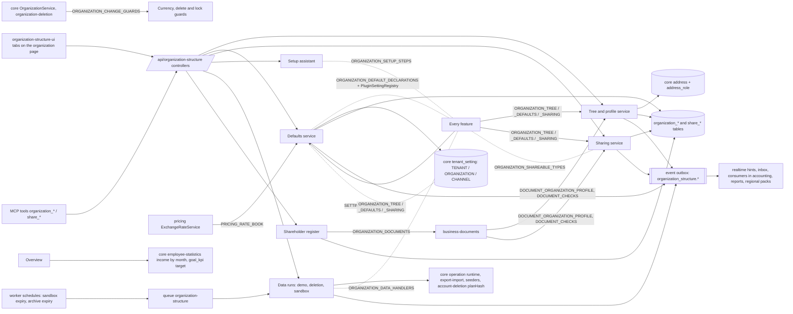

# Implementation Plan: Organization setup

> Translates an approved `spec.md` into architecture and tech choices. The plan owns
> implementation details; the spec owns behaviour.

**Feature ID**: `organization-setup`
**Spec**: `./spec.md`
**Tasks**: `./tasks.md`
**Status**: `Draft`
**Last updated**: 2026-11-23

---

## 1. Architecture Summary

A new plugin `@gauzy/plugin-organization-structure` (`packages/plugins/organization-structure`, with `organization-structure-ui`). The core `organization` record stays the single store of what it holds (country included, on its contact); the plugin adds a 1:1 profile, the tree, group defaults, shares, relationships, the assistant, data runs (demo, transaction deletion, sandbox) and the shareholder register. Other features reach it only through ports bound in `apps/api/src/plugin-composition.ts` and contribute to it through four multi-ports (defaults, shareable types, setup steps, data handlers). It builds on what the platform has: organization addresses are core address-book rows (`address` with owner `ORGANIZATION`, `address_role`); organization and tenant default values are rows of the core settings store `tenant_setting`, whose **organization level this feature adds to core once** for every plugin; data runs are core operations; deletion confirms the dry run's plan with the `planHash` contract of `account-deletion`; demo data comes from the existing `createRandom*` seeders; sandbox copies go through `export-import`; the overview reads the organization income statistics and keeps its target as a goal KPI. Core gains one optional guard slot so organization update and delete can be refused by the plugin.

## 2. Tech Choices

| Concern | Choice | Rationale |
| ------- | ------ | --------- |
| Package | new plugin pair `organization-structure`, `-ui`; no React package (organization screens are the Gauzy web app) | Principle I; [platform architecture](../../architecture/business-suite.md) §2.1 |
| Core record | `organization` unchanged and still the store of name, official name, currency, tax id, registration date, time zone, formats, fiscal dates, logo, brand colour, invoice defaults and the contact (main address and **country**, read by `organization-location.ts`); `organization_profile` 1:1 keyed by `organizationId` for what it lacks | spec FR-4; core stays small |
| Addresses | core address book: `address` rows with `ownerType = ORGANIZATION`, `ownerId` = the organization, roles in `address_role` (`REGISTERED`, `BILLING`, `SHIPPING`, `RETURN`, `REMIT_TO`, `PAYOUT`, plus an additive `OTHER` value of `AddressRoleEnum`); one default per owner and role through `AddressRoleService.setDefault` / `defaultFor` and the nightly `address-default-reconcile`; the organization's contact address is the fallback when no `REGISTERED` or `BILLING` default exists | one address book |
| Core guard | optional multi-token `ORGANIZATION_CHANGE_GUARDS` consulted by `OrganizationService.update` and by `organization-deletion.ts` (soft and for good); unbound, or bound with the flag off for the tenant, = today's behaviour; the currency rule refuses only with ledger journals, and with confirmed documents only where the setting `organization.lockCurrencyOnceDocuments` (default off) is on, otherwise it answers a warning with the counts | spec FR-8, FR-19, FR-64, FR-69 |
| Tree | `parentOrganizationId` + materialised `path` (ids joined by `/`) + `depth`; subtree by `path LIKE` prefix | same idiom as `accounting-foundation`; no recursive SQL on three dialects |
| Defaults | declarations from the existing `PluginSettingRegistry` (contributions with scope `ORGANIZATION`) plus `ORGANIZATION_DEFAULT_DECLARATIONS` for typed defaults (record pickers, validators, fixed-once-used) and for values that already have a home: organization fields (`timeZone`, `startWeekOn`, `dateFormat`, `numberFormat`, `fiscalStartDate`, `currencyPosition`, `daysUntilDue`, `defaultInvoiceEstimateTerms`, `convertAcceptedEstimates`, `discountAfterTax`, `separateInvoiceItemTaxAndDiscount`, `invoiceRemindersEnabled`) and the organization-scoped settings tables `organization_task_setting`, `goal_general_setting`, `inbox_organization_setting`, read and written through their owners, never copied; organization and tenant values are `tenant_setting` rows (scopes `ORGANIZATION` and `TENANT`); only the group layer (a group's value for its descendants and the enforce switch) is the plugin's `organization_group_default`; 30 s cache per instance, evicted by the change event | platform settings store; no second settings model |
| Organization level of the settings store | core `TenantSettingService.resolve(names, { tenantId, organizationId?, channelId? })`: `CHANNEL` → `ORGANIZATION` → (inherited layer) → `TENANT` → global → environment → the declared default of `PluginSettingRegistry`, honouring each declaration's `scope`; `saveOrganizationSettings(organizationId, values)` writes `ORGANIZATION` rows under the existing unique `(organizationId, scope, name)`; `getResolvedSettings` keeps its signature and reads only `TENANT` rows at the tenant level; an optional core port `SETTING_INHERITANCE` (bound by this plugin) adds the enforced ancestor value above everything and the ancestor default between the organization and the tenant. Built once here; every plugin's organization-scoped setting (e.g. `purchasing.overReceiptTolerancePercent`, the document type policies) reads through it, with or without this plugin's flag | one resolution, one store |
| Sharing | grants expanded into `organization_share_member` rows (one per receiving organization), so a filter is one indexed sub-select; group shares re-expanded on tree change; the filter is additive: `organizationId = :org OR organizationId IS NULL OR id IN (shared with :org)`, so every record an organization reads today stays readable | spec FR-33 performance on one million rows; sharing never hides a record |
| Rates | pricing's `ExchangeRateService.findRateAt` gains an optional port `PRICING_RATE_BOOK` (ordered organizations to read) and a nullable `purpose` column on `exchange_rate`; resolution order beyond that stays `general-ledger`'s | one rate table |
| Data runs | core operations (types `ORG_DEMO_CREATE`, `ORG_DEMO_REMOVE`, `ORG_TXN_DELETE`, `ORG_PURGE`, `ORG_SANDBOX_COPY`, `ORG_SANDBOX_RESET`, `ORG_SANDBOX_EXPIRE`) registered with `OperationRegistry`, `aggregateType` `organization` and `aggregateId` the target organization so `UQ_operation_aggregate_live` keeps one live run per organization; one step per record type in handler order, the cursor in the step state, slices of 1,000; lease, stalled-run recovery, retry and cancel from the runtime; pause parks the operation between slices (the runtime's parked state) and resume releases it; `@AcceptedOperation` answers `202`; a thin `organization_data_run` row keyed by `operationId` keeps only the dry-run report, `planHash`, confirmation and archive link; archives as ZIP of CSV through the core export writer (`export-import`, `spreadsheet-safe-row.ts`) into tenant file storage | one runtime for long work |
| Deletion confirmation and order | the `account-deletion` contract: the dry run returns its plan and `planHash` (`planHashOf`), the confirm sends it back and is refused with `409` when the plan changed, so exactly what was shown is deleted; the core record types' data handlers and their order are derived from `FactoryResetService`'s repository list (dependency-ordered), filtered to the organization, not written anew | one deletion order for core tables |
| Demo data | the existing seeders: core demo handlers call the `createRandom*` functions of core `*.seed.ts` for one organization (they take a tenant-to-organizations map and a count) under `SeedDataService`; plugins contribute through `IOnPluginWithOrganizationRandomSeed.onPluginOrganizationRandomSeed(organization, size, seed)`, an organization-scoped variant added beside `IOnPluginWithRandomSeed` in `packages/plugin/src/lib/plugin.hook.ts`; a seeding-context subscriber records each created id in `organization_demo_record` | no second demo contract |
| Sandbox copy | the export / import pipeline: export the organization (`export.service.ts`, `@ExportRedacted` for secrets), apply the handlers' anonymization rules to the rows, import into the new organization with old-to-new id mapping through `import_record` and `import-history`; data handlers add only anonymization rules | one copy path |
| Setup assistant core steps | the sections of the existing `organizations-step-form` (`packages/ui-core/shared/src/lib/organizations/organizations-step-form/`: name, official name, tax id, region, time zone, formats, week start, fiscal dates) are hosted as the assistant's profile, currency and formats steps, so one form writes those organization fields; "modules to switch on" writes core `feature_organization` rows through the feature service | one organization form |
| Overview | sales by month from the core statistics queries (`AggregatedEmployeeStatisticQuery`, `EmployeeStatisticsHistoryQuery`, `MonthAggregatedEmployeeStatisticsQuery`) extended with an optional sales source (confirmed invoices, or orders through `ORGANIZATION_DOCUMENTS`); the monthly target is a core `goal_kpi` per organization (`targetValue`, `currentValue`, `unit` = currency, `operator` `>=`); shown on the existing accounting dashboard | no second monthly aggregate |
| Register numbering and posting | share transactions are a document type of `business-documents` (`share_transaction`) with posting facts for `accounting` | [platform architecture](../../architecture/business-suite.md) §3.1, §3.4 |
| Schedules | `@ScheduledJob` in the worker (`OrganizationStructureSchedulePlugin`), `@QueueWorker` in the API, in-process timers without a queue root | task-automations layout |
| Permissions | plugin permission contributions with `defaultFor` in `organization-structure.permissions.ts`; no seeding migration | grants declared once, not seeded |
| Branding | the existing sidebar logo component `packages/ui-core/theme/src/lib/components/gauzy-logo/` becomes organization-aware (brand name, logo, favicon of the selected organization from the `Store`) only while `FEATURE_ORGANIZATION_STRUCTURE` is on and the organization's setting `organization.inAppBranding` (default off) is on; otherwise it renders exactly as today | one logo component; nothing changes until chosen |
| Feature gate | `FEATURE_ORGANIZATION_STRUCTURE` contribution (default off); `FeatureFlagGuard` + `@FeatureFlag` on every controller and resolver | [platform architecture](../../architecture/business-suite.md) §6 |

## 3. Data Model

### New or changed entities

All tables extend `TenantOrganizationBaseEntity` (soft delete, `isActive`, `isArchived`); rows that are tenant-wide carry `organizationId` null explicitly; JSON is `text`; ids of other plugins' rows carry no foreign key; editable rows carry `version int` for `If-Match`.

| Table | Columns (beyond the base) | Indexes and uniqueness |
| --- | --- | --- |
| `organization_profile` | `shortCode` varchar(10) null, `legalForm` varchar(64), `registrationNumber` varchar(64), `registrationAuthority` varchar(128), `commencedOn` date null, `industryKey` varchar(48) null, `brandName` varchar(120) null, `faviconImageId` uuid null, `isGroup` bool, `parentOrganizationId` uuid null, `path` varchar(1024), `depth` int, `ownershipPercent` numeric(9,4) null, `ownedFrom`, `ownedUntil` date null, `consolidationMethod` varchar(12) (`FULL`, `PROPORTIONAL`, `EQUITY`, `NONE`), `kind` varchar(8) (`LIVE`, `DEMO`, `SANDBOX`), `sourceOrganizationId` uuid null, `expiresAt` null, `lockedBy` varchar(24) null (`TRANSACTION_DELETION`, `SANDBOX_COPY`), `reportingCurrency` varchar(3) null, `setupProgress` int, `version` | unique `(organizationId)`; unique live `(tenantId, shortCode)`; idx `(tenantId, path)`, `(tenantId, parentOrganizationId)` |
| `organization_group_default` | rows only on group organizations: `key` varchar(96), `value` text null (the value for descendants; null = enforce the group's own value), `isEnforced` bool, `setByUserId`, `version` | unique live `(organizationId, key)` |
| `organization_share` | `recordType` varchar(64), `recordId` uuid, `mode` varchar(8) (`ALL`, `GROUP`, `LIST`), `groupOrganizationId` uuid null, `version` (owner = `organizationId`) | unique live `(tenantId, recordType, recordId)` |
| `organization_share_member` | `shareId` fk cascade, `recordType`, `recordId`, `memberOrganizationId` uuid, `origin` varchar(6) (`LIST`, `GROUP`, `ALL`) | unique `(shareId, memberOrganizationId)`; idx `(memberOrganizationId, recordType, recordId)` |
| `organization_share_default` | `recordType`, `mode` varchar(8) (`OWN`, `GROUP`, `ALL`) | unique `(organizationId, recordType)` |
| `organization_relationship` | `counterpartOrganizationId`, `customerContactId` uuid null, `vendorId` uuid null, `counterpartMode` varchar(8) (`DRAFT`, `CONFIRM`), `pricePolicy` varchar(12) (`SAME_PRICE`, `SENDER_COST`, `PRICE_LIST`), `priceListId` uuid null, `eliminate` bool | unique `(organizationId, counterpartOrganizationId)`; idx `(customerContactId)`, `(vendorId)` |
| `organization_setup_run` | `state` varchar(10) (`OPEN`, `APPLIED`, `ABANDONED`), `countryCode`, `industryKey`, `answers`, `proposal`, `steps` text, `actorKind` varchar(8), `startedByUserId` | idx `(organizationId, state)` |
| `organization_setup_template` | `key` varchar(64), `name` varchar(120), `industryKey`, `countryCode` null, `content` text, `sourceOrganizationId` null (tenant-wide) | unique live `(tenantId, key)` |
| `organization_data_run` | the dry-run and confirmation record beside the core operation: `kind` varchar(16), `targetOrganizationId`, `sourceOrganizationId` null, `options`, `report` text (dry run), `planHash` varchar(64), `operationId` uuid null (set at confirmation), `requestedByUserId`, `confirmedAt`, `actorKind`, `archiveFileId` uuid null, `archiveExpiresAt` null | unique `(operationId)`; idx `(targetOrganizationId, kind)` |
| `organization_demo_record` | `operationId`, `recordType`, `recordId` | unique `(recordType, recordId)`; idx `(organizationId, operationId)` |
| `share_class` | `code` varchar(16), `name`, `nominalValue` numeric(20,6), `currency` varchar(3), `votesPerShare` numeric(9,4), `authorisedCount` bigint null, `issuedCount` bigint | unique live `(organizationId, code)` |
| `shareholder` | `holderNumber` varchar(32), `holderKind` varchar(12) (`PERSON`, `COMPANY`, `ORGANIZATION`), `name` varchar(255), `contactId` uuid null (core `contact`), `organizationContactId` null, `holderOrganizationId` null, `taxId` varchar(64) null, `version` | unique live `(organizationId, holderNumber)` |
| `share_transaction` | `number` varchar(64) null, `kind` varchar(10) (`ISSUE`, `TRANSFER`, `BUY_BACK`), `state` varchar(10), `transactionDate` date, `shareClassId` fk, `fromShareholderId`, `toShareholderId` null, `count` bigint, `ranges` text (`[{ from, to }]`), `pricePerShare`, `amount` numeric(20,6), `currency`, `notes` text, `version` | unique live `(organizationId, number)`; idx `(organizationId, transactionDate)` |
| `share_holding_range` | `shareClassId`, `shareholderId` null (null = held by the organization), `fromNumber`, `toNumber` bigint, `acquiredByTransactionId`, `acquiredOn`, `releasedByTransactionId` null, `releasedOn` null | idx `(shareClassId, fromNumber)`, `(shareholderId, releasedOn)` |

Not tables of this plugin, by design: organization addresses (core `address` + `address_role`), the country (core `organization.contact`), organization and tenant default values (core `tenant_setting`), run state, steps, cursors and progress (core `operation` / `operation_step`), the monthly target (core `goal_kpi`) and monthly sales (core statistics queries). The plugin keeps `organization_data_run` only for what exists before its operation starts or outlives it (the dry-run report, `planHash`, the confirmation and the archive link), `organization_setup_run` only for the answers and proposal of an interactive assistant session, which is not long work, and `organization_demo_record` for the records a demo run created, which their removal reads.

Changed outside the plugin (additive): `exchange_rate` gains `purpose` varchar(4) null (`BUY`, `SELL`, null = both) through a migration of the pricing plugin; core `AddressRoleEnum` gains `OTHER`; core `TenantSettingService` gains `resolve` and `saveOrganizationSettings` and the optional `SETTING_INHERITANCE` token; `packages/plugin/src/lib/plugin.hook.ts` gains `IOnPluginWithOrganizationRandomSeed`; contracts gain `ORGANIZATION_CHANGE_GUARDS` (with `afterUpdate(before, after)`) and its interface.

### Migrations

**Migration timestamps**: `packages/plugins/organization-structure` `1791000071100` to `1791000071199`; `packages/plugins/pricing` `1791000071200` to `1791000071299`.

In `packages/plugins/organization-structure/src/lib/database/migrations/` (helpers from the inbox plugin), additive, idempotent, three dialects, both ORMs: `1791000071100-CreateOrganizationStructureTables` (profile, group defaults, shares, relationships), `1791000071110-CreateOrganizationSetupTables` (`organization_setup_run` with the assistant's answers and proposal, `organization_setup_template`, `organization_data_run` with the dry run, confirmation and archive link of a data run whose execution is a core operation, `organization_demo_record`), `1791000071120-CreateShareRegisterTables`; in `packages/plugins/pricing/src/lib/database/migrations/`: `1791000071200-AddExchangeRatePurpose`. Role grants come from the permission contributions' `defaultFor`. Backfill: a profile row per existing organization is created lazily on first read (root, `LIVE`, path = own id), so the migration writes no rows; existing organization addresses and settings rows stay where they are.

### Contracts

`packages/contracts/src/lib/organization-structure.model.ts`: profile, tree node, link ownership, default declaration and value with source, group default, share and sharing default, relationship, setup run, step contribution, industry template, data run (dry run, plan hash), data handler contribution, overview, share class, shareholder, share transaction, holding, register reports; enums `ConsolidationMethod`, `OrganizationKind`, `ShareMode`, `DataRunKind`, `ShareTransactionKind`; `tenant-setting.model.ts` gains `ISettingResolveOptions` and `ISettingInheritance`.

## 4. API Surface

### 4.1 Ports

Declared by this plugin (optional tokens in `organization-structure.types.ts`):

| Port | Answered by | Purpose |
| --- | --- | --- |
| `ORGANIZATION_DEFAULT_DECLARATIONS` (multi) | any feature | `{ key, area, labelKey, type, recordType?, required?, inheritable?, fixedOnceUsed?: () => Promise<boolean>, validate? }` |
| `ORGANIZATION_SHAREABLE_TYPES` (multi) | item catalogue, sales customers, procurement suppliers, pricing, tax, fixed assets, time off | `{ recordType, owner, labelKey, route, canEdit(user, id), usedOpen(organizationId, id) }` (open documents using it) |
| `ORGANIZATION_SETUP_STEPS` (multi) | business documents (series), regional packs, accounting, tax, warehouse, core features | `{ key, order, labelKey, status(orgId), propose(ctx), apply(orgId, proposal, { preview }), component }` |
| `ORGANIZATION_DATA_HANDLERS` (multi) | every plugin with organization data (core record types are derived from the factory-reset repository list) | `{ recordType, category: MASTER \| TRANSACTION \| SETTING, dependsOn, protected?(orgId), count, export(writer), delete(m, slice), afterDelete?, anonymize?: IAnonymizationRule[] }`; demo samples come from the plugin's organization seed hook, copies from export / import |
| `ORGANIZATION_DOCUMENTS` | `business-documents` | registration of `share_transaction`; confirmed document counts and sums per type and month (read live for the overview) |
| `ORGANIZATION_LEDGER_TYPES`, `ORGANIZATION_CURRENCY_PEGS` | `accounting` | posting type of share transactions; pegs of FR-42 |
| `ORGANIZATION_PRINT` | `print-templates` | share certificate rendering |

Answered by this plugin (other features bind their own tokens to these services): `OrganizationTreeService` (`ORGANIZATION_TREE`: `ancestors`, `descendants`, `members(groupId, asOf)` with ownership), `OrganizationDefaultsService` (`ORGANIZATION_DEFAULTS`: `get`, `getMany`, `explain`), `OrganizationSharingService` (`ORGANIZATION_SHARING`: `filter(recordType, organizationId)` → `{ sql, parameters }` sub-select for either ORM's query builder, `isShared`, `assertShared`, `organizationsOf`), `OrganizationDocumentProfile` (`DOCUMENT_ORGANIZATION_PROFILE` of `business-documents`: short code, internal party → organization, pair policy), `OrganizationDocumentCheck` (a `DOCUMENT_CHECKS` participant: shared party and items, organization lock), `RateBookService` (`PRICING_RATE_BOOK`), `OrganizationChangeGuard` (core `ORGANIZATION_CHANGE_GUARDS`; its `afterUpdate` publishes `organization_structure.country.changed` when `organization.contact.country` changed), `GroupDefaultInheritance` (core `SETTING_INHERITANCE`).

### 4.2 REST

All under `/api/organization-structure`, `@FeatureFlag(FEATURE_ORGANIZATION_STRUCTURE)`, cursor pagination, `If-Match` on edits, `Idempotency-Key` on creating routes; refusals `422` with codes (`ORG_TREE_CYCLE`, `ORG_PARENT_NOT_GROUP`, `ORG_GROUP_HAS_CHILDREN`, `ORG_CURRENCY_LOCKED`, `ORG_DEFAULT_ENFORCED`, `ORG_DEFAULT_FIXED`, `ORG_SHARE_IN_USE`, `ORG_LOCKED`, `ORG_DELETE_BLOCKED`, `SHARE_RANGE_NOT_HELD`, `SHARE_COUNT_MISMATCH`, `SHARE_AMOUNT_MISMATCH`, `SHARE_AUTHORISED_EXCEEDED`, `SHARE_MOVED_SINCE`).

| Method | Endpoint | Permission | Description | Status |
| ------ | -------- | ---------- | ----------- | ------ |
| `GET` `PUT` | `/organizations/:id/profile` | `ORGANIZATION_STRUCTURE_VIEW` / `_EDIT` | profile with core fields; short code, legal facts, branding; the country is read from and written to `organization.contact.country` | New |
| — | core `/api/addresses` and `/api/address-roles` with `ownerType = ORGANIZATION` | core address permissions | organization addresses, roles and defaults; the Structure tab uses these routes | Existing |
| `GET` | `/tree?asOf`, `/organizations/:id/ancestors`, `/descendants` | `ORGANIZATION_STRUCTURE_VIEW` | tree with counts and hidden count | New |
| `POST` | `/tree/move`, `/organizations/:id/group` | `ORGANIZATION_STRUCTURE_EDIT` | `{ organizationId, parentId, ownership, method, from, until, preview }` → inherited changes | New |
| `GET` `PUT` `DELETE` | `/organizations/:id/defaults`, `/defaults/tenant` | `ORGANIZATION_STRUCTURE_VIEW` / `ORGANIZATION_DEFAULTS_EDIT` (+ `ALL_ORG_EDIT` for tenant) | values with source; set (`tenant_setting` rows, or the owner's field or table for defaults that already have one), enforce and descendant values on groups (`organization_group_default`), clear; `If-Match` on the row's `updatedAt` | New |
| `GET` | `/organizations/:id/readiness` | `ORGANIZATION_STRUCTURE_VIEW` | missing required defaults and step statuses | New |
| `GET` `PUT` | `/shares/:recordType/:recordId`, `/shares/bulk`, `/share-defaults` | `ORGANIZATION_SHARING_EDIT` (read: view) | share mode and members; bulk with per-record result; defaults | New |
| `GET` | `/shared-masters` | `ORGANIZATION_STRUCTURE_VIEW` | per type counts and defaults | New |
| `GET` `PUT` | `/organizations/:id/rate-book` | `ORGANIZATION_STRUCTURE_VIEW` / `ORGANIZATION_DEFAULTS_EDIT` | rate source, rates with purpose (writes through pricing) | New |
| `GET` `POST` `PUT` | `/setup/runs`, `/setup/runs/:id`, `/setup/runs/:id/propose`, `/apply`, `/setup/templates` | `ORGANIZATION_SETUP_RUN` | assistant runs, proposals with preview, apply steps, templates, copy from organization | New |
| `POST` `GET` | `/data-runs` (`kind`, `dryRun`), `/data-runs/:id` | permission of the kind | dry run (report and `planHash`); the run record with its operation | New |
| `POST` | `/data-runs/:id/confirm` (`{ planHash, typedName, otp? }`) | permission of the kind | `202` with the core operation handle; `409` when the plan changed since the dry run | New |
| `POST` | `/data-runs/:id/pause`, `/resume`; `GET` `/data-runs/:id/archive` | permission of the kind | park and release the operation; archive download (30 days); progress per record type, cancel and retry are the core `/api/operations/:id`, `/steps`, `/cancel`, `/retry` | New |
| `GET` `PUT` | `/relationships`, `/relationships/:id` | `ORGANIZATION_STRUCTURE_VIEW` / `_EDIT` | pair matrix, policies, mismatches; create internal parties | New |
| `GET` | `/organizations/:id/overview` | `ORGANIZATION_STRUCTURE_VIEW` | target (`goal_kpi`), achieved and 12 months (core statistics), counts (`ORGANIZATION_DOCUMENTS`), group combined | New |
| CRUD | `/share-register/classes`, `/shareholders`, `/transactions` | `SHAREHOLDER_REGISTER_VIEW` / `_EDIT` | register masters and drafts | New |
| `POST` | `/share-register/transactions/:id/confirm`, `/cancel` | `SHARE_TRANSACTIONS_CONFIRM` | through the document engine | New |
| `GET` | `/share-register/reports/movements`, `/reports/holdings`, `/holdings/:id/certificate` | `SHAREHOLDER_REGISTER_VIEW` | share movements, holdings, certificate PDF | New |

Data-run permissions: `DEMO_*` → `ORGANIZATION_DEMO_DATA_MANAGE`; `TXN_DELETE` → `ORGANIZATION_TRANSACTIONS_DELETE`; `ORG_PURGE` (delete for good: `SETTING` handlers first, then core delete for good) → `ORGANIZATION_TRANSACTIONS_DELETE` and `ALL_ORG_EDIT`; `SANDBOX_*` → `ORGANIZATION_SANDBOX_MANAGE`. GraphQL (behind `FEATURE_GRAPHQL`): read fields `organizationTree`, `organizationDefaults`, `shareHoldings`.

## 5. Events, Real-Time and Notifications

| Event | Emitted when | Consumers |
| ----- | ------------ | --------- |
| `organization_structure.tree.changed` `{ organizationId, parentBefore, parentAfter, ownership }` | move, group flag, ownership | share re-expansion, defaults cache, accounting shared charts, financial reports groups, realtime |
| `organization_structure.profile.changed`, `.country.changed` `{ organizationId, before, after }` | profile edit; country set | regional packs (pack proposal), assistant, realtime |
| `organization_structure.default.changed` `{ key, organizationId?, scope, enforced }` | default set or cleared | readers' caches, realtime, activity log |
| `organization_structure.share.changed` `{ recordType, recordId, added, removed }` | share edit or re-expansion | owners' search indexes, realtime |
| `organization_structure.relationship.changed` | pair created, policy changed, deactivated | `business-documents` counterpart consumer, invoicing |
| `organization_structure.setup.step_applied` `{ runId, step, actorKind }` | assistant step applied | readiness, inbox to the requester |
| core `operation.completed` and step events of the `ORG_*` types | data runs progress, end or fail | the plugin's consumer: realtime banner, lock release, inbox to requester and administrators |
| `organization_structure.sandbox.expiring` / `.expired` | three days before, at expiry | inbox to sandbox members |
| `share_register.holding.changed` `{ shareClassId, holders }` | confirmed or cancelled share transaction | tree ownership proposal, realtime |
| `document.share_transaction.confirmed` / `.cancelled` | through the document engine | accounting posting (`SHARE_CAPITAL`, `SHARE_PREMIUM`, `CONSIDERATION`, `TREASURY_SHARES`) |

Consumers of this plugin: `subscriber:organization-structure-shares` (tree changes → re-expand group shares in slices), `subscriber:organization-structure-overview` (`document.*.confirmed|cancelled` of sales types → realtime hint to open overviews and the `goal_kpi` current value), `subscriber:organization-structure-runs` (core operation events of the `ORG_*` types). Real-time hints `organization_structure` (tree, defaults, overview) and the core operation channel for runs. Inbox items through `INBOX_ITEM_WRITER`. Every tree, profile, default, share, relationship, setup and register change writes an `activity_log` row.

## 6. UI Surface

- Angular `organization-structure-ui` extends the existing organization edit page (`apps/gauzy/src/app/pages/organizations/edit-organization/`) with tabs registered through `PageTabRegistryService`: "Structure" (profile, the organization's address-book entries and their roles, branding, ownership), "Defaults" (by area, source badges, enforce switch on groups), "Setup" (assistant shell hosting the existing `organizations-step-form` sections and contributed step components, e.g. the regional and accounting steps) and "Data" (demo data, deletion with dry run and typed confirmation, archive, sandboxes); Settings → Danger zone (`danger-zone.component.ts`, tenant factory reset and account deletion) links to the organization's Data tab and the Data tab names the Danger zone for tenant-wide removal. New pages only where no page shows the concept: `/pages/organizations/tree` (tree with list alternative, drag and keyboard moves with preview), `/pages/settings/shared-masters`, `/pages/organizations/relationships`, `/pages/share-register` (classes, holders, transactions, reports, certificates). The overview (target, achieved, 12 months, document counts, group combined) extends the accounting dashboard `apps/gauzy/src/app/pages/dashboard/accounting/`. The sidebar logo component `gauzy-logo` and the favicon follow the selected organization from the `Store` where its in-app branding is on (else unchanged); the organization switcher marks demo and sandbox organizations and, with the flag off, is unchanged. Strings under `ORGANIZATION_STRUCTURE.*` in every locale.

## 7. MCP Tools, SDKs and Integrations

`packages/mcp-server/src/lib/tools/organization-structure.ts`, registered in `register-all-tools.ts`:

| Tool | Input | Output |
| --- | --- | --- |
| `organization_tree_get`, `organization_tree_move` | as-of; move with `preview` | tree; inherited changes or result |
| `organization_defaults_get`, `_explain`, `_set` | organization, keys; value, scope, `preview` | values with source; result |
| `organization_share_set` | record type, id, mode, members, `preview` | share and affected organizations |
| `organization_setup_status`, `_next_question`, `_answer`, `_propose`, `_apply` | run, answer; steps, `preview` | status; question; proposal with preview; applied steps |
| `organization_demo_data_create`, `organization_transactions_dry_run` | size, seed; types | run; dry-run report (deletion itself is not a tool) |
| `share_register_get`, `share_transaction_draft`, `share_holdings_report`, `share_movements_report` | organization, class, date | register; draft; report rows |
| `organization_overview_get`, `organization_relationships_get`, `organization_sandbox_create` | organization; months, `preview` | overview; matrix; sandbox run |

SDK: additive OpenAPI; regenerate after merge. Import: share register from CSV through `data-exchange` profiles when present. Export: archives and register reports as CSV. No outbound integration; sandboxes switch integrations off (§9).

## 8. Background Jobs

| Trigger | When | What it does | Idempotency |
| ------- | ---- | ------------ | ----------- |
| core operations `ORG_*` | confirm, resume after a park, runtime recovery | one step per record type in handler order: export slice to the archive, delete through the handler (or seed, or export and import for copies), cursor in the step state; lease and stalled-run recovery from the runtime; the consumer clears `lockedBy` when the operation ends | step cursor; handler deletes are id-based; `UQ_operation_aggregate_live` |
| `organization-structure.shares.expand` (consumer) | tree change | re-expands group shares in slices of 1,000 | unique member rows |
| `organization-structure.archives.expire` | daily 01:30 | removes archive files past 30 days | file id |
| `organization-structure.sandbox.expire` | daily 02:00 | reminders three days before; queues `SANDBOX_EXPIRE` runs at expiry | one run per sandbox |

The worker loads `OrganizationStructureSchedulePlugin`; the API hosts queue workers, consumers and the operation type registrations; without a queue root the API runs timers under a per-tenant lock. Runs execute inside `RequestContext.runWithRequest` with the requester as actor (system actor of the organization for expiries).

## 9. Security & Permissions

Keys in `organization-structure.permissions.ts` (plugin permission contributions with `defaultFor`): `ORGANIZATION_STRUCTURE_VIEW`, `ORGANIZATION_STRUCTURE_EDIT`, `ORGANIZATION_DEFAULTS_EDIT`, `ORGANIZATION_SHARING_EDIT`, `ORGANIZATION_SETUP_RUN`, `ORGANIZATION_DEMO_DATA_MANAGE`, `ORGANIZATION_TRANSACTIONS_DELETE`, `ORGANIZATION_SANDBOX_MANAGE`, `SHAREHOLDER_REGISTER_VIEW`, `SHAREHOLDER_REGISTER_EDIT`, `SHARE_TRANSACTIONS_CONFIRM` (eleven). `defaultFor`: super admin all; admin all but `ORGANIZATION_TRANSACTIONS_DELETE`; manager and viewer `ORGANIZATION_STRUCTURE_VIEW`; existing tenants receive missing rows through the platform's permission reload. Existing `ALL_ORG_VIEW`/`ALL_ORG_EDIT` keep governing core organization CRUD. Deletion confirm checks the `planHash`, the typed name and, for users with two-factor sign-in, a fresh code through the existing two-factor service; agents cannot confirm data runs (actor kind checked). Archives are files of the tenant's storage readable by the requester and administrators, removed after 30 days. Sandboxes: personal fields replaced by generated values by the handlers' anonymization rules applied between export and import, emails rewritten to a non-deliverable domain, the `OrganizationDocumentCheck` and a guard on this plugin's routes refuse sending, and the copy disables the organization's integration settings, webhooks and payment connections. Text fields sanitised; shared-record filters always include the tenant.

## 10. Observability

- Activity log: tree, profile, defaults, shares, relationships, setup steps, data runs (with dry run), register changes; agent actions marked; data runs also in the core operations list with their steps.
- Metrics: default resolution latency and cache hits, share filter latency, data-run throughput and failures per handler, archive sizes, sandbox count and expiries; scheduler execution log and dead letters.

## 11. Phased Rollout

1. **Phase 1 — Profile, tree and defaults.** Contracts, the organization level of the core settings store, profile, organization addresses in the core address book, branding, tree with ownership, core guard (currency, deletes), defaults registry and resolution, readiness, overview on the accounting dashboard. Usable: groups and inherited defaults.
2. **Phase 2 — Shared masters and rates.** Sharing with expansion and the document check, shared-masters page, rate book and purpose, adoption by item catalogue, customers and suppliers through their ports.
3. **Phase 3 — Assistant, demo data, deletion, register.** Setup assistant with contributed steps and templates, copy setup, demo data runs, transaction deletion with dry run, archive and lock, deletion rules, shareholder register with reports and certificates.
4. **Phase 4 — Advanced capabilities.** Proposals from country and industry, conversational agent tools, consolidation-ready ownership from the register, internal parties and pair policies, sandbox copies with anonymization and expiry.
5. **Phase 5 — General availability**: the feature is off by default; after the trial period it may be switched on by default for new tenants only; existing tenants keep their setting until an administrator changes it.

## 12. Constitution Reconciliation

- I Plugin-first: new plugin pair; core gains one optional guard slot, the organization level of the settings store with an inheritance port, an `OTHER` address role and an organization seed hook; pricing gains a nullable column and a port.
- II Tenant/organization scoping: every table scoped; tenant-wide rows explicit; share filters always tenant-bound.
- III Both ORMs, additive migrations: MultiORM entities, MikroORM repositories, tri-dialect migrations, no drop.
- IV Default-off flag; nothing removed: `FEATURE_ORGANIZATION_STRUCTURE` off; organization fields and routes unchanged.
- V Contracts and API first: `organization-structure.model.ts` and ports before UI; OpenAPI additive.
- VI Permissions, privacy, security: eleven keys; typed confirmation and second factor; archives time-limited; sandboxes anonymised.
- VII Real-time through the event bus: outbox events and realtime hints.
- VIII i18n and accessibility: keys in every locale; tree with list alternative; keyboard moves.
- IX Tests: unit, SQLite database, ORM parity, handler contract kit, e2e for deletion and sandbox.
- X Behaviour-first spec: details live here.
- XI Documentation describes our platform only.

## 13. Risks & Mitigations

| Risk | Likelihood | Impact | Mitigation |
| ---- | ---------- | ------ | ---------- |
| A transaction type without a data handler is left behind or blocks a delete | High | Medium | core types derived from the factory-reset list; dry run lists organization-scoped tables without a handler as "not handled"; handler contract kit; deletion refused when a non-excluded table is unhandled |
| Organization-level resolution changes what existing settings return | Medium | High | `getResolvedSettings` keeps its behaviour; `resolve` is new and only reads `ORGANIZATION` and `CHANNEL` rows when asked; existing tenant-setting specs pass unchanged |
| Deleting the wrong organization's data | Low | High | dry run, typed name, second factor, archive before delete, super-admin-only default, one run per organization |
| Share filters slow large lists | Medium | Medium | expanded member rows with a covering index; measured budget in CI |
| Owners adopt sharing unevenly | High | Medium | shared-masters page shows which types honour sharing; document check enforces on documents regardless |
| Sandbox leaks to the outside | Low | High | anonymised copy, non-deliverable emails, integrations and webhooks disabled, document check refuses sends, tests per channel |
| Tree moves invalidate many defaults and shares | Medium | Medium | preview of inherited changes; re-expansion in slices; cache eviction by event |

## 14. References

- Spec: `./spec.md` · Tasks: `./tasks.md`
- Siblings: `../business-document-engine/plan.md` (`DOCUMENT_ORGANIZATION_PROFILE`, `DOCUMENT_CHECKS`, counterpart consumer), `../accounting-foundation/plan.md` (tree idiom, shared charts), `../general-ledger/plan.md` (pegs, rate resolution), `../financial-reports/plan.md` (consolidation groups), `../regional-compliance-packs/plan.md` (regional step), `../invoicing-receivables-payables/plan.md` (inter-company invoices)
- Code: `packages/core/src/lib/organization` (`organization.service.ts`, `organization-deletion.ts`, `organization-location.ts`), `packages/core/src/lib/address`, `packages/core/src/lib/address-role`, `packages/core/src/lib/tenant/tenant-setting`, `packages/core/src/lib/plugin-contributions/plugin-contribution.registry.ts`, `packages/core/src/lib/operation`, `packages/core/src/lib/account-deletion/account-deletion.service.ts`, `packages/core/src/lib/user/factory-reset/factory-reset.service.ts`, `packages/core/src/lib/export-import`, `packages/core/src/lib/core/seeds/seed-data.service.ts`, `packages/plugin/src/lib/plugin.hook.ts`, `packages/core/src/lib/employee-statistics`, `packages/core/src/lib/goal-kpi`, `packages/core/src/lib/feature`, `packages/ui-core/shared/src/lib/organizations/organizations-step-form`, `packages/ui-core/theme/src/lib/components/gauzy-logo`, `packages/plugins/pricing/src/lib/exchange-rate/exchange-rate.service.ts`, `packages/plugins/inbox/src/lib/database/migration-helpers.ts`, `apps/api/src/plugin-composition.ts`
