# Implementation Plan: Payment gateways

> Translates an approved `spec.md` into architecture and tech choices. The plan owns
> implementation details; the spec owns behaviour.

**Feature ID**: `payment-gateways`
**Spec**: `./spec.md`
**Tasks**: `./tasks.md`
**Status**: `Draft`
**Last updated**: 2026-11-23

---

## 1. Architecture Summary

The provider framework of `packages/plugins/payment` stays the one model of online money (provider registration,
collection, session, capture, refund, callback log, account at a provider, saved instrument). This feature adds a new
module `packages/plugins/payment/src/lib/gateways/**`, loaded only with `GAUZY_PAYMENT_GATEWAYS_ENABLED`, that drives
that model through **provider adapters**: an adapter registry, a session driver that calls the adapter where today the
API only records what a client reports, a checkout service for any payable source, callback processing, disputes,
payouts and settlements, routing and insights. The existing signed invoice connector becomes the `signed-checkout`
adapter; a `payment-provider-sandbox` plugin ships with it; named provider adapters are separate plugins
`packages/plugins/payment-provider-<key>`. Money is recorded and allocated by `payments-and-collections`, which reacts
to this module's outbox events; screens live in the Angular payment UI plugin that `payments-and-collections`
introduces. Seller payouts stay the goods marketplace's records (`packages/plugins/marketplace/src/lib/seller-payout/`,
`seller-payout-line/`, `seller-settlement/`): this module executes them at the provider and writes the outcome back,
without a second payout record or a second approval. Each adapter is also a connector of `integration-hub`'s one
catalogue and health view.

```mermaid
flowchart LR
    SRC[pay page, invoice page, order checkout, subscribe link, portal, forms, register] -- PAYMENT_CHECKOUT --> CO[CheckoutService]
    SUB[subscription order path, instalments, requests] -- PAYMENT_CHARGES --> CH[OffSessionChargeService]
    CO --> ROUTE[RoutingService: rules, fees, health]
    CH --> ROUTE
    ROUTE --> COL[(payment_collection + payment_session)]
    COL -- PAYMENT_SESSION_DRIVER --> REG[[adapter registry]] --> AD[adapters: signed-checkout, sandbox, payment-provider-*]
    AD -- INTEGRATION_HTTP --> PROV[(provider)]
    PROV --> CB[POST /api/public/payment-gateways/callbacks/:providerId] --> LOG[(payment_webhook_event)] --> Q[(queue)] --> APPLY[Outcome applier: sessions, captures, refunds, disputes, instruments, payouts]
    APPLY --> OB[[event outbox payment_gateways.*]]
    OB --> PAC[payments-and-collections: record + allocate]
    OB --> GL[accounting posting rules]
    OB --> SB[subscription-billing, orders, POS, automations, webhooks]
    SCHED[worker schedules: status query, expiry, settlements, insights] --> APPLY
```



## 2. Tech Choices

| Concern | Choice | Rationale |
| ------- | ------ | --------- |
| Package | `packages/plugins/payment/src/lib/gateways/**` (existing plugin); adapters `payment-provider-sandbox`, `payment-provider-<key>`; screens in the Angular `payment-ui` | Principle I; no second payment model |
| Adapter contract | `IPaymentProviderAdapter` in contracts; `registerPaymentAdapters()` code registry, token `PAYMENT_ADAPTER_REGISTRY`; each adapter plugin also declares a connector manifest contribution (category `PAYMENTS`, sign-in kind, capabilities) so `integration-hub` lists it in its catalogue and health view | same shape as the email provider registry; one connector catalogue |
| Routing conditions | rows of core `rule` with a new owner type `PAYMENT_ROUTING_RULE`, evaluated by `rule.evaluator.ts`, as account availability already uses `PAYMENT_PROVIDER` | no condition column, no second rule engine |
| Payouts | organization settlements in `payment_payout` and `payment_payout_line`; a party payout whose source keeps its own payout record (seller payouts of the `marketplace` plugin) is executed from that record and reported back to it through `PAYOUT_SOURCES`, with the source's approval | one payout record and one approval per payout |
| Session driving | optional `PAYMENT_SESSION_DRIVER` port consulted by `PaymentSessionService` (`create`, `authorize`, `refresh`) and `PaymentCaptureService`, `RefundService`; unbound or a provider without adapter → record-only as today | build on the existing services |
| Credentials | existing rule: secrets in the provider's `integration_setting` rows; `configuration` keeps non-secret fields (capture mode, statement descriptor, event map) | Principle VI and today's design |
| Callbacks | one public route per provider registration, `PaymentWebhookEventService.intake` first (store, dedupe), then adapter verify and parse, queue `payment-gateway-callbacks` ordered per session by provider event time | today's ordering rule kept |
| Amounts | `DecimalString` and the money kernel; minor units by currency precision per adapter | spec FR-17, FR-81 |
| Outbound calls | `INTEGRATION_HTTP` of `integration-hub` (logged, endpoint policy); fallback core webhook endpoint policy and a local log | one request log |
| Embedded form | `ngx-payment-element` (Angular, `packages/ui-core/shared`) hosts the adapter's client script from the provider's origin only, in the app, the portal and Gauzy's public pages; CSP extended per enabled adapter; sites built with Ever Works send the payer to the hosted page or redirect the checkout endpoint answers | card data never touches the platform |
| Evidence | `GATEWAY_EVIDENCE_SOURCES` (multi) from print, fulfillment, time logs, core terms acceptance, communications | no copy of records |
| Background work | `@ScheduledJob` in the worker (`PaymentGatewaysSchedulePlugin`), `@QueueWorker` in the API; in-process timers without a queue root | house split |
| Feature gate | `FEATURE_PAYMENT_GATEWAY` (existing code) declared as a feature contribution of the gateway module (`dependsOn` `FEATURE_PAYMENT`, default off); `FeatureFlagGuard` + `@FeatureFlag` on new controllers; callback route guarded by nothing but the signature | existing rule of `payment.features.ts` |

## 3. Data Model

New tables extend `TenantOrganizationBaseEntity`; MultiORM decorators and MikroORM repositories; amounts
`numeric(20,6)` with `char(3)` currency; JSON as `text`; no foreign keys into other plugins.

### 3.1 Changed tables (additive, nullable)

| Table | Added columns | Indexes |
| --- | --- | --- |
| `payment_provider` | `adapterKey` varchar(64) (null = `code`), `channels` text, `cashAccountId` uuid, `defaultFor` text (channel × currency), `checkoutDescription` varchar(255), `feeTable` text, `credentialsCheckedAt`, `credentialsMode` varchar(4) (`TEST`, `LIVE`), `credentialsError` varchar(500), `routingPausedUntil`, `healthState` varchar(12) | idx `(organizationId, isEnabled, adapterKey)` |
| `payment_collection` | `sourceType` varchar(32) (`INVOICE`, `PAY_LINK`, `PAYMENT_REQUEST`, `ORDER`, `CART`, `SUBSCRIPTION_CYCLE`, `INSTALMENT`, `FORM`, `REGISTER_SALE`), `sourceId` uuid, `partyType` varchar(16), `partyId` uuid, `channel` varchar(16), `description` varchar(255), `items` text, `expiresAt`, `isTestMode` bool | idx `(sourceType, sourceId)`, `(partyType, partyId)` |
| `payment_session` | `checkoutKind` varchar(16) (`HOSTED`, `EMBEDDED`, `REDIRECT`, `WALLET`, `BANK_REDIRECT`, `PHONE_PROMPT`, `TERMINAL`, `OFF_SESSION`), `resultTokenHash` varchar(64), `returnUrl`, `cancelUrl` varchar(1024), `routingRuleId`, `failoverOfSessionId`, `terminalId`, `promptGroupId` uuid, `promptSecretHash` varchar(64), `declineCode` varchar(64), `declineClass` varchar(16) (`RETRYABLE`, `PAYER_ACTION`, `FINAL`, `PROVIDER_FAULT`), `expectedFee` numeric(20,6), `feeCurrency`, `networkTokenUsed` bool, `consentRef` varchar(120), `lastProviderEventAt`, `lastStatusQueryAt` | unique `resultTokenHash`; idx `(status, lastStatusQueryAt)`, `(promptGroupId)` |
| `payment_webhook_event` | `providerEventAt`, `appliedOutcome` varchar(32), `sessionId` uuid | idx `(sessionId, providerEventAt)` |
| `payment_method_token` | `mandateState` varchar(12) (`PENDING`, `ACTIVE`, `FAILED`, `CANCELLED`), `mandateReference` varchar(255), `earliestChargeOn`, `hasNetworkToken` bool, `consent` text, `expiryNoticeAt`, `lastUpdaterNoticeAt` | idx `(status, expiryYear, expiryMonth)` |

### 3.2 New tables (`payment` plugin, gateway module)

| Table | Columns | Indexes and uniqueness |
| --- | --- | --- |
| `payment_terminal` | `providerId`, `externalId` varchar(255), `label` varchar(120), `registerId` uuid null, `locationLabel`, `state` varchar(8) (`ONLINE`, `OFFLINE`, `BUSY`), `lastSeenAt`, `pairedByUserId` | unique `(providerId, externalId)` |
| `payment_dispute` | `providerId`, `externalId`, `captureId`, `sessionId`, `collectionId`, `sourceType`, `sourceId`, `stage` varchar(16) (`INQUIRY`, `CHARGEBACK`, `PRE_ARBITRATION`), `reasonCode` varchar(64), `reasonGroup` varchar(24), `amount`, `currency`, `feeAmount`, `evidenceDueAt`, `state` varchar(16) (`NEEDS_RESPONSE`, `UNDER_REVIEW`, `WON`, `LOST`, `ACCEPTED`, `WITHDRAWN`), `submittedAt`, `submittedByUserId`, `outcomeAt`, `holdApplied` bool | unique `(providerId, externalId)`; idx `(organizationId, state, evidenceDueAt)` |
| `payment_dispute_evidence` | `disputeId` FK cascade, `kind` varchar(16) (`INVOICE`, `ORDER`, `DELIVERY`, `TIME_RECORD`, `TERMS`, `COMMUNICATION`, `REFUND_POLICY`, `FILE`, `TEXT`), `sourceType`, `sourceId`, `fileId`, `text` text, `position` int, `included` bool, `addedBy` varchar(10) (`ASSEMBLER`, `PERSON`, `ASSISTANT`) | idx `(disputeId, position)` |
| `payment_payout` | `providerId`, `externalId` null, `direction` varchar(16) (`TO_ORGANIZATION`, `TO_PARTY`), `partyType`, `partyId`, `instrumentId`, `amount`, `currency`, `state` varchar(18) (`REQUESTED`, `AWAITING_APPROVAL`, `PENDING`, `IN_TRANSIT`, `PAID`, `FAILED`, `CANCELLED`), `arrivalOn`, `sourceType`, `sourceId`, `requestedByUserId`, `approvedByUserId`, `expectedFees`, `actualFees`, `feeDifference`, `bankTransactionId`, `idempotencyKey` varchar(120) | unique `(providerId, externalId)`; unique `(tenantId, idempotencyKey)`; idx `(organizationId, state, arrivalOn)`; no row for a seller payout (its record is `seller_payout`) |
| `payment_payout_line` | `payoutId` FK cascade, `kind` varchar(12) (`CAPTURE`, `REFUND`, `FEE`, `DISPUTE`, `DISPUTE_FEE`, `ADJUSTMENT`, `RESERVE`), `amount`, `currency`, `captureId`, `refundId`, `disputeId` uuid null, `externalRef` varchar(255), `matched` bool | idx `(payoutId)`, `(captureId)`; the settlement-line contract (`ISettlementLine`) other provider or channel settlements reuse |
| `payment_routing_rule` | `name`, `position` int, `channel` varchar(16) null, `providerIds` text (ordered), `costAware` bool, `failover` bool; conditions are `rule` rows (owner type `PAYMENT_ROUTING_RULE`) | idx `(organizationId, isActive, position)` |
| `payment_provider_health` | `providerId`, `hour` varchar(13), `attempts`, `succeeded`, `declined`, `providerFaults`, `p95Ms` int | unique `(providerId, hour)`; routing's own hourly counters (they drive pauses and must exist without `integration-hub`); the daily health score of an account goes to the hub's health snapshots through `INTEGRATION_HEALTH` |
| `payment_decline_insight` | `providerId`, `groupKey` varchar(255), `windowStart`, `count`, `rate`, `baselineRate` numeric(7,6), `probableCause` text, `state` varchar(12) (`OPEN`, `ACKNOWLEDGED`, `CLEARED`), `notifiedAt` | idx `(organizationId, state, windowStart)` |
| `payment_instrument_change` | `instrumentId`, `kind` varchar(16) (`UPDATER_EXPIRY`, `UPDATER_NUMBER`, `UPDATER_CLOSED`, `NETWORK_TOKEN`, `MANDATE_STATE`, `REPLACED`), `before`, `after` text (masked), `source` varchar(12) | idx `(instrumentId, createdAt)` |
| `payment_provider_recurring` | `subscriptionId`, `providerId`, `externalPlanRef`, `externalSubscriptionRef` varchar(255), `state` varchar(12) | unique `(providerId, externalSubscriptionRef)` |

### 3.3 Migrations

**Migration timestamps**: `packages/plugins/payment` `1791000040100` to `1791000040199`.

Listed in `packages/plugins/payment/src/lib/migrations/index.ts` only with `GAUZY_PAYMENT_GATEWAYS_ENABLED`; three
dialects; idempotent; forward-only; both ORMs:

1. `1791000040100-AlterPaymentFrameworkForGateways` — columns of §3.1; no backfill (null = today's behaviour).
2. `1791000040110-CreateGatewayTerminalAndDisputeTables`.
3. `1791000040120-CreateGatewayPayoutTables`.
4. `1791000040130-CreateGatewayRoutingInsightAndRecurringTables` — routing, health, insight, instrument change, recurring.

The feature and the new permission keys are contributions (§2, §9), not seeded by a migration.

### 3.4 Contracts

`packages/contracts/src/lib/payment-gateway.model.ts` (exported from `index.ts`): enums above; `IPaymentProviderAdapter`,
`IGatewayOutcome`, `ICheckoutRequest`, `ICheckoutStart`, `IOffSessionChargeRequest`, `IPayoutRequest`, `IPayoutSource`
(`describe(sourceId)`, `recordOutcome(sourceId, outcome)`), `ISettlementLine` (kind, amount, currency, capture, refund,
dispute, outside reference, matched), `IDispute`, `IEvidencePack`, `IRoutingRule`, `IDeclineInsight`, event payloads;
ports. `RuleOwnerType.PAYMENT_ROUTING_RULE` is added in `rule.model.ts`.

```ts
interface IPaymentProviderAdapter {               // registerPaymentAdapters([...]) in an adapter plugin
    key: string; displayName: string; configSchema: IProviderConfigSchema;   // secrets marked writeOnly
    capabilities: { checkoutKinds: CheckoutKind[]; authorizeCapture: boolean; partialCapture: boolean;
        partialRefund: boolean; offSession: boolean; mandates: boolean; networkTokens: boolean; updater: boolean;
        disputes: boolean; evidence: boolean; payouts: boolean; settlements: boolean; statusQuery: boolean;
        providerRecurring: boolean; terminals: boolean; balance: boolean; signedCallbacks: boolean };
    currencies(ctx): Promise<{ code: string; minorUnits: number; min?: string; max?: string; perRequestMax?: string }[]>;
    verifyCredentials(ctx): Promise<{ ok: boolean; mode: 'TEST' | 'LIVE'; error?: string }>;
    createCheckout(ctx, req: ICheckoutRequest): Promise<ICheckoutStart>;  // redirect address, client payload, prompt, externalId
    capture?(ctx, s, amount): Promise<IGatewayOutcome>; void?(ctx, s): Promise<IGatewayOutcome>;
    chargeOffSession?(ctx, req: IOffSessionChargeRequest): Promise<IGatewayOutcome>;
    refund?(ctx, capture, amount, reason): Promise<IGatewayOutcome>;
    setupInstrument?(ctx, req): Promise<ICheckoutStart>; revokeInstrument?(ctx, token): Promise<void>;
    queryStatus?(ctx, s): Promise<IGatewayOutcome[]>;
    verifyCallback(ctx, req: IInboundRequest): Promise<{ eventId: string; type: string; occurredAt: Date }>;
    parseCallback(ctx, req: IInboundRequest): Promise<IGatewayOutcome[]>;  // normalised outcomes
    classifyDecline(code: string): DeclineClass;
    submitEvidence?(ctx, dispute, pack): Promise<void>; acceptDispute?(ctx, dispute): Promise<void>;
    createPayout?(ctx, req: IPayoutRequest): Promise<IGatewayOutcome>; listSettlements?(ctx, since): Promise<ISettlement[]>;
    balance?(ctx): Promise<IBalance>; startTerminalPayment?(ctx, terminal, req): Promise<ICheckoutStart>;
}
```

`ctx` carries the provider registration, its decrypted settings, `INTEGRATION_HTTP` and the call log correlation.
`IGatewayOutcome` carries, for a capture or refund, its stable `operationRef` (the provider's id, or the idempotency key
of the platform's own request echoed by the provider; §8), and, for a failed charge, `notCharged: true` only when the
provider's answer proves that no charge was made (a refusal before processing); a timeout or an unclear answer never
sets it.

## 4. API Surface

New controllers: `TenantPermissionGuard`, `PermissionGuard`, `@FeatureFlag(FEATURE_PAYMENT_GATEWAY)`, DTOs, Swagger,
cursor pagination, `Idempotency-Key` on checkout, charge, refund and payout routes, `preview=true` where noted; the
existing `RejectCardDataPipe` on every body.

| Method | Endpoint | Permission | Description | Status |
| ------ | -------- | ---------- | ----------- | ------ |
| `GET` | `/api/payment-gateways/adapters` | `PAYMENT_PROVIDERS_VIEW` | loaded adapters, capabilities, currencies, config schemas | New |
| `*` | `/api/payment-providers/**` | existing keys | registration routes accept the additive fields | Changed (additive) |
| `PUT` `POST` `GET` | `/api/payment-providers/:id/credentials`, `/:id/verify-credentials`, `/:id/balance` | `PAYMENT_PROVIDERS_EDIT`; balance: view | write settings, verify, balance | New |
| `POST` | `/api/payment-gateways/checkouts/methods`, `/api/payment-gateways/checkouts` | `PAYMENT_SESSIONS_AUTHORIZE` (in-process callers use the port) | methods for a source; start | New |
| `GET` `POST` | `/api/public/payment-gateways/checkouts/:token`, `/:token/start` | public token, throttled | result page data; payer chooses a method | New |
| `POST` | `/api/public/payment-gateways/callbacks/:providerId` | provider signature; for an adapter declaring `signedCallbacks: false`, the prompt's single-use secret instead (never feature-gated) | provider callbacks; an unsigned callback names its prompt and carries the secret, compared in constant time with `promptSecretHash` and consumed on first use, and its outcome is confirmed through `queryStatus` before it is applied when the adapter declares `statusQuery`; a missing, wrong or used secret answers `401` and is stored as rejected | New |
| `POST` | `/api/payment-gateways/sessions/:id/query-status` | `PAYMENT_SESSIONS_VIEW` | ask the provider now | New |
| `POST` | `/api/payment-gateways/charges` | `PAYMENT_METHOD_TOKENS_CHARGE` | off-session charge `{ instrument, amount, source, consentRef }` | New |
| `POST` `GET` | `/api/payment-gateways/instruments/setup`, `/api/public/payment-gateways/setup/:token` | `PAYMENT_METHOD_TOKENS_EDIT`; public token | set-up session for cards and mandates | New |
| CRUD + `POST` | `/api/payment-gateways/terminals`, `/:id/payments`, `/:id/payments/:sessionId/cancel` | `PAYMENT_TERMINALS_MANAGE`; payments: `PAYMENT_SESSIONS_AUTHORIZE` | terminals | New |
| `*` | `/api/refunds/**`, `/api/payment-captures`, `/api/payment-webhook-events/**` | existing keys | now executed through adapters | Changed (behaviour behind the flag) |
| `GET` `POST` `PUT` | `/api/payment-gateways/disputes`, `/:id`, `/:id/evidence-pack/assemble`, `/:id/evidence-pack`, `/:id/{submit,accept}` | `PAYMENT_DISPUTES_VIEW`; `PAYMENT_DISPUTES_MANAGE` (`preview` on submit) | disputes and packs | New |
| `GET` `POST` | `/api/payment-gateways/payouts`, `/:id/{approve,cancel}`, `/api/payment-providers/:id/settlements/import` | `PAYMENT_PAYOUTS_VIEW`; `_REQUEST`; `_APPROVE` | organization settlements and party payouts without their own record, settlement import; seller payouts stay on the marketplace's routes | New |
| CRUD + `POST` | `/api/payment-gateways/routing-rules`, `/simulate` | `PAYMENT_ROUTING_MANAGE` | rules; which account a sample payment would use and why | New |
| `GET` `POST` | `/api/payment-gateways/insights`, `/:id/acknowledge` | `PAYMENT_INSIGHTS_VIEW` | decline insights | New |
| `*` | `/api/public/invoice-payments/**`, `/api/invoice-payments/connection/**` | unchanged | the signed connector routes | Unchanged |

GraphQL reads `paymentAdapters`, `paymentDisputes`, `paymentPayouts`, `paymentRoutingRules`, `paymentDeclineInsights`
beside the plugin's existing resolvers.

**Ports offered** (bound in `apps/api/src/plugin-composition.ts`): `PAYMENT_CHECKOUT` (`methods(req)`, `start(req)`,
`status(sessionId)`) for `payments-and-collections` (its public pay page for `shared_entity` pay links and payment
requests), the invoice public page, the existing order checkout path, `subscription-billing` (subscribe link and cycles, including plugin
plans the `registry` plugin sells as `subscription` plans), `customer-and-supplier-portal`, hosted forms of
`lead-capture-and-enrichment`, `point-of-sale-and-loyalty` (terminals); `PAYMENT_CHARGES` (`chargeOffSession`, `refund`)
for `subscription-billing` and instalments; `PAYMENT_PAYOUTS` (`request`, `status`, `recordSettlement`) for party
payouts a feature asks for (commission statements of `sales-order-management` registered with `PAYOUT_SOURCES`, net pay
and reimbursements paid through a provider by the payables adapter of the `payment` plugin), for
`commerce-connectors`, whose `recordSettlement({ sourceType: 'COMMERCE_CONNECTION', sourceId, providerId, externalId,
arrivalOn, amount, currency, lines })` records a settlement an outside sales channel reports as a `TO_ORGANIZATION`
`payment_payout` with its `payment_payout_line` rows (idempotent on `(providerId, externalId)`, matched and published
like a provider settlement), and for the `marketplace` plugin, whose `request({ sourceType: 'SELLER_PAYOUT', sourceId })` creates
no `payment_payout` row: the adapter is called with the seller payout's id as idempotency key and the provider
reference, transfer id, failure code and paid state are written back to `seller_payout` through the marketplace's
`PAYOUT_SOURCES` binding, after the marketplace's own approval (`approvedAt`, `approvedByUserId`);
`SETTLEMENT_LINE_SOURCES` (read port over `payment_payout_line` for `banking-and-reconciliation`, which other settlement
sources join with the same `ISettlementLine` shape); `PAYMENT_SESSION_DRIVER` (consumed by the plugin's own session,
capture and refund services); `registerPaymentAdapters`; `ACCESS_PROCESSORS` entries per adapter; a
`RECORD_TIMELINE_SOURCES` entry (attempts, refunds, disputes on the source record).

**Ports consumed** (optional): `PAYMENT_BANK_ACCOUNTS` (declared by `payments-and-collections`, bound to
`banking-and-reconciliation`: the organization's bank accounts; absent → no clearing account choice),
`INTEGRATION_HTTP` and `INTEGRATION_HEALTH` (`integration-hub`), `PAYOUT_SOURCES` (multi; `marketplace` binds seller
payouts), `MESSAGE_SENDER` (`email-and-communications`; fallback core email),
`GATEWAY_EVIDENCE_SOURCES` (multi), `GATEWAY_ASSISTANT`
(`ai-agents-and-assistants`, else `AiProviderRegistry`), `NOTIFICATION_DISPATCHER`, `APPROVAL_REQUESTS` (payouts above
the limit when workflows are on).

## 5. Events, Real-Time and Notifications

Appended with `EventOutboxService.append` in the writing transaction, partition `payment_collection:<id>`; the existing
in-process events (`PaymentAuthorizedEvent`, `PaymentCapturedEvent`, `PaymentRefundedEvent`, …) keep being raised.

| Event | Emitted when | Consumers |
| ----- | ------------ | --------- |
| `payment_gateways.checkout.completed` | a checkout ends paid, failed or expired | source owner, real-time result page |
| `payment_gateways.session.authorized` / `.failed` / `.voided` | provider outcome | orders (capture on shipment), POS, automations |
| `payment_gateways.capture.succeeded` | capture recorded (amount, fee, provider reference, source, items, party, clearing account) | `payments-and-collections` records and allocates once by provider reference; accounting (clearing, fee) |
| `payment_gateways.refund.succeeded` / `.failed` | refund outcome | `payments-and-collections` (money out), accounting |
| `payment_gateways.dispute.opened` / `.updated` / `.closed` | dispute changes | inbox notices, orders (hold), `payments-and-collections` and accounting on loss |
| `payment_gateways.instrument.saved` / `.expiring` / `.replaced` / `.revoked`, `payment_gateways.mandate.changed` | instrument facts | `subscription-billing` (retry on replaced), portal, notices |
| `payment_gateways.payout.paid` / `.failed`, `payment_gateways.settlement.reported` | payouts (with `sourceType` and `sourceId`) | `banking-and-reconciliation` (match), accounting (fees), the requesting feature (`sourceType`); the marketplace records provider reports for its sellers in `seller_settlement` (`providerReportId`, `discrepancyAmount`) |
| `payment_gateways.insight.raised` | decline spike | inbox notice to payment administrators, agents |

Without `payments-and-collections`, a capture whose source is an invoice is recorded by today's `InvoicePaymentService`
path (one core payment per provider reference). Real-time record types `payment_session` (result page, register),
`payment_dispute`, `payment_payout`. Notices: expiring instruments and confirmation links to payers through
`MESSAGE_SENDER`; dispute deadlines, callback failures, payouts awaiting approval and insights to administrators.

## 6. UI Surface

- **Angular `payment-ui`** (introduced by `payments-and-collections`; this feature creates it when that plugin is absent): Settings
  → Payments → **Providers** (adapter picker, form from schema, credentials, verify, channels, defaults, clearing account,
  fees), **Routing** (rules, simulation), **Terminals**; Accounting → **Online payments** (sessions with attempt chain,
  captures, callbacks with reprocess), **Disputes** (deadline list, evidence pack builder with drag order and preview),
  **Payouts** (settlements with lines and fee differences, party payouts with approval), **Insights**.
- **Public** (`public-layout-ui`): result pages `/pay/result/:token`, set-up page `/pay/setup/:token`; the Angular public
  invoice page gains the Pay button; embedded `ngx-payment-element` in `packages/ui-core/shared`, also used by the
  portal's saved-instruments block (Angular, mounted on `portal-sections`).
- Provider screens exist once, in `payment-ui`. The signed connector's existing routes stay unchanged for the
  clients that configure it today. Seller payouts keep their marketplace screens, which show the provider outcome.
- i18n keys `PAYMENT_GATEWAYS.*` in every locale; result pages in the payer's language; keyboard operable forms.

## 7. MCP Tools, SDKs and Integrations

New tools in `packages/mcp-server/src/lib/tools/payment-gateways.ts`; the 14 tools of `payments.ts` stay:

| Tool | Input | Output |
| --- | --- | --- |
| `payment_adapters_list` / `payment_providers_list` | — / filter | adapters / accounts with state |
| `payment_checkout_link_create` | source, amount, currency, methods | checkout address |
| `payment_sessions_list` / `payment_session_get` | filter / id | sessions with attempts and outcomes |
| `payment_capture` / `payment_refund_create` | session or capture, amount, reason, `preview` (default true) | effects or result |
| `payment_disputes_list` / `payment_dispute_pack_assemble` / `payment_dispute_submit` | filter / id / id, `preview` | disputes / pack / submission |
| `payment_payouts_list` / `payment_payout_request` | filter / party, amount, `preview` | payouts / request |
| `payment_decline_insights` | period | insights with groups and causes |

An agent never approves a refund or payout it requested (checked by the services). OpenAPI additive; Kiota SDKs
regenerated. Report definitions of spec FR-82 on datasets `payment_sessions`, `payment_refunds`, `payment_disputes`,
`payment_payouts`, `payment_instruments`. Webhook catalogue gains the `payment_gateways.*` events.

## 8. Background Jobs

| Trigger | When | What it does | Idempotency |
| ------- | ---- | ------------ | ----------- |
| queue `payment-gateway-callbacks` | callback stored | verify, parse, apply outcomes in provider-event order per session; money movements are applied by their own identity: a capture or refund callback finds or creates the `payment_capture` or refund row by its `operationRef` (looked up under the session row lock) and hands it to collections once, whatever `lastProviderEventAt` says. `operationRef` is the provider's capture or refund id, or, for a capture or refund the platform requested, the request's idempotency key that the provider echoes; it is the same in callbacks and status queries. A movement reported with neither is applied only when the session can hold just one (an automatic full capture: `<sessionId>:auto-capture`); otherwise it is stored as an unmatched outcome, the session gets a status query, and collections receive nothing until the status query or a person on the callbacks page matches it. The event id is never a money identity | `(providerId, eventId)` unique; one row per `operationRef`; `lastProviderEventAt` guards only the session state |
| queue `payment-gateway-charges` | off-session charge asked | routing, adapter call, failover once only on a provider fault that proves the charge was not made (the adapter's outcome `notCharged: true`, or a `queryStatus` answer that the provider holds no such charge); a timeout or an unclear answer leaves the session `PENDING` with a status query (the `status-query` job), and without `statusQuery` it waits for the callback or a person, never for another account | idempotency key; failover key linked |
| `payment-gateways.status-query` | every 5 minutes | sessions pending over 15 minutes (then hourly to 24 h) → `queryStatus` | outcome guard |
| `payment-gateways.authorization-expiry` | hourly | void uncaptured authorisations near the window end | session status compare-and-set |
| `payment-gateways.checkout-expiry` | hourly | expire unpaid checkouts, release reservations | status compare-and-set |
| `payment-gateways.instrument-expiry` | daily | 30-day notices once, expire at month end | `expiryNoticeAt` |
| `payment-gateways.settlements` | daily per account and on callbacks | import payouts and lines, match, fee check | `(providerId, externalId)` |
| `payment-gateways.health` | every minute | provider faults window → routing pause; hourly health rows | upsert per hour |
| `payment-gateways.insights` | hourly | decline groups against the 7-day rate | one open insight per group |
| `payment-gateways.dispute-deadlines` | daily | alerts 3 days before the deadline | once per dispute and day |

The worker loads `PaymentGatewaysSchedulePlugin`; queue consumers run in the API (they need the adapters). Without a
queue root, sweeps and queues run in-process under a lock.

## 9. Security & Permissions

- Existing keys reused: `PAYMENT_PROVIDERS_*`, `PAYMENT_SESSIONS_*`, `REFUNDS_*`, `PAYMENT_CALLBACKS_*`,
  `PAYMENT_ACCOUNT_HOLDERS_*`, `PAYMENT_METHOD_TOKENS_*`, `PAYMENT_GATEWAY_VIEW`. New keys in `payment.permissions.ts`:
  `PAYMENT_TERMINALS_MANAGE`, `PAYMENT_DISPUTES_VIEW`, `PAYMENT_DISPUTES_MANAGE`, `PAYMENT_PAYOUTS_VIEW`,
  `PAYMENT_PAYOUTS_REQUEST`, `PAYMENT_PAYOUTS_APPROVE`, `PAYMENT_ROUTING_MANAGE`, `PAYMENT_INSIGHTS_VIEW`, declared as
  permission contributions beside the existing ones with `defaultFor`: super admin all; admin all except
  `PAYMENT_PAYOUTS_APPROVE`; manager disputes view and insights view.
- Two-person rules in services: refund approver and payout approver differ from the requester; agents never approve. A
  seller payout is approved once, by the marketplace's approval, and is not asked again here.
- No card or full bank data: `RejectCardDataPipe` on every body and callback; embedded forms load provider scripts only
  from origins the adapter declares; logs reuse the card-data field list for redaction.
- Credentials only in `integration_setting`; `configuration` writes naming a credential are refused (existing rule).
- Public tokens (result, set-up) 128-bit random, hashed, single checkout scope, expiring; phone prompt secrets hashed and
  compared in constant time; callback route throttled per provider.
- Evidence packs contain personal data and are sent only when a person submits them; listed in spec §4.

## 10. Observability

Activity-log entries for provider accounts, credentials checks, routing rules, terminals, captures, refunds, dispute
submissions and payouts. Metrics: checkout conversion per method, provider latency and faults, callback lag, status
queries settling sessions, declines by class, failovers, refunds pending, disputes by state, payout fee differences.

## 11. Phased Rollout

1. **Phase 1 — Contracts, entities, migrations** (flags off).
2. **Phase 2 — Surface what exists and the contract**: adapter registry and session driver, signed connector as an
   adapter, sandbox adapter, provider screens over the existing registry with credentials and verification, sessions,
   captures, refunds and callbacks screens, feature contributed and guarded, result pages, the Angular invoice Pay button, MCP
   tools. Demo: pay an invoice through the sandbox hosted page and refund part of it.
3. **Phase 3 — Depth**: checkout for every source, embedded form, redirect, wallet and bank redirect kinds, phone prompts
   with split, terminals, authorise and capture windows, off-session charges, instruments and mandates, provider-managed
   recurring, disputes, payouts and settlements, status queries, reports; first named adapters as separate plugins.
4. **Phase 4 — Advanced capabilities**: routing with cost-aware choice and failover, network tokens and updater notices,
   evidence packs, decline insights.
5. **Phase 5 — General availability**: the feature is off by default; after the trial period it may be switched on by default for new tenants only; existing tenants keep their setting until an administrator changes it.

## 12. Constitution Reconciliation

- I Plugin-first: a module of the existing `payment` plugin; adapters as separate plugins; UI in the payment UI plugins.
- II Tenant/organization scoping: tenant-organization base everywhere; public routes resolve one checkout by token.
- III Both ORMs, additive migrations: nullable columns on five tables and new tables, three dialects.
- IV Default-off flag; nothing removed: deploy switch, `FEATURE_PAYMENT_GATEWAY`, adapter switches; record-only
  behaviour, the signed connector routes and the callback intake stay.
- V Contracts and API first: adapter, checkout, charge and payout contracts in Phase 1; REST and GraphQL before screens.
- VI Permissions, privacy, security: eight new keys, two-person rules, card-data refusal, credentials in settings.
- VII Real-time through the event bus: outbox events; result pages and terminals updated over the real-time channel.
- VIII i18n and accessibility: keys in every locale, payer-language pages, keyboard operable forms.
- IX Tests: sandbox scenario suite per capability, callback ordering and duplicate specs, both ORMs, e2e checkout.
- X Behaviour-first spec: implementation lives here only.
- XI Documentation describes our platform only.

## 13. Risks & Mitigations

| Risk | Likelihood | Impact | Mitigation |
| ---- | ---------- | ------ | ---------- |
| Payment recorded twice | Medium | High | one capture per provider reference, `payments-and-collections` once-only rule, outcome guard by event time |
| Failover charges twice | Low | High | only provider faults that prove no charge was made, never final or payer declines, timeouts or unclear answers; linked idempotency keys, status query before failover |
| Card data reaches the platform | Low | High | refusal pipe, provider-hosted fields only, CSP per adapter, redaction tests |
| Callbacks lost or late | Medium | Medium | stored first, status queries for 24 h, alerts on silence |
| Adapter maintenance burden | High | Medium | adapters as separate plugins with the sandbox contract suite; only enabled ones loaded |
| Dependent plugins absent (`payments-and-collections`, `banking`) | High | Medium | invoice fallback through today's path; clearing account optional |

## 14. References

- Spec: `./spec.md` · Tasks: `./tasks.md` · Siblings: `../payments-and-collections/plan.md`,
  `../subscription-billing/plan.md`, `../banking-and-reconciliation/plan.md`, `../point-of-sale-and-loyalty/plan.md`,
  `../integration-hub/plan.md`, `../email-and-communications/plan.md`
- Code: `packages/plugins/payment/src/lib/{payment-provider,payment-collection,payment-session,payment-capture,refund,
  payment-webhook-event,payment-account-holder,payment-method-token,invoice-payment,payment.features.ts,
  payment.permissions.ts,payment.card-data.pipe.ts}`, `packages/core/src/lib/{payment-method-token,payment-instrument,rule}`,
  `packages/plugins/marketplace/src/lib/{seller-payout,seller-payout-line,seller-settlement}`,
  `apps/api/src/plugin-composition.ts`, `packages/mcp-server/src/lib/tools/payments.ts`
