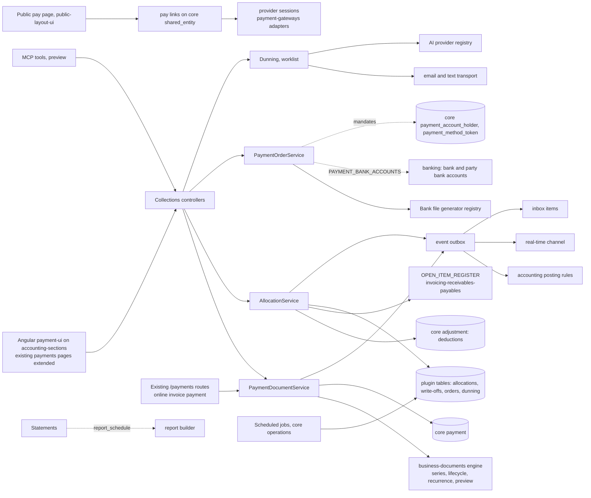

# Implementation Plan: Payments and collections

> Translates an approved `spec.md` into architecture and tech choices. The plan owns
> implementation details; the spec owns behaviour.

**Feature ID**: `payments-and-collections`
**Spec**: `./spec.md`
**Tasks**: `./tasks.md`
**Status**: `Draft`
**Last updated**: 2026-11-23

---

## 1. Architecture Summary

No second payment table: the core `payment` row stays the record of every money movement and gains a direction and a
lifecycle. All new behaviour lives in the existing plugin `@gauzy/plugin-payment` (`packages/plugins/payment`) as new
modules under `src/lib/collections/`, loaded only when `GAUZY_COLLECTIONS_ENABLED` is exactly `true` and guarded by
`FEATURE_COLLECTIONS`. A confirmed payment with a party opens one **credit open item** in the open-item register of
`invoicing-receivables-payables` (the platform's one store of what is owed); an **allocation** pairs a credit item
(payment, advance, credit note) with a charge item (instalment, debit note, dunning charge), so one payment across many
invoices, advances, credit-note offsetting and netting are the same operation. The register stays the only writer of
open items; `payment_allocation` is the platform's only settlement fact, which the register and `general-ledger` read.
Journals come from `accounting`, which consumes our events.

It builds on what exists: the provider framework of this plugin (`payment-collection`, `-session`, `-capture`,
`-webhook-event`, `refund`, `invoice-payment`), saved instruments and mandates on the core `payment_account_holder` and
`payment_method_token`, the bank-detail store of `banking-and-reconciliation` (read through `PAYMENT_BANK_ACCOUNTS`;
this plugin stores no account number), deductions as rows of the core `adjustment` ledger, withholding as records of
`tax-engine`, public pay links as core `shared_entity` links, statement schedules as report-builder schedules, the
core operation runtime for automatic allocation and dunning runs, and, when an organization chooses it, the core
invoice reminder sweep's steps as level 0 of its default dunning policy (otherwise the sweep keeps sending as today).

## 2. Tech Choices

| Concern | Choice | Rationale |
| ------- | ------ | --------- |
| Package | existing `packages/plugins/payment` (new `src/lib/collections/**`); new `payment-ui` | Principle I; payments already live here |
| Record | core `Payment` + 10 nullable columns; plugin table `payment_detail` keyed by `paymentId` | no parallel payment model |
| Open items and settlement | `OPEN_ITEM_REGISTER` port of `invoicing-receivables-payables` (`settle`, `release`, `open`, `writeOff`); `payment_allocation` is the one settlement fact the register's entries and the ledger's journals point to | one store of what is owed, one settlement model |
| Reasons | core `adjustment_reason` (`requiresApproval`, governed list) for deductions, write-offs, disputes | build on what exists |
| Deductions | core `adjustment` rows with the new owner types `PAYMENT` (bank charge, rounding, short payment, other on the payment) and `PAYMENT_ALLOCATION` (settlement discount, exchange write-down on one allocation), type `SETTLEMENT_DEDUCTION`, `reasonCode` from the governed reasons, the new nullable column `adjustment.dimensionSetId`; a deduction's tax part is a `tax_line` of the tax engine; tax withheld at payment is recorded only by `tax-engine` (`withholding_entry`) and read here | the single money-adjustment ledger; one withholding record |
| Payment methods | `payment_method` holds the organization's names, default account and reference rule (`requiresReference` false for the six seeded methods, so a payment without reference is accepted as today); each row has a `kind` from `PaymentMethodEnum` (gains `DIRECT_DEBIT`, `OTHER`), `payment.paymentMethod` is written from that kind so the enum column stays in step, providers keep `supportedPaymentMethods` as kinds and their availability stays `rule` rows of owner `PAYMENT_PROVIDER` | the three stay one answer |
| Online payments | existing `invoice-payment` (signed checkout), `payment-collection`, `payment-session`, `payment-capture`, `payment-webhook-event`, `refund` | provider framework stays; adapters by `payment-gateways` |
| Bank details and mandates | customer, supplier and employee bank details live encrypted in the one store of `banking-and-reconciliation` (`party_bank_account`: masked on screen, left out of tenant exports unless a permission allows it, every read logged), read through `PAYMENT_BANK_ACCOUNTS` with its verification state (`PaymentAccountVerificationStatus`, confirmed by a second person there); this is the platform's single exception to the rule that no bank account number is stored, and the comment of that rule on `payment_account_holder` and `seller` names it. Provider tokens stay in `payment_account_holder` and `payment_method_token`; a direct debit mandate is the holder's `mandateReference` and `mandateAcceptedAt` plus the new `mandateSequenceState` and `mandateLastUsedOn`, with a `DIRECT_DEBIT` method token naming the debtor's bank account | no second bank-detail or mandate table |
| Pay links | core `shared_entity` links (`packages/core/src/lib/shared-entity`) issued through the public-link service of `access-control-and-security`, which extends that table with `tokenHash`, `expiresAt`, `revokedAt`, `viewCount` and `lastViewedAt` (the `saved_report.shareTokenHash` pattern); scope `INVOICE` reuses the invoice's existing public link (`invoice.token`, public invoice page); the bank transfer reference is a check-digit code derived from the link's id | one public-link service for every scope |
| Statements | a statement schedule is a `report_schedule` of the statement report definition (`report-builder-and-dashboards`), one recipient per selected customer; each run is a `report_schedule_run`, each send a `report_delivery`; this plugin keeps the `statement` rows as the sent documents | one scheduling engine |
| Money out | payment orders cover payable items of suppliers and employees, net pay included (payroll's employee open items); marketplace seller payouts (`seller_payout`) stay apart because the payment provider executes them from the seller's balance under its licence and the platform holds no funds, so they need no bank file or organization approval | one approval and bank-file path for the organization's own money |
| Dunning | one engine when the organization chooses it: setting `collections.remindersThroughDunning` (default off). While off, the core invoice reminder sweep sends as today from `organization.invoiceRemindersEnabled` and dunning levels start at 1. When switched on, the default policy's level 0 is created as a copy of the core reminder schedule (3 days before due, then 1, 7 and 14 days after, the existing template); `invoiceRemindersEnabled` and the core rules are left untouched, and switching off returns the sending to the core sweep. Suspending or cancelling a customer's subscriptions is a level action that `subscription-billing` carries out; the subscription plugin keeps only its charge retries | no second reminder or suspension sweep; today's reminders unchanged until chosen |
| Bank files | `BANK_FILE_GENERATOR_REGISTRY` in this plugin; shipped generators `iso20022-credit-transfer` (pain.001), `iso20022-direct-debit` (pain.008), `delimited` | other plugins register national formats |
| Letters | print template engine (statement, dunning notice by level, receipt, voucher, remittance advice, cheque); existing receipt template kept | no private PDF code |
| Drafted reminders | AI provider registry of `ai-chat` with the organization's credentials; fixed templates as fallback | no new provider code |
| Long work | core operation runtime: automatic allocation (one child operation per party, aggregate `party:<type>:<id>`, so the runtime's one-live-operation rule is the party lock), dunning runs (one step per customer) and the allocation backfill are `operation` rows; domain rows keep `operationId` | resumable, pausable, cancellable |
| Periodic work | `@ScheduledJob` + `@QueueWorker`, every pass a `job_execution` row; in-process fallback without a queue root | house idiom |

Ports consumed (`@Optional()` where the owner may be off): `OPEN_ITEM_REGISTER`, `CREDIT_EXPOSURE_READER` (required);
`BUSINESS_DOCUMENT_ENGINE` (required); `TAX_CALCULATOR`, `TAX_WITHHOLDING` (`tax-engine`; absent → no withholding at
payment); `LEDGER_PERIOD_GUARD`, `LEDGER_EFFECTS_PREVIEW`; `PAYMENT_BANK_ACCOUNTS` (declared here, bound to
`banking-and-reconciliation`: its `PARTY_BANK_ACCOUNTS` (`PartyBankAccountService`) for party bank details with
verification and its `BankAccountService` for the organization's accounts; absent → free-text account label on the
payment and no payment orders); `SUBSCRIPTION_COLLECTION_ACTIONS`
(`subscription-billing`: suspend, resume and cancel; absent → the level action is skipped); `REPORT_SCHEDULES`
(report builder; absent → statements on request only); `APPROVAL_REQUESTS`; `MESSAGE_SENDER` (communications;
absent → platform email service). Ports provided: `OPEN_ITEM_ALLOCATOR` (used by `invoicing-receivables-payables` for
advances and "settled now", by `point-of-sale-and-loyalty`, `payroll-processing`, `expenses-and-travel`),
`BANK_FILE_GENERATOR_REGISTRY`, `DUNNING_COVERAGE` (core reminder sweep), and the ports `banking-and-reconciliation`
declares for payments: `BANKING_PAYMENT_GATEWAY`, `BANKING_PAYMENT_ORDERS` and a `BANKING_COUNTERPART_SOURCE` entry
(its open-item search reads the register directly), and `TAX_PAYMENT_GATEWAY` of `tax-engine` (paying a tax
remittance, with preview).

## 3. Data Model

### New or changed entities

**Core `payment` (additive, nullable; `packages/core/src/lib/payment/payment.entity.ts`)**

| Column | Type | Notes |
| ------ | ---- | ----- |
| `direction` | varchar(12) | `IN`, `OUT`, `TRANSFER`; null reads `IN` |
| `lifecycleState` | varchar(16) | `DRAFT`, `CONFIRMED`, `CANCELLED`; null = payment created before this feature (confirmed) |
| `documentNumber` | varchar(64) | series per direction; unique (`tenantId`, `organizationId`, `direction`, `documentNumber`) where not null |
| `partyType`, `partyId` | varchar(16), uuid | `CONTACT`, `VENDOR`, `EMPLOYEE`, registered types; `organizationContactId` and `employeeId` kept in step; index (`organizationId`, `partyType`, `partyId`) |
| `paymentMethodId` | uuid | `payment_method` row; the `paymentMethod` enum column kept in step |
| `cashAccountId` | uuid | the organization's cash or bank account (`bank_account` of `banking-and-reconciliation`, read through `PAYMENT_BANK_ACCOUNTS`); no FK |
| `unallocatedAmount` | numeric(20,6) | mirrors the payment's credit open item |
| `confirmedAt`, `cancelledAt` | timestamp | |

Existing columns reused: `reference` (reference number), `fxRate`, `settlementCurrency`, `settlementAmount`,
`externalId` and `paymentProviderId` (once-only online payments), `invoiceId` (kept; mirrored as one allocation).

**Other core tables (additive, nullable)**: `payment_account_holder` + `mandateSequenceState` varchar(10) (`FIRST`,
`RECURRING`, `FINAL`, `ONE_OFF`) and `mandateLastUsedOn` date; `adjustment` + `dimensionSetId` uuid.
`AdjustmentOwnerType` gains `PAYMENT` and `PAYMENT_ALLOCATION`, `AdjustmentType` gains `SETTLEMENT_DEDUCTION`. Pay
links use the `shared_entity` columns that `access-control-and-security` adds; this plan adds none there.

**Plugin tables** (tenant-organization base, MultiORM, amounts `numeric(20,6)`, JSON as text)

| Table | Columns | Indexes, uniqueness |
| ----- | ------- | ------------------- |
| `payment_detail` | `paymentId`; `kind` (`STANDARD`, `REFUND`, `NETTING`, `FINANCING_FUNDING`, `FINANCING_REPAYMENT`); `referenceDate`, `clearedAt`; `counterCashAccountId`, `counterAmount`, `counterCurrency`, `transferRate`; `organizationCurrency`, `exchangeRate`, `amountInOrganizationCurrency`; `allocatedAmount`, `deductionTotal` (mirror of its `adjustment` rows); `creditOpenItemId`; `isAdvance`, `advanceOrderType`, `advanceOrderId`; `recurrenceSourceId`, `paymentOrderId`, `paymentRequestId`, `chequeId`, `financingAgreementId`; `postingState`, `postingError`; `dimensionSetId`; `version` | unique `paymentId` (FK cascade); (`paymentOrderId`); (`advanceOrderId`) |
| `payment_method` | `name`, `code`, `kind` (`PaymentMethodEnum`: the six existing values, `DIRECT_DEBIT`, `OTHER`), `defaultCashAccountId`, `requiresReference`, `isActive`, `sortOrder` | unique (`organizationId`, `code`) |
| `payment_allocation` (the only settlement fact) | `groupId`; `paymentId`, `creditOpenItemId`, `chargeOpenItemId`; `partyType`, `partyId`; `amount` (charge currency), `creditAmount` (credit currency), `rate`, `exchangeDifference`; `discountTaken`, `discountTaxPart`; `allocatedOn`; `source` (`MANUAL`, `SUGGESTION`, `AUTO_RUN`, `ONLINE`, `ORDER`, `NETTING`, `EXISTING`), `ruleCode`, `operationId`; `state` (`ACTIVE`, `RELEASED`), `releasedAt`, `releasedById`, `releaseReason`, `releaseEffectiveOn` | (`chargeOpenItemId`, `state`); (`creditOpenItemId`, `state`); (`paymentId`, `state`); (`organizationId`, `partyType`, `partyId`, `allocatedOn`); (`operationId`) |
| `open_item_write_off`, `open_item_write_off_line` | header: `documentNumber`, `lifecycleState`, `direction`, `partyType`, `partyId`, `reasonId`, `currency`, `totalAmount`, `effectiveOn`, `source` (`MANUAL`, `BULK`, `TOLERANCE`), `approvalState`, `approvalRequestId`, `approvedById`; line: `writeOffId`, `openItemId`, `amount` | unique (`organizationId`, `documentNumber`); unique (`writeOffId`, `openItemId`) |
| `payment_request`, `payment_request_line` | header: `documentNumber`, `direction` (`INWARD`, `OUTWARD`), `partyType`, `partyId`, `amount`, `paidAmount`, `currency`, `state`, `allowPartial`, `minimumAmount`, `expiresAt`, `sharedEntityId` (its pay link), `paymentProviderId`, `language`, `channel`, `templateKey`, `isMuted`, `sentAt`, `viewedAt`, `orderType`, `orderId`, `subscriptionId`, `paymentOrderId`; line: `requestId`, `openItemId`, `subscriptionBillingId`, `amount` | (`organizationId`, `state`, `expiresAt`); (`partyType`, `partyId`); unique (`requestId`, `openItemId`) |
| `payment_order`, `payment_order_line`, `payment_order_file` | header: `documentNumber`, `direction` (`OUT`, `COLLECTION`), `cashAccountId`, `executionDate`, `currency`, `totalAmount`, `lineCount`, `state` (`DRAFT`, `AWAITING_APPROVAL`, `APPROVED`, `EXPORTED`, `EXECUTED`, `PARTLY_EXECUTED`, `REJECTED`, `CANCELLED`), `approvedById`, `approvedAt`, `approvalRequestId`, `generatorKey`, `executedAt`; line: `orderId`, `openItemId`, `paymentRequestId`, `partyType`, `partyId`, `partyBankAccountId` (banking's `party_bank_account`), `paymentAccountHolderId` (the mandate, for collection orders), `amount`, `discountTaken`, `endToEndReference`, `remittanceText`, `state` (`INCLUDED`, `HELD`, `EXECUTED`, `REJECTED`), `rejectionReason`, `paymentId`, `activeKey`; file: `orderId`, `generatorKey`, `fileId` (`@ExportRedacted`: the file holds account numbers), `fileName`, `sha256`, `sequence`, `isDuplicate`, `exportedById`, `exportedAt` | unique (`openItemId`, `activeKey`) (one active order per item); (`orderId`, `state`); (`organizationId`, `state`, `executionDate`) |
| `cheque_book`, `cheque` | book: `cashAccountId`, `firstNumber`, `lastNumber`, `nextNumber`, `printTemplateId`, `isActive`; cheque: `chequeBookId`, `number`, `paymentId`, `payeeName`, `amount`, `amountInWords`, `issuedOn`, `state` (`PRINTED`, `VOID`, `CLEARED`), `voidReason`, `printCount` | unique (`chequeBookId`, `number`); (`paymentId`) |
| `statement` (the sent document) | `scheduleRunId` (a `report_schedule_run`, null when produced on request), `partyType`, `partyId`, `periodStart`, `periodEnd`, `mode` (`ACTIVITY`, `OPEN_ITEMS`), `currency`, `openingBalance`, `closingBalance`, `language`, `fileId`, `sharedEntityId` (its pay link), `sentTo`, `sentAt`, `deliveryState` (`GENERATED`, `SENT`, `SKIPPED`, `FAILED`), `skipReason` | unique (`scheduleRunId`, `partyType`, `partyId`, `currency`) |
| `dunning_policy`, `dunning_level`, `dunning_policy_assignment` | policy: `name`, `code`, `isDefault`, `graceDays`, `autoIssueUpToLevel`, `interestBasis` (`DUE_DATE`, `LAST_NOTICE`), `chargeFees`, `chargeInterest`, `runFrequency`, `runDayRule`, `nextRunAt`, `isEnabled`; level: `policyId`, `level` (0 = reminders), `daysOverdue` (negative = before due), `repeatDays` (JSON day offsets; level 0 carries the core reminder steps 1, 7 and 14), `minimumAmount`, `feeType` (`NONE`, `FIXED`, `PERCENT`), `feeValue`, `feeCurrency`, `interestRatePerYear`, `channel`, `texts` (JSON per language; level 0 defaults to the existing reminder template), `actions` (JSON: `STOP_NEW_ORDERS`, `SUSPEND_SUBSCRIPTIONS`, `CANCEL_SUBSCRIPTIONS`); assignment: `policyId`, `contactGroupId`, `organizationContactId` | unique (`organizationId`, `code`); unique (`policyId`, `level`); (`organizationContactId`) |
| `dunning_notice`, `dunning_notice_line` | notice: `documentNumber`, `organizationContactId`, `policyId`, `level`, `issueDate`, `currency`, `overdueTotal`, `feeAmount`, `interestAmount`, `state` (`DRAFT`, `ISSUED`, `SETTLED`, `CANCELLED`, `SUPERSEDED`), `supersededById`, `operationId` (the dunning run), `language`, `channel`, `sharedEntityId` (its pay link), `fileId`, `sentAt`; line: `noticeId`, `openItemId`, `dueDate`, `daysOverdue`, `outstandingAmount`, `interestAmount`, `level` | unique (`operationId`, `organizationContactId`); (`organizationContactId`, `state`); (`openItemId`) |
| `collection_profile` (collection columns only) | `organizationContactId`, `collectorId`, `language`, `channel`, `contactId`, `dunningPolicyId`, `excludedFromDunning`, `pausedUntil`, `autoSendFirstLevel`, `averageDaysLate`, `averageDaysLateAt` | unique `organizationContactId`; (`collectorId`) |
| `payment_promise`, `payment_promise_item`, `payment_plan` | promise: `organizationContactId`, `amount`, `currency`, `promisedOn`, `promisedByName`, `state` (`PENDING`, `KEPT`, `BROKEN`, `CANCELLED`), `settledAmount`, `evaluatedAt`, `paymentPlanId`; item: `promiseId`, `openItemId`; plan: `organizationContactId`, `state` (`ACTIVE`, `COMPLETED`, `DEFAULTED`, `CANCELLED`), `totalAmount`, `agreedOn`, `note` | (`state`, `promisedOn`); (`openItemId`) |
| `receivable_dispute`, `receivable_dispute_item` | dispute: `organizationContactId`, `reasonId`, `amount`, `currency`, `ownerId`, `state` (`OPEN`, `UPHELD`, `CREDITED`, `WRITTEN_OFF`), `openedAt`, `resolvedAt`, `resolutionNote`, `creditNoteId`, `writeOffId`; item: `disputeId`, `openItemId` | (`organizationId`, `state`); unique (`disputeId`, `openItemId`) |
| `collection_reminder_draft` | `organizationContactId`, `level`, `language`, `channel`, `subject`, `body`, `facts` (JSON), `source` (`ASSISTANT`, `TEMPLATE`), `state` (`DRAFT`, `APPROVED`, `SENT`, `DISCARDED`), `approvedById`, `sentAt`, `sharedEntityId` | (`organizationContactId`, `state`) |
| `financing_agreement`, `financing_agreement_invoice` | agreement: `documentNumber`, `funderVendorId`, `advanceRatePercent`, `feeAmount`, `interestRatePerYear`, `termDays`, `startsOn`, `endsOn`, `withRecourse`, `currency`, `fundedAmount`, `repaidAmount`, `state` (`PROPOSED`, `APPROVED`, `FUNDED`, `SETTLED`, `CLOSED`, `CANCELLED`); invoice: `agreementId`, `invoiceId`, `financedAmount`, `collectedAmount`, `passedOnAmount`, `activeKey` | unique (`invoiceId`, `activeKey`) (one active agreement per invoice) |

Dunning fees and interest are `open_item` rows with source type `DUNNING_CHARGE` (registered with the register); a
payment's credit side is an `open_item` with source type `PAYMENT`. Account managers, payment terms, blocks and credit
limits of a customer stay on `organization_contact` and its `contact_group` (`sales-order-management`); the collection
profile holds only how the customer is chased, and notes about a customer are core `comment` rows on the contact. No
table here holds a bank account number, a mandate, a pay-link secret, a run or a schedule. Every table joins the
core tenant export.

### Migrations

**Migration timestamps**: `packages/plugins/payment` `1791000076100` to `1791000076199`; `packages/core` `1791000076900` to `1791000076999`.

- Core `packages/core/src/lib/database/migrations/1791000076900-AlterPaymentForPaymentDocuments.ts`: the payment
  columns and indexes, the `payment_account_holder` and `adjustment` columns above; no backfill (null = created before
  this feature).
- Plugin, in `packages/plugins/payment/src/lib/migrations/`, three files by area:
  `1791000076110-CreateCollectionsSettlementTables.ts`, `1791000076120-CreateCollectionsOrderTables.ts` (orders and
  requests), `1791000076130-CreateCollectionsWorklistTables.ts` (collections), listed in
  `packages/plugins/payment/src/lib/migrations/index.ts` only with the deployment switch on; idempotent, three dialects.
- Plugin `1791000076140-SeedCollectionsMasters.ts`: the six payment methods per organization, governed reasons (deductions,
  write-offs, disputes), document types and series (payment in, out and transfer, write-off, payment request, payment
  order, dunning notice, financing agreement); the payment types, over payments that exist today, register with
  `preexisting: true` (`business-document-engine` FR-113), so the engine's added lock and refusals stay off for
  payments unless the organization turns a type policy on. `FEATURE_COLLECTIONS` and the permissions are plugin contributions
  (`defaultFor` grants, §9), not seeds.
- Existing payments get their allocation rows by the resumable operation of §8 (a copy: `invoiceId` and every existing
  column stay as they are); an organization with invoice reminders on gets its default policy with level 0, copied from
  the reminder schedule, only when it switches `collections.remindersThroughDunning` on.

### Contracts

`packages/contracts/src/lib/collections.model.ts`: the enums above; `IPaymentDocument` (payment + detail + allocations +
deduction adjustments), `IPaymentAllocation`, `IAllocationSuggestion`, `IWriteOff`, `IPaymentRequest`, `IPayLinkView`
(a pay link as a shared entity), `IPaymentOrder`, `IBankFileGenerator`, `IPaymentBankAccountsPort`, `IStatement`,
`IDunningPolicy`, `IDunningNotice`, `ICollectionsWorklistEntry`, `IPaymentPromise`, `IReceivableDispute`,
`IFinancingAgreement`, event payloads of §5, port interfaces. `IPayment`, `IPaymentAccountHolder` and `IAdjustment`
gain the optional core fields; `PaymentMethodEnum` gains `DIRECT_DEBIT` and `OTHER`;
`AdjustmentOwnerType` gains `PAYMENT` and `PAYMENT_ALLOCATION`; `AdjustmentType` gains `SETTLEMENT_DEDUCTION`.

## 4. API Surface

Guards on every route: `TenantPermissionGuard`, `PermissionGuard`, `FeatureFlagGuard(FEATURE_COLLECTIONS)`; cursor
pagination; `Idempotency-Key` on creating and posting routes; `If-Match` on documents; `preview=true` where noted.

| Method | Endpoint | Permission | Description |
| ------ | -------- | ---------- | ----------- |
| `GET` `POST` `PUT` | `/api/payment-documents`, `/:id` | `ORG_PAYMENT_VIEW`; `ORG_PAYMENT_ADD_EDIT` (+ `PAYMENTS_OUT_EDIT` for money out) | drafts of money in, out, transfers with allocations and deductions → `IPaymentDocument` |
| `POST` | `/api/payment-documents/:id/confirm`, `/cancel` | `PAYMENTS_CONFIRM`, `PAYMENTS_CANCEL` | `preview`; `409` on stale open items; `422` with rule codes |
| `POST` | `/api/payment-documents/from/:sourceType/:sourceId` | `ORG_PAYMENT_ADD_EDIT` | pre-filled draft from invoice, bill, order, request, notice, statement, claim |
| `GET` | `/api/allocations/open-items` | `ORG_PAYMENT_VIEW` | a party's items for allocation with proposal (filters of spec FR-14) |
| `POST` | `/api/allocations`, `/api/allocations/release` | `PAYMENT_ALLOCATIONS_MANAGE`; `PAYMENT_ALLOCATIONS_RELEASE` | apply a set (payment, advance or credit → charges; differences); release; `preview` |
| `POST` | `/api/allocations/netting` | `PAYMENT_NETTING_CREATE` | net a party's receivables against payables |
| `GET` `POST` | `/api/allocations/suggestions/:paymentId`, `/accept` | `PAYMENT_ALLOCATIONS_MANAGE` | suggestions with reason and confidence |
| `POST` `GET` | `/api/allocation-runs`, `/:operationId` | `PAYMENT_ALLOCATIONS_MANAGE` | starts automatic allocation (`202` with the operation) and lists its per-party log; pause, resume and cancel are the core `/operations` routes |
| `GET` | `/api/allocations/integrity` | `ORG_PAYMENT_VIEW` | the conservation check of §10 |
| `POST` `GET` | `/api/write-offs`, `/:id/approve`, `/:id/cancel`; `GET` `/api/write-offs/small-balances` | `OPEN_ITEM_WRITE_OFFS_CREATE`; `OPEN_ITEM_WRITE_OFFS_APPROVE` | single, bulk (per-row results), `preview` |
| `POST` | `/api/payment-documents/:id/refund` | `REFUNDS_CREATE` | refund of a credit or overpayment; provider path through the existing `/refunds` |
| CRUD | `/api/payment-methods` | `ORG_PAYMENT_VIEW`; `PAYMENT_METHODS_EDIT` | methods master (kind kept in step with `PaymentMethodEnum`) |
| CRUD + `POST` | `/api/payment-requests`, `/:id/send`, `/:id/cancel` | `PAYMENT_REQUESTS_MANAGE` | requests |
| `POST` `DELETE` | `/api/pay-links`, `/:id` | `PAYMENT_REQUESTS_MANAGE` | issue or revoke a `shared_entity` pay link for a statement, notice or request; an invoice uses its existing public link |
| `GET` `POST` | `/api/public/pay/:token`, `/checkout`, `/notification` | public (token; rate limited) | page data, start checkout, provider notification (extends `invoice-payment`) |
| CRUD + `POST` | `/api/payment-orders`, `/proposal`, `/:id/request-approval`, `/:id/approve`, `/:id/export`, `/:id/execute`, `/:id/cancel` | `PAYMENT_ORDERS_MANAGE`; `PAYMENT_ORDERS_APPROVE`; `PAYMENT_ORDERS_EXPORT` | orders; export returns the file |
| `GET` | `/api/bank-file-generators` | `PAYMENT_ORDERS_MANAGE` | registered generators and their options |
| `PUT` | `/api/payment-account-holders/:id/mandate` | `PAYMENT_ORDERS_MANAGE` | mandate reference, signature date and sequence state on the existing account holder; bank details themselves are the `/party-bank-accounts` routes of `banking-and-reconciliation` |
| CRUD | `/api/cheque-books`; `POST` `/api/cheques/print`, `/:id/void` | `PAYMENT_ORDERS_MANAGE`; `CHEQUES_PRINT` | cheques |
| `POST` `GET` | `/api/statements`, `/:id/send` | `STATEMENTS_GENERATE` | statements on request; schedules are report-builder schedules of the statement definition |
| CRUD + `POST` | `/api/dunning-policies`; `/api/dunning-runs` (`preview`; `202` with the operation), `/:operationId`; `/api/dunning-notices`, `/:id/issue`, `/:id/cancel`, `/:id/waive-charges` | `DUNNING_MANAGE`; `DUNNING_ISSUE`; `DUNNING_CHARGES_WAIVE` | dunning |
| `GET` | `/api/payment-collections/worklist`, `/forecast`, `/profiles/:contactId` (`PUT`) | `COLLECTIONS_VIEW`; `COLLECTIONS_WORK` | worklist, forecast, profile |
| `POST` `PUT` | `/api/payment-collections/promises`, `/plans`, `/disputes`, `/disputes/:id/resolve` | `COLLECTIONS_WORK` | promises, plans, disputes |
| `POST` | `/api/payment-collections/reminders/draft`, `/:id/send`, `/:id/discard` | `COLLECTIONS_WORK` | drafted reminders |
| CRUD + `POST` | `/api/financing-agreements`, `/:id/approve`, `/:id/fund`, `/:id/repay`, `/:id/close` | `INVOICE_FINANCING_MANAGE` | financing |
| `GET` `PUT` | `/api/payment-collections/settings` | view; `COLLECTIONS_SETTINGS_EDIT` | organization policies |

Core `PaymentController` (`/payments`) keeps its routes and gains, declared before the inherited `:id` route and
answering `404` while the feature is off: `GET /payments/search`, `/statistics`, `/overdue`; `PUT /payments/:id/status`
and `/process` map to confirm and cancel; `/refund` to the refund above. `PaymentService.create` with an `invoiceId`
calls `OPEN_ITEM_ALLOCATOR` when the feature is on, so today's clients create a payment with one allocation. Today's
`POST`, `PUT` and `DELETE /payments` keep their permission (`ORG_PAYMENT_ADD_EDIT`), inputs and answers: the payment is
saved confirmed; the allocator never refuses on their behalf (an amount beyond the outstanding, or an invoice on hold,
leaves the rest unallocated); `PUT` releases and re-applies the payment's allocations and `DELETE` releases them; the
lock of spec FR-2 applies only when `collections.lockConfirmedPayments` is on (default off).

**Consumer tokens answered** (bound in `apps/api/src/plugin-composition.ts` to the payment, outgoing payment and dunning services; each consumer plan states the shape it calls and its fallback): `EXPENSE_PAYMENTS`.

## 5. Events, Real-Time and Notifications

Appended with `EventOutboxService.append` in the writing transaction; partition `party:<type>:<id>` (transfers:
`payment:<id>`).

| Event | Emitted when | Consumers |
| ----- | ------------ | --------- |
| `document.payment.confirmed`, `.cancelled` | payment lifecycle | `accounting` posting rules, `banking` (matching), real-time, webhooks |
| `payments.allocation.created`, `.released` | allocation set applied or released | `accounting` (exchange difference, discount, advance transfer), `receivables-payables`, dunning, worklist |
| `payments.write_off.confirmed`, `.cancelled` | write-off lifecycle | `accounting`, real-time |
| `collections.dunning_notice.issued`, `.cancelled`, `.settled`; `collections.dunning_charge.waived` | notice lifecycle | `accounting` (fee and interest), `sales-order-management` (order stop), inbox, timeline |
| `payments.financing.funded`, `.repaid`, `.closed` | financing steps | `accounting`, `receivables-payables` (financed flag) |
| `payments.payment_order.approved`, `.exported`, `.executed`; `payments.payment_request.sent`, `.paid`, `.expired` | order and request lifecycle | inbox items, real-time, `banking` |
| `collections.promise.recorded`, `.kept`, `.broken`; `collections.dispute.opened`, `.resolved` | collections facts | worklist, inbox for the collector, `receivables-payables` (disputed flag) |
| `collections.dunning_level.action` `{ customer, level, actions }` | a notice of a level with actions is issued | `sales-order-management` (stop new orders), `subscription-billing` (suspend or cancel subscriptions, through `SUBSCRIPTION_COLLECTION_ACTIONS`) |

**What a posting rule receives**

| Event | Amounts | Parties | Account hints | Dimensions |
| ----- | ------- | ------- | ------------- | ---------- |
| payment confirmed / cancelled | `amount`, `currency`, `exchangeRate`, amount in organization currency; transfers: both amounts and `transferRate`; `deductions[]` from its `adjustment` rows (`reasonCode`, `amount`, tax part); withheld tax from the tax engine's record; `unallocatedAmount` | `partyType`, `partyId` | `direction`, `kind`, `cashAccountId` and `counterCashAccountId`, method kind, `isAdvance` (separate advance account), `financingAgreementId`; `reversalOf` on cancel | `projectId`, `dimensionSetId`, per deduction too |
| allocation created / released | per pair: `amount` in charge and credit currency, `rate`, `exchangeDifference` (organization currency), `discountTaken`, `discountTaxPart`, `allocatedOn` | party; `invoiceId` and `direction` of the charge | credit source (`PAYMENT`, advance, credit note), `isAdvance` (advance → receivable or payable transfer), settlement discount class, netting flag | charge item's `projectId`, `dimensionSetId` |
| write-off | per line `amount` in both currencies, `openItemId`, `invoiceId` | party | `direction`, `reasonCode`, `source` | item's dimensions |
| dunning notice issued | `feeAmount`, `interestAmount` and the charge open item ids | customer | fee income and interest income hints; `level` | customer's default dimensions |
| financing funded / repaid | `fundedAmount`, `feeAmount`, interest, `repaidAmount` | funder vendor, customers of the invoices | financing liability, `withRecourse`, `cashAccountId` | — |

Consumed: `receivables_payables.open_item.changed` (request and notice state, promise evaluation, worklist),
`receivables_payables.hold.placed` / `.released`, `document.<invoice kinds>.cancelled` (release on cancel), provider
callbacks through the existing `payment-webhook-event` log, `banking.bank_transaction.matched` (cleared date, order
execution), banking's party bank account changes and verifications (hold or free order lines),
`accounting.journal.posted` / `.failed` (matched by `source`, setting `postingState`). Real time: record types
`payment`, `payment_allocation`,
`payment_order`, `dunning_notice`, `collections_worklist`. Notifications: inbox items for approvals (orders,
write-offs), broken promises, run results; receipts, requests, statements, notices and remittance advice by email or
text message through the communications transport with templates per language.

## 6. UI Surface

- **Angular** `packages/plugins/payment-ui` (lazy, hidden when the feature is off; routes on the page location
  `accounting-sections`, children of `/pages/accounting`): Payments (in, out, transfers; the existing
  `apps/gauzy/src/app/pages/payments` list is the page and gains the direction tabs and state badges), Record payment
  with allocation grid and suggestions, Reconciliation workspace (the one place to allocate and net open items, also
  linked from the register's Open items page), Unallocated, Write-offs, Payment requests, Payment orders (with the
  party's bank details read from banking, mandates, cheques), Statements (with the report builder's schedule dialog),
  Dunning (policies, runs, notices), Collections worklist with customer panel (promises, disputes, drafts, comments,
  timeline), Financing; Settings → Payments and collections. The invoice payments tab
  (`pages/invoices/invoice-payments`) reads server states. Public: the invoice page of `public-layout-ui` gains the Pay
  button while the feature is on for the invoice's tenant (with it off the page is unchanged); new public pay page
  `/pay/:token` in `public-layout-ui`.
- i18n keys `COLLECTIONS.*` in every locale; letter texts per language in policies and templates; the workspace is
  keyboard operable (arrow navigation in the grid, shortcuts for allocate in full and clear).

## 7. MCP Tools, SDKs and Integrations

`packages/mcp-server/src/lib/tools/collections.ts`; the 14 tools of `payments.ts` stay and six of them start to work.

| Tool | Input → output |
| ---- | -------------- |
| `payment_record`, `payment_cancel` | draft with allocations and deductions, `preview` → effects or the payment |
| `payment_allocate`, `payment_allocation_release`, `party_netting` | credit, charges, amounts, `preview` → resulting outstanding amounts and effects |
| `allocation_suggest`, `allocation_run_start`, `allocation_run_status` | payment or scope → suggestions with reasons; run state |
| `open_items_write_off`, `small_balances_list` | items, reason, `preview` → write-off or approval request |
| `payment_request_create`, `payment_request_send`, `pay_link_create` | items or scope → request, link |
| `payment_order_propose`, `payment_order_save`, `payment_order_approve`, `payment_order_export`, `payment_order_execute` | account, date, items, `preview` → order, file reference |
| `statement_generate`, `statement_schedule_save` | party, period → statement; selection and cadence → report-builder schedule |
| `dunning_policy_save`, `dunning_run`, `dunning_notice_issue`, `dunning_charges_waive` | policy, `preview` → proposed and issued notices |
| `collections_worklist_get`, `collections_reminder_draft`, `collections_reminder_send`, `promise_record`, `dispute_open`, `dispute_resolve`, `collections_forecast_get` | customer or filters → entries, draft, records |
| `financing_agreement_save`, `financing_fund`, `financing_repay` | agreement, amounts → agreement |

SDK: additive OpenAPI; regenerate after merge. Import and export: `data-import-export` templates `payments`,
`opening_advances` (party bank details import through banking's own template); bank status files read by the
generator that produced the order (optional `parseStatus`). Report definitions (spec §7 table, plus the statement of
account definition that statement schedules use) on datasets `payments`, `payment_allocations`, `write_offs`,
`payment_requests`, `payment_orders`, `dunning_notices`, `collections_activity`, `financing`. Integrations: provider
adapters (`payment-gateways`) plug into the existing provider registry; national bank formats register generators.

## 8. Background Jobs

The API loads the collections modules with their queue consumers; the worker loads `CollectionsSchedulePlugin` (queue
`collections-maintenance` and the schedules). Without a queue root the API runs the sweeps in-process under a lock.

| Trigger | When | What it does | Idempotency |
| ------- | ---- | ------------ | ----------- |
| `collections.auto-allocation` | by organization setting (default nightly) and on request | starts operation `COLLECTIONS_AUTO_ALLOCATION` with one child operation per party (aggregate `party:<type>:<id>`), rules in order, log | live-aggregate rule per party; open-item versions |
| report-builder schedule runs of the statement definition | as each schedule says | one statement per customer: build, render, send through `report_delivery` | unique (`scheduleRunId`, party, currency) |
| `collections.dunning-run` | hourly, policies due | starts operation `COLLECTIONS_DUNNING_RUN`, one step per customer: levels (level 0 = reminders), exclusions, notice, charges, level actions, send or propose | unique (`operationId`, customer) |
| `collections.promise-evaluation` | hourly, end of the promised day per time zone | marks kept or broken, notifies | promise state |
| `collections.request-expiry` | hourly | expires requests and reminds once before expiry (links expire through the public-link service's own sweep) | state compare |
| `collections.days-late-refresh` | nightly | average days late, expected dates, forecast | recomputation |
| operation `COLLECTIONS_ALLOCATION_BACKFILL` | feature turned on | cursor over payments with `invoiceId`, 500 per step, after the open-item backfill | unique `EXISTING` allocation per payment |
| queue `reminder-draft` | on request | assistant draft with recorded facts | draft id |
| outbox consumers `open-items`, `document-cancel`, `bank-match`, `bank-accounts`, `posting-result`, `recurrence` | on events | see §5 | delivery record |

Every scheduled pass is a `job_execution` row. When an organization has switched `collections.remindersThroughDunning`
on, its invoice reminders are sent by level 0 of its default dunning policy: the core reminder sweep
(`invoice-reminder.service.ts`) asks `DUNNING_COVERAGE` and skips every customer the collections engine covers, so no
customer gets both. `DUNNING_COVERAGE` answers "not covered" for every other organization and whenever the plugin is
not loaded, so the sweep sends as today.

## 9. Security & Permissions

New keys, contributed in `payment.permissions.ts` with `defaultFor` grants (no seed migration): `PAYMENTS_CONFIRM`,
`PAYMENTS_CANCEL`, `PAYMENTS_OUT_EDIT`, `PAYMENT_METHODS_EDIT`, `PAYMENT_ALLOCATIONS_MANAGE`,
`PAYMENT_ALLOCATIONS_RELEASE`, `PAYMENT_NETTING_CREATE`, `OPEN_ITEM_WRITE_OFFS_CREATE`, `OPEN_ITEM_WRITE_OFFS_APPROVE`,
`PAYMENT_REQUESTS_MANAGE`, `PAYMENT_ORDERS_MANAGE`, `PAYMENT_ORDERS_APPROVE`, `PAYMENT_ORDERS_EXPORT`,
`CHEQUES_PRINT`, `STATEMENTS_GENERATE`, `DUNNING_MANAGE`, `DUNNING_ISSUE`, `DUNNING_CHARGES_WAIVE`, `COLLECTIONS_VIEW`,
`COLLECTIONS_WORK`, `INVOICE_FINANCING_MANAGE`, `COLLECTIONS_SETTINGS_EDIT` (twenty-two). Existing payment and refund
keys are kept; viewing and changing a party's bank details are the permissions of `banking-and-reconciliation`.

| Role | Default grants (`defaultFor`) |
| ---- | ------------------------------- |
| `SUPER_ADMIN`, `ADMIN` | all |
| `DATA_ENTRY` (holds `ORG_PAYMENT_ADD_EDIT` today) | `PAYMENTS_CONFIRM`, `PAYMENTS_CANCEL` |
| `MANAGER` | `COLLECTIONS_VIEW`, `COLLECTIONS_WORK`, `STATEMENTS_GENERATE`, `PAYMENT_REQUESTS_MANAGE` |
| `VIEWER` | `COLLECTIONS_VIEW` |

Two-person rules are enforced in the services, not only by permission: an order's approver must differ from its
creator, and a party bank detail is confirmed by a second person in banking's store before an order may pay to it; an
agent never approves what it created. Bank details: customer, supplier and employee account numbers are stored
encrypted only in the bank-detail store of `banking-and-reconciliation` (masked on screen, left out of tenant exports
unless a permission allows it, every read logged), the platform's single exception to the rule that no bank account
number is stored; this plugin reads them through `PAYMENT_BANK_ACCOUNTS` and writes them only into the bank files it
generates. Pay links: 256-bit random secret, stored only as `shared_entity.tokenHash`, expiring, revocable, rate
limited, exposing only the party's own open items; checkout requests and notifications stay signed as in
`invoice-payment`; no card or bank credential of a payer reaches the API. Exported bank files are stored with their
hash, downloadable only by `PAYMENT_ORDERS_EXPORT`, and redacted from tenant exports (`@ExportRedacted` on
`payment_order_file.fileId`). Reminder drafts send only the facts listed in spec FR-55 to the organization's AI
provider, and only when it enabled drafting.

## 10. Observability

Activity-log entries for confirm, cancel, allocate, release, write-off, approve, export, execute, mandate changes,
waive, promise, dispute and settings. Metrics: allocation conflicts, suggestion acceptance rate, run durations, notices per
level, promises kept ratio, pay-link conversion, export duplicates, posting failures. Integrity check (daily, exposed at
`GET /api/allocations/integrity`): for every payment, amount = active allocations + deductions + unallocated; for every
open item, original − outstanding = active allocations + write-offs + credits (with the register's entries);
differences go to the shared finding store through `LEDGER_FINDINGS` (source `PAYMENTS`) when accounting is on.

## 11. Phased Rollout

1. **Phase 1 — Contracts, entities, migrations** (flags off).
2. **Phase 2 — Payments and allocation**: directions, confirm and cancel, methods, allocation, deductions, advances,
   release, write-offs, server-side settlement, events, existing route mapping, missing reads, backfill.
3. **Phase 3 — UI**: record payment with allocation grid, reconciliation workspace, lists, write-offs, settings, receipt
   and voucher templates. Demo: part payment across invoices, release, write off a small rest.
4. **Phase 4 — MCP tools, SDK, reports, docs.**
5. **Phase 5 — Requests, links, money out, statements**: payment requests, pay links on `shared_entity` and public pay
   page, bank details read from banking with their verification, payment orders, generators, execution, cheques,
   recurring payments, refunds, statements and their report-builder schedules.
6. **Phase 6 — Collections (advanced)**: dunning policies with an optional level 0 taking over the invoice reminders
   when the organization chooses it, notices,
   charges, level actions and scheduled runs; worklist, promises, disputes, drafted reminders, forecast; automatic
   allocation and suggestions; direct debit on account-holder mandates; financing.
7. **Phase 7 — General availability**: the feature is off by default; after the trial period it may be switched on by default for new tenants only; existing tenants keep their setting until an administrator changes it.

## 12. Constitution Reconciliation

- I Plugin-first: modules in the existing `payment` plugin plus one UI package; core gets columns (payment, account
  holder, adjustment), enum values and three read routes; bank details, schedules, runs, links and
  deductions use existing or sibling stores.
- II Tenant/organization scoping: tenant-organization base everywhere; public routes resolve scope from the link only.
- III Both ORMs, additive migrations: MultiORM entities, MikroORM repositories, nullable columns and new tables.
- IV Default-off flag; nothing removed: deployment switch and tenant feature; `FEATURE_PAYMENT`, today's routes, the
  reminder sweep and the signed checkout stay.
- V Contracts and API first: contracts in Phase 1, REST before UI, idempotency keys, additive OpenAPI.
- VI Permissions, privacy, security: 22 keys with contributed default grants, two-person rules, bank details only in
  banking's encrypted store, hashed links, redacted bank files.
- VII Real-time through the event bus: outbox events and real-time catalogue entries.
- VIII i18n and accessibility: keys in every locale, letters per language, keyboard operable workspace.
- IX Tests: unit specs, property tests (payment and open-item conservation, release restores state), generator fixtures
  validated against the published schemas, e2e for allocate, order, pay link, dunning run.
- X Behaviour-first spec: implementation lives here only.
- XI Documentation describes our platform only.

## 13. Risks & Mitigations

| Risk | Likelihood | Impact | Mitigation |
| ---- | ---------- | ------ | ---------- |
| Double settlement under concurrency | Medium | High | open-item versions, all-or-nothing sets, per-party run lock, conservation property tests |
| Payment fraud through changed bank details or a single approver | Medium | High | verification by a second person in banking's store, lines to unverified details held, creator ≠ approver, audit, inbox notices |
| Wrong bank files | Medium | High | schema validation of generated XML, fixture tests per generator, duplicate export mark, hash stored |
| Customers receive wrong or duplicate dunning | Medium | High | preview, auto level cap, exclusions, one notice per customer per run, reminder sweep coordination |
| Drafted reminders state things not on record | Low | High | facts-only prompt with the facts stored beside the draft, human approval by default |
| Existing payments and new allocations disagree | Medium | Medium | backfill, `invoiceId` mirrored as an `EXISTING` allocation, daily integrity check |
| Dependent plugins (`banking`, `payment-gateways`) absent | High | Medium | optional ports with fallbacks (free-text account, signed checkout only) |

## 14. References

- Spec: `./spec.md` · Tasks: `./tasks.md`
- Engines: `../invoicing-receivables-payables/plan.md` (open-item register), `../business-document-engine/plan.md`,
  `../general-ledger/plan.md`, `../payment-gateways/plan.md`, `../banking-and-reconciliation/plan.md` (bank-detail
  store, `PAYMENT_BANK_ACCOUNTS`), `../tax-engine/plan.md` (`withholding_entry`),
  `../report-builder-and-dashboards/plan.md` (`report_schedule`), `../subscription-billing/plan.md` (suspension),
  `../access-control-and-security/plan.md` (public links on `shared_entity`)
- Code: `packages/core/src/lib/payment`, `payment-account-holder`, `payment-method-token`, `shared-entity`,
  `invoice/invoice-reminder`, `adjustment`, `comment`, `operation`, `job-execution`, `event-outbox`,
  `export-import/export-redact.decorator.ts`; `packages/plugins/payment/src/lib` (`invoice-payment`, `refund`,
  `payment-provider`, `payment-webhook-event`, `payment.permissions.ts`, `payment.settings.ts`);
  `packages/plugins/marketplace/src/lib/seller-payout` (kept apart); `packages/mcp-server/src/lib/tools/payments.ts`
