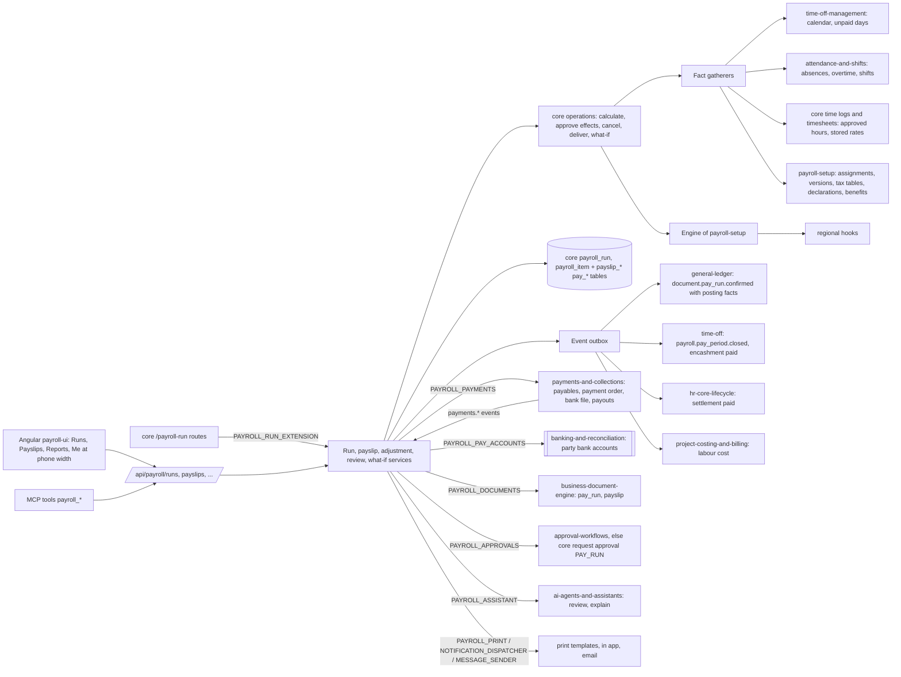

# Implementation Plan: Payroll processing

> Translates an approved `spec.md` into architecture and tech choices. The plan owns
> implementation details; the spec owns behaviour.

**Feature ID**: `payroll-processing`
**Spec**: `./spec.md`
**Tasks**: `./tasks.md`
**Status**: `Draft`
**Last updated**: 2026-11-23

---

## 1. Architecture Summary

The `processing` module of `@gauzy/plugin-payroll` (`packages/plugins/payroll/src/lib/processing/`), on the scaffold,
engine and setup module of `payroll-setup`. The pay-run register of core stays the stored result: a calculating run
is a `payroll_run` row with `mode = 'CALCULATED'`, and each payslip's earnings and deductions are `payroll_item` rows,
so the register's totals, per-employee summary, statistics and GraphQL fields keep meaning what they mean today.
Everything a register line cannot hold — the payslip header, employer contributions, accruals, informational
figures, the trace, cost allocation, delivery state — lives in plugin tables keyed by the run and the employee.

Core gains nullable columns on `payroll_run` and `payroll_item` and one optional hook, `PAYROLL_RUN_EXTENSION`, that
`PayrollRunService` calls for calculating runs only (process, cancel, edits of lines); unbound, or for typed-in runs
(`mode` null), the service behaves exactly as today. Core request approvals gain the type `PAY_RUN`, so a submitted run
waits on the existing Approvals page when `approval-workflows` is off.

**Built on what exists (no second store).** Calculation, approval effects, cancellation, delivery and what-if runs are
operations of the core operation runtime; the run's `calculationState` only mirrors the operation for lists. Employees'
bank details are read from the one encrypted store of `banking-and-reconciliation`. Payslips are delivered through the
notification dispatcher (in app) and the message sender (email), whose delivery records are the delivery state; the
payslip keeps only its state and time. Person-level amounts use core field visibility and the access log of
`access-control-and-security`. Settings are keys of `payroll.settings.ts`; permissions are plugin contributions; retention
reminders are rows of the platform's one reminder table. Employees read their payslips in the Gauzy web app, laid out
for phones and installable on them.

## 2. Tech Choices

| Concern | Choice | Rationale |
| ------- | ------ | --------- |
| Package | module `processing/` of `packages/plugins/payroll`; UI in `payroll-ui` | one plugin per domain (Principle I) |
| Register | core `payroll_run` / `payroll_item` + nullable columns; optional hook token in contracts | the calculating run writes the same register |
| Flags | `FEATURE_PAYROLL` (shared), `FEATURE_PAYROLL_EARNED_PAY` in `payroll.features.ts`, both default off | Principle IV |
| Permissions and settings | contributions in `payroll.permissions.ts` with `defaultFor` (§9); keys `payroll.processing.*`, `payroll.runApprovers` and `payroll.lockTimeOffInClosedPeriods` (false; spec FR-83) in `payroll.settings.ts`, overridable per pay group | no seed migration, no settings table |
| Calculation | engine of `payroll-setup` (`src/lib/engine/`), facts gathered in batches of 200 employees per operation step | one engine for previews and payslips |
| Long work | core operation runtime (`packages/core/src/lib/operation/`, `api/async-operation.ts`): types `PAYROLL_CALCULATE`, `PAYROLL_APPROVE_EFFECTS`, `PAYROLL_CANCEL`, `PAYROLL_DELIVER`, `PAYROLL_WHAT_IF`; aggregate = the run (or what-if), so one live operation per run; `202` with the operation reference; `payroll_run.calculationState` mirrors the operation's status | one run ledger with progress, retries, resume and compensation |
| Idempotency | per-employee result rows keyed `(payrollRunId, employeeId)`; hand-off, posting, delivery and time-source keys; `Idempotency-Key` on create, calculate, approve, cancel | resumable, no double effect |
| Money | core decimal helpers; register lines `numeric(14,2)` (existing), plugin amounts `numeric(20,6)`; payslip amounts rounded to the currency's decimals before the register is written | register net equals payslip net |
| Concurrency | one live operation per run (operation runtime) + run `version` (`409` on conflict) | one calculation per run |
| Year to date | maintained `payroll_ytd_total` rows updated on confirm and cancel inside the same transaction | no scans of past payslips |
| Documents | `pay_run` (posting type) and `payslip` (numbered, no posting) registered with `business-documents`; without it, numbers from core `SequenceService` and the same events | [platform architecture](../../architecture/business-suite.md) §3.1 |
| Posting | `ILedgerPostingFacts` inline on `document.pay_run.confirmed`; `LEDGER_POSTING_SOURCE` and `LEDGER_ACCOUNT_RESOLVER` answered by this plugin | [platform architecture](../../architecture/business-suite.md) §3.4; no ledger rows written here |
| Payments | `PAYROLL_PAYMENTS` port bound to an adapter in `packages/plugins/payment` | money out through one feature |
| Bank details | `PAYROLL_PAY_ACCOUNTS` bound to `PARTY_BANK_ACCOUNTS` of `banking-and-reconciliation` (employee rows, `partyType = EMPLOYEE`, masked; full numbers only for bank files with purpose `PAYROLL_FILE`) | one encrypted store of bank details |
| Approvals | `PAYROLL_APPROVALS` → `WorkflowApprovalGateway`; without the workflows plugin, a core `request_approval` of type `PAY_RUN` (§3) | every pending run decision on the existing Approvals page |
| Delivery | in app through `NOTIFICATION_DISPATCHER`, email through `MESSAGE_SENDER` (fallback core email templates and `email_history`); their records hold attempts and errors; `payslip.deliveryState` / `deliveredAt` / `deliveryRef` only | no second delivery ledger |
| Privacy | core `@VisibleWith` on person-level fields, default field rules and `AUDIT_EVENT_SINK` events, as in `payroll-setup` | one visibility service, one access log |
| Real time | `RealtimeHintsService.appendHint` on `payroll_run:<id>`, `payroll_payslip:<employeeId>`; operation progress events | Principle VII |
| PDF | print port to `print-and-pdf-designer` (three shipped templates); without it, payslips on screen and as data, email delivery as sign-in link | no private PDF code |

## 3. Data Model

### Changed core entities (additive, all nullable)

| Table | New columns (type) | Indexes |
| --- | --- | --- |
| `payroll_run` | `mode` varchar(12) (`CALCULATED`; null = typed in), `kind` varchar(16) (`REGULAR`/`OFF_CYCLE`/`SETTLEMENT`/`EARNED_PAY`/`CORRECTION`), `payGroupId`, `payPeriodId` uuid, `filters` text, `calculationState` varchar(12) (`NONE`/`QUEUED`/`RUNNING`/`DONE`/`FAILED`, mirror of the calculate operation), `calculatedAt`, `calculatedByUserId`, `preparedByUserId`, `submittedAt`, `submittedByUserId`, `employeeCount`, `failedCount` int, `organizationCurrency` char(3), `exchangeRate` numeric(20,10), `documentNumber` varchar(64), `journalRef` uuid, `journalState` varchar(12), `paymentState` varchar(16), `approvalRef` uuid (workflow instance or core request approval), `factsFingerprint` char(64), `version` int | idx `(organizationId, mode, status)`, `(organizationId, payGroupId, payPeriodId)` |
| `payroll_item` | `payslipId` uuid, `payElementId` uuid, `elementCode` varchar(40), `source` varchar(12) (`CALCULATED`/`ADDITIONAL`/`ARREAR`/`ROUNDING`; null = typed in), `yearToDate`, `monthToDate` numeric(14,2) | idx `(payslipId)`, `(organizationId, employeeId, payElementId)` |

Core entity classes gain the properties with `MultiORMColumn`; core create and update DTOs do not, so the existing
routes neither accept nor require them. `IPayrollRun` and `IPayrollItem` gain optional fields. `PayrollRunService`:
`process`, `cancel`, `addItem`, `updateItem`, `removeItem` call the optional `PAYROLL_RUN_EXTENSION` when
`run.mode === 'CALCULATED'` (process → payment state or "mark paid" without payments; cancel → cancel operation;
line edits → refuse `source` rows, keep typed rows as manual adjustments and mark the run stale).

Core request approvals (additive): `ApprovalPolicyTypesStringEnum.PAY_RUN` (`requestId` = the run); a decision gate
for it in `request-approval/linked-document-decision.gate.ts` (permission `ORG_PAYROLL_APPROVE`). The plugin registers
the `PAY_RUN` settler with the core settler registry specified by `approval-workflows`
(`registerRequestApprovalSettler(type, settle)`, called on the answer's transaction), which approves or returns the
run. The requester is the user who submitted the run, so the core rule that nobody approves their own
request and the preparer rule of FR-9 hold together.

### New plugin entities (`TenantOrganizationBaseEntity`)

| Table | Columns (type) | Indexes and uniqueness |
| --- | --- | --- |
| `payslip` | `payrollRunId` uuid (fk `payroll_run`), `employeeId` fk, `assignmentId`, `payGroupId`, `payPeriodId`, `kind`, `number` varchar(64), `state` (`DRAFT`/`CONFIRMED`/`WITHHELD`/`PAID`/`PAYMENT_FAILED`/`CANCELLED`), `outcome` (`CALCULATED`/`FAILED`/`SKIPPED`), `failure` text, `periodStart`, `periodEnd` date, `workingDays`, `payableDays`, `unpaidDays`, `absentDays`, `payableDaysOverride` numeric(9,4), `overrideReason`, `hours` numeric(12,4), `currency`, `organizationCurrency` char(3), `exchangeRate` numeric(20,10), `gross`, `deductions`, `net`, `roundedNet`, `employerCost`, `taxable`, `tax` numeric(20,6), `taxWorking` text, `daysExplanation` text, `paymentMethod` varchar(16), `bankAccountId` uuid null (the employee's `party_bank_account` row; only its mask is shown), `paidAt`, `paymentFailure` text, `deliveryState` varchar(10) (`PENDING`/`SENT`/`NO_EMAIL`/`FAILED`), `deliveredAt`, `deliveryRef` varchar(120), `liveKey` varchar(80), `factsFingerprint` char(64), `version` | unique `(payrollRunId, employeeId)`; unique `(tenantId, liveKey)` (`<employee>:<payPeriod>` for regular non-cancelled); idx `(organizationId, employeeId, periodEnd)`, `(organizationId, state)`, `(payrollRunId, deliveryState)` |
| `payslip_line` | `payslipId` fk cascade, `payElementId`, `elementCode`, `kind` (`EMPLOYER_CONTRIBUTION`/`ACCRUAL`/`INFORMATIONAL`), `quantity`, `rate`, `amount`, `yearToDate` numeric(20,6), `position` | idx `(payslipId)` |
| `payslip_trace` | `payslipId` unique, `engineVersion` varchar(16), `trace` text (JSON) | — |
| `payslip_time_source` | `payslipId`, `timesheetId` null, `timeLogId`, `projectId`, `hours`, `rate`, `amount`, `paidKey` varchar(80) null (`<timeLogId>` while the payslip is not cancelled) | unique `(tenantId, paidKey)`; idx `(payslipId)` |
| `payroll_ytd_total` | `employeeId`, `payrollYearId`, `monthKey` char(7) default `''`, `key` varchar(48) (`GROSS`, `NET`, `TAXABLE`, `TAX`, `EL:<elementId>`), `amount` numeric(20,6) | unique `(employeeId, payrollYearId, monthKey, key)` |
| `payslip_cost_allocation` | `payslipId`, `projectId`, `clientId`, `departmentId` uuid null, `dimensionSetId` uuid null (cost centre and other analysis values when accounting is on), `share` numeric(9,6), `hours`, `amount`, `employerCost` numeric(20,6) | idx `(payslipId)`, `(organizationId, projectId)` |
| `additional_pay`, `additional_pay_use` | pay: `number`, `employeeId`, `payElementId`, `amount`, `mode` (`ONE_OFF`/`RECURRING`), `payDate`, `fromDate`, `toDate`, `overrides`, `taxInFull`, `kind` (`MANUAL`/`INCENTIVE`/`RETENTION`/`ENCASHMENT`/`BENEFIT_CLAIM`/`SETTLEMENT`/`REFERRAL`/`COMMISSION`/`ADVANCE_RECOVERY`/`LOAN_REPAYMENT`/`ARREAR`/`CORRECTION`/`OVERTIME`/`END_OF_SERVICE`/`EARNED_PAY_RECOVERY`), `sourceType`, `sourceId`, `sourceKey` varchar(120), `reason`, `state` (`DRAFT`/`ACTIVE`/`CONSUMED`/`STOPPED`/`LAPSED`/`CANCELLED`), `requiresEmployment` bool, `version`; use: `additionalPayId`, `payPeriodId`, `payslipId`, `amount` | unique `(organizationId, number)`; unique `(tenantId, sourceKey)`; unique `(additionalPayId, payPeriodId)`; idx `(employeeId, state, payDate)` |
| `pay_withholding`, `pay_withholding_period` | `employeeId`, `fromDate`, `periods` int, `reason`, `state` (`ACTIVE`/`RELEASED`/`CANCELLED`); period: `withholdingId`, `payPeriodId`, `employeeId`, `payslipId`, `releasedAt`, `releaseRef` | unique `(payPeriodId, employeeId)` on periods |
| `pay_arrear`, `pay_arrear_line` | arrear: `employeeId`, `kind` (`ARREAR`/`CORRECTION`), `trigger` varchar(16), `triggerRef`, `fromDate`, `state` (`PROPOSED`/`ACCEPTED`/`DISMISSED`/`PAID`), `total`, `carriedRecovery`, `explanation` text, `decidedById`, `reason`, `proposalKey` varchar(160); line: `arrearId` fk cascade, `payslipId`, `payPeriodId`, `payElementId`, `oldAmount`, `newAmount`, `difference`, `explanation` | unique `(tenantId, proposalKey)`; idx `(organizationId, state)` |
| `end_of_service_payout` | `employeeId`, `ruleId`, `endOfWorkDate`, `serviceYears` numeric(8,4), `baseDaily`, `amount`, `channel` (`PAYSLIP`/`DIRECT`), `state` (`DRAFT`/`CONFIRMED`/`PAID`/`CANCELLED`), `additionalPayId`, `paymentRef`, `details` text, `version` | idx `(employeeId, state)` |
| `pay_run_finding` | `payrollRunId`, `payslipId`, `employeeId`, `kind` varchar(32), `severity` (`INFO`/`WARN`/`BLOCK`), `message`, `facts` text, `groupKey`, `acknowledgedById`, `acknowledgedAt`, `note` | idx `(payrollRunId, severity)` |
| `pay_run_review` | `payrollRunId`, `summary` text, `groups` text, `proposals` text (JSON previews), `createdById`, `actorType`, `aiRunId` uuid null (the run of `ai-agents-and-assistants`, which holds provider, model and usage) | idx `(payrollRunId)` |
| `payroll_what_if`, `payroll_what_if_result` | what-if: `name`, `payGroupId`, `payPeriodId`, `changes` text, `baseRunId`, `operationId` uuid null (its latest `PAYROLL_WHAT_IF` operation), `pinned` bool, `expiresAt`; result: `whatIfId` fk cascade, `employeeId`, `payslip` text (JSON), `difference` text | idx `(organizationId, expiresAt)`; unique `(whatIfId, employeeId)` |
| `pay_run_payment` | `payslipId`, `kind` (`NET`/`RELEASE`/`END_OF_SERVICE`/`EARNED_PAY`), `amount`, `currency`, `payableRef`, `orderRef`, `orderLineRef`, `state` (`HANDED_OFF`/`HELD`/`PAID`/`FAILED`/`WITHDRAWN`), `holdReason`, `failure`, `handOffKey` varchar(120) | unique `(tenantId, handOffKey)`; idx `(payslipId)`, `(orderRef)` |
| `earned_pay_request` | `employeeId`, `payPeriodId`, `amount`, `earnedNet`, `state` (`REQUESTED`/`APPROVED`/`PAID`/`REJECTED`/`RECOVERED`/`CANCELLED`), `decidedById`, `paymentRef`, `recoveredByPayslipId`, `requestKey` varchar(80) | unique `(tenantId, requestKey)`; idx `(employeeId, payPeriodId)` |

Payslip delivery has no table of its own: each send goes through `NOTIFICATION_DISPATCHER` (in app, de-duplication key
`payslip:<id>:<channel>:<send number>`) and `MESSAGE_SENDER` (email with the PDF or a sign-in link); `deliveryRef` names
that record and a resend raises the send number. Retention bonuses schedule their reminder as a `reminder` row through
the `REMINDERS` port of `automation-and-notifications` (source key `payroll-retention:<additionalPayId>`), cancelled
with the bonus. Loan repayments are additional pay of kind `LOAN_REPAYMENT` on an element written as the register's
`LOAN_DEDUCTION` line.

### Migrations

**Migration timestamps**: `packages/plugins/payroll` `1791000099100` to `1791000099199`; `packages/core` `1791000099900` to `1791000099999`.

- Core (`packages/core/src/lib/database/migrations/`): `1791000099900-ExtendPayrollRegisterForCalculation`: the
  columns and indexes above, three dialects, no backfill (null `mode` = typed-in run).
- Plugin (`packages/plugins/payroll/src/lib/database/migrations/`): `1791000099100-CreatePayslipTables` (payslip, lines, trace, time sources, year-to-date totals, cost allocation),
  `1791000099110-CreatePayAdjustmentTables` (additional pay and uses, withholdings, arrears, end-of-service payouts, earned
  pay), `1791000099120-CreatePayRunReviewTables` (findings, reviews, what-ifs, payments; the usage
  cost of agent employees is read from the usage record of `ai-agents-and-assistants`, so no table holds it here). Helpers of
  `payroll-setup`; partial uniqueness through nullable key columns on MySQL and SQLite.
- New tables registered with the tenant export and import and factory reset.

### Contracts

`packages/contracts/src/lib/payroll-processing.model.ts`: interfaces and enums (`PayrollRunModeEnum`,
`PayrollRunKindEnum`, `CalculationStateEnum`, `PayslipStateEnum`, `PayslipDeliveryStateEnum`, `AdditionalPayKindEnum`,
`FindingKindEnum`, …), DTO shapes, preview shapes, event payloads, the hook `IPayrollRunExtension` with token
`PAYROLL_RUN_EXTENSION`, and port interfaces (`IPayrollPayments`, `IPayrollAttendanceFacts`,
`IPayrollAdditionalPaySource`, `IPayrollPreview`, `IAmountsOwedPaidSource`). `IPayrollRun` and `IPayrollItem` in
`payroll.model.ts` gain optional fields; `approval-policy.model.ts` gains `PAY_RUN`.

## 4. API Surface

Routes under `/api/payroll`, guards `TenantPermissionGuard`, `PermissionGuard`, `FeatureFlagGuard`; cursor pagination;
`Idempotency-Key` on create, calculate, submit, approve, cancel, deliver, pay; `version` on updates; person-level
fields carry `@VisibleWith`. Existing `/api/payroll-run` routes keep their contracts. Long actions answer `202` with an
operation reference, read at `/api/operations/:id` (core).

| Method | Endpoint | Permission | Description | Status |
| ------ | -------- | ---------- | ----------- | ------ |
| `GET` `POST` | `/runs`, `/runs/:id`, `PUT /runs/:id/employees` | `ORG_PAYROLL_VIEW` / `ORG_PAYROLL_EDIT` | calculating runs (list also shows typed-in runs read-only) | New |
| `POST` `GET` | `/runs/:id/calculate` (`202`), `/runs/:id/progress` | `ORG_PAYROLL_EDIT` / `_VIEW` | calculate operation; per-employee outcomes | New |
| `POST` | `/runs/:id/submit`, `/runs/:id/approve` (`preview`), `/runs/:id/cancel` (`preview`, `202`), `/runs/:id/mark-paid` | `ORG_PAYROLL_EDIT`; approve and mark-paid `ORG_PAYROLL_APPROVE` | lifecycle; approve returns effects preview first | New |
| `GET` `POST` | `/runs/:id/findings`, `/findings/:id/acknowledge`, `/runs/:id/review` | `ORG_PAYROLL_VIEW` / `_EDIT` | checks, acknowledgements, assistant review | New |
| `GET` | `/runs/:id/variance`, `/runs/:id/payment-list`, `/runs/:id/agent-employees`, `/overview?month=` | `ORG_PAYROLL_VIEW`; overview `PAYROLL_REPORTS_VIEW` | comparisons, lists, consolidated view | New |
| `GET` `PUT` `POST` | `/payslips`, `/payslips/:id` (+ `/trace`, `/pdf`), `PUT /payslips/:id/payable-days`, `POST /payslips/:id/explain` | `ORG_PAYROLL_VIEW` / `_EDIT`; explain also own | payslips | New |
| `GET` `POST` | `/payslips/me`, `/payslips/me/:id` (+ `/pdf`, `/explain`) | `PAYROLL_SELF_SERVICE` | own payslips | New |
| `POST` `GET` | `/runs/:id/deliver` (`202`), `/runs/:id/deliveries` (payslip delivery states), `/payslips/:id/resend` | `PAYROLL_PAYSLIPS_SEND` | delivery | New |
| CRUD, `POST` | `/additional-pay` (+ `/:id/stop`), `/incentives`, `/retention-bonuses` | `PAYROLL_ADDITIONAL_PAY_EDIT` | additional pay and its kinds | New |
| CRUD, `POST` | `/withholdings` (+ `/:id/release`) | `PAYROLL_WITHHOLDING_EDIT` | withholdings | New |
| `GET` `POST` | `/arrears`, `/arrears/:id/{accept,dismiss}`, `/arrears/request` (`preview`), `/corrections/unpaid-days` | `ORG_PAYROLL_EDIT` | proposals and corrections | New |
| `POST` | `/end-of-service/payouts` (`preview`), `/:id/{confirm,cancel}` | `PAYROLL_ADDITIONAL_PAY_EDIT` | payouts | New |
| CRUD, `POST` | `/what-ifs` (+ `/:id/calculate` (`202`), `/compare`, `/:id/promote`) | `PAYROLL_SIMULATE` | simulations | New |
| `POST` | `/preview/payslip` | `PAYROLL_ASSIGNMENTS_VIEW` or caller port | throw-away payslip | New |
| `POST` | `/periods/:id/close`, `/periods/:id/reopen` | `ORG_PAYROLL_APPROVE` | period close | New |
| `GET` `POST` | `/earned-pay/me` (available, request), `/earned-pay` (list, decide) | `PAYROLL_SELF_SERVICE`; decide `ORG_PAYROLL_APPROVE` | earned pay (`FEATURE_PAYROLL_EARNED_PAY`) | New |
| `POST` | `/import/payslips` | `ORG_PAYROLL_EDIT` | historical payslips, per-row results | New |
| `PUT` | `/payroll-run/:id/process`, `/payroll-run/:id/cancel` | as today | delegate to the hook for calculating runs only | Changed (additive) |

Errors: `400` with codes (`PAYROLL_RUN_NOT_DRAFT`, `PAYROLL_RUN_FAILED_EMPLOYEES`, `PAYROLL_NEGATIVE_NET`,
`PAYROLL_FACTS_CHANGED`, `PAYROLL_BLOCKING_FINDING`, `PAYROLL_SELF_APPROVAL`, `PAYROLL_ACCOUNT_MISSING`,
`PAYROLL_PERIOD_LOCKED`, `PAYROLL_PAYMENT_EXPORTED`, `PAYROLL_RATE_MISSING`, `PAYROLL_OVERRIDE_OVERLAP`,
`PAYROLL_WITHHOLDING_OVERLAP`, `PAYROLL_EARNED_PAY_LIMIT`, `PAYROLL_AGENT_NOT_ALLOWED`), `403`, `404`, `409`
(calculation running, version). GraphQL reads `payslips`, `payrollRunFindings` behind `FEATURE_GRAPHQL`.

## 5. Events, Real-Time and Notifications

| Event | Emitted when | Consumers |
| ----- | ------------ | --------- |
| `payroll.pay_run.calculated`, `.submitted`, `.approved`, `.paid`, `.cancelled` | run lifecycle | real-time, notices (approvers on submit), automations, webhooks |
| `document.pay_run.confirmed` / `.cancelled` (`posting`: `ILedgerPostingFacts`, type `pay_run`, area `PAYROLL`; `document.pay_run_contributions.*` with the separate-journal setting) | approval, cancellation | `general-ledger` accrual journal and reversal |
| `document.payslip.confirmed` / `.cancelled`, `document.end_of_service_payout.confirmed`, `document.earned_pay_advance.confirmed` | per document | numbering and flow; direct payouts and advances post |
| `payroll.payslip.delivered`, `.paid`, `.payment_failed` | delivery and payment results | employee notice, real-time |
| `payroll.pay_period.closed` / `.reopened` | period close | `time-off-management` (closed-period guard, applied only where `payroll.lockTimeOffInClosedPeriods` is on; otherwise edits pass and reach arrears detection), `payroll-setup` (retroactive guard) |
| `payroll.encashment.paid`, `payroll.settlement.paid` | the payslip paying them is paid | `time-off-management`, `hr-core-lifecycle` |
| `payroll.arrears.proposed`, `payroll.finding.raised` | proposals, blocking findings | notices to payroll officers |
| `payroll.cost_allocated` | approval (per employee, project, client, period, amount, hours) | `project-costing-and-billing` (replaces its estimated labour cost for the period) |
| operation events of the `PAYROLL_*` operations (core operation publisher) | progress and completion | run page progress, notices |

Consumed by `subscriber:payroll`: `payroll.assignment.changed`, `payroll.element.version_activated`,
`payroll.structure.version_activated`, `payroll.pay_table.changed` (setup);
`time_off.request.approved` / `.withdrawn` / `.shortened`, `document.time_off_encashment.confirmed` / `.cancelled`;
`document.final_settlement.confirmed` / `.cancelled`; attendance events of `attendance-and-shifts` (tolerant of extra
fields); `payments.payment_order.approved` / `.exported` / `.executed` and payment-line rejection;
`accounting.journal.posted` / `.failed` / `.reversed`; `workflows.approval.decided` (record type `payroll.pay_run`).
A consumed change dated in a closed period goes to arrears detection; in an open period it marks affected draft
payslips stale. Approved benefit claim lines and other sources arrive through `PAYROLL_ADDITIONAL_PAY` (§7).

Real-time hints: `payroll_run:<id>` (progress, states), `payroll_payslip:<employeeId>` (own payslip states). Inbox
items through `INBOX_ITEM_WRITER`: submissions to approvers, failures and blocking findings to preparers, proposals,
assistant hand-offs. Notices through `NOTIFICATION_DISPATCHER` with de-duplication keys (`payroll-run:<id>:<event>`,
`payslip:<id>:<channel>:<send number>`); emails through `MESSAGE_SENDER` (fallback core email templates
`payroll-payslip`, `payroll-payslip-link`, `payroll-retention-reminder`); retention reminders as `reminder` rows.

## 6. UI Surface

- **Angular `payroll-ui`**: `/pages/payroll/runs` (all runs; typed-in runs open the existing register flow: lines,
  submit, approve, process, cancel), `/runs/:id` (tabs Employees, Payslips, Review — findings, acknowledgements,
  assistant panel —, Variance, Journal, Payments, Deliveries, Agent employees; live progress bar from the operation),
  `/payslips/:id` (lines, days explanation, tax working, trace viewer, PDF), `/additional-pay`, `/withholdings`,
  `/arrears`, `/end-of-service`, `/what-if` (scenario editor, side-by-side compare), `/overview`, `/reports` (report
  definitions), `/pages/payroll/me/payslips`, `/me/earned-pay`. Menu entries hidden without the feature or
  permission; `PAYROLL.*` keys in every locale; tables keyboard operable.
- Own payslips and the earned-pay card are laid out for phone width; the installed Gauzy web app keeps the last opened
  payslips of the signed-in employee readable offline (cached `/me` responses, cleared on sign-out).
- With `approval-workflows` off, a submitted run appears on the existing Approvals page (`apps/gauzy/src/app/pages/approvals`)
  as a request of type `PAY_RUN` linking to the run page.
- The existing amounts-owed report (`apps/gauzy/src/app/pages/reports/amounts-owed-report`) shows a "paid by payroll"
  column when the report's response carries it (core UI change, FR-96).

## 7. MCP Tools, SDKs and Integrations

MCP tools in `packages/mcp-server/src/lib/tools/payroll-processing.ts`:

| Tool | Input | Output |
| --- | --- | --- |
| `payroll_register_runs_list`, `payroll_register_run_get`, `payroll_register_summary` | filters; id | the existing register (phase 1) |
| `payroll_runs_list`, `payroll_run_get`, `payroll_run_findings` | filters; id | runs, outcomes, findings |
| `payroll_run_create`, `payroll_run_calculate` | pay group, period, kind, filters | run; operation reference |
| `payroll_run_submit`, `payroll_run_approve`, `payroll_run_cancel` | id, `preview` | effects preview (payslips, journal, payments), then result |
| `payroll_payslip_get`, `payroll_payslip_explain`, `payroll_my_payslips` | id; question | payslip; explanation with cited lines |
| `payroll_what_if_run` | pay group, period, changes | comparison |
| `payroll_additional_pay_save`, `payroll_withholding_save`, `payroll_arrears_decide` | record, `preview` | preview, then record |
| `payroll_earned_pay_request` | amount, `preview` | available and preview, then request |

Ports consumed (optional; bound in `apps/api/src/plugin-composition.ts`):

| Port | Bound to | Fallback |
| --- | --- | --- |
| `PAYROLL_TIME_OFF_FEED`, `PAYROLL_TIME_OFF_BALANCES` | `TIME_OFF_PAYROLL_FEED`, time-off balance reader | no unpaid days except core approved unpaid-policy requests read by date; no balance block |
| `PAYROLL_ATTENDANCE` | `attendance-and-shifts` facts (absences, half days, overtime, night, holiday and shift hours) | hours above standard from approved time |
| `PAYROLL_LEDGER` | `LedgerPostingService.check` / `.preview`, `LedgerLockService.check` | approval without posting pre-check (accounting off) |
| `PAYROLL_EXCHANGE_RATES` | `LEDGER_EXCHANGE_RATES` | rate entered on the run |
| `PAYROLL_DIMENSION_SETS` | `AnalyticDimensionSetService.resolve` | allocation kept on payslips by project, client and department |
| `PAYROLL_DOCUMENTS` | `BusinessDocumentEngine` | core `SequenceService` numbering, same events |
| `PAYROLL_APPROVALS` | `WorkflowApprovalGateway` (record type `payroll.pay_run`) | core `request_approval` of type `PAY_RUN`: approvers are the employees and teams of the setting `payroll.runApprovers` (none named: an administrator decides), decided on the existing Approvals page; gate `ORG_PAYROLL_APPROVE`; the preparer cannot approve |
| `PAYROLL_PAYMENTS` | `PayrollPayablesAdapter` in `packages/plugins/payment` (opens employee payables through `OPEN_ITEM_REGISTER`, source type `PAYSLIP`; proposes and withdraws payment order lines; provider payouts through `payment-gateways`) | payment list and manual "mark paid" |
| `PAYROLL_PAY_ACCOUNTS` | `PARTY_BANK_ACCOUNTS` of `banking-and-reconciliation` (the employee's primary verified account; masked; full number only with purpose `PAYROLL_FILE`) | no bank details: transfer payslips are held and listed; the payment list and "mark paid" still work |
| `PAYROLL_PRINT` | print templates render service (`payslip-standard`, `payslip-compact`, `payslip-detailed`) | on-screen payslip; email as sign-in link |
| `NOTIFICATION_DISPATCHER`, `MESSAGE_SENDER`, `REMINDERS` | `automation-and-notifications`, `email-and-communications` | core employee notification; core email templates; retention reminder as a notice on the reminder date by the `payroll.retention` sweep |
| `PAYROLL_ASSISTANT`, `PAYROLL_AGENT_USAGE`, `PAYROLL_REGIONAL_HOOKS`, `AUDIT_EVENT_SINK` | as in `payroll-setup` | as in `payroll-setup` |

Ports provided: `LEDGER_POSTING_SOURCE` (pay-run facts for preview, reposting, catch-up), `LEDGER_ACCOUNT_RESOLVER`
(element and payable accounts by role and `payElementId`), `LEDGER_CLOSE_CHECK` (approved runs not posted, open
regular runs of the period), `TIME_OFF_PAY_PERIOD_LOCK`, `HR_SETTLEMENT_SOURCE` (unpaid pay, withheld payslips,
end-of-service), `PAYROLL_ADDITIONAL_PAY` (`propose(source, lines)`, `cancel(source)` for `recruitment`,
`sales-order-management`, `expenses-and-travel` — including approved claim lines on benefit categories, kind
`BENEFIT_CLAIM`, which also write the benefit ledger of `payroll-setup` — and `performance-management`),
`PAYROLL_PREVIEW` (offer compensation preview of `recruitment`), `AMOUNTS_OWED_PAID_SOURCE` (core amounts-owed report:
amount confirmed payslips paid per employee and period).

Ledger registration (`LedgerDocumentTypeRegistry.register`): type `pay_run`, area `PAYROLL`, components `EARNING`,
`DEDUCTION`, `CONTRIBUTION_EXPENSE`, `CONTRIBUTION_LIABILITY`, `ACCRUAL_EXPENSE`, `ACCRUAL_LIABILITY`, `NET_PAYABLE`,
`ADVANCE_RECOVERY`, `LOAN_RECOVERY`, `ROUNDING`; amounts carry `keys.payElementId`, `party` (`EMPLOYEE`) per setting
and `distribution` from cost allocation; samples for the balance proof. Report definitions for spec §3.17 on datasets
`payroll.payslips`, `.payslip_lines`, `.allocations`, `.payments`, `.benefits`, `.tax`. Import template: historical
payslips. OpenAPI grows additively; Kiota SDKs regenerated after merge.

## 8. Background Jobs

| Trigger | When | What it does | Idempotency |
| ------- | ---- | ------------ | ----------- |
| operation `PAYROLL_CALCULATE` | calculate requested | steps of 200 employees: gather facts in batches, engine, write payslip, lines, trace and register lines in one transaction per employee; final step runs the review checks of spec FR-50 and, when enabled, the assistant review; progress on the operation and run hints | one live operation per run; `(payrollRunId, employeeId)` replace-on-recalculate; findings replaced per calculation; resumes from the last step |
| operation `PAYROLL_APPROVE_EFFECTS` | approval | numbers, confirmed states, year-to-date, benefit ledger, time sources, document events, payment hand-off, cost allocation event, delivery when automatic | per-payslip keys; resumable |
| operation `PAYROLL_CANCEL` | cancel accepted | reverse in the opposite order (compensating steps) | per-payslip keys |
| operation `PAYROLL_DELIVER` | delivery requested | render, hand to the dispatcher and the message sender, record each payslip's state | dispatcher key per payslip, channel and send |
| `payroll.retro-detect` (consumer + daily sweep) | change dated in a closed period | shadow recalculation, proposals | `proposalKey` per employee, trigger and period |
| `payroll.retention` | daily (worker) | lapses retention bonuses whose employee's work ended; reminders are `reminder` rows scheduled at grant | state check |
| operation `PAYROLL_WHAT_IF`, `payroll.what-if-expiry` (daily) | what-if calculate; expiry | simulate; delete unpinned expired results | one live operation per what-if |
| `payroll.earned-pay` (queue) | request approved | payout hand-off | `requestKey` |

Worker plugin `PayrollSchedulePlugin` (shared with `payroll-setup`) in `apps/worker/src/plugins.ts` for the sweeps,
recorded in `job_execution`; operations run on the core runtime with its lease, retry and stalled-run recovery.

## 9. Security & Permissions

- New keys, contributed in `payroll.permissions.ts`: `PAYROLL_ADDITIONAL_PAY_EDIT`, `PAYROLL_WITHHOLDING_EDIT`,
  `PAYROLL_SIMULATE`, `PAYROLL_PAYSLIPS_SEND` (group `ADMINISTRATION`), `PAYROLL_REPORTS_VIEW`. Existing
  `ORG_PAYROLL_VIEW / EDIT / APPROVE` guard runs and payslips; `PAYROLL_SELF_SERVICE` of `payroll-setup` guards own payslips and
  earned pay.
- Default roles (`defaultFor`): super admin and admin all; employee none new (self-service comes from setup); no grant
  to manager.
- Separation of duties on calculating runs: the user who prepared, calculated or submitted cannot approve
  (`PAYROLL_SELF_APPROVAL`), through the workflows plugin and through core request approval alike; approval of a run
  above the organization's limit goes through `approval-workflows` when it is on.
- Privacy: payslip amounts, lines, traces, year-to-date totals and allocations carry `@VisibleWith(ORG_PAYROLL_VIEW)`;
  own payslips only through `/me`; default field rules contributed to `access-control-and-security`; each read of
  another person's payslip writes one `sensitive-read` event to `AUDIT_EVENT_SINK`; bank details are the masks of the
  banking store, full numbers only inside bank files (`PAYROLL_FILE`) for holders of `BANK_ACCOUNT_NUMBERS_EXPORT`.
- Payslip PDF passwords: built from the chosen pattern at render time, never stored; protected PDFs use AES-256.
- Assistant: the explanation sends only the asking employee's payslip trace and previous payslip; the review sends
  run findings and aggregates, never bank details; both run on the agent runtime with the caller's permissions.

## 10. Observability

Run timeline (who and when per step), operation progress and failures per step, per-employee outcomes and failure
reasons, findings and acknowledgements, delivery states, payment states; metrics: payslips per second, failures by
code, review findings by kind, delivery success, earned-pay draws; activity-log entries for every change of spec
FR-104 with actor type `Agent` for MCP.

## 11. Phased Rollout

1. **Phase 1 — Surface the existing register**: Angular run list and detail for typed-in runs over today's routes
   (lines, summary, submit, approve, process, cancel, statistics card), MCP register tools, report definition of the
   register summary, permissions wired to the menu. Usable: payroll recorded by hand with screens and tools.
2. **Phase 2 — Calculating runs**: core columns, hook and approval type, payslips, facts (calendar, time off, approved
   time), engine runs, tax projection, year to date, additional pay, incentives, retention bonuses, loan deductions,
   withholding, corrections, end-of-service, settlements, documents, journals, payments, delivery, period close,
   multi-currency, reports.
3. **Phase 3 — Advanced capabilities**: automatic arrears with explanations, review checks and assistant review, what-if
   runs, payslip explanation assistant, allocation by tracked time and project cost hand-off, attendance facts, earned
   pay, consolidated overview, agent usage cost, amounts-owed paid column.
4. **Phase 4 — General availability**: the feature is off by default; after the trial period it may be switched on by default for new tenants only; existing tenants keep their setting until an administrator changes it.

## 12. Constitution Reconciliation

- I Plugin-first: module of plugin `payroll`; core gains nullable register columns, an optional hook, one approval type
  (its settler on the core registry of `approval-workflows`) and the amounts-owed paid column.
- II Tenant/organization scoping: every table on `TenantOrganizationBaseEntity`; the overview reads only the reader's organizations.
- III Both ORMs, additive migrations: nullable core columns, new plugin tables, three dialects, both ORMs.
- IV Default-off flag; nothing removed: `FEATURE_PAYROLL`, `FEATURE_PAYROLL_EARNED_PAY`; typed-in runs untouched.
- V Contracts and API first: optional contract fields; new routes; existing route contracts unchanged.
- VI Permissions, privacy, security: five keys, preparer cannot approve, field visibility, logged reads, masked bank
  details, no stored PDF passwords.
- VII Real-time through the event bus: outbox events, operation events, real-time hints for progress and states.
- VIII i18n and accessibility: `PAYROLL.*` keys, localized payslips and amounts in words, accessible tables.
- IX Tests: golden payslips, register equality, posting balance, idempotency of every operation and job, e2e of the lifecycle.
- X Behaviour-first spec: `spec.md` holds behaviour; this plan holds structure.
- XI Documentation describes our platform only.

## 13. Risks & Mitigations

| Risk | Likelihood | Impact | Mitigation |
| ---- | ---------- | ------ | ---------- |
| Register and payslip drift | Medium | High | one transaction per employee writes both; equality spec after every operation |
| Double payment of time or net pay | Low | High | `paidKey` per time log, `handOffKey` per payslip, one live operation per run |
| Dependent plugins (attendance, payments adapter, banking) absent | High | Medium | optional ports with fallbacks; tolerant consumers |
| Calculation throughput on large tenants | Medium | Medium | batched fact reads, operation steps across workers, maintained year-to-date |
| Wrong tax from incomplete declarations | Medium | High | projection shown on every payslip, review checks on tax-rate jumps, pack test cases |
| Two-decimal register columns | Low | Medium | three-decimal currencies refused for calculating runs until the register columns are widened |

## 14. References

- Spec: `./spec.md` · Tasks: `./tasks.md` · Sibling: `../payroll-setup/plan.md`
- Code: `packages/core/src/lib/payroll-run/payroll-run.service.ts` (`transition`, `process`, `recalculateTotals`),
  `packages/core/src/lib/payroll-item/payroll-item.entity.ts`, `packages/contracts/src/lib/payroll.model.ts`
  (`PayrollItemTypeEnum.LOAN_DEDUCTION`), `packages/core/src/lib/request-approval/` (`linked-document-decision.gate.ts`,
  `commands/handlers/request-approval.status.handler.ts`), `packages/core/src/lib/operation/`,
  `packages/core/src/lib/api/async-operation.ts`, `packages/core/src/lib/time-tracking/time-log/time-log-rates.ts`,
  `packages/core/src/lib/time-tracking/timesheet`, `packages/core/src/lib/event-outbox/event-outbox.service.ts`,
  `packages/plugins/realtime/src/lib/realtime-hints.service.ts`, `packages/scheduler/src/lib/decorators`,
  `apps/api/src/plugin-composition.ts`, `apps/gauzy/src/app/pages/approvals`
- Plans: `../general-ledger/plan.md` §4.1, `../payments-and-collections/plan.md`, `../business-document-engine/plan.md` §4.1,
  `../time-off-management/plan.md` §7, `../hr-core-lifecycle/plan.md`, `../regional-compliance-packs/plan.md`,
  `../banking-and-reconciliation/plan.md` §3.1, `../automation-and-notifications/plan.md`
