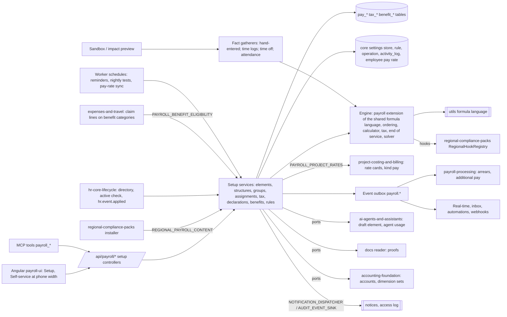

# Implementation Plan: Payroll setup

> Translates an approved `spec.md` into architecture and tech choices. The plan owns
> implementation details; the spec owns behaviour.

**Feature ID**: `payroll-setup`
**Spec**: `./spec.md`
**Tasks**: `./tasks.md`
**Status**: `Draft`
**Last updated**: 2026-11-23

---

## 1. Architecture Summary

A new plugin `@gauzy/plugin-payroll` (`packages/plugins/payroll`) with `payroll-ui` (Angular). Employee self-service
pages are pages of the Gauzy web app laid out for phone width (the app installs on phones); there is no second client.
This spec builds the plugin scaffold, the pure calculation **engine** and the **setup** module; `payroll-processing`
adds the **processing** module to the same plugin and is the only writer of the core pay-run register (`payroll_run`,
`payroll_item`). The employee's pay data, recurring costs and the register stay as they are; an hourly assignment keeps
the employee's pay rate in step (§3.2), core employee statistics gain one optional pay-cost hook, and contracts gain one
frequency value and one rule owner type.

The engine (`src/lib/engine/`) is pure TypeScript with no database or request context. Formulas and conditions are
written in the platform's one formula language, the `@gauzy/utils` module `formula/` that `custom-fields-and-forms`
builds (tokenizer, parser, type checker, exact-decimal evaluator with a step budget, conformance with the core
`rule.evaluator`). Payroll adds no parser of its own: `engine/formula-payroll/` extends that language with element
references resolved to element ids (renaming never breaks a formula), the payroll functions and fact names registered
in the language's function catalogue (`formula.model.ts`), the reference graph (cycles, ordering) and the per-payslip
step budget. On top of it the engine holds the payslip calculator over supplied facts (phases, segments, pro-rating,
rounding, trace), the tax-table computation, the end-of-service computation and the cost-to-company solver. The
sandbox, the impact preview, the cost-to-company panel and every pay run of `payroll-processing` call the same engine,
so a preview and a payslip cannot disagree. Build order: the shared formula module lands before the engine tasks.

**Built on what exists (no second store).** Settings are keys of `payroll.settings.ts` in the platform settings
store; permissions and their default roles are plugin contributions. End-of-service applicability is core `rule` rows.
Bulk assignment, impact previews and starter proposals are operations of the core operation runtime. Person-level
amounts are hidden by core field visibility (`@VisibleWith`) with default field rules of `access-control-and-security`,
and reads of another person's pay go to its access log through the core audit sink. Benefit claims are expense claims of
`expenses-and-travel` on a category linked to a benefit element; project pay rates are the dated rate cards of
`project-costing-and-billing`; cost shares use the analytic dimension sets of `accounting-foundation`. Notices go through
the notification dispatcher, whose de-duplication key is the only record of a notice already sent.



## 2. Tech Choices

| Concern | Choice | Rationale |
| ------- | ------ | --------- |
| Package | `packages/plugins/payroll` (new), `payroll-ui` (new Angular); modules `engine/`, `setup/` (this spec), `processing/` (sibling); no React package | Principle I; one plugin for one domain; one client |
| Flag | tenant feature `FEATURE_PAYROLL` in `payroll.features.ts` (`defaultEnabled: false`), `@FeatureFlag` + `FeatureFlagGuard` on every controller and resolver (pattern `subscription.features.ts`) | default off; existing register routes stay unflagged |
| Permissions | `payroll.permissions.ts` contributions (`packages/plugin/src/lib/plugin-contributions.ts`) with `defaultFor` (§9) | no seed migration; the permission reload adds missing rows to existing tenants |
| Settings | organization-scoped keys of `payroll.settings.ts` in the platform settings store (§3.1); `payroll-processing` adds its keys to the same file | no settings table |
| Persistence | MultiORM entities on `TenantOrganizationBaseEntity`; the shared core migration helpers of `@gauzy/core`; tri-dialect migrations | Principle III |
| Money | core `money/decimal.ts` (`parseDecimalString`, `multiplyDecimalUnits`, `divideDecimalUnits`, …) on scaled integers; amounts `numeric(20,6)`, rates `numeric(20,10)`, percents `numeric(9,4)` | exact decimals, [platform architecture](../../architecture/business-suite.md) §6 |
| Formula language | `@gauzy/utils` `formula/` (`custom-fields-and-forms`) with the payroll extension `engine/formula-payroll/`: element references by id, payroll functions and fact names in the shared catalogue, reference graph, step budget; ASTs stored as JSON text in payroll tables; no `eval`, no `Function` | one formula language for the platform; formulas and conditions share it |
| Record conditions | end-of-service applicability as core `rule` rows (`RuleOwnerType.END_OF_SERVICE_RULE`) over the employee context of `hr-core-lifecycle` plus pay group and separation kind, evaluated by `rule/rule.evaluator.ts` | one rule kernel; no condition column |
| Ordering | reference graph per structure version; Tarjan cycle detection; topological order inside the processing phases | spec FR-17, FR-19 |
| Versions | effective-dated version rows (`effectiveFrom`), resolved "in force on the period's last day" | spec FR-12 |
| Cross-plugin | optional injection tokens in `@gauzy/contracts`, bound in `apps/api/src/plugin-composition.ts`; unbound = capability absent | no import of another plugin's internals |
| Long and bulk work | core operation runtime (`packages/core/src/lib/operation/`, `api/async-operation.ts`): `202` with an operation reference read at `/api/operations/:id`; types `PAYROLL_BULK_ASSIGN`, `PAYROLL_IMPACT`, `PAYROLL_STARTER_PROPOSALS`; sweeps on `@ScheduledJob` recorded in `job_execution`; the outcome per employee of a bulk assignment (`ASSIGNED`, `SKIPPED`, `FAILED`, reason, assignment) is kept in the `output` of the step of its batch, so the feature adds no run or result table | one run ledger with progress, retries and resume |
| Privacy | core `@VisibleWith` on person-level amounts (`api/visible-with.decorator.ts`, `api/field-visibility.service.ts`), default field rules (`MASKED`, `isSensitive`) contributed to `access-control-and-security`, `sensitive-read` events through the core `AUDIT_EVENT_SINK` | one visibility service, one access log |
| Notices | `NOTIFICATION_DISPATCHER.notify({ category, recipients, record, …, dedupeKey })` of `automation-and-notifications` (core fallback when the Inbox is not loaded) | the dispatcher's key is the only "already sent" record |
| Events | `EventOutboxService.append` in the writing transaction; consumer `subscriber:payroll` in `EventConsumerRegistry` | at-least-once, deduplicated |
| Reports | definitions registered with `report-builder-and-dashboards` (setup lists: assignments, cost to company, declarations, proofs) | no hand-built report pages |

## 3. Data Model

### New plugin entities (`TenantOrganizationBaseEntity`: tenant, organization, soft delete, timestamps)

```ts
@MultiORMEntity('pay_element', { mikroOrmRepository: () => MikroOrmPayElementRepository })
export class PayElement extends TenantOrganizationBaseEntity implements IPayElement { /* columns below */ }
```

| Table | Columns (type) | Indexes and uniqueness |
| --- | --- | --- |
| `pay_element` | `code` varchar(40), `name` varchar(120), `kind` varchar(24) (`EARNING`/`DEDUCTION`/`EMPLOYER_CONTRIBUTION`/`ACCRUAL`/`INFORMATIONAL`), `registerType` varchar (`PayrollItemTypeEnum`), `description` text, `displayOrder` int, `deactivatedFrom` date, `source` varchar(12) (`USER`/`STARTER`/`PACK`), `packKey` varchar(64), `statutoryTag` varchar(64), `expenseAccountId`, `liabilityAccountId`, `accrualAccountId` uuid (no FK: `accounting`), `firstUsedAt` timestamp, `version` int | unique `(organizationId, code)`; idx `(organizationId, kind)` |
| `pay_element_version` | `elementId` fk, `effectiveFrom` date, `status` (`DRAFT`/`ACTIVE`/`SUPERSEDED`), `amountMethod` varchar(16) (`FIXED`/`FORMULA`/`QUANTITY_RATE`/`INPUT`), `fixedAmount` numeric(20,6), `formula`, `formulaAst`, `condition`, `conditionAst` text (source and AST of the shared language, element references by id), `quantitySource`, `rateSource` varchar(40), `inputDefault` numeric(20,6), `proRate` varchar(8) (`DAYS`/`HOURS`/`NONE`), `taxTreatment` varchar(16) (`TAXABLE`/`NON_TAXABLE`/`PRE_TAX`/`POST_TAX`/`INCOME_TAX`), `taxInFull` bool, `payMode` varchar(16) (`GROSS`/`OUTSIDE_GROSS`/`INFORMATIONAL`), `postToLedger` bool, `dropWhenZero` bool, `rounding` varchar(8), `roundingStep` numeric(20,6), `arrearsEligible` bool, `benefit` text (JSON: yearly maximum, payout method, unclaimed payout), `overrideReason` text, `activatedById`, `activatedAt`, `checksum` char(64) | unique `(elementId, effectiveFrom)`; idx `(organizationId, status)` |
| `pay_element_reference` | `versionId` fk cascade, `referencedElementId` uuid | unique `(versionId, referencedElementId)`; idx `(referencedElementId)` (impact, rename) |
| `pay_element_test_case` | `elementId` fk, `name` varchar(120), `inputs` text (JSON), `expectedAmount` numeric(20,6) null, `expectLeftOut` bool, `lastOutcome` varchar(8), `lastRunAt`, `lastMessage` text | idx `(elementId)` |
| `pay_table`, `pay_table_row` | table: `name` varchar(120), `keyLabels` text (JSON, one or two), `defaultAmount` numeric null; row: `tableId` fk cascade, `effectiveFrom` date, `key1` varchar(120), `key2` varchar(120) default `''`, `amount` numeric(20,6) | unique `(organizationId, name)`; unique `(tableId, effectiveFrom, key1, key2)` |
| `pay_structure`, `pay_structure_version`, `pay_structure_line` | structure: `name`, `currency` char(3), `frequency` varchar(16), `payBasis` varchar(12) (`SALARIED`/`HOURLY`/`MIXED`), `forContractors` bool, `maxFlexibleBenefits` numeric(20,6), `paymentMethod` varchar(16), `version`; version: `structureId`, `effectiveFrom`, `status`, `dailyEncashmentFormula`/`Ast` text, `activatedById`, `activatedAt`, `overrideReason`; line: `structureVersionId` fk cascade, `elementId`, `position` int, `overrideMethod`, `overrideAmount` numeric(20,6), `overrideFormula`/`Ast` text, `benefitDefaultYearly` numeric(20,6) | unique `(organizationId, name)`; unique `(structureId, effectiveFrom)`; unique `(structureVersionId, elementId)` |
| `pay_group` | `name`, `code` varchar(32), `countryCode` char(2), `currency` char(3), `frequency` varchar(16), `payDateRule` varchar(16) (`LAST_WORKING_DAY`/`FIXED_DAY`/`DAYS_AFTER_END`), `payDateValue` int, `payableDayBasis` varchar(16) (`WORKING_DAYS`/`CALENDAR_DAYS`/`FIXED_DAYS`), `fixedDays` int, `cashAccountId` uuid (no FK: `banking`), `defaultStructureId`, `settings` text (JSON, per-group overrides of `payroll.processing.*` keys), `isDefault` bool | unique `(organizationId, code)` |
| `payroll_year`, `pay_period` | year: `payGroupId` fk, `name`, `startDate`, `endDate`, `declarationOpensOn`, `declarationClosesOn`, `proofOpensOn`, `proofClosesOn` date; period: `payrollYearId` fk, `payGroupId`, `number` int, `startDate`, `endDate`, `payDate` date, `status` (`OPEN`/`CLOSED`), `closedAt`, `closedById` | unique `(payGroupId, startDate)` on both; idx `(organizationId, status, endDate)` |
| `pay_assignment` | `employeeId` fk, `structureId` fk, `payGroupId` fk, `effectiveFrom`, `effectiveTo` date null (maintained), `basePay` numeric(20,6), `basePeriod` varchar(8) (`PERIOD`/`YEAR`/`HOUR`), `variablePay` numeric(20,6), `taxTableId` uuid null, `paymentCurrency` char(3) null, `rateSource` varchar(16), `dailyEncashmentAmount` numeric(20,6) null, `allocationMode` varchar(16) (`FIXED`/`TRACKED_TIME`), `payableAccountId` uuid null, `status` (`PROPOSED`/`ACTIVE`/`REJECTED`/`CANCELLED`), `source` varchar(16) (`MANUAL`/`BULK`/`LEVEL`/`HR_EVENT`/`STARTER`/`IMPORT`), `sourceRef` uuid, `operationId` uuid null (the bulk or starter operation), `payRateSyncedAt` timestamp null, `activeKey` varchar(80) null, `version` int | unique `(tenantId, activeKey)` (`<employee>:<effectiveFrom>` while active); idx `(organizationId, payGroupId, effectiveFrom)`, `(employeeId, effectiveFrom)`, `(organizationId, status, source)` |
| `pay_assignment_share` | `assignmentId` fk cascade, `dimensionSetId` uuid null (analytic dimension set of `accounting-foundation`: cost centre, department and project values), `organizationDepartmentId`, `organizationProjectId` uuid null (used when accounting is off), `percent` numeric(9,4) | unique `(assignmentId, dimensionSetId, organizationDepartmentId, organizationProjectId)` |
| `level_pay_default` | `employeeLevelId` fk `employee_level`, `structureId`, `basePay` numeric(20,6), `basePeriod` varchar(8) | unique `(organizationId, employeeLevelId)` |
| `tax_table`, `tax_table_band`, `tax_table_surcharge` | table: `name`, `countryCode`, `currency`, `effectiveFrom` date, `standardDeduction`, `zeroTaxThreshold` numeric(20,6), `status` (`DRAFT`/`ACTIVE`/`RETIRED`), `firstUsedAt`, `source`, `packKey`, `version`; band: `taxTableId` fk cascade, `position`, `fromAmount`, `toAmount` null, `ratePercent` numeric(9,4), `condition`/`conditionAst` text (shared formula language); surcharge: `taxTableId`, `fromIncome`, `toIncome` null, `percentOfTax` numeric(9,4) | idx `(organizationId, countryCode, effectiveFrom)`; unique `(taxTableId, position)` |
| `pay_group_tax_table`, `employee_tax_choice` | `payGroupId`, `payrollYearId`, `taxTableId`, `isDefault`; `employeeId`, `payrollYearId`, `taxTableId`, `chosenAt` | unique `(payrollYearId, taxTableId)`; unique `(employeeId, payrollYearId)` |
| `exemption_category` | `parentId` uuid null (sub-category), `name`, `countryCode`, `yearlyMax` numeric(20,6) null, `packRuleKey` varchar(64) null, `isActive` | idx `(organizationId, countryCode, parentId)` |
| `tax_declaration`, `tax_declaration_line` | declaration: `employeeId`, `payrollYearId`, `status` (`DRAFT`/`SUBMITTED`/`LOCKED`), `declaredTotal`, `allowedTotal`, `version`; line: `declarationId` fk cascade, `subCategoryId`, `amount`, `allowed` numeric(20,6), `details` text (JSON inputs of the pack rule) | unique `(employeeId, payrollYearId)`; unique `(declarationId, subCategoryId)` |
| `tax_proof`, `tax_proof_line` | proof: `employeeId`, `payrollYearId`, `status` (`DRAFT`/`SUBMITTED`/`REVIEWED`), `submittedAt`; line: `proofId` fk cascade, `subCategoryId`, `amount`, `fileIds` text, `status` (`PENDING`/`VERIFIED`/`REJECTED`), `verifiedAmount`, `reviewerId`, `reason`, `extracted` text | idx `(organizationId, status)`, `(employeeId, payrollYearId)` |
| `other_income` | `employeeId`, `payrollYearId`, `sourceLabel` varchar(120), `amount`, `declaredById` | idx `(employeeId, payrollYearId)` |
| `benefit_choice`, `benefit_choice_line` | `employeeId`, `payrollYearId`, `assignmentId`, `status`, `total`; line: `choiceId` fk cascade, `elementId`, `yearlyAmount` | unique `(employeeId, payrollYearId)`; unique `(choiceId, elementId)` |
| `benefit_ledger_entry` | `employeeId`, `elementId`, `payrollYearId`, `kind` (`OPENING`/`ACCRUAL`/`PAYOUT`/`CLAIM`/`REVERSAL`), `amount`, `payslipId`, `expenseId` uuid null (the approved claim line, a core `expense` row of `expenses-and-travel`), `entryKey` varchar(120) | unique `(tenantId, entryKey)`; idx `(employeeId, elementId, payrollYearId)`, `(expenseId)` |
| `end_of_service_rule`, `end_of_service_band` | rule: `name`, `baseElementIds` text, `divisor` numeric(9,4), `serviceMethod` varchar(12) (`COMPLETED`/`EXACT`/`ROUNDED`/`MANUAL`), `unpaidReducesService` bool, `minimumYears` numeric(6,2), `bandMode` varchar(8) (`INSIDE`/`WHOLE`), `source`, `packKey`, `isActive`; applicability is core `rule` rows (`ownerType = END_OF_SERVICE_RULE`, `ownerId` = the rule); band: `ruleId` fk cascade, `fromYears`, `toYears` null numeric(6,2), `daysPerYear` numeric(9,4) | unique `(ruleId, fromYears)` |
| `payroll_opening_balance` | `employeeId`, `payrollYearId`, `kind` (`TAXABLE_PAY`/`TAX_WITHHELD`/`ELEMENT`), `elementKey` varchar(40) default `''`, `amount`, `source` varchar(12) | unique `(employeeId, payrollYearId, kind, elementKey)` |

Starter proposals are `pay_assignment` rows in `PROPOSED` with `source = STARTER` (FR-71), confirmed or rejected
through `/assignments/proposals`; proposals from HR events are the same rows with `source = HR_EVENT`. Project pay
rates have no table here: they are the dated rate cards of `project-costing-and-billing` on the employee × project axis
with rate kind `PAY`, read through `PAYROLL_PROJECT_RATES`; payroll keeps only the precedence rule (employee on project,
then project, then the rate the time log stored). `level_pay_default.employeeLevelId` matches the employee through
`employee.employeeLevelId` of `hr-core-lifecycle`; without it, through the employee's level label.

### 3.1 Settings (`payroll.settings.ts`, organization scope, settings store)

`payroll.ownPayVisible` (boolean, false), `payroll.unprovenExemptionsAtYearEnd` (boolean, true),
`payroll.documentReading` (boolean, false), `payroll.assistantEnabled` (boolean, false),
`payroll.contractorEmploymentTypeIds` (string[]), `payroll.hoursOverrunWarnPercent` (number, 25),
`payroll.statisticsFromPayslips` (boolean, false; spec FR-85), `payroll.accounts`
(json: default payroll payable and employee advance account designations of FR-84). `payroll-processing` declares its
`payroll.processing.*` keys in the same file; a pay group's `settings` overrides them for its runs.

### 3.2 Existing records kept in step

- **Employee pay rate.** When an assignment of an hourly structure (`basePeriod = HOUR`) becomes active, its rate and
  currency are written to `employee.payRateValue` / `payRateCurrency` on its effective date (at once for a date already
  reached, else by the daily `payroll.assignments.apply-rates` sweep), and `payRateSyncedAt` is stamped. Time-log
  pricing, the amounts-owed report and project costing therefore keep reading one figure; time logs keep the rate they
  stored. Salaried assignments leave the pay rate unchanged.
- **Employee statistics.** Core `employee-statistics` gains an optional hook `EMPLOYEE_PAY_COST_SOURCE` (unbound = today).
  Payroll binds it and answers "as today" unless `FEATURE_PAYROLL` is on for the tenant and the organization's
  `payroll.statisticsFromPayslips` is on: then, for months covered by confirmed payslips an employee's salary cost is the
  payslips' gross pay plus employer contributions; recurring salary, salary-tax and bonus rows count only for other months. The recurring rows,
  the organization's bonus rule (`bonusType`, `bonusPercentage`) and the shared organization recurring costs are never
  changed; cost to company of an assignment covers its pay elements only.

### Migrations

**Migration timestamps**: `packages/plugins/payroll` `1791000098100` to `1791000098199`.

- Plugin (`packages/plugins/payroll/src/lib/database/migrations/`): `1791000098100-CreatePayrollElementAndStructureTables`
  (elements, versions, references, test cases, pay tables, structures), `1791000098110-CreatePayrollCalendarAndAssignmentTables`
  (groups, years, periods, assignments, shares, level defaults), `1791000098120-CreatePayrollTaxAndDeclarationTables`,
  `1791000098130-CreatePayrollBenefitAndEndOfServiceTables` (choices, ledger, rules, bands, opening balances).
- Additive and idempotent per dialect through the plugin helpers; partial unique indexes become nullable key columns
  (`activeKey`) with plain unique indexes on MySQL and SQLite; SQLite tables created whole; no `NOT NULL` backfill.
- Core: no table change. Contracts gain `PayrollFrequencyEnum.DAILY` (the column is `varchar`), `RuleOwnerType.END_OF_SERVICE_RULE`
  and the `EMPLOYEE_PAY_COST_SOURCE` token.
- New tables registered with the tenant export and import (`export-import/repositories`) and factory reset, as the
  register tables are today.

### Contracts

`packages/contracts/src/lib/payroll-setup.model.ts`: interfaces and enums (`PayElementKindEnum`, `AmountMethodEnum`,
`TaxTreatmentEnum`, `PayModeEnum`, `ProRateEnum`, `PayBasisEnum`, `PayableDayBasisEnum`, `AllocationModeEnum`,
`ServiceMethodEnum`, …), DTO shapes, sandbox and impact result shapes, event payloads.
`payroll-formula.model.ts`: the payroll extension of the shared language (`formula.model.ts`): element-reference node,
payroll fact names, the payroll functions added to the catalogue, check result (`IFormulaFinding` with `position`,
`code`, `chain`). `payroll-ports.model.ts`: port tokens and interfaces listed in §7.

## 4. API Surface

All routes under `/api/payroll`, guarded by `TenantPermissionGuard`, `PermissionGuard`, `FeatureFlagGuard`
(`FEATURE_PAYROLL`); cursor pagination; `Idempotency-Key` on creating and activating routes; updates carry `version`
(`409` on conflict); person-level pay fields carry `@VisibleWith` (§9).

| Method | Endpoint | Permission | Description | Status |
| ------ | -------- | ---------- | ----------- | ------ |
| `GET` `PUT` | `/settings`, `/setup-checklist` | `PAYROLL_SETUP_VIEW` / `_EDIT` | the `payroll.*` keys of the settings store; checklist progress | New |
| `GET` `PUT` | `/settings/accounts` | `PAYROLL_SETUP_VIEW` / `_EDIT` | default payroll payable and employee advance accounts, kept as designations through `PAYROLL_LEDGER_ACCOUNTS` | New |
| CRUD | `/elements`, `/elements/:id/versions` (+ `/:vid/activate`), `/elements/:id/deactivate`, `/elements/:id/accounts` | `PAYROLL_SETUP_VIEW` / `_EDIT` | `PayElementDTO`, `PayElementVersionDTO` (formula text in, AST stored) | New |
| CRUD, `POST` | `/elements/:id/test-cases`, `/elements/:id/test-cases/run` | `PAYROLL_SETUP_EDIT` | cases; results per case | New |
| `POST` `GET` | `/formula/check`, `/formula/names` | `PAYROLL_SETUP_VIEW` | findings with positions and chains; names and functions for completion | New |
| `POST` | `/formula/draft` | `PAYROLL_SETUP_EDIT` | assistant draft (formula, condition, tests, sandbox result), never saved | New |
| CRUD | `/pay-tables`, `/pay-tables/:id/rows` | `PAYROLL_SETUP_VIEW` / `_EDIT` | lookup tables | New |
| CRUD, `POST` | `/structures`, `/structures/:id/versions` (+ `/activate`), `/structures/:id/bulk-assign` | `PAYROLL_SETUP_EDIT`; bulk `PAYROLL_ASSIGNMENTS_EDIT` | structures; bulk assignment answers `202` with the operation reference | New |
| CRUD, `POST` | `/pay-groups`, `/years`, `/years/:id/generate-periods`, `GET /periods` | `PAYROLL_SETUP_VIEW` / `_EDIT` | groups, years, periods | New |
| CRUD | `/assignments`, `GET /assignments/:id/cost`, `POST /assignments/:id/solve`, `/assignments/proposals` (+ `/:id/accept`, `/:id/reject`), `GET /assignments/bulk/:operationId/results` | `PAYROLL_ASSIGNMENTS_VIEW` / `_EDIT` | assignments, cost to company, solve, proposals (`PROPOSED` rows), bulk results per employee | New |
| CRUD | `/level-defaults` | `PAYROLL_SETUP_EDIT` | level defaults | New |
| CRUD, `POST` | `/tax-tables` (+ bands, surcharges, `/activate`, `/compute`), `/pay-groups/:id/tax-tables`, `/tax-choices/me` | `PAYROLL_SETUP_EDIT`; choice `PAYROLL_SELF_SERVICE` | tables; yearly tax preview | New |
| CRUD | `/exemption-categories` | `PAYROLL_SETUP_EDIT` | categories and sub-categories | New |
| `GET` `PUT` `POST` | `/declarations/me`, `/declarations`, `/proofs/me`, `/proofs`, `/proofs/:id/lines/:lineId/review`, `/other-income` | `PAYROLL_SELF_SERVICE` (own); `PAYROLL_DECLARATIONS_REVIEW` | declarations, proofs, reviews | New |
| `GET` `PUT` | `/benefit-choices/me`, `/benefit-choices`, `GET /benefits/eligibility?employeeId=&elementId=&date=`, `GET /benefit-ledger` | `PAYROLL_SELF_SERVICE` (own); `PAYROLL_DECLARATIONS_REVIEW` | choices, remaining eligible amount, ledger | New |
| CRUD, `POST` | `/end-of-service-rules` (applicability as rule rows), `/end-of-service/preview` | `PAYROLL_SETUP_EDIT`; preview `PAYROLL_ASSIGNMENTS_VIEW` | rules; amount with service and bands | New |
| CRUD | `/opening-balances` | `PAYROLL_ASSIGNMENTS_EDIT` | year-to-date brought in | New |
| `POST` `GET` | `/sandbox`, `/impact` (`202` with the operation reference; result on the operation) | `PAYROLL_SETUP_VIEW` (hand-entered) or `PAYROLL_ASSIGNMENTS_VIEW` | trace; impact summary | New |
| `GET` | `/employees-without-assignment`, `/agent-employees` | `PAYROLL_ASSIGNMENTS_VIEW` | lists | New |

Errors: `400` with stable codes (`PAYROLL_FORMULA_SYNTAX`, `PAYROLL_FORMULA_UNKNOWN_NAME`, `PAYROLL_FORMULA_CYCLE`,
`PAYROLL_FORMULA_TYPE`, `PAYROLL_TEST_FAILED`, `PAYROLL_ELEMENT_IN_USE`, `PAYROLL_ASSIGNMENT_DATE`,
`PAYROLL_ASSIGNMENT_DUPLICATE`, `PAYROLL_SHARES_NOT_100`, `PAYROLL_YEAR_OVERLAP`, `PAYROLL_BANDS_INVALID`,
`PAYROLL_CLAIM_ABOVE_ELIGIBLE` (returned to `expenses-and-travel` through the eligibility port),
`PAYROLL_AGENT_NOT_ALLOWED`, `PAYROLL_PERIOD_CLOSED`), `403`, `404` (other organization or feature off), `409`. Swagger
decorators and class-validator DTOs throughout; GraphQL reads of elements, structures and assignments behind
`FEATURE_GRAPHQL`. Bulk, impact and starter progress are read at `/api/operations/:id` (core).

**Consumer tokens answered** (bound in `apps/api/src/plugin-composition.ts` to the cost rate services; each consumer plan states the shape it calls and its fallback): `PROJECT_COST_RATE_SOURCE`, `SHIFTS_LABOUR_COST`.

## 5. Events, Real-Time and Notifications

| Event | Emitted when | Consumers |
| ----- | ------------ | --------- |
| `payroll.element.version_activated`, `payroll.structure.version_activated`, `payroll.pay_table.changed` | a version or table row becomes active (payload: ids, effective date, previous version) | `payroll-processing` arrears detection, structure override list, real-time |
| `payroll.assignment.changed` | assignment created, activated, changed or cancelled (payload: employee, effective date, before and after) | arrears detection, `time-off-management` daily rate cache, real-time |
| `payroll.declaration.submitted`, `payroll.proof.reviewed`, `payroll.other_income.changed` | as named | projection refresh of draft payslips, notices to reviewers or employee |
| `payroll.tax_table.activated` | as named | notice to the requester, real-time |
| operation events of `PAYROLL_BULK_ASSIGN`, `PAYROLL_IMPACT`, `PAYROLL_STARTER_PROPOSALS` (core operation publisher) | progress and completion | operation view, notice to the requester |
| consumed: `hr.event.applied` (pay-rate change), `hr.employee.hired` | | proposed assignments (`source = HR_EVENT`) |

Real-time hints through `RealtimeHintsService.appendHint` on `payroll_setup:<organizationId>` (lists). Inbox items
through `INBOX_ITEM_WRITER` (proofs to review, proposals to confirm). Notices through `NOTIFICATION_DISPATCHER` with a
de-duplication key per person, occasion and payroll year (`payroll:<occasion>:<employeeId>:<yearId>`); emails through
`MESSAGE_SENDER` (fallback: core email templates `payroll-declaration-window`, `payroll-proof-window`). Benefit claim
decisions are notified by `expenses-and-travel`, which decides the claims.

## 6. UI Surface

- **Angular `payroll-ui`** (registered in `apps/gauzy/src/plugin-ui.config.ts`; menu group "Payroll", hidden without
  the feature or permission): `/pages/payroll/setup` (checklist), `/setup/elements` (list; editor with the platform
  formula editor of `custom-fields-and-forms` fed with payroll names — token highlighting, completion from
  `/formula/names`, inline findings, test-case grid, versions timeline, impact button), `/setup/pay-tables`,
  `/setup/structures` (lines, overrides, benefits, preview), `/setup/pay-groups` (years, periods), `/setup/assignments`
  (list, form with cost-to-company panel and solver, shares, proposals, bulk assign wizard with result table),
  `/setup/tax` (tables, bands, compute preview), `/setup/exemptions`, `/setup/end-of-service` (applicability with the
  platform condition builder), `/setup/opening-balances`, `/setup/sandbox` (step trace, side-by-side compare of saved
  and draft versions), `/setup/agent-employees`; review queue `/payroll/reviews/proofs`; self-service
  `/pages/payroll/me/{declaration,proofs,benefits}` laid out for phone width (the benefits page shows the remaining
  eligible amount and opens a new expense claim on the benefit's category). Project pay rates are edited on the rate
  cards of `project-costing-and-billing`; the structures page links there. i18n keys `PAYROLL.*` in every locale.

## 7. MCP Tools, SDKs and Integrations

MCP tools in `packages/mcp-server/src/lib/tools/payroll-setup.ts`, registered in `register-all-tools.ts`:

| Tool | Input | Output |
| --- | --- | --- |
| `payroll_elements_list`, `payroll_element_get` | filters; id | elements with active version |
| `payroll_formula_check` | formula, element context | findings |
| `payroll_element_draft` | description, employee for the sample | draft (never saved) |
| `payroll_sandbox_run` | employee or facts, period, draft versions | trace |
| `payroll_impact_preview` | draft version | operation reference, then result |
| `payroll_structures_list`, `payroll_assignment_get`, `payroll_cost_to_company` | ids | structures; assignment (fields by permission); breakdown |
| `payroll_assignment_save` | assignment, `preview` | preview, then saved assignment |
| `payroll_declaration_submit`, `payroll_proof_submit` | own data, `preview` | preview, then record |
| `payroll_end_of_service_preview` | employee, date | service, bands, amount |

Benefit claims are filed through the expense tools of `expenses-and-travel`.

Ports declared in `payroll-ports.model.ts` (optional; bound in `apps/api/src/plugin-composition.ts`):

| Port | Bound to | Purpose (fallback when unbound) |
| --- | --- | --- |
| `PAYROLL_HR_DIRECTORY`, `PAYROLL_ACTIVE_EMPLOYEE` | `hr-lifecycle` directory and active check | branch, country, level, department, status (core employee columns, `startedWorkOn` / `endWork`) |
| `PAYROLL_WORKING_CALENDAR` | `TIME_OFF_WORKING_CALENDAR` | working days (core `working-days.ts` with official holidays, Saturday and Sunday off) |
| `PAYROLL_REGIONAL_HOOKS` | `RegionalHookRegistry` (`exemptionForDeclaration`, `exemptionForPeriod`, `taxRelief`, `regionalDeductions`, `employerContributions`, `costToCompanyComponents`, `endOfServiceAmount`) | generic rules |
| `PAYROLL_LEDGER_ACCOUNTS`, `PAYROLL_DIMENSION_SETS` | `LedgerAccountService`, `AnalyticDimensionSetService.resolve` | accounts unavailable; shares by department and project only |
| `PAYROLL_PROJECT_RATES` | rate-card reader of `project-costing-and-billing` (dated rates per project and per employee on a project, kind `PAY`) | the rate each time log stored |
| `PAYROLL_ASSISTANT` | `ai-agents-and-assistants` runtime (purpose `payroll.element_draft`; run, usage and budget recorded there), else the `ai-chat` provider registry with the organization's credentials | drafting unavailable |
| `PAYROLL_DOCUMENT_READER` | docs plugin reader (`GAUZY_DOCS_OCR_ENABLED`) | no pre-fill |
| `PAYROLL_AGENT_USAGE` | `ai-agents-and-assistants` usage costs | agent employees without cost |
| `CUSTOM_FIELD_METADATA` | `custom-fields` | no custom fields in formulas |
| `NOTIFICATION_DISPATCHER`, `AUDIT_EVENT_SINK` | `automation-and-notifications`; core audit sink (bound by `access-control-and-security`) | core employee notification; no access log entry |

Ports provided: `REGIONAL_PAYROLL_CONTENT` (receives a pack's payroll section: elements, tax tables, exemption
categories, end-of-service rules, contributions, file layouts handed to `payroll-processing`), `TIME_OFF_DAILY_RATE`
(spec FR-40), `HR_PAY_SUMMARY` (pay totals block of the employee overview of `hr-core-lifecycle`),
`PAYROLL_BENEFIT_ELIGIBILITY` (read by `expenses-and-travel` for claim lines on a category linked to a benefit element:
remaining eligible amount for the employee, element and payroll year, the same-month warning, refusal with
`PAYROLL_CLAIM_ABOVE_ELIGIBLE`), `EMPLOYEE_PAY_COST_SOURCE` (core employee statistics, §3.2).

Import templates (`data-import-export`): elements with versions, pay tables, structures, assignments, opening
balances, declarations, tax tables. OpenAPI grows additively; Kiota SDKs regenerated after merge.

## 8. Background Jobs

| Trigger | When | What it does | Idempotency |
| ------- | ---- | ------------ | ----------- |
| operation `PAYROLL_BULK_ASSIGN` | bulk assignment requested | one step per batch of 200 employees, the outcome of each employee in the step's `output`, progress on the operation | one live operation per structure version and date; one outcome per employee in the operation; resumes from the last step |
| operation `PAYROLL_IMPACT` | impact preview requested | recalculates the last closed period for affected employees with the draft version; the summary is the operation result, kept 24 h | one live operation per draft version |
| operation `PAYROLL_STARTER_PROPOSALS` | feature first enabled for an organization | `PROPOSED` assignments (`source = STARTER`) from pay rates, pay periods and recurring costs | one starter proposal per employee |
| `payroll.assignments.apply-rates` | daily 00:30 organization time (worker) | writes the rate of hourly assignments that became effective to the employee's pay rate (§3.2) | compare before write; `payRateSyncedAt` |
| `payroll.setup-reminders` | daily 07:00 organization time (worker) | declaration and proof windows, pending reviews, through `NOTIFICATION_DISPATCHER` | dispatcher key per person, occasion and year |
| `payroll.test-cases-nightly` | daily (worker) | re-runs every active element's test cases (catches pack and table changes), flags failures to administrators | result per case and day |
| `payroll.proof-reader` (queue) | proof line with attachment, reading enabled | extracts amount, date, issuer | one extraction per file |

Sweeps run in the worker (`PayrollSchedulePlugin` in `apps/worker/src/plugins.ts`) and are recorded in `job_execution`;
operations run on the core runtime in the API with its lease and stalled-run recovery; one sweep per organization and
kind at a time (advisory lock).

## 9. Security & Permissions

- New keys (group `ADMINISTRATION` unless noted), contributed in `payroll.permissions.ts`: `PAYROLL_SETUP_VIEW`,
  `PAYROLL_SETUP_EDIT`, `PAYROLL_ASSIGNMENTS_VIEW`, `PAYROLL_ASSIGNMENTS_EDIT`, `PAYROLL_DECLARATIONS_REVIEW`,
  `PAYROLL_SELF_SERVICE` (`GENERAL`). Existing `ORG_PAYROLL_VIEW / EDIT / APPROVE` keep guarding the register.
- Default roles (`defaultFor`): super admin and admin all; employee `PAYROLL_SELF_SERVICE`; no grant to manager.
  Effective only while the feature is on (guards return `404` first).
- Privacy: person-level amounts (`pay_assignment.basePay`, `variablePay`, `dailyEncashmentAmount`, cost-to-company
  figures, opening balances, benefit choices and ledger amounts) carry `@VisibleWith(PAYROLL_ASSIGNMENTS_VIEW)`; the
  existing employee columns (`payRateValue`, `billRateValue`) and recurring costs keep their current visibility;
  declarations, proofs and other income carry `@VisibleWith(PAYROLL_DECLARATIONS_REVIEW)`. Employees read their own
  records through the `/me` routes, whose responses are built for the caller. Default field rules (`MASKED`,
  `isSensitive`) are contributed to `access-control-and-security`; each read of another person's pay writes one
  `sensitive-read` event to `AUDIT_EVENT_SINK`. Exports, GraphQL and MCP outputs pass the same field visibility.
- Formulas: parsed by the shared language to an AST, evaluated by its tree walker over whitelisted names and functions
  with a step budget and a 2,000-character cap; no `eval`, dynamic import or prototype access (names resolved with
  own-property checks as the core rule evaluator does).
- Assistant: drafts carry only element names, codes, fact names and the description; no employee data is sent unless
  the user picked an employee for the sample, and then only that sample's facts.
- Input validation by class-validator; attachments through core file storage with type and size limits.

## 10. Observability

Activity-log entries for every change of spec FR-83 (actor type `Agent` for MCP actions); metrics: sandbox latency,
evaluator steps per payslip, test-case failures, operation durations, hook errors per pack; structured logs for
formula errors with element and organization (never amounts).

## 11. Phased Rollout

1. **Phase 1 — Definitions and sandbox** (flag off until the phase is demoable): plugin scaffold, contracts,
   entities, migrations, permission and settings contributions; engine (payroll extension of the shared formula
   language, ordering, calculator, trace); elements, versions, test cases, pay tables, structures, pay groups, years
   and periods, assignments with cost to company and solver, level defaults, starter elements; sandbox with
   hand-entered facts and the employee's data; setup pages. Usable: an organization defines its payroll and sees exact
   payslip previews.
2. **Phase 2 — Depth**: tax tables and choices, exemptions, declarations, proofs, other income, flexible benefits,
   benefit eligibility for expense claims, benefit ledger, end-of-service rules, opening balances, fixed cost
   allocation, bulk assignment, proposals from HR events, pack content and hooks, imports, read MCP tools, self-service
   pages at phone width; pay from tracked time with project rates and contractors (advanced, delivered early as the
   platform's core use); pay-rate sync and the statistics pay-cost hook.
3. **Phase 3 — Advanced capabilities**: impact preview, allocation by tracked time, assistant drafting, proof reading,
   starter proposals from existing data, agent employees, write MCP tools with previews.
4. **Phase 4 — General availability**: the feature is off by default; after the trial period it may be switched on by default for new tenants only; existing tenants keep their setting until an administrator changes it.

## 12. Constitution Reconciliation

- I Plugin-first: new plugin `payroll` with `payroll-ui`; core gains one optional statistics hook, contracts gain types,
  one enum value and one rule owner type.
- II Tenant/organization scoping: every table extends `TenantOrganizationBaseEntity`; services use tenant-aware queries.
- III Both ORMs, additive migrations: MultiORM entities, MikroORM repositories, tri-dialect plugin migrations.
- IV Default-off flag; nothing removed: `FEATURE_PAYROLL` default off; recurring costs and register kept; the pay rate
  changes only through hourly assignments.
- V Contracts and API first: contracts and REST with Swagger before UI; SDK regenerated; additive only.
- VI Permissions, privacy, security: six keys, field visibility with the platform access log, parsed formulas, no secrets.
- VII Real-time through the event bus: outbox events, operation events and real-time hints; no private channel.
- VIII i18n and accessibility: `PAYROLL.*` keys in every locale; formula editor keyboard and screen-reader friendly.
- IX Tests: engine golden suites, property tests on ordering, migration specs, service and e2e specs, UI rendering.
- X Behaviour-first spec: `spec.md` keeps behaviour; this plan holds structure.
- XI Documentation describes our platform only.

## 13. Risks & Mitigations

| Risk | Likelihood | Impact | Mitigation |
| ---- | ---------- | ------ | ---------- |
| Formula language grows into a programming language | Medium | High | payroll functions are a fixed extension of the shared catalogue; additions need a spec change; step budget |
| Shared formula module not ready when payroll starts | Medium | Medium | build order puts it first; payroll's conformance suite runs against it |
| Decimal drift between preview and payslip | Low | High | one engine for both; golden cases compare to the cent; core decimal helpers only |
| Pack hooks or ledger ports absent | Medium | Medium | optional ports with generic fallbacks; hooks recorded in the trace |
| Impact preview load on large tenants | Medium | Medium | 500-employee cap, operation on the background runtime, 24 h result |
| Rename or deletion breaks references | Low | High | AST by element id; deletion refused once referenced or used |
| Sensitive pay leaks through a new surface | Medium | High | `@VisibleWith` on every gated field, field rules, contract tests per surface |

## 14. References

- Spec: `./spec.md` · Tasks: `./tasks.md` · Sibling: `../payroll-processing/plan.md`
- Plans: `../custom-fields-and-forms/plan.md` (formula language), `../expenses-and-travel/plan.md` (claims),
  `../project-costing-and-billing/plan.md` (rate cards), `../access-control-and-security/plan.md` (field rules, audit sink)
- Code: `packages/core/src/lib/payroll-run`, `packages/core/src/lib/payroll-item`, `packages/contracts/src/lib/payroll.model.ts`,
  `packages/contracts/src/lib/payroll-frequency.util.ts`, `packages/core/src/lib/money/decimal.ts`,
  `packages/core/src/lib/rule/rule.evaluator.ts`, `packages/core/src/lib/operation/`, `packages/core/src/lib/api/{async-operation,visible-with.decorator,field-visibility.service}.ts`,
  `packages/core/src/lib/employee-statistics`, `packages/core/src/lib/time-tracking/time-log/time-log-rates.ts`,
  `packages/plugin/src/lib/plugin-contributions.ts`, `packages/plugins/subscription/src/lib/subscription.features.ts`,
  `packages/plugins/task-automations/src/lib/{database,schedule}/`, `apps/api/src/plugin-composition.ts`
