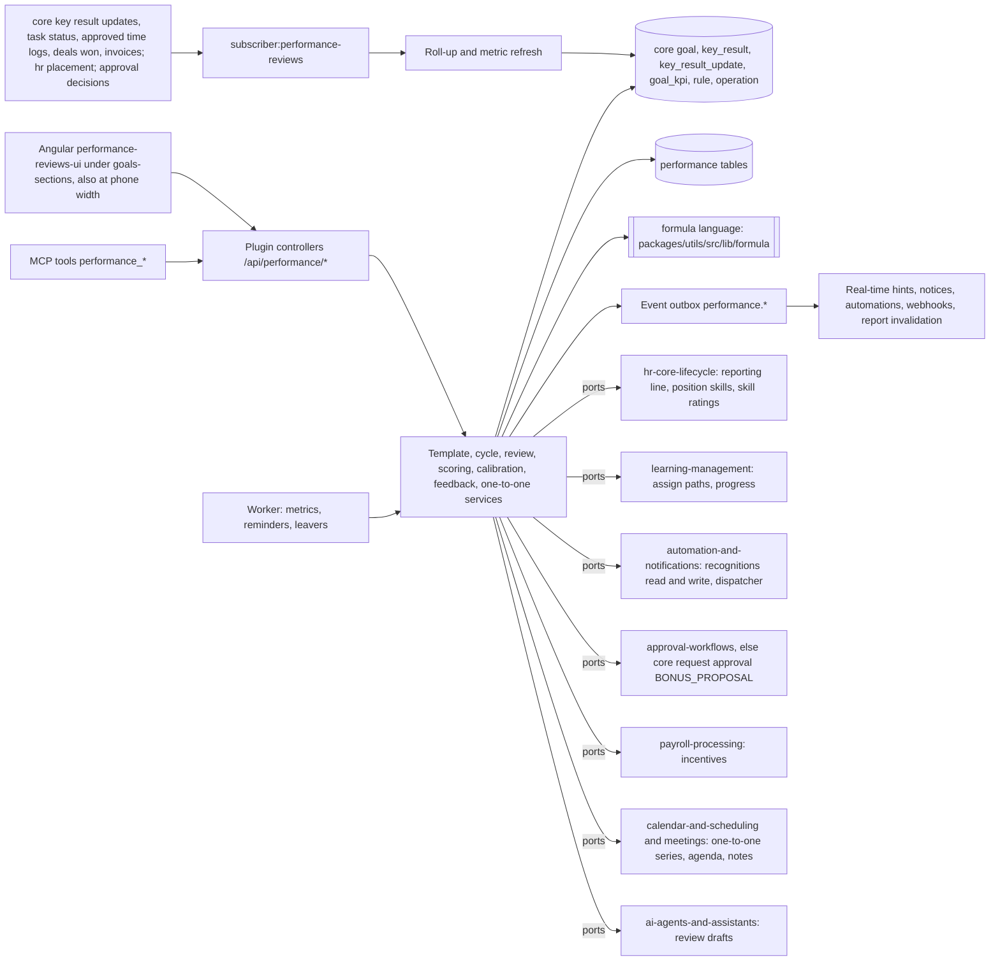

# Implementation Plan: Performance management

> Translates an approved `spec.md` into architecture and tech choices. The plan owns
> implementation details; the spec owns behaviour.

**Feature ID**: `performance-management`
**Spec**: `./spec.md`
**Tasks**: `./tasks.md`
**Status**: `Draft`
**Last updated**: 2026-11-23

---

## 1. Architecture Summary

Core keeps goals and everything under them (`packages/core/src/lib/goal`, `keyresult`, `keyresult-update` with
`keyresult-progress.ts`, `goal-kpi`, `goal-kpi-template`, `goal-template`, `keyresult-template`, `goal-time-frame`,
`goal-general-setting`) and their routes, pages and MCP tools. Filing a key result update already moves the key result
and its goal (`KeyResultUpdateService.create`, weighted `goalProgress` in `keyresult-progress.ts`). The new plugin
`@gauzy/plugin-performance-reviews` (`packages/plugins/performance-reviews`) adds focus areas, criteria, scales,
templates, the goal side tables (focus area, cycle, state, roll-up, metric binding), cycles, reviews, responses,
scoring, calibration, continuous feedback, one-to-one private notes, development areas, bonus proposals and the
assistant. Roll-up and metric refresh write ordinary key result updates through the core service, so the existing goal
pages show them.

**Built on what exists (no second store).** Settings are keys of `performance-reviews.settings.ts`; permissions are
plugin contributions. Cycle selection is core `rule` rows. Launch, release and metric refresh runs are operations of
the core runtime. Scores use the platform formula language of `custom-fields-and-forms`; questions and answers use the
question-set format of `custom-fields-and-forms`. Praise is a recognition entry of `automation-and-notifications`; one-to-ones are recurring
calendar events of `calendar-and-scheduling` whose shared agenda and notes are those of the meeting in `meetings`.
Bonus proposals go through `approval-workflows`, else a core request approval on the existing Approvals page. Notices go
through the notification dispatcher. Fields added to the existing goal dialogs go through two slots a core UI task
places there.



## 2. Tech Choices

| Concern | Choice | Rationale |
| ------- | ------ | --------- |
| Package | `packages/plugins/performance-reviews` (new), `performance-reviews-ui` (Angular); self review, feedback, one-to-one and check-in pages laid out for phone width | Principle I; one client |
| Core changes | none to tables; `pages.routes.ts` goal reports child gains a plugin-provided page with the existing goal reports page as fallback; slot ids `GOAL_FORM_FIELDS` and `KEY_RESULT_FORM_FIELDS` placed in the goal dialogs (§6); `RuleOwnerType.REVIEW_CYCLE`; `ApprovalPolicyTypesStringEnum.BONUS_PROPOSAL` | goal modules stay in core |
| Flag | tenant feature `FEATURE_PERFORMANCE_REVIEWS` in `performance-reviews.features.ts` (`defaultEnabled: false`), `@FeatureFlag` + `FeatureFlagGuard` on every controller | default off |
| Permissions | `performance-reviews.permissions.ts` contributions with `defaultFor` (§9); existing `GOALS_EDIT` kept for goal writes | no seed migration |
| Settings | organization-scoped keys of `performance-reviews.settings.ts` in the platform settings store (§3.1) | no settings table |
| Persistence | MultiORM entities on `TenantOrganizationBaseEntity`; the shared core migration helpers of `@gauzy/core` | Principle III |
| Formula | the platform formula language of `custom-fields-and-forms` (`packages/utils/src/lib/formula`), compiled on save, evaluated with a step budget | one language, no tenant code |
| Cycle selection | departments, branches, positions, levels, employment types, employee groups and minimum tenure as core `rule` rows (`ownerType = REVIEW_CYCLE`) over the employee context of `hr-core-lifecycle` (fallback: core employee columns), evaluated by `rule/rule.evaluator.ts` | one rule kernel; no filter column |
| Questions | template questions in the question-set format of `custom-fields-and-forms` (`packages/contracts/src/lib/question-set.model.ts`, platform field types: text, choices, yes or no, number, rating with its scale; key, label per language, required flag), edited and answered with its shared components; answers `{ fieldKey: value }` against the template snapshot of the review | one question and answer format with recruitment and other questionnaires |
| Skill proficiency | competency criteria rate on the 1–5 proficiency scale of `hr-core-lifecycle` and are written as proficiencies unchanged; for scores they convert to the review's scale linearly: `point = min + (rating − 1) × (max − min) / 4` | one proficiency scale |
| Goal writes | roll-up and metrics file key result updates through core `KeyResultUpdateService.create` under the organization's system-actor request context | one progress path; the author stamp stays truthful |
| Long work | core operation runtime (`packages/core/src/lib/operation/`): `PERFORMANCE_LAUNCH`, `PERFORMANCE_RELEASE` (aggregate = the cycle, one live per cycle), `PERFORMANCE_METRICS` (refresh batch); `202` with the operation reference; sweeps on `@ScheduledJob` recorded in `job_execution` | one run ledger with progress and resume |
| Recognition | praise written as a `recognition_entry` through `PERFORMANCE_RECOGNITIONS` (`automation-and-notifications`), read back as evidence beside formal `employee_award` rows | one recognition feed |
| One-to-ones | a series is a recurring event of `calendar-and-scheduling` (core recurrence; `sourceType` `performance.one_on_one`, manager and report as participants); its agenda items and shared notes are those of the meeting in `meetings` (`meeting_agenda_item`, carried items, notes); this plugin registers an agenda source (`registerMeetingAgendaSources`) for suggestions and keeps only each side's private notes | one event model, one agenda model |
| Notices | `NOTIFICATION_DISPATCHER.notify({ …, dedupeKey })` | the dispatcher's key is the only "already sent" record |
| AI | `PERFORMANCE_ASSISTANT` on the agent runtime of `ai-agents-and-assistants` (purpose `performance.review_draft`; run, model, usage and budget recorded there; fallback the `ai-chat` provider registry) | no run or usage table here |
| Events | `EventOutboxService.append` in the writing transaction; consumer `subscriber:performance-reviews` | at-least-once, deduplicated |
| Reports | `registerReportDatasets` / `registerReportDefinitions`, dashboard template `performance.overview` | report builder contract |

## 3. Data Model

All tables extend `TenantOrganizationBaseEntity`; JSON is `text` on SQLite and MySQL; scores are `numeric(8,4)`.

```ts
@MultiORMEntity('review', { mikroOrmRepository: () => MikroOrmReviewRepository })
export class Review extends TenantOrganizationBaseEntity implements IReview { /* columns below */ }
```

| Table | Columns (type) | Indexes and uniqueness |
| --- | --- | --- |
| `focus_area` | `name` varchar(120), `description` text, `isActive` | unique `(organizationId, name)` |
| `rating_criterion` | `name`, `description`, `kind` (`GENERAL`/`COMPETENCY`/`VALUE`), `skillId` uuid null (core `skill`), `examples` json, `isActive` | unique `(organizationId, name)` |
| `rating_scale` | `name`, `points` json (`value`, `label`, `description`), `bands` json (`min`, `max`, `point`), `isDefault` | idx `(organizationId, isDefault)` |
| `review_template` | `name`, `description`, `scaleId` fk, `focusAreas` json (`focusAreaId`, `weight`), `selfCriteria` json, `reviewerCriteria` json, `questions` json (question-set definition: `key`, labels, `type`, `required`, options or rating scale, response kind), `responseKinds` json, `includeCompetencies` bool, `version` | unique `(organizationId, name)` |
| `review_template_position` | `templateId` fk cascade, `organizationPositionId`, `employeeLevelId` null, `matchKey` varchar(80) (`<position>:<level or *>`) | unique `(organizationId, matchKey)` |
| `goal_performance` | `goalId` fk `goal` unique, `focusAreaId` null, `reviewCycleId` null, `state` (`NOT_STARTED`/`IN_PROGRESS`/`DONE`/`ARCHIVED`/`CLOSED`), `startDate` date null (null = start of the goal's time frame), `inAlignmentCycle` bool default false (set by the roll-up walk, FR-10); the end date is the goal's own `deadline` | idx `(organizationId, reviewCycleId, focusAreaId)` |
| `key_result_rollup` | `keyResultId` fk `key_result` unique, `mode` (`AVERAGE`/`WEIGHTED`), `lastComputedAt` | — |
| `key_result_metric` | `keyResultId` fk null unique, `kpiId` fk `goal_kpi` null unique, `metric` varchar(32) (`TRACKED_HOURS`/`TASKS_DONE`/`DEALS_WON_COUNT`/`DEALS_WON_AMOUNT`/`INVOICED`/`PAID`/`REPORT_MEASURE`), `filter` json, `reportDefinitionKey`, `measureKey` varchar(64) null, `fromDate`, `toDate`, `lastValue` numeric(20,6), `lastRefreshedAt`, `status` (`OK`/`SOURCE_UNAVAILABLE`/`ERROR`), `error` | idx `(organizationId, metric)`, `(status)` |
| `review_cycle` | `name`, `periodStart`, `periodEnd` date, `steps` json (dates), `goalScoring` (`PROGRESS`/`MANUAL`), `formula` text, `formulaCompiled` json, `kindWeights` json, `peerRules` json, `anonymous` bool, `minAnswers` int, `visibility` json, `distributionGuidance` json, `tolerance` int default 10, `bonusMatrix` json null, `goalTimeFrameId` uuid null (core `goal_time_frame`), `status` (`DRAFT`/`ACTIVE`/`CALIBRATING`/`RELEASED`/`CLOSED`), `launchedAt`, `releasedAt`, `closedAt`, `version`; selection is core `rule` rows (`ownerType = REVIEW_CYCLE`, `ownerId` = the cycle) | idx `(organizationId, status, periodStart)` |
| `review_participant` | `cycleId` fk, `employeeId`, `templateId`, `managerEmployeeId` null, `status` (`SELECTED`/`REMOVED`), `reason` text, `liveKey` varchar(80) (`<cycle>:<employee>`) | unique `(tenantId, liveKey)` |
| `review` | `cycleId`, `participantId` unique, `employeeId`, `managerEmployeeId`, `templateSnapshot` json, `step` varchar(16) (`NOT_STARTED`/`SELF`/`NOMINATION`/`FEEDBACK`/`MANAGER`/`CALIBRATION`/`RELEASED`/`ACKNOWLEDGED`/`INCOMPLETE`/`CLOSED`), `goalScore`, `selfScore`, `feedbackScore`, `managerScore`, `peerScore`, `upwardScore`, `competencyScore`, `finalScore`, `scoreError` text, `proposedPoint`, `managerPoint`, `finalPoint` int, `potential` varchar(8), `summary`, `strengths` text, `goalScoreFrozenAt`, `releasedAt`, `acknowledgedAt`, `employeeComment` text, `version` | unique `(cycleId, employeeId)`; idx `(organizationId, cycleId, step)`, `(managerEmployeeId, step)` |
| `review_focus_area_score` | `reviewId` fk cascade, `focusAreaId`, `weight` numeric(5,2), `completion`, `manualRating`, `score` | unique `(reviewId, focusAreaId)` |
| `review_response` | `reviewId` fk, `reviewerEmployeeId`, `kind` (`SELF`/`MANAGER`/`PEER`/`UPWARD`), `status` (`NOMINATED`/`REQUESTED`/`DECLINED`/`IN_PROGRESS`/`SUBMITTED`/`WITHDRAWN`), `nominatedByEmployeeId`, `approvedByEmployeeId`, `declineReason`, `answers` json (by field key of the template snapshot), `comments` text, `score`, `submittedAt`, `lockedAt`, `version` | unique `(reviewId, reviewerEmployeeId, kind)`; idx `(reviewerEmployeeId, status)` |
| `review_rating` | `responseId` fk cascade, `criterionId`, `rating` numeric(5,2), `comment` text | unique `(responseId, criterionId)` |
| `development_area` | `reviewId` null, `employeeId`, `title`, `actions` json, `dueDate`, `learningRef` varchar(120) null, `status` | idx `(employeeId, status)` |
| `calibration_session`, `calibration_change` | session: `cycleId`, `name`, `facilitatorEmployeeId`, `scope` json, `status`, `heldAt`; change: `sessionId`, `reviewId`, `oldPoint`, `newPoint`, `reason`, `changedByUserId`, `at` | idx `(cycleId)`; change append-only, idx `(reviewId, at)` |
| `feedback_note`, `feedback_request` (feedback from one employee to another, with a kind, a manager-only visibility and the request it answers, which a core `comment` on a record does not carry) | note: `giverEmployeeId`, `receiverEmployeeId`, `kind` (`SUGGESTION`/`NOTE`), `visibility` (`RECEIVER_AND_MANAGER`/`MANAGER_ONLY`), `text`, `recordType`, `recordId`, `requestId`; request: `requesterEmployeeId`, `aboutEmployeeId`, `topic`, `recipients` json, `dueDate`, `status` | idx `(receiverEmployeeId, createdAt)`, `(giverEmployeeId, createdAt)` |
| `one_on_one_note` (a table because it belongs to one occurrence of a recurring series, an event and a start time that is not a record a `comment` can point at, and only its author reads it) | `eventId` uuid (the series' calendar event), `occurrenceStartAt` timestamp, `authorEmployeeId`, `text` text, `version`; read only by its author | unique `(eventId, occurrenceStartAt, authorEmployeeId)` |
| `bonus_proposal` | `reviewId` unique, `employeeId`, `basis` json, `amount`, `currency`, `status` (`PROPOSED`/`AWAITING_APPROVAL`/`APPROVED`/`REJECTED`/`SENT`/`CANCELLED`), `approvalRef` uuid null (workflow instance or core request approval), `payrollRef` | idx `(organizationId, status)` |
| `review_assistant_draft` | `reviewId`, `requestedByUserId`, `aiRunId` uuid null (the run of `ai-agents-and-assistants`, holding provider, model and usage), `evidenceHash`, `statements` json (text, source refs), `flags` json | idx `(reviewId, createdAt)` |

Roll-up: on a key result update or goal progress change, the consumer walks up the alignment (`goal.alignedKeyResultId`)
with a visited set, recomputes each `key_result_rollup` key result from its aligned goals and files an update; the
visited set stops at an alignment cycle, which is marked on the goals and left out of roll-up (FR-10; refused at save
only with `performance.alignmentStrict` on). A task key result follows `task` status changes on the outbox. Metric refresh
reads core time logs (approved), tasks, deals and invoices through their services, or a report measure through
`REPORT_RUNS`, and files an update only when the value changed.

One-to-ones: creating a series asks `PERFORMANCE_CALENDAR` for a recurring event (cadence, weekday, time, time zone)
with the manager and the report; the meeting of each occurrence in `meetings` holds the shared agenda (items from both,
`CARRIED` items moved on, action items turned into tasks of the report by the meeting's task action) and the shared
notes; the plugin's agenda source suggests goals off track, key results without check-in, overdue tasks and feedback
received since the last occurrence; `one_on_one_note` keeps each side's private notes. Reviews read shared notes as
evidence through `PERFORMANCE_MEETINGS`.

### 3.1 Settings (`performance-reviews.settings.ts`, organization scope, settings store)

`performance.defaultScaleId`, `performance.alignmentStrict` (false; when true, alignment cycles and cross-cycle or
cross-focus-area alignments are refused), `performance.checkInReminderDays` (14),
`performance.assistantEnabled` (false), `performance.minGroupSize` (5), `performance.bonusApprovers` (json: employees
and teams deciding bonus proposals when `approval-workflows` is off).

### Migrations

**Migration timestamps**: `packages/plugins/performance-reviews` `1791000027100` to `1791000027199`.

- Plugin (`packages/plugins/performance-reviews/src/lib/database/migrations/`): `1791000027100-CreatePerformanceSetupTables` (focus areas, criteria, scales, templates, template positions),
  `1791000027110-CreateGoalPerformanceTables` (goal side table, roll-up, metrics), `1791000027120-CreateReviewCycleTables` (cycles,
  participants, reviews, focus area scores, responses, ratings, development areas), `1791000027130-CreateCalibrationAndBonusTables`,
  `1791000027140-CreateFeedbackAndOneOnOneTables` (`feedback_note`, `feedback_request`, `one_on_one_note`; free-text
  notes on a record are core `comment` rows),
  `1791000027150-CreatePerformanceAssistantTables` (drafts).
- Additive and idempotent per dialect; nullable `liveKey` columns with plain unique indexes replace partial indexes on
  MySQL and SQLite. No core table changes; foreign keys to `goal`, `key_result` and `goal_kpi` with `ON DELETE CASCADE`.

### Contracts

`packages/contracts/src/lib/performance.model.ts`: interfaces, enums (`ReviewCycleStatusEnum`, `ReviewStepEnum`,
`ResponseKindEnum`, `ResponseStatusEnum`, `GoalScoringEnum`, `GoalStateEnum`, `KeyResultMetricEnum`,
`FeedbackKindEnum`), score and evidence shapes, formula variables, event payloads and ports `IPerformanceTemplates`
(provided), `IPerformanceLearning`, `IPerformanceSkillRatings`, `IPerformanceRecognitions`, `IPerformanceCalendar`,
`IPerformanceMeetings`, `IPerformanceAssistant`, `IPerformanceMetricSource` (multi-provider). `RuleOwnerType.REVIEW_CYCLE`
and `ApprovalPolicyTypesStringEnum.BONUS_PROPOSAL` in their existing contract files.

## 4. API Surface

Routes under `/api/performance` with `TenantPermissionGuard`, `PermissionGuard`, `FeatureFlagGuard`; cursor
pagination; `Idempotency-Key` on launch, release and proposals; `version` on updates; Swagger decorators. Launch and
release answer `202` with an operation reference, read at `/api/operations/:id` (core).

| Method | Endpoint | Permission | Description (request → response) | Status |
| ------ | -------- | ---------- | -------------------------------- | ------ |
| `GET/PUT` | `/performance/settings` | `PERFORMANCE_SETTINGS_EDIT` | the `performance.*` keys of the settings store | New |
| `GET/POST/PUT/DELETE` | `/performance/{focus-areas,criteria,scales,templates}`, `PUT /templates/:id/positions` | read: any member; write: `PERFORMANCE_SETTINGS_EDIT` | masters; weight validation errors | New |
| `GET/PUT` | `/performance/goals/:goalId` | `GOALS_EDIT` or owner / lead | focus area, cycle, state, start date | New |
| `GET` | `/performance/goals/tree?root=&timeFrameId=&cycleId=&teamId=` | any member (goal visibility as today) | lazy alignment tree with progress | New |
| `PUT/DELETE` | `/performance/key-results/:id/rollup`, `/performance/key-results/:id/metric`, `/performance/kpis/:id/metric`; `POST …/metric/refresh` | `GOALS_EDIT` | binding, `preview` shows the current value | New |
| `GET/POST/PUT` | `/performance/cycles`, `/:id`; `POST /:id/{preview-selection,launch,participants,remove-participant,release,close}` | `PERFORMANCE_CYCLE_MANAGE` | cycle with its selection rules; selection list; operation reference | New |
| `GET` | `/performance/cycles/:id/progress`, `POST /cycles/:id/remind` | `PERFORMANCE_CYCLE_MANAGE` | counts and gaps; reminder result | New |
| `GET` | `/performance/reviews`, `/reviews/:id`, `/reviews/:id/evidence` | own, manager chain, assigned reviewer, calibrator, `PERFORMANCE_REVIEWS_VIEW` | review shaped by viewer and step | New |
| `POST/PUT` | `/performance/reviews/:id/{self,nominations,manager}`, `/reviews/:id/responses`, `/responses/:id` (`submit`, `decline`, `withdraw`) | `PERFORMANCE_SELF_SERVICE` / `PERFORMANCE_REVIEW_MANAGE` / requested reviewer | response DTOs; scores in response | New |
| `POST` | `/performance/reviews/:id/{acknowledge,development-areas,assign-learning,assistant-draft}` | employee / manager | as named | New |
| `GET/POST/PUT` | `/performance/calibration-sessions`, `/:id`; `POST /:id/changes` | `PERFORMANCE_CALIBRATE` | distribution, grid, change with reason | New |
| `GET/POST` | `/performance/bonus-proposals`; `POST /:id/submit` | `PERFORMANCE_CYCLE_MANAGE` | proposals; approval request (workflow or core request approval) | New |
| `GET/POST` | `/performance/feedback`, `/performance/feedback-requests` | `PERFORMANCE_SELF_SERVICE` | notes and requests (visibility filtered); praise is posted as a recognition entry | New |
| `GET/POST/PUT` | `/performance/one-on-ones` (series as calendar events), `/one-on-ones/:eventId/notes` (own private notes) | manager or report of the series | series, private notes; agenda and shared notes through the meeting | New |
| `GET` | `/performance/analytics/{overview,distribution,completion,goals,calibration,feedback}` | `PERFORMANCE_REPORTS_VIEW` | dataset providers | New |

Errors: `400` with stable codes (`PERFORMANCE_WEIGHTS_NOT_100`, `PERFORMANCE_FORMULA_INVALID`,
`PERFORMANCE_SCORING_LOCKED`, `PERFORMANCE_CYCLE_CLOSED`, `PERFORMANCE_SELF_FEEDBACK`, `PERFORMANCE_ALIGNMENT_CYCLE`
(strict alignment only),
`PERFORMANCE_REVIEWS_OPEN`, `PERFORMANCE_ONE_ON_ONES_UNAVAILABLE`), `403`, `404` (other organization, flag off), `409`
(`ENTITY_VERSION_CONFLICT`, duplicate review, a live launch or release operation).

## 5. Events, Real-Time and Notifications

| Event | Emitted when | Consumers |
| ----- | ------------ | --------- |
| `performance.cycle.launched` / `.released` / `.closed` | cycle lifecycle | notices, automations, report invalidation |
| `performance.review.step_changed`, `performance.review.acknowledged` | review moves | inbox items, notices, real-time |
| `performance.response.requested` / `.submitted` / `.declined` | responses | inbox item for the reviewer, score recompute |
| `performance.calibration.changed` | point changed | audit, bonus proposal refresh |
| `performance.goal.progress_rolled_up`, `performance.metric.refreshed` | roll-up or metric update | real-time goal and review hints |
| `performance.feedback.given` | as named | receiver notice |
| operation events of `PERFORMANCE_LAUNCH`, `PERFORMANCE_RELEASE`, `PERFORMANCE_METRICS` | progress and completion | cycle page progress |
| consumed: key result updates and goal changes (core), task status changes, approved time logs, deal won, invoice issued and paid | sources change | roll-up, task key results, metric refresh |
| consumed: `hr.event.applied`, `hr.separation.completed`; `workflows.approval.decided` (`performance.bonus_proposal`); settler of core request approval `BONUS_PROPOSAL` | placement, leavers, approvals | manager reassignment, incomplete reviews, proposal status |

Real-time: hints `record:Review:<id>`, `goal-tree:<organizationId>` on the platform channel. Inbox items through
`INBOX_ITEM_WRITER` (responses requested, step due, release). Notification categories
(`registerNotificationCategories`): `performance.review`, `performance.feedback`, `performance.check-in`, sent through
`NOTIFICATION_DISPATCHER` with de-duplication keys (`<category>:<reviewId or keyResultId>:<step or period>:<recipient>`).
One-to-one reminders are the calendar event's own reminders. Email templates for launch, reminders, release and
feedback requests.

## 6. UI Surface

- Angular plugin `packages/plugins/performance-reviews-ui` registered in `apps/gauzy/src/plugin-ui.config.ts`, routes
  through the `goals-sections` page location of `apps/gauzy/src/app/pages/pages.routes.ts`: `/pages/goals/tree`,
  `/pages/goals/cycles` (+ `/:id`, progress), `/pages/goals/reviews` (mine, my team, all) and `/reviews/:id`,
  `/pages/goals/calibration/:id`, `/pages/goals/feedback`, `/pages/goals/one-on-ones` (hidden without
  `calendar-and-scheduling` and `meetings`), `/pages/goals/performance-settings`. My review, responses, feedback,
  one-to-ones and check-ins are laid out for phone width.
- The goal reports child route of `pages.routes.ts` loads the plugin's report page when it is registered,
  `FEATURE_PERFORMANCE_REVIEWS` and `FEATURE_GOAL_REPORT` are on and the report builder is available (its plugin
  loaded and `FEATURE_REPORT_BUILDER` on for the tenant); otherwise the existing goal reports page
  (`WorkInProgressModule`) as today, so a tenant that never switched the feature on sees no change.
- The existing goal dialogs (`apps/gauzy/src/app/pages/goals/edit-objective`, `edit-keyresults`) have no extension
  slot: a core UI task adds the slot ids `GOAL_FORM_FIELDS` and `KEY_RESULT_FORM_FIELDS` to
  `packages/plugin-ui/src/lib/plugin-extension/page-extension-slot.types.ts`, renders them in the two dialogs and hands
  the saved goal or key result to the extension after the dialog's own save; the plugin registers its focus area,
  cycle, roll-up and metric fields there, rendered only while `FEATURE_PERFORMANCE_REVIEWS` is on. Nothing changes
  without the plugin or with the feature off.
- With `approval-workflows` off, bonus proposals appear on the existing Approvals page (`apps/gauzy/src/app/pages/approvals`)
  as requests of type `BONUS_PROPOSAL`.
- Lists are saved views; forms honour custom fields; i18n keys `PERFORMANCE.*` in every locale; rating controls are
  radio groups with labelled points; the grid and charts have table alternatives.

## 7. MCP Tools, SDKs and Integrations

`packages/mcp-server/src/lib/tools/performance.ts` (registered in `register-all-tools.ts`); `goals.ts` and
`key-results.ts` unchanged:

| Tool | Input | Output |
| --- | --- | --- |
| `performance_cycles_list`, `performance_cycle_progress` | filters; cycle | cycles; counts and gaps |
| `performance_review_get` | review | review shaped by the caller, with evidence |
| `performance_goal_tree` | root, time frame, cycle | alignment tree with progress |
| `performance_cycle_launch` | cycle, `preview` (default true) | selection and missing templates, or operation reference |
| `performance_feedback_request`, `performance_feedback_give` | people, topic or text | request or note (praise as a recognition) |
| `performance_response_submit` | review, kind, ratings, comments, `preview` | computed score, or response |
| `performance_summary_draft` | review | statements with sources and flags |
| `performance_key_result_bind_metric` | key result, metric, filter, `preview` | current value, or binding |

Report datasets: `performance.reviews`, `performance.responses`, `performance.calibration_changes`,
`performance.goals` (provider over core goals with the side table), `performance.feedback`; definitions for spec
§3.11 and the dashboard template `performance.overview`. Print template (`registerPrintTemplates`): review summary.
Import profiles: focus areas, criteria, templates, historical reviews. OpenAPI grows additively; SDKs regenerated.

Ports consumed (optional, bound in `plugin-composition.ts`): `HR_REPORTING_LINE`, `HR_DIRECTORY`,
`PERFORMANCE_SKILL_RATINGS` (adapter over `hr-lifecycle` skill ratings, source `REVIEW`, 1–5 scale),
`PERFORMANCE_LEARNING` (`learning-management`: assign a path or course, read progress), `PERFORMANCE_RECOGNITIONS`
(`automation-and-notifications` recognition entries: read for evidence, write for praise; unbound: praise is not
offered), `PERFORMANCE_APPROVALS` → `IApprovalGateway` (fallback: core `request_approval` of type `BONUS_PROPOSAL`,
approvers from `performance.bonusApprovers`, decided on the existing Approvals page, with its decision gate in
`linked-document-decision.gate.ts` and its settler through the core settler registry of `approval-workflows`),
`PAYROLL_ADDITIONAL_PAY` (incentives), `PERFORMANCE_CALENDAR` (recurring events of `calendar-and-scheduling`),
`PERFORMANCE_MEETINGS` (`meetings`: agenda items, shared notes, `registerMeetingAgendaSources`), `PERFORMANCE_ASSISTANT`
(agent runtime; fallback `ai-chat` provider registry), `PERFORMANCE_PRINT`, `REPORT_RUNS` (report measures),
`NOTIFICATION_DISPATCHER`, multi-provider `PERFORMANCE_METRIC_SOURCE` (time, tasks, deals, invoices built in; plugins add
more). Port provided: `PERFORMANCE_TEMPLATES` (`IPerformanceTemplates`: default template of a position, template read)
for `hr-lifecycle` positions and probation reviews.

## 8. Background Jobs

| Trigger | When | What it does | Idempotency |
| ------- | ---- | ------------ | ----------- |
| operation `PERFORMANCE_LAUNCH` | cycle launch | creates participants and reviews in steps of 200 with progress | one live operation per cycle; `liveKey` per employee |
| operation `PERFORMANCE_RELEASE` | release | releases reviews, writes skill ratings, creates bonus proposals | one live operation per cycle; review step + version; proposal unique per review |
| `performance.metrics.refresh` | hourly + on source events (coalesced per key result per minute) | runs a `PERFORMANCE_METRICS` operation over the due bindings; files updates when changed | value comparison; update keyed by operation and key result |
| outbox consumer roll-up | key result update, goal change, task status | walks alignment upward, files roll-up updates | visited set; event id per key result |
| `performance.reminders` | every 15 min | step due dates, nominations, check-ins, through `NOTIFICATION_DISPATCHER` | dispatcher key per recipient, record and step |
| `performance.leavers` | daily | marks reviews incomplete after end of work | review step |

The worker loads `PerformanceReviewsSchedulePlugin` (schedules only, recorded in `job_execution`); the API loads
`PerformanceReviewsPlugin`; operations run on the core runtime with its lease and stalled-run recovery.

## 9. Security & Permissions

- New keys, contributed in `performance-reviews.permissions.ts`: `PERFORMANCE_SETTINGS_EDIT`,
  `PERFORMANCE_CYCLE_MANAGE`, `PERFORMANCE_REVIEWS_VIEW`, `PERFORMANCE_REVIEW_MANAGE`, `PERFORMANCE_CALIBRATE`,
  `PERFORMANCE_REPORTS_VIEW`, `PERFORMANCE_SELF_SERVICE`. Existing `GOALS_EDIT` keeps guarding goal writes.
- Default roles (`defaultFor`): super admin and admin all; manager `PERFORMANCE_REVIEW_MANAGE`,
  `PERFORMANCE_REPORTS_VIEW`, `PERFORMANCE_SELF_SERVICE`; employee `PERFORMANCE_SELF_SERVICE`.
- Review access by role in the review (employee after release, manager chain through `HR_REPORTING_LINE`, assigned
  reviewer for their own response, calibrators of the session, `PERFORMANCE_REVIEWS_VIEW`); anonymous responses carry
  no reviewer id in any response to the employee; group-size suppression in reports outside HR. One-to-one private notes
  are read by their author only.
- Formulas compiled to the formula AST and evaluated with a step budget; no tenant code; unknown variables refused.
- Assistant input is the review's evidence only; drafts never write points; runs logged on the agent runtime.
- Separation of duties: calibrators cannot change their own review; bonus proposals go through approval (workflow or
  core request approval; nobody approves their own request).

## 10. Observability

- Score history per review, calibration log, launch, release and metric operations with counts and failures.
- Metrics: reviews per step, overdue responses, metric refresh latency and source failures, roll-up depth.
- Structured logs for formula evaluation errors per review; Sentry breadcrumbs on launch and release operations.

## 11. Phased Rollout

1. **Phase 1 — Surface and connect what exists** (flag off): contracts, plugin scaffold, permission and settings
   contributions, focus areas, criteria, scales, goal side table, goal dialog slots, roll-up, task key results, goal
   tree, check-in reminders, goal progress report on the existing reports route, read MCP tools.
2. **Phase 2 — Depth**: templates, cycles with rule-based selection and launch, reviews, self, peer, upward and manager
   responses, scoring with formula, cycle progress, release, acknowledgement, competencies, recognitions as evidence,
   reports and dashboard, print, import.
3. **Phase 3 — Advanced capabilities**: metric bindings from tracked work, continuous feedback and praise, one-to-ones
   on calendar events and meetings, calibration sessions with distribution and grid, assistant drafts with bias flags,
   learning assignment, bonus proposals, mutating MCP tools.
4. **Phase 4 — General availability**: the feature is off by default; after the trial period it may be switched on by default for new tenants only; existing tenants keep their setting until an administrator changes it.

## 12. Constitution Reconciliation

- I Plugin-first: `performance-reviews` and `-ui`; core goal modules used through their services; core gains two
  slot ids in the goal dialogs, one rule owner type and one approval type.
- II Tenant/organization scoping: every table on the tenant-organization base; review access by role and reporting line.
- III Both ORMs, additive migrations: MultiORM entities; create-table migrations only.
- IV Default-off flag; nothing removed: `FEATURE_PERFORMANCE_REVIEWS`; goal routes, pages, MCP tools and the existing goal reports page kept.
- V Contracts and API first: `performance.model.ts` and REST before UI; additive OpenAPI.
- VI Permissions, privacy, security: seven keys, anonymity thresholds, formula without tenant code, assistant limits.
- VII Real-time through the event bus: outbox events, operation events and record hints on the platform channel.
- VIII i18n and accessibility: `PERFORMANCE.*` keys in every locale; accessible ratings, grid and charts.
- IX Tests: weights, roll-up, metric refresh, scoring goldens, guards, calibration, release, migrations per dialect.
- X Behaviour-first spec: implementation lives here.
- XI Documentation describes our platform only.

## 13. Risks & Mitigations

| Risk | Likelihood | Impact | Mitigation |
| ---- | ---------- | ------ | ---------- |
| Roll-up loops or storms | Medium | Medium | alignment cycle guard, visited set, coalescing per key result, depth metric |
| Metric sources change or are unloaded | Medium | Low | multi-provider port, `SOURCE_UNAVAILABLE` state, last value kept |
| Anonymity broken by small teams | Medium | High | minimum answers, unattributed shapes, report suppression |
| Formula errors on some reviews | Medium | Medium | validation on save, per-review error, default formula fallback for preview |
| Assistant output read as a rating | Low | High | no write path, flags shown, audit of drafts |
| Large launches block the API | Low | Medium | background operations in steps, resumable |
| One-to-ones unavailable without calendar and meetings | Medium | Low | page hidden with the reason; reviews still read feedback and recognitions |

## 14. References

- Spec: `./spec.md` · Tasks: `./tasks.md`
- [platform architecture](../../architecture/business-suite.md) §2.5, §3.6, §3.8, §3.9, §3.11, §3.12, §6
- Plans: `../custom-fields-and-forms/plan.md` (formula language, field types), `../automation-and-notifications/plan.md`
  (recognition entries, dispatcher), `../calendar-and-scheduling/plan.md` (recurring events), `../meetings/plan.md`
  (agenda items, agenda sources)
- Code: `packages/core/src/lib/goal`, `keyresult`, `keyresult-update/keyresult-progress.ts`,
  `keyresult-update/keyresult-update.service.ts`, `goal-kpi`, `goal-time-frame`, `goal-general-setting`, `skills`,
  `rule/rule.evaluator.ts`, `operation`, `request-approval/linked-document-decision.gate.ts`, `employee-award`,
  `event-outbox`, `packages/scheduler`, `packages/plugins/inbox/src/lib/database/migration-helpers.ts`,
  `packages/plugin-ui/src/lib/plugin-extension/page-extension-slot.types.ts`,
  `apps/gauzy/src/app/pages/pages.routes.ts` (`goals-sections`), `apps/gauzy/src/app/pages/goals`,
  `apps/api/src/plugin-composition.ts`, `packages/mcp-server/src/lib/tools/goals.ts`, `key-results.ts`
