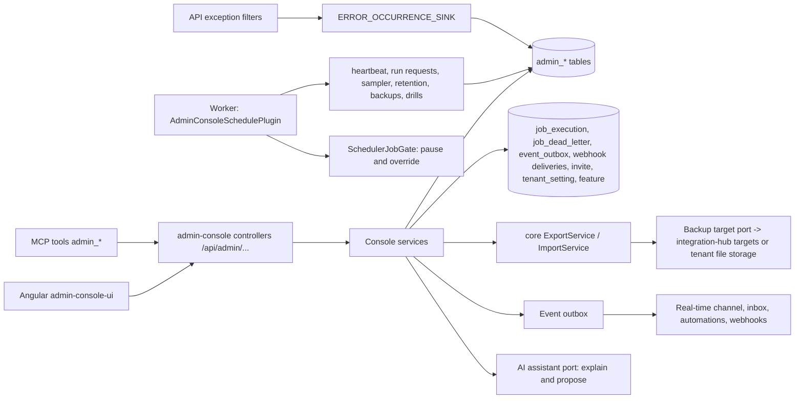

# Implementation Plan: Platform administration

> Translates an approved `spec.md` into architecture and tech choices. The plan owns
> implementation details; the spec owns behaviour.

**Feature ID**: `platform-administration`
**Spec**: `./spec.md`
**Tasks**: `./tasks.md`
**Status**: `Draft`
**Last updated**: 2026-11-23

---

## 1. Architecture Summary

A new plugin `@gauzy/plugin-admin-console` (`packages/plugins/admin-console`) owns the console tables, endpoints and
jobs; `admin-console-ui` holds the Angular pages. It reads what the platform already records instead of building a
second copy: the run ledger (`job_execution`) and dead letters (`job_dead_letter`) of core, the health service, the
event outbox and webhook deliveries, invitations, languages, features, tenant and global settings, the export and
import services, the anonymous statistics plugin (`ever-stats`) and the changelog plugin. Long operations of the
catalogue, backups, restores and drills are core durable operations (`packages/core/src/lib/operation/`,
`OperationRegistry`, `/api/operations`). Existing pages are extended rather than copied: bulk invitations extend
`POST /invite/emails` and its page, the users list is the existing `apps/gauzy/src/app/pages/users` page, the
deployment switches are a section of the existing `settings/feature` page, and the tenant's usage choice feeds the
`ever-stats` collector. Three small, optional, additive seams are added outside the plugin, each defaulting to today's
behaviour when nothing is bound:

1. `SchedulerJobGate` in `packages/scheduler` (next to `SchedulerRunRecorder`): asked before each tick whether a job
   is paused and which schedule applies; `triggerNow(jobId, { trigger, requestedBy })` gains an optional argument.
2. `ERROR_OCCURRENCE_SINK` in core: `ApiExceptionFilter` and `DatabaseErrorFilter` hand 5xx errors to it after the
   reply is written (fire and forget, bounded queue).
3. `TRANSLATION_OVERRIDE_SOURCE` in core i18n and `@gauzy/ui-core/i18n`: the translate loader merges tenant overrides
   over the shipped catalogue; email-template and print rendering ask the same source.

**Usage meter (the platform's one store of usage counters).** This plan adds it to the existing core `stats` module
(`packages/core/src/lib/stats/`, beside `GET /stats/global`) rather than to the console plugin, because
`access-control-and-security` (daily counts of agent principals and credentials) and `ai-agents-and-assistants`
(tokens and cost per agent, purpose, user and organization) write to it without the console loaded:
`UsageMeterService.add({ subjectKind, subjectId, metric, unit, value, at })` and `read(...)`, bound to the contracts
token `USAGE_METER`. Adoption metrics use the metric names and the allow-list of the `ever-stats` collector
(`packages/plugins/ever-stats/src/lib/ever-stats-collector.service.ts`), so the installation report and the adoption
view count the same things. Per-minute rates stay in the core throttler; no plugin keeps a counter table of its own.

**What this plugin arranges and what it does not decide.** Menu order, grouping, renaming, links, home tiles and landing
routes are arranged here (navigation layout); which areas and pages an audience may reach is decided by the page gates
of `access-control-and-security`. The menu shown is the layout filtered by permissions, features and gates; a layout
never shows a gated page, and a landing route on a gated page falls back to the next layer. The tenant layer is stored
in the tenant UI preferences (`tenant-ui-preferences.controller.ts`), the user layer in `user.uiPreferences`
(`packages/core/src/lib/user/ui-preferences.util.ts`); only role and profile layers need `admin_navigation_layout`.

**Retention.** The log kinds of this plugin (and the core logs it surfaces) are declared to the platform's one
retention model of `access-control-and-security` (`RETENTION_SOURCES`) with their shipped defaults; the operator sets
installation defaults for logs without a tenant through the global settings writer. The existing cleanups of the job
ledger and idempotency keys (`job-execution.service.ts`, `idempotency/idempotency-cleanup.worker.ts`) stay and read
their period from it, with their current periods as the declared defaults. Kinds that nothing purges today (expired
invitations, call logs, delivered outbox rows, discarded dead letters) are declared with the default `KEEP`, so no
existing record is removed until an administrator sets a period. While that plugin is not loaded, `admin.retention`
applies the declared defaults.



The operator rule is the existing one (`global-setting-writer.ts`: listed in `EVER_OPERATOR_USER_IDS`, or the super
admin of a single-tenant installation), wrapped in an `InstallationOperatorGuard` used on every installation route.

## 2. Tech Choices

| Concern | Choice | Rationale |
| ------- | ------ | --------- |
| Package | `packages/plugins/admin-console` (new), `admin-console-ui` (new); usage meter in the core `stats` module | Principle I; core keeps the ledger, probes and counters |
| Contributions | permissions (with `defaultFor`), the feature code and the tenant settings (`admin.telemetry.*`, `admin.backup.*`) declared as `PluginContributions` on `@GauzyCorePlugin`; values in `tenant_setting` | no seed migration, no one-row settings table |
| Backup and drill schedules | rules of the platform's one recurrence implementation (the frequency and period-claim rules of `invoice-schedule`, lifted to core by `business-document-engine`), one backup and one drill claimed per period | one recurrence implementation |
| Long operations | catalogue operations, backups, restores and drills registered in core `OperationRegistry` (`admin.operation.<key>`, `admin.backup`, `admin.restore`, `admin.drill`); preview and scope kept in the operation's input | one operations ledger, listed by `/admin/my-operations` |
| Flag | tenant feature `FEATURE_ADMIN_CONSOLE` in `admin-console.features.ts` (`defaultEnabled: false`), `@FeatureFlag` + `FeatureFlagGuard` on every controller (pattern: `subscription.features.ts`); query page behind `GAUZY_ADMIN_QUERY_CONSOLE_ENABLED`, database dumps behind `GAUZY_ADMIN_DB_DUMP_ENABLED` | default off |
| Persistence | MultiORM entities; tenant pages on `TenantOrganizationBaseEntity` (organization null where tenant-wide); installation rows with `tenantId` null (as `job_execution` already does); the shared core migration helpers of `@gauzy/core` | Principle III |
| Worker split | `AdminConsoleSchedulePlugin` loaded in `apps/worker/src/plugins.ts`; API loads `AdminConsolePlugin`; without a queue the API runs the same passes on in-process timers under the scheduler's lock | same split as task automations |
| Backups | streamed archive built from `repositories.service.ts` table registry in "backup mode" (no redaction of ciphertext, all tables of the tenant), manifest with per-type counts and SHA-256; AES-256-GCM per tenant key. Policy settings `admin.backup.schedule`, `.copies` (7), `.target`, `.encrypt` (true) and `.includeFiles` (true: data and files, FR-87). With files included, a file step follows the tables: it walks the file references of the tenant's rows (every column the table registry marks as a stored file with its `storageProvider`, such as `image_asset`, `screenshot` and plugin file columns), reads each through the core `FileStorage` provider the row names (`getFile`), streams it into the archive as `files/<provider>/<key>`, and adds to the manifest one entry per file (row reference, key, size, SHA-256) plus file count and bytes; a file the provider cannot read is listed as missing and fails verification. Restore writes the files back through the target tenant's storage provider before the rows are released, rewriting key and provider columns where they differ; the organization mode restores the files its records reference; verification checks every file entry by checksum after writing | dialect-independent, verifiable, files included |
| Error capture | sink port, bounded in-memory buffer (1,000), batch insert every 5 s; fingerprint = hash(type, normalised message, top 5 frames) | never slows the reply |
| Health history | samples every 5 min into `admin_health_sample`; hourly roll-up after 7 days | 30-day history at constant cost |
| Translations | overrides per tenant and language; client loader merges `GET /admin/translations/:lang/overrides` (ETag) over the shipped JSON; record values in `translated_value` only for types without translation tables (the product family keeps its tables) | no release needed |
| Telemetry | tenant choices as settings; the `ever-stats` collector excludes tenants that do not share usage (default share), and the telemetry preview calls the `ever-stats` preview; the product-analytics choice reads and writes the existing product-analytics tenant settings, whose tenant → global → environment resolution stays the default | one report, one preview; no tenant's analytics stops without its choice |
| Real-time | console events through the event outbox; record-change hints on the platform channel | Principle VII |
| AI | assistant through the in-app assistant's provider port and MCP tools; read-only plus confirmed operations | agents are users |

## 3. Data Model

### New or changed entities

No existing table changes. `admin_*` rows of installation scope have `tenantId` null and are read only through
operator routes. New core table (usage meter, in `packages/core/src/lib/stats/`): `usage_counter`.

```ts
@MultiORMEntity('admin_error_group', { mikroOrmRepository: () => MikroOrmAdminErrorGroupRepository })
export class AdminErrorGroup extends TenantOrganizationBaseEntity implements IAdminErrorGroup { /* below */ }
```

| Table | Columns (type) | Indexes and uniqueness |
| --- | --- | --- |
| `admin_job_summary` | `jobId` varchar(128), `jobName`, `ownerPlugin` varchar(64), `scheduleDeclared` varchar(64), `lastRunAt`, `lastStatus` varchar(24), `lastDurationMs` int, `nextRunAt` null, `runs14d` int, `failures14d` int, `consecutiveFailures` int | unique `(jobId)` |
| `admin_job_control` | `jobId`, `paused` bool, `scheduleOverride` varchar(64) null (cron or `every:<ms>`), `reason` text, `changedById`, `version` int | unique `(jobId)` |
| `admin_job_run_request` | `jobId`, `requestedById`, `status` (`PENDING`/`TAKEN`/`DONE`/`REFUSED`), `takenByNode`, `executionId` null, `idempotencyKey` | unique `(idempotencyKey)`; idx `(status, createdAt)` |
| `admin_worker_heartbeat` | `nodeId` varchar(128), `processKind` (`API`/`WORKER`), `release` varchar(40), `startedAt`, `lastSeenAt`, `jobs` json, `queues` json (name, waiting, active, delayed, completed, failed, oldestWaitingMs, perMinute), `plugins` json | unique `(nodeId)`; idx `(lastSeenAt)` |
| `admin_error_group` | `fingerprint` char(64), `kind` (`HTTP`/`JOB`/`DELIVERY`), `errorType` varchar(128), `message` varchar(512), `routeOrJob` varchar(255), `status` (`NEW`/`SEEN`/`RESOLVED`/`IGNORED`), `resolvedInRelease` null, `firstSeenAt`, `lastSeenAt`, `count` bigint, `tenantsAffected` int, `releases` json | unique `(fingerprint)`; idx `(status, lastSeenAt)` |
| `admin_error_occurrence` | `groupId` fk, `occurredAt`, `traceId` varchar(64), `tenantId` null, `organizationId` null, `userId` null, `httpStatus` int null, `method`, `path` varchar(512), `recordType`, `recordId`, `jobExecutionId` null, `deadLetterId` null, `release`, `stack` varchar(4096) | idx `(groupId, occurredAt)`, `(tenantId, occurredAt)`, `(traceId)` |
| `admin_health_sample` | `signal` varchar(64), `nodeId` null, `sampledAt`, `value` numeric(20,6), `status` (`OK`/`WARN`/`DOWN`), `detail` json, `resolution` (`RAW`/`HOUR`) | idx `(signal, sampledAt)` |
| `admin_health_threshold` | `signal`, `operator` (`GT`/`LT`), `value`, `durationMinutes`, `severity`, `recipients` json, `enabled`, `isDefault` | unique `(signal, severity)` |
| `admin_health_alert` | `thresholdId` fk, `openedAt`, `closedAt` null, `peakValue`, `notifiedAt` | idx `(closedAt, openedAt)` |
| `admin_backup` | `kind` (`TENANT`/`INSTALLATION`), `trigger` (`SCHEDULED`/`MANUAL`/`SAFETY`/`DRILL`), `status` (`RUNNING`/`VERIFIED`/`FAILED`/`DELETED`), `operationId` null, `startedAt`, `finishedAt`, `sizeBytes` bigint, `objectKey` varchar(512), `release`, `schemaVersion` varchar(40), `manifest` json (per type counts and hashes; with files, the file entries, count and bytes), `includesFiles` bool, `keyRef` varchar(128), `pinned` bool, `error` text (the register of stored archives; the run is a core operation) | idx `(tenantId, status, startedAt)` |
| `admin_restore` | `backupId` fk, `mode` (`NEW_TENANT`/`SAME_TENANT`/`ORGANIZATION`/`DRILL`), `targetTenantId`, `organizationId` null, `safetyBackupId` null, `operationId`, `preview` json, `report` json, `startedById` (status and progress read from the operation; the row keeps the preview and report people read later) | idx `(tenantId, createdAt)` |
| `admin_restore_drill` | `backupId`, `restoreId`, `operationId`, `durationMs`, `differences` json, `recordsRestored` bigint (the drill report the health page and FR-122 read) | idx `(tenantId, createdAt)` |
| `admin_setup_state` | `wizardStatus` (`OPEN`/`COMPLETED`/`DISMISSED`), `steps` json (key, status, appliedAt, error), `persona` json, `proposal` json, `version` | unique `(tenantId)` |
| `admin_checklist` | `key` varchar(96), `ownerPlugin`, `title`, `steps` json (key, kind, target, shared, order, hidden), `roleIds` json, `isCustom` bool, `enabled` | unique `(tenantId, key)` |
| `admin_checklist_progress` | `checklistId` fk, `userId` null (null = shared), `userKey` varchar(36) not null (the `userId`, or `*` for a shared step; written with it), `stepKey`, `doneAt`, `source` (`EVENT`/`MANUAL`) | unique `(checklistId, userKey, stepKey)` |
| `admin_tour` | `name`, `pageKey` varchar(128), `steps` json (anchor, title, text, position, nextOnClick, condition), `nextTourId` null, `audience` json, `published` bool, `keepRecord` bool, `version` | idx `(tenantId, pageKey, published)` |
| `admin_tour_progress` | `tourId` fk, `userId`, `stepIndex` int, `status` (`STARTED`/`FINISHED`/`DISMISSED`) | unique `(tourId, userId)` |
| `admin_help_item` | `pageKey`, `kind` (`LINK`/`ARTICLE`/`TOUR`/`VIDEO`), `title`, `url` null, `articleId` null, `order` | idx `(tenantId, pageKey)` |
| `admin_navigation_layout` | `layer` (`ROLE`/`PROFILE`), `subjectId`, `menu` json (order, groups, labels, links; no hide, which is a page gate of `access-control-and-security`), `header` json, `home` json, `landingRoute` null, `appLinks` json, `version` (the tenant layer lives in the tenant UI preferences, the user layer in `user.uiPreferences`) | unique `(tenantId, layer, subjectId)` |
| `admin_translation_override` | `language` varchar(10), `key` varchar(255), `value` text, `shippedHash` char(16), `updatedById` | unique `(tenantId, language, key)` |
| `admin_translation_proposal` | `language`, `key`, `proposedValue`, `status` (`PENDING`/`ACCEPTED`/`REJECTED`), `proposedById`, `reviewedById`, `source` (`USER`/`AI`) | idx `(tenantId, status)` |
| `translated_value` | `entityType` varchar(64), `entityId` uuid, `field` varchar(64), `language` varchar(10), `value` text; only for types without translation tables: the product family keeps `product_translation`, `product_category_translation`, `product_option_translation`, `product_option_group_translation`, `product_type_translation` (with `translation-ownership.helper.ts`), and the translation editor reads both | unique `(tenantId, entityType, entityId, field, language)` |
| `admin_tenant_language` | `language`, `enabled`, `isDefault` (the interface languages a tenant offers; different from `organization_language`, the languages an organization works in with their level, which stays as it is) | unique `(tenantId, language)` |
| `usage_counter` (core, `packages/core/src/lib/stats/`) | `organizationId` null, `subjectKind` varchar(16) (`TENANT`, `ORGANIZATION`, `USER`, `AGENT`, `CREDENTIAL`, `PURPOSE`), `subjectId` varchar(96) null, `metric` varchar(96) (adoption metrics named as in the `ever-stats` collector; `ai.tokens`, `ai.cost`, `access.writes`, …), `unit` varchar(8) (`COUNT`, `TOKENS` or a currency code), `grain` varchar(5) (`DAY`, `WEEK`, `MONTH`), `windowStart` date, `value` numeric(28,9), `firstAt`, `lastAt`, `organizationKey` varchar(36) not null (the `organizationId`, or `*` for a tenant-wide counter), `subjectKey` varchar(96) not null (the `subjectId`, or `*` when it is null); the two keys are written with their columns so increments of one counter always meet one row on every dialect | unique `(tenantId, organizationKey, subjectKind, subjectKey, metric, unit, grain, windowStart)`; idx `(tenantId, metric, windowStart)` |
| `admin_profiler_session` | `targets` json, `startedAt`, `endsAt`, `status`, `samples` json, `suggestions` json | idx `(status)` |
| `admin_config_snapshot` | `label`, `trigger` (`MANUAL`/`AUTO`), `areas` json, `content` json (or `objectKey` when large), `release`, `signature` char(64), `expiresAt` null | idx `(tenantId, createdAt)` |
| `admin_assistant_finding` | `subjectType` (`JOB_RUN`/`DEAD_LETTER`/`ERROR_GROUP`/`ALERT`/`BACKUP`), `subjectId`, `explanation` text, `proposals` json, `askedById`, `model` varchar(64) | idx `(subjectType, subjectId)` |
| `admin_demo_capture` | `channel` (`EMAIL`/`SMS`/`WEBHOOK`), `recipient` varchar(255), `subject`, `payload` json | idx `(createdAt)` |

### Migrations

**Migration timestamps**: `packages/plugins/admin-console` `1791000029100` to `1791000029199`; `packages/core` `1791000029900` to `1791000029999`.

- Plugin (`packages/plugins/admin-console/src/lib/database/migrations/`): `1791000029100-CreateAdminJobsAndErrorsTables`,
  `1791000029110-CreateAdminHealthTables`, `1791000029120-CreateAdminBackupTables` (backup, restore, drill),
  `1791000029130-CreateAdminOnboardingTables` (setup, checklists, tours, help, role and profile navigation),
  `1791000029140-CreateAdminTranslationTables` (overrides, proposals, `translated_value`, tenant languages),
  `1791000029150-CreateAdminOpsTables` (profiler, snapshots, findings, demo capture),
  `1791000029160-SeedAdminDefaultThresholds`.
- Core (`packages/core/src/lib/database/migrations/`): `1791000029900-CreateUsageCounter` (the `usage_counter` table
  of the usage meter in `packages/core/src/lib/stats/`). Permissions, their default grants, retention defaults and
  settings are contributions, not seeds.
- Additive, idempotent, per dialect with the plugin helpers; partial unique indexes become full unique indexes over a
  generated "live" column on MySQL; SQLite tables created whole. No backfill; `admin_job_summary` is built by the first
  sweep from the existing ledger.

### Contracts

`packages/contracts/src/lib/admin-console.model.ts`: interfaces for every table, enums (`AdminErrorStatus`,
`AdminBackupStatus`, `AdminRestoreMode`, `AdminNavigationLayer`, `AdminChecklistStepKind`, `AdminHealthSignal`),
contribution shapes (`IAdminSetupStepContribution`, `IAdminChecklistContribution`, `IAdminReferenceSeedContribution`,
`IAdminCountContribution`, `IAdminConfigAreaContribution`, `IAdminJobHint`, `IAdminTranslatableField`), event
payloads; `usage-meter.model.ts` (`IUsageMeter`, `USAGE_METER`, metric and unit types). Permissions contributed by
`admin-console.permissions.ts`.

## 4. API Surface

All routes under `/api/admin`, guarded by `TenantPermissionGuard`, `PermissionGuard`, `FeatureFlagGuard`;
installation routes also by `InstallationOperatorGuard`. Lists use cursor pagination; creating and running routes
take `Idempotency-Key`; updates take `version`. On the routes that exist today (`/invite/emails`, the user list
routes) `Idempotency-Key`, `version` and the cursor are optional and used only when sent; requests without them behave
as today.

| Method | Endpoint | Permission | Description (request → response) | Status |
| ------ | -------- | ---------- | -------------------------------- | ------ |
| `GET` | `/admin/overview` | `ADMIN_CONSOLE_VIEW` | area cards → `IAdminOverview` | New |
| `GET` | `/admin/session-start` | signed-in user | features, display settings, preferences, navigation, counts, announcements | New |
| `GET/PUT` | `/admin/setup`, `POST /admin/setup/steps/:key/apply`, `/skip`, `POST /admin/setup/proposal/apply` | `ADMIN_SETUP_RUN` | wizard state, step apply (`preview`), persona proposal | New |
| `POST` | `/admin/setup/reseed` | `ADMIN_SETUP_RUN` | `{ preview }` → per plugin records to add | New |
| `POST` | `/admin/installation/setup` | operator | first-run installation step | New |
| `POST` | existing `/invite/emails` | `ORG_INVITE_EDIT` | gains an uploaded file of addresses, an access profile and a per-row result (sent, member, invalid, already invited) | Changed (additive) |
| `POST` | `/admin/organizations/:id/members` | `ORG_INVITE_EDIT` | add existing tenant user | New |
| `GET` | existing user list routes | `ORG_USERS_VIEW` | gain sign-in facts (`user.lastLoginAt`, user type, invitation origin) for the existing users page; bulk actions call access-control routes | Changed (additive) |
| `GET/PUT` | `/admin/checklists`, `/admin/checklists/:id`; `GET /admin/checklists/me`; `POST /admin/checklists/:id/steps/:key/done`; `POST /admin/checklists/:id/reset` | `ADMIN_ONBOARDING_MANAGE` (me: user) | checklist DTOs | New |
| `GET/POST/PUT/DELETE` | `/admin/tours`, `/admin/tours/:id`; `GET /admin/tours/for-page/:pageKey`; `PUT /admin/tours/:id/progress` | manage / user | tour DTOs | New |
| `GET/POST/DELETE` | `/admin/help/:pageKey`, `/admin/help/search?q=` | user / `ADMIN_ONBOARDING_MANAGE` | help items | New |
| `GET` | `/admin/activation` | `ADMIN_CONSOLE_VIEW` | activation level and next hint per organization | New |
| `GET/PUT` | `/admin/navigation/:layer/:subjectId?`; `POST /admin/navigation/:layer/:subjectId/reset` | `ADMIN_NAVIGATION_MANAGE` (user layer: self) | layout DTO | New |
| `GET` | `/admin/counts` | user | menu counts (60 s cache) | New |
| `GET` | `/admin/settings-hub?q=` | user | pages and settings filtered by permission | New |
| `GET` | `/admin/deployment-switches` | `TENANT_SETTING` | deployment switches with value and source (read-only), shown as a section of the existing `settings/feature` page next to `feature-toggle.controller.ts` | New |
| `GET/PUT` | `/admin/installation/settings` | operator | effective config with sources; writable keys through the global-setting writer | New |
| `GET/PUT` | `/admin/languages` | `ADMIN_TRANSLATIONS_MANAGE` | enabled languages, default, completeness | New |
| `GET/PUT/DELETE` | `/admin/translations/:lang?q=&area=&overridden=`, `/admin/translations/:lang/:key` | `ADMIN_TRANSLATIONS_MANAGE` | overrides (placeholder check) | New |
| `GET` | `/admin/translations/:lang/overrides` | any user of the tenant | merged override map with `ETag` | New |
| `POST` | `/admin/translations/:lang/export`, `/import` (`preview`) | `ADMIN_TRANSLATIONS_MANAGE` | file ↔ rows | New |
| `GET/POST/PUT` | `/admin/translation-proposals` (+ `/:id/accept`, `/reject`), `POST /admin/translations/:lang/suggest` | user (propose) / manage | proposals, AI suggestions | New |
| `GET/PUT` | `/translated-values/:entityType/:entityId` | record's edit permission | values per field and language | New |
| `GET/PUT` | `/admin/telemetry` (+ `/preview`, `DELETE /admin/telemetry/counters`) | `ADMIN_TELEMETRY_MANAGE` | tenant choices (settings `admin.telemetry.*`); preview from the `ever-stats` preview with the tenant's choice applied | New |
| `GET` | `/admin/adoption` | `ADMIN_CONSOLE_VIEW` | usage meter counters by organization and week | New |
| `GET` | `/admin/jobs`, `/admin/jobs/:jobId`, `/admin/jobs/:jobId/runs` | `ADMIN_JOBS_VIEW` + operator | summary, ledger | New |
| `PUT` | `/admin/jobs/:jobId/control` | `ADMIN_JOBS_MANAGE` + operator | `{ paused?, scheduleOverride?, reason, version }` | New |
| `POST` | `/admin/jobs/:jobId/run` | `ADMIN_JOBS_MANAGE` + operator | run request → `409` when live | New |
| `GET` | `/admin/workers`, `/admin/queues` | `ADMIN_JOBS_VIEW` + operator | heartbeats, queue counts | New |
| `GET/POST` | `/admin/dead-letters`, `/:id`, `POST /admin/dead-letters/replay`, `/discard` | `ADMIN_JOBS_MANAGE` + operator | over `JobDeadLetterService` | New |
| `GET` | `/admin/my-operations` | user | own core operations (`/api/operations`) with cancel and retry links | New |
| `GET/PUT` | `/admin/errors`, `/admin/errors/:id`, `/admin/errors/:id/occurrences` | `ADMIN_ERRORS_VIEW` (stacks: operator) | groups, status changes | New |
| `GET` | `/admin/health`, `/admin/health/history?signal=`, `/admin/storage/tables` | `ADMIN_HEALTH_VIEW` + operator | snapshot, series, table sizes | New |
| `GET/PUT` | `/admin/health/thresholds`, `GET /admin/health/alerts` | `ADMIN_HEALTH_MANAGE` + operator | thresholds, alerts | New |
| `GET/PUT` | `/admin/backups/policy` (settings `admin.backup.*`); `GET/POST /admin/backups`; `POST /admin/backups/:id/pin`, `/download` | `ADMIN_BACKUPS_MANAGE` | policy, runs, signed link | New |
| `POST` | `/admin/backups/:id/restore-preview`; `POST /admin/restores`; `GET /admin/restores/:id` | `ADMIN_RESTORE_RUN` | preview, restore (mode), progress | New |
| `GET/POST` | `/admin/restore-drills` | `ADMIN_BACKUPS_MANAGE` | drills and reports | New |
| `GET/POST` | `/admin/installation/backups`; `POST /admin/installation/backup-status` | operator; signed (HMAC) for status | installation backups | New |
| `GET/PUT` | `/admin/retention` | operator | installation defaults of the declared log kinds (global settings); tenant periods are edited on the retention page of `access-control-and-security` | New |
| `GET/POST` | `/admin/operations`, `/admin/operations/:key/preview`, `/admin/operations/:key/run` (→ core operation) | `ADMIN_OPERATIONS_RUN` + operator (tenant re-seed: `ADMIN_SETUP_RUN`) | catalogue | New |
| `POST` | `/admin/query` | operator, switch on | `{ sql }` → rows (read-only) | New |
| `GET/POST` | `/admin/profiler`, `POST /admin/profiler/:id/stop` | `ADMIN_OPERATIONS_RUN` + operator | sessions | New |
| `GET` | `/admin/plugins` | operator | loaded plugins per process | New |
| `GET/POST` | `/admin/config-snapshots`, `/:id`, `/:id/diff?with=`, `/:id/export`, `POST /admin/config-snapshots/import`, `/:id/promote` (`preview`) | `ADMIN_CONFIG_SNAPSHOTS_MANAGE` | snapshots, diff, promotion | New |
| `POST` | `/admin/assistant/explain` | viewer of the subject | `{ subjectType, subjectId }` → finding | New |
| `GET` | `/admin/demo/captures` | operator | captured outbound messages | New |

Errors: `400` with stable codes (`ADMIN_PLACEHOLDER_MISMATCH`, `ADMIN_SCHEDULE_INVALID`, `ADMIN_BACKUP_NEWER_RELEASE`,
`ADMIN_DIALECT_MISMATCH`), `403` (not operator, missing permission), `404` (flag off, other tenant), `409` (version,
live run, backup or restore already running), `422` (target unreachable, manifest mismatch).

## 5. Events, Real-Time and Notifications

| Event | Emitted when | Consumers |
| ----- | ------------ | --------- |
| `admin.job.failed`, `admin.job.recovered` | a run fails / first success after failures | alerts, assistant hint, automations, webhooks |
| `admin.alert.opened`, `admin.alert.closed` | threshold passed / recovered | inbox, email, real-time |
| `admin.error_group.new`, `.reopened` | new fingerprint / occurrence after resolve | inbox (operator), real-time |
| `admin.backup.finished`, `.failed`; `admin.restore.finished`, `.failed`; `admin.drill.finished` | as named | inbox, email, health page |
| `admin.setup.completed`, `admin.checklist.completed` | wizard or checklist complete | adoption counters, automations |
| `admin.translation.changed` | override saved, imported or reset | cache invalidation, real-time hint to reload strings |
| consumed: every `<domain>.<entity>.created/updated` | creation and update steps | checklist auto-ticks, usage counters, activation level |
| consumed: `employee_notification.created`, task and approval events | counts | menu counts refresh |

Inbox items through `InboxItemWriter` (alerts, failed backups, drills, new error groups, update available, pending
translation proposals); email through the email-template system; real-time hints for jobs, alerts, backups, checklists.

## 6. UI Surface

- Angular plugin `packages/plugins/admin-console-ui`, registered in `apps/gauzy/src/plugin-ui.config.ts`, contributing
  `settings-sections` pages under Settings → Administration, hidden without the feature or the page permission:
  `overview`, `setup` (wizard, full-screen route `/onboarding/setup` reusing `onboarding-ui`), `invitations`, `users`,
  `onboarding` (checklists, tours editor with anchor picker, help items), `navigation`, `settings-hub`, `features`,
  `installation`, `languages`, `translations` (grid with inline edit, proposals, import/export), `telemetry` (next to
  the existing usage statistics page), `adoption`, `jobs` (+ `/:jobId`), `workers`, `queues`, `dead-letters`, `errors`
  (+ `/:id`), `health` (+ history, thresholds), `storage`, `backups` (+ restore wizard with preview), `drills`,
  `retention`, `operations`, `profiler`, `plugins`, `config-snapshots` (+ diff view), `demo`.
- Shell pieces in `packages/ui-core`: `TourOverlayComponent` and `[gaTourAnchor]` directive (named anchors), "Get
  started" card on the home page, help side panel, empty-state panel, operations panel, announcement bar, menu
  counts in the sidebar, translation-override merge in the translate loader, navigation layering in the menu
  builder. Each shell piece renders and calls the console only while `FEATURE_ADMIN_CONSOLE` is on for the tenant;
  with it off the shell, header, menu and home page render and load exactly as today. Existing app switcher, help,
  about, monitoring, usage statistics and what's-new pages stay.
- i18n keys `ADMIN_CONSOLE.*` in every locale of `packages/ui-core/i18n`; charts with table alternatives.
- No new users, invitations or features pages: the existing `pages/users`, invitations page and `settings/feature`
  page gain the bulk invitation, sign-in facts, bulk actions and deployment switches section (the console's
  `invitations`, `users` and `features` entries open them).

## 7. MCP Tools, SDKs and Integrations

- `packages/mcp-server/src/lib/tools/admin-console.ts`:

| Tool | Input | Output |
| --- | --- | --- |
| `admin_jobs_list` | filters | jobs with last outcome |
| `admin_job_runs` | job id, filters | ledger rows |
| `admin_job_run_now` | job id, `preview` (default true) | request or refusal |
| `admin_dead_letters` / `admin_dead_letter_replay` | filters / ids, `preview` | rows / replay result |
| `admin_errors_list` / `admin_error_get` | filters / id | groups / occurrences |
| `admin_health` | signals, range | snapshot and series |
| `admin_backups_list` / `admin_backup_now` | — / `preview` | backups / run |
| `admin_restore_preview` | backup, organization | differences |
| `admin_explain` | subject | finding with proposals |
| `admin_onboarding_progress` | organization, role | completion |
| `admin_translations_missing` / `admin_translation_propose` | language / key, text | keys / proposal |
| `admin_config_diff` / `admin_config_promote` | snapshots / items, `preview` | diff / result |

- Contribution points other plugins use (`@gauzy/plugin` metadata, read at boot): setup steps, checklists, reference
  seeds, menu counts, help items, translatable fields, configuration areas, job hints, usage milestones.
- Backup targets through the `ADMIN_BACKUP_TARGET` port bound in `apps/api/src/plugin-composition.ts` to
  `integration-hub` targets when present, else to the tenant's file storage provider.
- Report definitions registered for the seven reports of spec §3.15. OpenAPI grows additively; SDKs regenerated.

## 8. Background Jobs

| Trigger | When | What it does | Idempotency |
| ------- | ---- | ------------ | ----------- |
| `admin.heartbeat` | every 30 s, every process | upserts `admin_worker_heartbeat` (jobs, queues, plugins) | upsert on `nodeId` |
| `admin.run-requests` | every 10 s, processes holding the job | takes `PENDING` requests, calls `triggerNow(jobId, { trigger: 'MANUAL' })` | row status compare-and-set |
| `admin.job-summary` | after each recorded run + hourly | maintains `admin_job_summary`, emits failed / recovered | upsert on `jobId` |
| `admin.error-flush` | every 5 s, every process | batch-inserts buffered occurrences, updates groups | fingerprint upsert |
| `admin.health-sample` | every 5 min | samples signals, evaluates thresholds, opens and closes alerts | `(signal, sampledAt)` bucket |
| `admin.health-rollup` | hourly | rolls 7-day-old raw samples into hourly | resolution marker |
| `admin.backup.sweep` | every 15 min | starts due tenant backups (queue `admin-backup`), rotates copies | one running backup per tenant (advisory lock) |
| `admin.drill.sweep` | daily | starts due drills | one per tenant and month |
| `admin.retention` | daily 03:30, only while `access-control-and-security` is not loaded | applies the declared defaults of this plugin's log kinds | date bounds |
| `admin.invitations` | daily | expires lapsed invitations, sends half-life reminders | reminder marker |
| `admin.update-check` | weekly | release feed check, inbox item to the operator | one item per release |
| `admin.demo-reset` | daily, demo mode only, when the operator scheduled it (installation setting `admin.demo.reset`, default off) | reseeds the demo installation | operation run per day |
| `admin.usage-counters` | outbox consumer | adds adoption metrics to the core usage meter | `(eventId)` dedup |
| core operations `admin.backup`, `admin.restore`, `admin.drill`, `admin.operation.<key>` (queues `admin-backup`, `admin-restore`, `admin-operation`) | on demand | streamed archive, restore, catalogue operations with progress | operation idempotency key |

Jobs that act on tenant data (invitations, backups, drills, usage counters, retention of tenant logs) skip tenants
with `FEATURE_ADMIN_CONSOLE` off. Demo-mode protections and outbound capture are installation settings
`admin.demo.protectAccounts` and `admin.demo.captureOutbound` (default off), read by the protected-users check
(`user/default-protected-users.ts`) and the email, text and webhook senders. The worker loads
`AdminConsoleSchedulePlugin` (schedules, heartbeat, run requests, backup and restore consumers); the API loads
`AdminConsolePlugin` (routes, error sink, outbox consumers, heartbeat). Without a queue the API runs backups
and operations in-process, one at a time.

## 9. Security & Permissions

- New keys (contributed): `ADMIN_CONSOLE_VIEW`, `ADMIN_SETUP_RUN`, `ADMIN_ONBOARDING_MANAGE`, `ADMIN_NAVIGATION_MANAGE`,
  `ADMIN_TRANSLATIONS_MANAGE`, `ADMIN_TELEMETRY_MANAGE`, `ADMIN_BACKUPS_MANAGE`, `ADMIN_RESTORE_RUN`,
  `ADMIN_CONFIG_SNAPSHOTS_MANAGE`, `ADMIN_ERRORS_VIEW` (group `ADMINISTRATION`), and installation keys
  `ADMIN_JOBS_VIEW`, `ADMIN_JOBS_MANAGE`, `ADMIN_HEALTH_VIEW`, `ADMIN_HEALTH_MANAGE`, `ADMIN_OPERATIONS_RUN` that also
  require the operator rule. Existing keys reused: `ORG_INVITE_VIEW/EDIT`, `ORG_USERS_VIEW`, `TENANT_SETTING`,
  `EVENT_OUTBOX_VIEW`, `WEBHOOKS_VIEW`.
- Default grants through `defaultFor` on the permission contributions: super admin all; admin all except
  `ADMIN_RESTORE_RUN` and the installation keys; manager `ADMIN_CONSOLE_VIEW`; employee none (checklists, tours, help,
  own operations and proposals need no key). The permission reload adds them for existing tenants.
- Backups encrypted with a per-tenant key wrapped by the installation key; downloads by signed, single-use links;
  installation status endpoint verifies an HMAC with a secret from the environment.
- Error occurrences: secrets, tokens, cookies and bodies stripped by the same scrubber as `DatabaseErrorFilter`.
- Translation overrides and help items sanitised (inline markup allow-list); placeholders checked.
- Query page: read-only transaction, statement timeout, row cap, denied on multi-tenant installations, audited.
- Agents: read-only plus confirmed operations, marked as agent actions on the operation and in the audit.

## 10. Observability

- Audit entries for every console write; operations, backups, restores and drills as core operations; profiler
  sessions as records.
- Metrics: ledger lag, error flush queue size, sample duration, backup throughput, alert count.
- The console itself is sampled: a failing sampler or sink raises its own health signal.

## 11. Phased Rollout

1. **Phase 1 — Surface what exists** (flag off): contracts, scheduler gate port, job summary, jobs, runs, workers,
   dead letters, outbox and webhook backlog pages; bulk invite on the existing invitations page; sign-in facts and
   bulk actions on the existing users page; deployment switches on the existing features page; settings hub;
   installation settings; telemetry page next to usage statistics; usage meter; what's new link.
2. **Phase 2 — Depth**: error log with sink; health page and storage; setup wizard and reference seeds;
   checklists, tours, help panel, empty states, activation hints; navigation layers, counts, banner; translation
   overrides, proposals and translated values; tenant backups and restore; retention; demo-mode protections;
   operations catalogue; profiler; reports.
3. **Phase 3 — Advanced capabilities**: health history, thresholds and alerts; restore preview, organization restore and
   drills; administrator assistant; configuration snapshots with diff and promotion; persona proposal; adoption view;
   AI translation suggestions; MCP tools.
4. **Phase 4 — General availability**: the feature is off by default; after the trial period it may be switched on by default for new tenants only; existing tenants keep their setting until an administrator changes it.

## 12. Constitution Reconciliation

- I Plugin-first: `admin-console` and `admin-console-ui`; three optional seams in core and scheduler; the usage meter
  in the core `stats` module.
- II Tenant/organization scoping: tenant tables on the tenant base; installation rows tenant-less, operator-only.
- III Both ORMs, additive migrations: MultiORM entities, create-only migrations per dialect (one new core table).
- IV Default-off flag; nothing removed: `FEATURE_ADMIN_CONSOLE` plus two deployment switches; existing pages kept.
- V Contracts and API first: `admin-console.model.ts` and REST before UI; additive OpenAPI.
- VI Permissions, privacy, security: fifteen keys, operator guard, encrypted backups, consented telemetry.
- VII Real-time through the event bus: console events through the outbox; no private channel.
- VIII i18n and accessibility: keys in every locale; overrides layered over shipped catalogues; accessible tours.
- IX Tests: unit, per-dialect migration, backup round trip across dialects, e2e for routes.
- X Behaviour-first spec: implementation lives here.
- XI Documentation describes our platform only.

## 13. Risks & Mitigations

| Risk | Likelihood | Impact | Mitigation |
| ---- | ---------- | ------ | ---------- |
| Backups miss tables added later by plugins | Medium | High | archive built from the export table registry; a contract test fails when an entity is not registered; manifest verification |
| Restore into the same tenant corrupts data | Low | High | safety backup, read-only window, verification, automatic roll-back, drills |
| Error sink slows requests | Low | Medium | after-reply, bounded buffer, drop-and-count when full |
| Paused job forgotten | Medium | Medium | paused jobs on the console home and health page; optional pause expiry |
| Overrides break layouts or placeholders | Medium | Low | placeholder check, length warning, reset per key |
| Telemetry leaks tenant data | Low | High | consent per tenant, documented shape, preview equals payload, tests on the payload |
| Assistant proposes harmful operation | Low | Medium | read-only plus catalogue operations, preview and confirmation, audit |

## 14. References

- Spec: `./spec.md` · Tasks: `./tasks.md`
- [platform architecture](../../architecture/business-suite.md) §3.9, §3.11, §3.12, §6
- Code: `packages/core/src/lib/job-execution`, `job-dead-letter`, `health`, `invite`, `language`,
  `organization-language`, `feature`, `operation`, `stats`, `idempotency`, `user/ui-preferences.util.ts`,
  `product/product-translation.entity.ts`, `tenant/tenant-setting/{global-setting-writer.ts,tenant-ui-preferences.controller.ts}`,
  `export-import/export/export.service.ts`,
  `export-import/import/import.service.ts`, `export-import/repositories/repositories.service.ts`,
  `core/errors/api-exception.filter.ts`, `event-outbox`, `broadcast`, `user/default-protected-users.ts`;
  `packages/scheduler/src/lib/services/scheduler.service.ts`, `interfaces/scheduler-run-recorder.interface.ts`;
  `apps/worker/src/app/scheduler-ledger.bootstrap.ts`; plugins `ever-stats`, `ever-stats-ui`, `ever-instance`,
  `changelog`, `onboarding-ui`, `task-automations` (migration helpers); `apps/api/src/plugin-composition.ts`;
  product-analytics tenant settings `posthogEnabled` and `jitsuEnabled` (`posthog-config.service.ts`,
  `jitsu-analytics.service.ts`)
