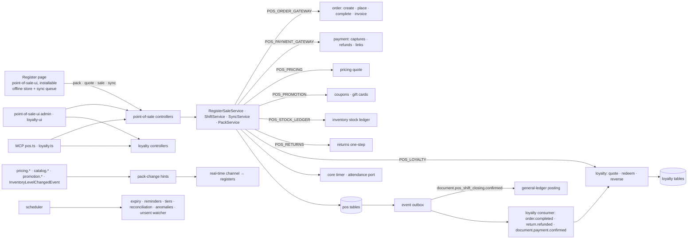

# Implementation Plan: Point of sale and loyalty

> Translates an approved `spec.md` into architecture and tech choices. The plan owns
> implementation details; the spec owns behaviour.

**Feature ID**: `point-of-sale-and-loyalty`
**Spec**: `./spec.md`
**Tasks**: `./tasks.md`
**Status**: `Draft`
**Last updated**: 2026-11-23

---

## 1. Architecture Summary

Two new plugins. `point-of-sale` owns registers, devices, shifts, cash and the register facts of a sale; every
commercial fact goes to the back end that already owns it through ports bound in `apps/api/src/plugin-composition.ts`:
the sale is an `order` (created, placed and completed in one step, `source = POINT_OF_SALE`), its tenders are
`payment` rows through the payment plugin, prices come from `POST /pricing/quote`, coupons and gift cards from the
promotion plugin, stock movements from the inventory stock ledger, returns from the returns plugin. A store is the
existing core `merchant` (its page `manage-merchants` and its MCP tools `merchants.ts` stay the store master); the items
a register offers are those its sales channel publishes (`product_channel`, `collection_channel` of the `catalog`
plugin); receipt numbers and closing numbers come from core `sequence`; receipt links are core `shared_entity` links;
cash expenses are core `expense` rows; stock changes arrive as the inventory plugin's `InventoryLevelChangedEvent`.
`loyalty` owns programmes, tiers, earning rules, members and the points ledger; it earns from outbox facts of any
channel and redeems as a `LOYALTY` adjustment on the document. The register is a full-screen page of the Gauzy web app
(Angular, in `point-of-sale-ui`), installable from the browser, with an offline store and a sync queue.

## 2. Tech Choices

| Concern | Choice | Rationale |
| ------- | ------ | --------- |
| Packages | new `packages/plugins/point-of-sale` and `point-of-sale-ui` (Angular: administration pages and the register page); new `packages/plugins/loyalty`, `loyalty-ui` | Principle I; one UI plugin per feature |
| Loading | `isPointOfSaleEnabled`, `isLoyaltyEnabled` (exactly `true`) in `apps/api/src/plugins.ts` and the worker | the task-automations and inbox pattern |
| Sale | an order through `POS_ORDER_GATEWAY` | one sale document, no merge |
| Store and assortment | the register's `merchantId` is the store; the offered items are those published to the register's `channelId` (`product_channel`, `collection_channel`); register filters only narrow inside that set; customer-group item restrictions are the one restriction model of `sales-order-management` (`sales_item_restriction`, read through `SALES_ITEM_RESTRICTIONS`), applied when a customer is attached | no second assortment or restriction model |
| Numbering | receipt numbers from a core `sequence` series per register: a device block is one `SequenceService.allocate` that advances the series by the block size; closings use a series of the same service (or the document engine's when loaded) | one counter |
| Idempotency | device-made `clientSaleId` unique per organization + `@Idempotent` on online routes | replay-safe |
| Offline store | the register keeps pack and queue in IndexedDB; the Gauzy web app is installable (`apps/gauzy/src/manifest.json`), and the register's lazy chunk and assets join an asset group of the Angular service worker (`apps/gauzy/ngsw-config*.json`) so the page starts offline once opened | installable, starts offline |
| Receipt links | core `shared_entity` rows (entity `PosSale`) with the hashed token, expiry and revocation columns of `access-control-and-security`, through the `shared_entity` service | one link facility |
| Cash expenses | a cash movement of kind `EXPENSE` creates a core `expense` (category, vendor optional, the register's project) linked from the movement | one expense record |
| Reports | report datasets and definitions as `reports` contributions of `report-builder-and-dashboards` | no report routes |
| Permissions | contributions in `point-of-sale.permissions.ts` and `loyalty.permissions.ts` with `defaultFor` | no seed migration |
| Offline pricing | pure evaluator shared with the server, exported from a browser-safe entry of `@gauzy/plugin-pricing` (`/engine`), run on the pack's rules | same answer offline and online for offline-capable rules |
| Device trust | per-device signing key (non-extractable browser key), public key stored at enrolment; batches signed | revocable devices, no shared secret |
| Background work | `@gauzy/scheduler` + queues `pos-maintenance`, `loyalty-maintenance`, in-process fallback | existing layout |
| Ledger safety | points entries append-only, refused update and delete by a database trigger (as the stock ledger) | auditability |
| Push | outbox → real-time hints | Principle VII |

## 3. Data Model

All tables extend `TenantOrganizationBaseEntity`. Migrations in each plugin's `src/lib/database/migrations/` with the
shared core migration helpers (`@gauzy/core`, `database/migration-helpers.ts` beside `check-constraint.helper.ts`,
lifted there by `procurement`, its T4; no plugin copy), PostgreSQL, MySQL, SQLite; a partial
unique index the dialect lacks (MySQL) is enforced by a row lock in the service.

### `point-of-sale` (migrations `1791000024100-CreatePointOfSaleTables` and `1791000024110-CreatePointOfSaleDeviceTables`)

| Table | Columns | Keys |
|---|---|---|
| `pos_register` | `name` varchar(120), `code` varchar(32), `merchantId` FK `merchant` (the store), `channelId` FK `channel`, `warehouseId` FK `warehouse`, `currency` varchar(3), `priceListId` uuid null, `walkInContactId` FK `organization_contact` null, `receiptSequenceKey` varchar(64), `receiptTemplateId` (print template; today's receipt templates are core `accounting_template` rows of type `receipt`, which the print designer lists beside its own templates and leaves unchanged), `receiptEmailTemplateId`, `campaignId`, `projectId` uuid null, `invoicePolicy` varchar(16) (`NEVER`, `ON_REQUEST`, `ALWAYS`, `CONSOLIDATED`), `behaviours` text (JSON `IPosRegisterBehaviours`), `offlinePolicy` text (JSON), `negativeStock` varchar(8), `differenceLimit` numeric(20,6) default 0, `customFields` text (JSON), `searchFields` text (JSON), `isActive` boolean, `version` int | unique `(organizationId, code)` live |
| `pos_register_user` | `registerId` FK cascade, `userId` FK `user` cascade, `employeeId` uuid null, `isDefault` boolean | unique `(registerId, userId)`; unique `(organizationId, userId)` where `isDefault` |
| `pos_register_payment_method` | `registerId` FK cascade, `method` varchar(24) (`CASH`, `CARD_TERMINAL`, `PROVIDER`, `PAYMENT_LINK`, `GIFT_CARD`, `LOYALTY`, `CUSTOMER_CREDIT`), `paymentProviderId` uuid null, `label` varchar(64), `isDefault`, `allowedInReturns`, `opensDrawer`, `isCounted`, `isOfflineCapable` boolean, `position` int | unique `(registerId)` where `isDefault`; a `CARD_TERMINAL` method uses the terminals of `payment-gateways` whose `payment_terminal.registerId` is this register |
| `pos_register_filter` | `registerId` FK cascade, `kind` varchar(16) (`ITEM_GROUP`, `COLLECTION`, `CUSTOMER_GROUP`), `refId` uuid | unique `(registerId, kind, refId)`; item filters narrow the channel's published items, never add to them |
| `pos_device` | `registerId` FK restrict, `name` varchar(120), `publicKey` text, `status` varchar(12) (`ACTIVE`, `REVOKED`), `enrolledById`, `revokedAt`, `lastSeenAt`, `appVersion` varchar(32), `lastSequence` bigint default 0, `packVersion` varchar(64), `unsentCount` int, `oldestUnsentAt` timestamp | index `(registerId, status)` |
| `pos_number_block` | `registerId`, `deviceId`, `fromNumber`, `toNumber` bigint (one `sequence` allocation of the register's series), `voidedCount` int, `closedAt` | unique `(registerId, fromNumber)`; the series is the counter, this row only records which device holds which range so unused numbers are reported as voided at closing |
| `pos_cashier_code` | `userId`, `codeHash` varchar(255) (salted, slow hash) | unique `(organizationId, userId)` |
| `pos_shift` | `registerId` FK restrict, `cashierUserId`, `employeeId` null, `deviceId` null, `status` varchar(12) (`OPEN`, `CLOSING`, `CLOSED`), `clientId` uuid, `openedAt`, `closingStartedAt`, `closedAt`, `timeLogId` uuid null, `missingSalesCount` int default 0, `approvedById`, `approvalReason` text, `totals` text (JSON snapshot), `closingNumber` varchar(32), `correctsShiftId` uuid null | unique `(registerId)` where `status` in open or closing; unique `(organizationId, clientId)` |
| `pos_cash_movement` | `shiftId` FK cascade, `kind` varchar(16) (`OPENING`, `PAY_IN`, `PAY_OUT`, `SAFE_DROP`, `EXPENSE`), `method` varchar(24), `amount` numeric(20,6), `currency`, `reason` text, `expenseId` uuid null (core `expense` of an `EXPENSE` movement), `userId`, `clientId` uuid, `occurredAt` | unique `(shiftId, clientId)` |
| `pos_shift_count` | `shiftId` FK cascade, `method`, `expected`, `counted`, `difference` numeric(20,6), `denominations` text (JSON) | unique `(shiftId, method)` |
| `pos_sale` | `orderId` FK `order` restrict (a sale's order; for a return, the order the return is recorded against), `saleOrderId` uuid null (the `orderId` on `SALE` rows, null on `RETURN` rows; written with it), `registerId`, `shiftId`, `closingShiftId` null, `deviceId` null, `cashierUserId`, `clientSaleId` uuid, `receiptNumber` varchar(32), `kind` varchar(8) (`SALE`, `RETURN`), `originalSaleId` null, `returnId` uuid null, `soldAt`, `receivedAt`, `wasOffline` boolean, `drawerOpenings` int, `voidedLines` int, `notices` text (JSON) | unique `(organizationId, clientSaleId)`; unique `(registerId, receiptNumber)`; unique `(saleOrderId)` (one sale row per order on every dialect, since the null of return rows is distinct; any number of returns per order); index `(orderId)`, `(shiftId)`, `(registerId, soldAt)` |
| `pos_sync_batch` | `deviceId`, `fromSequence`, `toSequence` bigint, `recorded`, `duplicates`, `refused` int, `receivedAt` | index `(deviceId, receivedAt)` |
| `pos_anomaly_finding` | `merchantId`, `cashierUserId`, `weekStart` date, `metric` varchar(32), `value`, `median` numeric(20,6), `shiftIds` text (JSON) | unique `(organizationId, merchantId, cashierUserId, weekStart, metric)` |

`pos_sale` holds register facts only; lines, amounts, payments and stock stay in the order, payment and inventory
tables. The closing document type `pos_shift_closing` is registered with the document registry of
`business-document-engine` (numbering series per register) when that plugin is loaded; otherwise the core
`sequence` service numbers closings. Receipt links are `shared_entity` rows (entity `PosSale`, an additive
`BaseEntityEnum` value); no link table of this plugin.

### `loyalty` (migration `1791000024200-CreateLoyaltyTables`)

| Table | Columns | Keys |
|---|---|---|
| `loyalty_programme` | `code` varchar(32), `name`, `status` (`DRAFT`, `ACTIVE`, `INACTIVE`), `startsAt`, `endsAt`, `currency`, `earnPointsPerUnit`, `redeemValuePerPoint`, `minRedeemPoints`, `maxRedeemSharePercent` numeric, `rounding` varchar(8), `enrolment` (`AUTO`, `MANUAL`), `channels` text (JSON), `expiryPolicy` (`AFTER_DAYS`, `PERIOD_END`, `INACTIVITY`, `NEVER`), `expiryDays`, `inactivityDays`, `reminderDays` int default 14, `expiryPeriod` varchar(8), `tierBasis` (`SPEND`, `POINTS`), `tierWindowMonths` int | unique `(organizationId, code)` live |
| `loyalty_tier` | `programmeId` FK cascade, `name`, `threshold` numeric(20,6), `earnMultiplier` numeric(9,6) default 1, `contactGroupId` FK `contact_group` set null, `position` | unique `(programmeId, threshold)`; service check: one tier at 0 |
| `loyalty_earn_rule` | `programmeId` FK cascade, `name`, `multiplier` numeric(9,6) null, `fixedPoints` numeric(20,6) null, `campaignId` FK `campaign` set null, `startsAt`, `endsAt`, `priority` int, `isActive` | index `(programmeId, isActive)` |
| `loyalty_member` | `programmeId` FK restrict, `contactId` FK `organization_contact` restrict, `tierId` null, `status` (`ACTIVE`, `SUSPENDED`, `LEFT`), `cardCode` varchar(64), `enrolledAt`, `balance`, `lifetimeEarned`, `tierQualifyingValue` numeric(20,6), `lastActivityAt`, `tierGroupMembershipId` uuid null (the contact-group membership the tier job created) | unique `(programmeId, contactId)`; unique `(organizationId, cardCode)` where not null |
| `loyalty_points_entry` | `memberId` FK restrict, `kind` (`EARN`, `REDEEM`, `EXPIRE`, `ADJUST`, `REVERSE`), `points` numeric(20,6) signed, `expiresAt` null, `sourceType` varchar(24) (`REGISTER_SALE`, `ORDER`, `INVOICE`, `RETURN`, `MANUAL`), `sourceId` null, `ruleIds` text (JSON), `reason` text, `balanceAfter` numeric(20,6), `shortfall` numeric(20,6) default 0, `createdById`, `idempotencyKey` varchar(160) | unique `(memberId, idempotencyKey)`; index `(memberId, createdAt)`, `(expiresAt)` where `kind = 'EARN'`; append-only trigger |
| `loyalty_points_allocation` | `earnEntryId` FK, `consumingEntryId` FK, `points` numeric(20,6) | index `(earnEntryId)`; append-only |
| `loyalty_reservation` | `memberId`, `cartId` uuid null, `orderId` uuid null, `points`, `expiresAt`, `status` (`OPEN`, `CONSUMED`, `RELEASED`) | index `(memberId, status)` |
| `loyalty_tier_change` | `memberId`, `fromTierId`, `toTierId`, `reason`, `changedAt` | index `(memberId)` |

Conditions of programme eligibility and of earning rules are core `rule` rows with new owner types
`LOYALTY_PROGRAMME` and `LOYALTY_EARN_RULE` (additive values of `RuleOwnerType`). The cached
`organization_contact.loyaltyPoints` becomes the sum of the contact's member balances, written by the loyalty
service only while `FEATURE_LOYALTY` is on; a contact whose cached value is not zero when first enrolled gets an
`ADJUST` entry (reason "opening balance", key `opening:<contactId>`) in its first programme before anything else, so
the cache never drops a balance held before the feature. Tier groups: `loyalty_member.tierGroupMembershipId` uuid
null records the core contact-group membership the tier job created; the job removes only that membership, never one
a user added. Idempotency keys: `earn:<sourceType>:<sourceId>`, `reverse:<returnId>:<memberId>`, `expire:<earnEntryId>` (one expiry
entry per earned entry, so several entries of a member expiring on the same date each expire).

### Migrations

**Migration timestamps**: `packages/plugins/point-of-sale` `1791000024100` to `1791000024199`; `packages/plugins/loyalty` `1791000024200` to `1791000024299`.

In each plugin's `src/lib/database/migrations/` through the shared core migration helpers; PostgreSQL, MySQL and SQLite branches, additive and forward-only, registered for both ORMs:

1. `point-of-sale`: `1791000024100-CreatePointOfSaleTables` — registers, register users, payment methods, filters,
   cashier codes, shifts, cash movements, shift counts, sales.
2. `point-of-sale`: `1791000024110-CreatePointOfSaleDeviceTables` — `pos_device`, `pos_number_block`,
   `pos_sync_batch`, `pos_anomaly_finding`.
3. `loyalty`: `1791000024200-CreateLoyaltyTables` — the eight loyalty tables, with the append-only triggers on entries
   and allocations.

### Contracts

`packages/contracts/src/lib/point-of-sale.model.ts` (register, behaviours, methods, device, pack, sync envelope and
results, shift, counts, cash movement, sale, closing summary, dashboard) and `loyalty.model.ts` (programme, tier,
rule, member, entry, quote, redemption, reservation, statement); `RuleOwnerType` and order `source` additions.

## 4. API Surface

Every route: `TenantPermissionGuard`, `PermissionGuard`, `FeatureFlagGuard` with `FEATURE_POINT_OF_SALE` or
`FEATURE_LOYALTY`; creating and money-moving routes `@Idempotent`; `If-Match` on updates.

| Method | Endpoint | Permission | Contract | Status |
| ------ | -------- | ---------- | -------- | ------ |
| CRUD | `/pos/registers` (+ `/users`, `/payment-methods`, `/filters` nested) | `POS_REGISTERS_VIEW` / `_EDIT` | `IPosRegister` | New |
| POST | `/pos/registers/:id/devices`; POST `/pos/devices/:id/revoke`; GET `/pos/devices` | `POS_DEVICES_MANAGE` | `IPosDevice` | New |
| GET | `/pos/devices/:id/pack?since=` | `POS_SELL` + device signature | `IPosPack` (full or changes) | New |
| POST | `/pos/devices/:id/number-blocks` | `POS_SELL` + device signature | `{ from, to }` allocated from the register's `sequence` series | New |
| POST | `/pos/sync` | `POS_SELL` + device signature | `IPosSyncBatch` → `IPosSyncResult[]` | New |
| POST | `/pos/shifts`; GET `/pos/shifts`, `/pos/shifts/:id` | `POS_SELL` / `POS_REGISTERS_VIEW` | `IPosShift` | New |
| POST | `/pos/shifts/:id/cash-movements` | `POS_CASH_MOVEMENT` | `IPosCashMovement` | New |
| POST | `/pos/shifts/:id/close`, `/pos/shifts/:id/approve` | `POS_SELL` / `POS_SHIFT_CLOSE_APPROVE` | counts → `IPosShiftClosing` | New |
| POST | `/pos/sales` (online; same handler as sync) | `POS_SELL` | `IPosSaleEnvelope` → `IPosSaleResult` | New |
| GET | `/pos/sales`, `/pos/sales/:id` | `POS_SELL` | search by receipt, customer, date, amount, status | New |
| POST | `/pos/sales/:id/returns`; POST `/pos/returns` | `POS_RETURN` / `POS_RETURN_WITHOUT_RECEIPT` | `IPosReturnEnvelope` | New |
| POST | `/pos/sales/:id/invoice`, `/pos/sales/:id/receipt/email`, `/pos/sales/:id/receipt/link` | `POS_SELL` | the link is a `shared_entity` row created through its service | New |
| GET | `/public/pos-receipts/:token` | public (token resolved by the `shared_entity` service; expiry and revocation honoured) | receipt PDF, the small transactional receipt page | New |
| PUT | `/pos/cashier-codes/me` | `POS_SELL` | `{ code }` | New |
| GET | `/pos/dashboard`, `/pos/anomalies` | `POS_REPORTS_VIEW` | live dashboard; findings | New |
| CRUD | `/loyalty/programmes` (+ `/activate`, `/tiers`, `/earn-rules`) | `LOYALTY_PROGRAMMES_VIEW` / `_EDIT` | `ILoyaltyProgramme` | New |
| GET/POST | `/loyalty/members`, `/loyalty/members/:id`, `/loyalty/members/by-card/:code`, `/loyalty/members/:id/ledger` | `LOYALTY_MEMBERS_VIEW` | `ILoyaltyMember`, entries | New |
| POST | `/loyalty/members/:id/adjustments` (`preview` flag) | `LOYALTY_POINTS_ADJUST` | `ILoyaltyAdjustment` | New |
| POST | `/loyalty/quote` | `LOYALTY_MEMBERS_VIEW` | basket → points to earn, redeemable range | New |
| POST / DELETE | `/loyalty/redemptions`, `/loyalty/reservations/:id` | `LOYALTY_MEMBERS_VIEW` + selling permission of the caller's channel | `ILoyaltyRedemption` | New |
| POST | `/loyalty/redemptions` for an invoice or order payment | `LOYALTY_MEMBERS_VIEW` + `ORG_PAYMENT_ADD_EDIT` | `ILoyaltyRedemption` with the document and the payment it joins | New |
| POST | `/loyalty/programmes/:id/simulate-campaign` | `LOYALTY_PROGRAMMES_EDIT` | rule + period → points and value | New |

The eight reports of spec FR-67 are report-builder datasets and definitions (`reports` contributions of both plugins,
read under `POS_REPORTS_VIEW` and `LOYALTY_MEMBERS_VIEW`); neither plugin has a report route.

Sync result codes: `RECORDED`, `DUPLICATE`, `RECORDED_WITH_NOTICES`, `REFUSED` (`DEVICE_REVOKED`, `CASHIER_NOT_ALLOWED`,
`MALFORMED`, `OUT_OF_SEQUENCE`). GraphQL: read queries for shifts, sales and members; subscription field for
`pos.register.pack_changed` through the declared streamed events.

**Consumer tokens answered** (bound in `apps/api/src/plugin-composition.ts` to the loyalty programme services; each consumer plan states the shape it calls and its fallback): `PORTAL_LOYALTY`.

## 5. Events, Real-Time and Notifications

| Event | Emitted when | Consumers |
| ----- | ------------ | --------- |
| `pos.shift.opened` / `pos.shift.closed` | shift opened, closing confirmed | dashboard hints, automations, timer stop |
| `document.pos_shift_closing.confirmed` | closing confirmed (and correction closings) | `general-ledger` posting rule; webhooks |
| `pos.sale.recorded` | sale or return recorded (online or synced) | dashboard hints, loyalty (register channel), automations |
| `pos.register.pack_changed` | a consumer of `catalog.*`, `pricing.*`, `promotion.promotion.changed` and the inventory level events finds affected registers | open registers fetch the changed pack |
| `pos.device.unsent_overdue` | watcher finds unsent sales older than 1 h on a closing shift | Inbox item to store managers |
| `pos.anomalies.found` | weekly anomaly job | Inbox item to `POS_REPORTS_VIEW` holders |
| `loyalty.points.earned` / `.redeemed` / `.expiring` / `.expired` | ledger writes; reminder job | automations (reminder email), webhooks, `general-ledger` |
| `loyalty.member.tier_changed` | tier evaluation | automations, contact group membership |

Loyalty consumes `order.completed`, `order.canceled`, `return.refunded`, `pos.sale.recorded` and
`document.payment.confirmed` (from `payments-and-collections`; it earns when the payment leaves the allocated
invoice fully paid) as outbox consumer `subscriber:loyalty`, earning once per idempotency key. Stock changes come
from the inventory plugin's CQRS `InventoryLevelChangedEvent`, `InventoryLevelLowEvent` and
`InventoryLevelOutOfStockEvent` (they carry the derived availability per variant and location), consumed by an event
handler of `point-of-sale` that coalesces them per register; when `warehouse-and-stock-movements` bridges them to the
outbox as `inventory.level.changed`, the handler moves to that consumer. Registers never poll for stock.

## 6. UI Surface

- `point-of-sale-ui` (Angular), register page `/pages/pos/register/:id`: full-screen layout without the app's side
  menu (shift open, selling grid and search, scan, cart, customer, discounts, coupons, gift cards, points, payment and
  change, park, recent sales, returns, cash movements, closing count, unsent indicator, cashier switch); installed from
  the browser as the Gauzy web app, it opens on the cashier's default register and starts offline.
- `point-of-sale-ui` administration pages: registers and their users, methods, filters, behaviours and offline policy;
  devices; shifts with closing review and approval; live dashboard; anomalies; reports open in the report builder.
  Menu Sales → Point of sale; the store picker reads the existing merchants (`manage-merchants`).
- `loyalty-ui` (Angular): programmes, tiers, earning and bonus rules with campaign link and simulation; members with
  ledger and adjustments; reports through the report builder; a loyalty panel contributed to the contact page, shown
  only while `FEATURE_LOYALTY` is on.
- i18n keys in every locale; keyboard-only selling and screen-reader labels; receipt templates seeded in the print
  engine (58 mm, 80 mm, A4).

## 7. MCP Tools, SDKs and Integrations

| Tool (file) | Input | Output |
|---|---|---|
| `get_register_status` (`pos.ts`) | `registerId?` | open shifts, devices, unsent counts |
| `get_shift_summary` | `shiftId` | closing summary |
| `find_register_sale` | receipt number or customer and date | sale with order, payments, returns |
| `list_cashier_anomalies` | store, period | findings with shifts |
| `get_loyalty_member` (`loyalty.ts`) | contact, card or member id | balance, tier, statement |
| `adjust_loyalty_points` | member, points, reason, `preview` | the entry it would write |
| `simulate_loyalty_campaign` | programme, rule, period, `preview` | points and value it would have cost |

Card terminals and providers: `payment-gateways` (a register's terminals are its `payment_terminal` rows by
`registerId`). Stores: the existing merchant tools (`merchants.ts`) stay the store tools. Receipt printers and cash drawers: browser print to the register's
printer with the drawer pulse in the receipt template; a local print bridge is a later integration. OpenAPI and SDKs
regenerated.

## 8. Background Jobs

| Trigger | When | What it does | Idempotency |
| ------- | ---- | ------------ | ----------- |
| `pos.unsent.watch` (scheduled) | every 10 min | devices with unsent sales older than 1 h on closing shifts → event | one event per device and hour |
| `pos.closing.correction` (queue) | a sale arrives for a closed shift | creates a correction closing and its event | key `(shiftId, saleId)` |
| `pos.anomalies.weekly` (scheduled) | Monday 04:00 per organization | medians per store and metric, findings, Inbox | unique finding key |
| `loyalty.expiry.daily` (scheduled) | daily 01:00 | expires remaining earned points by policy, one `EXPIRE` entry per due earned entry | key `expire:<earnEntryId>` |
| `loyalty.reminders.daily` | daily 09:00 | `loyalty.points.expiring` per member and expiry date | per member and date |
| `loyalty.tiers.daily` | daily 02:00 + after each earning | evaluates tiers, adds and removes the contact-group memberships it created (`tierGroupMembershipId`), never one a user added | change rows only on change |
| `loyalty.reconcile.nightly` | 03:00 | ledger sums vs balances and contact cache; reports differences | read-only |
| `loyalty.reservations.expire` | hourly + cart expiry events | releases open reservations | status transition once |

Worker loads `PointOfSaleSchedulePlugin` and `LoyaltySchedulePlugin` (schedules only); API hosts the queue workers;
in-process fallback without a queue.

## 9. Security & Permissions

- Permissions (§ spec FR-2, FR-3) declared as permission contributions in `point-of-sale.permissions.ts` (`POS_REGISTERS_VIEW`,
  `POS_REGISTERS_EDIT`, `POS_DEVICES_MANAGE`, `POS_SELL`, `POS_CASH_MOVEMENT`, `POS_RETURN`, `POS_RETURN_WITHOUT_RECEIPT`,
  `POS_SHIFT_CLOSE_APPROVE`, `POS_REPORTS_VIEW`) and `loyalty.permissions.ts` (`LOYALTY_PROGRAMMES_VIEW`,
  `LOYALTY_PROGRAMMES_EDIT`, `LOYALTY_MEMBERS_VIEW`, `LOYALTY_POINTS_ADJUST`) with `defaultFor`: super admin and admin all; manager `POS_REGISTERS_VIEW`,
  `POS_SHIFT_CLOSE_APPROVE`, `POS_REPORTS_VIEW`, `LOYALTY_MEMBERS_VIEW`; no seed migration. No default grant to employees.
- Devices: enrolment by `POS_DEVICES_MANAGE`; every pack, number-block and sync request signed by the device key and
  made in a signed-in user's session; revocation refuses further batches; cashier codes salted and slow-hashed, five
  wrong codes lock the device's cashier switch for 5 minutes.
- Pack privacy: no customer data except the walk-in customer and, when allowed, recent loyalty members (name, card,
  tier); unsent sales encrypted at rest in the browser with the device key.
- Public receipt links: `shared_entity` links (token stored as a hash, shown once in the QR code), expiry 90 days,
  revocable; the public route is rate limited.
- Data leaving the platform: receipt emails and payment-link messages to addresses the customer gives.

## 10. Observability

Metrics `pos_sync_lag_seconds`, `pos_offline_duration_seconds`, `pos_sales_total{wasOffline}`,
`pos_closing_difference`, `loyalty_points_total{kind}`; sync batch log; device last-seen; reconciliation report.

## 11. Phased Rollout

1. **Phase 1 — Online register and loyalty core**: plugins, registers, shifts, cash, online selling through the
   ports, payments, coupons, gift cards, receipts, returns, closing with event, programmes, tiers, ledger, earning on
   register sales and orders, redemption, reports (sales, payments, closings, loyalty activity, liability).
2. **Phase 2 — Depth**: partial payment, invoice policies and consolidation, payment links, custom checkout fields,
   expiry with reminders, reservations, earning on invoices, bonus rules with campaigns, members by tier, item sales.
3. **Phase 3 — Advanced capabilities**: offline-first register (devices, packs, number blocks, sync), real-time pack
   changes and dashboard, timer and attendance link with sales per worked hour, tier customer groups, MCP tools,
   campaign simulation, anomaly detection.
4. **Phase 4 — General availability**: the feature is off by default; after the trial period it may be switched on by default for new tenants only; existing tenants keep their setting until an administrator changes it.
   The deployment flags stay as each deployment sets them.

## 12. Constitution Reconciliation

- I Plugin-first: two new plugin pairs (server and Angular UI); the existing back ends are reached through ports, never copied.
- II Tenant/organization scoping: every table on the tenant-organization base; devices bound to one register.
- III Both ORMs, additive migrations: new tables; enum values added to `RuleOwnerType` and the order source.
- IV Default-off flag; nothing removed: deployment flags and tenant features off; nothing existing changes.
- V Contracts and API first: `point-of-sale.model.ts`, `loyalty.model.ts`; the register uses only public routes.
- VI Permissions, privacy, security: §9.
- VII Real-time through the event bus: §5; stock changes from the inventory level events, never polled.
- VIII i18n and accessibility: keys in every locale; keyboard-only selling.
- IX Tests: service specs, sync replay and crash tests, ledger trigger tests, e2e of the register on SQLite.
- X Behaviour-first spec: implementation lives here.
- XI Documentation describes our platform only.

## 13. Risks & Mitigations

| Risk | Likelihood | Impact | Mitigation |
| ---- | ---------- | ------ | ---------- |
| Order creation path not built for one-step completed sales | Medium | High | adapter in the order plugin's platform adapters module with its own specs; phase 1 proves it |
| Offline sales oversell | Medium | Medium | register negative-stock policy; Inbox notice; limits on offline duration and amount |
| Browser storage cleared with unsent sales | Low | High | unsent indicator, persistent storage request, closing blocked until sent |
| Pricing differences offline | Medium | Low | shared evaluator; sale kept at charged price with a notice |
| Double posting of register sales | Low | High | closing names covered sales; correction closings for late sales |
| Points drift from ledger | Low | Medium | append-only trigger; nightly reconciliation |

## 14. References

- Spec: `./spec.md` · Tasks: `./tasks.md`
- Code: `packages/plugins/order` (`order-platform-adapters.module.ts`), `packages/plugins/payment`,
  `packages/plugins/promotion`, `packages/plugins/returns`, `packages/plugins/inventory` (`events/inventory-level-changed.event.ts`),
  `packages/plugins/catalog/src/lib/{product-channel,collection-channel}`,
  `packages/core/src/lib/{merchant,sequence,shared-entity,expense,accounting-template}`,
  `packages/core/src/lib/database/check-constraint.helper.ts`, `packages/core/src/lib/time-tracking/timer`,
  `apps/gauzy/src/manifest.json`, `apps/gauzy/ngsw-config.json`, `apps/api/src/plugin-composition.ts`
