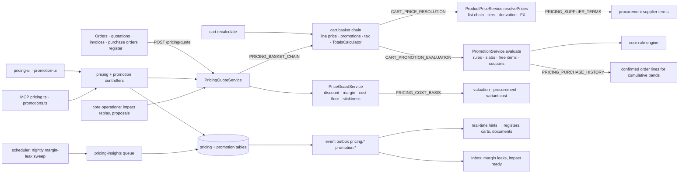

# Implementation Plan: Pricing and promotions

> Translates an approved `spec.md` into architecture and tech choices. The plan owns
> implementation details; the spec owns behaviour.

**Feature ID**: `pricing-and-promotions`
**Spec**: `./spec.md`
**Tasks**: `./tasks.md`
**Status**: `Draft`
**Last updated**: 2026-11-23

---

## 1. Architecture Summary

Two existing plugins carry the feature: `pricing` (`price_list`, `product_price`, `price_preference`,
`exchange_rate`, `recurring-price`, `ProductPriceService.resolvePrices`, `PriceListService.simulate`) and `promotion`
(`promotion`, `promotion_action`, `coupon`, `campaign*`, `promotion_usage`, `promotion_order_usage`, `gift_card*`,
`PromotionService.evaluate` and `simulate`). Conditions stay `rule` rows evaluated by the core rule engine; money moved
by a discount stays an `adjustment` row.

**One basket pricing path: the cart's chain.** The cart already prices a basket: `CommerceCartService.recalculate`
calls `resolveLinePrice` (`CART_PRICE_RESOLUTION` = `ProductPriceService`), `syncPromotionAdjustments`
(`CART_PROMOTION_EVALUATION` = `PromotionService`), `syncTaxLines` (`CART_TAX_CALCULATION` = `TaxRateService`) and
`TotalsCalculator` (`packages/plugins/cart/src/lib/totals/totals-calculator.ts`; bindings in
`apps/api/src/plugin-composition.ts`). That chain is the platform's one way to price a basket. The cart gains a
stateless entry `CommerceCartService.priceBasket(context, lines)` that runs the same steps over an unsaved basket (no
cart row, nothing written), and `recalculate` calls it before it persists lines, adjustments, tax lines and the totals
snapshot. `PricingQuoteService` in `pricing` serves every other caller (quotations, orders, invoices, purchase orders,
the register): it builds the context, runs that entry through the port `PRICING_BASKET_CHAIN` (bound in composition to
the cart's entry), and adds the explanation, nudges and guard results. `TotalsCalculator` stays the cart plugin's (the
order totals already use it). This spec deepens the engines the chain calls (list chain, units, country, rules, bands,
free items, slabs) and builds no second chain; `promotion` keeps depending on `pricing` and never the reverse. Without
the cart plugin the port is unbound and `/pricing/quote` answers with a notice.

## 2. Tech Choices

| Concern | Choice | Rationale |
| ------- | ------ | --------- |
| Package | existing `packages/plugins/pricing`, `packages/plugins/promotion`; new `pricing-ui`, `promotion-ui` | Principle I; build on the engines |
| Conditions | `rule` rows (`RuleOwnerType.PROMOTION`, `PROMOTION_ACTION`, `PRICE`, `PRICE_LIST`) with new attributes | one definition of "matches" |
| One pricing call | the cart's basket chain, reached by `PricingQuoteService` through `PRICING_BASKET_CHAIN` | one path for carts and documents; no dependency cycle |
| Money | core `Money`, `numeric(20,6)`, largest-remainder allocation | existing kernel |
| Settings | new `pricing.settings.ts` (guards `pricing.guards.*` default `OFF`, stickiness default `OFF`, `pricing.refuseUnitMultiples` false, list fallback, document price writes off); existing `promotion.settings.ts` | plugin settings store; defaults keep today's behaviour |
| Permissions | contributions in `pricing.permissions.ts` with `defaultFor` | the permission reload grants existing tenants; no seed migration |
| Persistence | MultiORM entities, tri-dialect migrations written with the shared core migration helpers (`@gauzy/core`, `database/migration-helpers.ts` beside `check-constraint.helper.ts`) | Principle III; no plugin copy |
| Price history | core activity log (entity `ProductPrice`, `previousValues` / `updatedValues`, source in `data`) | one history per record, as items have |
| Background work | core operations `PRICING_IMPACT` and `PRICING_PROPOSAL` (`@AcceptedOperation`, `/api/operations`); `@gauzy/scheduler` + queue `pricing-insights` for the nightly sweep (ticks in `job_execution`), in-process fallback | one run ledger |
| AI | `PRICING_ASSISTANT` bound to `ai-agents-and-assistants` (purpose `pricing.price-proposal`, declared with `registerAssistantPurposes`); fallback `ai-chat` `AiProviderRegistry` | no provider code in pricing |
| Reports | report-builder definitions declared through `registerReportDefinitions` | no report route |
| Push | outbox → real-time hints | Principle VII |
| UI | Angular `pricing-ui`, `promotion-ui`; "why this price" drawer exported for other UIs | screens for both plugins |

## 3. Data Model

### Changed tables

Migration `1791000023100-ExtendPricingTables` (pricing plugin, tri-dialect, through the shared core helpers):

| Table | New columns |
|---|---|
| `price_list` | `direction` varchar(8) not null default `SELLING` (`SELLING`, `BUYING`); `vendorId` uuid null (FK `organization_vendor`, set null; the one link between a supplier and its buying list); `isUnitIndependent` boolean default false. Index `(organizationId, direction, status)` live |
| `product_price` | `note` text null; `reference` varchar(128) null |
| `PriceComputeMode` | new value `AMOUNT_OFF` (`amount = base − value`; a negative value is a markup amount), stored as the column's existing varchar |

Migration `1791000023200-ExtendPromotionTables` (promotion plugin):

| Table | New columns |
|---|---|
| `promotion` | `kind` varchar(12) default `PROMOTION` (`PRICING_RULE`, `PROMOTION`, `SLAB`); `direction` varchar(8) default `SELLING`; `discountBase` varchar(8) default `NET` (`NET`, `LIST`); `maxCombinedDiscountPercent` numeric(9,6) null; `lockLineDiscount` boolean default false; `cumulativeWindowDays` int null; `cumulativeBasis` varchar(8) null (`QUANTITY`, `AMOUNT`); `nudgeThresholdPercent` numeric(9,6) null. Index `(organizationId, kind, status)` |
| `promotion_action` | `bandBasis` varchar(8) default `LINE` (`LINE`, `MIXED`, `DOCUMENT`); `bandMinQuantity`, `bandMaxQuantity`, `bandMinAmount`, `bandMaxAmount` numeric(20,6) null; `isRecursive` boolean default false; `freeQuantityRounding` varchar(8) null (`DOWN`, `NEAREST`, `UP`); `freeLineRate` numeric(20,6) null; `marginBase` varchar(8) null (`COST`, `LIST`) |
| `PromotionActionType` | new values `SET_PRICE`, `MARGIN` |

### New tables (pricing plugin, migration `1791000023110-CreatePricingInsightTables`)

All extend `TenantOrganizationBaseEntity` (soft delete where noted).

| Table | Columns | Keys |
|---|---|---|
| `price_guard_override` | `documentType` varchar(48), `documentId` uuid, `lineId` uuid, `guard` varchar(24) (`MAX_DISCOUNT`, `MIN_MARGIN`, `COST_FLOOR`, `RULE_LOCK`, `RATE_LOCK`), `expected`, `actual` numeric(20,6), `currency`, `userId`, `reason` text | index `(organizationId, createdAt)`; unique `(documentId, lineId, guard)` |
| `price_proposal` | `goal` text (JSON), `draftPriceListId` uuid FK set null, `impactOperationId` uuid null (the `PRICING_IMPACT` operation), `operationId` uuid null (the `PRICING_PROPOSAL` operation that built it), `status` varchar(12) (`PROPOSED`, `ACTIVATED`, `DISCARDED`), `requestedById` uuid, `viaAgent` boolean, `summary` text | index `(organizationId, status)` |
| `margin_leak_finding` | `documentType` varchar(48), `documentId`, `lineId`, `variantId` uuid, `kind` varchar(24) (`BELOW_COST`, `BELOW_MIN_MARGIN`, `ABOVE_MAX_DISCOUNT`, `STACKED_BEYOND_CAP`), `expected`, `actual` numeric(20,6), `currency`, `promotionIds` text (JSON), `status` varchar(16) (`OPEN`, `ACKNOWLEDGED`, `RESOLVED`), `note` text, `detectedAt` | unique `(organizationId, documentType, lineId, kind)` |

No price history table and no run table: price changes are core `activity_log` rows (entity `ProductPrice`, a new
`BaseEntityEnum` value; `updatedFields`, `previousValues`, `updatedValues`; `data` = `{ variantId, priceListId,
currency, source (PERSON, BULK, DOCUMENT, IMPORT, PROPOSAL), sourceRef }`), written by the price services for every
source and never also in another store; an impact replay is a core operation whose `result` holds the totals and the
per-group rows. No cache table either: cumulative bands are computed per quote (see below).

No backfill: every new column is defaulted to the current behaviour (`SELLING`, `PROMOTION`, `NET`, `LINE`).
Migration `1791000023120-EnableUsedCommerceSubFeatures` writes enabled toggle rows of `FEATURE_GIFT_CARDS`,
`FEATURE_PRICE_TIERS` and `FEATURE_MULTI_CURRENCY` for tenants holding a gift card, a price with a tier bound, or a
price or list in a currency other than the organization's (spec FR-2); idempotent; `down` is a no-op. Permissions are
contributions (§9), so no seed migration.

### Supplier prices: one precedence

Written once here and shared with `procurement` and `item-catalogue`:

- **Supplier term** (`vendor_product_term`, `procurement`): the supplier's price, discount, quantity band, pack size
  and label, lead time and supplier code for a variant, with validity and priority. Packs and lead times live only
  there (with `organization_vendor.leadTimeDays` as the supplier-wide fallback).
- **Purchase agreement** (`procurement`): committed quantity, value and call-off tracking on top of a term; its line
  points at the term that prices it.
- **Buying price list** (this spec): rules and discounts on top of the term price. A list names its supplier through
  `price_list.vendorId`; supplier records carry no price-list column. A buying list's rows derive from the term price
  (percentage or amount off, `AMOUNT_OFF`); a supplier's fixed prices are entered as supplier terms.
- **Default supplier** of an item: its preferred term (`isPreferred`).

A buying line is priced: term price (through `PRICING_SUPPLIER_TERMS`) → the buying list's derivation and pricing
rules of direction `BUYING` → guards. Quantities on buying documents are checked against the term's pack size; on
selling documents against the item's order multiple (`item-catalogue`); a difference is a warning unless the setting
`pricing.refuseUnitMultiples` (false) makes it a refusal.

### Migrations

**Migration timestamps**: `packages/plugins/pricing` `1791000023100` to `1791000023199`; `packages/plugins/promotion` `1791000023200` to `1791000023299`.

The pricing and promotion plugin migrations named above (changed pricing and promotion tables, the new insight tables and the data step that switches on the commerce sub-features already in use), through the shared core migration helpers; PostgreSQL, MySQL and SQLite branches, additive and forward-only, registered for both ORMs.

### Contracts

`packages/contracts/src/lib/pricing.model.ts` (new; the plugins' existing `*.types.ts` re-export it):
`PriceListDirection`, `IPricingQuoteRequest { context, lines[], documentListId?, ignoreRules?, couponCodes? }`,
`IPricingQuote { lines: IPricingQuoteLine[], freeLines, documentDiscounts, nudges, notices, totals }`,
`IPriceExplanation { candidates[], winner, rules[], guards[], steps[], amount }`, `IPriceGuardCheck`,
`IPriceGuardResult`, `IPriceGuardOverride`, `IPriceChange` (read model over the activity log), `IPriceProposal`,
`IPricingImpactResult` (the operation result), `IMarginLeakFinding`, `PricingGuardAction` (`OFF`, `WARN`, `BLOCK`),
`PromotionKind`, `PromotionDiscountBase`, `PromotionBandBasis`; additive fields on `IPromotion`, `IPromotionAction`,
`IPriceList`, `IProductPrice`.

### Rule attributes

New attributes registered with the rule validator (no schema change): `item.brandId`, `item.groupId`,
`item.collectionIds`, `customer.id`, `customer.groupIds`, `document.regionId`, `document.deliveryCountry`,
`document.channelId`, `document.campaignId`, `document.salesPersonId`, `document.priceListId`,
`document.warehouseId`, `context.weekday`, `context.hour`, `cumulative.quantity`, `cumulative.amount`.

### Resolution changes (no schema)

`ProductPriceService.resolvePrices` gains, for organizations whose tenant has `FEATURE_PRICING_RULES` on (with it off
every step below is skipped and resolution answers exactly as today, for carts, subscription prices and the existing
resolve route alike): the list chain of spec FR-9, reading the existing
`organization_contact.priceListId` and `contact_group.priceListId` (stored today, not read by resolution) and applying
the existing `contact_group.discountPercent` of the customer's group to the chosen list price as a named step; the
`direction` filter; the delivery-country check against `region_country`; the default-list fallback setting; unit
independence through the item conversion of `item-catalogue` (`POST /units/convert`); and, for buying lists, the
supplier term price of `procurement` as the base (`PRICING_SUPPLIER_TERMS`, precedence above). Every step appends to
the explanation trace that `/pricing/explain` returns; the existing one-line `explain` stays.

- **Legacy variant price.** The fallback to the variant's legacy retail price (`product-price.service.ts`, the
  existing last step) is kept for as long as a variant has no `product_price` row on the default list: with
  `FEATURE_PRICING` on, the item forms write `product_price` (`item-catalogue`), so no new legacy rows arise, and the
  explanation names the fallback when it is used.
- **Recurring prices.** `RecurringPriceService.resolveRecurringPrice` already hands its request to `resolvePrices`, so
  with `FEATURE_PRICING_RULES` on the list chain and the changes above apply to subscription prices without a second
  path (with it off they price as today); the quote prices one-off basket lines.
- **Delivery discounts.** The chain keeps answering a promotion that discounts delivery only with the existing
  `SHIPPING_DISCOUNT_NOT_SUPPORTED` notice; this spec adds no free-delivery action.
- **Cumulative bands.** `PRICING_PURCHASE_HISTORY` answers the windowed quantity or amount of a customer's confirmed,
  not cancelled order lines for a set of items, from the order lines' indexes, memoised per request; use counts per
  customer come from the existing `promotion_usage` and `promotion_order_usage` ledgers. No cached sums.

## 4. API Surface

New routes: `@UseGuards(TenantPermissionGuard, PermissionGuard, FeatureFlagGuard)` with
`@FeatureFlag(FEATURE_PRICING_RULES)` plus the module code. Existing controllers get `@FeatureFlag(FEATURE_PRICING)`
or `@FeatureFlag(FEATURE_PROMOTION)`; gift-card controllers `FEATURE_GIFT_CARDS`; tier and currency checks in the
price services (`FEATURE_PRICE_TIERS`, `FEATURE_MULTI_CURRENCY`, `400` with the feature named).

| Method | Endpoint | Permission | Contract | Status |
| ------ | -------- | ---------- | -------- | ------ |
| POST | `/pricing/quote` | `PRODUCT_PRICES_VIEW` | `IPricingQuoteRequest` → `IPricingQuote` (the cart chain over an unsaved basket) | New |
| POST | `/pricing/explain` | `PRODUCT_PRICES_VIEW` | one line + context → `IPriceExplanation` | New |
| POST | `/pricing/compare` | `PRICE_LISTS_SIMULATE` | basket + draft list or rule → per-line live vs draft | New |
| POST | `/pricing/check-lines` | `PRODUCT_PRICES_VIEW` | `IPriceGuardCheck` → `IPriceGuardResult[]` | New |
| POST | `/pricing/overrides` | `PRICING_GUARD_OVERRIDE` | `IPriceGuardOverride` (idempotent per line and guard) | New |
| POST | `/price-lists/:id/copy` | `PRICE_LISTS_CREATE` | `{ withPrices, percent?, roundTo? }` | New |
| POST | `/price-lists/:id/impact`, `/promotions/:id/impact` | `PRICING_INSIGHTS_VIEW` | `{ fromDate, toDate }` → result inline, or `202` with the `PRICING_IMPACT` operation (read at `/api/operations/:id`) | New |
| GET | `/product-prices/history?variantId=&priceListId=` | `PRODUCT_PRICES_VIEW` | `IPriceChange[]` (cursor) over the activity log | New |
| POST | `/pricing/proposals` (`preview` flag) | `PRICE_LISTS_SIMULATE` + `PRODUCT_PRICES_EDIT` | goal → `202` with the `PRICING_PROPOSAL` operation; `IPriceProposal` when done | New |
| POST | `/pricing/proposals/:id/discard` | same | | New |
| GET / PUT | `/pricing/margin-leaks`, `/pricing/margin-leaks/:id` | `PRICING_INSIGHTS_VIEW` | `IMarginLeakFinding` | New |
| POST | `/pricing/margin-leaks/scan` | `PRICING_INSIGHTS_VIEW` | `{ fromDate, toDate }` | New |
| GET / PUT | `/pricing/settings` | `PRODUCT_PRICES_VIEW` / `PRICING_SETTINGS_EDIT` | settings | New |
| GET | `/promotions/:id/performance`, `/coupons/batches/:batchId/performance` | `PROMOTIONS_VIEW` | counts, amounts, exclusions | New |
| * | existing `/price-lists`, `/product-prices`, `/price-preferences`, `/exchange-rates`, `/promotions`, `/coupons`, `/campaigns`, `/gift-cards` | existing | additive DTO fields | Changed, additive |

Activation of a proposal is the existing `POST /price-lists/:id/activate` (`PRICE_LISTS_EDIT`); the proposal
operation cannot call it. Quote, check and override routes accept idempotency keys. Errors: `400` with a code
(`OVERRIDE_TIE`, `NO_RATE`, `PACK_MULTIPLE`, `BAND_OVERLAP`, `RECURSIVE_MIXED`, `GUARD_BLOCKED`, `RATE_LOCKED`),
`404` across organizations, `409` on version conflict. GraphQL: `pricingQuote`, `priceExplanation` queries in the
pricing schema extension. Reports have no route: they are report definitions served by the report builder.

**Consumer tokens answered** (bound in `apps/api/src/plugin-composition.ts` to `PricingQuoteService`, `ProductPriceService`, `ExchangeRateService` and the coupon service; each consumer plan states the shape it calls and its fallback): `DOCUMENT_PRICING_STAGE`, `LEDGER_EXCHANGE_RATES`, `MANUFACTURING_PRICE_LISTS`, `PAYROLL_EXCHANGE_RATES`, `PRICING_COUPONS`, `PURCHASING_PRICING`.

## 5. Events, Real-Time and Notifications

| Event | Emitted when | Consumers |
| ----- | ------------ | --------- |
| `pricing.price_list.activated` / `.changed` | list activated, deactivated, scope or window changed | real-time hints (registers, carts, open documents), webhooks |
| `pricing.price.changed` | price rows written (one event per request, variant ids) | real-time hints, register packs, connectors |
| `promotion.promotion.changed` | existing `PromotionChangedEvent`, now also appended to the outbox | real-time hints, registers |
| `pricing.margin_leak.found` | a sweep records new findings | Inbox item to holders of `PRICING_INSIGHTS_VIEW` (one per run) |
| `pricing.proposal.created` | proposal draft written | Inbox notice to holders of `PRICE_LISTS_EDIT` |

Appended with `EventOutboxService.append` in the write's transaction, partition `pricing:<organizationId>`;
streamed names declared with `declareStreamedEvents`. The end of an impact replay is the core `operation.completed`
of type `PRICING_IMPACT`, posted to the requester's Inbox.

## 6. UI Surface

- `pricing-ui` (Angular): `/pages/catalog/price-lists` (list, scope, chain preview), `/pages/catalog/price-lists/:id`
  (price grid with tiers, units, windows, bulk upload, history), `/pages/catalog/exchange-rates`,
  `/pages/catalog/price-preferences`, `/pages/sales/pricing/simulator` (basket, compare, impact replay),
  `/pages/sales/pricing/margin-leaks`, `/pages/sales/pricing/proposals`, `/pages/settings/pricing` (guards,
  stickiness, defaults, fallback, document writes). A "Why this price" drawer component is contributed to the
  plugin location `document-line-actions` that order, invoice and register screens render.
- `promotion-ui` (Angular): `/pages/marketing/pricing-rules`, `/pages/marketing/promotions` (editor with conditions,
  bands, free items, stacking, simulate), `/pages/marketing/coupons` (batches, codes, export),
  the discount budget and usage of a campaign as a tab of the one campaign page `/pages/marketing/campaigns` of
  `marketing-campaigns` (the same route shows a plain campaign list with budgets and usage while that plugin is off,
  so there is never a second campaign list), `/pages/sales/gift-cards` (issue, ledger, adjust, cancel).
- Menus hidden unless the module code, `FEATURE_PRICING_RULES` for new pages, and the permission allow; i18n keys in
  every locale. The register of `point-of-sale-and-loyalty` consumes `/pricing/quote`; reports open in the report
  builder.

## 7. MCP Tools, SDKs and Integrations

| Tool (file) | Input | Output |
|---|---|---|
| `price_basket` (`pricing.ts`) | context, lines | `IPricingQuote` |
| `explain_price` | context, line | `IPriceExplanation` |
| `simulate_price_list` | list id, basket | live vs draft per line |
| `replay_price_impact` | list or promotion id, period | operation id and totals when ready |
| `propose_price_changes` | goal, scope, `preview` | proposal with impact; never activates |
| `list_margin_leaks` | period, status | findings |
| `list_promotions`, `create_promotion` (`promotions.ts`) | filters / promotion with `preview` | promotions / preview |
| `generate_coupon_batch` | promotion id, count, format, `preview` | batch summary |
| `validate_coupon`, `get_gift_card_balance` | code, context / code, pin | validity / balance |

OpenAPI regenerated; SDK regeneration noted. Price uploads through the existing bulk endpoint; mapped imports are
`data-import-export`'s.

## 8. Background Jobs

| Trigger | When | What it does | Idempotency |
| ------- | ---- | ------------ | ----------- |
| `pricing.margin-leaks.sweep` (scheduled) | nightly 03:00 per organization, catch-up 7 days | reads confirmed lines through the order port, applies guards' floors, records findings | unique finding key |
| operation `PRICING_IMPACT` (queue `pricing-insights`) | impact requested above 100,000 lines (inline below) | replays lines through `PricingQuoteService` with the draft, aggregates into the operation result | one step per cursor slice; resumable |
| operation `PRICING_PROPOSAL` | proposal requested | collects margins, asks `PRICING_ASSISTANT` for moves within the goal, writes a draft list, runs the impact | one proposal row per operation |

Worker loads `PricingSchedulePlugin` (schedules only); the API hosts the workers and operation handlers; in-process
fallback without a queue.

## 9. Security & Permissions

- New permissions as contributions in `pricing.permissions.ts`: `PRICING_GUARD_OVERRIDE` (`defaultFor` super admin,
  admin), `PRICING_SETTINGS_EDIT` (super admin, admin), `PRICING_INSIGHTS_VIEW` (super admin, admin, manager);
  existing tenants receive them through the permission reload. `FEATURE_PRICING_RULES` in `pricing.features.ts`,
  default off, depends on `FEATURE_PRICING` and `FEATURE_PROMOTION`.
- The quote route reads prices for the caller's organization only; customer-specific lists are visible to holders of
  `PRODUCT_PRICES_VIEW` only.
- AI proposals send item margins and prices, never customer data, to the organization's provider through
  `PRICING_ASSISTANT`; listed in the docs.
- Overrides and setting changes are append-only records with user and time; price changes are activity-log rows.

## 10. Observability

Metrics `pricing_quote_ms`, `pricing_rules_evaluated_total`, `pricing_guard_blocks_total{guard}`,
`pricing_leak_findings_total{kind}`; logs for refused resolutions (override tie, no rate); price history in the
activity log; overrides in their table.

## 11. Phased Rollout

1. **Phase 1 — Surface what exists**: module guards and the data-driven switch-on (FR-1, FR-2); `pricing-ui` and
   `promotion-ui` screens for lists, prices, preferences, rates, promotions, coupons, campaigns, gift cards; MCP
   read tools on the existing resolve and validate routes.
2. **Phase 2 — Depth**: list direction, supplier scope, unit independence, country check, list chain with the
   customer's list and group discount, fallback, copy; price fields and `AMOUNT_OFF`; `/pricing/quote` over the cart
   chain; rule attributes, `SET_PRICE` and `MARGIN`, bands, mixed and cumulative conditions, free-item recursion and
   rounding, discount base and cap, lock; ignore flag; slabs; coupon counting on every document; guards, overrides,
   stickiness; settings; report definitions.
3. **Phase 3 — Advanced capabilities**: explanation, compare, impact replay, price history, proposals, margin-leak sweep,
   nudges, real-time pushes, MCP writing tools.
4. **Phase 4 — General availability**: the feature is off by default; after the trial period it may be switched on by default for new tenants only; existing tenants keep their setting until an administrator changes it.

## 12. Constitution Reconciliation

- I Plugin-first: existing `pricing` and `promotion` plugins extended; the cart's chain reused; new UI plugins.
- II Tenant/organization scoping: every table on the tenant-organization base; resolution filters by organization.
- III Both ORMs, additive migrations: defaulted columns, new tables, enum values added without rewriting rows.
- IV Default-off flag; nothing removed: `FEATURE_PRICING_RULES` off; data-driven switch-on keeps used capabilities.
- V Contracts and API first: `pricing.model.ts`; one pricing path for every client.
- VI Permissions, privacy, security: §9.
- VII Real-time through the event bus: §5.
- VIII i18n and accessibility: keys in every locale; grid keyboard support.
- IX Tests: golden fixtures for resolution and evaluation, guard and band specs, migration tests on SQLite.
- X Behaviour-first spec: implementation lives here.
- XI Documentation describes our platform only.

## 13. Risks & Mitigations

| Risk | Likelihood | Impact | Mitigation |
| ---- | ---------- | ------ | ---------- |
| Guards on routes hide capabilities in use | Medium | High | data-driven switch-on migration; release note |
| Quote latency with many rules | Medium | Medium | candidate pre-filter by item, group and window; per-request rule cache; budget test |
| Cumulative band queries slow the quote | Medium | Medium | windowed sums over indexed order lines, memoised per request; budget test with 200 rules |
| Moving the cart's steps behind `priceBasket` changes cart totals | Low | High | the cart's existing totals specs run unchanged against `recalculate`; golden fixtures for both callers |
| Agents activate prices | Low | High | the proposal operation has no activation path; activation needs `PRICE_LISTS_EDIT` from a person's session |
| Two discount bases confuse users | Medium | Low | default to current behaviour; explanation shows the base used |

## 14. References

- Spec: `./spec.md` · Tasks: `./tasks.md`
- Code: `packages/plugins/pricing`, `packages/plugins/promotion`, `packages/core/src/lib/rule`,
  `packages/core/src/lib/adjustment`, `packages/core/src/lib/activity-log`, `packages/core/src/lib/operation`,
  `packages/plugins/cart/src/lib/commerce-cart/commerce-cart.service.ts` (the basket chain),
  `packages/plugins/cart/src/lib/totals/totals-calculator.ts`, `apps/api/src/plugin-composition.ts`
- Plans: `../procurement/plan.md` (supplier terms and agreements), `../item-catalogue/plan.md` (order multiples,
  conversions)
