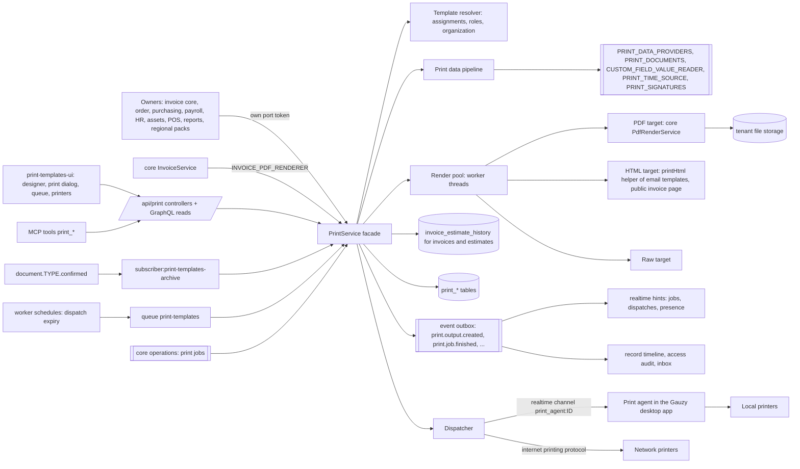

# Implementation Plan: Print and PDF designer

> Translates an approved `spec.md` into architecture and tech choices. The plan owns
> implementation details; the spec owns behaviour.

**Feature ID**: `print-and-pdf-designer`
**Spec**: `./spec.md`
**Tasks**: `./tasks.md`
**Status**: `Draft`
**Last updated**: 2026-11-23

---

## 1. Architecture Summary

A new plugin pair: `@gauzy/plugin-print-templates` (`packages/plugins/print-templates`) and `print-templates-ui` (Angular designer, print dialog, queue, printers), loaded by `apps/api/src/plugins.ts` only when `GAUZY_PRINT_TEMPLATES_ENABLED` is exactly `true`, gated per tenant by `FEATURE_PRINT_TEMPLATES` (printers and agents also `FEATURE_PRINT_AGENTS`).

The plugin owns a **layout document** (a versioned JSON tree of pages, bands and blocks), a **print data pipeline** that turns a record into the data a template reads (through owners' data providers, the document engine's snapshot and the custom-field reader, always as the requesting user), and a **renderer** with three targets from the same document: PDF, HTML embedded in email bodies and public pages, and raw printer bytes. Owners never import the plugin: they bind their own port token to the `PrintService` facade in `apps/api/src/plugin-composition.ts` and register their shipped templates and data providers at bootstrap. Core gains one optional port, `INVOICE_PDF_RENDERER`, that `InvoiceService` asks first; unbound or unassigned, today's code-built invoice, estimate and receipt PDFs are produced unchanged.

**Built on what exists.**

- **One PDF service in core.** The `pdfmake` set-up of `PdfmakerService` (`packages/core/src/lib/invoice/pdfmaker.service.ts`: fonts, URL access off, local access limited to fonts) and the image handling of the Docs renderer (`packages/plugins/docs/src/lib/pdf/pdf-render.ts`, `document-pdf.service.ts`, `sharp` scaling and metadata stripping) are extracted into one core service, `packages/core/src/lib/pdf/` (`PdfRenderService`), used by invoices, Docs and this plugin; no third set-up.
- **Invoice and estimate history stays one.** `invoice_estimate_history` (`packages/core/src/lib/invoice-estimate-history/`) remains the history of an invoice or estimate: when this plugin makes an output for one (download, email), the server writes the history entry with the template and version, and the Angular download and email screens (`apps/gauzy/src/app/pages/invoices/invoice-download/invoice-download-mutation.component.ts` and the email dialog) skip their own entry for that action when the print options answer that the server records it; the outputs tab of an invoice shows that history. `print_output` keeps the file, fingerprint and verification token.
- **Terms.** The terms of a document are its own field (`invoice.terms` for invoices and estimates); when a document form picks a default, the precedence is: the terms text set as default for the document type and organization, then `organization.defaultInvoiceEstimateTerms` (`organization.entity.ts`) for invoices and estimates; `print_terms_text` adds texts for the other types and languages without copying the organization field.
- **Email bodies and public pages.** The email template stays the message: core `email_template` (Handlebars and MJML, `compile-mjml.ts`) keeps subject, greeting and wrapper, and embeds the print HTML of the record through a `{{{printHtml}}}` helper the render service fills; there is no second email-body template store. The public invoice page (`packages/core/src/lib/public-share/invoice/`) renders the print HTML when a template with the portal output is assigned to the invoice type, and its own page otherwise.
- **Agent credentials** reuse the personal token helpers (`packages/core/src/lib/auth/user-api-token/user-api-token.utils.ts`: generation, SHA-256 hash, prefix, constant-time match). A print agent needs a device credential of its own rather than the desktop user's session because it must keep printing when nobody is signed in to the desktop app (a register's printer, a packing station overnight) and must be limited to its own printers' dispatches instead of carrying a person's rights. Pairing codes use `ACCESS_ONE_TIME_CODES` of `access-control-and-security` when it is loaded.
- **Bulk jobs** are core durable operations (`packages/core/src/lib/operation/`, `OperationRegistry`): lease, resume and cancel come from the operation; `print_job` keeps what the user chose and `print_job_item` the per-record outcome.



## 2. Tech Choices

| Concern | Choice | Rationale |
| ------- | ------ | --------- |
| Package | new plugin pair `print-templates`, `print-templates-ui` | Principle I; [platform architecture](../../architecture/business-suite.md) §2.1 |
| Permissions | the eleven permissions declared as `PluginContributions` with `defaultFor` (with the feature and setting contributions) | no seed migration |
| Template model | layout document JSON (`schemaVersion`, pages, bands, blocks, styles, translations) validated by a JSON Schema in contracts; upgrade functions per schema version | one model for designer, renderer and import files |
| Template language | the platform's Handlebars engine already used by email and accounting templates, in an isolated instance (`Handlebars.create()`, strict mode, `knownHelpersOnly`, no prototype access, step budget) with a fixed helper library | one language for print, email and portal (spec FR-19, FR-85) |
| Conditions | the isomorphic condition evaluator of `@gauzy/utils` (`formula/`, from `custom-fields-and-forms`), rule-kernel row shape | designer preview and server render agree |
| PDF | `pdfmake` 0.3 (MIT) through the core `PdfRenderService` extracted from `PdfmakerService` and the Docs renderer (one access policy: no URL, no local path but fonts in its in-memory file system; one image normaliser) | runs in API, worker, desktop server and SQLite demo without a browser; one PDF set-up |
| Archival, tags, attachments, merge | the PDF writer's tagged and archival subset options; `pdf-lib` (MIT) to merge outputs and embed files | spec FR-53, FR-57, FR-58 |
| Barcodes | `bwip-js` (MIT) in the API and in the designer | same symbols in preview and PDF |
| Images | `sharp` through the core `PdfRenderService` image normaliser (scale to 300 dpi of printed size, strip metadata) | memory and size bounds |
| Rendering isolation | a `worker_threads` pool (CPU − 1, at most 4) with a 30 s timeout and a heap limit per render | heavy renders never block request handling |
| Raw printing | command builders per language family (receipt, label) in the plugin; encoding by printer code page | spec FR-74 |
| Network printing | `ipp` client (MIT) from the queue worker | spec FR-72 |
| Print agent | a module in `packages/desktop-lib` enabled from the desktop app settings; jobs over the realtime channel, polling fallback | no inbound port at the customer |
| Background work | print jobs as core operations (`print-templates.job`); `@ScheduledJob` + `@QueueWorker` (`@gauzy/scheduler`) for dispatches, outbox consumers, in-process timers without a queue root | task automations layout; no second job runner |
| Retention | job files (7 days), drafting samples (24 hours) and dispatch payloads declared as kinds of the `access-control-and-security` retention model (`RETENTION_SOURCES`) | one retention runner |
| Feature gate | `FEATURE_PRINT_TEMPLATES`, `FEATURE_PRINT_AGENTS` contributions (`print-templates.features.ts`), `FeatureFlagGuard` + `@FeatureFlag` | [platform architecture](../../architecture/business-suite.md) §6 |

## 3. Data Model

All tables extend `TenantOrganizationBaseEntity` (soft delete, `isActive`, `isArchived`) unless noted; JSON is `text` on every dialect; ids of other plugins' records carry no foreign key; `organizationId` null means tenant-wide with `organizationIds` as the allow-list (the custom-fields idiom).

### New or changed entities

| Table | Columns (beyond the base) | Indexes and uniqueness |
| --- | --- | --- |
| `print_template` | `recordType` varchar(64), `key` varchar(96), `names` text (per language), `description` text null, `kind` varchar(8) (`LAYOUT`, `CODE`, `LABEL`, `RAW`, `EXISTING`), `outputs` varchar(32) (`PRINT`,`EMAIL`,`PORTAL`), `status` varchar(10) (`DRAFT`, `PUBLISHED`, `ARCHIVED`), `source` varchar(12) (`USER`, `PLUGIN`, `PACK`, `STANDARD`, `ACCOUNTING`), `sourceRef` varchar(128) null, `sourceChecksum` varchar(64) null, `copiedFromId` uuid null, `organizationIds` text null, `roleIds` text null, `defaultLanguage` varchar(8), `paper` text, `labelSheet` text null, `rawLanguage` varchar(16) null, `variables` text null, `draft` text, `draftVersion` int, `draftLockedByUserId` uuid null, `draftLockedAt` timestamp null, `publishedVersion` int null, `previewImageId` uuid null, `warningCount` int default 0, `lastUsedAt` timestamp null | unique `(tenantId, recordType, key)`; idx `(tenantId, recordType, status)` |
| `print_template_version` | `templateId` fk cascade, `version` int, `document` text, `checksum` varchar(64), `note` varchar(255) null, `publishedByUserId`, `publishedAt` | unique `(templateId, version)` |
| `print_assignment` | `recordType`, `templateId` fk restrict, `output` varchar(8), `contextType` varchar(16) (`TENANT`, `ORGANIZATION`, `PARTY`, `REGISTER`, `WAREHOUSE`, `CHANNEL`, `REPORT`), `contextKey` varchar(64) (null-safe id), `letterheadId` uuid null | unique `(tenantId, recordType, output, contextType, contextKey)` |
| `print_letterhead` | `name` varchar(120), `header`, `footer`, `firstPageHeader` text null (layout fragments), `imageMode` bool, `repeat` varchar(6) (`ALL`, `FIRST`), `isDefault` bool, `defaultFor` text null (document types), `isDisabled` bool | idx `(organizationId, isDefault)` |
| `print_snippet` | `recordType` varchar(64) null, `name` varchar(120), `document` text, `version` int | idx `(tenantId, recordType)` |
| `print_terms_text` | `name` varchar(120), `bodies` text (per language), `applies` varchar(8) (`SELLING`, `BUYING`, `BOTH`), `documentTypes` text, `defaultFor` text null, `copyAttachments` bool, `attachmentFileIds` text null, `isDisabled` bool (a document's own terms stay on the document; `organization.defaultInvoiceEstimateTerms` is the fallback for invoices and estimates) | idx `(organizationId, applies)` |
| `print_title` | `key` varchar(32), `labels` text, `isSystem` bool | unique `(tenantId, key)` |
| `print_font` (tenant base) | `family` varchar(64), `weight` int, `style` varchar(8), `fileId` uuid, `sha256` varchar(64), `scripts` text, `licenceConfirmedByUserId`, `licenceConfirmedAt` | unique `(tenantId, family, weight, style)` |
| `print_output` (the file register of outputs; for invoices and estimates the history entry is `invoice_estimate_history`; one `AUDIT_EVENT_SINK` event per row) | `recordType`, `recordId` uuid, `templateId` null, `templateVersion` int null, `output` varchar(8), `purpose` varchar(10) (`DOWNLOAD`, `EMAIL`, `ARCHIVE`, `PORTAL`, `JOB`, `PRINTER`), `language` varchar(8), `heading` varchar(32) null, `copyNumber` int, `fileId` uuid null, `fingerprint` varchar(64), `pages` int, `profile` varchar(10) (`STANDARD`, `ARCHIVAL`, `ARCHIVAL_EMBED`), `isTagged` bool, `verifyTokenHash` varchar(64) null, `verifyRevokedAt` null, `actorType` varchar(8), `actorUserId` null, `jobId` null, `invoiceEstimateHistoryId` null, `maskedFields` text (the field paths masked or hidden when the file was rendered, read by the file routes of §4), `appendedFileIds` text null (the attachments appended under FR-54, each checked at render and again by the file routes of §4), `durationMs` int | idx `(tenantId, recordType, recordId, createdAt)`, `(tenantId, createdAt)`; unique `(verifyTokenHash)`; unique `(tenantId, recordType, recordId, purpose, templateVersion)` where `purpose = 'ARCHIVE'` (guarded in code on MySQL) |
| `print_job` (the user's selection, options and merged file, a row because outputs, dispatches and the download link reference the job; state and progress are the operation's) | `recordType`, `templateId` null, `selection` text, `options` text, `outputKind` varchar(8) (`MERGED`, `ARCHIVE`, `PRINTER`), `printerId` null, `operationId` (core operation `print-templates.job`: status, progress, lease, resume, cancel, idempotency key), `total` int, `pinnedVersions` text, `fileId` null, `fileExpiresAt` null, `requestedByUserId` | idx `(requestedByUserId, createdAt)`, `(operationId)` |
| `print_job_item` | `jobId` fk cascade, `position` int, `recordId` uuid, `status` varchar(8) (`PENDING`, `DONE`, `SKIPPED`, `FAILED`), `reason` varchar(64) null, `error` text null, `outputId` null, `pages` int, `attempts` int; a table because a job holds up to 5,000 records whose outcome, output and reason are listed and exported (FR-66), which operation steps (one per stage) do not hold | unique `(jobId, recordId)`; idx `(jobId, status, position)` |
| `print_printer` | `name` varchar(120), `connection` varchar(8) (`AGENT`, `NETWORK`), `agentId` null, `systemName` varchar(255) null, `address` varchar(255) null, `kinds` text, `media` text, `rawLanguage` varchar(16) null, `location` varchar(120) null, `defaults` text (purpose and context keys), `status` varchar(10), `statusMessage` varchar(255) null, `lastSeenAt` | idx `(organizationId, connection)` |
| `print_agent` | `name` varchar(120), `tokenHash` varchar(64), `tokenPrefix` varchar(12) (generated, hashed and matched with the helpers of `user-api-token.utils.ts`), `platform` varchar(16), `version` varchar(32), `pairedByUserId`, `pairedAt`, `revokedAt` null, `lastSeenAt` | unique `(tokenHash)` |
| `print_agent_pairing` | `codeHash` varchar(64), `expiresAt`, `usedAt` null, `createdByUserId` (only while `ACCESS_ONE_TIME_CODES` is unbound; with it, pairing codes are one-time codes of purpose `print-agent-pairing`) | unique `(codeHash)` |
| `print_dispatch` | `printerId` fk cascade, `jobId` null, `outputId` null, `payloadFileId` uuid, `payloadKind` varchar(4) (`PDF`, `RAW`), `copies` int, `state` varchar(8) (`QUEUED`, `SENT`, `PRINTED`, `FAILED`, `EXPIRED`), `attempts` int, `error` varchar(255) null, `expiresAt`, `sentAt`, `ackAt` null, `requestedByUserId` | idx `(printerId, state, createdAt)` |

Organization settings through the plugin's setting contributions (`print-templates.settings.ts`): `print.jobMaxRecords` (1,000), `print.jobConcurrentPerUser` (3), `print.dispatchTtlHours` (24), `print.archiveOnConfirm` (document types, empty), `print.draftsNeedPermission` (false; spec FR-95: when true, drafts and cancelled documents print only with `PRINT_DRAFTS`, only for the types in `print.draftPrintTypes`, and always with the draft or cancelled mark), `print.draftPrintTypes` (types whose drafts may print while `print.draftsNeedPermission` is true; default every type). With `print.draftsNeedPermission` false, `INVOICE_PDF_RENDERER` and `/render` apply no draft check, as today's invoice routes.

### Migrations

**Migration timestamps**: `packages/plugins/print-templates` `1791000038100` to `1791000038199`.

In `packages/plugins/print-templates/src/lib/database/migrations/`, with the shared core migration helpers of `@gauzy/core`; additive, idempotent, PostgreSQL, MySQL and SQLite branches, registered for both ORMs: `1791000038100-CreatePrintTemplateTables` (template, version, assignment, snippet, heading, font), `1791000038110-CreatePrintLetterheadAndTermsTables`, `1791000038120-CreatePrintOutputAndJobTables` (`print_output`; `print_job` with the selection, options and merged file a user chose; `print_job_item` with one outcome per record; status, progress, lease, retries and cancel stay on the core operation), `1791000038130-CreatePrintPrinterTables` (printer, agent, pairing, dispatch). Permissions and default grants are plugin contributions; no migration is needed for them. No core table changes and no backfill: shipped templates are seeded per tenant on enable (§8).

### Contracts

`packages/contracts/src/lib/print-template.model.ts` (exported from `index.ts`): enums `PrintTemplateKind`, `PrintOutputKind`, `PrintPurpose`, `PrintJobState`, `PrintDispatchState`, `PrintBlockType`; `IPrintLayoutDocument` (`schemaVersion`, `page`, `bands` `{ header, firstHeader, oddHeader, evenHeader, lastHeader, footer, … }`, `body`, `styles`, `translations`, `variables`), the block union (`text`, `field`, `linkedField`, `table`, `repeat`, `image`, `barcode`, `signature`, `totals`, `taxes`, `amountInWords`, `terms`, `snippet`, `heading`, `divider`, `spacer`, `pageBreak`, `section`, `columns`, `canvas`, `timeAppendix`, `verification`), `IPrintTemplate`, `IPrintTemplateVersion`, `IPrintAssignment`, `ILetterhead`, `ITermsText`, `IPrintOutput`, `IPrintJob`, `IPrintPrinter`, `IPrintDispatch`, the JSON Schema `print-layout.schema.json`, and the in-process contract of §4.1.

## 4. API Surface

### 4.1 In-process contract

```ts
interface IPrintService {                                   // the facade owners bind their tokens to
    render(req: {
        recordType: string; recordIds: ID[]; templateId?: ID; templateKey?: string; output: 'PDF' | 'HTML' | 'RAW';
        purpose: PrintPurpose; language?: string; letterheadId?: ID | null; headingKey?: string; variables?: JsonData;
        profile?: 'STANDARD' | 'ARCHIVAL' | 'ARCHIVAL_EMBED'; embed?: { name: string; mime: string; content: Buffer }[];
        context?: { type: string; key: string }; store?: boolean;     // store = keep the file, write print_output
    }): Promise<IPrintResult>;                              // { content, mime, pages, fingerprint, outputId?, warnings }
    resolve(recordType: string, ctx: { organizationId: ID; output: PrintOutputKind; party?: IPartyRef;
            context?: { type: string; key: string } }): Promise<IResolvedPrintTemplate>;
    enqueue(req: IPrintJobRequest): Promise<IPrintJob>;
    dispatch(req: { printerId?: ID; context?: { type: string; key: string }; outputId?: ID; render?: IPrintRenderRequest;
                copies?: number }): Promise<IPrintDispatch>;
}
interface IPrintTemplateRegistration {                      // registerPrintTemplates([...]) in a plugin class
    key: string; owner: string; recordType: string; kind: PrintTemplateKind; outputs: PrintOutputKind[];
    names: Record<string, string> | { labelKey: string }; document: IPrintLayoutDocument; version: string;
    isDefault?: boolean; contexts?: string[];              // e.g. 'REGISTER' for receipts
}
interface IPrintDataProvider {                              // registerPrintDataProviders([...]); one per record type
    recordType: string; fields(viewer: IViewer): Promise<IPrintFieldCatalogue>;   // palette and standard template
    load(ids: ID[], o: { viewer: IViewer; language: string }): Promise<IPrintRecordData[]>;  // scope and masks applied
    permission?: string; draftStates?: string[]; partyOf?(data): IPartyRef; contexts?: string[];
}
```

Shipped templates and data providers are a `print` member of `PluginContributions` (`packages/plugin/src/lib/plugin-contributions.ts`) on each owner's `@GauzyCorePlugin`, unioned at boot by the core `plugin-contributions/` registry next to permissions, features and settings, so owners declare them without importing this plugin and the plugin contributions report lists them; `registerPrintTemplates` and `registerPrintDataProviders` are typed helpers that build those entries.

Resolution order (spec FR-48): party → owner context → organization → tenant → standard template, per output.

**Data pipeline.** `PrintDataService.load` picks the type's registered provider; without one it uses the document engine (`PRINT_DOCUMENTS`: snapshot, totals snapshot with `amountInWords`, flow numbers) for document types, else the generic provider over the record type registry's list source (entity, read scope, title and field catalogue), read with the requester's tenant, organization and read scope (and the record-level rules of `advanced-access` when loaded, through the shared CRUD list-query hook). Every value passes core `FieldVisibility` (permission-gated properties and, when bound, `FIELD_ACCESS_POLICY`); custom fields come through `CUSTOM_FIELD_VALUE_READER.readMany` with masks and without `hideInPrint` fields; the organization profile, party and letterhead are added; invoices add billed time through `PRINT_TIME_SOURCE`; signature blocks read `PRINT_SIGNATURES`.

**Ports this plugin offers** (bound in `plugin-composition.ts`): `PrintService` for the owners' tokens named in their plans: `PAYROLL_PRINT`, `HR_PRINT`, `ORGANIZATION_PRINT`, `PURCHASING_DOCUMENT_OUTPUT` (render half; sending stays with communications), `RECORD_VIEWS_PRINT`, `AUTOMATION_PRINT`, `E_INVOICING_PRINT` (archival profile with the XML embedded), and the print tokens of sales, delivery, warehouse, payments, assets, manufacturing, point of sale and financial reports; `PrintTemplateInstaller` (`install`, `upgrade`, `archive` with pack key and checksums) for `REGIONAL_PRINT_TEMPLATES`; `PrintInvoiceRenderer` for core `INVOICE_PDF_RENDERER`; `PrintTermsService` for owners' document forms; `PrintOutputTimelineSource` for `RECORD_TIMELINE_SOURCES`.

**Ports consumed** (optional; unbound → the capability is absent): `PRINT_DOCUMENTS` (`BusinessDocumentReader`), `CUSTOM_FIELD_METADATA`, `CUSTOM_FIELD_VALUE_READER`, `RECORD_VIEWS_SELECTION` (job ids from a view), `PRINT_REPORTS` (report-builder: run a definition for print), `PRINT_SENDER` (communications; fallback: only invoice and estimate email as today), `PRINT_ASSISTANT` (`ai-agents-and-assistants`, else the `ai-chat` provider registry), `PRINT_SIGNATURES` (multi: owners' captured signatures), `PRINT_TIME_SOURCE` (core invoice billed time), `PRINT_PUBLIC_LINKS` (`advanced-access` web-view links on core `shared_entity`; else owners' public links), `ACCESS_ONE_TIME_CODES` (agent pairing codes), `AUDIT_EVENT_SINK` (one event per output), `RETENTION_SOURCES` entries offered (`print.job-files`, `print.samples`, `print.dispatch-payloads`).

**Core changes.** `packages/core/src/lib/invoice/invoice-pdf-renderer.port.ts` declares `INVOICE_PDF_RENDERER` (`render(invoice, kind: 'INVOICE' | 'ESTIMATE' | 'RECEIPT', language): Promise<Buffer | null>`); `InvoiceService` injects it `@Optional()` and falls back to `generateInvoicePdfDefinition` when it is absent or answers `null`. `packages/core/src/lib/pdf/` holds the `PdfRenderService` extracted from `PdfmakerService` and the Docs renderer (both then call it). The email template renderer gains the `printHtml` helper (empty when the plugin is absent). `invoice_estimate_history` gets its entries from the server for outputs this plugin makes (no schema change).

### 4.2 REST

All under `/api/print`, `@FeatureFlag(FEATURE_PRINT_TEMPLATES)` (printers, agents and dispatches also `FEATURE_PRINT_AGENTS`), `TenantPermissionGuard`, class-validator DTOs, Swagger, cursor pagination, `If-Match` on template drafts, `Idempotency-Key` on jobs and dispatches.

| Method | Endpoint | Permission | Description | Status |
| ------ | -------- | ---------- | ----------- | ------ |
| `GET` | `/record-types`, `/record-types/:type/catalogue` | `PRINT_TEMPLATES_VIEW` | printable types with counts; field palette masked for the caller | New |
| `GET` `POST` | `/templates`, `/templates/:id` | `PRINT_TEMPLATES_VIEW` / `_MANAGE` | list, read; create from standard, blank, copy, file | New |
| `PATCH` | `/templates/:id/draft` | `PRINT_TEMPLATES_MANAGE` (code kind: `_CODE`) | save draft; `If-Match` draft version | New |
| `POST` | `/templates/:id/{lock,unlock,publish,archive,restore,copy}` | `_MANAGE` (publish: `_PUBLISH`) | lifecycle | New |
| `GET` `POST` | `/templates/:id/versions`, `/versions/:a/diff/:b`, `/versions/:v/restore` | `_VIEW` / `_MANAGE` | history, diff, restore to draft | New |
| `GET` | `/templates/:id/usage`, `/templates/:id/export` | `_VIEW` / `_MANAGE` | where used; file | New |
| `POST` | `/templates/import` | `_MANAGE` | `{ file, preview }` → diff or created items | New |
| `POST` | `/templates/:id/preview` | `_MANAGE` + view of the record | `{ recordId, language, letterheadId, headingKey, target, asRoleId?, draft }` → PDF or HTML with warnings | New |
| `POST` | `/templates/draft-from` | `_MANAGE` | `{ recordType, description?, sampleFileId? }` → draft + mapping report | New |
| `GET` `PUT` | `/assignments` | `_VIEW` / `_MANAGE` | defaults per type, output and context | New |
| CRUD | `/letterheads`, `/snippets`, `/headings`, `/fonts` | `PRINT_LETTERHEADS_MANAGE` / `_MANAGE` | | New |
| CRUD, `POST` | `/terms`, `/terms/:id/render` | `PRINT_TERMS_MANAGE`; render: create of the document type | texts; `{ documentType, documentId }` → text and attachments | New |
| `GET` | `/records/:type/:id/options` | print permission of the type | templates, letterheads, languages, headings, variables, printers, remembered choice | New |
| `POST` | `/render` | print permission of the type (+ `PRINT_DRAFTS` for drafts when `print.draftsNeedPermission` is on) | up to 10 ids → PDF, HTML or raw stream | New |
| `GET` | `/records/:type/:id/outputs`, `/outputs/:id/file` | `PRINT_HISTORY_VIEW` and current read access to the record | history and stored files (invoices and estimates: their `invoice_estimate_history` with the outputs' files); the file is served only when the requester can read the record at the time of the request (`RECORD_ACCESS_FILTER.can` when bound, else the type's read permission and today's scopes) and every field masked or hidden for the requester is in the output's `maskedFields`, and the requester may open every attachment in its `appendedFileIds` through the record's attachment access; otherwise `403 PRINT_OUTPUT_RESTRICTED`, with a fresh render through `/render` under the requester's own masks offered | New |
| `POST` `GET` | `/jobs`, `/jobs/:id`, `/jobs/:id/items`, `/jobs/:id/items.csv`, `/jobs/:id/file` | `PRINT_JOBS_RUN` (others' jobs: `PRINT_HISTORY_VIEW`) | start (ids or view and filter), progress, log, file; the merged file follows the output rule for every record of the job (its requester included, after losing access to one), and items and CSV list only the records the requester can read | New |
| `POST` | `/jobs/:id/{cancel,retry}` | requester | | New |
| `POST` | `/labels` | print permission of the type | `{ templateId, items[{ id, quantity }] \| quantityField, start, sort, output }`; more than 200 labels → job | New |
| CRUD, `POST` | `/printers`, `/printers/:id/test` | `PRINT_PRINTERS_MANAGE` | | New |
| `POST` `GET` | `/dispatches`, `/dispatches/:id/retry` | `PRINT_PRINTERS_USE` | send, list by printer, retry | New |
| `POST` `DELETE` | `/agents/pairing-codes`, `/agents/:id` | `PRINT_PRINTERS_MANAGE` | code (shown once; a one-time code of `access-control-and-security` when loaded); revoke | New |
| `POST` | `/agents/pair` | public, single-use code | answers the agent credential once | New |
| `GET` `POST` | `/agents/me/dispatches`, `/me/dispatches/:id/{payload,ack,result}`, `/me/printers` | agent credential | polling fallback, payload, status, printers | New |
| `GET` `POST` | `/public/print/verify/:token`, `/public/print/verify/:token/check` | public, rate limited (30/min per address) | summary; uploaded PDF (≤ 20 MB) → match | New |
| `GET` | `/reports/{usage,jobs,inventory,printers}` | `PRINT_HISTORY_VIEW` / `_VIEW` | FR-94 datasets | New |
| `GET` | `/api/invoices/download/:id` and the other invoice PDF routes | unchanged | render through `INVOICE_PDF_RENDERER` when assigned | Changed (additive) |

GraphQL (behind `FEATURE_GRAPHQL`): `printTemplates(recordType)`, `printTemplate(id)`, `printOutputs(recordType, recordId)` in `graphql/schema-extensions.ts`. Errors: `PRINT_TEMPLATE_INVALID` (with problems), `PRINT_DRAFT_STALE` (409), `PRINT_DRAFT_LOCKED` (423), `PRINT_RECORD_FORBIDDEN` (403), `PRINT_DRAFT_NOT_ALLOWED` (403), `PRINT_RENDER_TIMEOUT`, `PRINT_RENDER_FAILED` (with block path), `PRINT_JOB_LIMIT`, `PRINT_TEMPLATE_IN_USE`.

**Consumer tokens answered** (bound in `apps/api/src/plugin-composition.ts` to `PrintService`; each consumer plan states the shape it calls and its fallback): `COMMUNICATIONS_PRINT`, `LEARNING_PRINT`, `PERFORMANCE_PRINT`, `PORTAL_PRINT`, `RECRUITMENT_PRINT`, `REPORT_PRINT`, `SHEETS_PRINT`, `SLIDES_PRINT`.

## 5. Events, Real-Time and Notifications

| Event | Emitted when | Consumers |
| ----- | ------------ | --------- |
| `print.template.published` / `.archived` | lifecycle | realtime hint `print-templates:<tenantId>` (dialogs drop cached options), activity log |
| `print.output.created` `{ recordType, recordId, outputId, purpose, templateId, version, fingerprint, actor }` | an output is stored or downloaded | record timeline, `advanced-access` audit (print log), report datasets |
| `print.job.finished` / `.failed` | job ends | inbox item to the requester with the file link; realtime `print_job:<id>` |
| `print.dispatch.state_changed` | dispatch moves | realtime to requester and `print_printer:<id>` |
| `print.agent.offline` | no heartbeat for 10 minutes | inbox items to `PRINT_PRINTERS_MANAGE` holders of the organization |

Consumed: `document.<type>.confirmed` (outbox consumer `subscriber:print-templates-archive`) for types in `print.archiveOnConfirm`. Real-time: `RealtimeHintsService.appendHint` on `print_job:<id>` (counts), `print_template_draft:<id>` (presence, lock), `print_printer:<id>` (status), and `print_agent:<agentId>` (new dispatch ids; the agent fetches payloads over HTTPS). Polling fallback for agents every 5 s when the realtime plugin is absent, as documented for small deployments. Inbox items through `INBOX_ITEM_WRITER`.

## 6. UI Surface

- **Angular `print-templates-ui`** (lazy; menu entries carry `FEATURE_PRINT_TEMPLATES` and permissions):
  `/pages/settings/print/templates` (catalogue by type, usage, inventory warnings), `/templates/:id/designer`
  (flowing and canvas modes, field palette, properties, layers, outline editor, preview pane with record picker,
  language, letterhead, target and "as role", versions and diff), `/templates/:id/code` (code template editor),
  `/pages/settings/print/{letterheads,assignments,terms,headings,fonts,snippets}`, `/pages/print/jobs` (live progress,
  logs), `/pages/settings/print/printers` (agents, pairing, printers, test page, dispatch log), reports under
  `/pages/print/reports`. Strings under `PRINT_TEMPLATES.*` in every locale.
- **Exported pieces** for every page: `PrintActionComponent` (toolbar button and dialog), `PrintOutputsTabComponent` (registered through `PageTabRegistryService`), a bulk action registered with `registerBulkActions` for saved-view lists, `TermsPickerComponent` for document forms, `LabelPrintDialogComponent`. Each renders only while `FEATURE_PRINT_TEMPLATES` is on. The invoice, estimate and receipt pages show the print action next to the existing download, which stays as it is.
- No React package: the Angular exported pieces above are the print surface.
- **Desktop app**: Settings → Printing (pair with a code, list local printers, map them, test, log), in
  `packages/desktop-ui-lib` with the agent in `packages/desktop-lib`.

## 7. MCP Tools, SDKs and Integrations

`packages/mcp-server/src/lib/tools/print-templates.ts`, registered in `register-all-tools.ts`:

| Tool | Input | Output |
| --- | --- | --- |
| `print_templates_list` | record type, status | templates with outputs and defaults |
| `print_preview` | record type, id, template?, language? | PDF file link and warnings |
| `print_records` | record type, ids or view, template?, output | job or file link |
| `print_template_draft` | record type, description or sample file id | draft id and mapping report |
| `print_template_check` | template id | warnings |
| `print_template_explain` | template id | fields and conditions used |

SDK: additive OpenAPI; regenerate the SDKs after merge. Import and export: the template file (JSON with the layout document, fonts and images as base64, checksums), schema-validated. Integrations: network printers by the internet printing protocol; the print agent in the desktop app. No other outbound integration.

## 8. Background Jobs

| Trigger | When | What it does | Idempotency |
| ------- | ---- | ------------ | ----------- |
| `print-templates.seed` (queue) | `FEATURE_PRINT_TEMPLATES` enabled for a tenant, or a plugin with registrations upgraded | seeds or upgrades shipped templates and standard assignments for types that print nothing today; writes no assignment for invoices, estimates and receipts, which keep today's code-built PDFs until an administrator assigns a template; leaves copies alone | `(tenantId, recordType, key)`, `sourceChecksum` |
| core operation `print-templates.job` (queue `print-templates`) | job started, resumed or retried | slices of 25 records as operation steps, each rendered in the pool and appended to the output; the operation lease resumes an interrupted job; failed items retried (max 2) | item status; `(jobId, recordId)`; operation idempotency key |
| `subscriber:print-templates-archive` (outbox) | `document.<type>.confirmed` | archival copy for configured types | unique archive output per record and version |
| `print-templates.dispatch.network` (queue) | dispatch to a network printer | sends by the internet printing protocol, records the result | dispatch state |
| `print-templates.dispatch.expire` | every 15 min | expires dispatches past their TTL, notifies requesters; flags agents offline | state transition |
| retention kinds `print.job-files`, `print.samples`, `print.dispatch-payloads` | daily, by the retention runner of `access-control-and-security` (`print-templates.purge` only while that plugin is not loaded) | job files after 7 days, drafting samples after 24 h, unused pairing codes | idempotent delete |

The worker loads `PrintTemplatesSchedulePlugin` (schedules only); the API loads the queue workers and consumers. Without a queue root the API runs them on in-process timers under a per-tenant lock. Jobs run inside `RequestContext.runWithRequest` as the requester (their reads and masks), the archive consumer as a system actor of the organization with the document type's view permission.

## 9. Security & Permissions

`print-templates.permissions.ts`, declared as permission contributions with `defaultFor` (the grants below; the permission reload adds them for existing tenants): `PRINT_TEMPLATES_VIEW`, `PRINT_TEMPLATES_MANAGE`, `PRINT_TEMPLATES_PUBLISH`, `PRINT_TEMPLATES_CODE`, `PRINT_LETTERHEADS_MANAGE`, `PRINT_TERMS_MANAGE`, `PRINT_JOBS_RUN`, `PRINT_DRAFTS`, `PRINT_HISTORY_VIEW`, `PRINT_PRINTERS_MANAGE`, `PRINT_PRINTERS_USE` (eleven). Grants: super admin all; admin all but `PRINT_TEMPLATES_CODE`; manager `VIEW`, `JOBS_RUN`, `DRAFTS`, `HISTORY_VIEW`, `PRINTERS_USE`; data entry `JOBS_RUN`, `PRINTERS_USE`; employee `PRINTERS_USE`; viewer `VIEW`. Printing a record needs the type's print permission (registration, default its view permission) and the record's read scope. Template language: isolated Handlebars instance, strict, known helpers only, no prototype access, step budget 50,000, output size cap 20 MB; conditions in the `@gauzy/utils` evaluator; code templates sanitised to the documented subset. Uploads: fonts parsed before acceptance (TrueType/OpenType only, 10 MB), images raster only (the core upload rules), samples PDF or image up to 20 MB. Agent credential: 32 random bytes, SHA-256 hashed, prefix shown; pairing codes single-use, 10 minutes, hashed. Verification tokens random, hashed, revocable; the public page reveals only the five summary values. Network printers at private addresses refused unless `GAUZY_PRINT_PRIVATE_NETWORK_ALLOWED=true`. Agents (MCP) act through the caller's request context; outputs they make are marked `Agent`.

## 10. Observability

`print_output` and `print_job` rows, core operations of jobs, invoice and estimate history entries, one audit event per output; activity-log entries for publish, archive, assignment, letterhead, terms, printer and agent changes; metrics: render latency per type and target, pool queue length, render failures and timeouts, job throughput, dispatch latency and failures, agents online. Failures raise inbox items to the requester; scheduler executions and dead letters through the scheduler package.

## 11. Phased Rollout

1. **Phase 1 — Surface what exists.** Contracts, entities, migrations, renderer (PDF target) with the standard template, today's invoice, estimate and receipt layouts as shipped templates, accounting templates listed and assignable, `INVOICE_PDF_RENDERER`, print dialog and outputs tab, letterheads, assignments, render API, MCP read and preview tools. Usable: every printable type prints; invoices can switch to a template.
2. **Phase 2 — Depth.** Designer (flowing and canvas, bands, styles, versions, lock), snippets, terms, headings, watermarks, fonts, labels, report templates, bulk jobs and queue, owners' shipped templates and data providers, regional installer, code templates, reports of FR-94.
3. **Phase 3 — Advanced capabilities.** HTML target for email and portal, live preview as a role, assistant drafting, archival and tagged PDFs, signatures and certificate page, verification page, tracked-time appendix, print agents, raw templates and network printers, real-time progress and status.
4. **Phase 4 — General availability**: the feature is off by default; after the trial period it may be switched on by default for new tenants only; existing tenants keep their setting until an administrator changes it.

## 12. Constitution Reconciliation

- I Plugin-first: new plugin pair; core gains one optional port, the shared PDF service and the `printHtml` email helper; owners integrate through their own tokens.
- II Tenant/organization scoping: every table scoped; renders read through the requester's scope and masks.
- III Both ORMs, additive migrations: MultiORM entities, MikroORM repositories, four tri-dialect migrations, no drop.
- IV Default-off flag; nothing removed: deploy switch plus tenant features; invoice PDFs and accounting templates kept.
- V Contracts and API first: `print-template.model.ts`, layout schema, REST and the render facade before UI.
- VI Permissions, privacy, security: eleven keys, sandboxed language, hashed agent and verification tokens.
- VII Real-time through the event bus: outbox events, realtime hints, documented agent polling fallback.
- VIII i18n and accessibility: texts per language, right-to-left, outline editor, tagged PDFs.
- IX Tests: unit, renderer snapshots (PDF text and structure), dialect and ORM parity, e2e, desktop agent tests.
- X Behaviour-first spec: implementation stays here.
- XI Documentation describes our platform only.

## 13. Risks & Mitigations

| Risk | Likelihood | Impact | Mitigation |
| ---- | ---------- | ------ | ---------- |
| The PDF library lacks a layout feature a template needs | Medium | Medium | layout schema limited to what the compiler supports; designer refuses the rest; snapshot suite per block |
| Archival or tagged output fails validation | Medium | Medium | validator in CI on sample outputs; profile marked experimental until it passes |
| Large jobs exhaust memory | Medium | High | render pool with heap limits, slices of 25, merged output streamed to storage |
| Designer and renderer disagree | Medium | High | one layout compiler shared by preview (server-rendered PDF) and output; no client-side PDF |
| Template language abuse | Low | High | isolated instance, known helpers only, step and size budgets, tests with hostile templates |
| Owners bypass the facade with private PDF code | Medium | Medium | owning plugins name their print token; review checklist |
| Agents behind firewalls miss real-time | Medium | Low | polling fallback, ordered delivery, TTL with notice |

## 14. References

- Spec: `./spec.md` · Tasks: `./tasks.md`
- Siblings: `../business-document-engine/plan.md` (`BusinessDocumentReader`, totals snapshot), `../custom-fields-and-forms/plan.md` (`CUSTOM_FIELD_*` ports, record type registry, formula evaluator), `../record-views-and-search/plan.md` (`RECORD_VIEWS_PRINT`, `RECORD_VIEWS_SELECTION`, bulk actions), `../automation-and-notifications/plan.md` (`AUTOMATION_PRINT`), `../payroll-processing/plan.md` (`PAYROLL_PRINT`), `../procurement/plan.md` (`PURCHASING_DOCUMENT_OUTPUT`), `../organization-setup/plan.md` (`ORGANIZATION_PRINT`), `../regional-compliance-packs/plan.md` (`REGIONAL_PRINT_TEMPLATES`, `E_INVOICING_PRINT`), `../access-control-and-security/plan.md` (`FIELD_ACCESS_POLICY`, web-view links)
- Code: `packages/core/src/lib/accounting-template/`, `packages/core/src/lib/invoice/{invoice.service.ts,pdfmaker.service.ts,generate-invoice-pdf.ts}`,
  `packages/core/src/lib/invoice-estimate-history/`, `packages/core/src/lib/public-share/invoice/`, `packages/core/src/lib/auth/user-api-token/user-api-token.utils.ts`,
  `packages/core/src/lib/organization/organization.entity.ts` (`defaultInvoiceEstimateTerms`), `packages/core/src/lib/operation/`,
  `packages/plugins/docs/src/lib/pdf/document-pdf.service.ts`,
  `packages/core/src/lib/email-template/compile-mjml.ts`, `packages/plugins/docs/src/lib/pdf/pdf-render.ts`,
  `packages/core/src/lib/core/file-storage/helpers/upload-security.ts`, `packages/plugins/inbox/src/lib/database/migration-helpers.ts`,
  `apps/api/src/plugin-composition.ts`, `packages/desktop-lib`
