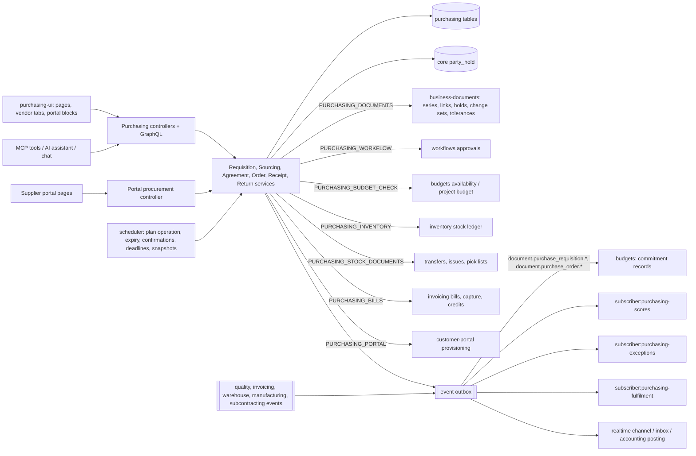

# Implementation Plan: Procurement

> Translates an approved `spec.md` into architecture and tech choices. The plan owns
> implementation details; the spec owns behaviour.

**Feature ID**: `procurement`
**Spec**: `./spec.md`
**Tasks**: `./tasks.md`
**Status**: `Draft`
**Last updated**: 2026-11-23

---

## 1. Architecture Summary

The existing `@gauzy/plugin-purchasing` (`packages/plugins/purchasing`) stays the owner of purchase orders, goods
receipts and vendor terms, with its lifecycle, tolerance resolution, three-way quantities and the `PURCHASING_INVENTORY`
and `PURCHASING_APPROVAL` ports. This plan adds, in the same plugin: supplier profile, groups, documents and risk
(beside core `organization_vendor`, which is not changed); requisitions; the buying plan; requests for quotation,
supplier quotations and awards; purchase agreements; supplier confirmations, shipping notices, purchase returns; the
buyer exception queue; scorecards. Every cross-plugin call is a port declared in `purchasing.types.ts` with an optional
token and bound in `apps/api/src/plugin-composition.ts`; nothing imports another plugin.

What it builds on rather than beside: supplier prices, packs and lead times stay in `vendor_product_term` (§2
"Supplier prices"); budget commitments are the records of `budgets-and-revenue-schedules`
(`accounting_budget_commitment`), fed by this plugin's document events; supplier holds are rows of the core party-hold
record (`party_hold`, shared with customers); document holds are the document engine's hold and release; plan runs are
operations of the core operation runtime; supplier addresses are the core address book; reports and the dashboard are
report-builder contributions; migrations use the shared core migration helpers.

## 2. Tech Choices

| Concern | Choice | Rationale |
| ------- | ------ | --------- |
| Package | `packages/plugins/purchasing` (existing); new Angular `purchasing-ui` (staff pages, vendor page tabs and the supplier portal blocks, mounted through `portal-sections`) | Principle I; no parallel procurement module; one UI plugin |
| Supplier data | plugin table `purchasing_supplier_profile` 1:1 with `organization_vendor`, holding only what the vendor and its `contact` lack (country and address come from the vendor's contact and the core address book; the active flag is the vendor's `isActive`; settlement term, currency, lead time and minimum order amount stay vendor columns) | core stays small; no copy of a vendor fact |
| Supplier addresses and files | core address book (`address` with owner `VENDOR`, `address_role` roles `BILLING`, `SHIPPING` for dispatch, `RETURN`, `REMIT_TO`); supplier document files are core `image_asset` records, the file handling `organization_document` uses | Principle I; one address book, one file store |
| Supplier prices | one precedence for `procurement`, `pricing-and-promotions` and `item-catalogue`: the supplier term (`vendor_product_term`) carries price, discount, quantity band, pack, lead time and supplier code; an agreement adds committed quantity, value and call-off tracking on top of a term (its line points at the term that prices it); a buying price list adds rules and discounts on top of the term price (link direction: `price_list.vendorId`, no price-list column on supplier records); the default supplier of an item is its preferred term (`isPreferred`) | one store per fact |
| Holds | supplier holds are rows of core `party_hold` (`partyType` `VENDOR`; the same record holds customers, `partyType` `CONTACT`); purchase order and requisition holds are the document engine's `hold` / `release` (`business_document.isOnHold`, `holdReason`) through `PURCHASING_DOCUMENTS`; the hold columns on `purchase_order` and `purchase_requisition` are written only while that port is unbound | one party-hold model; one document-hold model |
| Commitments | none stored here: `budgets-and-revenue-schedules` appends pre-commitments and commitments (`accounting_budget_commitment`) from `document.purchase_requisition.*` and `document.purchase_order.*`; remaining budget is read through `PURCHASING_BUDGET_CHECK` (`BudgetAvailabilityService.availability`); the project-budget fallback computes open commitments on read from open requisition and order lines | one commitment store |
| Persistence | MultiORM entities, plugin migrations for PostgreSQL, SQLite, MySQL, both ORMs; dialect helpers from the shared core `packages/core/src/lib/database/migration-helpers.ts` beside `check-constraint.helper.ts` (exported from `@gauzy/core`) | Principle III; no plugin copy |
| Money | `numeric(20,6)` + currency through `packages/core/src/lib/money` | existing purchasing rule |
| Settings | `PURCHASING_SETTINGS` contributions (organization scope) in a new `purchasing.settings.ts`, among them `purchasing.strictChecks` (false; spec FR-99: expected date before order date and future receipt date refused only when true, otherwise accepted with a warning as the existing routes do) and `purchasing.priceChainRule` (`OFF`) | pattern of `inventory.settings.ts`; keeps `purchasing.overReceiptTolerancePercent` |
| Permissions | contributions in `purchasing.permissions.ts` with `defaultFor` (`packages/plugin/src/lib/plugin-contributions.ts`) | no seed migration |
| Feature gates | `FeatureFlagGuard` + `@FeatureFlag` per controller and resolver | existing pattern of this plugin |
| Background work | `@ScheduledJob` + `@QueueWorker` from `@gauzy/scheduler` (ticks in `job_execution`); the buying plan runs as operation `PURCHASING_PLAN_RUN` of the core operation runtime (`packages/core/src/lib/operation/`); in-process fallback | one run ledger |
| Reminders | buyer reminders for expiring supplier documents through `REMINDERS` of `automation-and-notifications` (rows of `reminder`); supplier reminder emails through the email templates | one reminder table |
| Events | `EventOutboxService.append`, `EventConsumerRegistry` | at least once, idempotent consumers |
| Agents | MCP tools in `packages/mcp-server`; chat entry through the AI chat plugin's tool calls | agents are users |
| Reports | report definitions and the dashboard template as `reports` contributions of `report-builder-and-dashboards` | no hand-built report pages |

## 3. Data Model

All new tables extend `TenantOrganizationBaseEntity` (soft delete `deletedAt`, `isActive`, `isArchived`); money
`numeric(20,6)` with a currency column; quantities `numeric(20,6)`; JSON as `text` on every dialect; ids into other
plugins (`vendorId` excepted) carry no foreign key. Documents carry `version int` for `If-Match` and `number` from the
document engine series, unique `(organizationId, number)`.

### Changed entities (additive, nullable or defaulted)

| Table | Added columns | Notes |
| --- | --- | --- |
| `purchase_order` | `isOnHold` bool default false, `holdReason` text, `heldAt` (written only while `PURCHASING_DOCUMENTS` is unbound; with the engine the hold is `business_document.isOnHold`); `revision` int default 0; `orderingContactId`, `shipToAddressId`, `billToAddressId`, `dispatchAddressId` uuid; `deliveryTerms` varchar(64); `termsText` text; `documentDiscountPercent`, `documentDiscountBasis` varchar(8); `dropShipCustomerId`, `dropShipAddressId` uuid; `confirmationDueAt`, `supplierConfirmedAt`, `supplierConfirmationRef` varchar(128); `advanceRequiredAmount`; `sourceType` varchar(32), `sourceId` uuid | index `(organizationId, isOnHold, status)`, `(organizationId, confirmationDueAt)` |
| `purchase_order_line` | `lineKind` varchar(16) default `ITEM` (`ITEM`, `SERVICE`, `EXPENSE`, `SUBCONTRACT`); `description` text; `variantId` nullable for non-item lines; `isFreeItem` bool; `marginPercent`, `marginAmount`; `taxCategoryId`, `expenseAccountId`, `costCenterId`, `projectId` uuid; `isAsset` bool; `manufacturer` varchar(128), `manufacturerPartNumber` varchar(128); `deliveredBySupplier` bool, `deliveredQuantity`; `rejectedQuantity`, `returnedQuantity` default 0; `isClosed` bool, `closedAt`; `requisitionLineId`, `quotationLineId`, `agreementLineId`, `subcontractServiceId` uuid; `pricingSource` varchar(16); `confirmedQuantity`, `confirmedAt` | schedule lines are the existing per-date lines (unique `(order, variant, expectedAt)` already) |
| `goods_receipt` | `vendorId` uuid (standalone receipts); `shippingNoticeId` uuid; `deliveryNoteRef`, `carrierName`, `transportRef` varchar(128); `receivedFromOrganizationId` uuid | index `(organizationId, vendorId, receivedAt)` |
| `goods_receipt_line` | `purchaseOrderLineId` nullable (standalone); `rejectedQuantity` default 0; `rejectedWarehouseId` uuid; `rejectedMovementId` uuid; `inspectionState` varchar(16); `inspectionId` uuid; `returnedQuantity` default 0; `shippingNoticeLineId` uuid | check `CHK_goods_receipt_line_received` (`quantity + rejectedQuantity + damagedQuantity > 0`) replaces `CHK_goods_receipt_line_positive` (`quantity + damagedQuantity > 0`): the migration drops the old check before it adds the new one, which accepts every line the old one accepts and also a line whose units are all rejected (spec FR-76) |
| `vendor_product_term` | `minimumOrderQuantity`; `isPreferred` bool default false (the item's default supplier) | partial unique: one preferred live term per `(organizationId, variantId)`; an agreement's term is found from `purchase_agreement_line.vendorProductTermId` (one link direction) |
| `product_variant_setting` (core, no column change) | the existing `isPurchaseAutomatically` checkbox is the "buy automatically" mark of spec FR-32: plan lines of such a variant are accepted, converted and sent without a person within the organization's limit | the reorder levels and the reorder job stay `warehouse-and-stock-movements`' (`restockThreshold`, `stock_alert`) |
| `order_return_reason` (`returns` plugin, additive) | `appliesTo` varchar(8) default `BOTH` (`SALES`, `PURCHASE`, `BOTH`) | one governed list of return reasons for customer and supplier returns; read through `PURCHASING_RETURN_REASONS` |

### New entities

| Table | Columns (besides base) | Indexes and uniqueness |
| --- | --- | --- |
| `purchasing_supplier_profile` | `vendorId` FK, `kind`, `supplierGroupId`, `languageCode`, `taxIdentifier`, `withholdingCategoryId`, `ourCustomerNumber`, `isCarrier`, `isInternal`, `representsOrganizationId`, `requireOrderBeforeBill`, `requireReceiptBeforeBill` (nullable bools), `riskLevel`, `riskReasons` text, `riskNote`, `riskComputedAt`, `score` numeric(5,2), `scoreBand` varchar(64), `scoreUpdatedAt` | unique `(organizationId, vendorId)`; unique `(tenantId, representsOrganizationId)` where internal |
| `purchasing_supplier_group` | `name`, `code`, `parentId`, `path` varchar(1024), `paymentTermId`, `currency`, `payableAccountId`, `requiredDocumentTypes` text | unique `(organizationId, code)`; index `path`; a supplier has one group that gives it defaults, while core `contact_group` is a many-to-many segment of `organization_contact` rows (`contact_group_member.customerId`) that pricing targets, so the two stay apart |
| `purchasing_supplier_contact_role` | `vendorId`, `contactPersonId` (person under the vendor's linked organisation contact), `role` (`ORDERING`, `BILLING`, `DISPATCH`, `RETURNS`), `isPrimary` | unique primary per `(vendorId, role)`; persons only, addresses are `address_role` rows |
| `purchasing_supplier_document` | `vendorId`, `documentType` varchar(48), `number`, `issuedAt`, `expiresAt`, `state` (`VALID`, `EXPIRING`, `EXPIRED`, `REPLACED`), `imageAssetId` (core `image_asset`), `uploadedVia` (`STAFF`, `PORTAL`), `remindersSent` text (offsets of the supplier emails sent) | index `(organizationId, expiresAt, state)` |
| `purchase_requisition` | `number`, `status` (`DRAFT`, `SUBMITTED`, `APPROVED`, `REJECTED`, `CANCELLED`, `CLOSED`), `isOnHold`, `holdReason` (only while `PURCHASING_DOCUMENTS` is unbound), `source` (`STAFF`, `CHAT`, `AGENT`, `REORDER`, `PLAN`, `API`), `sourceRef`, `requesterUserId`, `requesterEmployeeId`, `neededBy`, `destinationWarehouseId`, `projectId`, `costCenterId`, `currency`, `estimatedTotal`, `approvalId`, `approvedAt`, `rejectionReason`, `version` | index `(organizationId, status)`, `(requesterUserId)` |
| `purchase_requisition_line` | `requisitionId`, `variantId` (nullable), `description`, `unitId`, `quantity`, `estimatedUnitCost`, `neededBy`, `destinationWarehouseId`, `projectId`, `costCenterId`, `expenseCategoryId`, `accountId`, `route` (`BUY`, `TRANSFER`, `ISSUE`, `MAKE`, `SUBCONTRACT`, `CUSTOMER_SUPPLY`), `routeSourceWarehouseId`, `suggestedVendorId`, `sourcedQuantity`, `fulfilledQuantity`, `isClosed`, `budgetOutcome` (`WITHIN`, `WARNING`, `OVER`, `NONE`), `budgetFacts` text, `sourceType`, `sourceId`, `sourceLineId` | index `(organizationId, route, isClosed)`; `expenseCategoryId` is the core `expense_category`: purchases are recorded as bills through invoicing, never also as core `expense` rows (spending out of pocket stays on the expense pages) |
| `purchase_plan_line` | `operationId` (the `PURCHASING_PLAN_RUN` operation; trigger, timing and counts live on the operation), `variantId`, `warehouseId`, `vendorId`, `quantity`, `unitId`, `unitCost`, `currency`, `orderByDate`, `neededBy`, `agreementLineId`, `requisitionLineIds` text, `state` (`PROPOSED`, `ACCEPTED`, `DISMISSED`, `CONVERTED`, `FAILED`), `resultRef`, `failureReason`, `facts` text | index `(operationId, vendorId)` |
| `request_for_quotation` | `number`, `status` (`DRAFT`, `OPEN`, `CLOSED`, `AWARDED`, `CANCELLED`), `round` int, `deadlineAt`, `isSealed`, `openedAt`, `openedById`, `currency`, `deliveryAddressId`, `deliveryTerms`, `termsText`, `emailTemplateId`, `attachPrint`, `scoringCriteria` text, `version` | index `(organizationId, status, deadlineAt)` |
| `request_for_quotation_line` | `rfqId`, `variantId` (nullable), `description`, `quantity`, `unitId`, `neededBy`, `requisitionLineId`, `dealId` | — |
| `request_for_quotation_supplier` | `rfqId`, `vendorId`, `contactPersonId`, `round`, `state` (`INVITED`, `VIEWED`, `ANSWERED`, `DECLINED`, `NO_ANSWER`), `invitedAt`, `viewedAt`, `answeredAt`, `outcome` | unique `(rfqId, vendorId, round)` |
| `supplier_quotation`, `supplier_quotation_line` | header: `number`, `rfqId`, `round`, `vendorId`, `vendorReference`, `status` (`DRAFT`, `RECEIVED`, `WITHDRAWN`, `EXPIRED`, `CLOSED`), `source` (`PORTAL`, `STAFF`), `validUntil`, `currency`, totals; line: `rfqLineId`, `variantId`, `description`, `quantity`, `unitPrice`, `discountPercent`, `taxCategoryId`, `leadTimeDays`, `minimumQuantity`, `vendorProductCode`, `isDeclined`, `orderedQuantity`, `note` | partial unique live `(rfqId, vendorId, round)` |
| `sourcing_award` | `rfqId`, `rfqLineId`, `quotationLineId`, `vendorId`, `quantity`, `sharePercent`, `reason`, `awardedById`, `awardedAt`, `targetType`, `targetId` | index `(rfqId)` |
| `purchase_agreement`, `purchase_agreement_line` | header: `number`, `vendorId`, `status` (`DRAFT`, `ACTIVE`, `EXPIRED`, `CLOSED`, `CANCELLED`), `validFrom`, `validTo`, `currency`, `committedValue`, `allowancePercent`, `version`; line: `variantId`, `vendorProductTermId` (the supplier term that prices the line, created by the agreement with its validity when no term fits), `committedQuantity`, `minimumCallOff`, `allowancePercent`, `orderedQuantity`, `receivedQuantity`, `billedQuantity`, `orderedValue` | index `(organizationId, vendorId, status, validTo)`; unique `(vendorProductTermId)` among live lines |
| `purchase_order_confirmation` | `purchaseOrderId`, `vendorReference`, `kind` (`AS_IS`, `CHANGES`), `state` (`PENDING`, `ACCEPTED`, `REJECTED`, `PARTLY_ACCEPTED`), `via` (`PORTAL`, `STAFF`), `changes` text (per line quantity, date, price and decision), `decidedById`, `decidedAt` | index `(purchaseOrderId)` |
| `shipping_notice`, `shipping_notice_line` | header: `number`, `vendorId`, `warehouseId`, `status` (`OPEN`, `PARTLY_RECEIVED`, `RECEIVED`, `CANCELLED`), `shippedAt`, `expectedAt`, `carrierName`, `trackingRef`, `packages` int, `via`; line: `purchaseOrderLineId`, `variantId`, `quantity`, `lots` text, `serials` text, `receivedQuantity` | index `(organizationId, vendorId, expectedAt)` |
| `purchase_return`, `purchase_return_line` | header: `number`, `vendorId`, `goodsReceiptId`, `warehouseId`, `status` (`DRAFT`, `CONFIRMED`, `CANCELLED`), `settlement` (`CREDIT`, `REPLACEMENT`), `reasonId` (governed `order_return_reason`), `reasonNote` text, `returnedAt`, `version`; line: `goodsReceiptLineId`, `purchaseOrderLineId`, `variantId`, `quantity`, `fromRejected`, `unitCost`, `lots` text, `stockMovementId` | index `(goodsReceiptId)` |
| `purchase_exception` | `kind` varchar(32), `state` (`OPEN`, `RESOLVED`, `CLEARED`), `vendorId`, `buyerUserId`, `purchaseOrderId`, `purchaseOrderLineId`, `documentType`, `documentId`, `varianceQuantity`, `varianceAmount`, `currency`, `facts` text, `resolution` varchar(24), `reason`, `resolvedById`, `resolvedAt`, `dedupeKey` varchar(160) | unique `(tenantId, dedupeKey)`; index `(organizationId, state, buyerUserId)` |
| `supplier_scorecard`, `supplier_scorecard_criterion`, `supplier_scorecard_band` | card: `name`, `supplierGroupId`, `windowMonths` default 12, `isDefault`; criterion: `measureKey`, `formula` text, `weight`, `best`, `worst`; band: `name`, `minScore`, `maxScore`, `color`, `actions` text | unique default per organization and group; bands checked contiguous in the service |
| `supplier_performance_fact` | `vendorId`, `measureKey`, `occurredAt`, `value`, `weight`, `sourceType`, `sourceId` | append-only; unique `(tenantId, sourceType, sourceId, measureKey)`; index `(vendorId, measureKey, occurredAt)` |
| `supplier_score_snapshot` | `vendorId`, `scorecardId`, `periodMonth` date, `score`, `band`, `criteria` text | unique `(vendorId, scorecardId, periodMonth)` |

### Core party hold (`packages/core/src/lib/party-hold/`)

| Table | Columns (besides base) | Indexes and uniqueness |
| --- | --- | --- |
| `party_hold` | `partyType` varchar(8) (`VENDOR`, `CONTACT`), `partyId`, `holdsOrdering`, `holdsReceiving`, `holdsBilling`, `holdsPaying` bools, `reason`, `source` (`MANUAL`, `DOCUMENT`, `SCORE`, …), `sourceRef`, `releaseAt`, `releasedAt`, `releasedById` | index `(partyType, partyId, releasedAt)` |

One hold record for suppliers and customers, in core because purchasing, orders, invoicing and payments all check it
and the parties are core records. `PartyHoldService` (`place`, `release`, `assertNotHeld(party, scope)`, release sweep)
publishes `party_hold.placed` / `.released`. For a supplier the four scopes are those of spec FR-10; the customer side
names which of its documents each scope stops. Purchasing writes only `VENDOR` rows through it.

### Migrations

**Migration timestamps**: `packages/plugins/purchasing` `1791000084100` to `1791000084199`; `packages/plugins/returns` `1791000084200` to `1791000084299`; `packages/core` `1791000084900` to `1791000084999`.

In `packages/plugins/purchasing/src/lib/database/migrations/`, listed in `migrations/index.ts`, each with PostgreSQL,
SQLite and MySQL branches written with the shared core helpers (`@gauzy/core`, `database/migration-helpers.ts` beside
`check-constraint.helper.ts`: dialect, quoting, `hasColumn`, `hasIndex`, Postgres advisory lock), which T4 lifts into
core from the task automations copy; idempotent and forward-only.

1. `1791000084100-AddProcurementColumns` — the changed columns above; SQLite rebuilds for the two nullability changes,
   replaying the recorded indexes (the pattern of `CreateVendorProductTermTable1791000000345`); on `goods_receipt_line`
   it drops `CHK_goods_receipt_line_positive` and then adds `CHK_goods_receipt_line_received` (on SQLite inside the
   table rebuild); its `down` restores the old check only when no line has all of its units rejected.
2. `1791000084110-CreateSupplierTables` — profile, group, contact role, document.
3. `1791000084120-CreateRequisitionTables` — requisition, line, plan line.
4. `1791000084130-CreateSourcingTables` — request, line, supplier, quotation, quotation line, award.
5. `1791000084140-CreateAgreementTables`.
6. `1791000084150-CreateSupplierCollaborationTables` — confirmation, shipping notice, return, exception.
7. `1791000084160-CreateScorecardTables`.
8. Core `1791000084900-CreatePartyHoldTable` in `packages/core/src/lib/database/migrations/`.
9. `returns` plugin `1791000084200-AddReturnReasonAppliesTo` in `packages/plugins/returns/src/lib/database/migrations/`
   (nullable-safe default `BOTH`).

Permissions, their default grants and the features are contributions (§9), not seeded by a migration. No `NOT NULL`
column without a default is added to an existing table.

### Contracts

`packages/contracts/src/lib/procurement.model.ts` (new): enums for every status and kind above, `ISupplierProfile`,
`ISupplierGroup`, `ISupplierDocument`, `ISupplierRisk`, `IPurchaseRequisition(+Line)`, `IBudgetCheckResult`,
`IPurchasePlanLine`, `IPlanLineExplanation`, `IRequestForQuotation(+Line, +Supplier)`, `ISupplierQuotation(+Line)`,
`IQuotationComparison`, `ISourcingAward`, `IPurchaseAgreement(+Line)`, `IPurchaseOrderConfirmation`,
`IShippingNotice(+Line)`, `IPurchaseReturn(+Line)`, `IPurchaseException`, `ISupplierScorecard`, `ISupplierScore`;
`party-hold.model.ts` (`IPartyHold`, `PartyHoldScope`); additive optional fields on `IPurchaseOrder`,
`IPurchaseOrderLine`, `IGoodsReceipt`, `IGoodsReceiptLine`, `IVendorProductTerm` in `purchasing.types.ts`.

## 4. API Surface

All routes: `TenantPermissionGuard`, `PermissionGuard`, `FeatureFlagGuard`; cursor pagination; `Idempotency-Key` on
creating, converting and posting routes; `If-Match` on document writes; bulk routes answer per row. Existing routes
of the five controllers are unchanged.

| Method | Endpoint | Permission | Description (request → response) | Status |
| ------ | -------- | ---------- | ----------- | ------ |
| `GET` `PUT` | `/purchasing/suppliers/:vendorId/profile` | `PURCHASE_ORDERS_VIEW` / `SUPPLIERS_MANAGE` | `UpsertSupplierProfileDTO` → `ISupplierProfile` with risk | New |
| `GET` `POST` `PUT` `DELETE` | `/purchasing/supplier-groups` (+ `/tree`) | `SUPPLIERS_MANAGE` | groups | New |
| `GET` `PUT` | `/purchasing/suppliers/:vendorId/contacts` | `SUPPLIERS_MANAGE` | contact roles | New |
| `GET` `POST` | `/purchasing/supplier-holds` (+ `POST /:id/release`) | `SUPPLIER_HOLDS_MANAGE` | supplier view over core `party_hold` rows of kind `VENDOR`: `CreateSupplierHoldDTO` → `IPartyHold` | New |
| `GET` `POST` `PUT` | `/purchasing/supplier-documents` | `SUPPLIERS_MANAGE` | documents with expiry | New |
| `GET` `POST` `PUT` | `/purchase-requisitions` | `PURCHASE_REQUISITIONS_VIEW` / `_CREATE` | `CreatePurchaseRequisitionDTO` → `IPurchaseRequisition` | New |
| `POST` | `/purchase-requisitions/draft-from-text` | `PURCHASE_REQUISITIONS_CREATE` | `{ text }` → unsaved draft with resolved lines and budget check | New |
| `POST` | `/purchase-requisitions/budget-check` | `PURCHASE_REQUISITIONS_CREATE` | lines → `IBudgetCheckResult[]` | New |
| `POST` | `/purchase-requisitions/:id/submit` · `/approve` · `/reject` · `/hold` · `/release` · `/cancel` · `/close-lines` | `_CREATE` / `_APPROVE` / `_PROCESS` | lifecycle | New |
| `POST` | `/purchase-requisitions/convert` | `PURCHASE_REQUISITIONS_PROCESS` | `{ lineIds, target, groupBySupplier, overrides }` → per-line results | New |
| `POST` | `/purchase-requisitions/fill` | `PURCHASE_REQUISITIONS_CREATE` | `{ from: BOM / SALES_ORDER / REORDER / PLAN, ref }` → lines | New |
| `GET` `POST` | `/purchase-plan/runs` (`POST` answers `202` with the `PURCHASING_PLAN_RUN` operation; runs are read from `/api/operations`), `GET /purchase-plan/lines?operationId=`, `POST /lines/convert`, `PUT /lines/:id` | `PURCHASE_PROPOSALS_MANAGE` | plan runs, lines with facts | New |
| `GET` `POST` `PUT` | `/requests-for-quotation` (+ `/:id/invite`, `/send`, `/close`, `/next-round`, `/open`, `/cancel`) | `SOURCING_EVENTS_VIEW` / `_EDIT` | `IRequestForQuotation` | New |
| `GET` | `/requests-for-quotation/:id/comparison` | `SOURCING_EVENTS_VIEW` | `IQuotationComparison` (refused before opening when sealed) | New |
| `POST` | `/requests-for-quotation/:id/awards` (+ `/awards/convert`) | `SOURCING_EVENTS_AWARD` | awards → per-target results | New |
| `GET` `POST` `PUT` | `/supplier-quotations` (+ `/:id/withdraw`) | `SOURCING_EVENTS_VIEW` / `_EDIT` | `ISupplierQuotation` | New |
| `GET` `POST` `PUT` | `/purchase-agreements` (+ `/:id/activate`, `/close`, `GET /:id/consumption`) | `PURCHASE_AGREEMENTS_VIEW` / `_EDIT` | `IPurchaseAgreement` | New |
| `POST` | `/purchase-orders/:id/hold` · `/release` · `/change-set` · `/lines/:lineId/close` · `/lines/:lineId/reopen` · `/lines/:lineId/delivered` | `PURCHASE_ORDERS_EDIT` | hold, revision, line close, drop-ship quantity | New |
| `POST` | `/purchase-orders/:id/send` | `PURCHASE_ORDERS_SEND` | existing route; body gains optional `{ email, publishToPortal }` | Changed (additive) |
| `GET` | `/purchase-orders/:id/print` · `/flow` | `PURCHASE_ORDERS_VIEW` | PDF; document flow | New |
| `POST` | `/purchase-orders/:id/confirmations/:cid/decide` | `PURCHASE_ORDERS_EDIT` | accept or reject proposed changes | New |
| `GET` `POST` | `/shipping-notices` | `GOODS_RECEIPTS_VIEW` / `_CREATE` | staff-entered notices | New |
| `POST` | `/goods-receipts` | `GOODS_RECEIPTS_CREATE` | existing route; body gains `shippingNoticeId`, `vendorId`, rejected quantities | Changed (additive) |
| `GET` `POST` | `/purchase-returns` (+ `/:id/confirm`, `/cancel`) | `PURCHASE_RETURNS_CREATE` | `IPurchaseReturn` | New |
| `GET` `POST` | `/purchase-exceptions` (+ `/:id/resolve`) | `PURCHASE_ORDERS_VIEW` / `PURCHASE_EXCEPTIONS_RESOLVE` | queue | New |
| `GET` `POST` `PUT` | `/supplier-scorecards` (+ `GET /suppliers/:vendorId/score`, `/history`) | `SUPPLIER_SCORECARDS_VIEW` / `_EDIT` | cards, scores | New |
| `GET` `PUT` | `/purchasing/settings` | `PURCHASING_SETTINGS_EDIT` | organization settings | New |
| `GET` `POST` | `/portal/procurement/*` (requests, answers, orders, confirmations, notices, invoices, documents, score) | portal session of the supplier's contact | supplier self-service; party-scoped | New |

Errors keep `PurchasingCodes` and add `SUPPLIER_ON_HOLD`, `SUPPLIER_BAND_BLOCKED`, `BUDGET_EXCEEDED`,
`REQUISITION_LINE_ALREADY_SOURCED`, `RFQ_DEADLINE_PASSED`, `RFQ_SEALED`, `QUOTATION_DUPLICATE`, `AGREEMENT_EXHAUSTED`,
`MINIMUM_ORDER_QUANTITY`, `PRICE_CHAIN_MISMATCH`, `RETURN_EXCEEDS_RECEIVED`, `ORDER_ON_HOLD`. GraphQL gains read fields
`purchaseRequisitions`, `requestsForQuotation`, `supplierQuotations`, `purchaseAgreements`, `purchaseExceptions`,
`supplierScore` in `graphql/schema-extensions.ts`.

**Ports** (optional tokens in `purchasing.types.ts`, bound in `apps/api/src/plugin-composition.ts`):

| Port | Answered by | Purpose; without it |
| --- | --- | --- |
| `PURCHASING_INVENTORY` (existing) | `StockLedgerService` | movements, putaway; gains rejected-location receipts and return issues |
| `PURCHASING_APPROVAL` (existing) | `PurchaseApprovalService` | unchanged single approval when no workflow is bound |
| `PURCHASING_DOCUMENTS` | `business-documents` registry | series, links, roll-ups, tolerances, holds, change sets; purchase orders and goods receipts, which exist today, register with `preexisting: true` (`business-document-engine` FR-113), so the engine adds no lock, refusal or tolerance beyond purchasing's own rules unless the organization turns a type policy on; without it the existing `sequence` numbering stays and holds use the fallback columns |
| `PURCHASING_WORKFLOW` | `workflows` | requisition and order approval by rules; without it permission-based |
| `PURCHASING_BUDGET_CHECK` | `BudgetAvailabilityService.availability` of `budgets-and-revenue-schedules` (counts its commitment records); fallback reader of `organization_project.budget` (cost type) with open requisition and order lines summed on read | remaining budget and control action |
| `PURCHASING_PRICING` | `pricing` buying-line resolution: the term price (read back through `PRICING_SUPPLIER_TERMS`, which this plugin answers with `VendorProductTermService`), then the derivation and rules of the supplier's `BUYING` lists, then guards | one precedence (§2); without it the term price stands |
| `PURCHASING_RETURN_REASONS` | `returns` plugin reason service (`order_return_reason` with `appliesTo` `PURCHASE` or `BOTH`) | governed reasons for purchase returns; without it a free-text reason |
| `PURCHASING_STOCK_FIGURES` | inventory availability | projected and free stock per item and location for routes and the plan |
| `PURCHASING_STOCK_DOCUMENTS` | inventory transfer and issue services, warehouse pick lists | requisition routes transfer and issue |
| `PURCHASING_MAKE`, `PURCHASING_SUBCONTRACT`, `PURCHASING_BOM` | `manufacturing`, `subcontracting` | make and subcontract routes, BOM explosion; hidden when unbound |
| `PURCHASING_BILLS` | `receivables-payables` | bill capture of uploads, bill from receipts, credit requests, billed share per receipt line, chain rules |
| `PURCHASING_QUALITY` | `quality` | inspection requirement per item and receipt line; results by event |
| `PURCHASING_PORTAL` | `customer-portal` | provision supplier access, publish documents, resolve the portal actor to a vendor |
| `PURCHASING_DOCUMENT_OUTPUT` | `print-templates`, `communications` | PDF rendering and email sending; fallback: platform email service without attachment |
| `PURCHASING_SALES` | `order` plugin | customer quotation for resale, drop-ship delivered roll-up |

The plugin also exposes `PurchasingSubcontractFacade` (subcontract lines of an order, order state, service line
received quantity written on the caller's transaction), bound by `subcontracting` to its `SUBCONTRACTING_PURCHASING` port,
and declares the hook `GOODS_RECEIPT_SUBCONTRACT` (bound by `subcontracting`): `GoodsReceiptService` calls it in the
receipt transaction for lines on `SUBCONTRACT` purchase lines, which answers the service quantity per line (finished ×
conversion), the unit cost and any refusal; the receipt rolls that service quantity into the subcontract line's
`purchase_order_line.receivedQuantity`, the one writer of that figure. `GoodsReceiptService.reverse` calls the hook's
`reverse` step for those lines inside the reversal's one transaction, so the subcontract consumption is reversed with
the receipt or not at all. Unbound, receipts on `SUBCONTRACT` lines are
refused with the reason.

**Consumer tokens answered** (bound in `apps/api/src/plugin-composition.ts` to the purchasing services (purchase lines, requisitions, goods receipts, supplier records); each consumer plan states the shape it calls and its fallback): `MANUFACTURING_PURCHASE_PRICES`, `MANUFACTURING_PURCHASING`, `PORTAL_SUPPLIER_ONBOARDING`, `PROJECT_PURCHASES`.

## 5. Events, Real-Time and Notifications

| Event | Emitted when | Consumers |
| ----- | ------------ | --------- |
| `document.<type>.confirmed` / `.cancelled` / `.amended` / `.closed` | document engine for each procurement type | accounting posting, tax register, report snapshots; `document.purchase_requisition.*` and `document.purchase_order.*` feed the commitment records of `budgets-and-revenue-schedules` |
| `purchasing.requisition.submitted` / `.approved` / `.rejected` / `.line_sourced` / `.line_fulfilled` | lifecycle | inbox to requester and buyers; warehouse requested figure |
| `purchasing.rfq.opened` / `.answer_received` / `.awarded` | sourcing | realtime comparison refresh; supplier emails |
| `purchasing.purchase_order.held` / `.released` / `.revised` / `.confirmed` / `.line_closed` | order changes | warehouse incoming figure, plan, exceptions, portal |
| `purchasing.shipping_notice.submitted` | portal or staff | warehouse expected arrivals, exceptions |
| `purchasing.goods_receipt.posted` / `.reversed`, `purchasing.purchase_return.confirmed` | receipts and returns | valuation, invoicing credit expectation, scores, fixed assets, requisition fulfilment |
| `purchasing.exception.raised` / `.resolved` / `.cleared` | queue | inbox to buyer, realtime |
| `party_hold.placed` / `.released` (core `PartyHoldService`, kind `VENDOR`) | supplier holds | inbox, portal, invoicing and payments hold checks |
| `purchasing.supplier.score_changed` / `.document_expiring` / `.document_expired` / `.risk_changed` | supplier facts | inbox, portal |
| In: `quality.inspection.decided`, `receivables_payables.bill_match.exception_raised` / `.exception_resolved`, `document.stock_transfer.*`, `manufacturing.work_order.completed`, `subcontracting.order.*` | other areas | `subscriber:purchasing-scores`, `subscriber:purchasing-exceptions`, `subscriber:purchasing-fulfilment` |

Inbox items through `INBOX_ITEM_WRITER`; realtime hints on channels `purchasing:<organizationId>` and per document.
Emails (invitations, orders, reminders, outcomes) through the email-template system in the supplier's language.

## 6. UI Surface

- **Angular `packages/plugins/purchasing-ui`** (lazy, `@gauzy/plugin-ui`; menu "Purchasing", shown with the feature
  codes and permissions): `/pages/purchasing/{requisitions,plan,requests-for-quotation,quotations,agreements,
  purchase-orders,shipping-notices,receipts,returns,exceptions,suppliers,scorecards,dashboard,settings}` (the
  catalogue already links `pages/purchasing/purchase-orders`). Lists are saved-view lists; forms honour custom fields;
  the comparison is a grid with per-line award controls; the requisition form shows the budget check live. The
  requisition and approval pages have phone layouts (the Gauzy web app is installable on phones). The dashboard page
  renders the procurement dashboard template of the report builder.
- **Vendor page** (`apps/gauzy/src/app/pages/vendors`): tabs "Procurement", "Documents", "Performance", "Holds" through
  the UI plugin slot registry; no change to the page when the flag is off. Supplier addresses are edited in the core
  address book on that page.
- **Supplier portal blocks** (requests and answers, order confirmation, shipping notice, invoice upload, documents,
  score) are Angular components of `purchasing-ui` mounted through the portal's `portal-sections` child routes.
- i18n keys `PURCHASING.*` in every locale of `packages/ui-core/i18n`.

## 7. MCP Tools, SDKs and Integrations

New file `packages/mcp-server/src/lib/tools/purchasing.ts`, registered in `register-all-tools.ts`:

| Tool | Input | Output |
| --- | --- | --- |
| `purchasing_draft_requisition` | text or lines, requester | unsaved draft with items, prices, budget check |
| `purchasing_submit_requisition` | draft or id, `preview` (default true) | requisition or preview |
| `purchasing_check_budget` | lines | per-line outcome and figures |
| `purchasing_requisition_status` | id or requester | lines with sourced and fulfilled quantities |
| `purchasing_plan_lines` / `purchasing_explain_plan_line` | run or filters / line id, optional "what if" | lines / explanation |
| `purchasing_convert_plan_lines` | line ids, `preview` | per-line results |
| `purchasing_compare_quotations` | request id | comparison with scores |
| `purchasing_award` | request, awards, `preview` | awards and draft orders |
| `purchasing_order_status` / `purchasing_send_order` | id / id, `preview` | order with flow / send result |
| `purchasing_record_receipt` / `purchasing_create_return` | lines, `preview` | receipt / return |
| `purchasing_supplier_score` / `purchasing_supplier_risk` | vendor | score with criteria / risk with reasons |
| `purchasing_list_exceptions` | buyer, state | exceptions |

The AI chat plugin offers these tools to the assistant; a chat message action "Raise requisition" is registered with
the chat record actions of `chat-agents-and-record-actions` (offered where `FEATURE_CHAT_RECORD_CARDS` is on). OpenAPI additive; SDKs regenerated after merge. Import
and export of suppliers, groups, terms, agreements and requisitions through `data-import-export`. The reports of spec
FR-95 and the dashboard of FR-96 are `reports` contributions (datasets, definitions, one dashboard template) of
`report-builder-and-dashboards`; the plugin adds no report route.

## 8. Background Jobs

| Trigger | When | What it does | Idempotency |
| ------- | ---- | ------------ | ----------- |
| `purchasing.plan.tick` (tick in `job_execution`) → operation `PURCHASING_PLAN_RUN` | nightly 02:00 organization time; on demand the same operation | buying plan per organization, resumable, counts in the operation's `result` | one live operation per organization (`aggregateType` `organization`) |
| `purchasing.supplier-documents.sweep` | daily | expiring and expired marks, supplier emails, buyer reminders through `REMINDERS`, document holds through `PartyHoldService` | per document and offset; reminder `sourceKey` per document and offset |
| core party-hold release sweep | hourly | lifts holds whose release date passed | per hold |
| `purchasing.confirmations.sweep` | hourly | unconfirmed and late lines → reminders and exceptions | exception `dedupeKey` |
| `purchasing.rfq.deadlines` | every 5 minutes | opens sealed answers, closes rounds, marks no-answer | per request and round |
| `purchasing.quotations.expire` / `purchasing.agreements.expire` | daily | validity ends; agreement warnings | per document and day |
| `purchasing.scores.snapshot` / `purchasing.risk.recompute` | monthly / daily | snapshots; risk levels | unique snapshot key / per supplier and day |
| Outbox consumers `subscriber:purchasing-scores`, `-exceptions`, `-fulfilment` | events | facts and scores, exceptions, requisition fulfilment | unique fact key, exception key, delivery record |

Schedules live in a `PurchasingSchedulePlugin` loaded by `apps/worker/src/plugins.ts`; queue jobs run in the API where
the services live; without a queue root the API runs them on in-process timers under a database lock (task
automations layout).

## 9. Security & Permissions

New values in `purchasing.permissions.ts` (the nine existing stay), declared as permission contributions:
`SUPPLIERS_MANAGE`, `SUPPLIER_HOLDS_MANAGE`, `PURCHASE_REQUISITIONS_VIEW`, `PURCHASE_REQUISITIONS_CREATE`,
`PURCHASE_REQUISITIONS_APPROVE`, `PURCHASE_REQUISITIONS_PROCESS`, `PURCHASE_PROPOSALS_MANAGE`, `SOURCING_EVENTS_VIEW`,
`SOURCING_EVENTS_EDIT`, `SOURCING_EVENTS_AWARD`, `PURCHASE_AGREEMENTS_VIEW`, `PURCHASE_AGREEMENTS_EDIT`,
`PURCHASE_PRICE_OVERRIDE`, `PURCHASE_RETURNS_CREATE`, `PURCHASE_EXCEPTIONS_RESOLVE`, `SUPPLIER_SCORECARDS_VIEW`,
`SUPPLIER_SCORECARDS_EDIT`, `PURCHASING_SETTINGS_EDIT`. Default grants (`defaultFor`): all to `SUPER_ADMIN` and
`ADMIN`; `PURCHASE_REQUISITIONS_CREATE` (own requisitions only) to `EMPLOYEE` and `MANAGER`;
`PURCHASE_REQUISITIONS_APPROVE` and the view values to `MANAGER`. Requesters read only their own requisitions without
`PURCHASE_REQUISITIONS_VIEW`. Sealed prices are excluded from every read (REST, GraphQL, reports, MCP) until opening.
Portal routes resolve the vendor from the session's contact and filter every query by it. Supplier document files are
core `image_asset` records in the platform file storage, readable with `SUPPLIERS_MANAGE`. Agents act in the caller's request context and are marked in the audit trail. DTOs use
class-validator; free text and email bodies are sanitised.

## 10. Observability

Activity-log entries for holds, awards, overrides, change sets, band changes and settings; metrics
`purchasing_budget_check_ms`, `purchasing_plan_run_seconds`, `purchasing_score_lag_seconds`,
`purchasing_exceptions_open`, `purchasing_portal_actions`; plan runs and sweeps visible in the job monitor; Sentry
breadcrumbs carry document type and id, never prices of sealed answers.

## 11. Phased Rollout

1. **Phase 1 — Surface what exists**: guard and menu, `purchasing-ui` for orders, receipts and vendor terms, supplier
   purchasing fields on the vendor page, print and send by email, MCP tools over the existing routes, report
   definitions on orders and receipts. Usable: a buyer works orders end to end on screen.
2. **Phase 2 — Depth: buying documents**: supplier profile, groups, contacts, holds; requisitions with routes and
   conversions; order lines, holds, change sets, line close, minimums, price rule; accepted and rejected receipts,
   standalone receipts, returns; settings. Behind `FEATURE_PURCHASE_REQUISITIONS` where new.
3. **Phase 3 — Depth: sourcing and agreements**: requests for quotation, quotations, comparison, awards, agreements.
   Behind `FEATURE_PURCHASE_SOURCING`.
4. **Phase 4 — Advanced capabilities**: chat and agent requisitions with the budget check (commitments counted from
   the budget records), buying plan with explanations, rounds and sealed answers, supplier self-service, exception queue, scorecards, documents and risk
   (`FEATURE_SUPPLIER_PERFORMANCE`). For each of the three sub-features, the feature is off by default; after the trial period it may be switched on by default for new tenants only; existing tenants keep their setting until an administrator changes it.

## 12. Constitution Reconciliation

- I Plugin-first: server code in `packages/plugins/purchasing`; UI in `purchasing-ui`; core gains only the shared party-hold record and the shared migration helpers, the `returns` plugin one reason column.
- II Tenant/organization scoping: every table on the tenant-organization base; services on `TenantAwareCrudService`; consumers take tenant and organization from the envelope; portal queries filtered by vendor.
- III Both ORMs, additive migrations: seven plugin migrations, one core and one `returns` migration, three dialects, both ORMs; SQLite covered by a migration spec.
- IV Default-off flag; nothing removed: `FEATURE_PURCHASING` and three sub-features off; every existing route, code and column stays.
- V Contracts and API first: contracts and REST land before screens; changed routes take only optional fields.
- VI Permissions, privacy, security: one key per decision; sealed prices; supplier isolation; sanitised content.
- VII Real-time through the event bus: outbox events, realtime hints, inbox items.
- VIII i18n and accessibility: keys in every locale; keyboard-operable grids and forms.
- IX Tests: unit specs per service and pure helper, DB specs on SQLite, e2e on the existing purchasing suite.
- X Behaviour-first spec: implementation lives here only.
- XI Documentation describes our platform only.

## 13. Risks & Mitigations

| Risk | Likelihood | Impact | Mitigation |
| ---- | ---------- | ------ | ---------- |
| Changes to existing order and receipt services break current callers | Medium | High | additive fields only; existing specs kept green; new behaviour in new methods |
| Two engines projecting stock | Medium | High | the plan reads warehouse figures through a port and never projects itself |
| Commitments disagree with open documents | Medium | Medium | budgets keeps the only commitment records, keyed by source line and event; its reconciliation report compares them with open orders |
| Hold columns and engine holds disagree | Low | Medium | the columns are written only while `PURCHASING_DOCUMENTS` is unbound; binding the engine copies open column holds once |
| Sealed prices leak through a side channel | Low | High | one read filter used by REST, GraphQL, reports and MCP; tests per surface |
| Score storms on bulk receipts | Medium | Low | facts appended per event, score recomputed once per supplier per batch |
| Portal actions on the wrong party | Low | High | vendor resolved from the session only; every portal route has a cross-party test |

## 14. References

- Spec: `./spec.md` · Tasks: `./tasks.md`
- Code: `packages/plugins/purchasing/src/lib/purchasing.types.ts`, `purchase-order/purchase-order.service.ts`,
  `goods-receipt/goods-receipt.service.ts`, `vendor-product-term/vendor-product-term.service.ts`,
  `purchase-approval/purchase-approval.service.ts`, `packages/core/src/lib/organization-vendor/`,
  `packages/core/src/lib/{contact-credential,address,address-role,contact-group,image-asset,operation,expense-categories}/`,
  `packages/core/src/lib/database/check-constraint.helper.ts`, `packages/core/src/lib/product-setting/`,
  `packages/plugins/inventory/src/lib/stock-transfer/`, `packages/plugins/returns/src/lib/order-return-reason/`,
  `packages/plugins/task-automations/src/lib/database/migration-helpers.ts` (source of the shared helpers),
  `apps/api/src/plugin-composition.ts`
- Related plans: `../business-document-engine/plan.md`, `../invoicing-receivables-payables/plan.md`,
  `../warehouse-and-stock-movements/plan.md`, `../customer-and-supplier-portal/plan.md`, `../subcontracting/plan.md`,
  `../budgets-and-revenue-schedules/plan.md`, `../pricing-and-promotions/plan.md`, `../report-builder-and-dashboards/plan.md`
