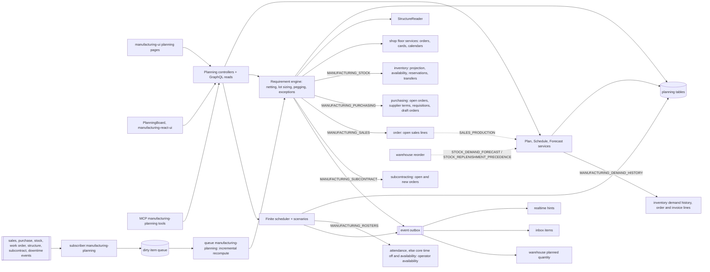

# Implementation Plan: Production planning

> Translates an approved `spec.md` into architecture and tech choices. The plan owns
> implementation details; the spec owns behaviour.

**Feature ID**: `production-planning`
**Spec**: `./spec.md`
**Tasks**: `./tasks.md`
**Status**: `Draft`
**Last updated**: 2026-11-23

---

## 1. Architecture Summary

The `planning/` module of `@gauzy/plugin-manufacturing` is gated by its own tenant feature `FEATURE_PRODUCTION_PLANNING`
(`dependsOn: FEATURE_MANUFACTURING`), contributed in `manufacturing.features.ts`. It reads structures through the
in-plugin `StructureReader`, work centres, calendars, cards and work orders through the shop floor module's services,
and everything else through the plugin's ports. It owns plans, schedules, forecasts, the material requirement engine
(net requirements, planned orders, pegging, exceptions), the finite-capacity scheduler, the planning board and
scenarios. It never writes stock, purchase or ledger tables: documents are created by their owners through ports and
linked back, and planned quantities are published as events the warehouse projection consumes.

It owns the platform's one demand forecast (store and engine) and the one replenishment precedence: stock reorder in
"forecast" mode reads its forecast through `STOCK_DEMAND_FORECAST`, and skips item-locations planning replenishes, as
`STOCK_REPLENISHMENT_PRECEDENCE` answers (both ports declared by `warehouse-and-stock-movements`, bound here). Order
minimums, multiples, lead times and safety stock are read from where they live (supplier terms, supplier, item, stock
level); planning stores only its overrides. A card's planned place and time live on the card (shop floor); requirement
runs and scenario computations run on the core operation runtime; permissions and settings are plugin contributions.

## 2. Tech Choices

| Concern | Choice | Rationale |
| ------- | ------ | --------- |
| Package | `planning/` module of `packages/plugins/manufacturing`; board and grids in `manufacturing-react-ui` | Principle I |
| Gate | `FEATURE_PRODUCTION_PLANNING` checked by `FeatureFlagGuard` on every planning controller, resolver, menu entry and tool | [platform architecture](../../architecture/business-suite.md) §6 |
| Requirement engine | pure netting per item and location in low-level-code order (codes from the structure explosion); incremental through a dirty-item table processed by a queue job; nightly full run | always current without a report run |
| Pegging | supply allocated to demand by date, first-come, stored per planned order and carried through component levels | explanation and orders at risk |
| Finite scheduler | deterministic forward heuristic in `planning/scheduler/finite-scheduler.ts` (priority rule, earliest feasible slot on centre or group member, pinned slots fixed); same function for board, scenarios and promise dates | testable, no external solver |
| Forecasting (the platform's one forecast) | pure TypeScript methods (moving average, additive trend and seasonal smoothing with weekly or yearly season, seasonal repeat), rolling-origin back-test, weighted absolute percentage error; planner forecasts (week or month periods) and one rolling forecast per organization and location (daily periods, 90 days, item-locations with at least 8 weeks of history, rebuilt nightly) in the same tables; `STOCK_DEMAND_FORECAST` answers daily quantities with error from the rolling forecast, adjusted by an active planner forecast where one covers the item | one store and one engine for planning and stock reorder; works on SQLite |
| Replenishment precedence | `STOCK_REPLENISHMENT_PRECEDENCE` answers whether an item-location is planned (`planning_item_setting.isPlanned`, tenant feature on): planned item-locations are replenished only by planned orders and the stock reorder run skips them; reorder proposals never enter planning | one replenishment source per item-location |
| Order quantities and lead times | read from their owners: minimum and multiple from the preferred `vendor_product_term` (`minQuantity`, `packSize`) for buys, else the item's `product.minOrderQuantity` / `orderMultiple` (`item-catalogue`); lead time from `planning_item_setting.leadTimeDaysOverride`, else the term's `leadTimeDays`, else `organization_vendor.leadTimeDays`, else the item's `product.leadTimeDays`, else the organization default; safety stock from `warehouse_product_variant.safetyStock`; values copied onto plan materials with their source | overrides only, sources shown |
| Planned times of cards | the card's `plannedStartAt` / `plannedEndAt`, pin and planned operator on `operation_card` (shop floor) are the one store; board moves and reschedules write them through the shop floor card service in one transaction; `capacity_slot` holds only operations of planned orders and scenario copies | no event sync between two stores |
| Board | `@dnd-kit/core` (MIT) for pointer and keyboard drag with screen-reader announcements; virtualised rows | accessible drag and drop |
| Persistence | MultiORM entities, plugin migrations, three dialects | Principle III |
| Background work | requirement regeneration and scenario computation are core operations (`MANUFACTURING_REQUIREMENTS_RUN` with the organization as aggregate, one live at a time; `MANUFACTURING_SCENARIO_COMPUTE` with the scenario as aggregate), steps per low-level code, per-item results through `BulkExecutor`, progress and retry at `/api/operations`; incremental recomputation on `@QueueWorker` queue `manufacturing-planning`; schedules with `@ScheduledJob` in `ManufacturingSchedulePlugin`; in-process timers under a lock without a queue root | one runtime for long work; no run table |
| Permissions, settings | permission contributions with `defaultFor`; planning settings as setting contributions in `manufacturing.settings.ts`, stored in the platform settings store | no seed migration, no settings table |

## 3. Data Model

### New entities (planning module)

All tables extend `TenantOrganizationBaseEntity`; quantities `numeric(20,6)`; JSON `text`; `lockVersion` for `If-Match`.

| Table | Columns (besides base) | Indexes and uniqueness |
| --- | --- | --- |
| `production_plan` | `number`, `status` varchar(12) (`DRAFT`, `CONFIRMED`, `IN_PROGRESS`, `COMPLETED`, `CLOSED`, `CANCELLED`), `planDate`, `filters` text, `combineRows`, `skipAvailableSubAssemblies`, `combineSubAssemblies`, `addProcessLoss` bool, `subAssemblyWarehouseId` uuid null, `materialOptions` text, `scheduleSignature` char(64) null, `scheduledAt`, `closedAt`, `lockVersion` | unique (`organizationId`, `number`); (`organizationId`, `status`) |
| `production_plan_source` | `planId` FK cascade, `sourceType` varchar(20) (`SALES_ORDER`, `REQUISITION`, `SCHEDULE`, `PLANNED_ORDER`, `SALES_REQUEST`), `sourceId`, `contactId` uuid null, `documentDate`, `deliveryDate` | unique (`planId`, `sourceType`, `sourceId`) |
| `production_plan_row` | `planId` FK cascade, `variantId`, `billOfMaterialsId`, `plannedQuantity`, `pendingQuantity`, `orderedQuantity`, `producedQuantity`, `unitId`, `warehouseId`, `plannedStartAt`, `plannedEndAt`, `includeExploded` bool, `processLossPercent` | (`planId`); (`variantId`) |
| `production_plan_row_reference` | `rowId` FK cascade, `sourceLineType` varchar(24), `sourceLineId`, `quantity`, `producedQuantity` | unique (`rowId`, `sourceLineType`, `sourceLineId`); (`sourceLineType`, `sourceLineId`) |
| `production_plan_sub_assembly` | `planId` FK cascade, `parentRowId` FK, `level` int, `variantId`, `billOfMaterialsId`, `source` varchar(12) (`MAKE`, `SUBCONTRACT`, `REQUEST`), `vendorId` uuid null, `scheduleDate`, `requiredQuantity`, `availableQuantity`, `plannedQuantity`, `warehouseId`, `documentType`, `documentId` uuid null | (`planId`, `level`) |
| `production_plan_material` | `planId` FK cascade, `variantId`, `warehouseId`, `requiredQuantity`, `projectedQuantity`, `safetyStock`, `minimumOrderQuantity`, `orderMultiple` (copies taken when the materials are fetched), `quantitySources` text (where each copied value came from: stock level, supplier term, item, setting), `proposedQuantity`, `route` varchar(12) (`BUY`, `TRANSFER`, `ISSUE`, `MAKE`, `SUBCONTRACT`, `CUSTOMER`), `sourceWarehouseId`, `vendorId` uuid null, `needDate`, `documentType`, `documentId`, `documentLineId` uuid null | (`planId`); (`variantId`, `warehouseId`) |
| `production_plan_schedule_row` | `planId` FK cascade, `kind` varchar(12) (`FINISHED`, `SUB_ASSEMBLY`, `MATERIAL`), `refId`, `workCentreId`, `vendorId` uuid null, `startAt`, `endAt`, `durationMinutes` | (`planId`) |
| `production_schedule` | `number`, `name`, `fromDate`, `toDate` date, `bucket` varchar(6) (`DAY`, `WEEK`, `MONTH`), `warehouseId`, `forecastId` FK null, `itemScope` text, `consumptionRule` varchar(16), `demandRefreshedAt`, `status` varchar(10), `lockVersion` | unique (`organizationId`, `number`); unique (`forecastId`) where active |
| `production_schedule_line` | `scheduleId` FK cascade, `variantId`, `bucketStart` date, `forecastQuantity`, `orderQuantity`, `requisitionQuantity`, `demandQuantity`, `projectedQuantity`, `plannedQuantity`, `firmedQuantity`, `releaseDate`, `cumulativeLeadDays` int, `firmedAs` varchar(16), `firmedRef` uuid null | unique (`scheduleId`, `variantId`, `bucketStart`) |
| `manufacturing_demand_forecast` | `number` null, `name`, `kind` varchar(8) (`PLANNER`, `ROLLING`), `warehouseId`, `frequency` varchar(6) (`DAY`, `WEEK`, `MONTH`), `periods` int, `startDate`, `status` varchar(10) (`DRAFT`, `ACTIVE`, `CANCELLED`), `historySource` varchar(16), `generatedAt`, `lockVersion` | unique (`organizationId`, `number`) where number not null; one `ROLLING` per (`organizationId`, `warehouseId`) |
| `manufacturing_demand_forecast_line` | `forecastId` FK cascade, `variantId`, `periodStart` date, `statisticalQuantity`, `adjustment`, `quantity`, `method` varchar(16), `backtestError` numeric(9,6), `actualQuantity`, `periodError` numeric null | unique (`forecastId`, `variantId`, `periodStart`); (`variantId`, `periodStart`) |
| `planning_item_setting` | `variantId`, `warehouseId` uuid null, `isPlanned` bool, `lotSizing` varchar(12) (`ONE_FOR_ONE`, `FIXED`, `MIN_MULTIPLE`, `DAYS_OF_SUPPLY`), `fixedQuantity`, `daysOfSupply`, `timeFenceDays`, `leadTimeDaysOverride` (overrides only: minimums, multiples, lead times and safety stock are read from their owners, §2), `plannerEmployeeId` uuid null | unique (`organizationId`, `variantId`, `warehouseId`) |
| `requirement_item_state` | `variantId`, `warehouseId`, `lowLevelCode` int, `dirtySince` timestamp null, `computedAt`, `factsHash` char(64), `failure` text | unique (`organizationId`, `variantId`, `warehouseId`); (`organizationId`, `dirtySince`, `lowLevelCode`) |
| `requirement_period` | `variantId`, `warehouseId`, `day` date, `grossDemand`, `scheduledReceipts`, `plannedReceipts`, `projectedStock` | unique (`organizationId`, `variantId`, `warehouseId`, `day`) |
| `planned_order` | `kind` varchar(12) (`MAKE`, `BUY`, `TRANSFER`, `SUBCONTRACT`), `variantId`, `warehouseId`, `sourceWarehouseId`, `vendorId`, `billOfMaterialsId` uuid null, `quantity`, `unitId`, `dueDate`, `releaseDate`, `state` varchar(10) (`PROPOSED`, `FIRMED`, `DRAFTED`, `DISMISSED`), `facts` text, `demandHash` char(64), `draftedType`, `draftedId` uuid null, `scenarioId` uuid null, `operationId` uuid null (the core operation of the run that proposed it; null for incremental passes) | (`organizationId`, `state`, `kind`, `releaseDate`); (`variantId`, `warehouseId`); (`scenarioId`) |
| `planned_operation` | `plannedOrderId` FK cascade, `sequence`, `operationId`, `workCentreId`, `workCentreGroupId` uuid null, `minutes` numeric | (`plannedOrderId`) |
| `planned_order_pegging` | `plannedOrderId` FK cascade, `demandType` varchar(24), `demandId`, `quantity`, `demandDate`, `topDemandType`, `topDemandId` | (`plannedOrderId`); (`topDemandType`, `topDemandId`) |
| `planning_exception` | `kind` varchar(20) (`EXPEDITE`, `DELAY`, `CANCEL`, `RELEASE_OVERDUE`, `NO_STRUCTURE`, `NO_SUPPLIER`, `NO_LEAD_TIME`, `RECOMPUTE_FAILED`, `UNSCHEDULED`), `variantId`, `warehouseId`, `refType`, `refId`, `facts` text, `suggestedAction`, `status` varchar(12), `firstSeenAt`, `lastSeenAt` | unique open (`organizationId`, `kind`, `variantId`, `warehouseId`, `refId`) |
| `capacity_slot` | `refType` varchar(16) (`PLANNED_OPERATION`; `CARD` only with a `scenarioId`, as a scenario's copy of a card), `refId`, `workCentreId`, `employeeId` uuid null, `startAt`, `endAt`, `setupMinutes`, `isPinned` bool, `conflicts` text, `scenarioId` uuid null, `lockVersion`. Real cards keep their planned place and time on `operation_card` | unique (`refType`, `refId`, `scenarioId`); (`workCentreId`, `startAt`); check: `refType` = `CARD` only when `scenarioId` is set |
| `capacity_load` | `workCentreId`, `day` date, `availableMinutes`, `scheduledMinutes`, `plannedMinutes`, `scenarioId` uuid null | unique (`workCentreId`, `day`, `scenarioId`) |
| `schedule_change` | `appliedById`, `appliedAt`, `changes` text (before and after per slot), `undoneAt` | (`organizationId`, `appliedAt`) |
| `planning_scenario` | `name`, `status` varchar(10) (`OPEN`, `COMPUTED`, `APPLIED`, `DISCARDED`, `EXPIRED`), `baseStamp` text (versions of touched objects), `result` text, `computedAt`, `expiresAt` | (`organizationId`, `status`) |
| `planning_scenario_change` | `scenarioId` FK cascade, `kind` varchar(20), `payload` text, `position` int | (`scenarioId`) |

### Migrations

**Migration timestamps**: `packages/plugins/manufacturing` `1791000091100` to `1791000091199`.

In `packages/plugins/manufacturing/src/lib/database/migrations/` (three dialects, idempotent, forward-only, both ORMs):
`1791000091100-CreateProductionPlanTables`, `1791000091110-CreateProductionScheduleAndForecastTables`,
`1791000091120-CreateMaterialRequirementTables`, `1791000091130-CreateCapacitySchedulingTables`. No backfill; the first requirement run is started by the "turn on planning" action,
never by a migration. Default role grants are permission contributions (`defaultFor`), not a migration. The forecast
tables carry the plugin prefix (`manufacturing_demand_forecast*`) so they never meet the staffing forecast tables of
`attendance-and-shifts`.

**Reused, not created:** run bookkeeping (core `operation`, `operation_step`); order minimums, multiples and lead times
(`vendor_product_term`, `organization_vendor`, item fields of `item-catalogue`); safety stock and projected stock (the
warehouse level row and projection); operator availability without attendance (core `time_off_request`,
`employee_availability`, `availability_slots`, `official_holiday`); card planned times (`operation_card`).

### Contracts

`packages/contracts/src/lib/manufacturing-planning.model.ts`: enums above, `IProductionPlan` (+ rows, sub-assemblies,
materials, schedule rows), `IProductionSchedule(+Line)`, `IManufacturingDemandForecast(+Line)`, `INetRequirement`, `IPlannedOrder`
(+ pegging), `IPlanningException`, `IPlannedOrderExplanation`, `IDraftDocumentsPreview`, `ICapacitySlot`,
`IBoardMove(+Result)`, `IPlanningScenario(+Change, +Comparison)`, `IPromiseAnswer`; additive.

## 4. API Surface

Guards `TenantPermissionGuard`, `PermissionGuard`, `FeatureFlagGuard` + `@FeatureFlag(FEATURE_PRODUCTION_PLANNING)`;
prefix `/api/manufacturing/planning`; `If-Match` on writes; `Idempotency-Key` on document creation and applies.

| Method | Endpoint | Permission | Description | Status |
| ------ | -------- | ---------- | ----------- | ------ |
| `GET` `POST` `PUT` | `/plans[/:id]` (+ `/confirm`, `/close`, `/reopen`, `/cancel`) | `PRODUCTION_PLANS_VIEW` / `_EDIT` | plans and lifecycle | New |
| `POST` | `/plans/:id/pull-orders` · `/pull-requisitions` · `/pull-planned` · `/fetch-rows` · `/explode` | `PRODUCTION_PLANS_EDIT` | sources, rows, sub-assemblies, materials | New |
| `GET` | `/plans/:id/materials` (`options`) · `/materials/export` · `/visual` | `PRODUCTION_PLANS_VIEW` | material rows, spreadsheet, overview | New |
| `POST` | `/plans/:id/create-documents` (`preview`) · `/reserve` | `PRODUCTION_PLANS_EXECUTE` | documents through ports; reservations | New |
| `POST` | `/plans/:id/schedule` (`preview`) | `PRODUCTION_PLANS_EDIT` | plan scheduling | New |
| `GET` `POST` `PUT` | `/schedules[/:id]` (+ `/refresh-demand`, `/firm`) | `_VIEW` / `_EDIT` | master production schedule | New |
| `GET` `POST` `PUT` | `/forecasts[/:id]` (+ `/generate` with `preview`, `/accuracy`) | `_VIEW` / `DEMAND_FORECASTS_EDIT` | forecasts | New |
| `GET` | `/requirements?variantId=&warehouseId=&bucket=` · `/planned-orders` · `/exceptions` | `PRODUCTION_PLANS_VIEW` | grid, proposals, exceptions | New |
| `GET` | `/planned-orders/:id/explain` · `/exceptions/:id/explain` | `PRODUCTION_PLANS_VIEW` | `IPlannedOrderExplanation` | New |
| `POST` | `/planned-orders/:id/firm` · `/dismiss`; `/exceptions/:id/acknowledge` | `PRODUCTION_PLANS_EDIT` | decisions | New |
| `POST` | `/planned-orders/draft-documents` (`preview`) | `PRODUCTION_PLANS_EXECUTE` | `IDraftDocumentsPreview` or created drafts | New |
| `POST` | `/requirements/recompute` (`variantId?`) · `/enable` | `PRODUCTION_PLANS_EDIT` / `PRODUCTION_PLANNING_SETTINGS_EDIT` | one item inline; all items or the first run `202` with the core operation handle | New |
| `GET` `PUT` | `/item-settings[/:variantId]` | `_VIEW` / `_EDIT` | lot sizing, fence, lead time | New |
| `GET` | `/board?from=&to=&workCentreIds=` | `PRODUCTION_PLANS_VIEW` | slots, loads, conflicts | New |
| `POST` | `/board/moves` (`preview`) · `/board/undo` · `/board/reschedule` (`preview`) | `PRODUCTION_SCHEDULE_EDIT` | moves, undo, finite run | New |
| `GET` `POST` | `/scenarios[/:id]` (+ `/changes`, `/compute`, `/compare`, `/apply`, `/discard`) | `PRODUCTION_SCHEDULE_EDIT` (read `_VIEW`) | scenarios; compute answers `202` with the core operation handle | New |
| `GET` | `/promise?variantId=&quantity=&neededBy=` | `PRODUCTION_PLANS_VIEW` or sales port | `IPromiseAnswer` | New |
| `GET` | `/reports/:key` | `_VIEW` | report rows | New |
| `GET` `PUT` | `/settings/planning` | `_VIEW` / `PRODUCTION_PLANNING_SETTINGS_EDIT` | the setting keys of spec FR-53 in the platform settings store | New |

Errors: `PLAN_NOTHING_TO_PLAN`, `PLAN_ROW_ABOVE_PENDING`, `PLAN_CLOSED`, `FORECAST_NOT_STOCK_ITEM`, `FORECAST_IN_USE`,
`BOARD_BEFORE_PREDECESSOR`, `BOARD_CLOSED_DAY`, `BOARD_STALE_MOVE`, `SCENARIO_BASE_CHANGED`, `SCENARIO_EXPIRED`.

**Ports** added to `manufacturing.types.ts`: `MANUFACTURING_ROSTERS` (attendance and time off: available minutes per
operator and day; when attendance is unbound or off, the fallback adapter reads core approved `time-off-request`,
`employee-availability`, `availability-slots` and `official-holiday`, so operators are never ignored) and
`MANUFACTURING_DEMAND_HISTORY` (warehouse demand history, order, delivery and invoice lines by period). Ports of other
modules and plugins used here: `MANUFACTURING_STOCK` (projection, safety stock, availability, reservations reference
`PRODUCTION_PLAN`, transfers), `MANUFACTURING_PURCHASING` (open purchase lines as receipts, supplier terms with
`minQuantity`, `packSize`, `leadTimeDays` and priority, the supplier's `leadTimeDays`, requisitions with source `PLAN`,
draft purchase orders), `MANUFACTURING_CATALOG` (the item's `minOrderQuantity`, `orderMultiple`, `leadTimeDays`),
`MANUFACTURING_SALES` (open lines with pending quantity, kit expansion), `MANUFACTURING_SUBCONTRACT` (open orders as
receipts, orders from plan lines). **Answered** (the `SALES_PRODUCTION` answer of `shop-floor-and-work-orders` takes the production request and promise
date from this module while planning is on for the tenant): `STOCK_DEMAND_FORECAST` (daily forecast with error per
item and location for a horizon; "none" while planning is off for the tenant, so reorder keeps fixed levels);
`STOCK_REPLENISHMENT_PRECEDENCE` (whether planning replenishes an item-location).

## 5. Events, Real-Time and Notifications

| Event | Emitted when | Consumers |
| ----- | ------------ | --------- |
| `document.production_plan.confirmed` / `.cancelled` / `.closed` | plan lifecycle | document flow, warehouse planned quantity |
| `manufacturing.plan.documents_created` / `.completed` | documents created; produced reaches planned | sales roll-up, automations |
| `manufacturing.planned_order.proposed` / `.firmed` / `.drafted` / `.dismissed` | requirement engine | requirement screens (realtime), procurement buying plan visibility |
| `manufacturing.planning_exception.raised` / `.resolved` | engine | inbox item to the item's planner (expedite, release overdue), daily digest |
| `manufacturing.capacity.changed` | board apply, reschedule (after the card times were written in the same change) | board and console queues (realtime) |
| `manufacturing.scenario.computed` / `.applied` | scenarios | planners' screens, audit |
| In: `document.sales_order.*`, `document.purchase_order.*`, `purchasing.requisition.*`, `inventory.level.changed`, `inventory.reservation.changed`, `inventory.transfer.*`, `manufacturing.work_order.*`, `manufacturing.output.recorded`, `manufacturing.structure.released` / `.default_changed`, `subcontracting.order.*`, `catalog.item.updated` | other areas | `subscriber:manufacturing-planning` marks items dirty |
| In: `manufacturing.downtime.opened`, `manufacturing.operation_card.completed` | shop floor | reschedule proposal when the setting is on |

Realtime hints `manufacturing.planning.*` declared in `planning-streamed-events.ts`.

## 6. UI Surface

- **Angular `manufacturing-ui`** (menu "Planning" under Manufacturing, shown only with `FEATURE_PRODUCTION_PLANNING`):
  `/pages/manufacturing/planning/plans[/:id]` (sources, rows, sub-assemblies, materials, documents, schedule, visual tabs),
  `/schedules[/:id]` (bucket grid with firm action), `/forecasts[/:id]` (periods grid, statistical and adjusted, method and
  error), `/requirements` (item grid, planned orders with explain panel and "draft documents" preview, exceptions),
  `/board`, `/scenarios[/:id]` (side-by-side comparison), `/reports`, `/settings/planning`.
- **React `manufacturing-react-ui`**: `PlanningBoard` (timeline per centre, drag and keyboard moves, pins, conflict
  badges, live updates, list alternative), `RequirementGrid`, `ScenarioCompare`; embedded in the Angular pages.
- **Sales order line**: promise date with its reason through the sales UI slot when planning is on.
- i18n keys `MANUFACTURING.PLANNING.*` in every locale; React strings via `useTranslation()`.

## 7. MCP Tools, SDKs and Integrations

New file `packages/mcp-server/src/lib/tools/manufacturing-planning.ts`: `planning_build_plan_from_orders` (`preview`),
`planning_item_requirement`, `planning_explain_planned_order`, `planning_draft_documents` (`preview` default true),
`planning_schedule_plan` (`preview`), `planning_create_scenario`, `planning_compute_scenario`,
`planning_compare_scenario`, `planning_generate_forecast` (`preview`), `planning_promise_date`. Agents act in the caller's
request context. OpenAPI additive; SDKs regenerated; materials export as spreadsheet through the platform export service;
report definitions and print templates registered with their engines.

## 8. Background Jobs

| Trigger | When | What it does | Idempotency |
| ------- | ---- | ------------ | ----------- |
| `planning.requirements-incremental` (queue) | dirty items, debounced 10 s, started within 60 s | recompute dirty items in low-level-code order; mark components dirty when planned orders change | lock per item; `factsHash` unchanged writes nothing |
| core operation `MANUFACTURING_REQUIREMENTS_RUN` | 03:00 organization time; on demand | full regeneration in low-level-code steps, exceptions refreshed, a failure per item | live-aggregate rule (one per organization); step checkpoint, retry resumes |
| `planning.schedule-demand` | daily 02:00 | refresh demand of active schedules | per schedule and day |
| `planning.forecast-rolling` | nightly 01:00 | rebuild each location's rolling forecast (daily, 90 days) for item-locations with at least 8 weeks of history, with method and error | lines replaced per item; unchanged history writes nothing |
| `planning.forecast-accuracy` | after each period end | actual demand and errors | per forecast line |
| `planning.reschedule` | downtime or late-completion events (setting); nightly 04:00 | finite run as a proposal for review | one open proposal per organization |
| core operation `MANUFACTURING_SCENARIO_COMPUTE` | on request | the engine and scheduler in scenario scope | one live per scenario |
| `planning.scenario-expiry` / `planning.exception-digest` | daily | expire scenarios; digest per planner | conditional update; per planner and day |

Schedules in `ManufacturingSchedulePlugin` (worker); queue workers in the API; in-process timers under a lock.

## 9. Security & Permissions

New values: `PRODUCTION_PLANS_VIEW`, `PRODUCTION_PLANS_EDIT`, `PRODUCTION_PLANS_EXECUTE`, `PRODUCTION_SCHEDULE_VIEW`, `PRODUCTION_SCHEDULE_EDIT`,
`DEMAND_FORECASTS_EDIT`, `PRODUCTION_PLANNING_SETTINGS_EDIT`, declared as permission contributions whose `defaultFor`
grants all to `SUPER_ADMIN` and `ADMIN` and all but settings to `MANAGER` (no seed migration). Creating documents also
needs the target's own create permission (checked by its owner).
Operator availability carries free minutes only, never absence reasons. Costs in previews only with
`MANUFACTURING_COSTS_VIEW`. Agents' drafts are marked in the audit trail and never confirmed by the tool.

## 10. Observability

Activity log on firm, dismiss, document drafts, board applies and undos, scenario applies. Metrics
`planning_dirty_items`, `planning_recompute_lag_seconds`, `planning_nightly_duration_seconds`,
`planning_exceptions_open{kind}`, `planning_board_apply_ms`; requirement runs and scenario computations with their
failures show in the core operations list.

## 11. Phased Rollout

1. **Phase 1 — Plans**: flag, contracts, plan tables, plans from sales orders and requisitions, rows, sub-assemblies,
   materials with projection, document creation, reservations, export, plan scheduling, visualiser, Angular pages.
2. **Phase 2 — Depth**: master production schedule, manual forecasts, requirement engine with lot sizing, pegging,
   exceptions and nightly run, capacity view, statistical forecast report, reports, settings, MCP read tools.
3. **Phase 3 — Advanced capabilities**: incremental recomputation, explanations and drafting with preview, firming from the
   schedule, statistical forecasts with method choice and accuracy, finite scheduler and board, scenarios, promise dates.
4. **Phase 4 — General availability**: the feature is off by default; after the trial period it may be switched on by default for new tenants only; existing tenants keep their setting until an administrator changes it.

## 12. Constitution Reconciliation

- I Plugin-first: module of the manufacturing plugin; owners create their documents through ports.
- II Tenant/organization scoping: base entity on every table; consumers scope from the envelope.
- III Both ORMs, additive migrations: four migrations, three dialects; SQLite migration specs.
- IV Default-off flag; nothing removed: `FEATURE_PRODUCTION_PLANNING` off; shop floor answers sales without it.
- V Contracts and API first: contracts and REST before screens; OpenAPI additive.
- VI Permissions, privacy, security: six keys; target permissions enforced by owners; absence reasons never exposed.
- VII Real-time through the event bus: recomputation and board updates from outbox events.
- VIII i18n and accessibility: keys in every locale; board keyboard moves and list alternative.
- IX Tests: property-based netting tests, scheduler and forecast specs, SQLite DB specs, e2e per route.
- X Behaviour-first spec: implementation lives here.
- XI Documentation describes our platform only.

## 13. Risks & Mitigations

| Risk | Likelihood | Impact | Mitigation |
| ---- | ---------- | ------ | ---------- |
| Recompute storms on busy tenants | Medium | Medium | dirty table with debounce, per-item locks, batches by low-level code |
| Projection disagreement with warehouse | Medium | High | projection read only through the warehouse port; planned quantity published, never stored twice |
| Two buying engines | Medium | Medium | planning raises requisitions by default; procurement's buying plan consolidates; stock reorder skips planned item-locations (`STOCK_REPLENISHMENT_PRECEDENCE`) |
| Card times written from two places | Low | High | the card is the one store; board and reschedule write it through the shop floor service in one transaction |
| Heuristic schedule not optimal | High | Low | pins and manual moves; scenarios compare alternatives; solver can replace the function later |
| Forecast quality on sparse history | Medium | Low | minimum history per method; error shown with every value |

## 14. References

- Spec: `./spec.md` · Tasks: `./tasks.md`
- Code: `packages/plugins/inventory/src/lib/stock-availability/stock-availability.service.ts`,
  `packages/plugins/purchasing/src/lib/purchasing.types.ts`, `packages/plugins/purchasing/src/lib/vendor-product-term/`,
  `packages/core/src/lib/organization-vendor/`, `packages/core/src/lib/operation/`, `packages/core/src/lib/time-off-request/`,
  `packages/core/src/lib/employee-availability/`, `packages/core/src/lib/availability-slots/`,
  `apps/api/src/plugin-composition.ts`, `apps/worker/src/plugins.ts`
- Related plans: `../shop-floor-and-work-orders/plan.md`, `../manufacturing-bom-and-routing/plan.md`,
  `../procurement/plan.md`, `../warehouse-and-stock-movements/plan.md`, `../sales-order-management/plan.md`,
  `../subcontracting/plan.md`
