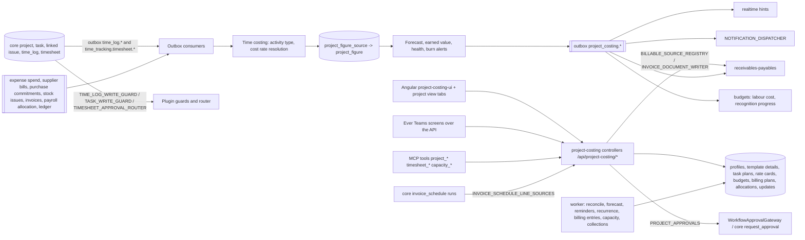

# Implementation Plan: Project costing and billing

> Translates an approved `spec.md` into architecture and tech choices. The plan owns
> implementation details; the spec owns behaviour.

**Feature ID**: `project-costing-and-billing`
**Spec**: `./spec.md`
**Tasks**: `./tasks.md`
**Status**: `Draft`
**Last updated**: 2026-11-23

---

## 1. Architecture Summary

The core project, task, linked issue, time log and timesheet records stay the one model of work. A new plugin
`@gauzy/plugin-project-costing` (`packages/plugins/project-costing`, `project-costing-ui`)
owns everything around money and planning in one-to-one or child tables keyed by the core ids: profiles, types,
template details, task plans and dependency details, work activity types, rate cards, the cost of each time log,
timesheet portions, budgets, figures, forecasts, billing plans, retainers, allocations, capacity and updates. It loads
only when `GAUZY_PROJECT_COSTING_ENABLED` is exactly `true`; every controller and resolver is guarded by
`FEATURE_PROJECT_COSTING`. Ever Teams shows projects, tasks, time and timesheets in its own screens over this API.

Core gains small, optional things: time-log changes are read from the outbox facts core appends today
(`time_log.started`, `.stopped`, `.created`, `.updated`, `.deleted` of `TimeLogFactsService`), and one outbox event,
`time_tracking.timesheet.status_changed`, is appended by the existing timesheet handlers when a consumer is registered
for it; two optional guard ports that core calls before writing (`TIME_LOG_WRITE_GUARD` for locks and the closed-task
rule, `TASK_WRITE_GUARD` for dependency, parent and cycle rules); one optional router (`TIMESHEET_APPROVAL_ROUTER`)
that the timesheet status handler consults; two additive enum values (`ProjectStatusEnum.PAUSED`,
`ProjectBillingEnum.RETAINER`); a project scope on the client billing schedules; and the task-template module shared
with `hr-core-lifecycle`. Unbound, core behaves exactly as today.

**Built on what exists.** Billing cycles are the core billing schedules (`invoice_schedule`, `invoice_schedule_run`,
`invoice-schedule.scheduler.ts`), which already bill un-invoiced billable time per period and gain a project scope, an
approved-time-only switch and an evidence pack. The bill side of a log is the rates the log already stores
(`time_log.billRateValue`, `projectBillRateValue`, `projectMemberBillRateValue`, `ratesStored`) and its billing link
`invoiceItemId`; the pay rate of a log is `time_log.payRateValue`; bill repricing stays `time-log-repricing.ts`. The lock
on approved time is the existing `timesheet.lockedAt`, which the project change requests already refuse to move. Task
dependencies are `task_linked_issues` rows. Capacity reads `employee_availability` and `availability_slots`;
utilization targets are shown beside the core time goals (`time_goal`). Stakeholders are `organization_contact` rows
(their company through `contact_buyer`). Settings are in the platform settings store; permissions are plugin
contributions; approvals fall back to core `request_approval` on the existing Approvals page; notices de-duplicate
through the notification dispatcher; runs and the reconciliation watermark are core `job_execution` / `operation` rows;
recurring tasks and update collections use the core recurrence rules; change history is `activity_log`. Project notes
and files stay on the project view's existing Comments and Documents tabs; read-only share links stay `shared_entity`;
task automations stay automation rules (the dependency and closed-task rules here are write guards).

## 2. Tech Choices

| Concern | Choice | Rationale |
| ------- | ------ | --------- |
| Package | new `packages/plugins/project-costing`, `project-costing-ui` (Angular); no React package: Ever Teams uses the API | Principle I; [platform architecture](../../architecture/business-suite.md) §2.5 |
| One work model | plugin tables keyed by `organizationProjectId`, `taskId`, `taskLinkedIssueId`, `timeLogId`, `timesheetId`; no copy of tasks or logs | spec FR-3, FR-106 |
| Dependencies | existing `task_linked_issue` rows of relation `BLOCKS` / `IS_BLOCKED_BY` are the dependencies; `task_dependency` adds kind and lag | no second link model |
| Flag | tenant feature `FEATURE_PROJECT_COSTING` (`project-costing.features.ts`, `defaultEnabled: false`); deploy flag `GAUZY_PROJECT_COSTING_ENABLED` | Principle IV |
| Settings and permissions | `project-costing.settings.ts` setting contributions stored in `tenant_setting` at `ORGANIZATION` scope (the organization level of `organization-setup`); `project-costing.permissions.ts` contributions with `defaultFor` | no settings table, no seed migration |
| Rates | pure cost resolver over rate cards, work activity defaults, `PROJECT_COST_RATE_SOURCE`, then the pay rate stored on the log (`time_log.payRateValue`); the bill side is read from the log's stored rates through `time-log-pricing.ts`, a card bill rate only filling a gap | existing invoice amounts unchanged |
| Money | core `money` decimal helpers; `numeric(20,6)` amounts, `numeric(20,10)` rates; costs stored in organization currency with rate | [platform architecture](../../architecture/business-suite.md) §6 |
| Figures | append-only `project_figure_source` contributions keyed by source, line key and revision, summed into `project_figure`; a change of a source appends its difference as the next revision, a removed source the negative of its sum | idempotent replays, corrections without updates, drill-down |
| Templates | core task-template module (`packages/core/src/lib/task-template/`) built here and shared with `hr-core-lifecycle`; the plugin adds project details one-to-one | one template engine, no plugin depends on another |
| Billing cycles | core `invoice_schedule` / `invoice_schedule_run` with a project scope; milestone, date and retainer lines join a run through `INVOICE_SCHEDULE_LINE_SOURCES` | one billing schedule model |
| Scheduling | pure working-day calendar over `HR_WORKING_CALENDAR`; critical path by forward and backward pass; recurrence by the core recurrence rules (`packages/core/src/lib/recurrence/`) | testable, one recurrence |
| Persistence | MultiORM entities, the shared core migration helpers of `@gauzy/core`, three dialects, JSON as `text` | Principle III |
| Background work | `@ScheduledJob` + `@QueueWorker` (`@gauzy/scheduler`), `ProjectCostingSchedulePlugin` in the worker, in-process fallback; passes recorded in core `job_execution`, user-started bulk work (repricing, recompute, bulk allocations) as core operations | house idiom; one run ledger |
| Notices | `NOTIFICATION_DISPATCHER.notify({ …, dedupeKey })` (else `INBOX_ITEM_WRITER` with the key as the item's `externalSource`/`externalId`, unique per tenant) | no notice log of our own |
| Assistant | `PROJECT_ASSISTANT` bound to `AGENT_RUNTIME.complete` of `ai-agents-and-assistants` (purposes `projects.*`; runs, usage and budgets recorded there), else the AI provider registry of `ai-chat`; previews only | no agent, run or usage table here |

## 3. Data Model

### Changed core code (additive)

| Where | Change |
| --- | --- |
| `packages/contracts/src/lib/organization-projects.model.ts` | `ProjectStatusEnum.PAUSED = 'paused'` (varchar column, no migration) |
| `packages/contracts/src/lib/organization.model.ts` | `ProjectBillingEnum.RETAINER = 'RETAINER'` (varchar column, no migration) |
| `time-tracking/time-log/commands/handlers/*` (create, update, delete, delete span, schedule entries), timer start and stop | no change: they append `time_log.started`, `.stopped`, `.created`, `.updated`, `.deleted` through `TimeLogFactsService` today (one fact per entry: `timeLogId`, `employeeId`, `projectId`, `taskId`, `organizationContactId`, times, `isBillable`, `source`, `logType`), which this plugin's consumers subscribe to |
| `time-tracking/timesheet/commands/handlers/timesheet-submit*`, `timesheet-update-status*` | append `time_tracking.timesheet.status_changed`; consult optional `TIMESHEET_APPROVAL_ROUTER.onStatusChange(...)` |
| `time-log.service.ts`, `timer.service.ts` | call optional `TIME_LOG_WRITE_GUARD.beforeStart / beforeCreate / beforeUpdate / beforeDelete` |
| `tasks/task.service.ts`, `linked-issue/task-linked-issue.service.ts` | call optional `TASK_WRITE_GUARD.beforeStatusChange / beforeParentChange / beforeLink` |
| `time-tracking/timesheet/` | `timesheet.lockedAt` (exists, set by nothing today) is set when a timesheet is approved with locking on and cleared on reopen; `TIME_LOG_WRITE_GUARD` reads it, and `timesheet-project-change-request.service.ts` already refuses locked sheets |
| `invoice-schedule/` | `invoice_schedule` + `organizationProjectId` uuid null (fk set null), `approvedOnly` bool default false, `scopeKey` varchar(40) not null default `'client'` (the project id when scoped); the unique key `IDX_invoice_schedule_organization_contact` becomes `(organizationContactId, scopeKey)`, so a client keeps one client-wide schedule and may add one per project (a client-wide run leaves out projects with their own schedule); `invoice_schedule_run` + `evidenceFileId` uuid null; `invoice-schedule-run.service.ts` filters by the project and, with `approvedOnly`, by approved timesheets and to time-and-materials projects (time of a project whose `billing` is `FLAT_FEE` or `MILESTONES` stays out of hourly lines), and asks the optional `INVOICE_SCHEDULE_LINE_SOURCES` hook for extra lines of the period (reached billing-plan entries, date entries, retainer top-ups, approved re-billable expenses), claimed in the run's transaction and marked billed with the run's invoice; client-wide schedules without `approvedOnly` run as today |
| `task-template/` (new core module) | `task_template` (`kind` varchar(24): `PROJECT`, `HR_ONBOARDING`, `HR_SEPARATION`; `name`, `description`, `isActive`, `version`), `task_template_task` (`templateId` fk cascade, `key` varchar(40), `parentKey`, `moduleKey`, `title`, `description` text, `issueTypeId`, `offsetDays`, `durationDays` int, `estimate` numeric(12,2), `weight` numeric(9,4), `isMilestone`, `assigneeRoleId`, `sortOrder`; unique `(templateId, key)`), `task_template_dependency` (`templateId` fk cascade, `fromKey`, `toKey`, `kind` (`FS`/`SS`/`FF`), `lagDays`; unique `(templateId, fromKey, toKey)`); `TaskTemplateService.instantiate(template, projectId, anchorDate, { preview, calendar, createTask? })` dates tasks on working days from the anchor (negative offsets count back from it) through an optional working-calendar port (fallback core official holidays plus Saturday and Sunday), creates core tasks for the template tasks `createTask` accepts (all by default) and remaps parents and blocking links; `hr-core-lifecycle` uses the same module for onboarding and separation |
| `request-approval/` | `ApprovalPolicyTypesStringEnum.TIMESHEET_PORTION`, `PROJECT_BUDGET` (varchar, no migration); a decision gate for each in `linked-document-decision.gate.ts` (the type's approve permission or being named on the request); a settler for each registered with the core settler registry specified by `approval-workflows` (`registerRequestApprovalSettler(type, settle)`, called on the answer's transaction) |

### New plugin entities (all `TenantOrganizationBaseEntity`: tenant, organization, timestamps, soft delete)

| Table | Columns (type) | Indexes and uniqueness |
| --- | --- | --- |
| `project_type` | `name` varchar(120), `description` text, `defaultTemplateId` (core `task_template`), `defaultProgressMethod` varchar(16), `defaultBillingMethod` varchar(16), `isActive` | unique live `(organizationId, name)` |
| `project_profile` | `organizationProjectId` fk unique cascade, `projectTypeId`, `priority` (values of `TaskPriorityEnum`), `departmentId`, `contractValue` numeric(20,6), `contractCurrency` varchar(3), `contractSource` (`TYPED`/`ORDERS`), `progressMethod` (`MANUAL` default for existing projects and projects without a type/`TASK_COUNT`/`TASK_AVERAGE`/`WEIGHTED`/`EFFORT`), `manualProgress`, `progress` numeric(5,2), `actualStart`, `actualEnd` timestamp, `trackedSeconds`, `approvedSeconds`, `billableSeconds`, `billedSeconds` bigint (billed = logs with `time_log.invoiceItemId`), `defaultActivityTypeId`, `currentBaselineId`, `health` varchar(12), `healthReasons` text, `version` | idx `(organizationId, projectTypeId)`, `(organizationId, health)` |
| `project_stakeholder` | `organizationProjectId`, `organizationContactId` (the person contact; their company through `contact_buyer`), `canSeeTime`, `canSeeFiles`, `receivesUpdates` bool, `welcomedAt`, `revokedAt` | unique live `(organizationProjectId, organizationContactId)` |
| `project_template_detail` | `taskTemplateId` fk unique cascade (core `task_template` of kind `PROJECT`), `projectTypeId`, `modules` text, `memberRoles` text, `statusSourceProjectId`, `budgetLines` text, `billingEntries` text, `source` (`MANUAL`/`PROJECT`/`ASSISTANT`) | — |
| `task_plan` | `taskId` fk unique cascade, `weight` numeric(9,4) null, `progress` numeric(5,2) null, `progressSource` (`MANUAL`/`DERIVED`), `isMilestone`, `completedById`, `completedAt`, `durationDays` int, `rescheduledAt`, `version` | idx `(organizationId, isMilestone)` |
| `issue_type_default` | `issueTypeId` unique (core `issue_type`), `weight`, `workActivityTypeId` | — |
| `task_dependency` | `taskLinkedIssueId` fk unique cascade, `predecessorTaskId`, `successorTaskId`, `kind`, `lagDays` | idx `(successorTaskId)`, `(predecessorTaskId)` |
| `task_recurrence` | `taskId` (pattern task), the core recurrence rule columns (`frequency`, `interval`, `weekday`, `dayOfMonth`, `startOn`, `endOn`, `maxOccurrences`, `timeZone`, `holidayPolicy`), `mode` (`SCHEDULE`/`ON_COMPLETION`), `nextOn` date, `lastTaskId`, `isActive` | idx `(organizationId, isActive, nextOn)` |
| `project_baseline`, `project_baseline_task` | baseline: `organizationProjectId`, `name`, `takenAt`, `takenById`, `budgetVersionId`; task: `baselineId` fk cascade, `taskId`, `startDate`, `dueDate`, `estimate`, `weight`, `plannedValue` numeric(20,6) | idx `(organizationProjectId, takenAt)`; unique `(baselineId, taskId)` |
| `work_activity_type` | `name`, `code` varchar(32), `isBillable`, `isProductive`, `costRate`, `billRate` numeric(20,6) null, `currency` varchar(3), `isDefault`, `isActive` (named apart from the time-tracking `activity` table and the `ActivityType` enum) | unique live `(organizationId, name)` |
| `rate_card` (the one dated rate table of the employee × project axis) | `employeeId`, `employeeLevelId`, `workActivityTypeId`, `organizationProjectId`, `organizationContactId` (each null), `costRate`, `billRate` null, `payRate` null (pay per hour on a project, read by `payroll-setup` through `PROJECT_RATE_CARDS`), `currency`, `effectiveFrom` date, `note`, `scopeKey` varchar(200) | unique live `(organizationId, scopeKey, effectiveFrom)`; idx `(employeeId, effectiveFrom)` |
| `time_log_cost` (what the log does not store) | `timeLogId` fk unique cascade, `employeeId`, `organizationProjectId`, `taskId`, `timesheetId`, `logDate` date, `workActivityTypeId`, `activitySource` varchar(16), `seconds` int, `billingSeconds` int null, `billingReason`, `costRate`, `costCurrency`, `costRateToOrg` numeric(20,10), `costAmount`, `costSource` varchar(24) (`CARD`/`ACTIVITY`/`PAYROLL`/`PAY_RATE` = `time_log.payRateValue`/`NONE`), `rateCardId`, `billRateOverride` numeric(20,6) null and `billSource` varchar(24) null (set only where the log's stored rates hold no positive rate or the organization chose activity first; otherwise the bill side is read from the log), `overtimeMultiplier` numeric(6,3) null, `approvalState` varchar(12), `recostedAt`, `version` | idx `(organizationProjectId, logDate)`, `(employeeId, logDate)`, `(timesheetId)`, `(organizationId, costSource)` |
| `timesheet_portion` | `timesheetId`, `organizationProjectId` null, `projectKey` varchar(40) (`-` for none), `seconds` int, `state` (`PENDING`/`APPROVED`/`DENIED`), `approvalRef` (workflow instance or core `request_approval` id), `approverUserIds` text, `decidedById`, `decidedAt`, `comment`, `overrideBy` (`NONE`/`STATUS_ROUTE`), `version` | unique `(timesheetId, projectKey)`; idx `(organizationId, state)` |
| `project_budget` | `organizationProjectId` unique live, `currentVersionId`, `approvedVersionId` | — |
| `project_budget_version` | `budgetId` fk, `version` int, `state` (`DRAFT`/`SUBMITTED`/`APPROVED`/`REJECTED`/`SUPERSEDED`), `reason`, `approvalRef`, `submittedAt`, `approvedAt`, `approvedById`, `totalCost`, `totalRevenue` numeric(20,6), `totalHours` numeric(12,2), `currency` | unique `(budgetId, version)` |
| `project_budget_line` | `versionId` fk cascade, `lineKey` char(64) (stable across versions), `kind` (`LABOUR`/`EXPENSE`/`PURCHASE`/`MATERIAL`/`OTHER`/`REVENUE`), `workActivityTypeId`, `employeeLevelId`, `moduleId`, `expenseCategoryId`, `description`, `hours`, `amount`, `spread` text (month → hours, amount), `notifiedThresholds` text | unique `(versionId, lineKey)` |
| `project_figure_source` (append-only) | `figureKey` varchar(160), `sourceType` varchar(40), `sourceId` uuid, `sourceLineId` uuid null, `sourceLineKey` varchar(36) not null (the `sourceLineId`, or `*` for a source without lines), `revision` int (the source's version that produced the row: 1 for the first contribution), `amount`, `hours` numeric(14,4) (for a revision after the first, the difference to the sum of the earlier rows of the same source, line and figure, so a cost going from 10 to 15 appends +5 and a deleted source appends the negative of its sum), `asOf` date | unique `(tenantId, sourceType, sourceId, sourceLineKey, figureKey, revision)`, so a replay of one revision adds nothing and a correction appends one row; idx `(figureKey)`, `(tenantId, sourceType, sourceId)` |
| `project_figure` | `organizationProjectId`, `taskId` null, `moduleId` null, `month` char(7), `source` varchar(24) (`LABOUR_ESTIMATED`, `LABOUR_ACTUAL`, `EXPENSE`, `PURCHASE_BILLED`, `PURCHASE_COMMITTED`, `MATERIAL`, `LEDGER_OTHER`, `REVENUE_BILLED`, `BILLABLE_TIME`, `BILLABLE_EXPENSE`, `BILLABLE_ENTRY`, `REVENUE_RECOGNISED`), `amount`, `hours`, `figureKey` | unique `(tenantId, figureKey)`; idx `(organizationProjectId, month)` |
| `project_forecast` | `organizationProjectId` unique, `asOf`, `actualCost`, `remainingCost`, `forecastCost`, `forecastRevenue`, `forecastMargin`, `budgetCost`, `breachOn` date, `plannedValue`, `earnedValue`, `cpi`, `spi` numeric(9,4), `drivers` text | — |
| `billing_plan_entry` | `organizationProjectId`, `sequence`, `description`, `trigger` (`TASK`/`MODULE`/`DATE`), `taskId`, `moduleId`, `dueOn`, `amount`, `percent` numeric(7,4), `currency`, `needsAcceptance`, `state` (`PLANNED`/`REACHED`/`ACCEPTED`/`OFFERED`/`INVOICED`/`WITHDRAWN`), `reachedAt`, `acceptedAt`, `acceptedByUserId`, `acceptedByContactId` (`organization_contact`), `billingClaimRef`, `invoiceId`, `version` | unique `(organizationProjectId, sequence)`; idx `(organizationId, state)` |
| `retainer`, `retainer_period`, `retainer_drawdown` | retainer: `organizationProjectId` unique live, `kind` (`HOURS`/`AMOUNT`), `periodUnit` (`MONTH`/`QUARTER`), `allowance`, `rollover` bool, `overage` (`BILL_AT_RATE`/`HOLD`), `topUpThresholdPercent`, `startsOn`, `endsOn`; period: `retainerId`, `periodStart`, `allowance`, `carriedIn`, `used`, `state`; drawdown: `periodId`, `timeLogId`, `seconds`, `amount` | unique `(retainerId, periodStart)`; unique `(timeLogId)` |
| `resource_allocation` | `organizationProjectId`, `employeeId` null, `positionId` null (unfilled role), `weekStart` date, `hours` numeric(8,2), `percent` numeric(5,2), `status` (`TENTATIVE`/`CONFIRMED`), `note` | idx `(employeeId, weekStart)`, `(organizationProjectId, weekStart)` |
| `capacity_target`, `capacity_figure` | target: `employeeId` or `employeeLevelId`, `billablePercent`, `productivePercent`, `effectiveFrom`; figure: `employeeId`, `weekStart`, `capacitySeconds`, `timeOffSeconds`, `unavailableSeconds` (from `employee_availability`), `allocatedSeconds`, `plannedSeconds`, `trackedSeconds`, `billableSeconds`, `productiveSeconds` | unique `(employeeId, weekStart)` |
| `update_collection` | `organizationProjectId` unique, the core recurrence rule columns (`frequency` daily, weekly or every two weeks, `interval`, `weekday`, `timeZone`), `windowStart`, `windowEnd` varchar(5), `question` text, `askScope` text, `digestScope` text, `isActive`, `nextRunAt` | idx `(isActive, nextRunAt)` |
| `project_update`, `project_update_answer` | update: `organizationProjectId`, `roundAt`, `state` (`COLLECTING`/`DRAFT`/`PUBLISHED`), `health` (`ON_TRACK`/`AT_RISK`/`OFF_TRACK`), `summary` text, `snapshot` text, `draftSource` (`MANUAL`/`ASSISTANT`), `citations` text, `publishedAt`, `publishedById`; answer: `updateId` fk, `employeeId`, `answer` text, `channel` (`APP`/`EMAIL`), `answeredAt` | idx `(organizationProjectId, roundAt)`; unique `(updateId, employeeId)` |

Record links: a project's sales orders are record links of `record-views-and-search` (core `resource_link` with a record target): `entity = OrganizationProject`, target the sales order, `role` `BILLED_FROM`.

Rules that keep one figure per fact:

- **Settings** (`project-costing.settings.ts`, `ORGANIZATION` scope; every one that can refuse or change an existing
  action defaults to today's behaviour): `projectCosting.costRateOrder`, `.billRateMode`
  (`EXISTING_FIRST` default, `ACTIVITY_FIRST`), `.lockApprovedTime` (default `false`), `.refuseSelfApproval` (default
  `false`), `.dependencyEnforcement` (`OFF`/`WARN` default/`BLOCK`), `.closedTaskTime` (`ALLOW` default/`WARN`/`REFUSE`),
  `.rescheduling` (`AUTOMATIC`/`PROPOSED` default), `.marginRevenueBasis`,
  `.healthAtRiskPercent`, `.healthOverPercent`, `.mirrorBudget` (default `true`), `.budgetSource` (`PROJECT` default,
  `ACCOUNTING`), `.projectCodeSeriesKey`, `.budgetThresholds`, `.evidenceActivityLevel`, `.evidenceScreenshots`,
  `.submissionReminderDays`.
- **Budgets**: with `.budgetSource = PROJECT` the project budget versions govern and the accounting budget lines on the
  project axis are listed read-only (FR-55); with `ACCOUNTING` the accounting budget of `budgets-and-revenue-schedules`
  governs, the Budget tab shows it read-only and project budget drafting is off. Mirroring into
  `organization_project.budget` / `budgetType` is on by default, so the `project-budgets` and `client-budgets` reports read
  the governing total.
- **Targets**: `capacity_target` is a share of capacity per person or level; the core time goals (`time_goal`, hours per
  period, Ever Teams) are shown beside it on the utilization screen and neither is derived from the other.
- **Levels**: `employeeLevelId` on cards, budget lines and targets matches through `hr-core-lifecycle`'s
  `employee.employeeLevelId`; without that feature, by the employee's level label (`employee.employeeLevel`) against
  `employee_level.level`.
- **Expenses**: with `EXPENSE_SPEND` bound, the `EXPENSE` and `BILLABLE_EXPENSE` figures of a project and month are read
  from `expenses-and-travel`'s maintained spend figures (task and module amounts summed from the approved claim lines on
  demand) and this plugin writes no expense sources; unbound, direct expenses with a project are figure sources.
- **Actual labour**: once `payroll-processing` allocates a closed pay period, its `payroll.cost_allocated` amounts
  replace the per-log estimate of that employee and period (`LABOUR_ACTUAL` against `LABOUR_ESTIMATED`), so margins never
  count labour twice.

### Migrations

**Migration timestamps**: `packages/plugins/project-costing` `1791000094100` to `1791000094199`; `packages/core` `1791000094000` to `1791000094099` (before the plugin range: migrations run in timestamp order across packages, and the plugin's tables reference the core `task_template` tables).

- Core (`packages/core/src/lib/database/migrations/`): `1791000094000-CreateTaskTemplateTables`,
  `1791000094010-AddProjectScopeToInvoiceSchedule` (`invoice_schedule` columns and unique key,
  `invoice_schedule_run.evidenceFileId`); enum values need none; outbox, guard and lock calls are code.
- Plugin (`packages/plugins/project-costing/src/lib/database/migrations/`): `1791000094100-CreateProjectCostingSetupTables`
  (types, profiles, sales-order links, stakeholders), `1791000094110-CreateProjectTemplateDetailTable`,
  `1791000094120-CreateTaskPlanningTables` (plan, issue-type defaults, dependency, recurrence, baselines),
  `1791000094130-CreateTimeCostingTables` (work activity types, rate cards, time-log cost, portions),
  `1791000094140-CreateProjectBudgetTables`, `1791000094150-CreateProjectFigureTables` (sources with append-only triggers on PostgreSQL
  and MySQL, application guard on SQLite; figures; forecasts), `1791000094160-CreateProjectBillingTables` (plan, retainers),
  `1791000094170-CreateCapacityTables`, `1791000094180-CreateProjectUpdateTables`. Idempotent (`hasTable`, `createIndexIfMissing`),
  PostgreSQL, MySQL and SQLite branches, registered for both ORMs and with tenant export, import and factory reset.
  Feature, permissions, role grants and settings are plugin contributions; no seed migration.
- No backfill: existing projects get a profile lazily; existing logs are costed by the resumable `reconcile` job.

### Contracts

`packages/contracts/src/lib/project-costing.model.ts`: interfaces and enums above (`IWorkActivityType`), rate-resolution
explanation (`IRateExplanation`), figure and forecast shapes, preview shapes (template instantiation, rescheduling,
completion cascade, budget fill, invoice draft), event payloads of §5, port tokens of §7, and the core guard interfaces
(`ITimeLogWriteGuard`, `ITaskWriteGuard`, `ITimesheetApprovalRouter`). `task-template.model.ts` (core module),
`invoice-schedule.model.ts` (optional `organizationProjectId`, `approvedOnly`, `evidenceFileId`, `IInvoiceScheduleLineSource`)
and `approval-policy.model.ts` (two values) gain additive members. `PermissionsEnum` and the feature catalogue gain the
keys of §9. Nothing existing is renamed.

## 4. API Surface

Routes under `/api/project-costing` with `TenantPermissionGuard`, `PermissionGuard`, `@FeatureFlag(FEATURE_PROJECT_COSTING)`;
cursor pagination; `Idempotency-Key` on creating, deciding, instantiating, repricing and draft-run routes; `If-Match`
version on updates. Being a flagged manager (`organization_project_employee.isManager`) authorises project-scoped
routes marked *(mgr)*. Errors `400`/`422` with codes (`PROJECT_TEMPLATE_INACTIVE`, `PROJECT_OPEN_TASKS`,
`TASK_DEPENDENCY_CYCLE`, `TASK_PREDECESSOR_OPEN`, `TASK_PARENT_DONE`, `TASK_CLOSED_NO_TIME`, `TIMESHEET_LOCKED`,
`TIMESHEET_SELF_APPROVAL`, `BUDGET_APPROVED_IMMUTABLE`, `BILLING_PLAN_OVER_100`, `RATE_NOT_FOUND`), `403`, `404`, `409`.

| Method | Endpoint | Permission | Description (request → response) | Status |
| ------ | -------- | ---------- | -------------------------------- | ------ |
| `GET/PUT` | `/settings` | `ORG_PROJECT_VIEW` / `PROJECT_COSTING_SETTINGS_EDIT` | the `projectCosting.*` keys of the settings store | New |
| CRUD | `/project-types` | `ORG_PROJECT_VIEW` / `PROJECT_TYPES_EDIT` | `ProjectTypeDTO` | New |
| `GET/PUT` | `/projects/:id/profile`, `GET /projects/:id/progress` | `ORG_PROJECT_VIEW` / `ORG_PROJECT_EDIT` *(mgr)* | `ProjectProfileDTO`; progress with method and inputs | New |
| `POST` | `/projects/:id/complete` (`mode` complete or cancel, `preview`), `/projects/:id/duplicate` | `ORG_PROJECT_EDIT` *(mgr)*; `ORG_PROJECT_ADD` | cascade preview then result; new project | New |
| CRUD, `POST` | `/projects/:id/stakeholders`, `/projects/:id/sales-orders` (link, unlink) | `ORG_PROJECT_EDIT` *(mgr)* | stakeholders with switches; order links with amounts | New |
| CRUD, `POST` | `/templates` (+ `/:id/tasks` bulk), `/templates/:id/instantiate` (`preview`), `/templates/from-project/:projectId`, `/templates/draft` | `PROJECT_TEMPLATES_EDIT`; instantiate `ORG_PROJECT_ADD` | core task templates of kind `PROJECT` with their project details; instantiation preview (dated tasks, links) from `TaskTemplateService` | New |
| `GET/PUT` | `/tasks/:id/plan`, `/issue-types/:id/defaults`, `/dependencies/:linkedIssueId` | `ORG_TASK_EDIT`; `ORG_TASK_SETTING` | weight, progress, milestone; defaults; kind and lag | New |
| `GET/POST` | `/projects/:id/schedule`, `/projects/:id/schedule/reschedule` (`preview`), `/projects/:id/baselines` | `ORG_PROJECT_VIEW` / `ORG_PROJECT_EDIT` *(mgr)* | tasks, links, critical path, baseline variance | New |
| `GET/PUT/DELETE` | `/tasks/:id/recurrence` | `ORG_TASK_ADD` | rule | New |
| CRUD, `POST` | `/work-activity-types`, `/rate-cards` (+ `/import`), `POST /rates/explain` | `PROJECT_ACTIVITY_TYPES_EDIT`; `PROJECT_RATES_VIEW` / `PROJECT_RATES_EDIT` | types; dated cards; `IRateExplanation` | New |
| `GET/PUT` | `/time-logs/:id/cost`, `/time-logs/:id/activity`, `/time-logs/:id/billing-hours` | own or `PROJECT_RATES_VIEW`; own before approval; `PROJECT_BILLING_HOURS_EDIT` *(mgr)* | cost row with the log's stored bill rates; activity change; billing hours with reason; the cost rate and cost amount are returned only with `PROJECT_COSTS_VIEW` or `PROJECT_RATES_VIEW`, so an employee reading their own log without either gets its activity type, billing hours and the bill-side fields the existing time-log routes already show them | New |
| `POST`, `GET` | `/time-logs/reprice` (`preview`, reason), `/unpriced` | `PROJECT_RATES_EDIT`; `PROJECT_RATES_VIEW` | recosting of the plugin's cost (a core operation above 1,000 logs, reason in `activity_log`); bill rates change only through the existing rate paths and `time-log-repricing.ts`; hours at zero rates | New |
| `GET/POST` | `/timesheets/:id/portions`, `/timesheet-portions/:id/decision`, `/timesheets/:id/reopen`, `/timesheets/missing-days` | approver or `CAN_APPROVE_TIMESHEET`; `PROJECT_TIMESHEETS_REOPEN`; own | portions; decision (`APPROVE`, `DENY`, per-log comments); reopen clears `timesheet.lockedAt`, reason in `activity_log` | New |
| CRUD, `POST` | `/projects/:id/budgets`, `/budget-versions/:id/lines` (bulk), `/budget-versions/:id/{submit,approve,reject,revise,fill}`, `GET /budget-versions/:id/diff` | `PROJECT_BUDGETS_VIEW` / `PROJECT_BUDGETS_EDIT` *(mgr)* / `PROJECT_BUDGETS_APPROVE` | versions and lines; fill from template, estimates or project | New |
| `GET` | `/projects/:id/budget-availability`, `/projects/:id/accounting-budgets` | `PROJECT_BUDGETS_VIEW` | remaining per kind; accounting lines on the project axis | New |
| `GET/POST` | `/projects/:id/{figures,costing,forecast,earned-value,ledger-agreement}`, `/projects/:id/overview/:card`, `POST /projects/:id/figures/recompute`, `GET /portfolio` | `ORG_PROJECT_VIEW` (hours) / `PROJECT_COSTS_VIEW` (amounts) | maintained figures; cards one by one | New |
| CRUD, `POST` | `/projects/:id/billing-plan`, `/billing-plan-entries/:id/{accept,withdraw}`, `/projects/:id/retainer` | `PROJECT_BILLING_PLAN_EDIT` *(mgr)* | entries and states; retainer and periods | New |
| `GET/PUT/POST` | `/projects/:id/invoice-schedule` (the project-scoped core `invoice_schedule`; `POST …/run` with `preview`), `/projects/:id/evidence?from&to` | `PROJECT_BILLING_PLAN_EDIT` *(mgr)*; `INVOICES_EDIT` to run | schedule and its `invoice_schedule_run` rows with evidence files; evidence pack file | New |
| `GET`, CRUD | `/capacity`, `/capacity/forecast`, `/utilization`, `/allocations` (+ bulk), `/capacity-targets` | `PROJECT_ALLOCATIONS_VIEW` / `PROJECT_ALLOCATIONS_EDIT`; own | people × weeks; shortfalls; utilization; allocations | New |
| `GET/PUT/POST` | `/projects/:id/update-collection`, `/projects/:id/updates`, `/updates/:id/answers` (me), `/updates/:id/{draft,publish}` | `PROJECT_UPDATES_MANAGE` *(mgr)*; answer: asked member | collection; rounds; answers; assistant draft; publish | New |
| `*` | `/organization-projects/*`, `/tasks/*`, `/task-linked-issue/*`, `/timer/*`, `/timesheet/*`, `/timesheet-project-change-request/*`, `/invoices/*` | as today | guards and router consulted only when bound and the feature is on | Unchanged contract |
| `*` | `/invoice-schedules/*`, `/request-approval/*` | as today | optional `organizationProjectId` and `approvedOnly` on schedules; portions and budget versions appear as request approvals when `approval-workflows` is off | Changed (additive) |

**Consumer tokens answered** (bound in `apps/api/src/plugin-composition.ts` to the cost roll-up and project update services; each consumer plan states the shape it calls and its fallback): `MARKETING_TIME_COST`, `PORTAL_PROJECTS`.

## 5. Events, Real-Time and Notifications

| Event | Emitted when | Consumers |
| ----- | ------------ | --------- |
| `project_costing.time_log.costed` `{ timeLogId, projectId, costAmount, billAmount, workActivityTypeId }` (`billAmount` priced from the log's stored rates) | a log is costed or recosted | figures, retainers, real-time |
| `project_costing.timesheet_portion.submitted` / `.decided` | routing and decisions | inbox (approvers, employee), automations |
| `project_costing.timesheet.approved` / `.reopened` `{ timesheetId, timeLogIds }` | all portions approved (`timesheet.lockedAt` set); reopened | `receivables-payables` worklist (approved time), `payroll-processing`, project invoice schedules |
| `project_costing.budget.submitted` / `.approved` / `.revised` / `.threshold_crossed` / `.burn_alert` | budget lifecycle and alerts | managers (dispatcher, `dedupeKey` per line, version and threshold), automations |
| `project_costing.milestone.reached` / `.accepted` / `.withdrawn` | billing plan entry states | `receivables-payables` worklist (`billing_claim` source `MILESTONE`), real-time |
| `project_costing.invoice_draft.prepared` | a project's invoice schedule run made a draft | project managers (dispatcher) |
| `project_costing.project.progress_changed` / `.completed` | progress or completion | `budgets-and-revenue-schedules` recognition progress, automations |
| `project_costing.figures.changed` (hint), `project_costing.allocation.changed` / `.over_capacity`, `project_costing.update.requested` / `.published` | figures, allocations, updates | real-time, inbox, email digests |
| `time_tracking.timesheet.status_changed` | core timesheet submit and status writes (core outbox event added by this plan) | this plugin's portions and locks; automations |
| consumed `time_log.started`, `.stopped`, `.created`, `.updated`, `.deleted` (core facts of today), `time_tracking.timesheet.status_changed` | capture | costing, portions, locks |
| consumed core `TaskEvent` (event bus) and activity-log events for `Task`, `TaskLinkedIssue`, `Expense` | task status and dates; links; direct expenses | rescheduling, progress, milestones, figures |
| consumed `workflows.approval.decided` (record types `time_tracking.timesheet_portion`, `project_costing.budget_version`), settlers of core request approvals (types `TIMESHEET_PORTION`, `PROJECT_BUDGET`) | approvals | decisions |
| consumed `payroll.cost_allocated` | payroll approval | actual labour and variance |
| consumed `expenses.claim.decided` / `.cancelled` | claims | real-time hint only when `EXPENSE_SPEND` is bound (its figures are read, not copied) |
| consumed `document.supplier_bill.*`, `document.purchase_order.*`, `document.customer_invoice.*`, `document.customer_credit_note.*` (lines with `projectId`) | purchases and billing | purchase, committed and revenue figures, entry invoiced state |
| consumed stock issue documents with the project stock dimension, `accounting.journal.posted` / `.reversed` | materials, ledger | material and ledger figures |
| consumed `document.sales_order.confirmed` / `.amended` / `.cancelled` | linked orders | contract value |

Real-time channels: `project_costing:project:<id>` (figures, forecast, progress, schedule changes),
`project_costing:timesheet:<id>` (portions), `project_costing:capacity:<organizationId>`. Notices through
`NOTIFICATION_DISPATCHER.notify({ category, recipients, record, dedupeKey })` (keys such as
`project-costing:timesheet-reminder:<timesheet>:<day>`, `…:budget-threshold:<line>:<version>:<threshold>`,
`…:update-request:<round>:<employee>`), so a repeated sweep sends nothing twice; without `automation-and-notifications`
the same key goes to `INBOX_ITEM_WRITER` as the item's `externalSource`/`externalId`. Emails through `MESSAGE_SENDER`
with core email templates as fallback (`timesheet-portion-waiting`, `timesheet-reminder`, `project-budget-threshold`,
`project-burn-alert`, `project-update-request`, `project-update-digest`, `project-stakeholder-welcome`).

## 6. UI Surface

- **Core UI (first, T58)**: the project view (`apps/gauzy/src/app/pages/projects/components/project-view`, today a
  constant `TABS` list) moves onto `PageTabRegistryService` with tabset `project-view-page` (its five existing tabs
  registered first, order and URLs kept); named slots `PROJECT_OVERVIEW_CARDS` (the existing Overview tab),
  `PROJECT_FORM_FIELDS` (project mutation form), `TASK_VIEW_SECTIONS` (task view page, beside the existing
  `TASK_VIEW_ACTIONS`) and `TIMESHEET_APPROVAL_DETAIL` (row detail of the timesheet Approvals tab) are added to
  `PAGE_EXTENSION_SLOTS`.
- **Angular `project-costing-ui`** (registered in `apps/gauzy/src/plugin-ui.config.ts`): overview cards in
  `PROJECT_OVERVIEW_CARDS`; tabs on the `project-view-page` tabset: Schedule, Costing, Budget, Billing, Updates, Stakeholders;
  project notes and files stay on the existing Comments and Documents tabs. Project form fields (type, priority,
  department, contract, progress method) through `PROJECT_FORM_FIELDS`; task plan fields, dependency kind and lag and the
  recurrence editor through `TASK_VIEW_SECTIONS`. Menu under Projects: Templates, Types, Portfolio, Workload,
  Utilization; under Settings: Work activity types, Rate cards, Project costing. The existing timesheet Approvals tab
  shows a timesheet's portions and the decision through `TIMESHEET_APPROVAL_DETAIL`, and the change-request screen is a
  tab of the `timesheet-page` tabset (route location `timesheet-sections`). Portion and budget decisions also appear on
  the existing Approvals page as request approvals when `approval-workflows` is off. Hidden without the feature or
  permission; i18n keys `PROJECT_COSTING.*` in every locale; timeline and board with list alternatives.
- **Ever Teams**: its project, task, timer and timesheet screens are specified in the Ever Teams specs and use the
  routes of §4 (costing card, forecast, portion decisions, allocations, update answers, work activity types for its
  timer); no React package of this plugin.

## 7. MCP Tools, SDKs and Integrations

The tools of `packages/mcp-server/src/lib/tools/projects.ts`, `tasks.ts`, `timer.ts`, `daily-plan.ts` and `reports.ts`
stay. New `project-costing.ts`:

| Tool | Input | Output |
| --- | --- | --- |
| `project_costs`, `project_forecast` | project, period | figures; forecast at completion, margin, health, drivers |
| `rate_explain`, `unpriced_hours` | time log or employee, project, date; filters | explanation; hours at zero rates |
| `project_from_template` | template, name, start, `preview` (default true) | dated plan, then project |
| `task_dependency_set`, `project_reschedule` | link, kind, lag; changes, `preview` | cycle check and moves, then result |
| `project_budget_get`, `project_budget_revise` | project; lines, reason, `preview` | versions; diff then draft revision |
| `timesheet_submit`, `timesheet_portion_decide` | timesheet; portion, decision, `preview` | result |
| `billing_plan_get`, `billing_entry_accept` | project; entry, `preview` | entries; state |
| `capacity_get`, `allocation_set`, `utilization_get` | people, weeks; allocation, `preview`; period | figures; allocation; utilization |
| `project_update_draft` | project, period | drafted update with citations (never published) |

Ports (tokens in contracts; optional; bound in `apps/api/src/plugin-composition.ts`):

| Port | Direction | Bound to | Fallback when unbound |
| --- | --- | --- | --- |
| `TIME_LOG_WRITE_GUARD`, `TASK_WRITE_GUARD`, `TIMESHEET_APPROVAL_ROUTER` | provided to core | plugin guards and router | core as today |
| `INVOICE_SCHEDULE_LINE_SOURCES` | provided to core | `ProjectScheduleLineSource` (reached and date billing-plan entries, retainer top-ups, and approved re-billable expenses of the run's project and period: claim lines read through `EXPENSE_SPEND` and direct billable expenses with `projectId`, `status` `UNINVOICED`, each billed once through `invoice_item.expenseId` and `expense.status` as the existing invoicing of expenses does) | schedules bill time only, as today |
| `PROJECT_APPROVALS` | consumed | `WorkflowApprovalGateway` (default definitions for portions and budget versions) | a core `request_approval` of type `TIMESHEET_PORTION` or `PROJECT_BUDGET` with the resolved approvers named (`request_approval_employee`, minimum count 1, nobody approves their own), decided on the existing Approvals page; the outcome arrives through its settler (`registerRequestApprovalSettler`) |
| `HR_REPORTING_LINE`, `HR_APPROVER_RESOLVER` (kind timesheets), `HR_WORKING_CALENDAR`, `TIME_OFF_AVAILABILITY` | consumed | hr-lifecycle, time-off-policies | team managers; core official holidays plus weekend; core approved time-off requests |
| `SHIFTS_SCHEDULE`, `PROJECT_OVERTIME_FACTS` | consumed | shifts; attendance facts provider | calendar hours; no multiplier |
| core `EmployeeAvailabilityService`, `AvailabilitySlotsService` | read directly | days marked unavailable or partial and dated availability ranges reduce capacity (FR-75) | — |
| `PROJECT_COST_RATE_SOURCE` | consumed | payroll-setup cost to company per hour | the pay rate stored on the log (`time_log.payRateValue`) |
| `PROJECT_RATE_CARDS` | provided (bound also as `PAYROLL_PROJECT_RATES` of `payroll-setup`) | `RateCardReader` (`payRateOf(employeeId, projectId, date)` from the cards' pay kind, cost and bill rates with their card) | — |
| `BILLABLE_SOURCE_REGISTRY` (registers `MILESTONE`, `RETAINER_TOPUP` readers), `INVOICE_DOCUMENT_WRITER` | consumed | receivables-payables | entries billed through the project's core invoice schedule (`INVOICE_SCHEDULE_LINE_SOURCES`); both paths (the receivables worklist and schedule runs) claim every entry in the transaction that writes the draft's lines, before the lines are written: time logs through the core lines transaction (`saveBillingTime` locks them and refuses a log billed elsewhere), billing-plan entries and retainer top-ups by a conditional write after a row lock (`invoiceId` and `billingClaimRef` set only where both are null), expenses by `status` `UNINVOICED` → `INVOICED`; an entry the write does not claim is left out of a schedule draft and refused with `409` on the worklist, so two drafts never bill one entry; a failed draft rolls its claims back with its transaction, and deleting a draft or voiding it with release clears them (the existing release rule) |
| `PROJECT_SALES_ORDERS` | consumed | order plugin `OrderStateReader` adapter | contract value typed |
| `PROJECT_PURCHASES`, `PROJECT_STOCK_ISSUES`, `PROJECT_LEDGER_ACTUALS`, `PROJECT_ACCOUNTING_BUDGETS` | consumed | purchasing commitments, inventory and valuation, accounting ledger and `BudgetAvailabilityService` | figure kind hidden |
| `EXPENSE_SPEND` | consumed | expense-claims spend figures (the only maintained expense figure) | core expenses with `projectId` as figure sources |
| `PROJECT_ASSISTANT` | consumed | `AGENT_RUNTIME.complete` of `ai-agents-and-assistants` (purposes `projects.update-draft`, `projects.template-draft`, `projects.re-plan`) | AI provider registry of `ai-chat`; without either, drafting tools hidden |
| `BUDGET_LABOUR_COST`, `RECOGNITION_PROGRESS_SOURCE` (`project.progress`, `project.billing_entry`) | provided | `LabourCostService`, `ProjectProgressSource` | — |
| `PROJECT_BUDGET_AVAILABILITY` | provided | `ProjectBudgetAvailabilityService` (bound also as the project fallback of `PURCHASING_BUDGET_CHECK` and `EXPENSE_BUDGET_AVAILABILITY`) | those plugins read the existing single budget |

Report definitions for spec §3.12 on datasets `project_costing.projects`, `.time_costs`, `.figures`, `.tasks`,
`.budgets`, `.forecasts`, `.capacity`, `.utilization`, `.purchases_materials`, plus a dashboard template
`project_costing.overview`; the existing `project-budgets` and `client-budgets` catalogue rows link to the budget
definition. Import templates: activity types, rate cards, budgets, templates, allocations. Checklist contribution
`projects.getting-started` to `platform-administration`. OpenAPI grows additively; Kiota SDKs regenerated after merge.

## 8. Background Jobs

| Trigger | When | What it does | Idempotency |
| ------- | ---- | ------------ | ----------- |
| `project-costing.time-cost` (outbox consumer) | `time_log.created`, `.stopped`, `.updated`, `.deleted` (core facts) | activity type, cost, cost row, figure sources, retainer drawdown | `time_log_cost` per log with `version`; sources keyed by log, line key and the cost row's `version` as `revision` |
| `project-costing.figures` (outbox consumers) | bills, orders, invoices, payroll, stock, ledger events | figure sources and sums, entry invoiced states | unique source key |
| `project-costing.forecast` (queue, debounced 5 s per project) | figure, task or estimate change | forecast, earned value, health, burn alerts | upsert per project; dispatcher `dedupeKey` per alert |
| `project-costing.reconcile` | nightly and on demand | costs logs changed since the watermark (desktop uploads, imports, integrations); compares the time-log source identities whose sum is not zero with the current logs and, for a log deleted or soft-deleted meanwhile (the feature off included), appends the reversing revision that brings its sources to zero; rebuilds sums; reports corrections | watermark = start of the organization's last succeeded `job_execution` of this job (5-minute overlap); source keys |
| `project-costing.timesheet-reminders` | daily | submission and approval reminders, missing days | dispatcher `dedupeKey` |
| `project-costing.recurrence` | hourly | creates due occurrences from the core recurrence rules | occurrence claimed before the task is created (the core recurrence run idiom); `lastTaskId` + `nextOn` advance in one transaction |
| core `invoice-schedule.scheduler.ts` | daily (existing) | runs project schedules too: approved billable time of the project, leaving out, with `approvedOnly` on, the time of a project billed fixed fee or milestones (`organization_project.billing` `FLAT_FEE`, `MILESTONES`; its hours shown as overrun in the evidence pack, FR-70), plus `INVOICE_SCHEDULE_LINE_SOURCES` lines (billing-plan entries, retainer top-ups, re-billable expenses), each entry claimed as in §7 (`BILLABLE_SOURCE_REGISTRY`), evidence pack attached to the run | existing claim of `(invoiceScheduleId, periodStart)` |
| `project-costing.billing-entries` | daily | date entries due, retainer periods and top-up proposals | entry state transitions; unique `(retainerId, periodStart)` |
| `project-costing.capacity` | nightly and on time-off, shift, availability and allocation events | capacity figures per person and week | unique `(employeeId, weekStart)` |
| `project-costing.update-collection` | every 15 minutes | prompts, reminders, digests | round per `roundAt`; dispatcher `dedupeKey` |

The worker loads `ProjectCostingSchedulePlugin`; the API loads `ProjectCostingPlugin` with the consumers; without a
queue root the API runs schedules on in-process timers under an advisory lock per organization. Every pass is a core
`job_execution` row; recompute on demand, repricing above 1,000 logs and bulk allocations are core operations
(`PROJECT_COSTING_RECOMPUTE`, `PROJECT_COSTING_RECOST`, `PROJECT_COSTING_ALLOCATE`) with progress on the operations view.

## 9. Security & Permissions

- New keys: `PROJECT_COSTING_SETTINGS_EDIT`, `PROJECT_TYPES_EDIT`, `PROJECT_TEMPLATES_EDIT`,
  `PROJECT_ACTIVITY_TYPES_EDIT`, `PROJECT_RATES_VIEW`, `PROJECT_RATES_EDIT`, `PROJECT_COSTS_VIEW`,
  `PROJECT_BILLING_HOURS_EDIT`, `PROJECT_TIMESHEETS_REOPEN`, `PROJECT_BUDGETS_VIEW`, `PROJECT_BUDGETS_EDIT`,
  `PROJECT_BUDGETS_APPROVE`, `PROJECT_BILLING_PLAN_EDIT`, `PROJECT_ALLOCATIONS_VIEW`, `PROJECT_ALLOCATIONS_EDIT`,
  `PROJECT_UPDATES_MANAGE`, `PROJECT_COSTING_REPORTS_VIEW`. Existing `ORG_PROJECT_*`, `ORG_TASK_*`,
  `CAN_APPROVE_TIMESHEET`, `TIME_TRACKER`, `ALLOW_MANUAL_TIME` unchanged.
- Default grants are the permission contributions' `defaultFor` (`project-costing.permissions.ts`): super admin and
  admin all keys; manager `PROJECT_BUDGETS_VIEW`, `PROJECT_ALLOCATIONS_VIEW`, `PROJECT_COSTING_REPORTS_VIEW`; employee
  none. A flagged project manager gets project-scoped budget, billing plan, billing hours, update and approval rights on
  that project only.
- Cost rates, costs and margins are sensitive dataset fields (`PROJECT_COSTS_VIEW`); approvers see activity level and
  screenshot counts under the existing screenshot permissions; evidence packs exclude screenshots unless both the
  organization switch and the employee's existing screenshot consent allow; stakeholder emails carry no amounts.
- Agents act with the caller's permissions; writing tools default to `preview: true`; records carry `actorType`.

## 10. Observability

- Histories for budgets, billing entries, portions, locks and reopen reasons, rate cards, work activity types, settings,
  recostings and allocations are core `activity_log` rows; passes are `job_execution` rows. Metrics: costing lag (log
  saved to costed), unpriced hours, reconciliation corrections, forecast run time, alerts raised, approval cycle time
  per portion. Structured logs without amounts.

## 11. Phased Rollout

1. **Phase 1 — Surface and cost what exists** (flag off by default): plugin scaffold, flag, settings, profiles and
   types, activity types, core outbox events and guard ports of time tracking, the core task-template module, the
   reconcile job, time costing at existing pay rates, figures from
   time and core expenses, costing and overview tabs, the existing change-request API on a screen, the existing budget
   shown as one line, reports FR-84, FR-86, FR-92, FR-93, read MCP tools.
2. **Phase 2 — Depth**: templates and duplication, progress methods and cascade, weights, dependencies with guards and
   rescheduling, rate cards and billing hours, timesheet portions, approval and lock, versioned budgets with
   availability and the accounting budget list, figures from claims, purchases, stock, invoices, payroll and ledger,
   billing plans and milestones to the worklist, stakeholders, update collections, capacity and utilization, reports
   FR-85, FR-87 to FR-91, FR-94, FR-97, onboarding checklist, import templates.
3. **Phase 3 — Advanced capabilities**: live forecast at completion and burn alerts with re-plan, baselines, critical path,
   schedule view and earned value, project invoice schedules with evidence, retainers, allocations, workload board and
   capacity forecast, recurring tasks, assistant drafts of updates and templates, rate explanations, reports FR-95 and
   FR-96, write MCP tools.
4. **Phase 4 — General availability**: the feature is off by default; after the trial period it may be switched on by default for new tenants only; existing tenants keep their setting until an administrator changes it.

## 12. Constitution Reconciliation

- I Plugin-first: `project-costing` pair; core gets two enum values, two outbox events, four optional ports, a project
  scope on invoice schedules and the shared task-template module.
- II Tenant/organization scoping: every table tenant-organization based; manager rights per project.
- III Both ORMs, additive migrations: create-table migrations in three dialects; core gains nullable schedule columns and
  a widened unique key with a defaulted scope column.
- IV Default-off flag; nothing removed: `FEATURE_PROJECT_COSTING` and `GAUZY_PROJECT_COSTING_ENABLED`; core unchanged
  while unbound.
- V Contracts and API first: new routes and contracts; existing routes keep their contracts.
- VI Permissions, privacy, security: seventeen keys; cost data as sensitive fields; screenshots never shared by default.
- VII Real-time through the event bus: outbox events and project channels.
- VIII i18n and accessibility: `PROJECT_COSTING.*` keys; list alternatives to timeline and board.
- IX Tests: rate-resolution tables, progress and scheduling golden cases, idempotent figure replays, ORM parity, guard
  specs with the feature off.
- X Behaviour-first spec: implementation lives here.
- XI Documentation describes our platform only.

## 13. Risks & Mitigations

| Risk | Likelihood | Impact | Mitigation |
| ---- | ---------- | ------ | ---------- |
| A capture path writes logs without the outbox event | High | Medium | nightly watermark reconciliation; corrections metric; guard spec over every time-log write path |
| Bill amounts change for existing invoices | Low | High | existing precedence first; activity cards only fill gaps; golden tests against `time-log-pricing.ts` |
| Locks surprise users of desktop offline upload | Medium | Medium | upload into a locked period lands as a change request instead of failing silently |
| Figures double count on replays | Medium | High | append-only sources with unique keys; sums rebuilt from sources |
| Dependent plugins (invoicing, budgets, payroll, purchasing, stock) absent | High | Medium | optional ports with fallbacks; figure kinds hidden when unbound |

## 14. References

- Spec: `./spec.md` · Tasks: `./tasks.md` · [platform architecture](../../architecture/business-suite.md) §2.5, §3.4, §3.6, §3.8, §3.11, §3.12, §6
- Code: `packages/core/src/lib/organization-project/` (`organization-project.entity.ts`,
  `organization-project-employee.entity.ts`, `organization-project-rate.service.ts`), `tasks/` (`task.entity.ts`,
  `linked-issue/`, `built-in-views.ts`, `due-reminder/`), `time-tracking/time-log/` (`time-log.entity.ts`,
  `time-log-pricing.ts`, `time-log-rates.ts`, `time-log-repricing.ts`, `commands/handlers/`), `time-tracking/timesheet/`,
  `event-outbox/`, `invoice-item/invoice-item-billed-time.ts`, `invoice-schedule/` (`invoice-schedule.entity.ts`,
  `invoice-schedule-run.entity.ts`, `invoice-schedule-run.service.ts`, `invoice-schedule.rules.ts`),
  `time-tracking/time-goal/`, `employee-availability/`, `availability-slots/`, `contact-buyer/`,
  `request-approval/` (`linked-document-decision.gate.ts`, `request-approval-decision.ts`), `job-execution/`, `operation/`,
  `reports/report.seed.ts`, `packages/contracts/src/lib/organization-projects.model.ts`, `task-linked-issue.model.ts`,
  `timesheet.model.ts` (`ActivityType`, kept apart from `IWorkActivityType`),
  `packages/ui-core/core/src/lib/services/page/page-tab-registry.service.ts`,
  `packages/plugin-ui/src/lib/plugin-extension/page-extension-slot.types.ts`,
  `packages/mcp-server/src/lib/tools/projects.ts`, `apps/api/src/plugin-composition.ts`,
  `packages/plugins/inbox/src/lib/database/migration-helpers.ts`
