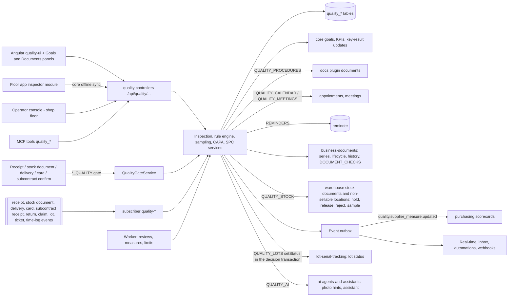

# Implementation Plan: Quality management

> Translates an approved `spec.md` into architecture and tech choices. The plan owns
> implementation details; the spec owns behaviour.

**Feature ID**: `quality-management`
**Spec**: `./spec.md`
**Tasks**: `./tasks.md`
**Status**: `Draft`
**Last updated**: 2026-11-23

---

## 1. Architecture Summary

A new plugin `@gauzy/plugin-quality` (`packages/plugins/quality`) owns setup (parameters, templates, sampling plans,
item profiles, enforcement rules), inspections, retained samples, non-conformances, improvement actions, customer and
supplier feedback and the analytics; `quality-ui` holds the Angular pages and the inspector module of the floor app.
It never writes stock quantities or lot statuses itself: stock moves through the warehouse stock-document API
(`QUALITY_STOCK` port), lot statuses are set by the lot plugin (`serials-and-batches`) through `QUALITY_LOTS.setStatus`, called
inside the decision's transaction like the stock movements, so a decision, its stock and lot effects and the outbox
append commit together (spec §4 Reliability), and inspections are a document type of the business document engine (numbering, lifecycle,
history).

The improvement loop is built on what the platform already has, and quality keeps only the bindings:

- **Objectives and reviews** are core goals (`packages/core/src/lib/goal`, `goal-kpi`, `keyresult`,
  `keyresult-update`): a quality objective is a goal bound to quality, its targets are KPI-backed key results, and a
  review is the key-result updates of one period. Quality keeps the review rhythm and the measure of each key result.
- **Procedures** are documents of the docs plugin (`packages/plugins/docs`: `document` tree by `parentId`, `version`,
  `isLocked`, `reviewStatus`, `document_version`, `document_category`, `document_link`) in a "Quality procedures"
  category; the docs tree move is already cycle-guarded.
- **Quality circles** are core appointments (`employee_appointment`: agenda, invitees, start and end); with the
  meetings feature on, their agenda items, minutes and linked records are the meeting's (`meeting_agenda_item`,
  `meeting_summary`, and record links of `record-views-and-search`).
- **Feedback on employees** is `performance-management`'s; quality records customer and supplier feedback.
- **Reminders** are rows of the generic `reminder` table scheduled through the `REMINDERS` port of
  `automation-and-notifications`; review rhythms use the core recurrence module (`packages/core/src/lib/recurrence/`).
- **Hold, reject and sample locations** are the non-sellable child locations of each warehouse, marked by purpose in
  the location tree of `warehouse-and-stock-movements` (`INSPECTION_HOLD`, `QUARANTINE`, `RETAINED_SAMPLE`).
- **Offline reading sets** are operations of the core offline-sync module, and the inspector layout is a module of the
  one installable floor app (`floor-ui`).
- **Photo hints and the quality assistant** are agent definitions of `ai-agents-and-assistants`, reached through
  `QUALITY_AI`; runs, usage and budgets are recorded there.

Enforcement is one service, `QualityGateService`, bound in `apps/api/src/plugin-composition.ts` to the quality tokens
the owning plugins reserve: `PURCHASING_QUALITY` (receipts), `SUBCONTRACTING_QUALITY` (subcontract receipts),
`MANUFACTURING_QUALITY` (template lookup for structures; card and output completion), and the inspection gates of the
fulfilment plugin (deliveries) and of the inventory plugin's stock documents. Each owner calls the gate inside its own
confirmation transaction; the gate answers findings (`BLOCK`/`WARN`) and, under a hold rule, the hold location. Quality
also contributes a `DOCUMENT_CHECKS` entry (`quality.inspection-in-use`) that refuses cancelling a document an open hold
or a decided inspection depends on, and the inspection type's own cancel check. Unbound, every owner behaves as today.

Owners' damaged quantities stay the owners' figures: `goods_receipt_line.damagedQuantity`,
`stock_transfer_line.damagedQuantity` and `order_return_line.damagedQuantity` count units that arrived unsellable and
never entered stock. An inspection covers the line's good quantity only, its rejected quantity counts units that
entered stock (in hold) and failed, the owner panels show both columns side by side, supplier measures add them, and a
return inspection covers only the restocked units (`restock = true`). Neither figure is ever copied into the other.



## 2. Tech Choices

| Concern | Choice | Rationale |
| ------- | ------- | --------- |
| Package | `packages/plugins/quality` (new), `quality-ui` (new) | Principle I |
| Flag | tenant feature `FEATURE_QUALITY` in `quality.features.ts` (`defaultEnabled: false`), `@FeatureFlag` + `FeatureFlagGuard` on every controller and resolver | default off; gate returns "not required" when off |
| Persistence | MultiORM entities on `TenantOrganizationBaseEntity`; parameters, groups and templates with `organizationId` null are tenant-shared with `organizationIds` allow-list; the shared core migration helpers of `@gauzy/core` | Principle III |
| Rule engine | pure functions in `engine/`: rule evaluation, safe expression parser (tokenizer + Pratt parser, no host evaluation), sampling tables, switching rules, run rules, limits, capability | deterministic, property-tested |
| Numbers | readings `numeric(20,6)`; parsing with the user's locale through `@gauzy/common` number helpers | FR-18 |
| Objectives and reviews | core `GoalService`, `KeyResultService`, `KeyResultUpdateService`, `GoalKpiService` used directly (core); `KpiOperatorEnum` `>=`/`<=` is the comparison, `KeyResultUpdateStatusEnum` `on track`/`off track` is passed/failed, `needs attention`/`none` is undecided | one objective and target store; the existing Goals pages |
| Procedures | docs plugin through `QUALITY_PROCEDURES` (category, tree, versions, lock, review, `document_link`) | one versioned document model |
| Circles | core `EmployeeAppointmentService`; meetings through `QUALITY_MEETINGS` when loaded | one meeting model |
| Recurrence and reminders | core recurrence rule columns on the goal binding; reminders through `REMINDERS` | one recurrence, one reminder table |
| Cross-plugin calls | ports bound in `plugin-composition.ts`: consumed `QUALITY_STOCK`, `QUALITY_DOCUMENTS`, `QUALITY_SOURCE_LINES` (read lines of receipts, stock documents, deliveries, cards, subcontract receipts, returns and claims through their owners), `QUALITY_LOTS` (read lot attributes; `setStatus` inside the decision's transaction), `QUALITY_TASKS` (create tasks for corrective steps), `QUALITY_AI`, `QUALITY_CALENDAR`, `QUALITY_MEETINGS`, `QUALITY_PROCEDURES`, `QUALITY_APPROVALS`, `QUALITY_COMMUNICATIONS`, `REMINDERS`; provided `QualityGateService`, `QualityTemplateLookup`, `QualityMeasureProvider` | no import of other plugins |
| Offline | reading sets of kind `quality.reading-set` (owner type `QUALITY_INSPECTION`) through the core offline-sync module and core idempotency; the inspector is a `floor-ui` module | one offline idiom, one floor app |
| Events | `EventOutboxService.append` in the decision transaction; consumers `subscriber:quality-*` in `EventConsumerRegistry` | at-least-once, deduplicated |
| Background work | `@ScheduledJob` + `@QueueWorker`; `QualitySchedulePlugin` in the worker; every pass a `job_execution` row | API and worker split |
| Reports | report definitions; supplier measures and cost of poor quality from monthly snapshot tables | no raw scans |
| Settings, permissions | settings keys in `quality.settings.ts`; permission contributions with `defaultFor` | platform stores, no seed migration |

## 3. Data Model

### New or changed entities

One existing table changes: core `key_result_update` gains `periodStart` and `periodEnd` (date null; core migration
`AddKeyResultUpdatePeriod`, unique (`keyResultId`, `periodEnd`) where not null), so a periodic check-in names its
period. Owners already add `inspectionState` / `inspectionId` to their lines in their own plans; core `BaseEntityEnum`
gains `QualityInspection`, `QualityNonConformance` and `ImprovementAction` for `document_link`, record links and
`comment`.

```ts
@MultiORMEntity('quality_inspection', { mikroOrmRepository: () => MikroOrmQualityInspectionRepository })
export class QualityInspection extends TenantOrganizationBaseEntity implements IQualityInspection { /* below */ }
```

| Table | Columns (type) | Indexes and uniqueness |
| --- | --- | --- |
| `quality_parameter_group` | `code`, `name`, `organizationIds` json null | unique `(tenantId, code)` |
| `quality_parameter` | `code` varchar(64), `name`, `groupId` fk null, `kind` (`NUMBER`/`TEXT`/`CHOICE`/`BOOLEAN`/`VISUAL`), `unitId` uuid null, `choices` json, `description` text, `isArchived` | unique `(tenantId, code)` |
| `quality_template` | `code`, `name`, `points` json, `currentVersionId` fk null, `verificationRequired` bool, `isArchived` | unique `(tenantId, code)` |
| `quality_template_version` | `templateId` fk, `version` int, `status` (`DRAFT`/`ACTIVE`/`SUPERSEDED`) | unique `(templateId, version)` |
| `quality_template_line` | `versionId` fk, `sequence`, `parameterId` fk, `readings` int (1–50), `ruleKind` (`RANGE`/`TARGET`/`EQUALS`/`FORMULA`/`MANUAL`), `min`, `max`, `target`, `tolerance` numeric(20,6) null, `expected` varchar(255) null, `formula` text null, `severity` (`CRITICAL`/`MAJOR`/`MINOR`), `instructions` text, `imageIds` json | unique `(versionId, sequence)` |
| `quality_sampling_plan` | `code`, `name`, `kind` (`FIXED`/`PERCENT`/`FULL`/`TABLE`), `fixedSize`, `percent`, `minSize`, `maxSize`, `table` json (lot-size bands × level: sample, accept, reject), `switching` json (tighten after N rejects in M, reduce after N accepts) | unique `(tenantId, code)` |
| `quality_sampling_level` | `planId`, `variantId`, `vendorId` null, `vendorKey` varchar(36) not null (the `vendorId`, or `*`), `level` (`NORMAL`/`TIGHTENED`/`REDUCED`), `history` json (last results), `changedAt`, `reason` | unique `(organizationId, planId, variantId, vendorKey)` |
| `quality_item_profile` | `variantId` uuid null, `productId` uuid null, `productCategoryId` uuid null, `points` json (point → required, templateId, samplingPlanId), `retainSample` bool, `sampleQuantity` numeric(20,6), `keepMonths` int, `ownerEmployeeId` null, `scopeKey` varchar(48) not null (`variant:<variantId>`, `product:<productId>` or `category:<productCategoryId>`, written with them) | check exactly one of `variantId`, `productId`, `productCategoryId`; unique `(organizationId, scopeKey)` |
| `quality_enforcement_rule` | `point` varchar(24), `itemGroupId`, `vendorId`, `contactId` null, `whenMissing` (`REFUSE`/`WARN`/`HOLD`), `whenRejected` (`REFUSE`/`WARN`/`MOVE`), `allowAdHoc` bool, `draftNonConformance` bool, `scopeKey` varchar(112) not null (`<itemGroupId or *>:<vendorId or *>:<contactId or *>`, written with them) | unique `(organizationId, point, scopeKey)` |
| `quality_inspection` | `number` varchar(64) null, `kind` (`INCOMING`/`IN_PROCESS`/`OUTGOING`/`RETURN`/`AD_HOC`), `point`, `sourceType` varchar(48), `sourceId`, `sourceLineId` uuid, `lotId` uuid null (the lot of an inspection drafted per source line and lot; also listed in `lotIds`), `sourceKey` varchar(128) null (`<sourceType>:<sourceLineId>:<lotId or *>`, written by the source consumer for the draft it creates and cleared when the inspection is canceled), `variantId`, `vendorId` null, `contactId` null, `quantity` (the line's good quantity), `sampleSize` numeric(20,6), `lotIds` json, `serialUnitIds` json, `templateVersionId` fk, `samplingPlanId` null, `samplingLevel` null, `inspectorId`, `verifierId` null, `state` (`DRAFT`/`IN_PROGRESS`/`AWAITING_VERIFICATION`/`DECIDED`/`CANCELLED`), `decision` (`ACCEPTED`/`REJECTED`/`PARTIAL`) null, `acceptedQuantity`, `rejectedQuantity`, `decidedById`, `decidedAt`, `holdMovementId`, `releaseMovementId`, `rejectMovementId` uuid null, `remarks` text, `certificateFileId` null, `version` int | unique `(organizationId, number)` where number not null; unique `(organizationId, sourceKey)` (null keys of ad-hoc and canceled inspections are distinct on every dialect); idx `(sourceType, sourceLineId)`, `(organizationId, state, createdAt)`, `(vendorId, decidedAt)`, `(variantId, decidedAt)` |
| `quality_reading_set` | `inspectionId` fk, `authorId`, `enteredAt`, `offlineOperationId` uuid null (core `offline_operation` when captured offline), `isCurrent` bool | unique `(offlineOperationId)` where not null |
| `quality_reading` | `readingSetId` fk, `templateLineId` fk, `values` json (numbers or text), `mean`, `minValue`, `maxValue`, `stdDev` numeric(20,6) null, `result` (`PASSED`/`FAILED`/`CANNOT_EVALUATE`/`PENDING`), `overrideResult` null, `overrideReason`, `overrideById`, `photoIds` json, `defectCount` int | unique `(readingSetId, templateLineId)` |
| `quality_inspection_hint` | `readingId` fk, `photoId`, `label` varchar(128), `confidence` numeric(5,4), `area` json, `aiRunId` uuid (the run of `ai-agents-and-assistants`, which records the model and usage), `outcome` (`ACCEPTED`/`OVERRIDDEN`/`PENDING`) | idx `(readingId)` |
| `quality_retained_sample` | `variantId`, `lotId`, `quantity`, `locationId`, `movementId`, `keepUntil` date, `status` (`RETAINED`/`DRAWN`/`DISPOSED`), `drawnForInspectionId` null | idx `(organizationId, status, keepUntil)`, `(lotId)` |
| `quality_goal_binding` | `goalId` uuid (core `goal`), the core recurrence rule columns (`frequency`, `interval`, `weekday`, `dayOfMonth` (−1 = last), `month`, `startOn`, `timeZone`), `nextDueOn` date, `procedureDocumentId` uuid null | unique `(goalId)`; idx `(organizationId, nextDueOn)` |
| `quality_key_result_measure` | `keyResultId` uuid (core `key_result` of type KPI), `measureKey` varchar(64), `scopeType` varchar(16) (`ORGANIZATION`/`ITEM_GROUP`/`SUPPLIER`/`WORK_CENTRE`), `scopeId` uuid null | unique `(keyResultId)` |
| `quality_nonconformance` | `number`, `subject`, `source` (`INSPECTION`/`CUSTOMER`/`SUPPLIER`/`AUDIT`/`PROCESS`/`CONTROL_CHART`), `sourceRef` json (inspection, ticket task, order claim, order return and its reason), `procedureDocumentId`, `variantId`, `lotIds`, `serialUnitIds` json, `vendorId`, `contactId`, `quantityAffected`, `severity` (`CRITICAL`/`MAJOR`/`MINOR`), `description`, `containment`, `rootCause` text, `disposition` (`USE_AS_IS`/`REWORK`/`SORT`/`SCRAP`/`RETURN_TO_SUPPLIER`) null, `status` (`OPEN`/`INVESTIGATING`/`ACTIONS_PENDING`/`CLOSED`/`CANCELLED`), `ownerId`, `supplierAnswerDueOn`, `supplierAnswer` text | unique `(organizationId, number)`; idx `(organizationId, status, severity)`, `(vendorId)` |
| `improvement_action`, `improvement_action_step` | action: `number`, `kind` (`CORRECTIVE`/`PREVENTIVE`), `links` json (type, id: goal, key-result update, procedure document, appointment, non-conformance, inspection, feedback), `status` (`OPEN`/`AWAITING_CHECK`/`CLOSED`/`REOPENED`), `effectivenessCheckOn` date, `checkResult` null, `projectId` null; step: `actionId`, `cause`, `step`, `ownerId`, `dueOn`, `status` (`OPEN`/`DONE`/`DROPPED`), `dropReason`, `taskId` null, `inboxItemId` null | unique `(organizationId, number)`; idx `(ownerId, status, dueOn)` |
| `quality_circle` | `appointmentId` uuid (core `employee_appointment`), `status` (`OPEN`/`CLOSED`); appointments carry no kind, so this row marks which appointments are quality circles and whether one is closed, while time, attendees, agenda and minutes stay on the appointment and its meeting | unique `(appointmentId)`; idx `(organizationId, status)` |
| `quality_feedback_template`, `quality_feedback`, `quality_feedback_score` | template: `name`, `subjectKind` (`CUSTOMER`/`SUPPLIER`), `parameters` json, `actionThreshold` int; feedback: `number`, `templateId`, `subjectKind`, `subjectId`, `byId`, `comment`; score: `feedbackId`, `parameter`, `score` int (1–5), `comment` (the per-criterion pattern of core `candidate_feedback` and `candidate_criterions_rating`) | idx `(subjectKind, subjectId)` |
| `quality_control_chart`, `quality_control_limit`, `quality_control_point`, `quality_control_alert` | chart: `parameterId`, `variantId`, `point`, `operationId`, `workCentreId`, `vendorId` null, `chartKind` (`XBAR_R`/`I_MR`/`P`), `subgroupSize`, `rules` json, `draftNonConformance` bool; limit: `chartId`, `fromPointId`, `centre`, `ucl`, `lcl`, `rangeCentre`, `rangeUcl`, `computedAt`; point: `chartId`, `inspectionId`, `value`, `range` null, `at`; alert: `chartId`, `rule`, `pointIds` json, `status`, `nonConformanceId` null | idx `(chartId, at)`; unique `(chartId, inspectionId)` |
| `quality_supplier_measure` | `vendorId`, `periodStart` date (month), `lotsInspected`, `lotsAccepted` int, `quantityInspected`, `quantityRejected`, `quantityDamagedOnArrival`, `defects` numeric, `acceptanceRate`, `defectsPerMillion` numeric(20,6), `ncCritical`, `ncMajor`, `ncMinor` int, `avgAnswerDays`, `avgCloseDays` numeric(10,2) | unique `(organizationId, vendorId, periodStart)` |
| `quality_cost_snapshot` | `periodStart`, `variantId`, `workOrderId`, `operationId`, `workCentreId`, `vendorId`, `lotId` null, `category` (`CORRECTIVE`/`SCRAP`/`REJECTED`/`RETURNS`/`TIME`/`CREDIT`), `amount` numeric(20,6), `currency`, `minutes` int | idx `(organizationId, periodStart, category)` |

No location-setting, objective, target, review, procedure, agenda or minute table: these are the warehouse's
non-sellable children, core goals and key-result updates, docs-plugin documents and the appointment and its meeting.
A review is the key-result updates of one goal with the same `periodEnd`: open while one is `none` or
`needs attention`, failed when one is `off track`, passed otherwise; its notes are core `comment` rows on the goal.

### Migrations

**Migration timestamps**: `packages/plugins/quality` `1791000088100` to `1791000088199`; `packages/core` `1791000088900` to `1791000088999`.

- In `packages/plugins/quality/src/lib/database/migrations/`: `1791000088100-CreateQualitySetupTables` (groups, parameters, templates, versions, lines, sampling plans and levels, item
  profiles, enforcement rules), `1791000088110-CreateQualityInspectionTables` (inspections, reading sets, readings, hints,
  retained samples), `1791000088120-CreateQualityImprovementTables` (goal bindings, key-result measures, non-conformances,
  improvement actions, quality circle marks, customer and supplier feedback), `1791000088130-CreateQualityAnalyticsTables`
  (charts, limits, points, alerts, supplier measures, cost snapshots); core (`packages/core/src/lib/database/migrations/`)
  `1791000088900-AddKeyResultUpdatePeriod`.
- Additive, idempotent, per dialect with the plugin helpers; partial unique indexes over a generated "live" column on
  MySQL; SQLite tables created whole. No backfill. Role grants come from the permission contributions (`defaultFor`);
  the "Quality procedures" document category is created on first use through the docs plugin.

### Contracts

`packages/contracts/src/lib/quality.model.ts`: interfaces, enums (`QualityPoint`, `QualityInspectionKind`,
`QualityInspectionState`, `QualityDecision`, `QualityRuleKind`, `QualitySeverity`, `QualityEnforcementWhenMissing`,
`QualityEnforcementWhenRejected`, `NonConformanceStatus`, `QualityActionStatus`), the gate contract
(`IQualityGateRequest { point, documentType, documentId, lines[] }` → `IQualityGateResult { lines: { lineId,
required, state, inspectionId?, damagedOnArrival?, finding?: { code, severity }, holdLocationId? }[] }`), decision
preview, derived review view and event payloads. Finding codes: `QUALITY_INSPECTION_MISSING`,
`QUALITY_INSPECTION_UNDECIDED`, `QUALITY_INSPECTION_REJECTED`, `QUALITY_INSPECTION_IN_USE`, `QUALITY_LOCATION_MISSING`.

## 4. API Surface

All routes under `/api/quality`, guarded by `TenantPermissionGuard`, `PermissionGuard`, `FeatureFlagGuard`; cursor
pagination; `Idempotency-Key` on creating and deciding routes; `version` on updates.

| Method | Endpoint | Permission | Description (request → response) | Status |
| ------ | -------- | ---------- | -------------------------------- | ------ |
| `GET/POST/PUT/DELETE` | `/quality/parameter-groups`, `/quality/parameters` | `QUALITY_VIEW` / `QUALITY_SETUP_EDIT` | parameter DTOs | New |
| `GET/POST/PUT` | `/quality/templates`, `/:id/versions`, `POST /:id/versions/:v/activate`, `POST /quality/templates/validate` | `QUALITY_VIEW` / `QUALITY_SETUP_EDIT` | template, lines, formula validation | New |
| `GET/POST/PUT` | `/quality/sampling-plans`, `GET /quality/sampling-levels` | `QUALITY_VIEW` / `QUALITY_SETUP_EDIT` | plans, current levels | New |
| `GET/POST/PUT/DELETE` | `/quality/item-profiles`, `/quality/enforcement-rules` | `QUALITY_VIEW` / `QUALITY_SETUP_EDIT` | profile, rule DTOs | New |
| `GET` | `/quality/locations?warehouseId=` | `QUALITY_VIEW` | the warehouse's hold, quarantine and sample children, read through `QUALITY_STOCK` | New |
| `GET` | `/quality/requirements?variantId=&point=` | `QUALITY_VIEW` | effective requirement, template, plan, sample size | New |
| `GET/POST/PUT` | `/quality/inspections`, `/quality/inspections/:id` | `QUALITY_VIEW` / `QUALITY_INSPECTIONS_EDIT` | `CreateInspectionDTO` → `IQualityInspection` | New |
| `POST` | `/quality/inspections/from-document` | `QUALITY_INSPECTIONS_EDIT` | `{ documentType, documentId }` → inspections per flagged line | New |
| `POST` | `/quality/inspections/:id/reading-sets` | `QUALITY_INSPECTIONS_EDIT` | readings → results per parameter (offline sets arrive through `/offline-sync/batches`) | New |
| `POST` | `/quality/inspections/:id/readings/:readingId/override` | `QUALITY_OVERRIDE` | `{ result, reason }` | New |
| `POST` | `/quality/inspections/:id/decide` | `QUALITY_INSPECTIONS_DECIDE` | `{ decision, acceptedQuantity?, preview? }` → effects preview or decided inspection | New |
| `POST` | `/quality/inspections/:id/verify`, `/cancel` | `QUALITY_INSPECTIONS_DECIDE` | verification; cancel (`409` when in use) | New |
| `POST` | `/quality/inspections/:id/photos/:photoId/hints` | `QUALITY_INSPECTIONS_EDIT` | AI hints (agent run) | New |
| `POST` | `/quality/inspections/:id/certificate` | `QUALITY_VIEW` | PDF through the print service | New |
| `GET` | `/quality/holds` | `QUALITY_VIEW` | stock in inspection hold with age | New |
| `GET/POST/PUT` | `/quality/retained-samples` (+ `/:id/draw`, `/:id/dispose`) | `QUALITY_VIEW` / `QUALITY_INSPECTIONS_EDIT` | samples | New |
| `GET/POST/PUT/DELETE` | `/quality/goal-bindings` (+ `/:id/measures`) | `QUALITY_VIEW` / `QUALITY_OBJECTIVES_EDIT` | bind a goal: rhythm, procedure, key-result measures | New |
| `GET/PUT` | `/quality/reviews` (+ `/:goalId/:periodEnd/targets/:keyResultId`) | `QUALITY_VIEW` / `QUALITY_OBJECTIVES_EDIT` | derived reviews; marking a target writes its key-result update | New |
| `GET/POST/PUT` | `/quality/nonconformances` (+ `/:id/status`, `/:id/send-to-supplier`, `/from-source`) | `QUALITY_VIEW` / `QUALITY_NONCONFORMANCE_EDIT` | non-conformances; sources: inspection, ticket (a task of issue type ticket), order claim, order return with its reason | New |
| `GET/POST/PUT` | `/quality/actions` (+ `/:id/steps`, `/:id/check`) | `QUALITY_VIEW` / `QUALITY_ACTIONS_EDIT` (a step's owner may complete it) | actions | New |
| `GET/POST/PUT` | `/quality/circles` (+ `/:id/status`) | `QUALITY_VIEW` / `QUALITY_CIRCLES_EDIT` | creates the appointment and its mark; lists marked appointments | New |
| `GET/POST/PUT` | `/quality/feedback-templates`, `/quality/feedback` | `QUALITY_VIEW` / `QUALITY_FEEDBACK_EDIT` | customer and supplier feedback | New |
| `GET/POST/PUT` | `/quality/charts` (+ `/:id/points`, `/:id/limits/recompute`, `/:id/alerts`) | `QUALITY_VIEW` / `QUALITY_SETUP_EDIT` | SPC | New |
| `GET` | `/quality/suppliers/:vendorId/measures`, `/quality/cost`, `/quality/measures/:key` | `QUALITY_REPORTS_VIEW` | measures | New |
| `POST` | `/quality/assistant/nonconformances/:id` | `QUALITY_NONCONFORMANCE_EDIT` | similar cases and draft (agent run) | New |
| `GET` | `/quality/home` | `QUALITY_VIEW` | home page cards | New |

Procedures use the documents routes of the docs plugin (category filter); quality writes their `document_link` rows
through `QUALITY_PROCEDURES`. Errors: `400` validation (`QUALITY_SAMPLE_SIZE`, `QUALITY_FORMULA_INVALID`,
`QUALITY_SCORE_RANGE`, `QUALITY_SAMPLE_NOT_LOT_TRACKED`), `403`, `404` (flag off, other organization), `409` (version,
already decided, in use, `DOCS_TREE_CYCLE` from the docs move), `422` (location missing, stock effect refused by the
warehouse).

## 5. Events, Real-Time and Notifications

| Event | Emitted when | Consumers |
| ----- | ------------ | --------- |
| `document.quality_inspection.confirmed` / `.cancelled` | decided / cancelled (document engine) | history, reports |
| `quality.inspection.created`, `.decided` (+ `.completed`, same payload), `.cancelled` | as named; payload: inspection, source line, decision, quantities, lots, vendor | purchasing (hold release, scorecard), lot-serial-tracking (lot status, already set through `QUALITY_LOTS` in the decision's transaction), manufacturing (card state), subcontracting, fulfilment, SPC, sampling levels, supplier measures |
| `quality.nonconformance.opened`, `.closed`; `quality.action.overdue`, `.closed`; `quality.review.due`, `.decided` | as named | inbox, automations, webhooks |
| `quality.chart.out_of_control` | a run rule breaks | inbox (quality owner), operator console warning, draft non-conformance |
| `quality.supplier_measure.updated` | measures recomputed | purchasing scorecards |
| consumed: `document.goods_receipt.confirmed`, `inventory.stock_document.confirmed`, fulfilment confirmed, `subcontracting.receipt.posted`, returns received, manufacturing card started | source documents | draft inspections, sample retention |
| consumed: `lot.created` (produced lots) | lot from production | sample retention |
| consumed: time-log events on corrective step tasks; `manufacturing.operation_card.completed` (corrective); valuation of scrap | cost sources | cost snapshots |

Inbox items through `InboxItemWriter`: inspections awaiting decision for the inspector, corrective steps due, reviews due,
alerts, samples ending, supplier answers. Reminders are `reminder` rows scheduled through `REMINDERS` when the dates
are set and cancelled when the record closes (`quality-step:<id>:before|after`, `quality-check:<id>`,
`quality-sample:<id>:30d`, `quality-supplier-answer:<id>`). Real-time record hints for inspections, holds, charts and
the home page.

## 6. UI Surface

- Angular plugin `packages/plugins/quality-ui`, registered in `apps/gauzy/src/plugin-ui.config.ts`, menu group
  "Quality" under Inventory, hidden without the feature or `QUALITY_VIEW`. Routes: `/pages/quality` (home and
  dashboard), `/inspections` (saved-view list) and `/inspections/:id` (reading grid with keyboard entry, live results,
  photos and hints, decision preview, certificate), `/holds`, `/samples`, `/setup/{parameters,templates,sampling,
  profiles,rules,locations}` (locations read-only, linking to the Warehouses page), `/nonconformances`, `/actions`,
  `/circles` (marked appointments, opening the appointment and its meeting), `/feedback`, `/charts` (+ `/:id`),
  `/suppliers`, `/reports`.
- Quality objectives and reviews are shown on the existing Goals pages (`/pages/goals`): quality contributes a panel
  (rhythm, measures, reviews of the period) through the UI plugin extension slots and adds no objectives page;
  procedures are the documents pages filtered by the "Quality procedures" category.
- The inspector module of the floor app (`floor-ui`, route `/pages/floor/inspect/:labelOrNumber`): scan, readings,
  photos, decide; offline sets through the core offline sync.
- Contributed panels on owners' pages through the plugin UI extension slots: inspection state chip, damaged-on-arrival
  and rejected columns, and "create inspections" on receipts, stock documents, deliveries, subcontract receipts and
  returns; item page "Quality" tab (profile); lot page retained samples; operator console inspection checklist
  (component used by shop-floor's console).
- i18n keys `QUALITY.*` in every locale; charts with table alternatives.

## 7. MCP Tools, SDKs and Integrations

- `packages/mcp-server/src/lib/tools/quality.ts`:

| Tool | Input | Output |
| --- | --- | --- |
| `quality_inspections_search` | filters, cursor | inspections with state and decision |
| `quality_inspection_get` | id or number | inspection, readings, results |
| `quality_inspection_create` | source line or item, quantity | draft inspection |
| `quality_readings_enter` | inspection, readings | results per parameter |
| `quality_inspection_decide` | inspection, decision, `preview` (default true) | effects preview or decided inspection |
| `quality_holds_list` | warehouse, item | stock on hold |
| `quality_nonconformance_draft` | subject, links | draft |
| `improvement_action_draft` | links, corrective steps | draft |
| `quality_chart_status` | item, parameter | limits, capability, alerts |
| `quality_supplier_measures` | supplier, period | measures |

- Objectives and reviews are read and updated with the existing goal and key-result MCP tools (`goals.ts`,
  `key-results.ts`); the photo-hint and assistant agents are registered with `ai-agents-and-assistants`.
- Report definitions for spec §3.13 and the dashboard; measures exposed to `procurement` scorecards through
  `QualityMeasureProvider` and to KPI-backed key results.
- Print templates: inspection certificate, non-conformance report, retained-sample label. Import templates:
  parameters, templates, item profiles, historical inspections. OpenAPI additive; SDKs regenerated.

## 8. Background Jobs

| Trigger | When | What it does | Idempotency |
| ------- | ---- | ------------ | ----------- |
| `quality.reviews.sweep` | daily 01:00 (organization time zone) | for due goal bindings (core recurrence): one key-result update per key result for the period, measured values filled (and the KPI's current value), `nextDueOn` advanced | unique (`keyResultId`, `periodEnd`) |
| consumer `subscriber:quality-sources` | source document events | draft inspections, sample retention movements | `quality_inspection.sourceKey` unique (source line and lot): a redelivered event finds the draft it made; delivery record |
| consumer `subscriber:quality-decisions` | `quality.inspection.decided` | sampling level switching, SPC points and run rules, supplier measure update | `(chartId, inspectionId)`, event dedup |
| `quality.supplier-measures.rebuild` | nightly | recomputes the current and previous month per supplier | upsert on `(vendorId, periodStart)` |
| `quality.cost.snapshot` | daily + month end | cost of poor quality snapshot | replace rows of the period |

`QualitySchedulePlugin` (worker) holds schedules; `QualityPlugin` (API) holds routes, gate, consumers. Every pass is a
`job_execution` row. Without a queue the API runs the sweeps on in-process timers under the scheduler's lock.

## 9. Security & Permissions

- New keys (contributed, group `GENERAL`, with `defaultFor`): `QUALITY_VIEW`, `QUALITY_SETUP_EDIT`,
  `QUALITY_INSPECTIONS_EDIT`, `QUALITY_INSPECTIONS_DECIDE`, `QUALITY_OVERRIDE`, `QUALITY_NONCONFORMANCE_EDIT`,
  `QUALITY_ACTIONS_EDIT`, `QUALITY_OBJECTIVES_EDIT` (bind goals and mark reviews; the goals' own permissions still
  apply), `QUALITY_PROCEDURES_EDIT` (documents of the procedures category; docs' own access still applies),
  `QUALITY_CIRCLES_EDIT`, `QUALITY_FEEDBACK_EDIT`, `QUALITY_REPORTS_VIEW`.
- Default grants: super admin and admin all; manager all except `QUALITY_OVERRIDE` and `QUALITY_SETUP_EDIT`; employee
  `QUALITY_VIEW` and `QUALITY_INSPECTIONS_EDIT` (record readings), corrective steps assigned to them through ownership
  checks; existing tenants receive them through the permission reload.
- Deciding and overriding are separate from recording; a verifier cannot be the inspector.
- Feedback readable only by `QUALITY_FEEDBACK_EDIT` holders.
- Formula evaluation never executes host code; text and HTML sanitised; photos through the file service; AI calls
  only through the agents of `ai-agents-and-assistants` and the tenant's configured provider, with the photo and
  parameter name only.

## 10. Observability

- Document history of inspections; audit (who, when, before, after) on readings, overrides, decisions and setup.
- Metrics: gate evaluations and findings per point, decision latency, holds by age, SPC alerts, hint agreement.

## 11. Phased Rollout

1. **Phase 1 — Setup and inspections** (flag off): contracts, parameters, templates, sampling (fixed, percent, full),
   item profiles, locations, inspections with readings and decisions, stock effects, certificate, inspection list,
   home page.
2. **Phase 2 — Enforcement and improvement loop**: gate bound to receipts, stock documents, deliveries, subcontract
   receipts and cards; holds; returns; retained samples; quality objectives on goals and reviews; procedures as
   documents; non-conformances; improvement actions; quality circles on appointments; feedback; reports and
   dashboard; MCP tools.
3. **Phase 3 — Advanced capabilities**: control charts and alerts; supplier measures to scorecards and supplier answers;
   acceptance sampling tables with switching; photo hints; quality assistant; cost of poor quality with tracked time.
4. **Phase 4 — General availability**: the feature is off by default; after the trial period it may be switched on by default for new tenants only; existing tenants keep their setting until an administrator changes it.

## 12. Constitution Reconciliation

- I Plugin-first: `quality` and `quality-ui`; enforcement through ports and document checks; core gains the period
  of key-result updates and three entity names; goals, documents, appointments and meetings reused.
- II Tenant/organization scoping: all tables on the tenant-organization base; shared setup with allow-lists.
- III Both ORMs, additive migrations: MultiORM entities, create-only plugin migrations and one additive core migration
  per dialect.
- IV Default-off flag; nothing removed: `FEATURE_QUALITY`; gate answers "not required" when off.
- V Contracts and API first: `quality.model.ts` and REST before UI; additive OpenAPI.
- VI Permissions, privacy, security: twelve keys as contributions; safe evaluator; feedback privacy; AI only on request.
- VII Real-time through the event bus: outbox events; record hints; no private channel.
- VIII i18n and accessibility: `QUALITY.*` keys; keyboard reading grid; floor-app targets.
- IX Tests: property tests for rules, sampling and run rules; enforcement matrix; per-dialect migrations; e2e.
- X Behaviour-first spec: implementation lives here.
- XI Documentation describes our platform only.

## 13. Risks & Mitigations

| Risk | Likelihood | Impact | Mitigation |
| ---- | ---------- | ------ | ---------- |
| Gate slows document confirmation | Medium | Medium | requirement cache per organization and item, one query per document, budget 30 ms per line |
| Owners' gate contracts drift as plugins change | Medium | Medium | one shared contract in `quality.model.ts`, contract tests with each owner's stub |
| Lot status out of step with the decision | Low | Medium | `QUALITY_LOTS.setStatus` runs in the decision's transaction, so a failure rolls the decision and its stock movements back; without the lot plugin no lot status exists |
| Formula evaluator abuse | Low | High | own parser, no host evaluation, length and depth limits, fuzz tests |
| False out-of-control alerts | Medium | Low | baseline period choice, rule set per chart, alert grouping per chart and day |
| AI hints trusted blindly | Medium | Medium | hints never decide, agreement reported, model recorded on the agent run |
| Goals edited outside quality break a review | Low | Medium | bindings and measures keyed by goal and key result; a deleted key result ends its measure and is shown on the next review |

## 14. References

- Spec: `./spec.md` · Tasks: `./tasks.md`
- [platform architecture](../../architecture/business-suite.md) §3.1, §3.5, §3.9, §3.11, §3.12, §6
- Related plans: `../procurement/plan.md` (`PURCHASING_QUALITY`, receipt line inspection columns),
  `../warehouse-and-stock-movements/plan.md` (stock documents, non-sellable locations by purpose, offline sync, floor
  app), `../delivery-and-shipping/plan.md` (fulfilment inspection state), `../shop-floor-and-work-orders/plan.md` and
  `../manufacturing-bom-and-routing/plan.md` (`MANUFACTURING_QUALITY`), `../subcontracting/plan.md`
  (`SUBCONTRACTING_QUALITY`), `../serials-and-batches/plan.md` (lot status from decisions),
  `../business-document-engine/plan.md` (`DOCUMENT_CHECKS`, core recurrence), `../meetings/plan.md`,
  `../documents-and-wiki/plan.md`, `../automation-and-notifications/plan.md` (`REMINDERS`),
  `../ai-agents-and-assistants/plan.md`, `../performance-management/plan.md` (employee feedback)
- Code: `packages/plugins/purchasing/src/lib/goods-receipt-line`, `packages/plugins/warehouse/src/lib/warehouse.types.ts`,
  `packages/plugins/returns/src/lib/order-return-line`, `packages/plugins/returns/src/lib/order-return-reason`,
  `packages/core/src/lib/goal`, `goal-kpi`, `keyresult`, `keyresult-update`, `employee-appointment`,
  `packages/plugins/docs/src/lib/entities`, `packages/core/src/lib/event-outbox`, `packages/scheduler`,
  `apps/api/src/plugin-composition.ts`
