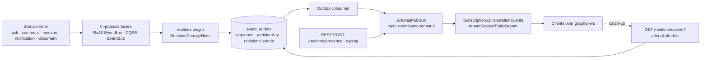

# Implementation Plan: Real-time channel

> Translates an approved `spec.md` into architecture and tech choices. The plan owns
> implementation details; the spec owns behaviour.

**Feature ID**: `realtime-channel`
**Spec**: `./spec.md`
**Tasks**: `./tasks.md`
**Status**: `Approved`
**Last updated**: 2026-11-08 (aligned with the code merged in ever-gauzy #11681 / #11686)

---

## 1. Architecture Summary

Nothing new is invented for transport: the plugin **declares** collaboration events with the
existing subscription catalogue, **appends** content-free change hints to the existing event
outbox after each domain write (the Inbox plugin's pattern; best effort and outside the domain
transaction, see §15), **publishes** ephemeral presence
and typing signals straight to the pub/sub, and exposes one typed subscription field that
employees may open with a dedicated permission (the kernel's `Subscription.events` stays
reserved for `EVENT_OUTBOX_VIEW` holders). Catch-up after a reconnect is a REST listing of the
same outbox rows, filtered to the collaboration catalogue and the caller's addressing.

## 2. Tech Choices

| Concern | Choice | Rationale |
| ------- | ------ | --------- |
| Package | new `packages/plugins/realtime` (`@gauzy/plugin-realtime`), loaded only when `GAUZY_REALTIME_ENABLED` is exactly `true` | Principle I; same loading contract as the Inbox plugin (`isInboxEnabled`) |
| Durable events | Core-event hints: `RealtimeHintsService.appendHint` → `EventOutboxService.append(dataSource.manager, {...})` after the domain write, from bus subscribers; never throws (a failed append is logged). Chat facts: `ChatRealtime.append(manager, fact)` inside the chat write's own transaction | Zero changes to the core's domain transactions; replay and catch-up walk the rows by (`createdAt`, `eventId`), which never move once appended. The core-event hints are not transactional with the write: a crash between the commit and the append loses that hint (§15.1); the chat facts commit with their write |
| Streaming | `declareStreamedEvents(catalogue, consumer, ...names)` + `tenantScopedTopicStream(pubSub, names, …)` in a plugin resolver | The plugin-facing surface core already exports |
| Ephemeral signals | `RealtimeSignalsService` → `GraphqlPubSub.publish(name, tenantId, envelope)` without an outbox row | Lost on disconnect by design (spec §1). Never replayed: after a reconnect a client re-reads presence through the employee reads (`Employee.lastSeenAt`, `isIdle`) and drops its typing indicators |
| Permission | new `PermissionsEnum.REALTIME_SUBSCRIBE`, default for SUPER_ADMIN, ADMIN, MANAGER, EMPLOYEE; seeded for existing tenants by a plugin migration | Employees must not need `EVENT_OUTBOX_VIEW` |
| Presence persistence | per connection in the plugin's `realtime_presence` table (TTL 150 s), merged per employee (active > idle > away > offline) and persisted on `Employee.lastSeenAt/isIdle` | One transaction per report, serialised per employee by a lock on the employee's published row; `presence.changed` only when the merge changes, from a report or from the 30 s sweep of lapsed connections (§15.2) |
| Multi-replica | deployment sets `GRAPHQL_PUBSUB_ENGINE` (Redis) | Existing seam; spec FR-13 |
| Comment events | add `CommentEvent` (RxJS `BaseEntityEvent<Comment>`) published by `CommentService` create/update/delete | The only domain without an in-process event today (additive core change) |

## 3. Data Model

### New or changed entities

None. Presence stays on `Employee`; hints and signals carry ids only.

### Migrations

- `packages/plugins/realtime/src/lib/database/migrations/1791000005100-SeedRealtimeRolePermissions.ts`
  — plugin-owned, tri-dialect, idempotent; grants `REALTIME_SUBSCRIBE` to SUPER_ADMIN, ADMIN,
  MANAGER, EMPLOYEE of every tenant (copy of the Inbox seed with the new grant table). Runs only
  where the plugin loads.

### Contracts (`@gauzy/contracts`)

- `packages/contracts/src/lib/realtime.model.ts`:
  - `RealtimeEventName` constants: `task.created`, `task.updated`, `task.deleted`,
    `comment.created`, `comment.updated`, `comment.deleted`, `mention.created`,
    `employee_notification.created`, `document.updated`, `presence.changed`,
    `typing.signalled`; `REALTIME_STREAMED_EVENTS` (the durable ones) and
    `REALTIME_SIGNAL_EVENTS` (the ephemeral ones).
  - `IRealtimeChangeHint { entity: BaseEntityEnum | string; entityId: ID; action: 'created'|'updated'|'deleted'; organizationId?: ID; actorUserId?: ID; recipientUserIds?: ID[]; parent?: { entity: string; entityId: ID } }`
  - `IRealtimePresenceInput { status: 'active'|'idle'|'away' }`, `IRealtimePresence { employeeId, userId, status, at }`
  - `IRealtimeTypingInput { conversationId: ID; threadRootId?: ID; recipientUserIds: ID[] }`
  - `IRealtimeCatchUpQuery { after?: number; afterId?: string; limit?: number }`, `IRealtimeCatchUp { events, cursor, cursorId, hasMore, resync }`, `IRealtimeEventEnvelope` (mirror of the kernel `EventEnvelope`).
- `PermissionsEnum.REALTIME_SUBSCRIBE = 'REALTIME_SUBSCRIBE'` + `default-role-permissions.ts` rows (new tenants).

## 4. API Surface

| Method | Endpoint | Permission | Description | Status |
| ------ | -------- | ---------- | ----------- | ------ |
| `POST` | `/api/realtime/presence` | employee (`@Permissions()`), `REALTIME_SUBSCRIBE` | Records presence (`EmployeeService.updatePresence`) and publishes `presence.changed` to the organization | New |
| `POST` | `/api/realtime/typing` | `REALTIME_SUBSCRIBE` | Publishes `typing.signalled` addressed to `recipientUserIds` (rate-limited 5/s per user) | New |
| `GET` | `/api/realtime/events?after=&afterId=&limit=` | `REALTIME_SUBSCRIBE` | Catch-up (`RealtimeCatchUpService.catchUp`): outbox rows of the collaboration catalogue for the caller's tenant/organization after the exact cursor (`after` = epoch ms of the last applied event's `createdAt`, `afterId` = its `eventId`, compared as (`createdAt`, `eventId`)), at most 500 a page (default 200), `hasMore` when cut; read once and bounded (`EventOutboxService.listOutboxRowsSince`); addressed rows only when the caller is one of the recipients stored on the row; answers `cursor`/`cursorId` to continue from and `resync: true` when the cursor predates the oldest row the caller's scope retains, or when the scope has no row at all (an inferred watermark: it also answers `resync` to a client whose cursor predates its organization's first event, see §15.8). A call without `after` answers no events and `cursor` = now. The outbox `sequence` is never compared: it is per partition (§15.6) | New |
| `GET` | `/api/realtime/status` | `REALTIME_SUBSCRIBE` | Whether subscriptions are served in this process, the catalogue names, limits | New |
| GraphQL | `Subscription.collaborationEvents(names: [String!]!, aggregateId: ID): EventEnvelope!` | `REALTIME_SUBSCRIBE` (+ `FEATURE_GRAPHQL`) | Streams the selected collaboration events of the caller's tenant/organization, addressed ones only to the caller | New |

DTOs: `RealtimePresenceDTO`, `RealtimeTypingDTO`, `RealtimeCatchUpQueryDTO` (class-validator, whitelist).
Errors: `400` unknown event name; `403` missing permission; `429` typing rate limit.

## 5. Events, Real-Time and Notifications

| Event | Emitted when | Payload (content-free) | Audience |
| ----- | ------------ | ---------------------- | -------- |
| `task.created/updated/deleted` | `TaskEvent` on the RxJS bus | `{ entity: 'Task', entityId, action, projectId?, organizationId }` | organization |
| `comment.created/updated/deleted` | new `CommentEvent` | `{ entity: 'Comment', entityId, action, parent: { entity, entityId } }` | organization (no check yet that the reader may see the parent record, §15.3) |
| `mention.created` | `CreateMentionEvent` (CQRS) | `{ entity, entityId, mentionedEmployeeId }` | addressed: mentioned employee's user |
| `employee_notification.created` | `EmployeeNotificationCreatedEvent` (CQRS, after the row is saved) | `{ notificationId, type, entity, entityId }` | addressed: receiver's user |
| `document.updated` | `DocumentEvent` (RxJS, docs plugin; `RealtimeHintsService` subscribes with `bus.ofType(DocumentEvent)`, imported from `@gauzy/plugin-docs`) | `{ entity: 'Document', entityId, action, organizationId, actorUserId }` | organization: **every member, reader of the page or not** (ids only, no content; §15.3 until the hint is addressed to readers) |
| `presence.changed` | `POST /realtime/presence` | `{ employeeId, userId, status, at }` | organization (ephemeral) |
| `typing.signalled` | `POST /realtime/typing` | `{ conversationId, threadRootId?, employeeId, userId }` | addressed (ephemeral) |

Chat and Inbox lanes add their own events (`chat_message.created`, `inbox_item.created` exists) by
calling the same `declareStreamedEvents` and `append`; the plugin exports `RealtimeHints` so a
plugin can append a hint without re-implementing the addressing rules.

## 6. UI Surface

None in this lane. Clients: Angular service (`chat-ui` lane) and Ever Teams `realtime-client`
lane open `graphql-ws` against the existing subscription endpoint with the user's JWT in
`connection_init` (`authorization`, `tenant-id`, `organization-id`), subscribe to
`collaborationEvents`, and call `GET /realtime/events` on reconnect.

## 7. MCP Tools, SDKs and Integrations

- No MCP tools. OpenAPI gains the three REST routes (SDK regeneration at release).

## 8. Background Jobs

None. Outbox dispatch is the existing worker's. No job prunes `event_outbox` today (§15.5).

## 9. Security & Permissions

- `REALTIME_SUBSCRIBE` on every route and the subscription field; `FEATURE_GRAPHQL` guard on the field.
- Addressed payloads carry `recipientUserIds`; the topic stream admits them only for a recipient
  (`tenantScopedTopicStream` default `recipientsOf`); catch-up applies the same rule in code after the
  bounded read (`admitsRow` in `realtime-catch-up.service.ts`). The recipients are the ones **stored on
  the row at write time**, so both deliveries then put every event to the **audience checks**
  (`RealtimeAudience`, `realtime-audience.ts`), in the subscriber's request context, when the event is
  handed over: the live stream from its `read` step, the catch-up once per page (one call per check per
  batch, refused rows walked past like rows addressed to others; a check that cannot answer fails the
  catch-up instead of skipping rows nobody decided, and drops the live event).
  - `document.updated`: `DOCS_READ` plus the Docs visibility scope (organization, creator, team space,
    shares, `DOCS_MANAGE`) through `DocumentService.filterReadableDocumentIds` (trashed pages included:
    a `deleted` fact names one) — one query per organization per batch.
  - `task.*`: the task read rule — `ALL_ORG_VIEW` or `ORG_TASK_VIEW` inside the caller's organization
    boundary (`isWithinOrganizationBoundary`). Core has no per-task visibility: `Task.public` is read by no
    task query, and the task reads are scoped by tenant, organization boundary and those permissions only.
  - `comment.*`: the rule of the record whose comments changed — a page's or a task's as above, a record
    with a comment-access policy (a contact's notes) through `CommentParentAccessService`, any other record
    the comment API's own rule (tenant and organization).
  - `chat_*`: current conversation membership, registered by the chat plugin through
    `SubscriptionCatalogue.restrictAudience` (`ChatMembershipAudience`): an active `chat_member` row of the
    subscriber, else nothing — except the `chat_conversation.changed` `removed` notice, which still
    reaches the member it removed. One query per batch, and the live lookups of one event-loop turn (every
    connection a fact fans out to) are answered by one query per tenant.
- Typing input validated (UUIDs, ≤ 50 recipients) and rate-limited; no message text ever travels.
- Presence status is an enum; `away`/`idle` map to `isIdle = true` for persistence.

## 10. Observability

- Counters (Nest `Logger` + the existing metrics seam where present): hints appended per name,
  signals published, catch-up calls, resync answers.

## 11. Phased Rollout

1. Contracts + permission + plugin skeleton + catalogue + hints + migration (flag off): PR 1.
2. Presence/typing routes + `collaborationEvents` field + catch-up + tests: PR 1 (same lane) or PR 2.
3. Enable on dev (`GAUZY_REALTIME_ENABLED=true`), verify with a graphql-ws client script.
4. Default stays off; chat-ui and Ever Teams lanes consume it.

## 12. Constitution Reconciliation

- I Plugin-first: new plugin; core gains only `CommentEvent` (+ contracts).
- II Scoping: every hint carries tenant (outbox) and organization; topics are per tenant.
- III ORMs/migrations: one additive seed migration, tri-dialect; no entity.
- IV Flag: `GAUZY_REALTIME_ENABLED` exact `true`; nothing removed; polling untouched.
- V Contracts first: `realtime.model.ts` lands first.
- VI Security: permission, addressing, validation, rate limit.
- VII Event bus: this is the channel.
- VIII i18n: n/a (no UI).
- IX Tests: specs per service and the resolver.
- X Behaviour-first spec: unchanged.
- XI Vendor-neutral docs.

## 13. Risks & Mitigations

| Risk | Likelihood | Impact | Mitigation |
| ---- | ---------- | ------ | ---------- |
| GraphQL snapshot / field-binding gate fails for the gated plugin SDL | high | CI red | add the schema file to `GATED_PLUGIN_SCHEMAS` in `tools/scripts/graphql-field-binding-check.mjs`, keep a plain `gql` template |
| Outbox retention shorter than the spec's 24 h window | low today (nothing prunes the outbox) | FR-3 broken once a retention job exists | catch-up answers `resync` honestly; any retention job MUST keep the newest 1,000 rows per organization and the last 24 h, and its test asserts both bounds (§15.5) |
| `document.updated` subscription misses a renamed class | low | no doc hints | the hints service imports `DocumentEvent` from `@gauzy/plugin-docs` directly |
| Hint storms on bulk task updates | medium | load | coalesce per aggregate per second (trailing edge, so the last edit is announced) in `RealtimeHintsService` |
| Multi-replica without Redis engine | medium | missed events across replicas | status route reports the engine; runbook note |

## 14. References

- Spec: `./spec.md` · Tasks: `./tasks.md` · Architecture: `../../architecture/collaboration-suite.md`
- Kernel: `packages/core/src/lib/graphql/subscriptions/`, `packages/core/src/lib/event-outbox/`, `packages/plugins/inbox/src/lib/realtime/inbox-realtime.ts`

## 15. Known limitations / follow-ups

What the merged code (ever-gauzy #11681, #11686) does not do yet. Each item names the code
location; none of them changes the flag-off default.

1. **Core-event hints are not transactional with the write (chat facts are, T19).** The chat plugin
   appends its facts inside its writes' own transactions (`ChatRealtime.append` → `appendInTransaction`,
   in a savepoint, tried again when another transaction took the same partition position — the
   `UQ_event_outbox_partition_seq` race — so a concurrent append never fails the user's write); only the
   per-member counter fan-out of a send stays after the commit (one row per member would hold the
   conversation's row lock; the message's own fact already reaches every member).
   `RealtimeHintsService.appendHint` still appends the task, comment, document, mention and notification
   hints on `dataSource.manager` after the domain write commits, from bus subscribers, and logs a failure:
   those events are published by core write paths that hand over no transaction (and are mostly single
   auto-committed `update` statements), so joining them would mean changing the platform core's task,
   comment, mention and notification writes for refetch triggers that carry no data. A crash between the
   commit and the append, or a failed append, loses that hint: the write is safe, the instant refresh is
   not (the next read, a focus refetch or a reconnect still shows the change). Kept so deliberately; the
   reasoning is in `RealtimeHintsService`'s documentation.
2. ~~**Presence is last-write-wins per employee.**~~ Resolved (T20): each connection reports under its own
   `connectionId` into the plugin's `realtime_presence` table (TTL 150 s); the employee's presence is the
   merge of the live connections (active, then idle, then away; offline when none), persisted on
   `Employee.lastSeenAt/isIdle`, and `presence.changed` is published only when the merge changes — on a
   report, or when a 30 s sweep settles a lapsed connection. A report locks the employee's published row,
   so two reports of one employee merge one after the other, and every change carries the row's `revision`
   (readers drop a change older than the last applied, as two processes may deliver two changes out of
   order). The fan-out is coalesced (T26): one `presence.changed` per employee
   per 5 s across processes — a conditional update of the published row's
   `publishedAt` / `publishedRevision` admits one publication per window, the
   window's changes are told once as its latest state when it closes (a timer in
   the process that was held back), and the sweep tells a change whose process
   stopped first. What remains: a client that names no connection shares one per
   employee that never lapses (last report wins, as before).
3. ~~**Document, comment and task hints reach the whole organization.**~~ Resolved (T21): the hints stay
   organization-wide on the outbox, and their audience is decided at delivery — live and in the catch-up —
   by the read rule of the record they name (§9: Docs visibility scope, the task read rule, the parent
   record's rule for a comment). Chosen over recipients computed at write time: an organization page has
   as many readers as the organization has members, and a page made private or a share revoked after the
   write is honoured at replay. What remains: the comments of a record type without a read rule of its own
   follow the comment API's rule (tenant and organization), as the comment API itself does; the subscriber's
   permissions are the ones of the credential the subscription opened with (the connection's session closes
   the socket when they change).
4. ~~**Replay trusts the recipients stored at write time.**~~ Resolved (T22): the chat plugin registers a
   current-membership check for every `chat_*` name (`SubscriptionCatalogue.restrictAudience`), and both
   deliveries apply it (§9): a member who left or was removed no longer receives nor replays the
   conversation's events, the notice of their own removal excepted. The kernel's `Subscription.events`
   (outbox viewers, `EVENT_OUTBOX_VIEW`) does not apply audience checks: its holders read the outbox itself.
5. ~~**No retention job; the replay window is whatever is retained.**~~
   Resolved (T23): `RealtimeRetentionService` prunes, once an hour, the
   collaboration rows past both FR-3 bounds — older than 24 h and beyond the
   newest 1,000 of their scope (an organization, or the tenant-wide rows). It
   is conservative: collaboration replay names only, dispatched (`PUBLISHED`)
   rows only, rows with a tenant only, never a partition's newest row (so an
   aggregate's `sequence` never starts over: `append` numbers a partition as
   its highest plus one), never a row a consumer's delivery record has not
   acknowledged (a dead delivery is replayed by re-driving its outbox row),
   at most 500 per scope and 50 scopes per pass,
   looking only at scopes past the 1,000 and continuing through the scopes
   where the previous pass stopped. Each scope's batch is removed in one
   transaction with `RealtimeReplayWatermarkService.advance`, so the watermark
   `resync` is answered from (§15.8) moves with it. **Off unless
   `GAUZY_REALTIME_RETENTION_ENABLED=true`**, separately from the plugin: it
   deletes rows, so production turns it on only after the backups-first check
   of its database.
6. ~~**The cursor is time-based, not a sequence, and not commit-safe.**~~ Resolved (T24) with a settle
   window: the catch-up's answered position never passes `now − REALTIME_CATCH_UP_SETTLE_MS` (10 s, longer
   than an appending transaction runs between stamping and committing its row), the rows past it are still
   answered and answered again from the position (clients apply by `eventId`), and a first call answers that
   horizon instead of now; a regression test interleaves two real transactions committing out of stamp
   order. On Postgres, where a row is stamped with its transaction's start, the horizon is also held behind
   the oldest transaction open in the database (`pg_stat_activity`, `RealtimeSettleHorizon`), so a transaction
   that waits on a lock longer than the window is still covered — for up to 5 minutes: a transaction open
   longer than that (a forgotten session) holds the cursor back no further, so the cursor must still move.
   **Remaining gap:** an event appended by a transaction open for more than 5 minutes — or committing more
   than 10 s after its row was stamped off Postgres, or on Postgres while `pg_stat_activity` cannot be read
   (the read fails, is logged once a minute, and the 10 s window alone holds the cursor), or by a
   transaction of another database role, whose `xact_start` `pg_stat_activity` hides from the platform's
   role without an error (the platform writes the outbox through its one role) — can fall behind a cursor
   already answered; a client that missed it live does not get it from the catch-up, and no `resync` says
   so. `sequence` was
   no option: it is the highest position of the row's partition plus one, allocated inside the writing
   transaction, not at commit and not across partitions. A position taken from a
   streamed event stays unsafe (the dispatcher delivers neither in commit order nor at once), so clients
   must resume from the catch-up's own cursor — the Ever Teams client still moves its cursor on streamed
   events (follow-up there). Original analysis: `EventOutboxService.append` numbers
   `sequence` per `partitionKey` (default `<aggregateType>:<aggregateId>`), so it orders one aggregate's
   events and is never compared across aggregates; the catch-up cursor is (`createdAt`, `eventId`) (spec
   FR-2). A row whose insert commits after a later-stamped row was already read falls behind a client's
   cursor and is skipped by the next catch-up without a `resync` (a window of milliseconds under
   concurrent appends from several replicas), contrary to FR-2 and the no-loss requirement. The same holds
   for the live stream: a client that applied B live and disconnects resumes from B, so an earlier-stamped
   A committing during the disconnect is never replayed. Follow-up (T24): a commit-safe order **and** a safe
   resume position independent of the last live event, either (a) a settle window: the server stamps every
   live envelope and every catch-up answer with a `safeCursor` (the newest position older than now minus the
   longest append transaction), clients resume from the last `safeCursor` they received rather than from the
   last event they applied, and deduplicate re-sent events by `eventId`; or (b) a commit-ordered position (a
   per-organization counter row locked and incremented in the append's transaction) delivered in that order
   live and in catch-up. Either way with a regression test of two concurrent appends that commit out of
   stamp order, one of them delivered live before the disconnect.
7. **The flag is deployment-wide.** `GAUZY_REALTIME_ENABLED` (`isRealtimeEnabled`) loads the plugin for
   the whole process; there is no tenant or organization switch, and nothing closes one tenant's open
   subscriptions (spec §2.2 says so).
8. ~~**`resync` is inferred from the oldest row.**~~ Resolved (T25): `resync` is answered exactly when the
   cursor precedes the watermark of the caller's scope (the organization's and the tenant-wide rows) in the
   plugin's `realtime_replay_watermark` table, the full (`createdAt`, `eventId`) position of the newest row a
   retention removed; with no retention yet, never. Original: `RealtimeCatchUpService.catchUp` answers `resync` when
   `after` precedes the oldest row of the caller's scope or when the scope has no row: with no pruning
   at all, a client that took a `cursor` = now before its organization's first event is told to resync on
   its next reconnect although nothing was lost (a needless refetch, never a missed event). Follow-up
   (T25): an actual retention watermark stored as the full position (`createdAt`, `eventId`) of the newest
   row a retention job removed, per scope, with `resync` whenever the client's cursor precedes that position
   in (`createdAt`, `eventId`) order (a cursor `(t, A)` when `(t, B)` was pruned is behind it); until a job
   exists, never.
9. ~~**Live events wait for the outbox dispatcher.**~~ Resolved (T28): a
   process that consumes the outbox dispatch queue runs a pass right after each
   commit that appended an event (`EventOutboxCommitSignal`, raised from the
   ORM's after-commit hook for the transaction the append used; the pass is
   `EventOutboxDispatchWorker.wake`, coalesced so commits during a pass cost
   one more pass). The outbox row is still written in the caller's transaction
   and stays the replay and webhook record; the per-minute pass still runs and
   retries. Off with `GAUZY_EVENT_OUTBOX_DISPATCH_ON_COMMIT=false`. Original:
   a hint reaches subscribers
   when the dispatch pass hands its row to `GraphqlSubscriptionConsumer`, and
   that pass runs every minute (`EventOutboxDispatchScheduler`,
   `CronExpression.EVERY_MINUTE`), so a live event arrives up to about a
   minute after its commit, and later when the row waits behind its
   partition's head or a retry. Spec §4's P95 under 1 s is not met. The
   catch-up is unaffected (it reads the outbox, dispatched or not). Follow-up
   (T28): publish to subscribers right after the commit, keeping the outbox
   row as the replay and webhook record.
   `tools/scripts/realtime-live-probe.mjs` measures it (T18).
