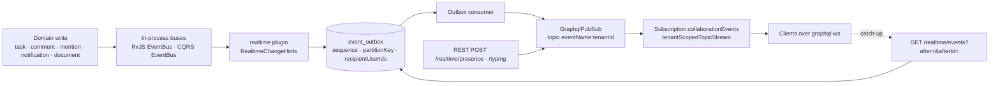

# Implementation Plan: Real-time channel

> Translates an approved `spec.md` into architecture and tech choices. The plan owns
> implementation details; the spec owns behaviour.

**Feature ID**: `realtime-channel`
**Spec**: `./spec.md`
**Tasks**: `./tasks.md`
**Status**: `Approved`
**Last updated**: 2026-11-08 (aligned with the code merged in ever-gauzy #11681 / #11686)

---

## 1. Architecture Summary

Nothing new is invented for transport: the plugin **declares** collaboration events with the
existing subscription catalogue, **appends** content-free change hints to the existing event
outbox after each domain write (the Inbox plugin's pattern; best effort and outside the domain
transaction, see §15), **publishes** ephemeral presence
and typing signals straight to the pub/sub, and exposes one typed subscription field that
employees may open with a dedicated permission (the kernel's `Subscription.events` stays
reserved for `EVENT_OUTBOX_VIEW` holders). Catch-up after a reconnect is a REST listing of the
same outbox rows, filtered to the collaboration catalogue and the caller's addressing.

## 2. Tech Choices

| Concern | Choice | Rationale |
| ------- | ------ | --------- |
| Package | new `packages/plugins/realtime` (`@gauzy/plugin-realtime`), loaded only when `GAUZY_REALTIME_ENABLED` is exactly `true` | Principle I; same loading contract as the Inbox plugin (`isInboxEnabled`) |
| Durable events | `RealtimeHintsService.appendHint` → `EventOutboxService.append(dataSource.manager, {...})` after the domain write, from bus subscribers; never throws (a failed append is logged) | Zero changes to domain transactions; replay and catch-up walk the rows by (`createdAt`, `eventId`), which never move once appended. Not transactional with the write: a crash between the commit and the append loses that hint (§15.1) |
| Streaming | `declareStreamedEvents(catalogue, consumer, ...names)` + `tenantScopedTopicStream(pubSub, names, …)` in a plugin resolver | The plugin-facing surface core already exports |
| Ephemeral signals | `RealtimeSignalsService` → `GraphqlPubSub.publish(name, tenantId, envelope)` without an outbox row | Lost on disconnect by design (spec §1). Never replayed: after a reconnect a client re-reads presence through the employee reads (`Employee.lastSeenAt`, `isIdle`) and drops its typing indicators |
| Permission | new `PermissionsEnum.REALTIME_SUBSCRIBE`, default for SUPER_ADMIN, ADMIN, MANAGER, EMPLOYEE; seeded for existing tenants by a plugin migration | Employees must not need `EVENT_OUTBOX_VIEW` |
| Presence persistence | existing `Employee.lastSeenAt/isIdle` through `EmployeeService.updatePresence`; no new table | v1 is last-write-wins per employee: every `POST /realtime/presence` overwrites `isIdle` and publishes at once, so an idle tab can mark an employee who is active in another tab idle; the per-connection merge of spec FR-7 is a follow-up (§15.2) |
| Multi-replica | deployment sets `GRAPHQL_PUBSUB_ENGINE` (Redis) | Existing seam; spec FR-13 |
| Comment events | add `CommentEvent` (RxJS `BaseEntityEvent<Comment>`) published by `CommentService` create/update/delete | The only domain without an in-process event today (additive core change) |

## 3. Data Model

### New or changed entities

None. Presence stays on `Employee`; hints and signals carry ids only.

### Migrations

- `packages/plugins/realtime/src/lib/database/migrations/1791000005100-SeedRealtimeRolePermissions.ts`
  — plugin-owned, tri-dialect, idempotent; grants `REALTIME_SUBSCRIBE` to SUPER_ADMIN, ADMIN,
  MANAGER, EMPLOYEE of every tenant (copy of the Inbox seed with the new grant table). Runs only
  where the plugin loads.

### Contracts (`@gauzy/contracts`)

- `packages/contracts/src/lib/realtime.model.ts`:
  - `RealtimeEventName` constants: `task.created`, `task.updated`, `task.deleted`,
    `comment.created`, `comment.updated`, `comment.deleted`, `mention.created`,
    `employee_notification.created`, `document.updated`, `presence.changed`,
    `typing.signalled`; `REALTIME_STREAMED_EVENTS` (the durable ones) and
    `REALTIME_SIGNAL_EVENTS` (the ephemeral ones).
  - `IRealtimeChangeHint { entity: BaseEntityEnum | string; entityId: ID; action: 'created'|'updated'|'deleted'; organizationId?: ID; actorUserId?: ID; recipientUserIds?: ID[]; parent?: { entity: string; entityId: ID } }`
  - `IRealtimePresenceInput { status: 'active'|'idle'|'away' }`, `IRealtimePresence { employeeId, userId, status, at }`
  - `IRealtimeTypingInput { conversationId: ID; threadRootId?: ID; recipientUserIds: ID[] }`
  - `IRealtimeCatchUpQuery { after?: number; afterId?: string; limit?: number }`, `IRealtimeCatchUp { events, cursor, cursorId, hasMore, resync }`, `IRealtimeEventEnvelope` (mirror of the kernel `EventEnvelope`).
- `PermissionsEnum.REALTIME_SUBSCRIBE = 'REALTIME_SUBSCRIBE'` + `default-role-permissions.ts` rows (new tenants).

## 4. API Surface

| Method | Endpoint | Permission | Description | Status |
| ------ | -------- | ---------- | ----------- | ------ |
| `POST` | `/api/realtime/presence` | employee (`@Permissions()`), `REALTIME_SUBSCRIBE` | Records presence (`EmployeeService.updatePresence`) and publishes `presence.changed` to the organization | New |
| `POST` | `/api/realtime/typing` | `REALTIME_SUBSCRIBE` | Publishes `typing.signalled` addressed to `recipientUserIds` (rate-limited 5/s per user) | New |
| `GET` | `/api/realtime/events?after=&afterId=&limit=` | `REALTIME_SUBSCRIBE` | Catch-up (`RealtimeCatchUpService.catchUp`): outbox rows of the collaboration catalogue for the caller's tenant/organization after the exact cursor (`after` = epoch ms of the last applied event's `createdAt`, `afterId` = its `eventId`, compared as (`createdAt`, `eventId`)), at most 500 a page (default 200), `hasMore` when cut; read once and bounded (`EventOutboxService.listOutboxRowsSince`); addressed rows only when the caller is one of the recipients stored on the row; answers `cursor`/`cursorId` to continue from and `resync: true` when the cursor predates the oldest row the caller's scope retains, or when the scope has no row at all (an inferred watermark: it also answers `resync` to a client whose cursor predates its organization's first event, see §15.8). A call without `after` answers no events and `cursor` = now. The outbox `sequence` is never compared: it is per partition (§15.6) | New |
| `GET` | `/api/realtime/status` | `REALTIME_SUBSCRIBE` | Whether subscriptions are served in this process, the catalogue names, limits | New |
| GraphQL | `Subscription.collaborationEvents(names: [String!]!, aggregateId: ID): EventEnvelope!` | `REALTIME_SUBSCRIBE` (+ `FEATURE_GRAPHQL`) | Streams the selected collaboration events of the caller's tenant/organization, addressed ones only to the caller | New |

DTOs: `RealtimePresenceDTO`, `RealtimeTypingDTO`, `RealtimeCatchUpQueryDTO` (class-validator, whitelist).
Errors: `400` unknown event name; `403` missing permission; `429` typing rate limit.

## 5. Events, Real-Time and Notifications

| Event | Emitted when | Payload (content-free) | Audience |
| ----- | ------------ | ---------------------- | -------- |
| `task.created/updated/deleted` | `TaskEvent` on the RxJS bus | `{ entity: 'Task', entityId, action, projectId?, organizationId }` | organization |
| `comment.created/updated/deleted` | new `CommentEvent` | `{ entity: 'Comment', entityId, action, parent: { entity, entityId } }` | organization (no check yet that the reader may see the parent record, §15.3) |
| `mention.created` | `CreateMentionEvent` (CQRS) | `{ entity, entityId, mentionedEmployeeId }` | addressed: mentioned employee's user |
| `employee_notification.created` | `EmployeeNotificationCreatedEvent` (CQRS, after the row is saved) | `{ notificationId, type, entity, entityId }` | addressed: receiver's user |
| `document.updated` | `DocumentEvent` (RxJS, docs plugin; `RealtimeHintsService` subscribes with `bus.ofType(DocumentEvent)`, imported from `@gauzy/plugin-docs`) | `{ entity: 'Document', entityId, action, organizationId, actorUserId }` | organization: **every member, reader of the page or not** (ids only, no content; §15.3 until the hint is addressed to readers) |
| `presence.changed` | `POST /realtime/presence` | `{ employeeId, userId, status, at }` | organization (ephemeral) |
| `typing.signalled` | `POST /realtime/typing` | `{ conversationId, threadRootId?, employeeId, userId }` | addressed (ephemeral) |

Chat and Inbox lanes add their own events (`chat_message.created`, `inbox_item.created` exists) by
calling the same `declareStreamedEvents` and `append`; the plugin exports `RealtimeHints` so a
plugin can append a hint without re-implementing the addressing rules.

## 6. UI Surface

None in this lane. Clients: Angular service (`chat-ui` lane) and Ever Teams `realtime-client`
lane open `graphql-ws` against the existing subscription endpoint with the user's JWT in
`connection_init` (`authorization`, `tenant-id`, `organization-id`), subscribe to
`collaborationEvents`, and call `GET /realtime/events` on reconnect.

## 7. MCP Tools, SDKs and Integrations

- No MCP tools. OpenAPI gains the three REST routes (SDK regeneration at release).

## 8. Background Jobs

None. Outbox dispatch is the existing worker's. No job prunes `event_outbox` today (§15.5).

## 9. Security & Permissions

- `REALTIME_SUBSCRIBE` on every route and the subscription field; `FEATURE_GRAPHQL` guard on the field.
- Addressed payloads carry `recipientUserIds`; the topic stream admits them only for a recipient
  (`tenantScopedTopicStream` default `recipientsOf`); catch-up applies the same rule in code after the
  bounded read (`admitsRow` in `realtime-catch-up.service.ts`). Both decide on the recipients **stored on
  the row at write time**: a member removed from a chat conversation can still replay the ids of the
  events addressed to them while they were a member (`conversationId`, `messageId`; the content stays
  behind the chat API's membership check). There is no current-membership recheck yet (§15.4).
- Typing input validated (UUIDs, ≤ 50 recipients) and rate-limited; no message text ever travels.
- Presence status is an enum; `away`/`idle` map to `isIdle = true` for persistence.

## 10. Observability

- Counters (Nest `Logger` + the existing metrics seam where present): hints appended per name,
  signals published, catch-up calls, resync answers.

## 11. Phased Rollout

1. Contracts + permission + plugin skeleton + catalogue + hints + migration (flag off): PR 1.
2. Presence/typing routes + `collaborationEvents` field + catch-up + tests: PR 1 (same lane) or PR 2.
3. Enable on dev (`GAUZY_REALTIME_ENABLED=true`), verify with a graphql-ws client script.
4. Default stays off; chat-ui and Ever Teams lanes consume it.

## 12. Constitution Reconciliation

- I Plugin-first: new plugin; core gains only `CommentEvent` (+ contracts).
- II Scoping: every hint carries tenant (outbox) and organization; topics are per tenant.
- III ORMs/migrations: one additive seed migration, tri-dialect; no entity.
- IV Flag: `GAUZY_REALTIME_ENABLED` exact `true`; nothing removed; polling untouched.
- V Contracts first: `realtime.model.ts` lands first.
- VI Security: permission, addressing, validation, rate limit.
- VII Event bus: this is the channel.
- VIII i18n: n/a (no UI).
- IX Tests: specs per service and the resolver.
- X Behaviour-first spec: unchanged.
- XI Vendor-neutral docs.

## 13. Risks & Mitigations

| Risk | Likelihood | Impact | Mitigation |
| ---- | ---------- | ------ | ---------- |
| GraphQL snapshot / field-binding gate fails for the gated plugin SDL | high | CI red | add the schema file to `GATED_PLUGIN_SCHEMAS` in `tools/scripts/graphql-field-binding-check.mjs`, keep a plain `gql` template |
| Outbox retention shorter than the spec's 24 h window | low today (nothing prunes the outbox) | FR-3 broken once a retention job exists | catch-up answers `resync` honestly; any retention job MUST keep the newest 1,000 rows per organization and the last 24 h, and its test asserts both bounds (§15.5) |
| `document.updated` subscription misses a renamed class | low | no doc hints | the hints service imports `DocumentEvent` from `@gauzy/plugin-docs` directly |
| Hint storms on bulk task updates | medium | load | coalesce per aggregate per second (trailing edge, so the last edit is announced) in `RealtimeHintsService` |
| Multi-replica without Redis engine | medium | missed events across replicas | status route reports the engine; runbook note |

## 14. References

- Spec: `./spec.md` · Tasks: `./tasks.md` · Architecture: `../../architecture/collaboration-suite.md`
- Kernel: `packages/core/src/lib/graphql/subscriptions/`, `packages/core/src/lib/event-outbox/`, `packages/plugins/inbox/src/lib/realtime/inbox-realtime.ts`

## 15. Known limitations / follow-ups

What the merged code (ever-gauzy #11681, #11686) does not do yet. Each item names the code
location; none of them changes the flag-off default.

1. **Hints are not transactional with the write.** `RealtimeHintsService.appendHint` (and
   `ChatRealtime.publish` in the chat plugin) append on `dataSource.manager` after the domain write
   commits, from bus subscribers, and swallow errors. A crash between the commit and the append, or a
   failed append, loses that event: the write is safe, the live update and the catch-up row are not.
   The spec's no-loss requirement (FR-9, §4 Reliability) therefore holds only while the process stays
   up. Follow-up: append inside the originating transaction (`EventOutboxService.append(manager, …)`
   with the write's `EntityManager`), chat messages first, then the task and comment writes.
2. **Presence is last-write-wins per employee.** `RealtimeSignalsService.publishPresence` writes
   `Employee.isIdle` through `EmployeeService.updatePresence` and publishes every call; there is no
   per-connection state, no merge across a user's tabs and devices, no `offline` on the last
   disconnect and no 5 s coalescing (spec FR-7, §4 Performance). Follow-up: keep presence per
   connection (with a TTL) in the pub/sub engine and publish the merged state (active wins) only when
   it changes.
3. **Document, comment and task hints reach the whole organization.** `documentHint`, `commentHint` and
   `taskHint` in `realtime-hints.service.ts` carry no `recipientUserIds`, so `document.updated`, `comment.*`
   (on a page, a private task or any other record) and `task.*` are streamed and replayed to every member,
   reader or not: ids and the actor only, never content (spec FR-4). Follow-up (T21): decide the audience
   from the parent record's read access, for live delivery and catch-up alike: documents through the docs
   plugin's `DocumentAccessService` (visibility, team spaces, shares); tasks and the comments on them
   through the task read rules (private tasks, project membership); any other parent type the same way,
   and no hint at all for a parent type without a read rule.
4. **Replay trusts the recipients stored at write time.** `admitsRow` (catch-up) and
   `tenantScopedTopicStream` (live) compare the caller with the row's `recipientUserIds`; neither
   rechecks current chat membership, so a removed member can still replay the ids of events addressed
   to them before the removal (spec §2.2, FR-4). Follow-up: a membership predicate that the chat plugin
   registers with the catch-up and the live stream for the `chat_*` names.
5. **No retention job; the replay window is whatever is retained.** Nothing prunes `event_outbox`, so
   FR-3's floor (the newest 1,000 events per organization or 24 h, whichever is larger) holds by
   default. The first retention job must keep both bounds and test them; `resync` is answered whenever
   the cursor predates the oldest retained row of the caller's scope.
6. **The cursor is time-based, not a sequence, and not commit-safe.** `EventOutboxService.append` numbers
   `sequence` per `partitionKey` (default `<aggregateType>:<aggregateId>`), so it orders one aggregate's
   events and is never compared across aggregates; the catch-up cursor is (`createdAt`, `eventId`) (spec
   FR-2). A row whose insert commits after a later-stamped row was already read falls behind a client's
   cursor and is skipped by the next catch-up without a `resync` (a window of milliseconds under
   concurrent appends from several replicas), contrary to FR-2 and the no-loss requirement. The same holds
   for the live stream: a client that applied B live and disconnects resumes from B, so an earlier-stamped
   A committing during the disconnect is never replayed. Follow-up (T24): a commit-safe order **and** a safe
   resume position independent of the last live event, either (a) a settle window: the server stamps every
   live envelope and every catch-up answer with a `safeCursor` (the newest position older than now minus the
   longest append transaction), clients resume from the last `safeCursor` they received rather than from the
   last event they applied, and deduplicate re-sent events by `eventId`; or (b) a commit-ordered position (a
   per-organization counter row locked and incremented in the append's transaction) delivered in that order
   live and in catch-up. Either way with a regression test of two concurrent appends that commit out of
   stamp order, one of them delivered live before the disconnect.
7. **The flag is deployment-wide.** `GAUZY_REALTIME_ENABLED` (`isRealtimeEnabled`) loads the plugin for
   the whole process; there is no tenant or organization switch, and nothing closes one tenant's open
   subscriptions (spec §2.2 says so).
8. **`resync` is inferred from the oldest row.** `RealtimeCatchUpService.catchUp` answers `resync` when
   `after` precedes the oldest row of the caller's scope or when the scope has no row: with no pruning
   at all, a client that took a `cursor` = now before its organization's first event is told to resync on
   its next reconnect although nothing was lost (a needless refetch, never a missed event). Follow-up
   (T25): an actual retention watermark stored as the full position (`createdAt`, `eventId`) of the newest
   row a retention job removed, per scope, with `resync` whenever the client's cursor precedes that position
   in (`createdAt`, `eventId`) order (a cursor `(t, A)` when `(t, B)` was pruned is behind it); until a job
   exists, never.
