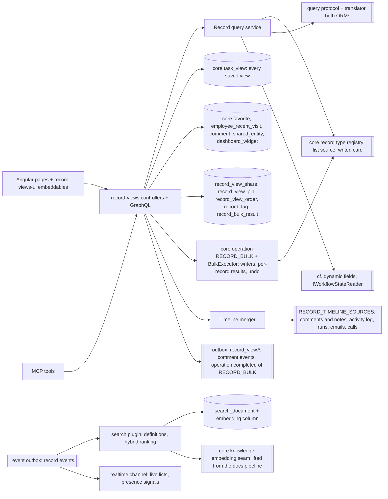

# Implementation Plan: Record views and search

> Translates an approved `spec.md` into architecture and tech choices. The plan owns
> implementation details; the spec owns behaviour.

**Feature ID**: `record-views-and-search`
**Spec**: `./spec.md`
**Tasks**: `./tasks.md`
**Status**: `Draft`
**Last updated**: 2026-11-23

---

## 1. Architecture Summary

A new plugin pair, `@gauzy/plugin-record-views` (`packages/plugins/record-views`) and `record-views-ui` (Angular),
loaded by `apps/api/src/plugins.ts` only when `GAUZY_RECORD_VIEWS_ENABLED` is exactly `true` and gated per tenant by
`FEATURE_RECORD_VIEWS`. It builds on what exists:

- **Record types** come from the core registry (`packages/core/src/lib/record-type/`, `custom-fields-and-forms` T2). This
  plan adds optional parts to a registry entry: a **list source** (entity, query schema, read scope, title and search
  fields, declared events), a **record writer** (the type's own update path) and a **card source**.
- **Queries** compile a view into the platform's **query protocol** (`packages/core/src/lib/api/query-ast.ts`:
  `FilterNode`, `SortKey`, cursor) and run through `query-translator.ts` on both ORMs, with custom fields as `cf.<key>`
  dynamic fields of the same grammar (resolver bound by `custom-fields-and-forms`), workflow states from
  `IWorkflowStateReader` and the type's read scope applied last.
- **One view model: `task_view`.** Every saved view of every record type is a `task_view` row: the core table gains
  additive `recordType` (default `Task`), `layout`, `definition`, `icon`, `isSystem`, `systemKey`, `sourceText`,
  `position` and `offlineAllowed` columns, task columns and `/api/task-views` routes stay as they are, and a task view
  is simply a view whose record type is `Task`. Personal sidebar pins are `favorite` rows (`entity = TaskView`, already
  favouritable); recents are `employee_recent_visit`; notes are `comment` rows; the record timeline reads
  `activity_log`, `comment` and contributed sources; public share links are `shared_entity`; per-type settings and
  audience defaults are the `views` section of the `recordType.<key>` setting (`custom-fields-and-forms` owns the
  `form` section).
- **Bulk work** runs as core operations (`RECORD_BULK`) with per-record results through `bulk-executor.service.ts` and a
  `record_bulk_result` table keyed by `operationId` for undo, the same shape `business-document-engine` uses for its
  bulk item log.
- **Search** stays the `search` plugin: this plan adds index definitions in code beside the existing ones (comments with
  notes, linked emails, every registered type), hybrid ranking with meaning-based hits, and the Angular search page at the
  link its feature contribution already names (`/pages/search`). Embeddings use the docs plugin's knowledge pipeline
  (markdown chunker, token counter, embedding service, vector-store registry with its PostgreSQL vector and lexical
  providers), lifted into one core seam `packages/core/src/lib/knowledge-embedding/` that the docs plugin re-exports
  and keeps using for `document_chunk`; records get one vector per `search_document` through the same seam and queue.
- **UI**: the generic pieces of `task-views-ui` (filter tree, row groups, selection, bulk undo, timeline, shortcut
  registry) move to `packages/ui-core` with re-exports left in `task-views-ui`; the new layouts and the palette are
  embeddables every page can host; the palette is an additional launcher: the Quick Actions dialog keeps its shortcut,
  customisation and behaviour, and its actions also appear in the palette as commands. There is no React package: these
  screens are the Gauzy web app.

## 2. Tech Choices

| Concern | Choice | Rationale |
| ------- | ------ | --------- |
| Package | new `packages/plugins/record-views`, `-ui`; extends `search`, `task-views-ui`, core `task_view` and `comment` | Principle I; build on what exists |
| Query | core query protocol and translator; per-type query schemas beside their controllers | one grammar for REST, GraphQL and views |
| Saved views | core `task_view` generalised with additive columns; `ViewService` serves every record type; task view routes and their filters on `recordType = 'Task'` unchanged | one view model |
| Writes | record writers of the registry (task writer = `TaskUpdateCommand`) | each owner keeps its rules |
| Bulk | core operation `RECORD_BULK` (inline under 500 records, `202` with `@AcceptedOperation` above), `bulk-executor.service.ts` per-record results, `record_bulk_result` keyed by `operationId` for undo | one bulk shape |
| Manual order | task views keep `task_view.manualOrder` (and the existing order route keeps working); views of other types use fractional rank strings in `record_view_order` | one store per view kind |
| Pins and favourites | personal sidebar pins are core `favorite` rows with `entity = TaskView`; `record_view_pin` holds only audience pins (team, role, organization); a pin to a dashboard creates a core `dashboard_widget` (`options.kind = 'record-view'`, `options.viewId`) on the existing custom dashboards | existing favourites and dashboards |
| Recents | core `employee_recent_visit` with additive `visits` counter and `userId` (people without an employee record), upserted per person and record (as its service already does), served by the existing `/api/employee-recent-visit` route; the palette reads the newest 200 per person and no row is ever pruned | existing recents store, no data removed |
| Notes | core `comment` with additive `kind` (`COMMENT`, `NOTE`), `visibility` (`READERS`, `PRIVATE`) and `isPinned` columns; written through the existing `/api/comment` routes, so mentions, reactions, `@CommentParentAccessPolicy`, search indexing and the timeline have one source | notes are comments |
| Per-type settings and defaults | the `views` section of the `recordType.<key>` setting in `tenant_setting` (quick filters, card and hover fields, allowed layouts, live updates, count mode, sensitive, default view per team, role and organization, and `listMode`: `EXISTING` by default, so an adopted page opens its existing table, or `VIEWS`); a person's own default view, landing view and list mode per type in `IUserUiPreferences.recordViews` (a person's choice wins over the type's) | settings store and preference store |
| Share link | the sidebar's share link is the core `shared_entity` public link of the record | existing public links |
| Export | CSV through the core export writer with `packages/utils/src/lib/spreadsheet-safe.ts` (cell injection guard); XLSX with `exceljs` and the same guard | one export path |
| Search ranking | existing database provider; reciprocal rank fusion with the meaning-based hits | works with nothing configured |
| Embeddings | the docs knowledge pipeline lifted into core `knowledge-embedding/` (vector-store registry with `pgvector.provider.ts` and `lexical.provider.ts`, `embedding.service.ts`, `markdown-chunker.ts`, `token-counter.ts`, its queue); the docs plugin re-exports it; records store one vector per `search_document` (additive `embedding` column, `vector(1536)` on PostgreSQL with the extension, else unused and keyword only) | one embedding pipeline and vector store |
| Calendar | `@fullcalendar/*`, already a dependency of `ui-core` | no new calendar library |
| Map | Leaflet, lazy-loaded; tiles from `GAUZY_MAP_TILE_URL` only | nothing external by default |
| Board, tree, table | `@angular/cdk` drag and drop, tree and virtual scroll | existing dependency |
| Offline | `@angular/service-worker` with `apps/gauzy/ngsw-config.json`, IndexedDB wrapper in `ui-core` | registered only behind the flag |
| Push | outbox → realtime hints; presence as ephemeral signals | Principle VII |

Only permissively licensed packages are used; the dependency licence gate checks every package.

## 3. Data Model

All new tables extend `TenantOrganizationBaseEntity` (soft delete, `isActive`, `isArchived`); JSON is `text` on every
dialect; `viewId` always points at a `task_view` row.

| Table | Columns (besides base) | Indexes and uniqueness |
| --- | --- | --- |
| existing `task_view` + columns | `recordType` varchar(64) default `Task`, `layout` varchar(16) null (`LIST`, `TABLE`, `BOARD`, `CALENDAR`, `TIMELINE`, `TREE`, `MAP`, `GALLERY`, `DASHBOARD`), `definition` text null (filter, quick filters, sort, group, columns, aggregates, layout settings and field mappings, page size), `icon` varchar(64) null, `isSystem` bool default false, `systemKey` varchar(64) null, `sourceText` text null, `position` int null, `offlineAllowed` bool default false; existing `visibility` (`PERSONAL`, `SHARED`), `version`, `manualOrder` and scope columns unchanged | + idx `(tenantId, organizationId, recordType, visibility)`; unique `(tenantId, organizationId, recordType, systemKey)` |
| `record_view_share` | `viewId` (`task_view`), `audienceType` (`USER`, `TEAM`, `ROLE`, `ORGANIZATION`), `audienceId` null, `canEdit` bool | unique `(viewId, audienceType, audienceId)`; idx `(tenantId, audienceType, audienceId)` |
| `record_view_pin` | audience pins only: `viewId`, `audienceType` (`TEAM`, `ROLE`, `ORGANIZATION`), `audienceId`, `position` int, `showCount`, `offline` bool | idx `(tenantId, audienceType, audienceId)` |
| `record_view_order` | views of record types other than `Task`: `viewId`, `recordId`, `rank` varchar(32) | unique `(viewId, recordId)`; idx `(viewId, rank)` |
| `record_tag` | `recordType`, `recordId`, `tagId` FK `tag` cascade | unique `(recordType, recordId, tagId)`; idx `(tenantId, tagId)`; only for types without their own tags |
| `record_bulk_result` | `operationId` (core `operation` of type `RECORD_BULK`), `recordType`, `recordId`, `outcome` (`DONE`, `REFUSED`, `FAILED`, `UNDONE`), `reason` text, `previous` text, `versionAfter` varchar(64) | idx `(operationId, outcome)` |
| existing `comment` + columns | `kind` varchar(8) default `COMMENT` (`NOTE`), `visibility` varchar(8) default `READERS` (`PRIVATE`), `isPinned` bool default false | + idx `(tenantId, entity, entityId, kind)` |
| existing `employee_recent_visit` + columns | `visits` int default 1, `userId` uuid null | + unique `(tenantId, employeeId, entity, entityId)` for upserts (and `(tenantId, userId, entity, entityId)` where `employeeId` is null), created only where existing rows hold no duplicate (no row is deleted to make room; elsewhere the service's existing find-then-update path stays) |
| existing `resource_link` + columns (the record link) | `targetEntity` varchar(50) (a `BaseEntityEnum` value or a registered record type key), `targetEntityId` uuid, `role` varchar(32) (`PRIMARY`, `RELATED` or a feature's role), `linkedBy` varchar(16) (`PERSON`, `SYSTEM`, `MATCH`, `INTAKE`); `url` becomes nullable (a row has a URL or a record target) | + unique (`entity`,`entityId`,`targetEntity`,`targetEntityId`) where `targetEntityId` is not null; idx (`tenantId`,`targetEntity`,`targetEntityId`) |
| existing `search_document` + columns (search plugin) | `embedding` (vector(1536) with the PostgreSQL extension, else text null), `embeddingModel` varchar(64) null, `embeddingHash` varchar(64) null | vector index on PostgreSQL |

Not tables of this plugin, by design: views (`task_view`), personal pins (`favorite`), recents
(`employee_recent_visit`), notes (`comment`), dashboard pins (`dashboard_widget`), per-type settings and audience
defaults (`tenant_setting`), bulk run state (`operation`), public links (`shared_entity`), vectors (`search_document`
through the core embedding seam), record links (`resource_link`).

**Record links.** The one store of links between two records is the core `resource_link`
(`packages/core/src/lib/resource-link/`, polymorphic `entity` + `entityId`) with the record target above: a row with
`targetEntity` and `targetEntityId` links the source record to the target record, `role` says how and `linkedBy` who
made it. `ResourceLinkService` gains `link`, `unlink` and `linksOf(ref, { direction })` (both directions, filtered by
the viewer's read scope of the other record through the registry's `list` source); the record page's related-records
section (FR-72) and the timeline read them. The existing resource link routes and lists (`/api/resource-link`, the
task and project resource link panels) keep answering only rows with a `url`, as today; record links are read through
`linksOf`. Features write their own rows and add no link table: communications
(`entity = Communication`), calls (`TelephonyCall`), deals and their documents, tasks raised from CRM records and
tickets (tickets are tasks), calendar events, meeting rooms, tasks made from discussions, asset work and project sales
orders.

**Core and shared changes (additive):**

- `packages/contracts/src/lib/record-type.model.ts`: optional `list` (`IRecordListSource`: entity, `ApiQuerySchema`,
  read scope, title, image and search paths, declared event names, parent path), `writer` (`IRecordWriter`:
  `update(ref, patch, { expectedVersion, actor })`, `assertCanEdit`), `card` (`IRecordCardSource`) on a registry entry;
  `record-view.model.ts` (definition schema, layouts, shares, pins, bulk, timeline entry, palette command).
- `packages/core/src/lib/api/`: query schemas for the first types beside their controllers (task, project, contact,
  deal, employee, candidate, invoice, expense, income, vendor, product, equipment, goal, time-off request) and listed in
  `query-schemas.ts`; their existing routes are untouched.
- `packages/core/src/lib/core/entities/entity-type-base.entity.ts`: `entity` validation widened from `BaseEntityEnum`
  to "a `BaseEntityEnum` value or a registered record type key" (no schema change), so comments, notes, mentions,
  reactions, favourites, recents, followers and activity reach plugin types.
- `packages/core/src/lib/tasks/views/`: the additive columns above and `ViewService` reading any record type;
  `packages/core/src/lib/comment/`: the note columns; `packages/core/src/lib/employee-recent-visit/`: counter, user key
  and upsert; `packages/core/src/lib/knowledge-embedding/`: the seam lifted from the docs plugin.
- `packages/core/src/lib/record-type/core-record-writers.ts`: writers for the first types (tasks through
  `TaskUpdateCommand`), shared with `automation-and-notifications`.
- `IUserUiPreferences.recordViews` (per-user view preferences); `keyboard.bindings` keeps its shape.

**Migration timestamps**: `packages/plugins/record-views` `1791000036100` to `1791000036199`; `packages/plugins/search` `1791000036200` to `1791000036299`; `packages/core` `1791000036300` to `1791000036399`.

**Migrations** (shared core migration helpers of `@gauzy/core`; PostgreSQL, SQLite and MySQL branches; idempotent,
forward-only, both ORMs):

1. `1791000036100-CreateRecordViewTables` — share, pin, order.
2. `1791000036110-CreateRecordTagTable` — tag.
3. `1791000036120-CreateRecordBulkResultTable` — bulk result.
4. Core: `1791000036300-ExtendTaskViewCommentRecentVisit` — the additive columns and indexes on `task_view`, `comment`
   and `employee_recent_visit`.
5. Core: `1791000036310-AddResourceLinkRecordTarget` — the record target columns and keys of `resource_link`, guarded by
   `hasColumn` so that it is safe from any feature that uses it (this one, `email-and-communications`,
   `crm-leads-and-deals`, `telephony`).
6. Search plugin: `1791000036200-AddSearchDocumentEmbedding` (vector column and index only where the extension exists).

Index definitions for comments with notes, linked emails and registered types are code beside the existing
`definitions/*.definition.ts`, indexed and searched only for tenants with `FEATURE_RECORD_VIEWS` on (other tenants'
index and results stay as today); role grants come from the permission contributions' `defaultFor`; the search
plugin's `SEARCH_VIEW` keeps its current default holders (super admin, admin, employee), and people without it get
pages, commands and recents in the palette; no seeding migration.

**Contracts**: the `record-type.model.ts` additions and `record-view.model.ts` in `packages/contracts/src/lib/`, listed above; they reach the SDKs through the OpenAPI document.

## 4. API Surface

| Method | Endpoint | Permission | Description | Status |
| ------ | -------- | ---------- | ----------- | ------ |
| `GET` | `/api/record-views/types` | tenant member | registered types with layouts, fields and settings the caller may use | New |
| `GET` `POST` | `/api/record-views/views?recordType=` | view of the type / any member | `task_view` rows of the type grouped (pinned, mine, shared, system); create | New |
| `GET` `PUT` `DELETE` | `/api/record-views/views/:id` | reader / editor / owner or `RECORD_VIEW_MANAGE` | view; update with `If-Match`; delete | New |
| `POST` | `/api/record-views/views/:id/duplicate` | reader | duplicate; pinning for oneself is the existing `/api/favorite` with `entity = TaskView` | New |
| `PUT` | `/api/record-views/views/:id/shares` | `RECORD_VIEW_SHARE` (roles and organization: `RECORD_VIEW_MANAGE`) | audiences and audience pins | New |
| `PUT` | `/api/record-views/views/:id/order` | editor | `{ recordId, before?, after? }`; task views write `manualOrder` | New |
| `GET` `PUT` | `/api/record-views/type-settings/:recordType` | reader / `RECORD_VIEW_MANAGE` | the `views` section of the `recordType.<key>` setting: quick filters, card and hover fields, layouts, audience default views; a person's own default through `PUT /api/user/ui-preferences` | New |
| `GET` | `/api/record-views/:recordType/records` | view of the type | `viewId` or `filter`, `sort`, `fields`, `page[after]`, `count`; query protocol | New |
| `GET` | `/api/record-views/:recordType/groups` | view of the type | group counts and aggregates per group, totals | New |
| `PATCH` | `/api/record-views/:recordType/records/:id` | edit of the record (writer) | inline edit; `If-Match` | New |
| `POST` | `/api/record-views/:recordType/bulk` | per action and record | `{ action, params, ids \| viewId + filter, preview }` → results, or `202` with the core operation handle above 500 records | New |
| `GET` `POST` | `/api/record-views/bulk/:operationId/{results,undo}` | requester | per-record results; undo within 10 minutes as a child operation; progress and cancel are the core `/api/operations/:id` | New |
| `GET` | `/api/record-views/:recordType/export` | view of the type + `EXPORT_ADD` | CSV (core export writer) or XLSX stream through `spreadsheet-safe`, ≤ 50,000 rows | New |
| `POST` | `/api/record-views/:recordType/interpret` | view of the type | plain-language text → definition draft and explanation | New |
| `GET` | `/api/record-views/:recordType/:id/{card,timeline}` | view of the record | hover card; merged timeline with `kinds`, `order`, cursor | New |
| `*` | existing `/api/comment` with `kind = NOTE`, `visibility`, `isPinned` | the comment access policy of the record; author for changes | notes | Changed (additive) |
| `GET` | existing `/api/employee-recent-visit` | self | recents (last 20 for the palette), counter and user key added | Changed (additive) |
| `*` | existing `/api/favorite`, `/api/dashboard-widget`, `/api/shared-entities` | unchanged | personal pins, dashboard pins, share links | Existing |
| `GET` | `/api/record-views/palette?q=`, `/api/record-views/upcoming` | self | records, provider suggestions; next 7 days | New |
| `GET` | `/api/search?mode=hybrid` | `SEARCH_VIEW` (+ `FEATURE_SEMANTIC_SEARCH` for meaning) | hybrid ranking with snippets and parent records | Changed (additive) |
| `*` | `/api/task-views/**`, `/api/search/**` | unchanged | existing behaviour | Unchanged |

Controllers: `@FeatureFlag(FEATURE_RECORD_VIEWS)`, `TenantPermissionGuard`, `@Permissions()`, class-validator DTOs,
Swagger, idempotency keys on creating routes. GraphQL reads (`recordViews`, `recordView`, `records(recordType, …)`,
`recordTimeline`, `recordCard`) in `graphql/schema-extensions.ts`.

**Ports offered** (contracts tokens, injected `@Optional()`, bound in `apps/api/src/plugin-composition.ts`):

| Port | Consumers | Contract |
| --- | --- | --- |
| `RECORD_VIEWS_QUERY` | report-builder, data-import-export | `compile(recordType, viewOrDefinition, viewer) → ApiQuery`; `fieldCatalogue(recordType, viewer)` |
| `RECORD_VIEWS_SELECTION` | automations (`AUTOMATION_VIEWS`), business-documents bulk runs, digests, exports | `resolveIds(recordType, view \| filter, viewer, { limit, after })`, `count(…)` |
| `RECORD_TIMELINE_SOURCES` (multi) | comments and notes, activity log (field changes, custom fields included), automations, workflows, communications, telephony, meetings, files | `list(ref, { after, limit, kinds, viewer }) → entries` |
| `registerBulkActions`, `registerPaletteProviders` | any plugin | bulk action and server palette suggestion declarations |

**Ports consumed** (unbound → capability not offered): `CUSTOM_FIELD_METADATA`, `CUSTOM_FIELD_VALUE_READER`,
`RECORD_VIEWS_WORKFLOW_STATE` (`IWorkflowStateReader`), `RECORD_VIEWS_REPORTS` (save as report, cards for the
dashboard layout), `RECORD_VIEWS_EXPORT` (large exports), `RECORD_VIEWS_PRINT`, `RECORD_VIEWS_ASSISTANT` (plain-language
filters through `ai-agents-and-assistants`), `AUTOMATION_FLOWS` (start a flow in bulk), `DOCS_KNOWLEDGE_SEARCH_SERVICE`
(document hits in hybrid search). Time-report filters stay core `saved_report` definitions; a view's "Save as report"
hands its definition to the report builder.

**Consumer tokens answered** (bound in `apps/api/src/plugin-composition.ts` to the record query, record notes, saved view and text search services; each consumer plan states the shape it calls and its fallback): `DOCUMENT_TEXT_SEARCH`, `MEETINGS_RECORD_NOTES`, `RECORD_VIEWS_SAVED_VIEWS`, `SHEETS_RECORD_ROWS`.

## 5. Events, Real-Time and Notifications

| Event | Emitted when | Consumers |
| ----- | ------------ | --------- |
| `record_view.created` / `.updated` / `.shared` / `.deleted` | view changes | realtime hint to the view's audience (menus refresh), activity log for shares |
| existing comment events (notes carry `kind = NOTE`; private notes are not indexed or published to others) | note changes | search indexing, timeline realtime, automations, mention notices |
| core `operation.completed` of `RECORD_BULK` | a bulk run ends | the plugin's consumer posts the inbox notice to the requester; progress from the operation step events |
| In: event names each list source declares (`task.*`, `custom_record.*`, plugin `<domain>.<entity>.<verb>`) | records change | live lists (client re-reads changed ids), search index consumer |
| Signal `record.viewing` (ephemeral) | a client opens, edits or leaves a record | presence on the record for its readers (`RealtimeSignalsService`, audience check by read rule) |

Mentions in notes notify through the existing comment mention notifications (and the automation dispatcher when loaded).

## 6. UI Surface

- **Embeddables `packages/ui-core/shared/src/lib/record-views/`**: `ngx-record-list` (view host: menu, quick filters,
  filter builder, column chooser, group sidebar, bulk toolbar, layout switcher), layouts `ngx-record-table` (virtual
  scroll, inline edit, cell paste, aggregates), `ngx-record-board`, `ngx-record-calendar`, `ngx-record-timeline-layout`
  (generalised `task-views-ui` timeline), `ngx-record-tree`, `ngx-record-map` (lazy), `ngx-record-gallery`,
  `ngx-record-dashboard`; record shell `ngx-record-timeline`, `ngx-record-sidebar`, `ngx-record-pager`; directive
  `ngxRecordHoverCard`; `ngx-unsaved-guard`. Hidden when the routes answer `404`.
- **Core services `packages/ui-core/core/src/lib/services/`**: `shortcuts/` (registry, recorder, help; moved from
  `task-views-ui/keyboard` with re-exports), `command-palette/` (`CommandPaletteRegistry`; quick actions registered as
  commands), `offline/` (IndexedDB sets and edit queue).
- **Angular `packages/plugins/record-views-ui`**: header palette (`ngx-command-palette`, mod+K unless the person bound
  that key to a quick action, then another rebindable key; the existing Quick Actions dialog stays as it is on its own
  shortcut), `/pages/search`, `/pages/records/:recordType` (the one owner of these
  routes: the generic list of every registered type without a page, custom record types included, whose detail and
  create routes open the forms `custom-fields-and-forms` registers), Settings → Views (type settings, audience
  defaults), service worker registration behind the flag; adoption on contacts, deals, projects, employees, candidates,
  invoices, expenses, incomes, vendors, products, equipment, goals and time-off pages: each keeps its existing table and
  actions as the default with the feature on, offers the shared list as a second layout, and opens the shared list
  first only when the type's `listMode` or the person's own choice says so; with the feature off it shows only its
  existing table. The board layout reuses the existing boards (deal pipeline board, project board
  `project-board.component.ts`, task kanban) inside a saved view; their own pages stay as they are with the feature
  off and on. The sidebar favourite links
  (`favorite-links`) list pinned views; the record sidebar embeds `entity-comments` for notes and the existing share
  link dialog.
- The `/api/task-views` routes stay unchanged for their existing clients; the recents and palette suggestion routes are
  part of the API any client may call.
- i18n keys `RECORD_VIEWS.*`, `SEARCH.*`, `SHORTCUTS.*` in every locale of `packages/ui-core/i18n`.

## 7. MCP Tools, SDKs and Integrations

New `packages/mcp-server/src/lib/tools/record-views.ts`, registered in `register-all-tools.ts`:

| Tool | Input | Output |
| --- | --- | --- |
| `views_list` / `views_run` | record type / view or filter, sort, fields, limit | views / records page |
| `views_create_from_text` | record type, text, `preview` (default true) | definition chips, explanation, saved view on confirm |
| `search_everything` | text, types, mode (`keyword`, `hybrid`) | hits with parent records and snippets |
| `record_timeline` / `record_card` | record type, id, kinds | entries / card |
| `records_bulk_update` | record type, ids or view, field patch, `preview` | per-record plan or results |

OpenAPI additive; Kiota SDKs regenerated after merge. Exports in CSV (core export writer) and XLSX (`exceljs`,
already used by the docs extractor), both through `spreadsheet-safe`.

## 8. Background Jobs

| Trigger | When | What it does | Idempotency |
| ------- | ---- | ------------ | ----------- |
| core operation `RECORD_BULK` | bulk work (inline under 500, background above) | steps of 100 records through writers via `BulkExecutor`; lease, retry and cancel from the runtime; undo as a child operation within 10 minutes (`undoUntil` in the operation result) | per operation and record result row |
| search consumer (existing, extended) | record and comment events | for tenants with the feature on, indexes registered types, comments with notes (private notes excluded), linked emails; other tenants are indexed as today | document key per entity and id |
| core `knowledge-embedding` queue (lifted from the docs pipeline) | indexed text changed, `FEATURE_SEMANTIC_SEARCH` on | embeds changed `search_document` rows through the tenant's provider, rate-limited per tenant; backfill on enable | `embeddingHash` per document and model |

Queues run in the API; schedules in the worker (`RecordViewsSchedulePlugin`); without a queue root the API runs them on
in-process timers under a database lock (task automations layout).

## 9. Security & Permissions

`record-views.permissions.ts` (contributions with `defaultFor`): `RECORD_VIEW_SHARE` (people and teams),
`RECORD_VIEW_MANAGE` (roles, organization, audience defaults, type settings, any shared view); `defaultFor`: both to
`SUPER_ADMIN` and `ADMIN`; `RECORD_VIEW_SHARE` to `MANAGER` and `EMPLOYEE`; the search plugin's `SEARCH_VIEW`
keeps its current default holders. Tenant features `FEATURE_RECORD_VIEWS` and
`FEATURE_SEMANTIC_SEARCH` (`dependsOn: FEATURE_SEARCH`), both default off.

Every record query applies the list source's read scope after the view's filter; field masks of custom fields
(their provider of the core `FieldVisibility`) and `@VisibleWith` apply to columns, groups, aggregates, exports, cards and search snippets;
a column the reader may not see is dropped, not emptied. Shares never widen access. Bulk and inline writes go through
writers with the actor's permissions and version checks. Notes are comments: sanitised on write and render, read
through the record's comment access policy, private notes only by their author. The
plain-language interpreter sends field labels, kinds and option names and the user's own reference names only. Offline
sets are encrypted with a per-session key in IndexedDB and cleared on sign-out; `sensitive` types are never cached.

## 10. Observability

Activity entries for view shares, defaults and bulk runs; bulk runs in the core operations list; metrics for query time per type,
count mode, group query time, cache hits, live-update fan-out, search latency, queries without results, embedding lag
and provider spend.

## 11. Phased Rollout

1. **Phase 1 — Surface what exists** (flag off): contracts and registry parts, query schemas for the first types, the
   core record timeline contract, record links in core and the knowledge-embedding seam moved into core,
   the generalised `task_view`, generic list with list, table and board layouts, saved views with filters, sort, grouping and
   columns, the search page over the existing search plugin, the command palette (pages, quick actions, records,
   recents), shortcut registry in `ui-core`, MCP view and search tools.
2. **Phase 2 — Depth**: calendar, timeline, tree, map, gallery and dashboard layouts; group sidebar and aggregates; bulk
   actions with undo; inline edit and cell paste; export; tags on any type; record timeline, notes, sidebar, hover cards
   and quick entry; full-text coverage of comments, notes and emails; preferences; phone layouts; reports.
3. **Phase 3 — Advanced capabilities**: plain-language filters, live lists and presence, meaning-based search, sharing with
   roles and teams with dashboard pins, offline pinned views, selection ports for other engines.
4. **Phase 4 — General availability**: the feature is off by default; after the trial period it may be switched on by default for new tenants only; existing tenants keep their setting until an administrator changes it.

## 12. Constitution Reconciliation

- I Plugin-first: new plugin pair; `search` and `task-views-ui` extended; core gains registry parts, query schemas, a
  widened record type check, additive columns on `task_view`, `comment` and `employee_recent_visit`, and the embedding
  seam lifted from the docs plugin.
- II Tenant/organization scoping: every table on the tenant-organization base; queries run under the reader's scope.
- III Both ORMs, additive migrations: five migrations on three dialects; the vector column only where supported.
- IV Default-off flag; nothing removed: deploy switch plus tenant features; existing lists, task views and search stay.
- V Contracts and API first: query protocol, REST, GraphQL reads and SDKs before the embeddables.
- VI Permissions, privacy, security: two permissions, reader scope on every surface, masks, minimal AI payloads.
- VII Real-time through the event bus: live lists from outbox hints; presence as platform signals.
- VIII i18n and accessibility: keys in every locale; keyboard moves for cards, events and tree nodes.
- IX Tests: unit, ORM parity, dialect and e2e per route; rendering tests per layout.
- X Behaviour-first spec: implementation stays in this plan.
- XI Documentation describes our platform only.

## 13. Risks & Mitigations

| Risk | Likelihood | Impact | Mitigation |
| ---- | ---------- | ------ | ---------- |
| Generic queries slower than hand-tuned ones | Medium | High | query schemas whitelist indexed fields; estimated counts; benchmarks at one million rows per type |
| A list source forgets its read scope | Low | High | registry refuses a list source without a scope; e2e per type with a restricted reader |
| Generalising `task_view` changes the task views page | Medium | Medium | additive nullable columns with defaults; task view routes filter on `recordType = 'Task'`; round-trip specs between both UIs; existing task view suites unchanged |
| Live updates flood large lists | Medium | Medium | hints carry ids only; the client re-reads visible ids, debounced per second |
| Embedding cost and privacy | Medium | Medium | separate feature, tenant's own provider, rate limit, hash to skip unchanged documents; one pipeline shared with documents |
| Offline data on lost devices | Low | High | opt-in per view, encrypted store, cleared on sign-out, sensitive types excluded |

## 14. References

- Spec: `./spec.md` · Tasks: `./tasks.md` · Related: `../custom-fields-and-forms/plan.md`,
  `../automation-and-notifications/plan.md`, `../approval-workflows/plan.md`
- Code: `packages/core/src/lib/tasks/views/`, `packages/plugins/task-views-ui/src/lib/{models,keyboard,components}/`,
  `packages/plugins/search/src/lib/`, `packages/core/src/lib/api/{query-ast,query-translator,query-schemas}.ts`,
  `packages/core/src/lib/{favorite,employee-recent-visit,comment,shared-entity,dashboard,operation}/`,
  `packages/core/src/lib/api/bulk-executor.service.ts`, `packages/plugins/docs/src/lib/knowledge/{chunking,embedding,vector-store}/`,
  `packages/utils/src/lib/spreadsheet-safe.ts`,
  `packages/ui-core/shared/src/lib/record-view/`, `packages/ui-core/core/src/lib/services/quick-actions/`,
  `packages/plugins/realtime/`, `apps/gauzy/src/app/pages/shared/entity-comments/`
