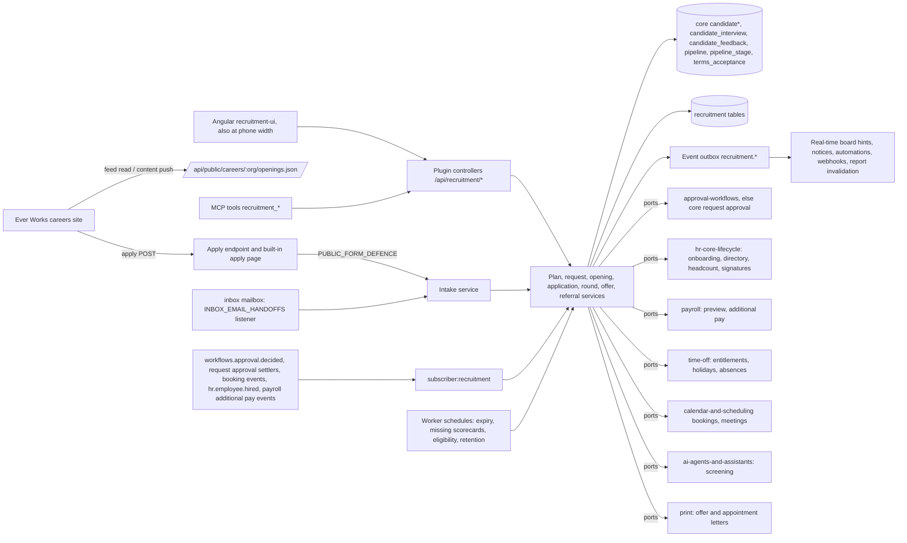

# Implementation Plan: Recruitment

> Translates an approved `spec.md` into architecture and tech choices. The plan owns
> implementation details; the spec owns behaviour.

**Feature ID**: `recruitment`
**Spec**: `./spec.md`
**Tasks**: `./tasks.md`
**Status**: `Draft`
**Last updated**: 2026-11-23

---

## 1. Architecture Summary

Core keeps the candidate and everything under it (`packages/core/src/lib/candidate*`: candidate, source, education,
experience, skills, documents, interviews, interviewers, technologies and personal qualities as criteria, criterion
ratings, feedback) and the hire path (`CandidateHiredCommand`). The new plugin `@gauzy/plugin-recruitment`
(`packages/plugins/recruitment`) adds the process around them: headcount plans, hiring requests, openings,
applications, interview templates and rounds, scorecards, offers, referrals, screening summaries, the careers feed with its
apply endpoint, and the applicant portal. A round **is** a `candidate_interview` (with its interviewers and criteria
copied from the interview template); a scorecard **is** a `candidate_feedback` with its criterion ratings; the plugin adds one row
beside each for what core does not hold. Core routes and screens keep working on the same rows.

**Built on what exists (no second store).** Hiring pipelines are core `pipeline` rows of kind `HIRING` with core
`pipeline_stage` rows; recruitment-only facts of a stage sit in a one-to-one side table. Self-scheduling is a booking of
`calendar-and-scheduling` (fallback: a core appointment with its signed link). Offer acceptance is a signature request of
`hr-core-lifecycle` when it is loaded. Application questions use the question-set format of `custom-fields-and-forms`; consent is core
`terms_acceptance`; public form abuse is handled by the shared public-form defence of `lead-capture-and-enrichment`.
The careers site is rendered by Ever Works from the careers feed, which uses the organization's public slug; Gauzy keeps
the feed, the apply endpoint, events and two small transactional pages (apply, offer decision). Approvals go through
`approval-workflows`, else core request approvals on the existing Approvals page. Settings, permissions, notices,
reminders and the screening runs use the platform's stores (§2). Pay fields use core field visibility.



## 2. Tech Choices

| Concern | Choice | Rationale |
| ------- | ------ | --------- |
| Package | `packages/plugins/recruitment` (new), `recruitment-ui` (Angular); referral, interview and scorecard pages laid out for phone width | Principle I; one client |
| Core changes | `pipeline.kind` (value `HIRING`) and `pipeline.isDefault` (the columns `crm-leads-and-deals` declares; the core migration adds whichever is missing); the core pipeline list leaves `HIRING` pipelines out unless that kind is asked for, so sales pipeline pages never show them; `ApprovalPolicyTypesStringEnum` values `HIRING_REQUEST`, `JOB_OFFER`; candidate profile on the page-tab registry and the `CANDIDATE_VIEW_ACTIONS` slot (§6) | candidate and pipelines stay in core |
| Pipelines | core `pipeline` (kind `HIRING`; the organization default has `isDefault`; an opening that overrides it has its own) and `pipeline_stage` (`index` = position); `recruitment_stage_detail` one-to-one for category, email template, required feedback and public label | one pipeline model with sales |
| Flag | tenant feature `FEATURE_RECRUITMENT` in `recruitment.features.ts` (`defaultEnabled: false`), `@FeatureFlag` + `FeatureFlagGuard` on every controller (pattern `subscription.features.ts`) | default off |
| Permissions | `recruitment.permissions.ts` contributions with `defaultFor` (§9) | no seed migration |
| Settings | organization-scoped keys of `recruitment.settings.ts` in the platform settings store (§3.1), including the referral programme | no settings table |
| Persistence | MultiORM entities on `TenantOrganizationBaseEntity`; the shared core migration helpers of `@gauzy/core` | Principle III |
| Careers site | rendered by an Ever Works site of the organization: with the Ever Works integration on, opening events push the public fields to the linked Work; any site may read the public feed and the embed script; organization addressed by `organization.profile_link` | public pages are Ever Works sites; Gauzy keeps data, feed and transactions |
| Apply | public endpoint `POST /api/public/careers/:org/:opening/apply` and a built-in apply page per opening (a transactional page like the public estimate answer page) for links from job boards and sites without their own form; `PUBLIC_FORM_DEFENCE` of `lead-capture-and-enrichment` (trap, signed render token, throttles, challenge); consent as core `terms_acceptance` | one public-form defence; one consent evidence store |
| Questions | application questions in the question-set format of `custom-fields-and-forms` (`packages/contracts/src/lib/question-set.model.ts`, platform field types: short and long text, number, yes or no, single and multiple choice, date, file, rating with its scale; key, label per language, required flag, options), edited with `ngx-question-set-editor` and answered with `ngx-question-set-form`; the opening keeps a `questionsVersion`; answers are `{ fieldKey: value }` with the version answered | one question and answer format with reviews and other questionnaires |
| Self-scheduling | `RECRUITMENT_CALENDAR` → a one-off, unpublished booking type of `calendar-and-scheduling` per round (`assignment = COLLECTIVE`, hosts = the round's required interviewers, window, notice and cancel cut-off from the link) and its signed booking link; the booking (`recordType` `InterviewRound`) creates the round's event; fallback: core `employee_appointment` with its signed link (`/employee-appointment/sign/:id`) over `availability_slots` | no second slot ledger |
| Offer link and acceptance | the offer link is a `shared_entity` row of the offer (hashed token, expiry, single use through the public-link service of `access-control-and-security` when loaded); acceptance is a signature request of `hr-core-lifecycle` with the candidate as its one outside signer (`RECRUITMENT_SIGNATURES`); without it, the typed name, consent, letter fingerprint and client are kept on the offer | one link model; one signing evidence model |
| Board | saved view of the `JobApplication` record type (`record-views-and-search`), stage as group field, writer = application service | no second board |
| Cross-plugin | injection tokens in `@gauzy/contracts`, bound in `apps/api/src/plugin-composition.ts`, all optional | no import of another plugin's internals |
| Background work | sweeps on `@ScheduledJob` recorded in `job_execution`; bulk application moves through the core bulk executor (`api/bulk-executor.service.ts`) with per-row results; intake on a queue | one run ledger |
| Notices and reminders | `NOTIFICATION_DISPATCHER.notify({ …, dedupeKey })`; before-round reminders as `reminder` rows through `REMINDERS` of `automation-and-notifications` | no notice table |
| AI | `RECRUITMENT_ASSISTANT` on the agent runtime of `ai-agents-and-assistants` (purpose `recruitment.screening`; run, model, usage and budget recorded there; fallback the `ai-chat` provider registry) | no run or usage table here |
| Events | `EventOutboxService.append` in the writing transaction; consumer `subscriber:recruitment` in `EventConsumerRegistry` | at-least-once, deduplicated |
| Reports | datasets and definitions through `registerReportDatasets` / `registerReportDefinitions` (report builder contract) | no hand-built report pages |

## 3. Data Model

All tables extend `TenantOrganizationBaseEntity` (tenant, organization, soft delete, timestamps); JSON is `text` on
SQLite and MySQL; money is `numeric(20,6)` with a `char(3)` currency.

```ts
@MultiORMEntity('job_application', { mikroOrmRepository: () => MikroOrmJobApplicationRepository })
export class JobApplication extends TenantOrganizationBaseEntity implements IJobApplication { /* columns below */ }
```

### Core columns (nullable or defaulted, declared on the core entity classes)

| Table | New columns | Notes |
| --- | --- | --- |
| `pipeline` | `kind` varchar(8) default `DEAL` (`DEAL`, `LEAD`, `HIRING`); `isDefault` bool default false | same definition as `crm-leads-and-deals`; the migration adds a column only when it is missing; idx `(organizationId, kind, isDefault)` |

### New plugin tables

| Table | Columns (type) | Indexes and uniqueness |
| --- | --- | --- |
| `headcount_plan` | `name`, `periodStart`, `periodEnd` date, `status` (`DRAFT`/`ACTIVE`/`CLOSED`), `isGroupPlan` bool, `parentPlanId` uuid null, `currency`, `estimatedCost`, `version` | idx `(organizationId, status, periodStart)` |
| `headcount_plan_line` | `planId` fk cascade, `organizationPositionId` fk, `organizationDepartmentId` null, `branchId` uuid null (no fk: `hr-lifecycle`), `plannedPositions` int, `costPerPosition`, `currency`, `hiringRequestId` null, `heldCount`, `openCount` int (maintained) | idx `(organizationId, organizationPositionId)`, `(planId)` |
| `hiring_request` | `number` varchar(32), `organizationPositionId`, `organizationDepartmentId`, `branchId`, `positions` int, `organizationEmploymentTypeId` null, `payMin`, `payMax`, `payCurrency`, `payPeriod` varchar(12), `reason` (`NEW`/`REPLACEMENT`), `replacesEmployeeId` null, `neededBy` date, `description` text, `requestedByEmployeeId`, `status` (`DRAFT`/`AWAITING_APPROVAL`/`APPROVED`/`REJECTED`/`PAUSED`/`FILLED`/`CANCELLED`), `approvalRef` uuid null (workflow instance or core request approval), `approvedAt`, `filledAt`, `timeToFillDays` int, `version` | unique `(organizationId, number)`; idx `(organizationId, status)`, `(organizationPositionId, status)` |
| `job_opening` | `number`, `title` varchar(200), `slug` varchar(120), `organizationPositionId`, `organizationDepartmentId` null, `branchId` null, `organizationEmploymentTypeId` null, `workplace` (`ON_SITE`/`HYBRID`/`REMOTE`), `location` varchar(200), `description` text (sanitised), `requirements` json, `positionsToFill` int, `payMin`, `payMax`, `payCurrency`, `payPeriod`, `showPay`, `showApplicationCount` bool, `visibility` (`INTERNAL`/`PUBLIC`), `status` (`DRAFT`/`OPEN`/`PAUSED`/`CLOSED`), `openFrom`, `closesOn` date, `postedAt`, `closedAt`, `pipelineId` uuid null (core `pipeline`; null = the organization's default hiring pipeline), `interviewPlan` json, `questions` json (question-set definition), `questionsVersion` int, `duplicatePolicy` (`MERGE`/`REFUSE`), `keepOpenAfterFill`, `blindReview` bool, `hiringRequestId` null, `templateId` null, `projectId` uuid null (core project for tracked recruiting time), `version` | unique `(organizationId, number)`, `(organizationId, slug)`; idx `(organizationId, status, visibility)`, `(closesOn)` |
| `job_opening_member` | `openingId` fk cascade, `employeeId`, `role` (`HIRING_MANAGER`/`RECRUITER`/`COORDINATOR`) | unique `(openingId, employeeId, role)` |
| `job_opening_template` | `name`, `document` json | idx `(organizationId)` |
| `recruitment_stage_detail` | `stageId` fk core `pipeline_stage` unique, cascade; `category` (`OPEN`/`HIRED`/`REJECTED`/`WITHDRAWN`), `emailTemplate` varchar(80) null, `requiresFeedback`, `isPublic` bool, `publicLabel` | — |
| `applicant_source`, `rejection_reason` | source: `name`, `kind` varchar(16), `isReferral` bool, `monthlyCost`, `currency`, `trackingCode` varchar(40); reason: `name`, `side` (`ORGANIZATION`/`CANDIDATE`) | unique `(organizationId, name)`; unique `(organizationId, trackingCode)` |
| `job_application` | `candidateId` fk `candidate`, `openingId` fk, `stageId` fk core `pipeline_stage`, `sourceId` null, `referralId` null, `appliedAt`, `stageEnteredAt`, `lastActivityAt`, `rating` numeric(4,2), `ratingSource`, `coverLetter` text, `cvDocumentId` uuid null (`candidate_document`), `expectedPay`, `expectedPayCurrency`, `expectedPayPeriod`, `answers` json, `questionsVersion` int, `ownerEmployeeId` null, `status` (`OPEN`/`HIRED`/`REJECTED`/`WITHDRAWN`), `rejectionReasonId` null, `rejectionNote`, `closedAt`, `hiredEmployeeId` null, `consentAcceptanceId` uuid null (core `terms_acceptance`), `talentPoolAcceptanceId` uuid null, `talentPoolUntil` date null, `liveKey` varchar(80) null (`<openingId>:<candidateId>` while open), `submissionKey` varchar(80) null, `anonymisedAt`, `version` | unique `(tenantId, liveKey)`, `(tenantId, submissionKey)`; idx `(organizationId, openingId, stageId)`, `(candidateId)`, `(organizationId, status, closedAt)` |
| `job_application_move` | `applicationId` fk cascade, `fromStageId`, `toStageId`, `reason` text, `movedByUserId`, `actorType`, `at` | idx `(applicationId, at)` |
| `interview_template` | `name`, `positionIds` json, `durationMinutes` int, `defaultInterviewerIds` json, `criteria` json (`key`, `name`, `kind` `SKILL`/`QUALITY`/`QUESTION`, `weight`, `guidance`), `expectedAverage` numeric(4,2), `guidance` text, `isActive` | idx `(organizationId, isActive)` |
| `interview_round` | `applicationId` fk, `candidateInterviewId` fk `candidate_interview` unique, `interviewTemplateId` null, `status` (`TO_BOOK`/`SCHEDULED`/`HELD`/`CANCELLED`/`NO_SHOW`), `outcome` null, `averageRating` numeric(4,2), `bookingRef` uuid null (calendar booking, or the core appointment of the fallback), `calendarEventRef`, `meetingRef` varchar(120), `liveKey` varchar(80) null (`<applicationId>:<interviewTemplateId>`), `version` | unique `(tenantId, liveKey)`; idx `(organizationId, status)` |
| `interview_scorecard` | `candidateFeedbackId` fk `candidate_feedback` unique, `roundId` fk, `interviewerEmployeeId`, `recommendation` varchar(16), `submittedAt`, `lockedAt` | unique `(roundId, interviewerEmployeeId)` |
| `offer` | `applicationId` fk, `candidateId`, `number`, `revision` int, `status` (`DRAFT`/`AWAITING_APPROVAL`/`APPROVED`/`SENT`/`ACCEPTED`/`DECLINED`/`WITHDRAWN`/`EXPIRED`), `organizationPositionId`, `organizationDepartmentId`, `branchId`, `employeeLevelId`, `organizationEmploymentTypeId`, `reportsToEmployeeId`, `startDate`, `validUntil` date, `basePay`, `payCurrency`, `payPeriod`, `variablePay`, `variablePayPeriod`, `payStructureId` null, `targetCostToCompany` null, `timeOffPolicyIds` json, `holidayCalendarId` null, `probationDays`, `noticeDays` int, `workingHours` json, `terms` json, `letterTemplateKey`, `letterOutputId` null, `sentAt`, `decidedAt`, `declineReason`, `approvalRef` uuid null, `signatureRequestId` uuid null (`hr-core-lifecycle`), `acceptance` json null (typed name, consent, fingerprint, client, `ipHash`; kept only when no signature request exists), `previewSnapshot` json, `liveKey` varchar(80) null (`<applicationId>` while live), `version` | unique `(organizationId, number, revision)`, `(tenantId, liveKey)`; idx `(organizationId, status, validUntil)` |
| `offer_term`, `offer_term_set` | term: `name`, `text`, `isActive`; set: `name`, `termIds` json | idx `(organizationId)` |
| `referral` | `referrerEmployeeId`, `candidateId` null, `applicationId` null, `openingId` null, `name`, `emailHash` varchar(64), `phone`, `relationship`, `reason` text, `consentConfirmed` bool, `status` (`SUBMITTED`/`IN_PROCESS`/`HIRED`/`NOT_SELECTED`/`WITHDRAWN`), `bonusStatus` (`NONE`/`NOT_ELIGIBLE`/`PENDING`/`DUE`/`PROPOSED`/`PAID`/`CANCELLED`), `bonusAmount`, `bonusCurrency`, `eligibleOn` date, `payrollRef` varchar(120), `version` | idx `(organizationId, emailHash, createdAt)`, `(referrerEmployeeId)`, `(bonusStatus, eligibleOn)` |
| `screening_summary` | `applicationId` fk, `requestedByUserId`, `aiRunId` uuid null (the run of `ai-agents-and-assistants`; holds provider, model, input hash and usage), `removedAttributes` json, `result` json, `status`, `error` text | idx `(applicationId, createdAt)` |

Intake of a person without sign-in: `CandidateIntakeService` creates the `user` through core `UserService` with role
`CANDIDATE`, inactive (`isActive: false`; T10 proves that neither password nor one-time-code sign-in opens for it), no
password hash and no welcome email (the existing candidate create command is not used for intake),
then the `candidate` and its `candidate_source` with the source name; an invite later uses the existing candidate
invite. The application keeps `sourceId` (the master); the candidate source name is a display copy written from the
master at intake, and on a master rename only where it still equals the master's former name, so editing it on the
existing candidate page never changes the application's source, which reports read, and a rename never undoes a
person's edit. The candidate's own `rating` and `status` stay editable on the existing pages: `rating` is never written
by the plugin (the application rating shows on the Applications tab), and `status` is written only when one of the
candidate's applications changes status. Anonymisation (only with `recruitment.retentionEnabled` on, only for candidates
with at least one application) replaces the user's names and email with placeholders, deletes candidate documents,
education, experience and files, clears application free text and keeps stage history, sources and dates.

Headcount: activating a plan writes each position's planned positions to the position headcount of `hr-core-lifecycle`
(`RECRUITMENT_HEADCOUNT`, sum of the plan's lines per position for the period), so the org chart's vacancies and the
plan's open counts read one figure; holders come from the same port. Without `hr-core-lifecycle` the plan lines stand
alone.

### 3.1 Settings (`recruitment.settings.ts`, organization scope, settings store)

`recruitment.planEnforcement`, `recruitment.groupPlanEnforcement` (`OFF`/`WARN`/`BLOCK`, default `OFF`),
`recruitment.openingSequenceId` (core `sequence`), `recruitment.consent` (json: statement per language and version),
`recruitment.retentionEnabled` (false), `recruitment.retentionMonths` (12), `recruitment.talentPoolMonths` (24), `recruitment.referralWindowDays` (180),
`recruitment.mailboxId`, `recruitment.sender` (json: name, address), `recruitment.hideScorecardsUntilSubmitted` (true),
`recruitment.screeningEnabled` (false), `recruitment.applyRateLimit` (json, 5 in 10 minutes),
`recruitment.approvers` (json: employees and teams deciding hiring requests and above-range offers when
`approval-workflows` is off), `recruitment.referralProgramme` (json: active, rules per position or level → amount and
currency, eligibility days 90, opening scope and ids, exclude hiring team, pay element key).

### Migrations

**Migration timestamps**: `packages/plugins/recruitment` `1791000026100` to `1791000026199`; `packages/core` `1791000026900` to `1791000026999`.

- Core (`packages/core/src/lib/database/migrations/`): `1791000026900-AddPipelineKindAndDefault` (adds `pipeline.kind`
  and `pipeline.isDefault` when missing, three dialects).
- Plugin (`packages/plugins/recruitment/src/lib/database/migrations/`): `1791000026100-CreateRecruitmentSetupTables`
  (sources, rejection reasons, stage details, interview templates, templates, term library),
  `1791000026110-CreateHeadcountAndRequestTables`, `1791000026120-CreateOpeningAndApplicationTables` (openings, members,
  applications, moves), `1791000026130-CreateInterviewTables` (rounds, scorecards),
  `1791000026140-CreateOfferAndReferralTables`, `1791000026150-CreateScreeningTables`.
- Additive and idempotent per dialect with the plugin helpers; partial unique indexes are nullable `liveKey` columns
  with plain unique indexes on MySQL and SQLite; SQLite tables are created whole.

### Contracts

`packages/contracts/src/lib/recruitment.model.ts`: entity interfaces, enums (`OpeningStatusEnum`,
`ApplicationStatusEnum`, `StageCategoryEnum`, `RoundStatusEnum`, `ScorecardRecommendationEnum`, `OfferStatusEnum`,
`ReferralStatusEnum`, `ReferralBonusStatusEnum`, `PlanEnforcementEnum`), DTO and preview shapes, public feed and apply
payloads, event payloads and port interfaces `IRecruitmentOpeningsReader`, `IRecruitmentOnboarding`,
`IRecruitmentCalendar`, `IRecruitmentMeetings`, `IRecruitmentTimeOffSummary`, `IRecruitmentScreeningAssistant`,
`IRecruitmentSignatures`, `IRecruitmentHeadcount`. `PipelineKindEnum` gains `HIRING`; `approval-policy.model.ts` gains
`HIRING_REQUEST` and `JOB_OFFER`.

## 4. API Surface

Routes under `/api/recruitment` with `TenantPermissionGuard`, `PermissionGuard`, `FeatureFlagGuard`; cursor
pagination; `Idempotency-Key` on creating routes; `version` on updates; Swagger decorators everywhere.

| Method | Endpoint | Permission | Description (request → response) | Status |
| ------ | -------- | ---------- | -------------------------------- | ------ |
| `GET/PUT` | `/recruitment/settings`, `/recruitment/referral-programme` | `RECRUITMENT_SETTINGS_EDIT` | the `recruitment.*` keys of the settings store | New |
| `GET/POST/PUT/DELETE` | `/recruitment/{sources,rejection-reasons,interview-templates,opening-templates,offer-terms,offer-term-sets}` | read: `RECRUITMENT_APPLICATION_VIEW`; write: `RECRUITMENT_SETTINGS_EDIT` | masters | New |
| `GET/POST/PUT` | `/recruitment/pipelines`, `/:id/stages` | read: `RECRUITMENT_APPLICATION_VIEW`; write: `RECRUITMENT_SETTINGS_EDIT` | core hiring pipelines with stage details; removing a stage that holds applications needs a target stage | New |
| `GET/POST/PUT` | `/recruitment/headcount-plans`, `/:id/lines`, `POST /:id/pull-requests`, `/:id/activate` | `RECRUITMENT_PLAN_EDIT` (read: `RECRUITMENT_REPORTS_VIEW`) | plan with held, open and vacancy counts | New |
| `GET/POST/PUT` | `/recruitment/hiring-requests`, `/:id`; `POST /:id/{submit,pause,cancel}` | `RECRUITMENT_REQUEST_CREATE` (own) / `RECRUITMENT_OPENING_EDIT` | `HiringRequestDTO` | New |
| `GET/POST/PUT` | `/recruitment/openings`, `/:id`; `POST /:id/{open,pause,close,reopen}`, `POST /from-request/:requestId` | `RECRUITMENT_OPENING_EDIT` (read: `RECRUITMENT_APPLICATION_VIEW`) | `JobOpeningDTO` (`preview` shows the plan check) | New |
| `GET/POST/PUT` | `/recruitment/applications`, `/:id`; `POST /:id/{move,reject,withdraw}`, `POST /applications/bulk` | `RECRUITMENT_APPLICATION_EDIT` (read: `_VIEW`) | `JobApplicationDTO`, `MoveDTO` (`toStageId`, `reason`, `override`), per-row results of the bulk executor | New |
| `GET` | `/recruitment/applications/:id/{timeline,documents,rounds,offers}`; `/recruitment/talent-pool` | `RECRUITMENT_APPLICATION_VIEW` | detail panes; pool search | New |
| `POST/GET` | `/recruitment/applications/:id/screening-summaries` | `RECRUITMENT_APPLICATION_VIEW` | queued run → `IScreeningSummary` | New |
| `GET/POST/PUT` | `/recruitment/rounds`, `/:id`; `POST /:id/{reschedule,cancel,hold,no-show,scheduling-link}` | `RECRUITMENT_INTERVIEW_SCHEDULE` | `ScheduleRoundDTO` (interview template, times, interviewers, location); the scheduling link is the booking link of `calendar-and-scheduling` | New |
| `GET/POST/PUT` | `/recruitment/rounds/:id/scorecards`, `/scorecards/:id` | listed interviewer (+ `ORG_CANDIDATES_FEEDBACK_EDIT` for others' read) | `ScorecardDTO` → candidate feedback + scorecard | New |
| `GET/POST/PUT` | `/recruitment/offers`, `/:id`; `POST /:id/{preview,submit,send,withdraw,revise}`; `GET /:id/letter` | `RECRUITMENT_OFFER_EDIT` / `RECRUITMENT_OFFER_SEND`; pay fields need `RECRUITMENT_COMPENSATION_VIEW` | `OfferDTO`, `CompensationPreview`, PDF | New |
| `POST` | `/recruitment/offers/:id/{hire,appointment-letter}` | `RECRUITMENT_OFFER_EDIT` | onboarding start or existing hire; letter PDF | New |
| `GET/POST` | `/recruitment/referrals`, `/recruitment/me/referrals`; `PUT /referrals/:id` | `RECRUITMENT_REFERRAL_CREATE` (own) / `RECRUITMENT_REFERRAL_MANAGE` | `ReferralDTO` | New |
| `GET/POST` | `/recruitment/me/applications`, `/me/applications/:id/withdraw`, `/me/offers/:id/{accept,decline}`, `/me/consent` | `RECRUITMENT_CANDIDATE_SELF` | applicant portal | New |
| `GET` | `/recruitment/analytics/{overview,funnel,sources,time-to-fill,interviews,offers,referrals,calibration}` | `RECRUITMENT_REPORTS_VIEW` | dataset providers of §7 | New |
| `GET` | `/api/public/careers/:org/openings.json`, `/:org/embed.js` | public | feed of public open openings (job-posting fields, apply form definition) and the list widget; `:org` = `organization.profile_link` | New |
| `GET` `POST` | `/api/public/careers/:org/:opening/apply` | public (`PUBLIC_FORM_DEFENCE`, per-address and per-email limits) | built-in apply page; multipart apply → thank-you answer or page | New |
| `GET/POST` | `/api/public/recruitment/offers/:token` (`view`, `accept`, `decline`) | `shared_entity` token | offer decision page (accept through the signature request when `hr-core-lifecycle` is loaded) | New |

Errors: `400` with stable codes (`RECRUITMENT_PLAN_FULL`, `RECRUITMENT_OPENING_CLOSED`, `RECRUITMENT_DUPLICATE_REFERRAL`,
`RECRUITMENT_INTERVIEW_TEMPLATE_NOT_ALLOWED`, `RECRUITMENT_FEEDBACK_REQUIRED`, `RECRUITMENT_OFFER_LIVE`, `RECRUITMENT_OFFER_EXPIRED`,
`RECRUITMENT_STAGE_IN_USE`), `403` (not a listed interviewer, missing permission), `404` (other organization, flag off),
`409` (`ENTITY_VERSION_CONFLICT`); slot conflicts are answered by the booking pages of `calendar-and-scheduling`. Public
routes return generic messages only.

## 5. Events, Real-Time and Notifications

| Event | Emitted when | Consumers |
| ----- | ------------ | --------- |
| `recruitment.hiring_request.approved` / `.filled` | approval decided; last hire | plan counts, automations |
| `recruitment.opening.opened` / `.closed` / `.changed` | status or public fields change | feed cache, content push to the linked Ever Works Work, plan counts, `hr-lifecycle` chart vacancies, webhooks |
| `recruitment.application.received` / `.stage_changed` / `.closed` | intake; moves; reject, withdraw, hire | board hints, stage emails, automations, report invalidation |
| `recruitment.round.scheduled` / `.held` / `.cancelled`, `recruitment.scorecard.submitted` | rounds and scorecards | reminders, decision inbox item, calendar |
| `recruitment.offer.sent` / `.accepted` / `.declined` / `.expired` | offer lifecycle | onboarding start, automations, notices |
| `recruitment.hire.completed`, `recruitment.referral.bonus_due` | employee created for an application; referral eligible | request and opening fill, payroll proposal |
| consumed: `workflows.approval.decided` (`recruitment.hiring_request`, `recruitment.offer`); settlers of core request approvals `HIRING_REQUEST`, `JOB_OFFER` | decision | request or offer status |
| consumed: booking confirmed, rescheduled and cancelled events of `calendar-and-scheduling` for bookings linked to a round; signature completed and declined events of `hr-core-lifecycle` for offers | candidate booked; candidate signed | round scheduled; offer accepted or declined |
| consumed: `hr.employee.hired` (with candidate), payroll additional-pay paid and cancelled events | hire; bonus paid | application hired; referral bonus status |

Real-time: record-change hints `record:JobApplication:<id>` and `recruitment-board:<openingId>` on the platform
channel, presence on the opening board. Inbox items through `INBOX_ITEM_WRITER`: decision after last scorecard, new
referral, approval outcomes, expired offers. Notification categories (`registerNotificationCategories`):
`recruitment.interview`, `recruitment.scorecard-missing`, `recruitment.offer`, `recruitment.referral`, sent through
`NOTIFICATION_DISPATCHER` with de-duplication keys (`scorecard-missing:<roundId>:<interviewerId>:<date>`). Before-round
reminders are `reminder` rows scheduled through `REMINDERS` when a round is scheduled (source key
`recruitment-round:<roundId>:<offset>`) and cancelled or moved with it. Candidate emails through the email-template
system (existing `candidate-schedule-interview`, `interviewer-interview-schedule`, `reject-candidate`, plus new
acknowledgement, stage, scheduling link, offer, offer expired).

## 6. UI Surface

- Angular plugin `packages/plugins/recruitment-ui` registered in `apps/gauzy/src/plugin-ui.config.ts`; menu group
  "Recruitment" hidden without the feature or permission. Routes: `/pages/recruitment/dashboard`, `/plans`,
  `/requests`, `/openings`, `/openings/:id` (board, details, rounds, team), `/applications/:id`, `/interviews`,
  `/offers/:id`, `/referrals`, `/talent-pool`, `/reports`, `/settings` (pipelines, sources, reasons, interview templates, templates,
  terms, referral programme, careers feed and linked site, mailbox, privacy); `/pages/my-applications` (candidate) and
  `/pages/my-referrals` (employee). Referral, my-interviews and scorecard pages are laid out for phone width.
- Existing candidate pages (`apps/gauzy/src/app/pages/candidates`): a core UI task first moves the candidate profile
  tabs (`edit-candidate-profile`, today a fixed `nb-route-tabset`) onto `PageTabRegistryService` with a new
  `PageTabsetPageId` `candidate-edit-page` (existing tabs registered first, same order) and adds the slot id
  `CANDIDATE_VIEW_ACTIONS` to `page-extension-slot.types.ts`, rendered in the profile header; the plugin then registers
  the "Applications" tab and the "Schedule from template" action there. Existing tabs stay unchanged.
- Public: the built-in apply page and the offer decision page through a new `public-sections` member of
  `PageRouteLocationId` (`packages/ui-core/core/src/lib/common/component-registry.types.ts`), read by
  `packages/plugins/public-layout-ui/src/lib/public-layout.routes.ts` (both additive); self-scheduling uses the booking
  pages of `calendar-and-scheduling`. The careers list and opening pages are an Ever Works site.
- With `approval-workflows` off, hiring requests and above-range offers appear on the existing Approvals page
  (`apps/gauzy/src/app/pages/approvals`) as requests of types `HIRING_REQUEST` and `JOB_OFFER` linking to the record.
- Board and lists are saved views; forms honour custom fields; i18n keys `RECRUITMENT.*` in every locale; board cards
  move by keyboard between columns; slot pickers announce time zones.

## 7. MCP Tools, SDKs and Integrations

`packages/mcp-server/src/lib/tools/recruitment.ts` (registered in `register-all-tools.ts`); existing `candidates.ts`
tools unchanged:

| Tool | Input | Output |
| --- | --- | --- |
| `recruitment_openings_search`, `recruitment_opening_get` | filters; id | openings with counts; opening with team and plan check |
| `recruitment_opening_draft_from_request` | request, template, `preview` (default true) | draft opening or created opening |
| `recruitment_applications_search`, `recruitment_application_get` | opening, stage, source; id | applications; application with rounds and scorecards (pay fields by permission) |
| `recruitment_application_move` | application, stage, reason, `preview` | rule check, or moved application |
| `recruitment_round_schedule` | application, interview template, interviewers, window or time, `preview` | free slots and invitations, or round |
| `recruitment_screening_summary` | application | summary with evidence and removed attributes |
| `recruitment_offer_draft` | application, pay, start date, `preview` | compensation preview, or draft offer |
| `recruitment_funnel` | opening or period | stage counts and conversion |

Report datasets: `recruitment.applications`, `recruitment.moves`, `recruitment.rounds`, `recruitment.offers`,
`recruitment.referrals`, `recruitment.headcount` (provider), `recruitment.calibration` (provider); definitions for spec
§3.13 and the dashboard template `recruitment.hiring`. Print templates (`registerPrintTemplates`): offer letter
(standard, short, with pay breakdown), appointment letter; data provider for `Offer`. Import profiles
(`registerImportProfiles`): openings, candidates with applications, historical offers. Careers feed: JSON of public
openings with the job-posting structured-data fields a site renders and the apply form definition; with the Ever Works
integration on, the same fields are pushed to the linked Work on opening events. OpenAPI grows additively; Kiota SDKs
regenerated after merge.

Ports consumed (bound in `plugin-composition.ts`, all optional): `RECRUITMENT_APPROVALS` → `IApprovalGateway`
(fallback: core `request_approval` of type `HIRING_REQUEST` or `JOB_OFFER`, approvers from `recruitment.approvers`,
decided on the existing Approvals page, with decision gates in `linked-document-decision.gate.ts` and settlers through
the core settler registry of `approval-workflows`); `RECRUITMENT_ONBOARDING` → adapter over `hr-lifecycle` process start for a
candidate (fallback: core `CandidateHiredCommand`); `HR_DIRECTORY` (branches, required skills); `RECRUITMENT_HEADCOUNT`
(position headcount of `hr-lifecycle`); `RECRUITMENT_SIGNATURES` (signature requests of `hr-lifecycle` with one outside
signer; fallback: acceptance evidence on the offer); `PAYROLL_PREVIEW` and `PAYROLL_ADDITIONAL_PAY`
(`payroll-processing`); `TIME_OFF_WORKING_CALENDAR`, `TIME_OFF_AVAILABILITY` and `RECRUITMENT_TIME_OFF_SUMMARY` (adapter
over time-off policies); `RECRUITMENT_CALENDAR` (busy times, events with invitations, one-off booking types and links;
fallback: core availability slots and employee appointments with signed links); `RECRUITMENT_MEETINGS` (room link;
fallback: typed link); `RECRUITMENT_ASSISTANT` (agent runtime; fallback `ai-chat` provider registry);
`RECRUITMENT_PRINT` → print service; `PUBLIC_FORM_DEFENCE` (fallback: trap field and the throttles of
`recruitment.applyRateLimit`); `NOTIFICATION_DISPATCHER`, `REMINDERS`; `INBOX_EMAIL_HANDOFFS` listener for the bound
mailbox. Port provided: `RECRUITMENT_OPENINGS` (`IRecruitmentOpeningsReader`: open positions per position) for
`hr-lifecycle` chart vacancies and the learning portal.

## 8. Background Jobs

| Trigger | When | What it does | Idempotency |
| ------- | ---- | ------------ | ----------- |
| `recruitment.openings.close-expired` | daily per organization time zone | closes openings past closes-on; notifies recruiters | status + version |
| `recruitment.offers.expire` | hourly | expires sent offers past valid-until; ends their offer links | status + version |
| `recruitment.scorecards.missing` | daily per organization time zone | notices to interviewers with a missing scorecard after a held round | dispatcher key per round, interviewer and day |
| `recruitment.referrals.eligibility` | daily | proposes eligible bonuses through `PAYROLL_ADDITIONAL_PAY` | `payrollRef` set once; source key = referral id |
| `recruitment.retention` | daily, only for organizations with `recruitment.retentionEnabled` on | anonymises candidates with at least one application past retention; lists them to settings admins first (7 days notice) | `anonymisedAt` |
| `recruitment.headcount.recount` | on hire, opening and employee events + nightly | held and open counts per plan line | upsert per line |
| queue `recruitment-intake` | inbox hand-off, public apply | creates candidate and application | message id / `submissionKey` |
| queue `recruitment-screening` | summary requested | runs the assistant on the agent runtime with redacted input | one run per request id |

The worker loads `RecruitmentSchedulePlugin` (schedules only, recorded in `job_execution`); the API loads
`RecruitmentPlugin`. Without a queue the API runs the sweeps on in-process timers under advisory locks and the intake
inline. Bulk moves run through the core bulk executor with a result per application.

## 9. Security & Permissions

- New keys, contributed in `recruitment.permissions.ts`: `RECRUITMENT_PLAN_EDIT`, `RECRUITMENT_REQUEST_CREATE`,
  `RECRUITMENT_OPENING_EDIT`, `RECRUITMENT_APPLICATION_VIEW`, `RECRUITMENT_APPLICATION_EDIT`,
  `RECRUITMENT_INTERVIEW_SCHEDULE`, `RECRUITMENT_OFFER_EDIT`, `RECRUITMENT_OFFER_SEND`, `RECRUITMENT_COMPENSATION_VIEW`,
  `RECRUITMENT_REFERRAL_CREATE`, `RECRUITMENT_REFERRAL_MANAGE`, `RECRUITMENT_REPORTS_VIEW`, `RECRUITMENT_SETTINGS_EDIT`,
  `RECRUITMENT_CANDIDATE_SELF`. Existing `ORG_CANDIDATES_*` keys keep guarding the core candidate routes.
- Default roles (`defaultFor`): super admin and admin all; manager `RECRUITMENT_REQUEST_CREATE`,
  `RECRUITMENT_APPLICATION_VIEW`, `RECRUITMENT_INTERVIEW_SCHEDULE`, `RECRUITMENT_REPORTS_VIEW`,
  `RECRUITMENT_REFERRAL_CREATE`; employee `RECRUITMENT_REFERRAL_CREATE`; candidate `RECRUITMENT_CANDIDATE_SELF`. Hiring
  managers and recruiters of an opening read its applications without the view key (membership check).
- Public routes: organization resolved from `organization.profile_link`, only `PUBLIC` + `OPEN` openings, apply payload
  validated with class-validator, HTML sanitised, files type- and size-checked and scanned through the file storage
  hook, the shared public-form defence; offer links are hashed `shared_entity` tokens, single use for acceptance,
  expiring with the offer.
- Pay fields of hiring requests, applications and offers (`payMin`, `payMax`, `expectedPay`, `basePay`, `variablePay`,
  `targetCostToCompany`, the preview snapshot) carry `@VisibleWith(RECRUITMENT_COMPENSATION_VIEW)`, with default field
  rules contributed to `access-control-and-security`; every surface (pages, board cards, exports, MCP) passes core field
  visibility. An opening's pay range is public only when `showPay` is set.
- Assistant input is the redacted text of FR-62 only; results never act; runs logged on the agent runtime.
- Separation of duties: approving an above-range offer is a workflow or request-approval decision; nobody approves
  their own request.

## 10. Observability

- Application history, offer revisions and acceptance evidence, screening runs, job runs with counts and failures.
- Metrics: applications received per source, intake failures, booking conflicts, offers expired, feed latency.
- Structured logs for refused public submissions (reason only, no personal data); Sentry breadcrumbs on intake.

## 11. Phased Rollout

1. **Phase 1 — Surface and connect what exists** (flag off): contracts, plugin scaffold, permission and settings
   contributions, masters, hiring pipelines on core pipelines, openings and templates, applications on existing
   candidates, board, the candidate profile on the tab registry, interview templates on existing interviews, scorecards on
   existing feedback with averages, decision inbox item, read MCP tools, report datasets.
2. **Phase 2 — Depth**: headcount plans and checks, hiring requests with approvals (workflows or core request
   approvals), careers feed and embed script, apply endpoint and built-in apply page, mailbox intake, reminders, offers
   with preview, terms, letters and acceptance, onboarding hand-off, appointment letter, referrals and bonuses,
   dashboard and reports, import, consent.
3. **Phase 3 — Advanced capabilities**: self-scheduling through bookings, screening assistant with redaction, blind
   review and hidden scorecards, calibration, applicant portal, retention and talent pool, source cost and tracked
   time, mutating MCP tools with previews.
4. **Phase 4 — General availability**: the feature is off by default; after the trial period it may be switched on by default for new tenants only; existing tenants keep their setting until an administrator changes it.

## 12. Constitution Reconciliation

- I Plugin-first: `recruitment` and `-ui`; core candidate modules used, not changed; core pipelines gain a kind; the
  candidate profile moves onto the tab registry.
- II Tenant/organization scoping: every table on the tenant-organization base; public routes resolve one organization.
- III Both ORMs, additive migrations: MultiORM entities and MikroORM repositories; create-table migrations and two
  nullable core columns.
- IV Default-off flag; nothing removed: `FEATURE_RECRUITMENT`; candidate routes, status, hire path and job-search plugins unchanged.
- V Contracts and API first: `recruitment.model.ts` and REST before UI; additive OpenAPI.
- VI Permissions, privacy, security: fourteen keys, field visibility on pay, public input hardening, redacted assistant input, retention.
- VII Real-time through the event bus: outbox events, board hints and presence on the platform channel.
- VIII i18n and accessibility: `RECRUITMENT.*` keys in every locale; keyboard board; accessible apply page.
- IX Tests: plan checks, intake idempotency, booking races, scorecard rules, offer lifecycle, retention, migrations.
- X Behaviour-first spec: implementation lives here.
- XI Documentation describes our platform only.

## 13. Risks & Mitigations

| Risk | Likelihood | Impact | Mitigation |
| ---- | ---------- | ------ | ---------- |
| Public form abuse and malicious files | High | Medium | shared public-form defence, throttling, type and size checks, scanning hook, queue intake |
| Candidates without sign-in confuse the user model | Medium | Medium | users created inactive with no password; invite path unchanged; tests on sign-in refusal |
| Assistant output read as a decision | Medium | High | no action from output, removed attributes listed, decision buttons separate, audit of runs |
| Double booking of interviewers | Medium | Medium | booking pages check slots again at confirmation; collective booking types |
| Hiring pipelines leak into sales screens | Low | Medium | core list filter on `kind`; contract test on the sales pipeline routes |
| Core interview or feedback changes break rounds | Low | Medium | rounds and scorecards keyed by core ids; contract tests on core routes |
| Payroll, HR or calendar not loaded | High | Low | documented fallbacks (simple preview, hire action, bonus due task, signed appointment links) |

## 14. References

- Spec: `./spec.md` · Tasks: `./tasks.md`
- [platform architecture](../../architecture/business-suite.md) §2.5, §3.6, §3.8, §3.9, §3.11, §3.12, §6
- Plans: `../crm-leads-and-deals/plan.md` (pipeline kind), `../calendar-and-scheduling/plan.md` (bookings),
  `../lead-capture-and-enrichment/plan.md` (`PUBLIC_FORM_DEFENCE`), `../hr-core-lifecycle/plan.md` (signatures, headcount)
- Code: `packages/core/src/lib/candidate*`, `candidate/commands/handlers/candidate.{create,hired}.handler.ts`,
  `candidate-interview/interview-criteria.helper.ts`, `pipeline/pipeline.entity.ts`, `pipeline-stage/pipeline-stage.entity.ts`,
  `pipeline/pipeline.service.ts`, `employee-appointment`, `availability-slots`, `event-types`, `terms-acceptance`,
  `shared-entity`, `request-approval/linked-document-decision.gate.ts`, `email-send/email-template-render.service.ts`,
  `sequence`, `event-outbox`, `packages/scheduler`, `packages/plugins/inbox/src/lib/email/handoff/inbox-email-handoffs.ts`,
  `packages/plugins/inbox/src/lib/database/migration-helpers.ts`, `packages/plugins/public-layout-ui/src/lib/public-layout.routes.ts`,
  `packages/plugin-ui/src/lib/plugin-extension/page-extension-slot.types.ts`,
  `packages/ui-core/core/src/lib/services/page/page-tab-registry.service.ts`,
  `apps/gauzy/src/app/pages/candidates/edit-candidate/edit-candidate-profile`, `packages/plugins/subscription` (features
  pattern), `apps/api/src/plugin-composition.ts`, `packages/mcp-server/src/lib/tools/candidates.ts`
