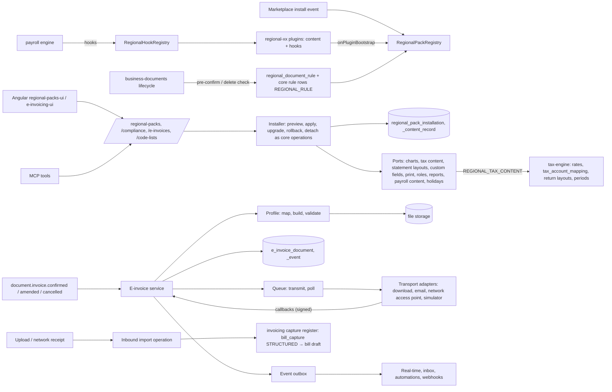

# Implementation Plan: Regional compliance packs

> Translates an approved `spec.md` into architecture and tech choices. The plan owns
> implementation details; the spec owns behaviour.

**Feature ID**: `regional-compliance-packs`
**Spec**: `./spec.md`
**Tasks**: `./tasks.md`
**Status**: `Draft`
**Last updated**: 2026-11-23

---

## 1. Architecture Summary

Three kinds of package:

- **Framework** `@gauzy/plugin-regional-packs` (`packages/plugins/regional-packs`, UI `regional-packs-ui`): the pack
  contract, the registry, the installer with its content ledger, dated content, upgrades and self-tests, address
  formats, document rules, the compliance checker and the hook registry.
- **Country packs** `@gauzy/plugin-regional-<iso2>` (`packages/plugins/regional-us`, `-gb`, `-de`, `-in`: the first set
  of four complete packs): content files plus, for extended packs, hook implementations; every other country is a
  marketplace pack on the same contract. A pack registers
  itself with the framework in `onPluginBootstrap` (as `PurchasingPlugin` registers its unit references). Data-only
  packs from the marketplace are rows in `regional_pack_version`, no code.
- **Electronic invoicing** `@gauzy/plugin-e-invoicing` (`packages/plugins/e-invoicing`, UI `e-invoicing-ui`):
  profiles, generation, validation, register, transports, inbound reading, code lists.

Packs never write another plugin's tables and keep no second copy of what an engine owns: the installer hands each
content section to the owning engine through a port bound in `apps/api/src/plugin-composition.ts`; an unbound port
means the section is skipped and reported. In particular:

- **Tax content** (categories, rates, regimes, withholding, the tax-to-account map, return layouts) goes to
  `tax-engine` through `REGIONAL_TAX_CONTENT`: account roles become rows of its `tax_account_mapping` (the only such
  map), return layouts become layouts of the statement and return layout model of `financial-reports` registered by
  `tax-engine`. Returns are prepared, frozen, exported and filed on the tax periods of `tax-engine`.
- **Document rules** are header rows of this plugin whose conditions are core `rule` rows (owner type
  `REGIONAL_RULE`), evaluated by `evaluateRuleSet`; extended packs may add typed rule functions.
- **Runs** (apply, upgrade, rollback, detach, self-test, inbound import) are core operations.
- **Inbound supplier e-invoices** enter the one intake register of incoming financial documents, the capture register
  of `invoicing-receivables-payables` (`bill_capture`, source `STRUCTURED`); this plugin reads the file and keeps the
  network facts in its register. Routing identifiers of parties are tax registrations of `tax-engine` with the
  network's scheme.

## 2. Tech Choices

| Concern | Choice | Rationale |
| ------- | ------ | --------- |
| Packages | `regional-packs`, `regional-us`, `regional-gb`, `regional-de`, `regional-in`, `e-invoicing` (+ two Angular UI plugins) | Principle I; [platform architecture](../../architecture/business-suite.md) §2.2 |
| Flags | tenant features `FEATURE_REGIONAL_PACKS`, `FEATURE_E_INVOICING` in each plugin's `*.features.ts`; `@FeatureFlag` + `FeatureFlagGuard` on every controller; hook and rule evaluation also check the feature | default off |
| Pack format | folder or archive: `manifest.json` (identity, sections, compatibility), one JSON file per section, `tests/*.json`, `i18n/<locale>.json`; JSON Schema per section in `packages/contracts/src/lib/regional/schemas` | data-only packs installable at run time; same validator for shipped packs |
| Dated content | every rate, table, threshold and rule carries `validFrom` / `validTo`; the existing `tax_rate` and `tax_regime` windows (`startsAt` / `endsAt`) are used as they are | spec FR-16 |
| Content ledger | `regional_pack_content_record` with content key and checksum of what the pack wrote; "user-changed" = current record checksum differs | upgrades without overwriting |
| Rules | pack conditions written as core `rule` rows (`RuleOwnerType.REGIONAL_RULE`, scope `ORDER` for the document and `ITEM` for lines; field path, compare, in, pattern, groups for and / or, `isNegated` for not), validated by `rule.validator.ts`, patterns checked by `rule.pattern-safety.ts`, evaluated by `evaluateRuleSet`; extended packs may register typed rule functions | one rule engine; no evaluation of pack-supplied code in data-only packs |
| Hooks | `RegionalHookRegistry.resolve(countryCode, hookName)` returning a typed function or nothing; hook names in contracts | payroll and fixed assets call hooks, never a pack |
| Returns | layouts shipped as tax content: boxes are rows of a `TAX_RETURN` statement layout whose selectors are tax-register filters (treatment, direction, rate, subdivision, account); preparation, snapshot, export and filing on `tax-engine` periods | one layout model, one period and filing model |
| Runs | core operations (`packages/core/src/lib/operation`): types `REGIONAL_PACK_APPLY`, `_UPGRADE`, `_ROLLBACK`, `_DETACH`, `_SELF_TEST`, `E_INVOICE_INBOUND_IMPORT`; aggregate = organization (one live run), one step per section, cursor in the operation state | resumable and observable without a run table |
| XML | build with `xmlbuilder2` (MIT), schema validation with `xmllint-wasm` (MIT; no native build, works in the desktop and SQLite builds); business rules compiled from the standards' rule sets into TypeScript rule tables at build time; licences re-checked in the PR that adds them | one validator in API and worker |
| Hybrid PDF | PDF/A-3 with the XML embedded, produced by the platform PDF service through the print port | reuse of print pipeline |
| Numbering | one gap-free numbering series of the document engine (core `sequence`, key `e-invoice:transmission`) per organization, shared by every profile, so no number is used twice in an organization; outbound file names are built from that number and kept unique per organization (`outboundFileName`) | spec FR-63 |
| Inbound | files read by the profile readers, each handed to the capture register of `invoicing-receivables-payables` (`bill_capture`, source `STRUCTURED`), which drafts the bill | one intake register |
| Settings | `e-invoicing.settings.ts` and `regional-packs.settings.ts` contributions (organization scope): import defaults, automatic apply, automatic rate upgrades, `regional.fieldChecksBlocking` (false) and `regional.addressChecksBlocking` (false) of spec FR-107 | platform settings store |
| Permissions | contributions with `defaultFor` in each plugin's `*.permissions.ts` | no seed migration |
| Background work | `@ScheduledJob` + `@QueueWorker`; schedule-only plugins in the worker, consumers in the API; in-process fallback; scheduled passes recorded in `job_execution` | house pattern |
| Secrets | transport credentials and certificates in `IntegrationSetting` (encrypted); callbacks verified by signature | Principle VI |

Standards implemented by the shipped profiles (named because the files must conform to them): EN 16931-1 semantic
model in its two syntaxes (UBL 2.1 invoice and credit note; UN/CEFACT Cross Industry Invoice D16B), the hybrid PDF
profile of that standard, the open four-corner delivery network (Peppol, AS4, through an access point), and OASIS genericode 1.0 for code lists.

## 3. Data Model

### New or changed entities

No existing table changes. Tables extend `TenantOrganizationBaseEntity` unless marked tenant-level
(`TenantBaseEntity`). Shipped packs are not stored: they live in the registry; the tables hold what a tenant
installed and applied.

| Table | Columns (type) | Indexes and uniqueness |
| --- | --- | --- |
| `regional_pack_version` (tenant-level) | `packCode` varchar(64), `countryCode` char(2), `subdivisionCode` varchar(16) null, `version` varchar(32), `contentAsOf` date, `publisher` varchar(255), `source` varchar(16) (`MARKETPLACE`/`PRIVATE`), `manifest` json, `contentFileId` uuid, `checksum` varchar(64), `status` varchar(12) (`VALID`/`INVALID`/`RETIRED`), `validationReport` json, `licenceRef` varchar(128) null | unique `(tenantId, packCode, version)` |
| `regional_pack_installation` | `packCode`, `packSource` varchar(12) (`SHIPPED`/`TENANT`), `packVersion`, `role` varchar(12) (`PRIMARY`/`SECONDARY`), `sections` json, `status` varchar(12) (`APPLIED`/`RUNNING`/`DETACHED`), `autoApplyRateUpgrades` bool, `appliedAt`, `appliedById`, `lastOperationId` uuid null, `selfTestStatus` varchar(12) null, `selfTestAt` null | unique `(organizationId, packCode)`; one `PRIMARY` per organization (partial unique; generated column on MySQL) |
| `regional_pack_content_record` | `installationId` fk, `section` varchar(32), `contentKey` varchar(160), `targetType` varchar(64), `targetId` uuid, `packVersion`, `checksum` varchar(64), `state` varchar(16) (`PACK`/`USER_CHANGED`/`ARCHIVED`/`CLASH_SKIPPED`), `validFrom` date null, `validTo` date null, `validFromKey` varchar(10) not null (`validFrom` as `YYYY-MM-DD`, or `-` for undated content; written with it, so the unique key holds for undated content on every dialect) | unique `(installationId, section, contentKey, validFromKey)`; idx `(targetType, targetId)` |
| `regional_self_test_result` | `operationId` (the self-test operation), `installationId`, `caseKey` varchar(160), `status` varchar(8), `expected` json, `actual` json, `difference` text | idx `(operationId, status)`, `(installationId, status)` |
| `regional_address_format` (tenant-level) | `countryCode` char(2), `layout` json, `labels` json, `requiredParts` json, `postalCodePattern` varchar(128), `subdivisions` json, `packCode` null | unique `(tenantId, countryCode)`; shipped formats come from the registry |
| `regional_document_rule` | `packCode`, `ruleKey` varchar(160), `documentType` varchar(64), `events` varchar(64) (`DRAFT`, `CONFIRM`, `CANCEL`, `DELETE`), `kind` varchar(24) (the rule kinds of spec FR-28), `severity` varchar(8), `isAdjustable` bool, `messageKey` varchar(160), `typedFunction` varchar(64) null (extended packs), `validFrom`, `validTo`; organization override: `severityOverride` null, `disabled` bool, `overrideReason` text, `changedById`; conditions are core `rule` rows (`REGIONAL_RULE`, `ownerId` = this row). Spec FR-107: a `BLOCK` rule on a document type that exists today (invoices, estimates, payments, expenses, orders, purchase orders) is installed with `isAdjustable` true and `severityOverride` `WARN`, unless the user enforced it in the apply preview; enforcing clears the override | unique `(organizationId, packCode, ruleKey, validFrom)`; idx `(organizationId, documentType)` |
| `regional_compliance_check` | `documentType` varchar(64), `documentId` uuid, `documentVersion` int, `checkedAt`, `findings` json, `blockingCount` int, `warningCount` int | unique `(organizationId, documentType, documentId)`; idx `(organizationId, blockingCount)` |
| `e_invoice_profile_setting` | `profileKey` varchar(64), `enabled` bool, `generateOnConfirm` bool, `blockConfirmOnFindings` bool, `transportId` fk null, `retentionYears` int | unique `(organizationId, profileKey)` |
| `e_invoice_document` | `direction` varchar(8), `profileKey`, `documentType`, `documentId` uuid null, `captureId` uuid null (inbound: the `bill_capture` of `invoicing-receivables-payables`), `partyType`, `partyId` null, `versionNo` int, `supersededById` null, `status` varchar(12) (`GENERATED`/`INVALID`/`QUEUED`/`SENT`/`DELIVERED`/`ACCEPTED`/`REJECTED`/`FAILED`/`RECEIVED`/`WITHDRAWN`), `transmissionNumber` bigint null, `fileName` varchar(255), `outboundFileName` varchar(255) null (the `fileName` of an outbound document, null for inbound files), `fileId` uuid, `fileChecksum` varchar(64), `pdfFileId` null, `networkMessageId` varchar(255) null, `attempts` int, `nextAttemptAt` null, `lastError` text null, `sentAt`, `deliveredAt`, `retainUntil` date | unique `(organizationId, transmissionNumber)` (nulls allowed); unique `(organizationId, outboundFileName)` (nulls allowed); unique `(organizationId, documentType, documentId, profileKey, versionNo)`; idx `(organizationId, status, nextAttemptAt)`, `(organizationId, createdAt)`, `(captureId)` |
| `e_invoice_event` | `eInvoiceDocumentId` fk, `kind` varchar(24), `occurredAt`, `details` json, `payloadFileId` null | idx `(eInvoiceDocumentId, occurredAt)`; append-only |
| `e_invoice_transport` | `adapterKey` varchar(32), `name`, `config` json (no secrets), `integrationSettingId` uuid null, `status`, `lastCheckedAt` | idx `(organizationId, adapterKey)` |
| `code_list` (tenant-level) | `publisher`, `name`, `listVersion` varchar(64), `canonicalUri` varchar(512), `canonicalVersionUri` null, `sourceFileId` null, `isArchived` | unique `(tenantId, canonicalUri, listVersion)` |
| `code_list_entry` (tenant-level) | `codeListId` fk cascade, `code` varchar(64), `name`, `description` null, `isDefault` bool | unique `(codeListId, code)`; one default per list |
| `code_list_mapping` (tenant-level) | `codeListId` fk cascade, `entryId` fk cascade, `recordType` varchar(64), `recordId` uuid | unique `(tenantId, codeListId, recordType, recordId)` |

**Owned elsewhere, written through ports (no table here):**

| Concept | Owner and store | Port |
| --- | --- | --- |
| Tax-to-account map of a pack (tax kinds and return boxes to ledger accounts) | `tax-engine` `tax_account_mapping` (rows marked with pack and version) | `REGIONAL_TAX_CONTENT` |
| Return layouts and their structured export mapping | statement and return layout model of `financial-reports`, registered by `tax-engine` | `REGIONAL_TAX_CONTENT` |
| Prepared, final and filed returns | `tax-engine` `tax_period` with its frozen pack | read through `REGIONAL_TAX_PERIODS` |
| Country statement layouts (balance sheet, profit and loss) | `financial-reports` `statement_layout` | `REGIONAL_STATEMENT_LAYOUTS` |
| Party routing identifiers of delivery networks | `tax-engine` `tax_registration` (scheme of the network; directory lookups through `TAX_REGISTRATION_VERIFIER`) | `E_INVOICING_REGISTRATIONS` |
| Inbound supplier e-invoices and their outcome | `invoicing-receivables-payables` `bill_capture` (source `STRUCTURED`); the upload is an `E_INVOICE_INBOUND_IMPORT` operation whose result lists the captures | `E_INVOICING_CAPTURES` |
| Import defaults (item for unmatched lines, supplier group, tax account, series, price list) | platform settings store, `e-invoicing.settings.ts` | — |
| Pack runs and their history | core `operation`, `operation_step` | — |

**Kept apart, with the reason:** `code_list_mapping` and core `integration_map`: an integration map ties a record to
the id it has in one connected system (an `integration_tenant` with credentials and sync), while a code-list mapping
ties a record to an entry of a versioned standard list that several profiles read and that carries a name, a
description and a default entry; a code list is not a connected system, so `integration_map` has no row to hang it on.

### Migrations

**Migration timestamps**: `packages/plugins/regional-packs` `1791000083100` to `1791000083199`; `packages/plugins/e-invoicing` `1791000083200` to `1791000083299`.

- `regional-packs`: `1791000083100-CreateRegionalPackTables` (version, installation, content record, self-test result,
  address format, document rule), `1791000083110-CreateRegionalComplianceCheckTable`. `e-invoicing`:
  `1791000083200-CreateEInvoiceTables` (profile setting, document, event, transport), `1791000083210-CreateCodeListTables`. Default role
  grants are permission contributions (`defaultFor`), not migrations. Country plugins ship no migrations: their
  content is applied by the installer, per organization, never at migration time.
- Additive, idempotent, three dialects with the shared core migration helpers of `@gauzy/core`; partial unique indexes use a
  generated column on MySQL; no backfill. `RuleOwnerType` gains `REGIONAL_RULE`.

### Contracts

`packages/contracts/src/lib/regional/`: `regional-pack.model.ts` (`IRegionalPackManifest`, section content types
including return layouts and their export mapping, `IRegionalPackInstallation`, `IRegionalPackRunResult` (the
operation result), `IRegionalPackPreview`, `IRegionalUpgradeDiff`), `regional-rule.model.ts` (document rule header,
rule kinds, `IComplianceFinding`), `regional-hooks.model.ts` (hook names and signatures: `exemptionForDeclaration`,
`exemptionForPeriod`, `taxRelief`, `regionalDeductions`, `employerContributions`, `costToCompanyComponents`,
`endOfServiceAmount`, `depreciationConvention`, `taxRoundingRule`), `e-invoice.model.ts` (profile, document, event,
transport, inbound result, status enums), `code-list.model.ts`, and the JSON Schemas of the pack format.

Ports (optional tokens, exported by `regional-packs` unless noted): `REGIONAL_CHART_TEMPLATES`,
`REGIONAL_TAX_CONTENT` (tax categories, rates, regimes, withholding, account-map rows, return layouts and export
mappings), `REGIONAL_TAX_PERIODS` (read prepared and filed periods for anomalies and "not reliable" markers),
`REGIONAL_STATEMENT_LAYOUTS`, `REGIONAL_CUSTOM_FIELDS`, `REGIONAL_PRINT_TEMPLATES`, `REGIONAL_ROLE_BUNDLES`,
`REGIONAL_REPORT_DEFINITIONS`, `REGIONAL_PAYROLL_CONTENT`, `REGIONAL_HOLIDAYS` (bound to core `official-holiday`),
`REGIONAL_DOCUMENT_CHECKS` (the document engine's pre-confirm and delete check slot; it also runs the e-invoice
validation of FR-62 synchronously, inside the confirming transaction, for an invoice of an organization whose profile
has `blockConfirmOnFindings` on, and refuses the confirmation on a blocking finding, while the invoice-event consumer
keeps generating the file after a successful confirmation); `E_INVOICING_INVOICES` (read a
confirmed document snapshot), `E_INVOICING_CAPTURES` (hand a read inbound file to the capture register),
`E_INVOICING_REGISTRATIONS` (routing identifiers as tax registrations), `E_INVOICING_PRINT`.

## 4. API Surface

Guards: `TenantPermissionGuard`, `PermissionGuard`, `FeatureFlagGuard`. Runs and transmissions accept an
`Idempotency-Key`. Lists use cursor pagination.

| Method | Endpoint | Permission | Description (request → response) | Status |
| ------ | -------- | ---------- | -------------------------------- | ------ |
| `GET` | `/regional-packs`, `/regional-packs/:code`, `/regional-packs/:code/versions/:version` | `REGIONAL_PACKS_VIEW` | catalogue with coverage; pack detail and content summary | New |
| `POST` | `/regional-packs/validate` | `REGIONAL_PACKS_MANAGE` | pack archive → `IRegionalPackValidationReport` | New |
| `POST` | `/regional-packs/install` · `DELETE /regional-packs/:code/versions/:version` | `REGIONAL_PACKS_MANAGE` | install or retire a tenant pack version (data-only) | New |
| `GET` | `/regional-pack-installations?organizationId=` | `REGIONAL_PACKS_VIEW` | applied packs with self-test status and available upgrade | New |
| `POST` | `/regional-pack-installations/preview` | `REGIONAL_PACKS_MANAGE` | `{ organizationId, packCode, version, sections }` → `IRegionalPackPreview` | New |
| `POST` | `/regional-pack-installations` | `REGIONAL_PACKS_MANAGE` | apply → `202` with the operation | New |
| `GET/POST` | `/regional-pack-installations/:id/upgrade/preview`, `/:id/upgrade`, `/:id/rollback`, `/:id/detach`, `/:id/self-test` | `REGIONAL_PACKS_MANAGE` | diff; operations | New |
| `GET/PUT` | `/regional-pack-installations/:id/content?state=USER_CHANGED`, `/:id/content/:recordId/accept` | `REGIONAL_PACKS_MANAGE` | user-changed records; accept the pack's value | New |
| `GET` | `/operations?type=REGIONAL_PACK_*`, `/operations/:id` (core, existing), `/regional-pack-installations/:id/self-test-results` | `REGIONAL_PACKS_VIEW` | run history, progress, self-test results | Existing / New |
| `GET/PUT` | `/regional-rules?organizationId=`, `/regional-rules/:ruleKey/override` | `REGIONAL_PACKS_VIEW` / `REGIONAL_PACKS_MANAGE` | active rules with their conditions; override of adjustable rules | New |
| `GET` | `/address-formats/:countryCode` (public read), `PUT` same | none / `REGIONAL_PACKS_MANAGE` | format for forms and print; tenant override | New |
| `POST` | `/compliance/check` | view permission of the document | `{ documentType, documentId }` or a draft payload → `IComplianceFinding[]` | New |
| `GET` | `/compliance/worklist?organizationId=`, `/compliance/explain-tax?documentType=&lineId=` | `REGIONAL_PACKS_VIEW` | open findings; tax explanation with the return boxes a line feeds | New |
| `GET/PUT` | `/e-invoice-profiles`, `/e-invoice-profiles/:key/settings`, `/e-invoicing-settings` | `E_INVOICES_VIEW` / `E_INVOICE_TRANSPORTS_MANAGE` | profiles, profile settings, organization settings (import defaults) | New |
| `GET/POST/PUT/DELETE` | `/e-invoice-transports`, `POST /e-invoice-transports/:id/test` | `E_INVOICE_TRANSPORTS_MANAGE` | transports; secrets write-only | New |
| `GET` | `/e-invoices`, `/e-invoices/:id`, `/e-invoices/:id/file`, `/e-invoices/:id/events` | `E_INVOICES_VIEW` | register, file, responses | New |
| `POST` | `/e-invoices/validate`, `/e-invoices/generate`, `/e-invoices/:id/send`, `/e-invoices/:id/withdraw` | `E_INVOICES_SEND` | `{ documentType, documentId, profileKey?, preview? }` → findings, document or transmission | New |
| `POST` | `/e-invoices/export` | `E_INVOICES_SEND` | `{ periodStart, periodEnd, partyId? }` → archive (async for large sets) | New |
| `POST` | `/e-invoices/callbacks/:adapterKey` | signature of the network | status and inbound notifications | New |
| `POST` | `/e-invoices/inbound` (multipart) | `E_INVOICES_IMPORT` | upload → `202` with an `E_INVOICE_INBOUND_IMPORT` operation; its result lists each file with its capture, bill draft or refusal reason | New |
| `POST` | `/e-invoices/recipients/lookup` | `E_INVOICES_SEND` | directory lookup of a party's routing identifier, stored as a tax registration | New |
| `GET/POST/PUT/DELETE` | `/code-lists`, `/code-lists/:id/entries`, `POST /code-lists/import`, `/code-lists/:id/mappings` (+ `/bulk`) | `CODE_LISTS_VIEW` / `CODE_LISTS_MANAGE` | lists, entries, genericode import, mappings with per-row results | New |

Returns are prepared, viewed with drill-down, frozen, exported (printable and the authority's structured file) and
filed on the tax periods of `tax-engine` (`/tax-periods/:id/return`, `/tax-periods/:id/pack`); the tax-to-account map
of a pack is edited on the tax accounts page of `tax-engine` (`/tax-accounts`, filter by pack); routing identifiers
on its registrations (`/tax-registrations`). No route of this feature duplicates them.

Errors: `400` with stable codes (`REGIONAL_PACK_INVALID`, `E_INVOICE_BLOCKING_FINDINGS`, `CODE_LIST_MAPPING_DUPLICATE`),
`403`, `404` (flag off or other tenant), `409` (`REGIONAL_PACK_RUN_IN_PROGRESS`, upgrade rollback refused),
`422` (unreadable inbound file). Uploads limited to 50 MB per archive and 5 MB per file, scanned before parsing.

**Consumer tokens answered** (bound in `apps/api/src/plugin-composition.ts` to the payroll hooks of the installed packs; each consumer plan states the shape it calls and its fallback): `PAYROLL_REGIONAL_HOOKS`.

## 5. Events, Real-Time and Notifications

| Event | Emitted when | Consumers |
| ----- | ------------ | --------- |
| `regional.pack.applied`, `.upgraded`, `.rolled_back`, `.detached` | an operation ends | timeline of the organization, real-time, webhooks |
| `regional.pack.upgrade_available` | registry or marketplace has a newer version of an applied pack | inbox of `REGIONAL_PACKS_MANAGE` holders |
| `regional.self_test.failed` / `.recovered` | nightly or on-demand test changes state | inbox, "not reliable" marker on the affected tax periods' returns |
| `regional.compliance.findings_changed` | a check changes the findings of a document | worklist and open document forms (real-time) |
| `e_invoicing.document.generated`, `.invalid`, `.queued`, `.sent`, `.delivered`, `.accepted`, `.rejected`, `.failed`, `.received` | register status changes | register page (real-time), inbox (rejected, failed), automations, webhooks |
| `e_invoicing.inbound_import.completed` | an inbound import operation ends | inbox of the uploader |
| consumed: `document.invoice.confirmed` / `.amended` / `.cancelled`, credit note events | invoicing | generate, new version, cancellation handling |
| consumed: `tax.period.prepared` / `.filed` | `tax-engine` | anomaly list of the period; adjustments against a filed period |
| consumed: organization created or country changed (core facts) | setup | pack proposal |
| consumed: marketplace install of a pack (registry plugin event) | install | `regional_pack_version` row, validation operation |

Document checks are synchronous through the document engine's check slot (blocking rules must stop the confirm);
everything else rides the outbox. Inbox items through the inbox item writer; emails through the email-template
system (upgrade available, rejected transmission).

## 6. UI Surface

- `packages/plugins/regional-packs-ui` (Angular, registered in `apps/gauzy/src/plugin-ui.config.ts`): Settings →
  Regional (`/pages/settings/regional`, through the `settings-sections` page location): catalogue with coverage
  matrix, pack page (content, date, what is not covered), apply wizard with preview and optional sections, upgrade
  diff with "changed by you" comparison, run history (core operations), self-test results, rules list with
  overrides; `/pages/accounting/compliance` (worklist, through `accounting-sections`). Returns are the tax period pages
  of `tax-engine` (`/pages/accounting/tax/periods`) and the pack's account map is the tax accounts page; the pack page
  links to both. A "Regional" step component is exported for the setup assistant of `organization-setup`. A
  findings panel component is exported for document forms (invoice, bill, order) and shows live findings.
- Address form component (`gauzy-regional-address`) in the UI plugin, used by party, organization and document
  address forms through the form layout slot for organizations that applied a pack; it keeps every field of today's
  address form and shows the pack's checks as warnings unless `regional.addressChecksBlocking` is on; without the
  feature or without a pack the current fields stay as they are.
- The print layouts section of the apply wizard lists the regulated types with a pick per type; invoices, estimates
  and receipts are unpicked by default, so their current layout stays assigned.
- `packages/plugins/e-invoicing-ui`: `/pages/accounting/e-invoices` (register with saved views, status timeline,
  file viewer, send, withdraw, export), `/inbound` (upload, import result with links to the captures),
  `/settings` (profiles, transports with test, import defaults), `/code-lists` (lists, entries, mappings, import).
  Routing identifiers are edited on the party's tax registrations. An "E-invoice" chip with status is contributed to
  the invoice page.
- i18n: `REGIONAL.*`, `E_INVOICING.*`, `CODE_LISTS.*` in every locale; pack-supplied labels and rule messages come
  from the pack's `i18n` files with English as fallback.

## 7. MCP Tools, SDKs and Integrations

| Tool (`packages/mcp-server/src/lib/tools/regional.ts`, `e-invoicing.ts`) | Input | Output |
| --- | --- | --- |
| `regional_packs_catalogue` | country, tenant scope | packs with versions and coverage |
| `regional_pack_apply` | organization, pack, sections, `preview` (default true) | preview or operation |
| `regional_pack_upgrade` | installation, `preview` (default true) | diff or operation |
| `regional_pack_self_test` | installation | cases with pass or fail |
| `regional_return_prepare` | report, period | boxes of the `tax-engine` period, anomalies, drill-down links |
| `compliance_check_document` | document reference or draft | findings with suggested fixes |
| `compliance_explain_tax` | document line | regime, rate, rule, boxes fed |
| `e_invoice_validate` | document, profile | findings |
| `e_invoice_send` | document, `preview` (default true) | findings and transport, or transmission |
| `e_invoice_status` / `e_invoice_inbound_status` | id / operation id | status and events / per-file outcome with captures |
| `code_list_lookup` | list, record or code | entry and mappings |

- Transport adapters (`packages/plugins/e-invoicing/src/lib/transports/`): `download`, `email`, `network-access-point`
  (AS4 through a configurable access point API), `simulator` (tests and demos); a national exchange platform is a
  transport a country's marketplace pack adds. Each
  implements `IEInvoiceTransport` (`send`, `status`, `verifyCallback`, `parseInbound`, `lookupRecipient`); the
  directory lookup is also offered to `tax-engine` as a `TAX_REGISTRATION_VERIFIER` for network schemes.
- Pack authoring kit: `packages/plugins/regional-packs/kit` (schemas, `validate-pack` CLI, test-case runner, a
  sample pack), published with the docs.
- Report definitions registered: the reports of spec §3.10. Print layouts through the print port. OpenAPI additive;
  SDKs regenerated. Marketplace: packs are listed as the "regional pack" kind (the Ever Platform spec `marketplace-catalogue`).

Legal terms behind the descriptive names of the spec, for implementers: India — permanent tax account number
(PAN), bank branch routing code (IFSC), cheque clearing code (MICR), provident fund (PF), rent allowance (HRA),
withholding at source (TDS); United States — information return for supplier payments (forms of the 1099
family), employee withholding certificate (W-4), yearly wage and tax statement (W-2), federal unemployment tax
(FUTA); United Kingdom — pay as you earn (PAYE), national insurance (NI), the real-time payroll submission (RTI),
the nine-box VAT return submitted digitally (Making Tax Digital); Germany — wage tax (Lohnsteuer), advance VAT return
(Umsatzsteuer-Voranmeldung), summary of intra-community supplies (Zusammenfassende Meldung), social insurance
contribution statement (Beitragsnachweis), German e-invoice profiles of the European standard (XRechnung, ZUGFeRD).

## 8. Background Jobs

| Trigger | When | What it does | Idempotency |
| ------- | ---- | ------------ | ----------- |
| operations `REGIONAL_PACK_APPLY` / `_UPGRADE` / `_ROLLBACK` / `_DETACH` | on request | one step per section in order, writes the content ledger, cursor in the operation state after each record | `(installationId, section, contentKey, validFromKey)`; resume from the cursor; one live operation per organization |
| `regional.self-test.nightly` | nightly per organization | starts a `REGIONAL_PACK_SELF_TEST` operation, stores results, emits failed or recovered | one result set per operation |
| `regional.upgrade-check` | at boot and daily | compares applied versions with registry and tenant versions | one notice per installation and version |
| `regional.rate-upgrades.sweep` | daily | applies rate-only upgrades due today where the tenant opted in | operation idempotency key `(installationId, toVersion)` |
| queue `e-invoice-transmit` | on send and retry | validates again, sends through the transport, schedules backoff (5 min doubling, 72 h cap) | `transmissionNumber`; network message id |
| `e-invoicing.status-poll` | every 15 min | polls transports without callbacks | event dedupe by `(document, kind, network reference)` |
| operation `E_INVOICE_INBOUND_IMPORT` | on upload or receipt | unpacks, reads, checks, hands each readable file to the capture register (which drafts the bill), records refusals in the result | `(supplierTaxNumber, supplierInvoiceNumber)`; file checksum (the capture register's unique checksum) |
| `e-invoicing.retention.check` | monthly | lists files past retention for an admin decision (deletes nothing) | — |

Every scheduled pass writes its `job_execution` row. `RegionalPacksSchedulePlugin` and `EInvoicingSchedulePlugin` run
in the worker (schedules only); operation steps and queue consumers run in the API where the ports are bound. Without
a queue, runs and transmissions execute in-process.

## 9. Security & Permissions

- New permission contributions: `REGIONAL_PACKS_VIEW`, `REGIONAL_PACKS_MANAGE` (`ADMINISTRATION`), `E_INVOICES_VIEW`,
  `E_INVOICES_SEND`, `E_INVOICES_IMPORT`, `E_INVOICE_TRANSPORTS_MANAGE` (`ADMINISTRATION`), `CODE_LISTS_VIEW`,
  `CODE_LISTS_MANAGE`. Returns use the period permissions of `tax-engine` (`TAX_PERIODS_VIEW`, `TAX_PERIODS_MANAGE`).
- Default grants through `defaultFor`: super admin and admin all; manager the `VIEW` keys. A pack's role bundles
  (for example a tax auditor) are created through the roles port, never by editing existing roles.
- Data-only packs carry no executable content: rules are `rule` rows checked by the rule validator and pattern-safety
  helper, formulas are parsed data; archives are size-limited, path-checked and scanned.
- Transport secrets and certificates in `IntegrationSetting`, write-only through the API; callbacks verified by the
  adapter's signature check; inbound XML parsed with external entities disabled.
- Data leaving the platform: the structured invoice and its attachments to the chosen transport, listed on the
  transport's settings page.
- Agents: tools preview by default; a check or an agent never confirms or transmits.

## 10. Observability

- Operation history and content ledger; self-test results; `e_invoice_event`; inbound import results; platform audit
  entries for overrides and accepted pack values (account-map edits are audited by `tax-engine`).
- Metrics: runs by outcome, self-test failures, findings per document type, transmissions by status, time to
  delivery, inbound refusal reasons.
- Logs for refused callbacks and port failures; Sentry breadcrumbs per run section and transmission.

## 11. Phased Rollout

1. **Phase 1 — Framework and first content** (flags off): contracts, registry, installer with ledger and dated
   content, address formats (base set), tax content and statutory fields sections, catalogue and apply wizard. Gives
   the existing tax engine its first shipped content.
2. **Phase 2 — Accounting side of the four packs**: charts, document rules on the core rule engine, print layouts,
   role bundles, account-map rows and return layouts handed to `tax-engine`, audit trail; United States, United
   Kingdom, Germany and India (goods and services tax, withholding).
3. **Phase 3 — Electronic invoicing**: code lists, the European standard profiles, register, validation, download
   and email transports, inbound reading into the capture register; the Germany pack's e-invoicing.
4. **Phase 4 — Payroll content**: hook registry, payroll sections, holidays; payroll rules of the four packs.
5. **Phase 5 — Advanced capabilities**: upgrades with diff, rollback and automatic rate upgrades, self-tests, network
   transports, compliance checker and worklist, MCP tools, run-time packs from the marketplace, authoring kit.
6. **Phase 6 — General availability**, pack by pack once its legal review is done: the feature is off by default; after the trial period it may be switched on by default for new tenants only; existing tenants keep their setting until an administrator changes it.

## 12. Constitution Reconciliation

- I Plugin-first: framework, country and e-invoicing plugins; engines reached only through ports; no copy of what an engine owns.
- II Tenant/organization scoping: installations, records, rules, checks and e-invoices per organization; pack
  versions, address formats and code lists per tenant; shipped packs are code, not rows.
- III Both ORMs, additive migrations: MultiORM entities; create-only migrations on three dialects.
- IV Default-off flag; nothing removed: two flags; existing country, currency, address and tax data untouched.
- V Contracts and API first: pack format and hook contracts in `packages/contracts` before any pack is written.
- VI Permissions, privacy, security: eight keys; encrypted secrets; verified callbacks; no executable pack data.
- VII Real-time through the event bus: outbox events; live register and worklist on the platform channel.
- VIII i18n and accessibility: platform keys plus pack-supplied translations with fallback.
- IX Tests: pack test cases run in CI against every dialect; profile conformance suites; rule property tests on the core evaluator.
- X Behaviour-first spec: implementation lives here.
- XI Documentation describes our platform only.

## 13. Risks & Mitigations

| Risk | Likelihood | Impact | Mitigation |
| ---- | ---------- | ------ | ---------- |
| Legal content is wrong or out of date | Medium | High | content date and coverage on every pack, "preview" status until reviewed locally, self-tests, staleness warning, upgrade notices |
| Scope creep per country | High | Medium | fixed first list; contract and kit so further countries arrive as data-only packs |
| Engines' ports (charts, custom fields, payroll content, tax content, layouts) absent | Medium | Medium | optional tokens; a missing port skips its section with a report; phases follow the engines' order |
| Upgrades overwrite user work | Low | High | content ledger with checksums; user-changed records never overwritten; preview before every run |
| Network access needs contracts and certificates | High | Medium | simulator, download and email first; adapters behind one interface; per-deployment configuration |
| XML validation differs across platforms | Medium | Medium | WebAssembly validator, rule tables in TypeScript, conformance files from the standards in CI |
| Rule evaluation slows confirmation | Low | Medium | rule sets compiled once and cached per organization and document type, 300 ms budget test |
| Pack conditions need operators the rule engine lacks | Low | Medium | operators cover compare, set, pattern, null and grouping; anything else is a typed rule function of an extended pack |

## 14. References

- Spec: `./spec.md` · Tasks: `./tasks.md`
- [platform architecture](../../architecture/business-suite.md) §2.2, §3.1, §3.3, §3.4, §3.7, §3.8, §3.11, §3.12, §6
- Code: `packages/plugins/tax/src/lib` (`tax-regime`, `tax-rate`, `tax-rate-part`, `tax-category`),
  `packages/core/src/lib/rule` (`rule.evaluator.ts`, `rule.validator.ts`, `rule.pattern-safety.ts`),
  `packages/contracts/src/lib/rule.model.ts`, `packages/core/src/lib/operation`, `packages/core/src/lib/integration-map`,
  `packages/core/src/lib/country`, `packages/core/src/lib/address/address.entity.ts`,
  `packages/core/src/lib/official-holiday`, `packages/core/src/lib/sequence`, `packages/core/src/lib/payroll-run`,
  `packages/plugins/purchasing/src/lib/purchasing.plugin.ts` (registration in `onPluginBootstrap`),
  `packages/plugin/src/lib/plugin-contributions.ts`, `packages/plugins/registry`, `apps/api/src/plugin-composition.ts`
- Related plans: `../tax-engine/plan.md`, `../financial-reports/plan.md`, `../invoicing-receivables-payables/plan.md`,
  `../accounting-foundation/plan.md`, `../business-document-engine/plan.md`
