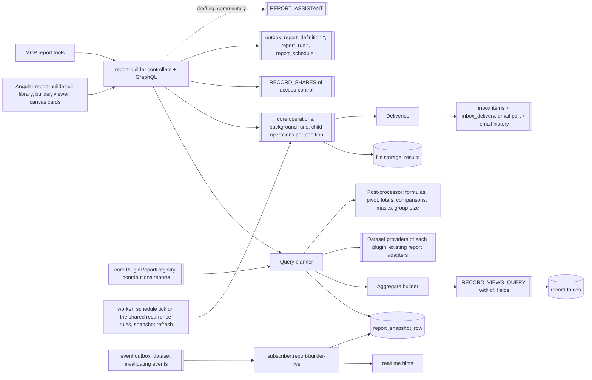

# Implementation Plan: Report builder and dashboards

> Translates an approved `spec.md` into architecture and tech choices. The plan owns
> implementation details; the spec owns behaviour.

**Feature ID**: `report-builder-and-dashboards`
**Spec**: `./spec.md`
**Tasks**: `./tasks.md`
**Status**: `Draft`
**Last updated**: 2026-11-23

---

## 1. Architecture Summary

A new plugin pair, `@gauzy/plugin-report-builder` (`packages/plugins/report-builder`) and `report-builder-ui` (Angular),
loaded by `apps/api/src/plugins.ts` only when `GAUZY_REPORT_BUILDER_ENABLED` is exactly `true` and gated per tenant by
`FEATURE_REPORT_BUILDER`. The existing time and activity report, saved-report and export routes stay unchanged for
their current clients. It builds on what exists:

- **Declarations as plugin contributions, engine in the plugin.** Plugins must declare datasets, definitions and
  dashboard templates without importing the plugin, so they are a member `reports` of `PluginContributions`
  (`packages/plugin/src/lib/plugin-contributions.ts`) on `@GauzyCorePlugin`, unioned at boot by a `PluginReportRegistry`
  in the core `packages/core/src/lib/plugin-contributions/` registry next to permissions, features and settings, so the
  plugin contributions report reads one source. `registerReportDatasets`, `registerReportDefinitions` and
  `registerDashboardTemplates` are typed helpers that build those entries. With the plugin absent the declarations are
  inert.
- **Record-type datasets** come from the core record type registry (`custom-fields-and-forms`) and are queried through
  `RECORD_VIEWS_QUERY` (`record-views-and-search`): the view filter grammar, the type's read scope applied last, and
  custom fields as `cf.<key>` dynamic fields of the core query protocol (`custom-fields-and-forms`). The plugin adds
  grouping, measures and pivots on top.
- **Computed datasets** are provider classes of the owning plugin (`IReportDatasetProvider`); the eleven existing reports
  become providers that call the same services and query handlers as their routes (`packages/core/src/lib/time-tracking`,
  `expense`, `payment`), so figures match by construction.
- **Existing modules stay**: `packages/core/src/lib/reports` (catalogue rows link to definitions by slug; catalogue
  authoring behind `REPORT_CATALOGUE_AUTHORING_ENABLED` keeps creating catalogue rows, which a user definition can link
  to), `saved-report` (read as variants through `SavedReportVariantStore`), `dashboard` and `dashboard_widget` (a report
  card is a widget whose existing `options` JSON names a definition); the Angular canvas and widget registry gain a
  widget kind.
- **Per-user and shared state reuses core**: favourites are core `favorite` rows (`packages/core/src/lib/favorite/`,
  `GlobalFavoriteService`) and recently run definitions are `employee_recent_visit` rows, once `BaseEntityEnum` gains
  `ReportDefinition`; a user's own home dashboard is the existing `dashboard.isDefault` (`dashboard.service.ts`, used by
  the dashboard switcher), and only role defaults need `report_home`; sharing definitions and dashboards with people,
  teams and roles is the one share model of `access-control-and-security` (`access_record_share` through
  `RECORD_SHARES`).
- **Background work** uses core durable operations (`packages/core/src/lib/operation/`, `@AcceptedOperation` →
  `/api/operations`): a partitioned run is operation `report-builder.run` with one child operation per partition
  (`parentOperationId`, `deadlineAt`); its status is the operation's, and `report_run` is only the access log of FR-55.
  Schedules use the platform's one recurrence implementation, the frequency and period-claim rules of
  `packages/core/src/lib/invoice-schedule/` (`invoice-schedule.rules.ts`, the once-per-period claim of
  `invoice_schedule_run`) lifted to core by `business-document-engine` (`packages/core/src/lib/recurrence/`), extended
  with weekday and custom rules.
  Deliveries to internal recipients go through the Inbox plugin's delivery (`inbox_delivery`, which already retries and
  honours preferences) and emails leave a row in core email history (`email_sent`); `report_delivery` only records
  each recipient's outcome and points at them. Live figures ride the event outbox and the realtime plugin's hints.
- **Charts**: report cards use `chart.js` with `ng2-charts` (in `packages/ui-core`); the existing `@swimlane/ngx-charts`
  charts of `apps/gauzy` stay as they are; no third library.



## 2. Tech Choices

| Concern | Choice | Rationale |
| ------- | ------ | --------- |
| Package | new `packages/plugins/report-builder`, `-ui`; declarations as the `reports` member of `PluginContributions` | Principle I; plugins register without a dependency |
| Permissions, feature, settings | `PluginContributions` on `@GauzyCorePlugin` (as `packages/plugins/search/src/lib/search.plugin.ts`): the ten permissions with `defaultFor`, `FEATURE_REPORT_BUILDER`, the tenant setting `reports.maxSchedulesPerUser` (50) in `tenant_setting` | no seed migration for grants |
| Record-type queries | `RECORD_VIEWS_QUERY.compile` → `ApiQuery`, then `AggregateQueryBuilder` (TypeORM and MikroORM query builders) | one filter grammar and read scope with saved views |
| Date grains | per-dialect expressions (PostgreSQL `date_trunc`, MySQL `DATE_FORMAT`, SQLite `strftime`) in the organization's time zone | three dialects |
| Formulas | `@gauzy/utils` formula language (`custom-fields-and-forms`) | one language; sandboxed evaluator |
| Background runs | core `OperationRegistry` operation `report-builder.run`; partitions as child operations (`parentOperationId`), merge as the parent's step; queue `report-builder` | durable, resumable, existing `/api/operations` surface, no second status machine |
| Recurrence | the shared recurrence and period-claim rules lifted from `invoice-schedule` (`business-document-engine`) | one implementation for invoice, report, import, export and archive schedules |
| Conditions | conditional schedules as core `rule` rows (owner type `REPORT_SCHEDULE`) evaluated by `rule.evaluator.ts` against the computed measure | one condition store |
| Sharing | `RECORD_SHARES` of `access-control-and-security` for definitions and dashboards; without it a definition or dashboard is private or organization-wide; dashboards that exist keep today's readers (organization-wide to `DASHBOARD_READ` holders) until their owner narrows them | one share model; no reader loses a dashboard |
| Favourites, recents, home | core `favorite`, `employee_recent_visit`, `dashboard.isDefault` | no per-plugin copy |
| Results and exports | streamed rows to file storage (`packages/core/src/lib/core/file-storage`); CSV writer in the plugin; XLSX with `exceljs` (MIT, already used by the docs plugin); PDF through the print port or `pdfmake` (MIT, a core dependency) | no new heavy dependency |
| Charts | `chart.js` with `ng2-charts` (MIT, existing in `ui-core`); heatmap through `chartjs-chart-matrix` (MIT, a `chart.js` plugin) loaded lazily; gauge as a half doughnut; funnel as ordered bars; the `@swimlane/ngx-charts` charts of today's pages stay | no third chart library |
| Canvas | existing custom dashboard canvas and `WidgetRegistryService` | no second dashboard |
| Snapshots | aggregate rows per snapshot, period, dimension hash and scope key | answers with access filtering; works on SQLite |
| Push | outbox → `RealtimeHintsService.appendHint` (`packages/plugins/realtime`) | Principle VII |
| Assistant | `REPORT_ASSISTANT` → `ai-agents-and-assistants`; fallback `ai-chat` `AiProviderRegistry` | tenant's own provider |

## 3. Data Model

**Migration timestamps**: `packages/plugins/report-builder` `1791000037100` to `1791000037199`; `packages/plugins/report-builder` `1791000037990` to `1791000037999` (its seed, which must run after the core migration whose column it writes); `packages/core` `1791000037900` to `1791000037989`.

All tables extend `TenantOrganizationBaseEntity` (soft delete, `isActive`, `isArchived`); JSON is `text` on every
dialect; keys are `varchar(96)`; ids into core tables carry a foreign key only where the core table exists at migration
time (`dashboard`, `user`, `role`).

| Table | Columns (besides base) | Indexes and uniqueness |
| --- | --- | --- |
| `report_definition` | `key` (user definitions `u:<uuid>`), `name` varchar(160), `labels` text, `description` text, `categoryKey` varchar(64), `datasetKey`, `document` text (filters, prompts, columns, measures, grouping, pivot, formulas, sort, limit, comparison, formatting, chart, print), `visibility` (`PRIVATE`, `ORGANIZATION`; shares with people, teams and roles are `access_record_share` rows of record type `ReportDefinition`), `ownerUserId`, `baseKey` null, `baseVersion` int null, `isHeavy` bool, `status` (`ACTIVE`, `INVALID`, `UNAVAILABLE`), `lastRunMs` text (last three durations), `version` int | unique `(tenantId, organizationId, key)`; idx `(tenantId, categoryKey)`, `(tenantId, ownerUserId)`, `(tenantId, baseKey)` |
| `report_definition_version` | `definitionId` FK cascade, `version` int, `document` text, `changedByUserId` | unique `(definitionId, version)` |
| `report_measure` | `datasetKey`, `key` varchar(64), `kind` (`MEASURE`, `DIMENSION`), `labels`, `description` text, `expression` text (formula over base measures, or bucket rules), `format` varchar(24), `ownerUserId`, `isCertified` bool, `certifiedByUserId`, `certifiedAt` | unique `(tenantId, organizationId, datasetKey, key)` |
| `report_user_setting` | `userId`, `definitionKey`, `prompts` text, `layout` text (favourites and recent runs are core `favorite` and `employee_recent_visit` rows; this table stays because `user.uiPreferences` holds at most 16 KB per user, too little for settings per definition) | unique `(tenantId, userId, definitionKey)` |
| `report_run` (the access log of FR-55) | `definitionKey`, `definitionVersion` int, `datasetKey`, `mode` (`LIVE`, `BACKGROUND`, `EXPORT`, `PRINT`, `DRILL`, `CARD`, `SCHEDULE`), `source` (`VIEWER`, `DASHBOARD`, `SCHEDULE`, `MCP`, `API`), `outcome` (`COMPLETED`, `FAILED`, `CANCELLED`, `TIMED_OUT`, `EXPIRED`) null while a background run is open (its live status is the operation's), `prompts` text, `columns` text, `accessHash` varchar(64), `operationId` null, `partitions` int, `rowCount` int, `durationMs` int, `resultFileId` null, `resultFormat` varchar(8), `expiresAt`, `error` text, `requestedByUserId` | idx `(tenantId, requestedByUserId, createdAt)`, `(tenantId, expiresAt)`, `(tenantId, definitionKey, createdAt)` |
| `report_snapshot` | `datasetKey`, `name`, `dimensions` text, `grain` (`DAY`, `WEEK`, `MONTH`), `measures` text, `refresh` (`HOURLY`, `DAILY`, `WEEKLY`, `EVENTS`), `status` (`BUILDING`, `READY`, `STALE`, `FAILED`), `asOf`, `watermark` varchar(64), `lastError` text, `rowCount` int | unique `(tenantId, organizationId, datasetKey, name)` |
| `report_snapshot_row` | `snapshotId` FK cascade, `periodKey` varchar(16), `dimensionHash` varchar(64), `dimensions` text, `scopeKey` varchar(64) (the dataset's scope value: employee, owner or team id, or `*`), `measures` text (additive partials: sums, counts, min, max) | unique `(snapshotId, periodKey, dimensionHash, scopeKey)`; idx `(snapshotId, periodKey)` |
| `report_schedule` | `name`, `ownerUserId`, `items` text (definition keys, prompts, formats), `recurrence` text (the shared recurrence rule format), `timeZone` varchar(64), `nextRunAt` (computed by the shared rules), `lastRunAt`, `recipients` text (users, teams, roles, outside addresses), `deliveryMode` (`PER_RECIPIENT`, `OWNER`), `skipWhenEmpty` bool, `rowLimit` int, `introduction` text, `commentary` (`OFF`, `ON`, `REVIEW`), `status` (`ACTIVE`, `PAUSED`), `consecutiveFailures` int, `pausedReason` varchar(64); the condition of a conditional schedule is core `rule` rows of owner type `REPORT_SCHEDULE` | idx `(status, nextRunAt)`, `(tenantId, ownerUserId)` |
| `report_schedule_run` | `scheduleId` FK cascade, `periodKey` varchar(32), `status` (`RUNNING`, `AWAITING_REVIEW`, `SENT`, `PARTIAL`, `SKIPPED`, `FAILED`), `conditionValue` text, `commentary` text, `approvedByUserId`, `fileIds` text, `operationId` null, `finishedAt` (claimed once per period by the shared period-claim rule, as `invoice_schedule_run` is) | unique `(scheduleId, periodKey)` |
| `report_delivery` | `scheduleRunId` FK cascade, `recipientKind` (`USER`, `EMAIL`), `recipientKey` varchar(320), `channel` (`EMAIL`, `INBOX`), `status` (`SENT`, `SKIPPED`, `FAILED`), `reason` text, `inboxItemId` null, `emailSentId` null (the `email_sent` row), `sentAt`; retries and preferences belong to `inbox_delivery` and the email transport | unique `(scheduleRunId, recipientKind, recipientKey, channel)`, so a recipient's email and inbox notice of one run are kept and deduplicated each on its own |
| `report_dashboard_setting` | `dashboardId` FK `dashboard` cascade, `filterBar` text, `crossFilter` bool, `refreshSeconds` int null, `templateKey` null, `templateVersion` int null, `wallDisplay` bool | unique `(dashboardId)` |
| `report_dashboard_user_layout` | `dashboardId` FK cascade, `userId`, `hiddenWidgetIds` text, `positions` text (a table for the same 16 KB reason as `report_user_setting`) | unique `(dashboardId, userId)` |
| `report_home` | `roleId`, `dashboardId` FK cascade (role defaults only: a user's own default is `dashboard.isDefault` and wins over the role's; where a user lands after sign-in is the navigation layout of `platform-administration`) | unique `(tenantId, organizationId, roleId)` |

Background runs and schedule executions are core operations (status, progress, partitions, retries) and the schedule
tick is a scheduled job recorded in `job_execution`; the plugin keeps `report_run` only as the access log of FR-55 and `report_schedule_run`
only as the once-per-period claim of the shared recurrence rules with the review state, files and deliveries of that
period, which no operation row holds.

**Core and shared changes (additive, no core schema change):**

- `packages/contracts/src/lib/report-builder.model.ts`: dataset, field, measure, dimension, parameter, definition
  document, chart, card, dashboard template, run, result page, drill token, schedule, provider and port interfaces;
  exported from `index.ts`.
- `packages/plugin/src/lib/plugin-contributions.ts`: `PluginContributions.reports` (`datasets`, `definitions`,
  `dashboardTemplates`); `packages/core/src/lib/plugin-contributions/`: `PluginReportRegistry` (`datasets()`,
  `definitions()`, `templates()`, duplicate keys refused at bootstrap and listed in the plugin contributions report);
  helpers `registerReportDatasets`, `registerReportDefinitions`, `registerDashboardTemplates` build the entries.
- `packages/contracts`: `BaseEntityEnum` gains `ReportDefinition` (favourites, recent visits, shares); `RuleOwnerType`
  gains `REPORT_SCHEDULE`.
- `dashboard_widget.options` carries `{ kind: 'report-card', definitionKey, visual, prompts, optOutFilters }`; the
  existing widgets are untouched. `WidgetCategory` in `ui-core` gains the member `'reports'`.
- Catalogue: definitions with `catalogueSlug` link to existing `report` rows; plugins insert their `report_category` and
  `report` rows by seed migration (for example `financial-reports`), and the per-organization menu switch keeps working.
  The `report` table is shared by every tenant, so every feature that adds catalogue rows uses one shared catalogue
  feature filter: the core migration `AddReportCategoryFeatureKey` adds a nullable `featureKey` to `report_category`
  (and to `report`, for a row a feature places in a category another feature owns), null for every existing row; a
  feature puts its rows in a category carrying its feature code, and core `ReportService.findAllReports`,
  `getMenuItems`, the category list and `ReportOrganizationService.bulkCreateOrganizationReport` skip categories and
  rows whose feature is off for the tenant: with the feature off, the Reports page, the menu and a new organization's
  switches are exactly today's (spec FR-89, FR-90; task T51, safe from any feature).

**Registration contract for plugins.** Plugins of every domain (finance, trade, stock, manufacturing, people,
platform) register reports with this engine. They follow these rules:

```ts
registerReportDatasets([{                       // builds contributions.reports.datasets of the plugin's @GauzyCorePlugin
  key: 'accounting.trial_balance',            // <domain>.<name>; a record type dataset uses its registry key
  labels: { en: 'Trial balance' },
  source: { kind: 'computed', provider: TrialBalanceDatasetProvider },   // or { kind: 'recordType', recordType, lines? }
  parameters, fields, measures, dimensions,   // the semantic layer of the dataset
  scope: { organization: true, scopeField: 'employeeId' },               // what readers are filtered by
  sensitive: [{ field: 'amount', permission: 'PAYROLL_AMOUNTS_VIEW' }],
  minGroupSize: { size: 5, unlessPermission: 'HR_ANALYTICS_RAW_VIEW' },
  partitions: ['organizationId', 'month'],
  invalidatedBy: ['accounting.journal.posted', 'accounting.journal.reversed'],
  drill: { recordType: 'LedgerLine' },        // or 'provider' when the provider answers drill()
  featureKey: 'FEATURE_ACCOUNTING', permissions: ['ACCOUNTING_REPORTS_VIEW'],
}]);
registerReportDefinitions([{ key: 'accounting.trial_balance', version: 3, category: 'ledger',
  catalogueSlug: 'trial-balance', locked: false, document, cards }]);
registerDashboardTemplates([{ key: 'sales.overview', version: 1, cards, filterBar }]);
```

1. Keys are stable `<domain>.<name>`; a changed shipped definition bumps `version` (clones then offer the change).
2. A record-type dataset needs no provider: the plugin declares measures and dimensions over the registered type; the
   datasets other plugins declare (`invoice_documents`, `payments`, `accounting.ledger_lines`, `payroll.payslips`) are
   these declarations.
3. A provider implements `IReportDatasetProvider`: `describe(ctx)`, `run(query, ctx)` (pages or an async row stream),
   optional `aggregate(query, ctx)` (server-side grouping), `drill(cell, ctx)`, `partitions(query, ctx)`,
   `estimate(query, ctx)`. It must filter by `ctx.access.organizationIds`, `ctx.access.scopeValues` and, before any
   grouping, `ctx.access.recordRules` (the reader's record rules of `REPORT_ACCESS_RULES` for the dataset's record types,
   as conditions the provider adds to its query); a provider declares `appliesRecordRules: true` once it does. For a
   reader whom record rules restrict, the engine runs a provider without that declaration only through `run` with each
   row's record id, drops denied rows and aggregates itself, and refuses with `REPORT_ACCESS_UNSUPPORTED` when its rows
   carry no record id. The engine re-applies masks, sensitive columns and group-size rules afterwards and never trusts
   a provider for them.
4. Statutory definitions set `locked: true`. Comparison columns, presentation currency and "as on" options of a
   provider are its parameters; the engine adds generic period comparisons only for declared date dimensions.
5. Background runs go through `REPORT_RUNS`; a plugin adds no background-run table of its own (`financial-reports`
   runs its long statements as `report_run` rows through `REPORT_RUNS`). Frozen domain results (month-end packs) stay
   with their owners.
6. Live figures need only `invalidatedBy`; events carry ids and organization, never figures.
7. Without this plugin, a domain may serve its definitions through `ReportDefinitionRegistry` and its provider on its
   own route (for example `manufacturing-bom-and-routing` with `/reports/:key`).

**Migrations** (shared core migration helpers of `@gauzy/core`; PostgreSQL, SQLite and MySQL branches; idempotent,
forward-only, both ORMs):

1. `1791000037100-CreateReportDefinitionTables` — definition, version, measure, user setting.
2. `1791000037110-CreateReportRunTables` — `report_run`, the access log of FR-55 (the run itself is a core operation).
3. `1791000037120-CreateReportSnapshotTables` — snapshot, snapshot row.
4. `1791000037130-CreateReportScheduleTables` — `report_schedule` (its rule in the shared recurrence format of
   `packages/core/src/lib/recurrence/`), `report_schedule_run` (the period claim, review state and files of a period;
   execution is a core operation), `report_delivery`.
5. `1791000037140-CreateReportDashboardTables` — dashboard setting, user layout, role home.
6. `1791000037990-SeedPlatformReportCatalogue` (plugin; its timestamp follows migration 7, so a database with both
   pending adds `featureKey` before the seed writes it) — category "Platform" and the rows of spec FR-87 in core `report`,
   the category keyed `FEATURE_REPORT_BUILDER` in the shared catalogue feature filter, so they are listed only for
   tenants with the feature on (spec FR-89).
7. Core: `1791000037900-AddReportCategoryFeatureKey` — nullable `featureKey` on `report_category` and `report`, the
   shared catalogue feature filter (spec FR-90).

Permissions and default grants are plugin contributions; no migration is needed for them.

**Sources of the platform reports (FR-87).** Computed providers over what the platform records: background runs and
report usage over `report_run`, `report_schedule_run`, `report_delivery` and core `operation`; plugin contributions over
`PluginPermissionRegistry`, `PluginFeatureRegistry`, `PluginReportRegistry` and the other registries of
`packages/core/src/lib/plugin-contributions/`; job activity over `job_execution` and `job_dead_letter`
(`packages/core/src/lib/job-execution/`, `job-dead-letter/`); notifications over `employee_notification`; email activity
over `email_sent` (`packages/core/src/lib/email-history/`); sign-in activity over sessions (`auth/user-session/`), failed
attempts of `auth/login-attempt.service.ts` and, when loaded, the sign-in audit of `access-control-and-security`; users
and members over `user`, `role` and `employee.kind`, with the totals cards from `StatsService`
(`packages/core/src/lib/stats/stats.service.ts`, `GET /stats/global`); parties, addresses and people over the core
address book (`address`, `address_role`); open work items over tasks. The dashboard templates of FR-10 are providers over
`employee-statistics` month aggregates and `time-tracking/statistic`, which back today's built-in dashboards.

**Contracts**: `packages/contracts/src/lib/report-builder.model.ts` and the `BaseEntityEnum` and `RuleOwnerType` additions, listed above; they reach the SDKs through the OpenAPI document.

## 4. API Surface

| Method | Endpoint | Permission | Description | Status |
| ------ | -------- | ---------- | ----------- | ------ |
| `GET` | `/api/report-builder/datasets[/:key]` | `REPORT_DEFINITION_VIEW` | datasets with fields, measures, dimensions the caller may use | New |
| `GET` `POST` `PUT` `DELETE` | `/api/report-builder/measures[/:id]`, `POST …/:id/certify` | `REPORT_MEASURE_MANAGE` (read: view) | tenant measures and dimensions; delete refused when used | New |
| `GET` | `/api/report-builder/catalogue` | `REPORT_DEFINITION_VIEW` | categories with system, shared, own, favourite, recent | New |
| `GET` `POST` | `/api/report-builder/definitions` | view / `REPORT_DEFINITION_CREATE` | list; create (idempotency key) | New |
| `GET` `PUT` `DELETE` | `/api/report-builder/definitions/:key` | reader / editor / owner or `REPORT_DEFINITION_MANAGE` | read; update with `If-Match`; delete | New |
| `POST` | `/api/report-builder/definitions/:key/{clone,apply-base}` | reader / editor | clone; apply base change (favourites through the existing `/favorite` routes with entity `ReportDefinition`) | New |
| `GET` | `/api/report-builder/definitions/:key/versions` | editor | history (shares through `/api/access/shares?recordType=ReportDefinition`, `REPORT_DEFINITION_SHARE`; roles and organization: `…_MANAGE`) | New |
| `POST` | `/api/report-builder/definitions/:key/run` | reader | prompts, page, view mode → page, or `202` with an operation | New |
| `POST` | `/api/report-builder/preview` | `REPORT_DEFINITION_CREATE` | unsaved document → first 100 rows | New |
| `GET` `POST` | `/api/report-builder/runs[/:id]`, `POST …/:id/cancel`, `GET …/:id/result` | requester / `REPORT_RUN_ADMIN` | background runs and downloads | New |
| `POST` | `/api/report-builder/definitions/:key/export` | `REPORT_EXPORT` | `{ format, prompts, columns }` → stream (≤ 50,000) or `202` | New |
| `POST` | `/api/report-builder/drill` | reader of the figure | drill token → `{ recordType, filter, viewLink }` or provider rows | New |
| `POST` | `/api/report-builder/{interpret,explain}` | `REPORT_DEFINITION_CREATE` / reader | text → draft and explanation; cell → drivers | New |
| `GET` `POST` `PUT` `DELETE` | `/api/report-builder/snapshots[/:id]`, `POST …/:id/refresh` | `REPORT_DEFINITION_MANAGE` | aggregate snapshots | New |
| `GET` `POST` `PUT` `DELETE` | `/api/report-builder/schedules[/:id]`, `POST …/:id/{test,pause,resume}` | `REPORT_SCHEDULE_MANAGE` (outside addresses: `…_EXTERNAL`) | schedules, preview of next run | New |
| `GET` `POST` | `/api/report-builder/schedules/:id/runs`, `POST /api/report-builder/schedule-runs/:id/approve` | owner / `REPORT_RUN_ADMIN` | runs, deliveries, commentary review | New |
| `GET` `PUT` | `/api/report-builder/dashboards/:id/{settings,my-layout}` | `DASHBOARD_UPDATE` / reader | filter bar, personal layout (shares through `/api/access/shares?recordType=Dashboard`, `DASHBOARD_SHARE`) | New |
| `GET` `POST` | `/api/report-builder/dashboard-templates`, `POST …/:key/copy` | `DASHBOARD_CREATE` | templates from plugins and built-in dashboards | New |
| `GET` `PUT` | `/api/report-builder/home/roles[/:roleId]` | `REPORT_DEFINITION_MANAGE` | role default dashboards (a user's own default is the existing dashboard default switch) | New |
| `GET` | `/api/report-builder/access-log` | `REPORT_DEFINITION_MANAGE` | runs, exports, prints, deliveries | New |
| `*` | `/api/report/**`, `/api/saved-reports/**`, `/api/public/saved-reports/:token`, `/api/dashboard*/**`, the eleven report routes | unchanged | existing behaviour | Unchanged |

Controllers carry `@FeatureFlag(FEATURE_REPORT_BUILDER)`, `TenantPermissionGuard`, `@Permissions()`, class-validator DTOs,
Swagger, idempotency keys on creating routes and cursor pagination. Errors: `REPORT_FIELD_UNKNOWN`,
`REPORT_FIELD_MASKED` (403 for filters on hidden fields), `REPORT_DEFINITION_LOCKED`, `REPORT_DEFINITION_STALE` (409),
`REPORT_SOURCE_UNAVAILABLE`, `REPORT_ROW_LIMIT`, `REPORT_RATE_MISSING`, `REPORT_MEASURE_IN_USE`,
`REPORT_ACCESS_UNSUPPORTED`. GraphQL reads
(`reportDatasets`, `reportDefinitions`, `reportDefinition`, `reportRun`, `reportSchedules`) in `graphql/schema-extensions.ts`.

**Ports offered** (contracts tokens, provided when loaded, injected `@Optional()`, bound in
`apps/api/src/plugin-composition.ts`):

| Port | Consumers | Contract |
| --- | --- | --- |
| `REPORT_RUNS` | financial-reports packs, domain report routes, MCP | `run(key, prompts, viewer, { mode, format })` → page, file or operation ref |
| `REPORT_CARDS` (also bound as `AUTOMATION_REPORT_CARDS`) | summary digests, record-views dashboard layout, chart elements of `presentations` | `render(cardRef, viewer, { format: 'data' \| 'html' })` |
| `RECORD_VIEWS_REPORTS` | record-views | `saveAsReport(recordType, viewDefinition, viewer)`, `cardsFor(recordType, filter, viewer)`, `pinToDashboard(viewRef, dashboardId, kind)` |
| automation action `report.send` (`registerAutomationActions`) | automation flows | send a definition or pack to recipients |

**Ports consumed** (unbound → the capability is not offered): `RECORD_VIEWS_QUERY`, `RECORD_VIEWS_SELECTION` (drill
counts), `CUSTOM_FIELD_METADATA`, `CUSTOM_FIELD_VALUE_READER` (custom fields filter and sort as `cf.<key>` fields of the core query
protocol), `NOTIFICATION_DISPATCHER` (else
`INBOX_ITEM_WRITER` with the Inbox plugin's `inbox_delivery`, else the employee notification), `REPORT_EMAIL`
(`email-and-communications`; else core `EmailSendService` with `EmailTemplateRenderService`, recorded in `email_sent`),
`REPORT_PRINT` (`print-and-pdf-designer`), `REPORT_ACCESS_RULES` (record and field rules of
`access-control-and-security`), `RECORD_SHARES` (`access-control-and-security`; else definitions and dashboards are
private or organization-wide), `AUDIT_EVENT_SINK` (one event per access-log entry), `RETENTION_SOURCES` entries offered
(`report.runs` 90 days, `report.results` 7 days), `REPORT_ASSISTANT`, `REPORT_FX_RATES` (rate tables of
`general-ledger`, else core currency rates).

**Consumer tokens answered** (bound in `apps/api/src/plugin-composition.ts` to the report run and schedule services; each consumer plan states the shape it calls and its fallback): `DOCUMENT_REPORTS`, `PRINT_REPORTS`, `REPORT_SCHEDULES`, `TAX_PACK_SCHEDULES`.

## 5. Events, Real-Time and Notifications

| Event | Emitted when | Consumers |
| ----- | ------------ | --------- |
| `report_definition.created` / `.updated` / `.shared` / `.deleted` | definition changes | realtime hint to its audience (catalogue refresh), activity log for shares, webhooks |
| `report_run.completed` / `.failed` | a background run or export ends | inbox notice to the requester, realtime progress |
| `report_schedule.delivered` / `.failed` / `.paused` | a schedule run ends; a schedule pauses | owner notice, webhooks, automations |
| `report_snapshot.refreshed` | a snapshot refresh ends | realtime hint; health metric |
| In: every `invalidatedBy` name of the registered datasets (and record-type list source events) | records change | `subscriber:report-builder-live`: drops cache, marks snapshot periods dirty, appends hints `report-dataset:<datasetKey>` with organization ids, coalesced per second |

Notification categories (`registerNotificationCategories`): `report.run-ready`, `report.delivery`,
`report.schedule-health`, `report.commentary-review`. Outbox events carry ids only; figures never ride the outbox.

## 6. UI Surface

- **Angular `packages/plugins/report-builder-ui`** (lazy, hidden on `404`): `/pages/reports/library` (catalogue),
  `/pages/reports/builder/new` and `…/builder/:key` (dataset picker, field tree with custom fields and child collections,
  measures, filters with the saved-view filter builder, prompts, grouping, pivot, formulas, chart, preview, "describe a
  report" box), `/pages/reports/view/:key` (viewer with table, pivot and chart, side panel, export, schedule, add to
  dashboard, live badge and freeze), `/pages/reports/runs`, `/pages/reports/schedules[/:id]`, `/pages/reports/measures`,
  `/pages/reports/snapshots`, Settings → Reports (access log, home dashboards per role). The existing report pages get an
  "Open in report builder" action behind the flag and are otherwise unchanged.
- **Canvas**: the custom dashboard palette gains the category "Reports" with the widget `report-card` (picker of
  definitions and visuals), a filter bar above the canvas, cross-filter, share dialog, personal layout, templates gallery
  and wall display; `packages/ui-core/shared/src/lib/report-builder/` holds `ngx-report-card`, `ngx-report-table`,
  `ngx-report-pivot`, `ngx-report-chart` (with table alternative), `ngx-filter-bar`, embedded by record-views and digests.
- Catalogue favourites and "recently run" read core `favorite` and `employee_recent_visit`; the share dialog is the one
  of `access-control-and-security`, opened for record types `ReportDefinition` and `Dashboard`.
- i18n keys `REPORT_BUILDER.*` and `DASHBOARD.*` additions in every locale of `packages/ui-core/i18n`.

## 7. MCP Tools, SDKs and Integrations

New `packages/mcp-server/src/lib/tools/report-builder.ts`, registered in `register-all-tools.ts`; the four existing tools
of `reports.ts` stay:

| Tool | Input | Output |
| --- | --- | --- |
| `reports_list_datasets` / `reports_list_definitions` | category, search | datasets with measures / definitions |
| `reports_run` | key, prompts, limit | columns, rows, totals, drill tokens, computed time |
| `reports_drill` | drill token, limit | records or rows behind the figure |
| `reports_draft_from_text` | text, dataset (optional), `preview` (default true) | draft document, explanation, preview rows |
| `reports_export` | key, prompts, format | file link or operation |
| `reports_schedule_create` | items, recurrence, recipients, `preview` (default true) | next runs and recipients, or the schedule |
| `reports_explain_figure` | drill token | drivers and wording |

OpenAPI additive; Kiota SDKs regenerated after merge. Formats: CSV (UTF-8, optional byte-order mark, RFC 4180 quoting),
XLSX, PDF, JSON. Cells starting with `=`, `+`, `-`, `@` are neutralised with core `spreadsheet-safe-row.ts`.

## 8. Background Jobs

| Trigger | When | What it does | Idempotency |
| ------- | ---- | ------------ | ----------- |
| operation `report-builder.run` (queue `report-builder`) | background run or export | plan, run partitions in parallel as child operations, merge as a step, write the file, notify | operation idempotency key per run and partition |
| `report-builder.schedule-tick` | every minute | creates due schedule runs and advances `nextRunAt` in the schedule's time zone through the shared recurrence and period-claim rules | unique `(scheduleId, periodKey)` |
| `report-builder.deliver` (queue) | per schedule run | condition check (core `rule` rows), per-recipient run and render, commentary, hand-off to inbox delivery or email | unique delivery row |
| `report-builder.commentary` (queue) | schedule with commentary | assistant call with figures only, 60 s timeout, then review or send | per schedule run |
| `report-builder.snapshot-refresh` | hourly, daily, weekly, or dirty periods from events | rebuilds changed periods in batches | per snapshot, period and watermark |
| `report-builder.expire` | hourly | expires runs whose operation passed its deadline; results (7 days) and the run log (90 days) are retention kinds pruned by the platform retention runner of `access-control-and-security` (this job prunes them only while that plugin is not loaded) | status checks |
| outbox consumer `subscriber:report-builder-live` | dataset events | cache drop, dirty periods, coalesced hints | delivery record per event |

Queue jobs run in the API; schedules in the worker (`ReportBuilderSchedulePlugin` in `apps/worker/src/plugins.ts`);
without a queue root the API runs them on in-process timers under a database lock (task automations layout).

## 9. Security & Permissions

`report-builder.permissions.ts`, declared as permission contributions: `REPORT_DEFINITION_VIEW`, `REPORT_DEFINITION_CREATE`, `REPORT_DEFINITION_SHARE`,
`REPORT_DEFINITION_MANAGE`, `REPORT_MEASURE_MANAGE`, `REPORT_SCHEDULE_MANAGE`, `REPORT_SCHEDULE_EXTERNAL`,
`REPORT_EXPORT`, `REPORT_RUN_ADMIN`, `DASHBOARD_SHARE`. `defaultFor`: all but `REPORT_SCHEDULE_EXTERNAL` to `SUPER_ADMIN` and
`ADMIN`; `VIEW`, `CREATE`, `SHARE`, `SCHEDULE_MANAGE`, `EXPORT`, `DASHBOARD_SHARE` to `MANAGER`; `VIEW`, `CREATE`,
`EXPORT` to `EMPLOYEE`; `VIEW` to `DATA_ENTRY` and `VIEWER`. `REPORT_SCHEDULE_EXTERNAL` to no role.

**Engine-level access** (`ReportAccessService`): every run builds an access context (organization ids of the member,
employee visibility as the time and HR modules apply it, the record-type read scope compiled by `RECORD_VIEWS_QUERY`,
record rules from `REPORT_ACCESS_RULES` when bound) and an `accessHash` used by cache and run rows. Field masks come
from `CUSTOM_FIELD_METADATA` (`CustomFieldVisibility`), `@VisibleWith` metadata (`packages/core/src/lib/api/
visibility-metadata.ts`), dataset `sensitive` declarations and field rules when bound; a masked column is removed before
execution, never blanked after. Snapshot rows are filtered by `scopeKey` against the reader's scope values. The
covered-query check decides whether a snapshot may answer a run: the snapshot holds the run's dimensions, grain,
measures and filters as additive partials, and the reader's access reduces to `scopeKey` values alone, meaning the
reader's read scope, employee visibility and organizations select whole scope values and no record rule of
`REPORT_ACCESS_RULES` applies to the reader for the dataset's record types (rules narrow inside a scope value, so a
partial can mix records the reader may and may not read). When any of these fails the run goes to the scoped live
query for that reader; a snapshot never answers a reader whom record rules restrict. Group-size
rules suppress after aggregation and before totals are shown. Schedules compute per recipient; outside addresses get the
owner's access and a signed download link expiring after 72 hours. Formulas run in the `@gauzy/utils` evaluator (no I/O,
step budget). The assistant receives the dataset catalogue for drafting and computed figures for commentary; never
rows. Every run, export, print and delivery is a `report_run` row (the log) and one `AUDIT_EVENT_SINK` event pointing at
it, so the access audit of `access-control-and-security` reads the details here instead of copying them.

## 10. Observability

`report_run` and `report_delivery` history; activity entries for shares, certifications and schedule changes; metrics
`report_run_duration{dataset,mode}`, `report_cache_hit_ratio`, `report_snapshot_age_seconds`, `report_queue_depth`,
`report_deliveries_total{status}`, `report_live_hints_total`.

## 11. Phased Rollout

1. **Phase 1 — Surface what exists** (flag off): contracts, the `reports` contribution member and the shared catalogue
   feature filter in core, plugin scaffold and tables, engine-level
   access and masks, providers for the eleven existing reports with consistency tests, saved-report variants, catalogue and
   viewer with CSV, XLSX and PDF export, report-card widget, dashboard templates from the built-in dashboards, MCP run and
   list tools.
2. **Phase 2 — Depth**: builder over record types (`RECORD_VIEWS_QUERY`), prompts, grouping, pivot, formulas,
   comparisons, charts and metric cards, dashboards with filter bar, sharing through `RECORD_SHARES` and role home
   dashboards, background runs with child operations, schedules on the shared recurrence rules and deliveries through
   inbox delivery, run log, group-size rules, platform reports and the Administration dashboard,
   ports for record-views and digests.
3. **Phase 3 — Advanced capabilities**: semantic layer with tenant measures and certification, drill-down on every figure,
   live updates, aggregate snapshots, plain-language drafting, commentary and explanations, conditional schedules.
4. **Phase 4 — General availability**: the feature is off by default; after the trial period it may be switched on by default for new tenants only; existing tenants keep their setting until an administrator changes it.

## 12. Constitution Reconciliation

- I Plugin-first: plugin pair; core gains a contributions member only; `reports`, `saved-report`, `dashboard`,
  `favorite`, `employee_recent_visit` reused.
- II Tenant/organization scoping: every table on the tenant-organization base; every run under the reader's scope.
- III Both ORMs, additive migrations: seven plugin migrations on three dialects; no core table changes.
- IV Default-off flag; nothing removed: deploy switch and `FEATURE_REPORT_BUILDER`; existing pages and routes stay.
- V Contracts and API first: contracts, REST, GraphQL reads, OpenAPI and SDKs before the UI.
- VI Permissions, privacy, security: ten permissions, engine-level access and masks, minimal AI payloads, logged exports.
- VII Real-time through the event bus: dataset events → hints on the realtime channel; no private channel.
- VIII i18n and accessibility: keys in every locale, chart table alternatives, keyboard canvas and builder.
- IX Tests: unit, ORM parity, dialect and e2e per route; consistency tests against the eleven report routes.
- X Behaviour-first spec: implementation stays in this plan.
- XI Documentation describes our platform only.

## 13. Risks & Mitigations

| Risk | Likelihood | Impact | Mitigation |
| ---- | ---------- | ------ | ---------- |
| Generic aggregates slower than hand-tuned reports | Medium | High | query schemas whitelist indexed fields; snapshots; automatic background mode; benchmarks at one million rows |
| A provider forgets the reader's scope | Low | High | providers receive scope values, not raw ids; e2e per registered dataset with a restricted reader |
| Existing report figures drift from the builder | Medium | Medium | providers call the same services; consistency tests per report on seeded data |
| Snapshot answers stale or wrong figures | Medium | Medium | additive partials only; "as of" shown; covered-query check; rebuild from scratch on demand |
| Schedules flood mailboxes | Low | Medium | per-user limits, "skip when empty", conditions, preferences through the dispatcher |
| Assistant leaks data | Low | High | catalogue-only drafting, figures-only commentary, tenant's own provider, payload tests |

## 14. References

- Spec: `./spec.md` · Tasks: `./tasks.md` · Related: `../record-views-and-search/plan.md`,
  `../custom-fields-and-forms/plan.md`, `../automation-and-notifications/plan.md`, `../financial-reports/plan.md`,
  `../access-control-and-security/plan.md` (shares, retention, audit sink), `../business-document-engine/plan.md`
  (shared recurrence rules)
- Code: `packages/core/src/lib/{reports,saved-report,dashboard,operation,api,event-outbox,favorite,employee-recent-visit,invoice-schedule,job-execution,email-history,stats,rule,plugin-contributions}/`,
  `packages/plugins/inbox/src/lib/delivery/`, `packages/plugin/src/lib/plugin-contributions.ts`,
  `packages/ui-core/core/src/lib/services/widget/`, `packages/ui-core/shared/src/lib/report/export/`,
  `apps/gauzy/src/app/pages/{reports,dashboard/custom-dashboard}/`, `packages/plugins/realtime/src/lib/`,
  `packages/plugins/task-automations/src/lib/database/migration-helpers.ts`, `packages/mcp-server/src/lib/tools/reports.ts`
