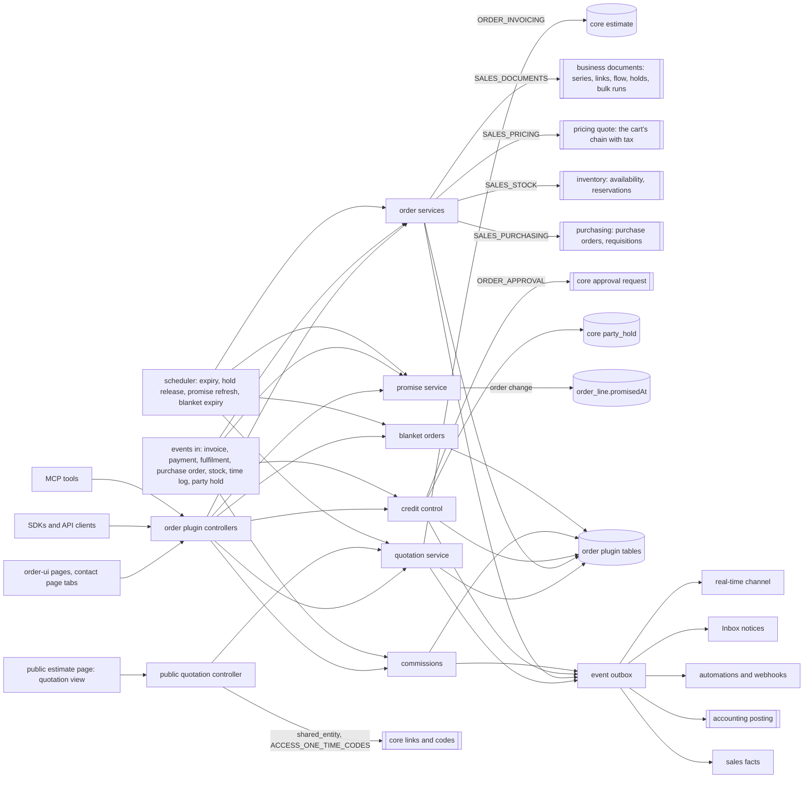

# Implementation Plan: Sales order management

> Translates an approved `spec.md` into architecture and tech choices. The plan owns
> implementation details; the spec owns behaviour.

**Feature ID**: `sales-order-management`
**Spec**: `./spec.md`
**Tasks**: `./tasks.md`
**Status**: `Draft`
**Last updated**: 2026-11-23

---

## 1. Architecture Summary

Everything lands in the existing `@gauzy/plugin-order` (`packages/plugins/order`) as new sub-modules beside the order
aggregate, plus a new Angular plugin `@gauzy/plugin-order-ui` (`packages/plugins/order-ui`) and a quotation view on the
existing public estimate page of `public-layout-ui`. A quotation is the order in its draft stage plus an
`order_quotation` record; each sent revision issues a core estimate through the existing `ORDER_INVOICING` port
(`OrderInvoicingAdapter`), which stays the only writer of estimates from this plugin. Shared engines are reached
through ports bound in `apps/api/src/plugin-composition.ts`, never by importing another plugin's internals.

**Built on what exists, one model per concept.**

- **Customer values** live on the customer's own records. The contact keeps what it already holds
  (`organization_contact.creditLimit`, `creditUsed`, `paymentTermId`, `paymentTermsDays`, `currency`, `priceListId`,
  `channelId`, default addresses; `ownerUserId` as account manager and `territoryId`, the columns `crm-leads-and-deals`
  adds) and gains only the missing sales columns; customer groups are core `contact_group` rows, which gain a parent
  (the group tree) and their defaults; a contact's `defaultGroupId` names, among its group memberships, the group that
  gives it defaults (as `defaultBillingAddressId` names one of its addresses). Organization values are `sales.*` keys of
  the platform settings store. There is no sales profile table.
- **Credit**: the limit resolves contact → group tree → organization setting; exposure extends the contact's
  `creditUsed` (re-derived nightly from the order and refund ledgers) with open receivables from
  `invoicing-receivables-payables`; every credit decision, for an order or for an invoice review of
  `invoicing-receivables-payables`, is one `sales_credit_decision` row, written through `SALES_PARTY_GUARD`.
- **Holds and blocks**: an order hold is the document engine's `hold` / `release` action on the order's document
  (`business-document-engine`); the order keeps only a reason code and a release date, which the engine lacks.
  Customer blocks are rows of core `party_hold` (`partyType = CONTACT`), the one party-hold record shared with supplier
  holds (`packages/core/src/lib/party-hold/`, `PartyHoldService`, defined with `procurement`).
- **Public link and signature**: the online quotation is the existing public estimate page
  (`public-layout-ui` route `:type/:id/:token`, `components/invoice-estimate/`) with a quotation view; its link is a core
  `shared_entity` row with the hashed token, expiry, revocation, view count and code flag that
  `access-control-and-security` adds to it, and the one-time code comes from `ACCESS_ONE_TIME_CODES`. A signature is an
  image asset plus a core `terms_acceptance` evidence row, the same signing step as contracts of
  `crm-leads-and-deals`. Older estimate links keep answering through `ESTIMATE_ANSWER_ROUTER`.
- **Lost reasons and chosen alternatives** are the organization's CRM lists (`crm_list_item`, lists `LOST_REASON` and
  `CHOSEN_ALTERNATIVE`, `crm-leads-and-deals` FR-88), shared by deals and quotations.
- **Promises**: the promise date is the existing `order_line.promisedAt` with `leadTimeDays` (and the order's
  `promisedAt`, the latest line promise materialised by the totals writer). The promise service is its only writer: it
  sets it directly on draft lines and, once an order is confirmed, through an order change (`UPDATE_ORDER_PROPERTIES`),
  so every move shows in the order's history; it adds only the reason and source. `delivery-and-shipping` and every
  other reader read these columns.
- **Proformas** are documents of the engine (type `proforma`): a thin `order_proforma` row with its lines as engine
  document lines (`business_document_line`, source = the order lines), numbered from the engine's `proforma` series,
  printed through the print designer, emailed through the platform's document email path, linked through
  `shared_entity`.
- **Bulk invoicing** over a selection of orders starts a document-engine bulk run (core operation
  `BUSINESS_DOCUMENT_BULK`, grouping per party and currency, items per order).
- **Sales structure**: sales groups are core organization teams (`organization_team` with its members and managers);
  a territory names the team that serves it; a sales person is an employee with a commission plan and an enabled flag.
  Targets publish their attainment to a core goal KPI (`goal_kpi`). Commission arithmetic (rate, basis and tiers
  resolved once and snapshotted, exact money) is the marketplace's, lifted from `seller-commission.service.ts` into
  `packages/core/src/lib/money/commission.ts` and used by both plugins; statements are paid as party payouts of
  `payment-gateways` (the statement registered with `PAYOUT_SOURCES`) or as pay elements handed to payroll.
- **Item restrictions**: `sales_item_restriction` is the one restriction model of every selling path (quotations,
  orders, the register through `SALES_ITEM_RESTRICTIONS`); channel publication (`product_channel`) decides what a
  channel offers and restrictions narrow it per customer or group.
- **Inter-company**: the purchase order drafted in the represented organization is this plan's; the invoice side
  uses the `invoice.sentTo` mirror of `invoicing-receivables-payables`.
- **Reports** are report-builder definitions; **runs** (commission statements) are core operations; **migrations** use
  the shared core migration helpers (`@gauzy/core`, `database/migration-helpers.ts` beside `check-constraint.helper.ts`).

## 2. Tech Choices

| Concern | Choice | Rationale |
| --- | --- | --- |
| Package | existing `packages/plugins/order`, new sub-folders `quotation/`, `sales-customer/`, `sales-team/`, `commission/`, `blanket-order/`, `credit-control/`, `promise/`, `proforma/`, `sales-report/` | Principle I; extend, no parallel model |
| UI | new `packages/plugins/order-ui` (Angular, `sales-sections` of the page route registry, plus tabs on the existing contact page); quotation view on the existing public estimate page of `packages/plugins/public-layout-ui` | Principle I; one screen per concept |
| Persistence | MultiORM entities + MikroORM repositories, tri-dialect migrations in `src/lib/database/migrations/` with the shared core migration helpers; core columns through the kernel set | Principle III; no plugin copy |
| Quotation owner | `order` + `order_quotation`; estimate = issued copy through `ORDER_INVOICING` | one model, never two |
| Numbering, links, flow, holds, bulk runs | `business-documents` registry (the `sales_order` type over the order plugin's existing orders, and the `quotation` type that wraps estimates issued by existing order quotes, register with `preexisting: true` of `business-document-engine` FR-113: the engine's added locks, refusals and tolerances stay off for them unless the organization turns a type policy on); fallback to core `SequenceService` and the plugin's own references while `FEATURE_BUSINESS_DOCUMENTS` is off (holds then read the order's reason code; proformas and bulk runs need the engine) | depends on `business-document-engine` |
| Customer and group values | columns on `organization_contact` and `contact_group`; organization values in `sales.*` settings | no copy of a contact fact; no settings table |
| Customer blocks | core `party_hold` (`CONTACT`) through `PartyHoldService` | one party-hold model with suppliers |
| Credit decisions | `sales_credit_decision`, shared with the invoice credit reviews of `invoicing-receivables-payables` | one credit-decision record |
| Public links and codes | core `shared_entity` (hashed token, expiry, revocation, views, code flag) and `ACCESS_ONE_TIME_CODES` | one link facility |
| Signatures | image asset + core `terms_acceptance` evidence | one signing step with contracts |
| Money | core money kernel (`DecimalString`, exact decimal text), organization currency and rate stored; commission arithmetic in `packages/core/src/lib/money/commission.ts` | [platform architecture](../../architecture/business-suite.md) §6; one commission resolver |
| Events | `EventOutboxService.append` + `EventConsumerRegistry` consumers | Principle VII |
| Jobs | `@ScheduledJob` + `@QueueWorker` (`@gauzy/scheduler`, ticks in `job_execution`); statement generation as core operation `SALES_COMMISSION_STATEMENTS`; in-process fallback timer without a queue | one run ledger |
| Approvals | core `RequestApprovalService` through `ORDER_APPROVAL` (types `SALES_ORDER`, `SALES_ORDER_CREDIT`, `SALES_QUOTATION`) | becomes workflow definitions in `approval-workflows` |
| Flags | `@FeatureFlag(FEATURE_ORDER)` on every order controller, the existing `request-approval` and `approve` routes included; `FEATURE_ORDER_APPROVALS` read only by the new threshold routing in the place path; `@FeatureFlag(FEATURE_SALES)` (+ sub-feature) on new ones; migration `1791000020180-EnableOrderFeatureForTenantsWithOrders` writes an enabled `FEATURE_ORDER` toggle for every tenant that has an `order` row (idempotent) | wire declared codes; no tenant using orders loses a route |
| Settings and permissions | `sales.*` setting contributions and permission contributions with `defaultFor` (`packages/plugin/src/lib/plugin-contributions.ts`) | no settings table, no seed migration |
| New ports (declared in `order.types.ts`, bound in `plugin-composition.ts`) | `SALES_PRICING` (`PricingQuoteService` of `pricing-and-promotions`, which runs the cart's basket chain; unbound → the existing price resolution port), `SALES_DOCUMENTS` (document registry, series, links, holds, bulk runs), `SALES_STOCK` (availability, reservations, pick lists), `SALES_PURCHASING` (purchase orders, requisitions, supplier terms and lead times), `SALES_PRODUCTION` (unbound until manufacturing exists), `SALES_PROJECTS` (core project and task services), `SALES_GOALS` (core goal KPI service), `SALES_PAYOUTS` (`payment-gateways` payout sources; unbound → statements marked paid by hand); provided to other plugins: `SALES_PARTY_GUARD` (party holds, credit and document-chain checks the delivery and invoice paths call, and the credit-review writer of invoicing), `SALES_ITEM_RESTRICTIONS`; core `ESTIMATE_ANSWER_ROUTER` (optional; consulted by the estimate answer paths before conversion) | the plugin's existing port idiom; each unbound port has a documented fallback |

## 3. Data Model

All new tables extend `TenantOrganizationBaseEntity` (tenant, organization, soft delete, audit columns). Amounts are
`numeric(20,6)` with a `currency` column; JSON is `text` on every dialect (one code path for both ORMs).

### New or changed entities

| Table | Columns (besides base) | Keys and indexes |
| --- | --- | --- |
| `order_quotation` | `orderId` uuid FK cascade; `number` varchar(64); `status` varchar(16) (`DRAFT`, `SENT`, `VIEWED`, `REVISING`, `ACCEPTED`, `DECLINED`, `EXPIRED`, `LOST`); `validUntil` date; `currentRevision` int; `dealId`, `sourceEstimateId`, `ownerUserId`, `approvalRequestId`, `acceptedRevisionId`, `shareId` uuid null (the `shared_entity` row of the current link; views are counted there, the first view is the `VIEWED` transition); `isTemplate` bool; `attribution` text; `lostAt`, `acceptedAt` timestamp; `acceptedBy` varchar(16); `lostNote` text | unique `orderId`; unique (`organizationId`,`number`); index (`organizationId`,`status`,`validUntil`), (`organizationId`,`dealId`) |
| `order_quotation_revision` | `quotationId` FK cascade; `revision` int; `estimateId` uuid null (FK `invoice` set null); `snapshot` text; `fingerprint` varchar(64); `status` varchar(16) (`SENT`, `SUPERSEDED`, `WITHDRAWN`, `ACCEPTED`, `DECLINED`, `EXPIRED`, `LOST`); `issuedAt`, `answeredAt` timestamp; `sentTo`, `signerName`, `signerEmail` varchar(255); `emailOutcome` varchar(32); `selections` text; `signatureAssetId` uuid; `acceptanceId` varchar(128) (the `terms_acceptance` row holding signing time, hashed address, client, method and the fingerprint of revision plus selections); `declineReason` text | unique (`quotationId`,`revision`); index `estimateId` |
| `order_quotation_outcome_item` | `quotationId` FK cascade; `kind` varchar(24) (`REASON`, `CHOSEN_ALTERNATIVE`); `itemId` uuid (a `crm_list_item` of list `LOST_REASON` or `CHOSEN_ALTERNATIVE`, no FK across sets) | unique (`quotationId`,`kind`,`itemId`) |
| `order` (+ columns, nullable) | `requestedAt` timestamp; `purchaseOrderDate` date; `deliveryTermsId`, `projectId`, `territoryId`, `salesPartnerId`, `blanketOrderId`, `internalPurchaseOrderId` uuid; `deliveryTermsPlace` varchar(255); `holdReasonCode` varchar(32); `holdUntil`, `confirmationSentAt` timestamp; `creditState` varchar(16) default `NOT_CHECKED`; `noConfirmationEmail` bool default false | index (`organizationId`,`territoryId`), (`organizationId`,`salesPartnerId`), (`organizationId`,`creditState`), (`holdUntil`) where not null |
| `order_line` (+ columns) | `offerRole` varchar(16) default `REQUIRED`; `alternativeGroup` varchar(64); `isSelected` bool default true; `requestedAt` timestamp; `promiseReason` varchar(32); `promiseSourceId` uuid (the promise itself is the existing `promisedAt` with `leadTimeDays`); `isClosed` bool default false; `closedQuantity`, `reservedQuantity`, `pickedQuantity`, `purchasedQuantity`, `requisitionedQuantity`, `plannedQuantity`, `producedQuantity` numeric default 0; `deliveredBySupplier` bool default false; `supplierId`, `bundleParentLineId`, `salesUnitId`, `projectId`, `taskId`, `blanketOrderLineId` uuid; `salesUnitFactor`, `salesUnitQuantity`, `unitCost` numeric; `serviceMode` varchar(16) default `NONE`; `isCommissionable` bool default true; `customerItemCode` varchar(64) | index (`orderId`,`alternativeGroup`), `bundleParentLineId`, `blanketOrderLineId` |
| `order_line_schedule` | `orderLineId` FK cascade; `dueAt` date; `quantity`, `deliveredQuantity` numeric; `isClosed` bool | index (`organizationId`,`dueAt`) |
| `order_proforma` (document type `proforma` of the engine) | `orderId` FK; `number` varchar(64); `basis` varchar(16); `amount` numeric; `currency`; `hideQuantities` bool; `status` varchar(16); `issuedAt`, `sentAt` timestamp; `sentTo` varchar(255); no lines column: its lines are the engine's document lines | unique (`organizationId`,`number`) |
| `order_sales_share` | `ownerType` varchar(16) (`CONTACT` = a customer's default team, `ORDER`); `ownerId`, `salesPersonId`, `commissionPlanId` uuid; `sharePercent` numeric(7,4); `frozenRate` numeric(9,6) | unique (`ownerType`,`ownerId`,`salesPersonId`) |
| `organization_contact` (core, existing + columns) | `salesPartnerId`, `commissionPlanId`, `deliveryTermsId`, `representsOrganizationId` (the internal flag), `defaultGroupId` uuid; `deliveryTermsPlace` varchar(255); `overdueThreshold` numeric(20,6); `creditCheckStage` varchar(16); `requireOrderForDelivery`, `requireDeliveryForInvoice` bool null; `customerNumber`, `supplierNumberAtCustomer` varchar(64); `ownerUserId` and `territoryId` added only where `crm-leads-and-deals` has not added them (same names) | unique (`organizationId`,`customerNumber`) live; unique (`tenantId`,`representsOrganizationId`) where not null |
| `contact_group` (core, existing + columns) | `parentId` uuid (self, set null; the group tree); `paymentTermId`, `territoryId`, `commissionPlanId`, `deliveryTermsId` uuid; `creditLimit`, `overdueThreshold` numeric(20,6); `creditCheckStage` varchar(16); `requireOrderForDelivery`, `requireDeliveryForInvoice` bool null; the existing `priceListId` and `discountPercent` read as they are | index `parentId` |
| `sales_item_restriction` | `ownerType` (`CONTACT`, `CONTACT_GROUP`), `ownerId`, `mode` (`ALLOW`,`DENY`), `targetType` (`VARIANT`,`PRODUCT`,`CATEGORY`,`TAG`), `targetId` | unique on all five |
| `sales_territory` | `name`, `code`, `parentId` (self, set null), `isGroup`, `teamId` uuid (the `organization_team` serving it; its managers manage the territory) | unique (`organizationId`,`code`) |
| `sales_person` | `employeeId`, `commissionPlanId`, `isEnabled` (groups of sales people are organization teams) | unique (`organizationId`,`employeeId`) |
| `sales_partner` | `contactId` FK `organization_contact`; `partnerType` varchar(64); `territoryId`, `commissionPlanId`, `logoAssetId` uuid; `referralCode` varchar(32); `isPublic` bool; `publicDescription` text; `website` varchar(255) | unique (`organizationId`,`contactId`), (`organizationId`,`referralCode`) |
| `sales_target`, `sales_target_weight` | `ownerType` (`TERRITORY`,`SALES_PERSON`,`PARTNER`), `ownerId`, `periodStart`, `periodEnd`, `measure`, `productCategoryId`, `targetAmount`, `targetQuantity`, `currency`, `weightId`, `goalKpiId` (the core `goal_kpi` the attainment is published to) / `name`, `weights` text, `isEven` | index (`ownerType`,`ownerId`,`periodStart`) |
| `sales_commission_plan` | `name`; `baseRate` numeric(9,6); `tiers`, `categoryRates` text; `earningEvent` varchar(16); `clawback`, `isActive` bool | unique (`organizationId`,`name`) |
| `sales_commission_entry` | `beneficiaryType` (`SALES_PERSON`,`PARTNER`), `beneficiaryId`, `orderId`, `orderLineId`, `sourceType` varchar(32), `sourceId`, `statementId` uuid; `baseAmount`, `rate`, `amount` (signed), `currency`; `status` varchar(16); `earnedAt` | unique (`orderLineId`,`beneficiaryType`,`beneficiaryId`,`sourceType`,`sourceId`) (idempotency); index (`beneficiaryId`,`status`,`earnedAt`) |
| `sales_commission_statement` | `beneficiaryType`, `beneficiaryId`, `number`, `periodStart`, `periodEnd`, `status`, `total`, `currency`, `approvedByUserId`, `approvedAt`, `paidAt`, `payoutRef` varchar(128) (the provider transfer reported back through `PAYOUT_SOURCES`), `payElementRef` | unique (`organizationId`,`number`); unique (`beneficiaryId`,`periodStart`,`periodEnd`) where status ≠ `CANCELED` |
| `sales_blanket_order` / `_line` | `contactId`, `number`, `startsAt`, `endsAt`, `currency`, `priceListId`, `status`, `allowancePercent`, `note` / `blanketOrderId` FK cascade, `variantId`, `agreedPrice`, `agreedQuantity`, `orderedQuantity`, `version` (`@VersionedColumn`) | unique (`organizationId`,`number`); unique (`blanketOrderId`,`variantId`) |
| `sales_delivery_terms` | `code` varchar(8), `name`, `description`, `isActive` | unique (`organizationId`,`code`) |
| `sales_credit_decision` (the one credit-decision record of orders and invoices) | `contactId`, `orderId` null, `invoiceId` null, `approvalRequestId`, `decidedByUserId` uuid; `decision` varchar(24) (`RELEASED_ONCE`, `LIMIT_RAISED`, `ADVANCE_REQUESTED`, `REJECTED`, `APPROVED_ONCE`, `DECLINED`); `reviewState` varchar(16) (`REQUESTED`, `DECIDED`, `WITHDRAWN`, `EXPIRED`); `exposureSnapshot` text; `condition` text; `approvedExposure` numeric(20,6); `previousLimit`, `newLimit` numeric; `decidedAt`, `expiresAt` timestamp | check `orderId` or `invoiceId` set; index (`contactId`,`decidedAt`), `orderId`, `invoiceId` |
| `sales_fact` | order-line grain: `orderId`, `orderLineId`, `customerId`, `contactGroupId`, `territoryId`, `partnerId`, `variantId`, `productCategoryId`, `factDate`, `quantity`, `netAmount`, `orgAmount`, `cost`, `isReturn` | unique `orderLineId`+`isReturn`; index (`organizationId`,`factDate`) |

Customer blocks are rows of core `party_hold` (`partyType = CONTACT`, defined with `procurement`): for a customer,
`holdsOrdering` stops quotations and orders, `holdsReceiving` stops deliveries, `holdsBilling` stops invoices and
`holdsPaying` stops refunds and payouts to it; a full block sets all four; `releaseAt` is the release date, lifted by
the core release sweep; `reason`, `source` and the user who placed it are on the row. Organization defaults are the
`sales.*` settings; the internal flag is `representsOrganizationId` being set.

Cross-set references (`invoice`, `organization_contact`, `employee`, `product_category`, purchasing and inventory ids)
follow the plugin's rule: the set that creates a target constrains it; references into other plugins carry no FK.

### Migrations

**Migration timestamps**: `packages/plugins/order` `1791000020100` to `1791000020199`; `packages/core` `1791000020900` to `1791000020999`.

Plugin migration set (`ALL_ORDER_MIGRATIONS`), each with PostgreSQL, MySQL and SQLite branches written with the shared
core migration helpers, idempotent, a `down` that reverses its own statements, registered for both ORMs:
`1791000020100-CreateOrderQuotationTables` (quotation, revision, outcome items), `1791000020110-AddOrderSalesColumns`
(order and order_line columns, `order_line_schedule`, `order_proforma`, `order_sales_share`),
`1791000020120-CreateSalesMasterTables` (restrictions, territories, sales people, partners, delivery terms, credit
decisions), `1791000020130-CreateSalesTargetCommissionTables`, `1791000020140-CreateSalesBlanketOrderTables`,
`1791000020150-CreateSalesFactTable`, `1791000020170-SeedSalesDeliveryTerms` (per existing organization; new
organizations get the list from the organization-created handler). Kernel set (`packages/core/src/lib/database/migrations/`):
`1791000020900-ExtendContactAndGroupSalesColumns` (the `organization_contact` and `contact_group` columns above).
Permissions and default grants are plugin contributions; no migration is needed for them. Every new `order_line` column is
nullable or defaulted: no backfill. A data step creates `order_quotation` rows for existing draft or pending orders
with a `quoteInvoiceId` (revision 1 = that estimate), so old quotes join the new model; these rows get no `validUntil`
(the expiry job skips them) and the order and its estimate are left as they are, so the old estimate link keeps
answering. `1791000020180-EnableOrderFeatureForTenantsWithOrders` (see Flags).
`1791000020190-SeedOrderConfirmationEmailTemplate` (the order confirmation email template, every locale).

### Contracts

`packages/contracts/src/lib/`: `order-quotation.model.ts` (quotation, revision, selections, answer, send and accept
inputs, statuses), `sales-master.model.ts` (contact and group sales values with their resolved sources, restriction,
territory, person, partner, target, delivery terms), `sales-commission.model.ts`, `sales-blanket-order.model.ts`,
`sales-credit.model.ts` (decision, review state, exposure breakdown), additive fields in `order.model.ts` (`IOrder`,
`IOrderLine`), `IOrganizationContact` and `IContactGroup`; `OrderLineOfferRole`, `OrderLineServiceMode`,
`OrderCreditState`, `PromiseReason` enums.

## 4. API Surface

All routes: `TenantPermissionGuard`, `PermissionGuard`, `@FeatureFlag`, Swagger, class-validator DTOs, cursor
pagination on lists, `Idempotency-Key` on creating and sending routes, `If-Match` on writes of versioned rows.

| Method | Endpoint | Permission | Description | Status |
| --- | --- | --- | --- | --- |
| `*` | `/orders/**`, `/order-*` (existing 11 controllers) | existing | gated by `FEATURE_ORDER` (switched on by migration for tenants with orders); contracts, permissions and answers unchanged, `request-approval` and `approve` included | Changed |
| `POST` | `/orders/:id/quote/send` · `/accept` · `/decline` | existing | routed through the quotation (FR-32) | Changed |
| `GET`, `POST` | `/order-quotations` | `SALES_QUOTATIONS_VIEW` / `_EDIT` | list, create (`customerId`, `dealId`, `fromQuotationId`, `templateId`) | New |
| `GET`, `PUT` | `/order-quotations/:id` | `_VIEW` / `_EDIT` | read; validity, owner, terms, attribution | New |
| `PUT` | `/order-quotations/:id/lines/:lineId/offer` | `_EDIT` | role, alternative group, preferred | New |
| `POST` | `/order-quotations/:id/send` · `/revise` · `/accept` · `/decline` · `/lost` · `/link/revoke` | `_EDIT` | lifecycle; `send` and `accept` take `preview`; `send` issues the `shared_entity` link, `link/revoke` revokes it; `lost` takes CRM list items | New |
| `GET` | `/order-quotations/:id/revisions` · `/revisions/compare?from=&to=` | `_VIEW` | history and diff | New |
| `POST` | `/order-quotations/from-estimate/:estimateId` | `_EDIT` + `ESTIMATES_VIEW` | convert (FR-31) | New |
| `GET`, `POST` | `/public/quotations/:token` · `/totals` · `/code` · `/accept` · `/decline` · `/questions` · `/pdf` | public, token (a `shared_entity` link, looked up by hash) | data and answers of the quotation view of the public estimate page (rate limited) | New |
| `POST` | `/orders/:id/hold` · `/resume` · `/close` · `/lines/:lineId/close` · `/lines/:lineId/reopen` | `ORDERS_EDIT` | hold and resume perform the engine's `hold` / `release`; close | New |
| `PUT` | `/orders/:id/lines/:lineId/schedule` | `ORDERS_EDIT` | portions (manual or generated) | New |
| `POST` | `/orders/:id/reservations` · `/reservations/release` | `ORDERS_EDIT` + `STOCK_EDIT` | reservation requests | New |
| `POST` | `/orders/:id/purchase-orders` · `/requisition` · `/production-request` · `/pick-list` · `/project` · `/advance-request` | `ORDERS_EDIT` + target grant | create linked documents; `preview` | New |
| `GET`, `POST` | `/orders/:id/proformas`, `/order-proformas/:id/send` · `/cancel` · `/pdf` | `ORDERS_VIEW` / `ORDERS_EDIT` | proformas (engine document type `proforma`) | New |
| `POST` | `/orders/:id/confirmation/send` | `ORDERS_EDIT` | resend confirmation | New |
| `GET` | `/orders/:id/flow` · `/availability` · `/promise` · `/margin` | `ORDERS_VIEW` (margin: `SALES_MARGIN_VIEW`) | flow, stock, promise, margin | New |
| `POST` | `/orders/bulk/invoice` | `ORDERS_EDIT` + `INVOICES_EDIT` | starts a document-engine bulk run (`202`, order → invoice); per-order results at the engine's `/bulk-runs/:operationId/items` | New |
| `GET`, `POST` | `/orders/:id/credit` · `/credit/decision` | `ORDERS_VIEW` / `SALES_CREDIT_RELEASE` | exposure; release, raise, advance, reject (a `sales_credit_decision` row) | New |
| `GET`, `PUT` | `/sales-customers/:contactId/defaults`, `/sales-customer-groups/:groupId/defaults` | `SALES_CUSTOMERS_EDIT` (read `ORG_CONTACT_VIEW`) | the contact's or group's sales columns with resolved values and their sources | New |
| `GET` | `/sales-customers/:contactId/overview` | `ORG_CONTACT_VIEW` (+ `INVOICES_VIEW` parts) | customer overview | New |
| `POST` | `/sales-customers/:contactId/block` · `/unblock` | `SALES_CUSTOMERS_EDIT` | places or releases a core `party_hold` (`CONTACT`) through `PartyHoldService` | New |
| CRUD | `/sales-item-restrictions`, `/sales-territories`, `/sales-persons` (+ `/:id/reassign`), `/sales-partners`, `/sales-targets` (+ `/attainment`), `/sales-target-weights`, `/sales-delivery-terms` | `SALES_TEAMS_*` / `SALES_CUSTOMERS_EDIT` / `SALES_SETTINGS_EDIT` | masters | New |
| `GET` | `/public/organizations/:organizationId/partners` | public | published partners (read feed) | New |
| CRUD | `/sales-commission-plans`, `GET /sales-commission-entries` | `SALES_COMMISSIONS_VIEW` / `_EDIT` | plans and entries | New |
| `POST`, `GET` | `/sales-commission-statements/generate` · `/:id/approve` · `/:id/pay` · `/:id/cancel` · `/:id/pdf` · `/mine` | `_EDIT` / `_APPROVE`; `mine`: own | statements; `generate` answers `202` with the operation | New |
| CRUD | `/sales-blanket-orders` (+ `/:id/confirm` · `/close` · `/reopen` · `/cancel`) | `SALES_BLANKET_ORDERS_*` | blanket orders | New |
| `GET`, `PUT` | `/sales-settings` | `SALES_SETTINGS_EDIT` (read `ORDERS_VIEW`) | organization settings, including the organization-level customer defaults | New |

Lost reasons and chosen alternatives are maintained on the CRM lists page (`crm-leads-and-deals`); this plan adds no list
route. Errors use the plugin's coded messages (`QUOTATION_REVISION_STALE`, `QUOTATION_EXPIRED`,
`ORDER_LINE_BELOW_DELIVERED`, `BLANKET_ALLOWANCE_EXCEEDED`, `CONTACT_BLOCKED`, `CREDIT_HELD`, …). Reports have no
routes of their own: they are report definitions served by the report builder.

**Consumer tokens answered** (bound in `apps/api/src/plugin-composition.ts` to the order services (territories, quotation acceptance, order lines, party restrictions, order requests); each consumer plan states the shape it calls and its fallback): `CRM_TERRITORIES`, `ITEM_PARTY_RESTRICTIONS`, `MANUFACTURING_SALES`, `PORTAL_ORDER_REQUESTS`, `PORTAL_QUOTATIONS`, `PROJECT_SALES_ORDERS`, `PURCHASING_SALES`, `SUBCONTRACTING_SALES`.

## 5. Events, Real-Time and Notifications

| Event (outbox, partition `ORDER:<orderId>` unless noted) | Emitted when | Consumers |
| --- | --- | --- |
| `order.quotation.sent` · `viewed` · `revising` · `accepted` · `declined` · `lost` · `expired` | quotation lifecycle | real-time hint, Inbox (accepted, declined, question to owner), CRM deal update, automations, webhooks, sales facts |
| `order.held` · `resumed` · `line_closed` · `closed` | hold and close | real-time, automations |
| `order.credit.held` · `released` · `rejected` | credit control | Inbox to `SALES_CREDIT_RELEASE` holders, approval request, real-time |
| `order.promise.changed` | a line's promise moved (an order change) | Inbox to owner when past requested date, real-time |
| `order.commission.accrued` · `earned` · `reversed`; `order.commission_statement.approved` · `paid` (partition `COMMISSION:<beneficiaryId>`) | commission lifecycle | `accounting` posting, Inbox to beneficiary, payout |
| `order.blanket.confirmed` · `closed` · `expired`; `order.proforma.issued` | masters and proformas | automations, webhooks |
| `document.quotation.*`, `document.sales_order.*`, `document.blanket_order.*`, `document.commission_statement.*`, `document.proforma.*` | through the document engine | posting engines, document flow |

Consumed: `fulfillment.shipped|delivered` (line progress), invoice and payment events (commission earning, credit
exposure, advance release), purchase order and stock level events (promise refresh), time log events and task
completion (service lines), `party_hold.placed` / `.released` (re-check held orders of the customer), the core
`EstimateAnsweredEvent` (FR-30). Real-time: change hints for `order`, `order_quotation`, `sales_commission_statement`.
Emails: quotation email (the estimate email, with the online link), new templates `order-confirmation` (one template
for every order source, with a variant per channel where a channel sets one; sent for orders placed in the Sales app,
and for checkout and other existing sources only where `sales.confirmationEmailForExistingSources` is on for the
organization or channel, default off), `order-proforma`,
`quotation-question-reply`, `commission-statement`.

## 6. UI Surface

- **`packages/plugins/order-ui`** registers under `sales-sections`: `quotations` (list, editor with the line grid,
  options and alternatives, availability and margin columns, revisions and diff), `orders` (list, board, calendar,
  detail with tabs: lines, deliveries, invoices, payments, changes, timeline, flow), `customers` (the existing contacts
  list filtered to customers, opening the existing contact page), `blanket-orders`, `team` (territories, sales people,
  partners, targets; groups of sales people are managed on the existing Teams page), `commissions` (plans, entries,
  statements, my statements), `settings`. Menu entries need `FEATURE_SALES` and the view permission; a page answered
  `404` is hidden. Every list is a saved-view list.
- The existing contact page (`apps/gauzy/src/app/pages/contacts`, `contact-view`) gains tabs contributed by `order-ui`:
  sales overview, sales defaults (with their sources), buyers, restrictions, block; customer groups gain their parent
  and defaults on the existing group screens. Tabs and group fields show only while `FEATURE_SALES` is on; with it off
  the contact and group screens are unchanged.
- Shared components exported for other plugins: `ga-document-flow` (flow panel), `ga-promise-badge`, `ga-credit-panel`.
- `public-layout-ui`: the existing estimate page (`:type/:id/:token`, `InvoiceEstimateViewComponent`) gains a quotation
  view for issued revisions (options and alternatives, totals recalculated on the server, signature pad with typed
  alternative, one-time code, question box).
- `apps/gauzy/src/app/pages/invoices/invoice-estimates`: a banner and link for estimates that are issued copies.
- i18n keys `SALES.*` in every locale of `packages/ui-core/i18n/`.

## 7. MCP Tools, SDKs and Integrations

- `packages/mcp-server/src/lib/tools/sales-quotations.ts`: `get_quotations`, `get_quotation`, `create_quotation`,
  `send_quotation` (preview), `accept_quotation` (preview), `mark_quotation_lost`, `compare_quotation_revisions`,
  `draft_quotation_from_message` (preview; input: text, sender email; output: party, lines, confidence, unmatched).
- `sales-orders.ts`: `get_orders`, `get_order`, `get_order_flow`, `place_order` (preview), `hold_order`,
  `create_order_purchase_orders` (preview), `get_order_promise`, `propose_line_substitutions`, `explain_order_margin`.
- `sales-customers.ts`: `get_customer_overview`, `update_customer_sales_defaults`, `block_customer`,
  `release_credit_hold` (preview). `sales-commissions.ts`: `get_commission_statements`, `generate_commission_statements`
  (preview), `approve_commission_statement` (preview). `sales-blanket-orders.ts`: `get_blanket_orders`,
  `create_blanket_order`.
- OpenAPI regenerated; official SDKs regenerated at release. Outbound webhooks carry the events of §5.

## 8. Background Jobs

| Trigger | When | What it does | Idempotency |
| --- | --- | --- | --- |
| `order.quotation-expiry` (scheduler → queue) | daily 01:00 UTC | sent or viewed quotations past `validUntil` → `EXPIRED`, link expired, notice to owner | conditional update on status |
| `order.hold-release` | daily | held orders whose `holdUntil` passed → engine `release`, credit control again | conditional update |
| `order.blanket-expiry` | daily | active blanket orders past `endsAt` → `EXPIRED` | conditional update |
| `order.promise-refresh` (queue worker) | on stock, purchase order, production events; nightly full pass | recompute promises of open lines, debounced per line (60 s); writes `promisedAt` through an order change on confirmed orders | last-writer by line `version` |
| `order.commission-earning` (outbox consumer) | invoice, payment, return, credit, cancel events | create or reverse entries | unique entry key |
| operation `SALES_COMMISSION_STATEMENTS` | on request | build statements for a period | unique per beneficiary and period |
| `order.sales-facts` (outbox consumer) | order, quotation, return events | upsert `sales_fact` rows; update the targets' goal KPIs | unique `orderLineId`+`isReturn` |

Customer blocks are lifted by the core party-hold release sweep; expired invoice credit reviews are expired by the
invoicing job on the shared decision rows. The worker (`apps/worker/src/plugins.ts`, which already loads `order`)
registers the schedules and enqueues; the API consumes queues where a service needs email, PDF or core services.
Without a queue root the API runs the daily jobs on an in-process timer under an advisory lock (PostgreSQL), `GET_LOCK`
(MySQL) or an in-process guard (SQLite).

## 9. Security & Permissions

- New permission keys as contributions in `order.permissions.ts` with `defaultFor` (existing tenants through the
  permission reload): `SALES_QUOTATIONS_VIEW`, `SALES_QUOTATIONS_EDIT` (super admin, admin, manager);
  `SALES_PRICE_OVERRIDE`, `SALES_MARGIN_VIEW`, `SALES_CREDIT_RELEASE`, `SALES_SETTINGS_EDIT`, `SALES_COMMISSIONS_EDIT`,
  `SALES_COMMISSIONS_APPROVE` (super admin, admin); `SALES_CUSTOMERS_EDIT`, `SALES_TEAMS_VIEW`, `SALES_TEAMS_EDIT`,
  `SALES_COMMISSIONS_VIEW`, `SALES_BLANKET_ORDERS_VIEW`, `SALES_BLANKET_ORDERS_EDIT`, `SALES_REPORTS_VIEW` (super admin,
  admin; manager gets the view keys). Existing `ORDERS_*`, `CONTACT_CREDITS_EDIT`, `ESTIMATES_*` are reused unchanged.
- Public quotation routes: the link is a `shared_entity` row (random token, only its hash stored, revocable, expiring
  with the quotation); 30 requests per minute per token and address; the one-time code comes from
  `ACCESS_ONE_TIME_CODES` (6 digits, 10 minutes, 5 attempts); with that port unbound the "signature code" setting cannot
  be turned on.
- Signatures, signer names and emails are personal data: included in the contact's export and erased with it; the
  `terms_acceptance` evidence (hashed address, fingerprint) stays. Margins and costs never leave the API without
  `SALES_MARGIN_VIEW`.
- Agents act through the caller's request context; MCP tools never widen permissions; previews write nothing.
- Data leaving the platform: quotation, confirmation, proforma, statement and question-reply emails.

## 10. Observability

Order timeline (`order_history`) entries for every quotation, hold, close, credit and commission decision; activity log
on contacts and groups for sales value, block and credit changes. Metrics: quotations sent and accepted per day, time
from send to answer, credit holds open and their age, promise refresh lag, job durations and failures. Errors to the
platform logger with order and organization ids.

## 11. Phased Rollout

1. **Phase 1 — Surface what exists** (flag `FEATURE_SALES` off by default): `@FeatureFlag` wiring, `order-ui` orders
   list and detail, order creation, confirmation email, print templates, order and quote MCP tools, estimate answer
   routing (FR-29, FR-30, FR-32), first reports (orders to deliver and invoice, sales by dimension, quotation and order value over time).
2. **Phase 2 — Depth**: quotation record, revisions, options, lost reasons from the CRM lists, validity, conversion;
   order depth (dates, schedules, hold, close, guards, units, bundles, reservations, purchasing, requisitions,
   production and pick requests, proformas, inter-company); credit check and blocking; customer and group values,
   restrictions, overview; territories, people, partners, targets; blanket orders; delivery terms; settings; remaining
   reports.
3. **Phase 3 — Advanced capabilities**: online acceptance and signature on the public estimate page, credit holds as
   approval requests with decisions, promise dates, commissions and statements, service lines to projects, live
   document flow, agent tools.
4. **Phase 4 — General availability**: the feature is off by default; after the trial period it may be switched on by default for new tenants only; existing tenants keep their setting until an administrator changes it.

## 12. Constitution Reconciliation

- I Plugin-first: extends `packages/plugins/order`; UI in new `order-ui`; core gets one optional port (estimate
  answer routing), additive columns on the contact and group, and the shared commission arithmetic.
- II Tenant/organization scoping: base entity on every table; `TenantAwareCrudService`; public routes resolve the
  tenant from the link only.
- III Both ORMs, additive migrations: MultiORM entities, MikroORM repositories, three dialects, nullable columns.
- IV Default-off flag; nothing removed: `FEATURE_SALES` and new sub-features off; every existing route and field kept.
- V Contracts and API first: contracts first (T1), REST before UI, GraphQL reads added to the plugin's schema.
- VI Permissions, privacy, security: permission contributions, hashed link tokens, rate limits, personal data in
  export and erase.
- VII Real-time through the event bus: outbox events, real-time hints, Inbox notices; no private channel.
- VIII i18n and accessibility: keys in every locale, keyboard and screen-reader support, typed signature alternative.
- IX Tests: unit specs per service and pure function, e2e per controller, contract tests on existing routes.
- X Behaviour-first spec: the spec names no table or class.
- XI Documentation describes our platform only.

## 13. Risks & Mitigations

| Risk | Likelihood | Impact | Mitigation |
| --- | --- | --- | --- |
| Users meet two quotation screens | Medium | Medium | issued copies open the quotation; the estimates list shows the banner; Sales app is the only creation path once on |
| Dependent engines (documents, pricing, reservations) absent | High | Medium | ports with in-plugin fallbacks: core sequence, the cart's pricing chain, reservation ports |
| Credit exposure wrong without invoicing depth | Medium | High | exposure parts shown separately; receivables part only when invoicing reports it |
| Promise refresh load on big catalogues | Medium | Medium | debounced per line, event-scoped, nightly pass in the worker |
| Promise moves flood the order history | Medium | Low | one order change per refresh pass and order, only when a date moves |
| Order plugin grows large | High | Low | sub-modules with their own Nest modules and sub-features; can split later |
| Wiring `FEATURE_ORDER` cuts off a tenant that turned it off | Low | Medium | migration enables it for every tenant with orders; release note; toggle rows already enabled by default |
| Sales rules refuse or hold orders of existing paths (checkout, API) | Medium | High | every refusing, holding or requiring `sales.*` setting defaults to today's behaviour (credit check stage `NONE`, requested date not required, buyer reference accepted, price edit open to `ORDERS_EDIT`); contract tests on checkout and order routes with the feature on |

## 14. References

- Spec: `./spec.md` · Tasks: `./tasks.md`
- Code: `packages/plugins/order/src/lib/order-invoicing/order-invoicing.service.ts` (quote send, accept, decline),
  `order-approval/order-approval.adapter.ts`, `order-state-machine/order-state-machine.ts`, `order.features.ts`,
  `order-line/order-line.entity.ts` (`promisedAt`, `leadTimeDays`), `packages/core/src/lib/invoice/estimate-answer/`,
  `packages/core/src/lib/public-share/invoice/`, `packages/core/src/lib/shared-entity/`,
  `packages/core/src/lib/terms-acceptance/`, `packages/core/src/lib/organization-contact/`,
  `packages/core/src/lib/contact-group/`, `packages/core/src/lib/goal-kpi/`, `packages/core/src/lib/money/`,
  `packages/plugins/marketplace/src/lib/commission/seller-commission.service.ts`,
  `packages/plugins/public-layout-ui/src/lib/components/invoice-estimate/`, `apps/api/src/plugin-composition.ts`
- Plans: `../invoicing-receivables-payables/plan.md` (credit reviews), `../procurement/plan.md` (`party_hold`),
  `../crm-leads-and-deals/plan.md` (lists, contract signing), `../access-control-and-security/plan.md` (links, codes),
  `../business-document-engine/plan.md` (holds, bulk runs, document types)
