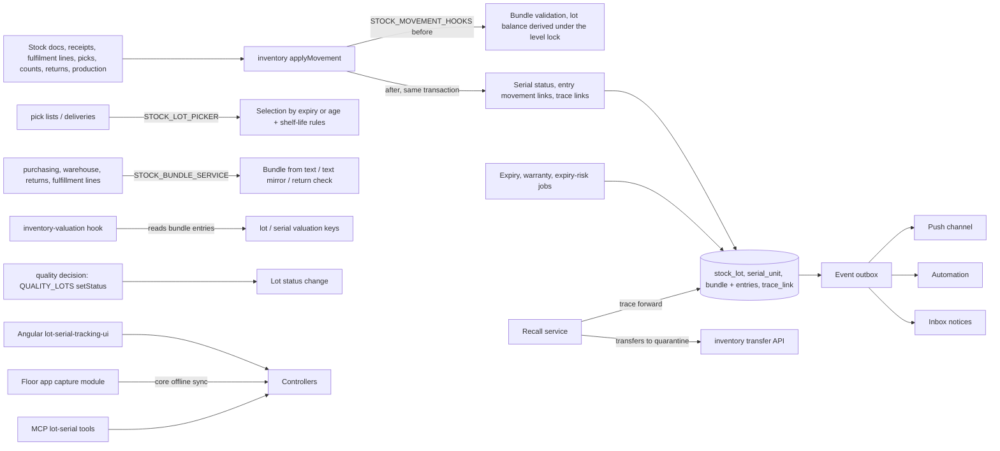

# Implementation Plan: Lots and serial units

> Translates an approved `spec.md` into architecture and tech choices. The plan owns
> implementation details; the spec owns behaviour.

**Feature ID**: `serials-and-batches`
**Spec**: `./spec.md`
**Tasks**: `./tasks.md`
**Status**: `Draft`
**Last updated**: 2026-11-23

---

## 1. Architecture Summary

A new plugin, `@gauzy/plugin-lot-serial-tracking` (`packages/plugins/lot-serial-tracking`), owns tracking policies,
lots, serial units, bundles, trace links and recalls. It stores no quantity: the level row of the inventory plugin
stays the only stored quantity per item and location, and a lot's balance per location and bin is derived from the
posted bundle entries of the movements (a canceled original keeps its entries and its reversing bundle offsets them), exactly as `StockLedgerService.readBinBalance` derives bin balances from
`stock_movement` rows ("nothing is stored on a bin"). A lot's reserved quantity is derived from the active
`stock_reservation` rows naming it (`lotId`, `serialUnitId`, added by `warehouse-and-stock-movements`).

It attaches to the existing stock write path through the ports declared by the inventory plugin: its
`STOCK_MOVEMENT_HOOKS` entry validates a line's bundle **before** the movement (lot balance read under the level lock)
and records serial statuses, entry movement links and trace links **after** it, in the same transaction. It also binds
`STOCK_LOT_PICKER` (automatic selection used by pick lists, deliveries, transfers and consumption) and
`STOCK_LOT_SCAN_RESOLVER` (lots and serial units for the scan resolver). The owners of tracked lines declare bundle
ports that this plugin binds (together `STOCK_BUNDLE_SERVICE` below): purchasing `PURCHASING_LOT_BUNDLES` (goods
receipt lines), warehouse `WAREHOUSE_LOT_BUNDLES` (pick lines), returns `RETURNS_LOT_BUNDLES` (order return, claim and
exchange lines, whose stock already moves through `RETURNS_STOCK_LEDGER`) and fulfillment `FULFILLMENT_LOT_BUNDLES`
(fulfilment lines). The valuation plugin reads the bundle entries from the movement context to key layers by lot or
serial unit. Unbound, nothing changes.

## 2. Tech Choices

| Concern | Choice | Rationale |
| ------- | ------ | --------- |
| Package | new `packages/plugins/lot-serial-tracking`, `lot-serial-tracking-ui` (Angular, including the capture module of the floor app `floor-ui`) | Principle I; one floor app |
| Coupling | ports of the inventory plugin and of the line owners, bound in `apps/api/src/plugin-composition.ts`; no import of other plugins | |
| Balances | derived per (lot, location, bin) from the `signedQuantity` of every posted `lot_serial_bundle_entry` row (one with a `movementId`), whatever its bundle's status became: a receipt of 10 that is canceled keeps its +10 entries under the `CANCELLED` original and the reversing bundle adds −10, so the balance is zero; draft entries carry no `movementId` and count nothing; read and checked under the movement's level lock; no balance table, no reserved counter | one stored quantity per item and location |
| Traces | an edge table (`trace_link`) walked breadth-first with cycle detection (a visited set of nodes) through any number of levels: `depth` (default 5) bounds only what one answer expands, and an answer with unexpanded nodes returns them as a continuation cursor (`next`) that the next call expands, until none is left; a recall's impact walks the forward trace to the end as steps of a core operation, never truncated | five levels < 2 s; no level left out |
| Numbering | lot and serial series through the business document engine's numbering series | [platform architecture](../../architecture/business-suite.md) §3.1 |
| Item defaults | shelf life and warranty period are the item's (`product.shelfLifeDays`, `product.warrantyDays` of `item-catalogue`); the policy stores overrides only; tracking `LOT`/`SERIAL` requires `product_variant_setting.trackInventory` (refused otherwise) and `NONE` leaves it unchanged | one default per item |
| Warranty | the serial unit holds the warranty dates and status of serial-tracked items; field service's installed units read them (event `serial_unit.warranty_expiring` and a read through its port) and keep dates only for untracked units; service contract end is read from field service's contracts | one owner, one job |
| Equipment | an own tool registered in core `equipment` keeps its `serialNumber` there; a serial unit taken into own use MAY link it (`equipmentId`), and items marked `isEquipment` default to that link | no second tool register |
| Offline | capture operations are kinds of the core offline-sync module (`lot-serial.capture`, owner the floor task), applied once through core idempotency; duplicate serials become `offline_exception` rows | one offline idiom |
| Jobs | `@ScheduledJob` + `@QueueWorker`, queue `lot-serial-tracking`, every pass a `job_execution` row; in-process fallback | scheduler package |
| Graph UI | SVG rendering in the Angular plugin with a list view as text alternative | accessibility |
| Settings, permissions, AI | settings keys in `lot-serial-tracking.settings.ts`; permission contributions with `defaultFor`; the expiry-risk agent is an agent definition of `ai-agents-and-assistants` reading production planning's forecast through `STOCK_DEMAND_FORECAST` | platform stores |

## 3. Data Model

### New or changed entities

All tables extend `TenantOrganizationBaseEntity` (soft delete on policies, lots and rules; none on bundles, traces).

| Table | Columns (beyond base) | Keys and indexes |
| --- | --- | --- |
| `item_tracking_policy` | `variantId`, `productId`, `itemGroupId` uuid null (exactly one), `mode` varchar(16) (`NONE`, `LOT`, `SERIAL`, `LOT_AND_SERIAL`), `lotSeriesId`, `serialSeriesId` uuid null, `shelfLifeDaysOverride` int null, `warrantyDaysOverride` int null (null = the item's own value), `expiryRequired` boolean, `expiryWarningDays` int, `pickingPolicy` varchar(8) null, `valuationBy` varchar(8) (`NONE`, `LOT`, `SERIAL`), `serialScope` varchar(16), `allowNegativeLots` boolean | unique (`organizationId`, `subjectKey`) |
| `stock_lot` | `number` varchar(64), `variantId` FK RESTRICT, `manufacturedAt`, `expiresAt` date null, `vendorId` uuid null, `sourceDocumentType` varchar(64), `sourceDocumentId` uuid, `parentLotId` FK self SET NULL, `plannedQuantity`, `producedQuantity` decimal(20,6), `status` varchar(16), `isDisabled` boolean, `description` text, `attributes` json | unique (`organizationId`, `variantId`, `number`) where not deleted; (`organizationId`, `status`, `expiresAt`) |
| `stock_lot_status_change` | `lotId` FK, `fromStatus`, `toStatus`, `reason` text, `sourceType` varchar(32), `sourceId` uuid, `changedByUserId` | (`lotId`, `createdAt`) |
| `serial_unit` | `number` varchar(128), `uniquenessKey` varchar(200), `variantId` FK, `lotId` FK null, `status` varchar(16), `warehouseId`, `binId` uuid null, `vendorId`, `receiptDocumentType`, `receiptDocumentId`, `customerContactId`, `deliveryDocumentType`, `deliveryDocumentId`, `deliveryOrderLineId`, `workOrderId`, `fixedAssetId`, `equipmentId`, `lastMovementId` uuid null, `warrantyStartsAt`, `warrantyEndsAt` date null, `warrantyStatus` varchar(16) | unique (`organizationId`, `uniquenessKey`); (`organizationId`, `status`, `warehouseId`); (`customerContactId`); (`deliveryOrderLineId`) |
| `serial_unit_event` | `serialUnitId` FK, `movementId` uuid, `documentType`, `documentId`, `fromStatus`, `toStatus`, `warehouseId`, `customerContactId`, `occurredAt` | (`serialUnitId`, `occurredAt`) |
| `lot_serial_bundle` | `documentType` varchar(64), `documentId`, `lineId` uuid, `direction` varchar(4), `warehouseId`, `status` varchar(16) (`DRAFT`, `CONFIRMED`, `CANCELLED`), `quantity` decimal(20,6), `reversesBundleId`, `originalBundleId` uuid null | unique (`documentType`, `lineId`, `direction`) among live bundles |
| `lot_serial_bundle_entry` | `bundleId` FK CASCADE, `lotId` FK null, `serialUnitId` FK null, `quantity` decimal(20,6), `warehouseId`, `binId` uuid null, `movementId` uuid null, `signedQuantity` decimal(20,6) (positive in, negative out; set on confirmation, reversed by the cancelling bundle) | (`bundleId`); (`lotId`, `warehouseId`, `binId`) for derived balances; (`serialUnitId`) |
| `trace_link` | `fromKind` varchar(8), `fromId` uuid, `toKind` varchar(8), `toId` uuid, `relation` varchar(16), `documentType`, `documentId`, `lineId`, `quantity` decimal, `occurredAt` | (`fromKind`, `fromId`); (`toKind`, `toId`); (`documentType`, `documentId`) |
| `lot_recall` | `number`, `reason` text, `severity` varchar(8), `status` varchar(16) (`OPEN`, `CONTAINED`, `CLOSED`), `openedByUserId`, `closedAt`, `noticeTemplateId` uuid null | unique (`organizationId`, `number`) |
| `lot_recall_subject` | `recallId` FK CASCADE, `lotId`, `serialUnitId` uuid null, `isDirect` boolean | (`recallId`) |
| `lot_recall_impact` | `recallId` FK CASCADE, `kind` varchar(16), `refType`, `refId`, `warehouseId`, `customerContactId`, `quantity`, `action` varchar(16), `actionState` varchar(16), `actionDocumentType`, `actionDocumentId` | (`recallId`, `kind`) |
| `shelf_life_rule` | `contactId`, `channelId`, `variantId`, `itemGroupId` uuid null, `minRemainingDays` int | unique (`organizationId`, `subjectKey`) |

No column of an existing table changes: the free-text fields of `goods_receipt_line` and `pick_list_line` stay as
they are; for items with lot or serial tracking they are written by their owning plugins from the bundle
(`STOCK_BUNDLE_SERVICE`), and for untracked items they stay as typed and any lot recorded from them never refuses a
movement; `order_return_line`,
`order_claim_line`, `order_exchange_line` and `fulfillment_line` gain no column, their bundles being keyed by
`documentType` and `lineId`. A returned serial unit is checked against the units delivered by the fulfilment lines of
the return line's `orderLineId` (`serial_unit.deliveryOrderLineId`, status `DELIVERED`); a returned lot against the
delivering bundles of that order line.

### Migrations

**Migration timestamps**: `packages/plugins/lot-serial-tracking` `1791000087100` to `1791000087199`.

In `packages/plugins/lot-serial-tracking/src/lib/database/migrations/`: `1791000087100-CreateLotSerialTables`
(policies, lots, status changes, serial units and events), `1791000087110-CreateBundleTables` (bundles and entries),
`1791000087120-CreateTraceAndRecallTables` (traces, recalls, shelf-life rules). Tri-dialect, idempotent, additive,
registered for both ORMs. Role grants come from the permission contributions (`defaultFor`).

### Contracts

`packages/contracts/src/lib/lot-serial.model.ts` (policy, lot, statuses, serial unit, bundle and entries, derived lot
balance, picking suggestion), `stock-trace.model.ts` (nodes, edges, direction), `lot-recall.model.ts` (recall, impact,
actions).

## 4. API Surface

Guards: `TenantPermissionGuard`, `PermissionGuard`, `FeatureFlagGuard` with `@FeatureFlag(FEATURE_LOT_SERIAL_TRACKING)`;
creating and confirming routes take `Idempotency-Key`; lists cursor paged.

| Method | Endpoint | Permission | Description | Status |
| ------ | -------- | ---------- | ----------- | ------ |
| `GET/POST/PUT/DELETE` | `/api/item-tracking-policies[/:id]` | `LOT_SERIAL_POLICY_EDIT` (read `LOT_SERIAL_VIEW`) | shows the item's shelf life and warranty beside the overrides | New |
| `POST` | `/api/item-tracking-policies/start` | `LOT_SERIAL_POLICY_EDIT` | tracking start document; `preview` | New |
| `GET/POST/PUT` | `/api/stock-lots[/:id]` | `LOT_SERIAL_VIEW` / `LOT_SERIAL_EDIT` | | New |
| `POST` | `/api/stock-lots/:id/status` | `LOT_SERIAL_STATUS_EDIT` | `{ status, reason }` | New |
| `GET` | `/api/stock-lots/:id/balances`, `/lineage`, `/status-history` | `LOT_SERIAL_VIEW` | balances derived from bundle entries and reservations | New |
| `GET` | `/api/serial-units[/:id]`, `/:id/history` | `LOT_SERIAL_VIEW` | | New |
| `POST` | `/api/serial-units/generate` | `LOT_SERIAL_EDIT` | `{ variantId, count, preview }` | New |
| `GET/PUT` | `/api/lot-serial-bundles` (`documentType`, `lineId`) | `LOT_SERIAL_VIEW` / `LOT_SERIAL_EDIT` | draft bundle of a draft line | New |
| `POST` | `/api/lot-serial-bundles/suggest` | `LOT_SERIAL_VIEW` | outward suggestion by policy and shelf life | New |
| `POST` | `/api/lot-serial-bundles/import`; `GET /template` | `LOT_SERIAL_EDIT` | file in, template out | New |
| `GET` | `/api/stock-trace` | `LOT_SERIAL_VIEW` (+ contact view for customers) | `{ kind, id, direction, depth, cursor }` → nodes, edges and `next` while unexpanded nodes remain | New |
| `GET/POST` | `/api/lot-recalls[/:id]` | `LOT_RECALL_MANAGE` | | New |
| `POST` | `/api/lot-recalls/:id/impact`, `/contain`, `/notices`, `/close` | `LOT_RECALL_MANAGE` | `contain` takes `preview` | New |
| `GET/POST/PUT/DELETE` | `/api/shelf-life-rules[/:id]` | `LOT_SERIAL_POLICY_EDIT` | | New |
| `POST` | `/api/lot-serial/override` | `LOT_SERIAL_OVERRIDE` | one-time override token for an expired lot move, with reason | New |

Existing routes of purchasing (goods receipts), warehouse (pick lines), inventory (documents, transfers, counts),
returns (returns, claims, exchanges) and fulfillment (fulfilment lines) accept an optional `bundle` on lines (additive
DTO field); responses add `bundleId`.

**Consumer tokens answered** (bound in `apps/api/src/plugin-composition.ts` to the lot and serial services; each consumer plan states the shape it calls and its fallback): `DOCUMENT_LOT_BUNDLES`, `FIELD_SERVICE_SERIALS`, `MANUFACTURING_LOTS`.

## 5. Events, Real-Time and Notifications

| Event | Emitted when | Consumers |
| ----- | ------------ | --------- |
| `lot.created` | a lot is created (series, manual entry, receipt or production output) | quality sample retention, automation |
| `lot.status.changed` | any lot status change | push (`stock-lot:<organizationId>`), automation, pick suggestion cache |
| `lot.expiring` / `lot.expired` | daily job | inbox notice and email to stock managers, automation, expiry-risk agent |
| `lot.recall.opened` / `.contained` / `.closed` | recall lifecycle | inbox to stock and quality managers, push, automation |
| `serial_unit.delivered` / `.warranty_expiring` | delivery confirmed; the one warranty job | field service installed base (reads the dates), automation |
| called: `QUALITY_LOTS.setStatus` (bound here for `quality-management`) | inside the transaction of an accepted or rejected inspection decision | lot to available or quarantined with the inspection as source, then `lot.status.changed` |

## 6. UI Surface

- Angular `@gauzy/plugin-lot-serial-tracking-ui` under `/pages/inventory/lots`, `/serial-units`, `/trace` (graph and
  list), `/recalls` (impact, containment preview, notices, progress), `/tracking-policies`, `/shelf-life-rules`,
  reports; a bundle editor component (entry, scan, ranges, generation, import, suggestion) registered on every line
  editor of stock documents, receipts, picks, returns and fulfilments through the UI extension point.
- The same plugin registers the lot and serial capture steps as a module of the floor app (`floor-ui`), with
  on-device series generation and an offline cache of lots for the task.
- i18n keys `LOT_SERIAL.*` in every locale.

## 7. MCP Tools, SDKs and Integrations

- `packages/mcp-server/src/lib/tools/lot-serial.ts`: `trace_stock_lot`, `trace_serial_unit`, `list_expiring_lots`,
  `get_serial_unit_history`, `preview_lot_recall`, `open_lot_recall` (`preview`), `propose_expiry_actions`.
- The expiry-risk agent is registered with `ai-agents-and-assistants` and uses these tools.
- OpenAPI regenerated; SDK regeneration at release; report definitions registered with the report builder; label
  templates (lot label, serial label) registered with the print feature.

## 8. Background Jobs

| Trigger | When | What it does | Idempotency |
| ------- | ---- | ------------ | ----------- |
| `lot-serial.expiry` | daily 00:15 organization time | expire lots; warning notices | per lot and threshold (status change row) |
| `lot-serial.warranty` | daily 00:45 | the one warranty-status job of serial units; expiring events | per unit and status |
| `lot-serial.expiry-risk` | weekly Monday 06:00 | compare lots with production planning's forecast; proposals for the agent | one proposal set per organization and week |
| `lot-serial.recall-impact` | on recall open and on demand | forward trace and impact rows | recomputed, not appended |

Worker loads the schedulers; the API hosts the queue workers; every pass is a `job_execution` row; without a queue
root the API runs them on in-process timers under a database lock.

## 9. Security & Permissions

New keys (`lot-serial-tracking.permissions.ts`, contributions with `defaultFor`): `LOT_SERIAL_VIEW`, `LOT_SERIAL_EDIT`,
`LOT_SERIAL_POLICY_EDIT`, `LOT_SERIAL_STATUS_EDIT`, `LOT_SERIAL_OVERRIDE`, `LOT_RECALL_MANAGE`. Defaults: super admin
and admin all; manager `LOT_SERIAL_VIEW`, `LOT_SERIAL_EDIT`, `LOT_SERIAL_STATUS_EDIT`; existing tenants receive them
through the permission reload. Customer nodes in traces require `ORG_CONTACT_VIEW`; serial unit cost requires
`STOCK_VALUATION_VIEW`. Recall notices are drafts sent by a person through communications. Override tokens are
single-use, expire after 10 minutes and are audited.

## 10. Observability

Activity log on status changes, overrides, tracking starts and recall actions. Metrics: bundle validation latency,
selection latency (derived balances), trace depth and duration, expired lots on hand, recall containment time.

## 11. Phased Rollout

1. **Phase 1 — Surface what exists**: lots built from the free-text receipt and pick fields (`STOCK_BUNDLE_SERVICE`),
   lot list and available-lots report, read MCP tools.
2. **Phase 2 — Depth**: policies and tracking start, serial units, bundles on every line (returns and fulfilment
   included), picking policy, expiry blocking, valuation keys, traces, reports and checks.
3. **Phase 3 — Advanced capabilities**: shelf-life rules, recall workflow, trace graph, expiry-risk agent, offline capture,
   live updates and automation triggers.
4. **Phase 4 — General availability**: the feature is off by default; after the trial period it may be switched on by default for new tenants only; existing tenants keep their setting until an administrator changes it.

## 12. Constitution Reconciliation

- I Plugin-first: one new plugin with an Angular UI plugin that also adds a floor-app module; inventory reached
  through ports.
- II Tenant/organization scoping: every table on the tenant-organization base; uniqueness keys include the organization.
- III Both ORMs, additive migrations: three migrations, three dialects; no existing column changed.
- IV Default-off flag; nothing removed: flag off by default; free-text fields keep working.
- V Contracts and API first: contracts and routes before screens; bundle field additive on existing DTOs.
- VI Permissions, privacy, security: six keys; customer data permission-checked; overrides single-use and audited.
- VII Real-time through the event bus: outbox events to the push channel.
- VIII i18n and accessibility: keys in every locale; graph keyboard navigable with a list alternative.
- IX Tests: validation, selection, trace and recall specs; checks as invariant tests after the e2e suite.
- X Behaviour-first spec: the spec names no tables.
- XI Documentation describes our platform only.

## 13. Risks & Mitigations

| Risk | Likelihood | Impact | Mitigation |
| ---- | ---------- | ------ | ---------- |
| Serial-heavy lines slow confirmation | Medium | Medium | set-based validation; 1,000 units budget measured |
| Derived lot balances slow selection | Medium | Medium | index (`lotId`, `warehouseId`, `binId`) on entries; one grouped sum per item and location; 200 ms budget measured with 5,000 lots |
| Two models (text and bundle) diverge | Medium | High | text written only from the bundle while the item's tracking is on; untracked items keep their text as typed; consistency check |
| Trace explosion on high-volume lots | Medium | Medium | per-answer depth with continuation, paged expansion, cycle detection, indexed edges; the recall walk runs as an operation |
| Adoption lot hides real lot mix | High | Low | adoption lot flagged; count-driven split suggested |
| Offline duplicate serials | Low | Medium | uniqueness at sync; exceptions instead of loss |

## 14. References

- Spec: `./spec.md` · Tasks: `./tasks.md`
- Code: `packages/plugins/purchasing/src/lib/goods-receipt-line/`, `packages/plugins/warehouse/src/lib/pick-list-line/`,
  `packages/plugins/returns/src/lib/order-return-line/`, `packages/plugins/fulfillment/src/lib/fulfillment-line/`,
  `packages/plugins/inventory/src/lib/stock-ledger/stock-ledger.service.ts` (`readBinBalance`),
  `packages/plugins/inventory/src/lib/stock-level/stock-level.service.ts`,
  `packages/core/src/lib/product-setting/product-setting.entity.ts` (`trackInventory`, `isEquipment`),
  `packages/core/src/lib/equipment/equipment.entity.ts` (`serialNumber`), `apps/api/src/plugin-composition.ts`
