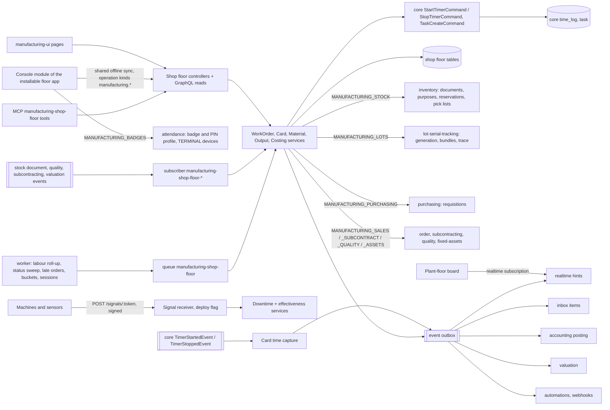

# Implementation Plan: Shop floor and work orders

> Translates an approved `spec.md` into architecture and tech choices. The plan owns
> implementation details; the spec owns behaviour.

**Feature ID**: `shop-floor-and-work-orders`
**Spec**: `./spec.md`
**Tasks**: `./tasks.md`
**Status**: `Draft`
**Last updated**: 2026-11-23

---

## 1. Architecture Summary

The `shop-floor/` module of `@gauzy/plugin-manufacturing` (scaffolded by `manufacturing-bom-and-routing`) owns work
centres, shop floors, work orders, operation cards, card time, downtime, machine signals, effectiveness and the console
back end. It reads structures through the in-plugin `StructureReader`. It moves stock only by creating and confirming
stock movement documents of the purposes it registers with the inventory purposes registry, reserves through inventory
reservations (the reserved figure of a material line is read from them, never stored here), gets lots and serial units
from lot tracking, and lets valuation value and the ledger post from events. Operator time is the core timer: a card
owns a core task in the organization's production project; starting work runs core `StartTimerCommand` in the operator's
request context; labour is recomputed from the core `time_log` rows of that task under the platform's labour attribution
rule, which this plan owns (§2). The operator console is a module of the installable floor app and its offline sync,
both owned by `warehouse-and-stock-movements`; stations are attendance devices and operators sign in with the badge and
PIN of the attendance kiosks (`attendance-and-shifts`).

## 2. Tech Choices

| Concern | Choice | Rationale |
| ------- | ------ | --------- |
| Package | `shop-floor/` module of `packages/plugins/manufacturing`; console screens in `manufacturing-ui` registered as a module of the floor app; plant-floor board in `manufacturing-react-ui`, embedded through the `@gauzy/ui-react` bridge | Principle I; one plugin for the three manufacturing specs |
| Stock | stock movement documents with purposes `PRODUCTION_ISSUE`, `PRODUCTION_RETURN`, `PRODUCTION_OUTPUT` (lines `INPUT`, `OUTPUT`, `SECONDARY` with `costShare`, additional cost lines), `PRODUCTION_CONVERSION`, `PRODUCTION_DISASSEMBLY`, registered at bootstrap through `STOCK_PURPOSE_REGISTRY`; reservation reference `PRODUCTION_ORDER` | warehouse plan provides both; one write path |
| Valuation | output value = the order's cost not yet absorbed (consumed input layers + additional cost lines (labour, machine, overhead per centre) to date − what earlier outputs of the order took) × output quantity ÷ max(quantity still to make, output quantity) − secondary shares, computed by valuation on the output document; what no output absorbed at close is variance (spec FR-45) | stock-ledger plan: "production output (cost given by production)" |
| Time | core task per card in the production project; core timer commands in the operator's context (`RequestContext.runWithRequest`, the `linear-process.ts` idiom); labour recomputed from `time_log` of the task (`logType` `TRACKED`/`MANUAL`/`RESUMED` productive, `IDLE` idle, `BREAK` break) × stored `payRateValue` | no core change; time shows in timesheets and payroll |
| Labour attribution (the platform's one rule, owned here) | a time log is labour of exactly one work record: the record whose core task the log carries (`time_log.taskId`): an operation card here, a field-service visit's work or travel task, a warehouse task's work item, a subcontract order's task; never by overlapping intervals. A work-record task is created by its owner for that record alone and never shared. Work records value a log at the `payRateValue` stored on it; project costing counts the same log once, under the task's project, for project figures | a log is never counted twice; one labour value per log |
| Signals | `@Public()` controller registered only when `GAUZY_MANUFACTURING_SIGNALS_ENABLED === 'true'`; URL secret looked up by SHA-256 (the chat incoming webhook idiom); HMAC verified with `verifyWebhookSignature` (core `webhook-signature.ts`) for every source that has a signature secret (generated at registration; removed only by `MANUFACTURING_SIGNALS_MANAGE` for a device that cannot sign): a missing, wrong or stale signature on such a source answers `401`, and a source without one is identified by its URL secret alone | public path absent unless chosen |
| Console | a module of the installable floor app `floor-ui` (`/pages/floor`, owned by `warehouse-and-stock-movements`: one install, one service worker, one IndexedDB queue for scanning, console and inspection screens); console actions are operation kinds (`manufacturing.card.start`, `.pause`, `.resume`, `.complete`, `.output`, `.loss`, `.step_done`, `.downtime_confirm`, `.issue_confirm`) contributed through `OFFLINE_OPERATION_KINDS` (owner type `manufacturing.operation_card`) to the core offline-sync module (`packages/core/src/lib/offline-sync/`: `offline_operation` log, `offline_exception` queue, each operation applied once through `IdempotencyService`) | no console operation or exception table here |
| Stations and badges | a station is an `attendance_device` of kind `TERMINAL` (device key, last seen, revocation: attendance plugin); operators identify with the badge and PIN of `employee_attendance_profile`, checked with its failure lockout, through the `MANUFACTURING_BADGES` port bound to the attendance plugin; `work_centre_station` keeps which centres a device serves | one badge and PIN per employee for kiosks and consoles |
| Work-centre calendars | kept here: weekly slots, country holidays, closed days, extra hours and overtime are capacity time of a machine, which the calendar feature leaves to this spec (its bookable resources cover rooms, vehicles and lent equipment); availability of other modules is read through the shop floor services, so there is one working-time model per centre | one capacity calendar |
| Analytic dimensions | production stock documents and their lines carry `dimensionSetId` resolved through `AnalyticDimensionSetService.resolve` (`accounting-foundation`) from the order's project and the work centre, which this plugin registers as a `RECORD` dimension source (`ANALYTIC_DIMENSION_SOURCE`, type `manufacturing.work_centre`); absorbed cost lines carry their cost kind and dimension set, no free-form keys | one dimension model |
| Permissions, settings | permission contributions with `defaultFor` in `manufacturing.permissions.ts`; shop floor settings as setting contributions in `manufacturing.settings.ts`, stored in the platform settings store | no seed migration, no settings table |
| Push | outbox realtime hints declared with `declareStreamedEvents`; board and console subscribe | Principle VII |
| Background work | `@ScheduledJob` in `ManufacturingSchedulePlugin` (worker), `@QueueWorker` (API), queue `manufacturing-shop-floor`; in-process timers under a database lock without a queue root | scheduler package |
| Persistence | MultiORM entities, plugin migrations through the shared core migration helpers of `@gauzy/core`, three dialects | Principle III |

## 3. Data Model

### New entities (shop floor module)

All tables extend `TenantOrganizationBaseEntity`; quantities and money `numeric(20,6)` with `currency`; JSON `text`;
`lockVersion` for `If-Match`; ids into other plugins and core carry no foreign key except core `employee` (SET NULL).

| Table | Columns (besides base) | Indexes and uniqueness |
| --- | --- | --- |
| `work_centre_group` | `code`, `name`, `description` | unique (`organizationId`, `code`) live |
| `work_centre` | `code`, `name`, `kind` varchar(12) (`MACHINE`, `LINE`, `CELL`, `MANUAL`), `groupId` FK null, `plantFloorId` FK null, `description`, `parallelCapacity` int ≥ 1, `wipWarehouseId`, `outputWarehouseId` uuid null, `equipmentId`, `assetId` uuid null, `calendarCountryCode` varchar(2) null, `allowsHolidayWork`, `allowsOvertime` bool null, `hourlyRate`, `labourRate`, `machineRate`, `overheadRate` numeric, `status` varchar(12) (`RUNNING`, `IDLE`, `DOWN`, `SETUP`, `MAINTENANCE`, `OFF`), `statusSince` timestamp, `statusSource` varchar(12), `lockVersion` | unique (`organizationId`, `code`) live; (`plantFloorId`); (`groupId`) |
| `work_centre_status_change` | `workCentreId` FK cascade, `status`, `source`, `sourceRef`, `startedAt`, `endedAt` | (`workCentreId`, `startedAt`) |
| `work_centre_cost_kind` | `code`, `name`, `class` varchar(10) (`LABOUR`, `MACHINE`, `OVERHEAD`), `accountRole` varchar(64) null | unique (`organizationId`, `code`) |
| `work_centre_cost_component` | `ownerType` varchar(6) (`GROUP`, `CENTRE`), `ownerId`, `costKindId` FK, `hourlyAmount`, `currency` | unique (`ownerType`, `ownerId`, `costKindId`) |
| `work_centre_working_hour` | `workCentreId` FK cascade, `weekday` smallint, `startTime`, `endTime` varchar(5), `isEnabled` | (`workCentreId`, `weekday`) |
| `work_centre_calendar_exception` | `workCentreId` FK cascade, `fromDate`, `toDate` date, `kind` varchar(10) (`CLOSED`, `EXTRA`), `startTime`, `endTime`, `reason` | (`workCentreId`, `fromDate`) |
| `work_centre_operator` | `workCentreId` FK cascade, `employeeId` FK `employee`, `isLead` bool | unique (`workCentreId`, `employeeId`) |
| `shop_floor` | `code`, `name`, `warehouseId` uuid, `description` | unique (`organizationId`, `code`) live |
| `work_centre_station` | `deviceId` uuid (attendance `attendance_device` of kind `TERMINAL`, no FK across plugins), `workCentreId` FK cascade | unique (`deviceId`, `workCentreId`); (`workCentreId`) |
| `work_order` | `number`, `productId`, `variantId`, `billOfMaterialsId`, `structureVersion` int, `quantity`, `stockQuantity`, `unitId`, `status` varchar(12), `isOnHold` bool, `holdReason`, `materialState` varchar(16), `priority` int, `plannedStartAt`, `plannedEndAt`, `actualStartAt`, `actualEndAt`, `sourceWarehouseId`, `wipWarehouseId`, `outputWarehouseId`, `scrapWarehouseId` uuid null, `sourceType` varchar(20) (`MANUAL`, `SALES_ORDER_LINE`, `PLAN_LINE`, `REQUISITION_LINE`, `SUBCONTRACT_ORDER`, `PARENT_WORK_ORDER`, `AGENT`), `sourceId`, `salesOrderLineId`, `planLineId`, `requisitionLineId`, `subcontractOrderId`, `parentWorkOrderId` uuid null, `projectId`, `taskId` uuid null, `explodeAllLevels`, `usesStepOutputs` bool, `issueMode`, `consumptionBasis` varchar(12), `overproductionPercent`, `producedQuantity`, `processLossQuantity`, `disassembledQuantity`, `convertedQuantity`, `maxProducibleQuantity` numeric null, `currency`, `plannedMaterialCost`, `plannedOperatingCost`, `actualMaterialCost`, `actualLabourCost`, `actualMachineCost`, `actualOverheadCost`, `additionalOperatingCost`, `correctiveCost`, `absorbedCost`, `varianceFacts` text, `labourEstimated` bool, `description`, `closedAt`, `lockVersion` | unique (`organizationId`, `number`); (`organizationId`, `status`, `plannedEndAt`); (`variantId`, `status`); (`salesOrderLineId`); (`planLineId`) |
| `work_order_material` | `workOrderId` FK cascade, `lineNo`, `variantId`, `originalVariantId` uuid null, `structureLineId`, `workOrderOperationId` uuid null, `requiredQuantity`, `unitId`, `sourceWarehouseId`, `requestedQuantity`, `pickedQuantity`, `issuedQuantity`, `consumedQuantity`, `returnedQuantity`, `extraIssuedQuantity`, `isExtra`, `isCustomerSupplied`, `isNotIssued`, `allowsSubstitutes` bool, `unitCost` numeric null. No reserved column: the reserved figure is the sum of the line's active `stock_reservation` rows (reference `PRODUCTION_ORDER`, `lineId` = this line). `issued`, `consumed` and `returned` are written only in the confirming stock document's transaction; `requested` and `picked` are caches written by the requisition and pick-list consumers; all are checked by the nightly integrity check | unique (`workOrderId`, `lineNo`); (`variantId`) |
| `work_order_operation` | `workOrderId` FK cascade, `sequence`, `position` int, `operationId`, `structureOperationId` uuid, `workCentreId`, `workCentreGroupId` uuid null, `plannedSetupMinutes`, `plannedRunMinutes`, `actualMinutes` numeric, `plannedStartAt`, `plannedEndAt`, `actualStartAt`, `actualEndAt`, `hourlyRate`, `plannedCost`, `actualCost`, `completedQuantity`, `lostQuantity`, `state` varchar(10) (`PENDING`, `READY`, `RUNNING`, `DONE`), `isSubcontracted` bool, `materialSource`, `stepOutputVariantId` uuid null | (`workOrderId`, `position`) |
| `work_order_output` | `workOrderId` FK cascade, `kind` varchar(12) (`MAIN`, `CO_PRODUCT`, `BY_PRODUCT`, `SCRAP`, `EXTRA`, `NON_STOCK`), `variantId`, `plannedQuantity`, `producedQuantity`, `unitId`, `valuation`, `sharePercent` | (`workOrderId`) |
| `operation_card` | `number`, `workOrderId` FK, `workOrderOperationId` FK, `operationId`, `workCentreId` uuid null, `sequence`, `batchNo` int, `quantity`, `completedQuantity`, `lostQuantity`, `state` varchar(10) (`WAITING`, `READY`, `RUNNING`, `PAUSED`, `DONE`, `CANCELLED`), `plannedStartAt`, `plannedEndAt`, `requiredMinutes`, `actualStartAt`, `actualEndAt`, `productiveSeconds`, `idleSeconds`, `breakSeconds`, `machineSeconds` int, `labourCost`, `machineCost`, `overheadCost`, `idleLabourCost` numeric, `labourEstimated` bool, `isCorrective` bool, `correctsCardId` FK null, `correctiveRate` numeric null, `taskId` uuid, `barcode` varchar(64), `pauseReasonId` uuid null, `inspectionState` varchar(12), `inspectionRef` uuid null, `stepOutputDocumentId` uuid null, `autoCompleteStep` bool, `isPinned` bool, `plannedEmployeeId` uuid null, `lockVersion`. The card's `plannedStartAt`/`plannedEndAt`, pin and planned operator are the only store of its planned place and time (written by release placement or by the planning board through the card service); `work_order_operation.plannedStartAt/plannedEndAt` are the earliest start and latest end of its cards, written in the same transaction | unique (`organizationId`, `number`); unique (`organizationId`, `barcode`); (`workCentreId`, `state`, `plannedStartAt`); (`workOrderId`); (`taskId`) |
| `operation_card_session` | `cardId` FK cascade, `employeeId` FK `employee`, `productiveSeconds`, `idleSeconds`, `breakSeconds` int, `labourCost`, `idleLabourCost`, `currency`, `firstStartAt`, `lastStopAt`, `computedAt`, `logsHash` char(64) | unique (`cardId`, `employeeId`) |
| `operation_card_entry` | `cardId` FK cascade, `kind` varchar(8) (`OUTPUT`, `LOSS`), `quantity`, `employeeId`, `recordedAt`, `source` varchar(8) (`CONSOLE`, `SIGNAL`, `STAFF`), `lots` text (an offline entry is applied once by the shared offline-sync service) | (`cardId`) |
| `operation_card_material` | `cardId` FK cascade, `workOrderMaterialId` FK, `requiredQuantity`, `issuedQuantity` | unique (`cardId`, `workOrderMaterialId`) |
| `operation_card_step` | `cardId` FK cascade, `name`, `minutes`, `doneAt`, `doneByEmployeeId` | (`cardId`) |
| `stop_reason` | `code`, `name`, `category` varchar(12) null (`PLANNED`, `UNPLANNED`, `SETUP`, `MAINTENANCE`, `QUALITY`, `MATERIAL`, `OPERATOR`), `forPause`, `forDowntime` bool, `signalCodes` text, `isActive` | unique (`organizationId`, `code`) |
| `downtime` | `number`, `workCentreId` FK, `startedAt`, `endedAt` timestamp null, `durationMinutes` numeric, `reasonId` FK, `operatorEmployeeId` uuid null, `remarks`, `source` varchar(8) (`MANUAL`, `PAUSE`, `SIGNAL`), `sourceRef`, `state` varchar(12) (`OPEN`, `TO_CONFIRM`, `CONFIRMED`), `assetRepairId` uuid null (the fixed-assets `asset_repair` of the centre's asset this stop belongs to, chosen or opened through `MANUFACTURING_ASSETS`; the repair's downtime hours are the sum of its linked rows, written back through the same port when a row closes, so a machine stop is recorded once) | unique (`organizationId`, `number`); (`workCentreId`, `startedAt`); (`assetRepairId`) |
| `signal_source` | `workCentreId` FK, `name`, `tokenHash` char(64), `secretCipher` text null, `requireSignature` bool, `stopCodeMap` text, `maxPerMinute` int, `lastSignalAt`, `lastMachineTime`, `isActive` | unique (`tokenHash`); (`workCentreId`) |
| `machine_signal` | `sourceId` FK, `workCentreId`, `externalId` varchar(128), `kind` varchar(8) (`RUNNING`, `STOPPED`, `COUNT`, `ALARM`), `code` varchar(64), `goodCount`, `rejectCount` numeric, `machineTime`, `receivedAt`, `outcome` varchar(12) | unique (`sourceId`, `externalId`); (`workCentreId`, `machineTime`) |
| `effectiveness_bucket` | `workCentreId`, `bucketStart` timestamp (hour), `plannedSeconds`, `runSeconds`, `plannedDownSeconds`, `unplannedDownSeconds`, `idealSeconds`, `totalCount`, `goodCount` numeric, `source` varchar(8) | unique (`workCentreId`, `bucketStart`) |
| `console_session` | `deviceId` uuid (the station's attendance device), `employeeId`, `startedAt`, `lastActionAt`, `endedAt` | (`deviceId`, `endedAt`) |

Changes in other plugins (additive): the absorbed cost lines of an output document name their
cost kind (`work_centre_cost_kind`) and `dimensionSetId` (warehouse plan's `stock_document_additional_cost`); the item
default field `defaultBillOfMaterials` (item-catalogue); the `MANUFACTURING_ASSETS` answer of fixed assets (maintenance
windows, repair link, downtime hours).

**Reused, not created:** badges, PINs and station devices (`employee_attendance_profile`, `attendance_device` of
`attendance-and-shifts`); the offline operation log and exception queue (core `offline_operation`, `offline_exception`
on core idempotency) and the installable app (`floor-ui`), both specified by `warehouse-and-stock-movements`; reservations (`stock_reservation`); time (`time_log`, `task`, core timer); dimensions
(`analytic_dimension_set`); holidays (`official_holiday`); machine records (`equipment`, fixed assets).

### Migrations

**Migration timestamps**: `packages/plugins/manufacturing` `1791000090100` to `1791000090199`.

In `packages/plugins/manufacturing/src/lib/database/migrations/` (three dialects, idempotent, forward-only, both ORMs):

1. `1791000090100-CreateManufacturingWorkCentreTables` — groups, centres, status changes, cost kinds and components,
   working hours, calendar exceptions, roster, shop floors, station links (the structure module's operations reference
   centres and groups by id through the `MANUFACTURING_WORK_CENTRES` reader this module binds).
2. `1791000090110-CreateManufacturingWorkOrderTables` — work orders, materials, operations, outputs.
3. `1791000090120-CreateManufacturingOperationCardTables` — cards, sessions, entries, card materials, steps.
4. `1791000090130-CreateManufacturingDowntimeAndSignalTables` — stop reasons (seeded per organization on first use),
   downtime, signal sources, signals, effectiveness buckets.
5. `1791000090140-CreateManufacturingConsoleTables` — console sessions.

Default role grants are permission contributions (`defaultFor`), not a migration.

### Contracts

`packages/contracts/src/lib/manufacturing-shop-floor.model.ts`: enums of the tables, `IWorkCentre`, `IWorkCentreCalendar`,
`IPlantFloor`, `IPlantFloorBoardTile`, `IWorkOrder(+Material, +Operation, +Output)`, `IWorkOrderReleasePreview`
(shortages, capacity placement, reservations), `IOperationCard(+Session, +Entry)`, `IDowntime`, `IStopReason`,
`ISignalInput`, `IEffectivenessFigures`, the payloads of the console operation kinds, `IWorkOrderCostBreakdown`,
`IGenealogyNode`, `IBadgeIdentification` (the `MANUFACTURING_BADGES` shape); additive exports.

## 4. API Surface

All routes `TenantPermissionGuard`, `PermissionGuard`, `FeatureFlagGuard` + `@FeatureFlag(FEATURE_MANUFACTURING)`,
prefix `/api/manufacturing`; `If-Match` on writes; `Idempotency-Key` on every stock, output and card action.

| Method | Endpoint | Permission | Description | Status |
| ------ | -------- | ---------- | ----------- | ------ |
| `GET` `POST` `PUT` | `/work-centres[/:id]`, `/work-centre-groups[/:id]`, `/shop-floors[/:id]`, `/cost-kinds` | `MANUFACTURING_WORK_ORDERS_VIEW` / `MANUFACTURING_WORK_CENTRES_EDIT` | masters | New |
| `PUT` | `/work-centres/:id/cost-components` · `/calendar` · `/roster`; `POST /:id/copy-group-costs` | `MANUFACTURING_WORK_CENTRES_EDIT` | rates, slots and exceptions, operators | New |
| `GET` | `/work-centres/:id/availability?from=&to=` · `/shop-floors/:id/board` · `/stock-summary` | `MANUFACTURING_WORK_ORDERS_VIEW` | free time; board tiles; floor stock | New |
| `GET` `POST` `PUT` | `/work-orders[/:id]` | `_VIEW` / `MANUFACTURING_WORK_ORDERS_EDIT` | `WorkOrderDTO` → `IWorkOrder` | New |
| `POST` | `/work-orders/:id/release` (`preview`) · `/hold` · `/resume` | `MANUFACTURING_WORK_ORDERS_RELEASE` / `_EDIT` | lifecycle; preview = shortages, placement | New |
| `POST` | `/work-orders/:id/close` (`stopRunningCards`) · `/cancel` | `MANUFACTURING_WORK_ORDERS_RELEASE` | close, cancel | New |
| `GET` `PUT` | `/work-orders/:id/materials` | `_VIEW` / `_EDIT` (setting) | required materials | New |
| `POST` | `/work-orders/:id/reserve` · `/issue` (`preview`) · `/return` · `/requisitions` · `/pick-lists` | `MANUFACTURING_MATERIALS_MOVE` | stock documents, reservations, requests | New |
| `POST` | `/work-orders/:id/output` (`preview`) · `/convert` · `/disassemble` | `MANUFACTURING_OUTPUT_RECORD` | output, conversion, disassembly | New |
| `POST` | `/work-orders/:id/make-structure` | `MANUFACTURING_STRUCTURES_EDIT` | draft structure | New |
| `GET` | `/work-orders/:id/cost` · `/genealogy` · `/flow` | `MANUFACTURING_COSTS_VIEW` / `LOT_SERIAL_VIEW` / `_VIEW` | breakdown, trace, document flow | New |
| `GET` | `/operation-cards[/:id]` | `_VIEW` or `MANUFACTURING_OPERATIONS_WORK` (own centres) | cards | New |
| `POST` | `/operation-cards/:id/start` · `/pause` · `/resume` · `/complete` · `/entries` · `/steps/:stepId/done` | `MANUFACTURING_OPERATIONS_WORK` (roster) | card work; timer through core | New |
| `POST` | `/operation-cards/:id/corrective` · `/assign` · `/cancel` · `/inspection` | `MANUFACTURING_OPERATIONS_SUPERVISE` | supervision; assign warns on approved core time off and employee unavailability of the day (`MANUFACTURING_ROSTERS`, falling back to core `time-off-request` and `employee-availability`) | New |
| `GET` `POST` `PUT` | `/downtime[/:id]` (+ `/confirm`), `/stop-reasons[/:id]` | `MANUFACTURING_DOWNTIME_EDIT` (read `_VIEW`) | downtime and reasons | New |
| `GET` `POST` `PUT` | `/signal-sources[/:id]` (+ `/rotate-secret`) | `MANUFACTURING_SIGNALS_MANAGE` | sources; secret shown once | New |
| `POST` | `/signals/:token` | `@Public()`, deploy flag; secret in path, optional `X-Signature` | `ISignalInput` or batch → `202`, per-signal outcome | New |
| `GET` | `/effectiveness?workCentreId=&from=&to=&bucket=` | `_VIEW` | figures | New |
| `GET` | `/console/queue` · `/console/offline-pack` | `MANUFACTURING_OPERATIONS_WORK` or station session | queue; the module's offline pack (no costs) for the floor app; sync and exceptions go through core `/api/offline-sync/batches` and `/api/offline-sync/exceptions` (owner type `manufacturing.operation_card`, resolve permission `MANUFACTURING_OPERATIONS_SUPERVISE`) | New |
| `GET` `PUT` | `/console/stations` · `/console/stations/:deviceId/centres` | `MANUFACTURING_STATION_OPERATE` | attendance devices of kind `TERMINAL` with the centres they serve; devices are registered on the attendance devices page | New |
| `POST` | `/console/stations/:deviceId/sign-in` · `/sign-out` | device key + badge and PIN through `MANUFACTURING_BADGES` | operator sessions on a station; PIN lockout and reset are the attendance profile's | New |
| `GET` | `/reports/:key` · `/dashboard` | `_VIEW` (+ cost key for values) | report rows, dashboard cards | New |
| `GET` `PUT` | `/settings/shop-floor` | `_VIEW` / `MANUFACTURING_SETTINGS_EDIT` | the setting keys of spec FR-79 in the platform settings store | New |

Errors: `WORK_ORDER_TEMPLATE_ITEM`, `WORK_ORDER_STRUCTURE_NOT_RELEASED`, `WORK_ORDER_SHORTAGE`, `WORK_ORDER_HELD`,
`WORK_ORDER_OVER_ISSUE`, `WORK_ORDER_OVERPRODUCTION`, `CARD_SEQUENCE`, `CARD_INSPECTION_MISSING|UNFINISHED|REJECTED`,
`CARD_OUTPUT_CONSUMED`, `CARD_NOT_ON_ROSTER`, `CARD_CAPACITY`, `CARD_TIME_REQUIRED`, `DOWNTIME_OVERLAP`,
`CAPACITY_NOT_FOUND`; badge and PIN refusals (unknown badge, locked PIN) come from the attendance profile. GraphQL reads
`workOrders`, `workOrder`, `operationCards`, `workCentres`.

**Ports declared** (added to `manufacturing.types.ts`): `MANUFACTURING_STOCK` (inventory documents, purposes registry,
reservations and hand-over, reserved quantity per line, availability, pick lists; required for stock actions),
`MANUFACTURING_LOTS` (lot and serial generation, bundles on lines, `/stock-trace`; outputs without lots when unbound),
`MANUFACTURING_PURCHASING` (requisitions), `MANUFACTURING_SALES` (sales line quantities, write-back),
`MANUFACTURING_SUBCONTRACT` (propose for an operation), `MANUFACTURING_ASSETS` (maintenance windows; open or find the
repair of a centre's asset and write its downtime hours), `MANUFACTURING_LEDGER` (document type registration, effects
preview), `MANUFACTURING_BADGES` (attendance plugin: identify a badge and check a PIN on `employee_attendance_profile`
with its lockout, check a `TERMINAL` device key; stations are unavailable when unbound or when `FEATURE_ATTENDANCE` is
off, and the console then runs signed in as the operator's own user). Console operation kinds are contributed through
`OFFLINE_OPERATION_KINDS` and the console screens through the module registry of `floor-ui`. **Ports answered**:
`MANUFACTURING_WORK_CENTRES` (work centre lookup, active check and rates of `WorkCentreRateService`, for the structure
module's operations), `SUBCONTRACTING_WORK_ORDERS` (inward orders, reservation hand-over, operation events),
`PURCHASING_MAKE` (requisition make route), `SALES_PRODUCTION` (production request and promise date: the production plan's date while planning is on for the
tenant, the capacity-based date otherwise), `LEDGER_POSTING_SOURCE` and `LEDGER_ACCOUNT_RESOLVER` (cost kinds' roles) for `manufacturing.work_order`.

**Consumer tokens answered** (bound in `apps/api/src/plugin-composition.ts` to the work order services; each consumer plan states the shape it calls and its fallback): `PORTAL_PRODUCTION`.

## 5. Events, Real-Time and Notifications

| Event | Emitted when | Consumers |
| ----- | ------------ | --------- |
| `document.work_order.confirmed` / `.cancelled` / `.closed` | release, cancel, close (close carries variance facts) | accounting posting rules contributed for `manufacturing.work_order`, stock projection (planned), document flow |
| `manufacturing.work_order.released` / `.started` / `.completed` / `.held` / `.resumed` / `.late` | lifecycle; late sweep | realtime, sales promise refresh, planning, automations, inbox to owner |
| `manufacturing.output.recorded` | output document confirmed | sales produced roll-up, requisition fulfilment, planning, subcontracting inward |
| `manufacturing.operation.reached` | a card becomes ready | subcontracting proposal for subcontracted operations |
| `manufacturing.operation_card.started` / `.paused` / `.resumed` / `.completed` / `.cancelled` | card actions | board, console, effectiveness, automations |
| `manufacturing.work_centre.status_changed` / `.rate_changed` | derived status; rate edits | board tiles; structure costs stale |
| `manufacturing.downtime.opened` / `.confirmed` / `.closed` | downtime | board, effectiveness, inbox when over threshold |
| `offline_exception` of a `manufacturing.*` operation kind (core offline-sync module) | sync conflict | supervisor inbox |
| In: core `TimerStartedEvent` / `TimerStoppedEvent` (CQRS) | timer on a card task | `CardTimeCapture` appends `manufacturing.card_time.changed` → labour roll-up |
| In: `inventory.stock_document.confirmed` / `.cancelled`, `valuation.document.valued`, `quality.inspection.decided`, `subcontracting.receipt.posted` | other areas | counters, actual material cost, inspection state, operation done |

Realtime hints `manufacturing.work_order.*`, `manufacturing.operation_card.*`, `manufacturing.work_centre.*` declared in
`shop-floor-streamed-events.ts`; inbox items through `INBOX_ITEM_WRITER`.

## 6. UI Surface

- **Angular `manufacturing-ui`**: `/pages/manufacturing/work-orders` (saved views, calendar, board), `/work-orders/:id`
  (materials, operations, cards, outputs, cost, genealogy, flow), `/operation-cards`, `/work-centres[/:id]` (rates,
  calendar, roster, signals), `/shop-floors[/:id]`, `/downtime`, `/stop-reasons`, `/stations` (attendance `TERMINAL`
  devices and their centres), `/reports`, `/dashboard`, `/settings/shop-floor`. Badges and PINs are enrolled on the
  attendance employee profile; console exceptions are resolved on the floor app's shared exceptions page, filtered to
  manufacturing kinds. Sales order and requisition pages get a "Create work order" action through plugin slots when the
  flag is on.
- **Console module of the floor app** (screens in `manufacturing-ui`, registered with the module registry of `floor-ui`,
  which owns the install, the one service worker, the device queue and camera and keyboard-wedge scanning): queue per
  centre, card screen, checklist, materials, sessions, shortcuts, dark and light themes.
- **React `manufacturing-react-ui`**: the `PlantFloorBoard` (embedded in the Angular floor page) and `CardTimer` widgets.
- i18n keys `MANUFACTURING.SHOP_FLOOR.*` in every locale; React strings via `useTranslation()`.

## 7. MCP Tools, SDKs and Integrations

New file `packages/mcp-server/src/lib/tools/manufacturing-shop-floor.ts`: `manufacturing_work_order_status` (progress,
why late: behind-plan operation, downtime, shortages, promise effect), `manufacturing_create_work_order` (`preview`),
`manufacturing_release_work_order` (`preview`: shortages and placement), `manufacturing_issue_materials` (`preview`),
`manufacturing_record_output` (`preview`), `manufacturing_explain_cost_variance`, `manufacturing_list_downtime`,
`manufacturing_shop_floor_status`. Card start and completion are not offered as tools. OpenAPI additive; SDKs
regenerated. The signal endpoint is documented for integrators (payload, signature, retries). Print templates and
report definitions registered with their engines; imports of work centres, calendars and stop reasons through
`data-import-export`.

## 8. Background Jobs

| Trigger | When | What it does | Idempotency |
| ------- | ---- | ------------ | ----------- |
| `shop-floor.labour-rollup` (queue) | `manufacturing.card_time.changed`, debounced 5 s per card; nightly 01:30 for logs edited in 7 days | recompute sessions and card labour from the card task's time logs at their stored pay rate | `logsHash` per session; recomputed, never summed |
| `shop-floor.signals-apply` | after receipt, per source in machine-time order | status, downtime, counts, buckets | unique (`sourceId`, `externalId`) |
| `shop-floor.status-sweep` | every minute | calendar transitions, silent running sources | conditional update on `statusSince` |
| `shop-floor.effectiveness` | on events; hourly bucket close | maintain hour buckets | upsert per (`workCentreId`, `bucketStart`) |
| `shop-floor.idle-guard` | every 5 min | timers on cards without console activity past idle + grace: stop at last activity, record idle | per card and minute |
| `shop-floor.late-orders` | every 15 min | late event and inbox once per order and day | key (order, date) |
| `shop-floor.console-sessions` | every 5 min | end inactive station operator sessions | conditional update |
| Outbox consumers `subscriber:manufacturing-shop-floor-stock`, `-quality`, `-subcontract`, `-time` | events of §5 | counters, inspection state, operations done, card time | delivery record per consumer and event |
| `shop-floor.downtime-repair` | a maintenance downtime with a repair link closes | writes the repair's downtime hours through `MANUFACTURING_ASSETS` | sum recomputed from the linked rows |

Schedules in `ManufacturingSchedulePlugin` (worker); queue workers in the API; in-process fallback timers under a lock.

## 9. Security & Permissions

New values: `MANUFACTURING_WORK_CENTRES_EDIT`, `MANUFACTURING_WORK_ORDERS_VIEW`, `MANUFACTURING_WORK_ORDERS_EDIT`,
`MANUFACTURING_WORK_ORDERS_RELEASE`, `MANUFACTURING_MATERIALS_MOVE`, `MANUFACTURING_OUTPUT_RECORD`,
`MANUFACTURING_OPERATIONS_WORK`, `MANUFACTURING_OPERATIONS_SUPERVISE`, `MANUFACTURING_DOWNTIME_VIEW`, `MANUFACTURING_DOWNTIME_EDIT`,
`MANUFACTURING_SIGNALS_MANAGE`, `MANUFACTURING_STATION_OPERATE`, declared as permission contributions whose `defaultFor`
grants all to `SUPER_ADMIN` and `ADMIN`, all but signals and station to `MANAGER`, and `MANUFACTURING_OPERATIONS_WORK`
to `EMPLOYEE` (effective only on a roster); no seed migration. Pay rates are read inside the labour service and never
serialised; per-person cost is not exposed. Station actions run in a request context of the
operator's user marked `viaStationId` (the device id) in the activity log; badge hashing, PIN hashing and the failure
lockout are the attendance profile's. Signal tokens stored as SHA-256; signature secrets
encrypted with the platform's integration-secret encryption; payloads validated and capped at 64 KiB; per-source rate
limit plus the platform throttler. Console offline packs exclude costs and pay.

## 10. Observability

Activity log on release, hold, close, cancel, overrides, station sign-ins, downtime confirmations and exception
resolutions. Metrics `manufacturing_release_ms`, `manufacturing_console_sync_lag_seconds`,
`manufacturing_signals_received_total{outcome}`, `manufacturing_labour_rollup_lag_seconds`,
`manufacturing_open_downtime_minutes`; a nightly integrity check compares order counters with confirmed stock documents.

## 11. Phased Rollout

1. **Phase 1 — Core shop floor**: work centres, groups, rates, calendars, shop floors; work orders with materials,
   operations, reservations, issue, return, output (secondary, loss), cards with sequence and completion; costing from
   material and rates; Angular pages; read MCP tools. Usable: make an item from its structure with correct stock and cost.
2. **Phase 2 — Depth**: capacity check, step-output cards, corrective cards, inspections, conversion, disassembly,
   requisitions and pick lists, sales, subcontract and requisition links, lots and serials, downtime manual entry,
   settings, reports, dashboard, print templates, MCP write tools with preview.
3. **Phase 3 — Advanced capabilities**: card time through the core timer with labour from stored pay rates, idle and breaks;
   operator console with offline sync, scanning and stations; shop-floor board; machine signals and automatic
   downtime; effectiveness; genealogy; agent explanations.
4. **Phase 4 — General availability**: the feature is off by default; after the trial period it may be switched on by default for new tenants only; existing tenants keep their setting until an administrator changes it.

## 12. Constitution Reconciliation

- I Plugin-first: module of the manufacturing plugin; other plugins through ports; core used through its commands only.
- II Tenant/organization scoping: base entity everywhere; signals resolve scope from the source row; consumers from envelopes.
- III Both ORMs, additive migrations: five migrations, three dialects; SQLite migration specs.
- IV Default-off flag; nothing removed: `FEATURE_MANUFACTURING`; signals receiver absent unless the deploy flag is `true`.
- V Contracts and API first: contracts, REST and OpenAPI before screens.
- VI Permissions, privacy, security: eleven keys; pay never serialised; signed signals; badges and PINs kept hashed on
  the attendance profile.
- VII Real-time through the event bus: outbox hints drive board and console.
- VIII i18n and accessibility: keys in every locale; console and board keyboard and screen-reader operable.
- IX Tests: unit specs for sequence, allowances, costing, labour, effectiveness; SQLite DB specs; e2e per route.
- X Behaviour-first spec: implementation lives here.
- XI Documentation describes our platform only.

## 13. Risks & Mitigations

| Risk | Likelihood | Impact | Mitigation |
| ---- | ---------- | ------ | ---------- |
| Timer started in an operator's context misused | Low | High | only roster operators, station device key, attendance badge and PIN, audit marker, no tool access |
| Card tasks crowd task lists | Medium | Low | production project hidden from default task views; tasks closed on card completion |
| Offline actions conflict | High | Medium | the core offline-sync module: per-operation results, exceptions, idempotent client ids |
| A time log counted on two records | Medium | High | the labour attribution rule of §2: by task only, tasks never shared |
| Signal floods | Medium | Medium | per-source limit, batch endpoint, async apply queue |
| Counters drift from stock documents | Medium | High | counters in the document's transaction; nightly integrity check |

## 14. References

- Spec: `./spec.md` · Tasks: `./tasks.md`
- Code: `packages/core/src/lib/time-tracking/timer/timer.service.ts`, `packages/core/src/lib/time-tracking/timer/events/`,
  `packages/core/src/lib/time-tracking/time-log/time-log.entity.ts`, `packages/core/src/lib/time-tracking/time-log/break-rules.ts`,
  `packages/core/src/lib/webhook/webhook-signature.ts`, `packages/plugins/chat/src/lib/controllers/chat-webhook-receive.controller.ts`,
  `packages/core/src/lib/official-holiday/`, `packages/plugins/inventory/src/lib/inventory.enums.ts`,
  `packages/plugins/realtime/src/lib/realtime-hints.service.ts`, `apps/api/src/plugin-composition.ts`,
  `packages/core/src/lib/idempotency/`, `packages/core/src/lib/time-off-request/`, `packages/core/src/lib/employee-availability/`,
  `packages/plugins/inventory/src/lib/stock-reservation/`, `packages/plugin/src/lib/plugin-contributions.ts`
- Related plans: `../manufacturing-bom-and-routing/plan.md`, `../warehouse-and-stock-movements/plan.md`,
  `../stock-ledger-and-valuation/plan.md`, `../serials-and-batches/plan.md`, `../subcontracting/plan.md`,
  `../general-ledger/plan.md`, `../production-planning/plan.md`, `../attendance-and-shifts/plan.md`,
  `../accounting-foundation/plan.md`, `../fixed-assets/plan.md`, `../project-costing-and-billing/plan.md`,
  `../maintenance-and-field-service/plan.md`, `../calendar-and-scheduling/plan.md`
