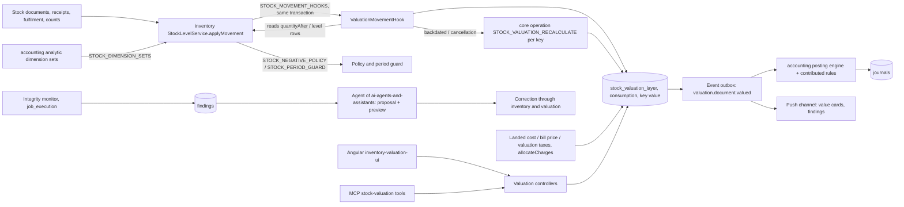

# Implementation Plan: Stock ledger and valuation

> Translates an approved `spec.md` into architecture and tech choices. The plan owns
> implementation details; the spec owns behaviour.

**Feature ID**: `stock-ledger-and-valuation`
**Spec**: `./spec.md`
**Tasks**: `./tasks.md`
**Status**: `Draft`
**Last updated**: 2026-11-23

---

## 1. Architecture Summary

A new plugin, `@gauzy/plugin-inventory-valuation` (`packages/plugins/inventory-valuation`), adds a value layer to every
movement of the existing quantity ledger. It never writes movements itself except through the inventory write path
(counts, resets, openings) and never writes ledger lines: it publishes valued-document events that the `accounting`
posting engine turns into journals with the posting rules this plugin contributes. It binds four ports the inventory
plugin declares (`warehouse-and-stock-movements`): `STOCK_MOVEMENT_HOOKS` (write the layer inside the movement
transaction), `STOCK_NEGATIVE_POLICY` (replaces the fixed "never negative" invariant only when bound), `STOCK_PERIOD_GUARD`
(closing and freeze) and `STOCK_VALUE_PREVIEW` (values in document previews and in the existing count variance). Unbound,
inventory behaves exactly as today; bound, each port first checks `FEATURE_INVENTORY_VALUATION` for the movement's tenant
and answers as unbound when it is off (no layer, today's never-negative invariant with its unlimited and backorder
exemptions, no period guard, today's variance cost), so loading the plugin changes nothing for tenants that never
switched the feature on. With it on, the negative policy keeps the unlimited and backorder exemptions of
`assertInvariants` and accepts a backdated outflow whose current level stays covered (a negative layer settled later)
unless the organization setting `inventory-valuation.refuseBackdatedNegative` (default `false`) is on.

Valuation keeps value and cost only. The quantity of a key is the stock level's: the hook reads the movement's
`quantityAfter` (item and location keys) or the organization's level rows (organization keys) in the movement
transaction, and the bundle entries of `serials-and-batches` for lot and serial keys; no key or layer stores a running
quantity. A key with a dimension set (`dimensionSetId` set) is a part of its level, which holds every dimension
together, so its quantity is its own: the quantity of its latest `stock_closing_balance` plus the signed quantities of
its quantity-moving layers (`MOVEMENT`, `OPENING`) after that closing, read in the movement transaction under the level
lock through the index (`keyHash`, `occurredAt`, `sequence`); with project A at 5 and project B at 5, a receipt of 5
for A values A's moving average on 10, while the level shows 15. Stock dimensions are the analytic dimension sets of `accounting-foundation`, resolved through the inventory
port `STOCK_DIMENSION_SETS` (bound to `AnalyticDimensionSetService`). Recalculations, closings and on-demand integrity
runs are core operations (`packages/core/src/lib/operation/`); scheduled passes are `job_execution` rows. Charges are
spread over lines by the one allocation function of the inventory plugin (`allocateCharges`).

## 2. Tech Choices

| Concern | Choice | Rationale |
| ------- | ------ | --------- |
| Package | new `packages/plugins/inventory-valuation`, `inventory-valuation-ui` | Principle I; optional value layer |
| Coupling | ports declared by inventory, bound in `apps/api/src/plugin-composition.ts` | no plugin imports another's internals |
| Layer write | synchronous in the movement transaction | stock value can never disagree with quantities |
| Quantity | the level row (`warehouse_product_variant`) and the movement's `quantityAfter` are the only quantity; the open-layer queue is the mutable projection `stock_layer_remaining` (remaining quantity and value per incoming layer, written in the movement transaction from the consumptions, so layers stay immutable), and the integrity check compares its sum with on hand and recomputes it from layers and consumptions | one stored quantity per item and location |
| Recalculation | append-only correction layers from a core operation per key (type `STOCK_VALUATION_RECALCULATE`, aggregate = the key hash, so the runtime's one live operation per aggregate is the per-key lock; attempts, error and result on the operation) | history never rewritten (spec FR-14); one run ledger |
| Money | exact decimals (`decimal(20,6)` unit cost, values rounded to currency minor unit with a rounding layer) | money kernel |
| Postings | outbox event per valued document version → `accounting` rules | commerce plugins hold no ledger tables |
| Jobs | `@ScheduledJob` + `@QueueWorker`, queue `inventory-valuation`, every pass a `job_execution` row; closings and on-demand runs are core operations (`202` handle); in-process timers without a queue root | scheduler package, operation runtime |
| Reports | report definitions over the key values, level rows and closing snapshots | performance budget §6 |
| Dimensions | `dimensionSetId` of `accounting-foundation` on movement, layer and closing balance; required dimensions are `analytic_dimension_rule` rows whose scope tests the stock line context (document type, direction, location, item) this plugin registers | one analytic dimension model |
| Allocation | `allocateCharges` of `@gauzy/plugin-inventory` (`stock-document/cost-allocation.ts`) for landed cost, stock document additional costs and subcontract receipts | one allocation rule |
| Cost price | core `product_variant_price.unitCost` stays the variant's cost price; applying a dated standard writes it; FIFO and average items leave it as purchasing and users set it; pricing's `product_price.costAmount` (margin floor) is read only as an opening cost source | one cost price per variant |
| Settings, permissions, AI | settings keys in `inventory-valuation.settings.ts`; permission contributions with `defaultFor`; the correction agent is an agent definition of `ai-agents-and-assistants` (runs and usage recorded there) | platform stores |

## 3. Data Model

### New or changed entities

All new tables extend `TenantOrganizationBaseEntity`; layers and consumptions are append-only (service refuses update
and delete; a trigger refuses them as on `stock_movement`); `stock_layer_remaining` is the one mutable projection beside
them, always equal to each layer's quantity and value less its consumptions.

| Table | Columns (beyond base) | Keys and indexes |
| --- | --- | --- |
| `stock_valuation_policy` | `scope` varchar(16) (`ORGANIZATION`, `ITEM_GROUP`, `ITEM`, `LOCATION`), `variantId`, `itemGroupId`, `warehouseId` uuid null, `method` varchar(16) null, `keyScope` varchar(16) null, `allowNegative` boolean null, `allowNegativeLots` boolean null | unique (`organizationId`, `scope`, `subjectKey`) |
| `stock_standard_cost` | `variantId`, `unitCost` decimal(20,6), `currency` varchar(3), `effectiveFrom` timestamp, `appliedAt` timestamp null; the dated schedule of standards, which the variant's single cost price cannot hold; the daily apply job writes the effective one to `product_variant_price.unitCost` | unique (`organizationId`, `variantId`, `effectiveFrom`) |
| `stock_valuation_layer` | `movementId` uuid null, `kind` varchar(16) (`MOVEMENT`, `CORRECTION`, `LANDED_COST`, `REVALUATION`, `PRICE_VARIANCE`, `ROUNDING`, `OPENING`), `keyHash` varchar(64), `variantId`, `warehouseId`, `lotId`, `serialUnitId` uuid null, `dimensionSetId` uuid null, `occurredAt` timestamp, `sequence` bigint, `quantity`, `unitCost`, `value` decimal(20,6), `currency` varchar(3), `keyValueAfter`, `keyUnitCostAfter` decimal(20,6), `documentType` varchar(64), `documentId`, `documentLineId` uuid, `correctsLayerId`, `operationId`, `landedCostId` uuid null, `carriedForward` boolean, `postingState` varchar(16), `explanation` json, `movementKey` varchar(104) null (`<movementId>:<keyHash>` on `MOVEMENT` layers, null on the other kinds) | unique (`movementKey`): one `MOVEMENT` layer per movement and valuation key, so a movement over lots A and B (or several serial units) writes one layer per lot or serial key and a replayed hook writes none twice, on every dialect; (`movementId`); (`keyHash`, `occurredAt`, `sequence`); (`documentType`, `documentId`); (`organizationId`, `occurredAt`) |
| `stock_layer_consumption` | `outLayerId` FK, `inLayerId` FK, `quantity`, `unitCost`, `value` decimal(20,6) | (`outLayerId`); (`inLayerId`) |
| `stock_layer_remaining` (mutable projection, derivable from layers and consumptions) | `inLayerId` FK, `keyHash` varchar(64), `occurredAt` timestamp, `sequence` bigint (copied from the layer for the queue order), `remainingQuantity`, `remainingValue` decimal(20,6), `version` int; written with its incoming layer and updated by every consumption in the same transaction | unique (`inLayerId`); (`keyHash`, `occurredAt`, `sequence`) |
| `stock_valuation_key` | `keyHash` varchar(64), `variantId`, `warehouseId`, `lotId`, `serialUnitId`, `dimensionSetId`, `value`, `unitCost` decimal(20,6), `lastOccurredAt`, `lastSequence`, `recalculateFrom` timestamp null (earliest pending replay; a second request lowers it instead of starting another operation), `version` int; no quantity column | unique (`organizationId`, `keyHash`) |
| `landed_cost_document` | `number`, `status` varchar(16), `occurredAt`, `currency`, `totalAmount` decimal(20,6), `sourceDocumentType` varchar(64) null, `sourceDocumentId` uuid null (the stock document whose additional costs it carries), `confirmedAt`, `confirmedByUserId`, `note` | unique (`organizationId`, `number`); (`sourceDocumentType`, `sourceDocumentId`) |
| `landed_cost_target` | `landedCostId` FK CASCADE, `targetType` varchar(32), `targetLineId` uuid, `variantId`, `quantity`, `value`, `weight`, `volume`, `manualShare` decimal | (`landedCostId`); (`targetType`, `targetLineId`) |
| `landed_cost_charge` | `landedCostId` FK CASCADE, `kind` varchar(16), `description`, `amount` decimal(20,6), `currency`, `rate` decimal(20,10), `vendorId`, `billId`, `billLineId` uuid null, `additionalCostId` uuid null (`stock_document_additional_cost`), `basis` varchar(16), `affectsValuation` boolean | unique (`billLineId`) where not null and not cancelled |
| `landed_cost_allocation` | `chargeId` FK, `targetId` FK, `amount` decimal(20,6), `layerId` uuid | (`chargeId`) |
| `stock_value_reset` | `number`, `variantId`, `warehouseId`, `lotId`, `effectiveAt`, `currentValue`, `expectedValue` decimal, `status`, `findingId` uuid null | (`organizationId`, `variantId`, `warehouseId`, `effectiveAt`) |
| `stock_closing` | `periodFrom`, `periodTo` date, `previousClosingId`, `status` varchar(16) (`PENDING`, `CLOSED`, `REOPENED`, `FAILED`), `operationId` uuid (the core operation that snapshots; start, end and error there), `keyCount` int, `totalValue`, `ledgerDifference` decimal | unique (`organizationId`, `periodTo`) |
| `stock_closing_balance` | `closingId` FK CASCADE, `keyHash`, `variantId`, `warehouseId`, `lotId`, `dimensionSetId`, `quantity` (snapshot at period end), `value`, `unitCost`, `openLayers` json | unique (`closingId`, `keyHash`) |
| `stock_integrity_finding` | `check` varchar(48), `severity` varchar(8), `subjectKey` varchar(160), `variantId`, `warehouseId`, `lotId`, `documentType`, `documentId`, `expected`, `actual`, `difference` decimal, `firstSeenAt`, `lastSeenAt`, `status` varchar(16), `jobExecutionId`, `operationId` uuid null (the pass that last saw it), `proposal` json, `aiRunId` uuid null, `resolvedByType`, `resolvedById` | unique open row per (`organizationId`, `check`, `subjectKey`) |
| `cycle_count_plan` | `warehouseId`, `thresholds` json, `frequencyDays` json, `tolerance` json, `blind` boolean, `isActive`, `lastRunAt` | (`organizationId`, `warehouseId`) |
| `cycle_count_class` | `planId` FK, `variantId`, `class` varchar(1), `consumptionValue` decimal, `computedAt`, `nextCountDue` date | unique (`planId`, `variantId`) |

No recalculation, integrity-run or dimension table: recalculations and runs are core operations and `job_execution`
rows (the incremental integrity cursor is the result of the last finished pass), dimensions are accounting's.

Inventory plugin, changed (migration in `packages/plugins/inventory`): `stock_movement.dimensionSetId` (uuid null,
indexed); `stock_count.purpose` (varchar(16), default `COUNT`; `OPENING`), `stock_count.planId`, `costCenterId` (uuid
null), `tolerancePercent` (decimal null; null = no recount required, as today), `differenceAccountRole` (varchar(64) null); `stock_count_line.countedUnitCost`,
`unitCostAtCount`, `valueBefore`, `varianceValue` (decimal null). With valuation bound, the existing
`StockCountLineService.unitCostsOf` (which today reads `product_variant_price.unitCost` for `stock_count.varianceValue`)
asks `STOCK_VALUE_PREVIEW` for the key cost, so the count total and its lines use one figure. `IStockMovementInput`
gains optional `valuation` (`unitCost`, `currency`, `rate`, `sourceMovementId`) and `dimensionSetId`; purchasing passes
the receipt line cost through it. Movements written with `eventOnly` (units that never entered the location's stock,
`StockLedgerService`) get no layer.

### Migrations

**Migration timestamps**: `packages/plugins/inventory-valuation` `1791000086100` to `1791000086199`; `packages/plugins/inventory` `1791000086200` to `1791000086299`.

`inventory-valuation` (`packages/plugins/inventory-valuation/src/lib/database/migrations/`):
`1791000086100-CreateValuationLayerTables`, `1791000086110-CreateLandedCostTables`,
`1791000086120-CreateStockClosingTables`, `1791000086130-CreateStockIntegrityAndCountPlanTables`. Inventory
(`packages/plugins/inventory/src/lib/database/migrations/`): `1791000086200-AddStockMovementDimensionSet`,
`1791000086210-ExtendStockCountForValuation`. Tri-dialect, idempotent, additive, registered for both ORMs, with append-only triggers per dialect for layers and
consumptions (as the movement table has). No backfill: opening layers are written by the explicit "turn on" action
(spec FR-86), not by the migration. Role grants come from the permission contributions (`defaultFor`).

### Contracts

`packages/contracts/src/lib/stock-valuation.model.ts` (methods, layer, explanation, key value, lookup, preview
effects), `landed-cost.model.ts`, `stock-closing.model.ts`, `stock-integrity.model.ts` (checks, finding, proposal),
`cycle-count.model.ts`; operation types `STOCK_VALUATION_RECALCULATE`, `STOCK_CLOSING`, `STOCK_INTEGRITY_RUN`; additive
exports.

## 4. API Surface

Guards: `TenantPermissionGuard`, `PermissionGuard`, `FeatureFlagGuard` with `@FeatureFlag(FEATURE_INVENTORY_VALUATION)`;
creating and confirming routes accept `Idempotency-Key`; lists are cursor paged.

| Method | Endpoint | Permission | Description | Status |
| ------ | -------- | ---------- | ----------- | ------ |
| `GET/PUT` | `/api/stock-valuation/settings` | `STOCK_VALUATION_VIEW` / `_EDIT` | spec FR-85 | New |
| `POST` | `/api/stock-valuation/enable` | `STOCK_VALUATION_EDIT` | opening layers; `{ effectiveAt, costSource, preview }`; `costSource` `VARIANT_COST_PRICE` (`product_variant_price.unitCost`), `PRICING_COST` (`product_price.costAmount`), `LAST_RECEIPT` (`goods_receipt_line.unitCost`), `ZERO` | New |
| `GET/POST/PUT/DELETE` | `/api/stock-valuation/policies[/:id]` | `STOCK_VALUATION_EDIT` | methods, key scope, negative rules | New |
| `GET/POST` | `/api/stock-valuation/standard-costs` | `STOCK_VALUATION_EDIT` | dated; `preview` revaluation and cost price change | New |
| `POST` | `/api/stock-valuation/method-changes` | `STOCK_VALUATION_EDIT` | `{ variantId, method, effectiveAt, preview }` | New |
| `GET` | `/api/stock-valuation/layers` | `STOCK_VALUATION_VIEW` | filters: key, document, period | New |
| `GET` | `/api/stock-valuation/explain` | `STOCK_VALUATION_VIEW` | `layerId` or `documentType`+`documentId`(+`lineId`) or `journalLineId` | New |
| `GET` | `/api/stock-valuation/balances` | `STOCK_VALUATION_VIEW` | `at`, group-by; quantities from levels and movements | New |
| `GET` | `/api/stock-valuation/lookup` | `STOCK_VIEW` (+ value with `STOCK_VALUATION_VIEW`) | `code`, `warehouseId`, `at` | New |
| `POST` | `/api/stock-valuation/preview` | `STOCK_DOCUMENTS_VIEW` | effects of a draft or cancellation | New |
| `GET/POST` | `/api/stock-valuation/recalculations[/:id/retry]` | `STOCK_VALUATION_EDIT` | views over the core operations of type `STOCK_VALUATION_RECALCULATE` | New |
| `POST` | `/api/stock-valuation/repost` | `STOCK_VALUATION_EDIT` | document or range | New |
| `GET/POST/PUT/DELETE` | `/api/landed-costs[/:id]` | `LANDED_COST_EDIT` | drafts | New |
| `GET` | `/api/landed-costs/available-charges` | `LANDED_COST_EDIT` | bill lines marked landed cost | New |
| `POST` | `/api/landed-costs/:id/preview`, `/confirm`, `/cancel` | `LANDED_COST_CONFIRM` | | New |
| `POST` | `/api/stock-counts/:id/import`; `GET /api/stock-counts/:id/sheet` (inventory plugin's count controller) | `STOCK_EDIT` | existing counts | New (additive) |
| `GET/POST/PUT` | `/api/cycle-count-plans[/:id]`; `POST /:id/run` | `STOCK_EDIT` | | New |
| `GET/POST` | `/api/stock-value-resets[/:id/confirm]` | `STOCK_VALUATION_EDIT` | | New |
| `GET/POST` | `/api/stock-closings`; `POST /:id/reopen` | `STOCK_CLOSING_MANAGE` | `POST` answers `202` with the closing operation | New |
| `GET/POST` | `/api/stock-integrity/runs` | `STOCK_INTEGRITY_MANAGE` | `POST` starts a `STOCK_INTEGRITY_RUN` operation; `GET` lists passes from operations and job executions | New |
| `GET` | `/api/stock-integrity/findings` | `STOCK_INTEGRITY_MANAGE` | | New |
| `POST` | `/api/stock-integrity/findings/:id/propose`, `/apply`, `/accept` | `STOCK_INTEGRITY_MANAGE` (+ the correction's own key) | `apply` takes `preview` | New |

Dimensions are maintained on the accounting dimension routes and pages; this plugin registers the stock line context
their rules test.

**Consumer tokens answered** (bound in `apps/api/src/plugin-composition.ts` to the valuation services; each consumer plan states the shape it calls and its fallback): `LEDGER_STOCK_VALUE`, `MANUFACTURING_VALUATION`, `SUBCONTRACTING_VALUATION`.

## 5. Events, Real-Time and Notifications

| Event | Emitted when | Consumers |
| ----- | ------------ | --------- |
| `valuation.document.valued` / `.reversed` | layers of a document (version) written or reversed | `accounting` posting engine (rules `stock.*`), activity log |
| `valuation.key.corrected` | recalculation appended corrections | `accounting` (adjusting journal), push |
| `valuation.recalculation.failed` | third failure of the operation | inbox notice to valuation managers, automation |
| `valuation.closing.completed` | closing done | inbox, automation, `accounting` close checklist |
| `valuation.integrity.finding_raised` | new open finding | inbox, push (`stock-integrity:<organizationId>`), automation |
| `valuation.negative.settled` | covering inflow settled a negative layer | automation |
| `valuation.value.changed` | coalesced per organization per 5 s | push to value cards |
| consumed: `inventory.stock_document.*`, `document.goods_receipt.*`, `document.supplier_bill.confirmed`, `warehouse.task.completed` | from inventory, procurement, invoicing, warehouse | posting facts, landed cost from document additional costs, bill price differences, labour capitalization |

Posting rules contributed to `accounting` (registry of `general-ledger`): `stock.receipt`, `stock.issue`, `stock.sale`,
`stock.transfer`, `stock.adjustment`, `stock.landed_cost`, `stock.price_variance`, `stock.revaluation`,
`stock.rounding`, `stock.opening`; account roles `STOCK`, `STOCK_IN_TRANSIT`, `RECEIVED_NOT_BILLED`,
`COST_OF_GOODS_SOLD`, `STOCK_ADJUSTMENT`, `EXPENSES_INCLUDED_IN_VALUATION`, `PURCHASE_PRICE_VARIANCE`, `ROUNDING`,
`OPENING_BALANCE`, `ISSUE_EXPENSE`; determination keys location → item → item group → organization.

## 6. UI Surface

- Angular `@gauzy/plugin-inventory-valuation-ui` under `/pages/inventory/valuation`: settings and policies, standard
  costs, layer explorer with the "why this cost" panel, counts (list, scope, scan, review, close, print), cycle count
  plans, landed costs, value resets, closings, integrity findings with proposals and previews, reports. Dimensions are
  the accounting dimension pages.
- The "why this cost" panel is exported as a component and registered on the inventory pages, the stock document
  editor and the accounting journal line view through the UI plugin extension points.
- i18n keys `INVENTORY_VALUATION.*` in every locale; values hidden without `STOCK_VALUATION_VIEW`.

## 7. MCP Tools, SDKs and Integrations

- `packages/mcp-server/src/lib/tools/stock-valuation.ts`: `get_stock_balance_at`, `explain_stock_cost`,
  `preview_stock_backdate`, `list_stock_integrity_findings`, `propose_stock_correction`, `apply_stock_correction`
  (`preview`), `create_landed_cost`, `confirm_landed_cost` (`preview`), `run_stock_closing` (`preview`),
  `get_cycle_count_plan`.
- The correction agent is registered with `ai-agents-and-assistants` and uses these tools.
- OpenAPI regenerated; SDK regeneration at release. Report definitions registered with the report builder.

## 8. Background Jobs

| Trigger | When | What it does | Idempotency |
| ------- | ---- | ------------ | ----------- |
| `valuation.recalculate` | core operation per key, started when `recalculateFrom` is set; sweep every minute | replay a key from `recalculateFrom`, append corrections | one live operation per key (aggregate); steps resume |
| `valuation.integrity-incremental` | every 15 min (`job_execution`) | checks on keys changed since the last pass's cursor | upsert finding per check and subject |
| `valuation.integrity-full` | nightly 03:30 (`job_execution`) | all checks | same |
| `valuation.closing` | on request, core operation `STOCK_CLOSING` | snapshot, ledger agreement | one closing per period end |
| `valuation.standard-cost-apply` | daily 00:30 | revalue at effective dates; write `product_variant_price.unitCost` | `appliedAt` |
| `valuation.abc-classify` / `valuation.cycle-count-plan` | monthly 1st / nightly 04:00 | classes; generate counts and floor-app tasks | per plan and due date |
| `valuation.labour-capitalize` | monthly 1st 05:00 (setting on) | landed cost from completed task labour | one per organization and month |
| outbox consumers | on events | posting facts, landed costs of document additional costs, bill price differences | delivery record per event |

Worker loads the schedulers; the API hosts the queue workers; without a queue root the API runs them on in-process
timers under a database lock.

## 9. Security & Permissions

New keys (`inventory-valuation.permissions.ts`, contributions with `defaultFor`): `STOCK_VALUATION_VIEW`,
`STOCK_VALUATION_EDIT`, `LANDED_COST_EDIT`, `LANDED_COST_CONFIRM`, `STOCK_CLOSING_MANAGE`, `STOCK_FREEZE_OVERRIDE`,
`STOCK_INTEGRITY_MANAGE`. Defaults: super admin and admin all; manager `STOCK_VALUATION_VIEW` and `LANDED_COST_EDIT`;
existing tenants receive them through the permission reload. Values this plugin adds are removed from responses (not
only hidden) without the view key; the existing `stock_count.varianceValue` (`Decimal!` in GraphQL) keeps answering
under the inventory permissions that read it today. Corrections applied by an agent run in the caller's request context and are marked as agent
actions in the audit trail.

## 10. Observability

Activity log on policy, standard cost, method change, landed cost, reset, closing and correction. Metrics: layer write
latency, recalculation backlog and duration (operations), findings open by check, posting lag. Alerts on a
recalculation backlog older than one hour.

## 11. Phased Rollout

1. **Phase 1 — Surface what exists**: count screens and print on the existing counts; quantity ledger and balance
   reports; quantity integrity checks over the existing reconcile; read MCP tools.
2. **Phase 2 — Depth**: layers and methods, recalculation, negative policy, opening, value reset, closing and freeze,
   perpetual postings, landed cost, valuation taxes, dimensions, value reports.
3. **Phase 3 — Advanced capabilities**: "why this cost" everywhere, backdated preview, monitor and agent, closing agreement,
   cycle count plans, labour capitalization, live value, automation triggers.
4. **Phase 4 — General availability**: the feature is off by default; after the trial period it may be switched on by default for new tenants only; existing tenants keep their setting until an administrator changes it.
   Switching it on writes opening layers (spec FR-86).

## 12. Constitution Reconciliation

- I Plugin-first: new plugin and UI plugin; inventory reached only through its ports.
- II Tenant/organization scoping: all tables on the tenant-organization base; key hashes include the organization.
- III Both ORMs, additive migrations: six migrations, three dialects, append-only triggers per dialect.
- IV Default-off flag; nothing removed: flag off by default; unbound ports, and bound ports with the flag off, leave
  inventory unchanged; the count variance value keeps its readers.
- V Contracts and API first: contracts and endpoints before screens; previews as endpoints.
- VI Permissions, privacy, security: seven keys; values stripped without the view key; agent actions audited.
- VII Real-time through the event bus: outbox events to the push channel.
- VIII i18n and accessibility: keys in every locale; accessible tables and panels.
- IX Tests: property tests per method, ledger invariants (stock value equals ledger) as tests, SQLite database specs.
- X Behaviour-first spec: the spec names no tables.
- XI Documentation describes our platform only.

## 13. Risks & Mitigations

| Risk | Likelihood | Impact | Mitigation |
| ---- | ---------- | ------ | ---------- |
| Layer write slows hot movements | Medium | High | one insert and one key update; budget 20 ms P95 measured in CI |
| Recalculation storms after mass backdating | Medium | Medium | merge per key through `recalculateFrom`, concurrency limit, quiet window |
| Stock and ledger drift | Medium | High | postings deduplicated per document version; monitor + agreement at close |
| Wrong opening costs at switch-on | High | Medium | preview, keys without cost listed, value reset afterwards |
| Rounding residue | Low | Low | rounding layers keep key value equal to the sum of layers |
| Organization-scope keys read many level rows | Low | Medium | one indexed sum per variant; the key row's version check serialises writers of one key; the integrity check compares layers with the levels |

## 14. References

- Spec: `./spec.md` · Tasks: `./tasks.md`
- Code: `packages/plugins/inventory/src/lib/stock-level/stock-level.service.ts` (`applyMovement`, the rule that on-hand stock never goes negative),
  `packages/plugins/inventory/src/lib/stock-count/`, `packages/plugins/inventory/src/lib/stock-count-line/stock-count-line.service.ts`
  (`unitCostsOf`), `packages/plugins/inventory/src/lib/stock-ledger/stock-ledger.service.ts` (`eventOnly`),
  `packages/plugins/purchasing/src/lib/goods-receipt-line/` (`unitCost`),
  `packages/core/src/lib/product-variant-price/product-variant-price.entity.ts` (`unitCost`),
  `packages/plugins/pricing/src/lib/product-price/product-price.entity.ts` (`costAmount`),
  `packages/core/src/lib/operation/`, `packages/core/src/lib/job-execution/`, `apps/api/src/plugin-composition.ts`
