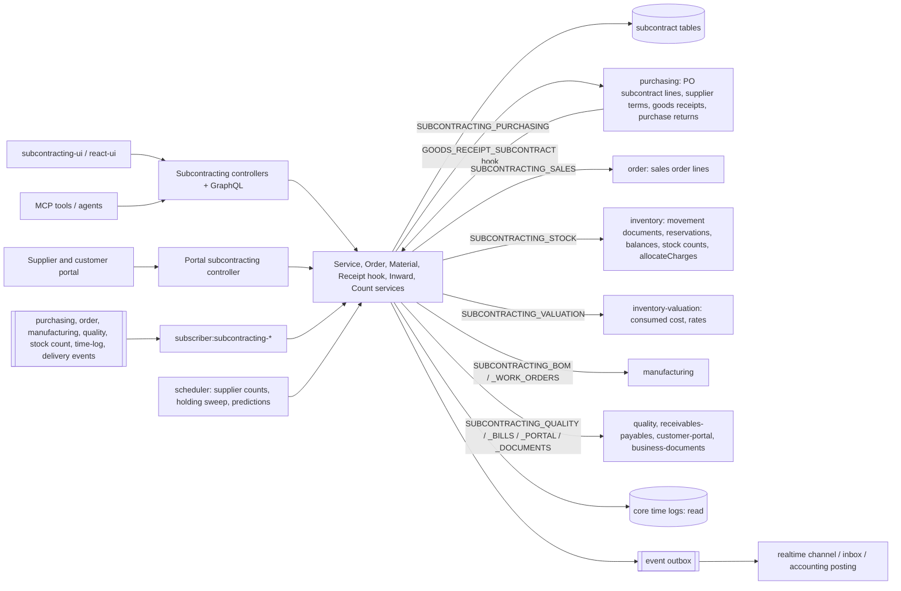

# Implementation Plan: Subcontracting

> Translates an approved `spec.md` into architecture and tech choices. The plan owns
> implementation details; the spec owns behaviour.

**Feature ID**: `subcontracting`
**Spec**: `./spec.md`
**Tasks**: `./tasks.md`
**Status**: `Draft`
**Last updated**: 2026-11-23

---

## 1. Architecture Summary

A new plugin `@gauzy/plugin-subcontracting` (`packages/plugins/subcontracting`), always loaded and gated per tenant by
`FEATURE_SUBCONTRACTING`. It owns subcontract services (the finished item → service item and structure mapping),
subcontract orders (both directions) with their outputs and materials, the subcontract part of goods receipts
(consumption, secondary outputs, cost parts), production reports, progress reports, count decisions and contractor
links. It writes no stock, ledger, purchase or sales table: stock moves through stock movement documents of the
purposes it registers with the warehouse area; bills of materials, work orders, valuation, inspections, bills and the
portal are reached through ports bound in `apps/api/src/plugin-composition.ts`.

It builds on what exists rather than beside it:

- **Locations**: a supplier-held location is a stock location of kind `THIRD_PARTY` with `ownerVendorId`, a
  customer-owned one has `ownerContactId` (both columns of core `warehouse`, `warehouse-and-stock-movements`); no party
  location table.
- **Receipts**: finished goods arrive on a purchasing `goods_receipt` of the subcontract service lines; purchasing calls
  the `GOODS_RECEIPT_SUBCONTRACT` hook this plugin binds inside the receipt transaction; returns to the supplier are
  procurement's `purchase_return`; `purchase_order_line.receivedQuantity` has one writer, the goods receipt.
- **Reconciliation**: a count of the supplier's location is an inventory `stock_count` (mode `SPOT`) that the supplier
  answers in the portal; closing it writes the corrections.
- **Suppliers and prices**: the suppliers of a service, their preference and price are the `vendor_product_term` rows
  of the service item.
- **Contractor labour**: the contractors' time logs on the order's tasks, at the pay rate stored on each log (the
  labour attribution rule of `shop-floor-and-work-orders`).
- **Additional costs**: spread by the inventory plugin's one allocation function `allocateCharges`; later charges are
  landed costs of `stock-ledger-and-valuation` targeting the goods receipt lines.
- **Reservations**: `stock_reservation` (reference `SUBCONTRACT_ORDER`); the reserved figure of a material line is
  read from them.

## 2. Tech Choices

| Concern | Choice | Rationale |
| ------- | ------ | --------- |
| Package | new `packages/plugins/subcontracting`, `subcontracting-ui`, `subcontracting-react-ui` | Principle I; this spec owns the domain |
| One model | `subcontract_order.direction` (`OUTWARD`, `INWARD`) with shared outputs and materials | spec FR-4 |
| Stock | stock movement documents with registered purposes; reservation reference `SUBCONTRACT_ORDER` with `lineId` = the material line; no reserved counter on the line | warehouse plan provides both |
| Supplier-held stock | a location of kind `THIRD_PARTY` with `ownerVendorId` = the supplier (warehouse plan's owner column); the party's default location is its owned location with the best core `warehouse.priority` | existing `WarehouseType.THIRD_PARTY`; the owner lives on the location |
| Customer-owned stock | a location with `ownerContactId` (warehouse plan) | excluded from own available and valued stock |
| Finished-goods receipt | a purchasing `goods_receipt` whose lines are on the order's `SUBCONTRACT` purchase lines (finished item as `variantId`, accepted `quantity`, procurement's `rejectedQuantity` / `rejectedWarehouseId`, delivery note and carrier on the header); purchasing calls `GOODS_RECEIPT_SUBCONTRACT` (declared by purchasing, bound here) in the receipt transaction: it checks the lines against the subcontract orders, returns the service quantity per line (finished × conversion) that the receipt rolls up into `purchase_order_line.receivedQuantity`, writes the consumption and secondary-output document, and returns the unit cost the receipt line carries to valuation | one receipt document and one received-quantity path per purchase order |
| Returns to the supplier | procurement's `purchase_return` of the goods receipt (also from the rejected location); consumer of `purchasing.purchase_return.confirmed` updates returned quantities; valuation reverses cost in proportion | no second return document |
| Supplier counts | inventory `stock_count` (mode `SPOT`, `warehouseId` = the supplier's location, `scopeCriteria` = the order materials), lines answered in the portal through the existing count route; per-line decision (charge, write off, accept) in `subcontract_count_decision`; `POST /stock-counts/:id/close` writes the corrections | the count feature measures, this plugin decides |
| Service suppliers and price | `vendor_product_term` of `serviceVariantId` (`vendorId`, `priority` = preference, `unitCost` = price per service unit, an hour for time-priced services, `leadTimeDays`, `status`) | no supplier or rate copy on the service |
| Contractor labour | time logs on the order's tasks under the labour attribution rule of `shop-floor-and-work-orders`, valued at each log's stored `payRateValue` | one labour value per log |
| Additional costs | `allocateCharges` of `@gauzy/plugin-inventory` (quantity, amount, weight, volume, manual) spreads costs entered with the receipt over its lines; later costs are landed costs targeting the goods receipt lines | one allocation function |
| Persistence | MultiORM entities, plugin migrations for PostgreSQL, SQLite, MySQL, both ORMs | Principle III |
| Settings | `SUBCONTRACTING_SETTINGS` contributions, organization scope, stored in the platform settings store | pattern of `inventory.settings.ts` |
| Permissions | permission contributions with `defaultFor` in `subcontracting.permissions.ts`; receipts and supplier returns use purchasing's `GOODS_RECEIPTS_CREATE` and procurement's `PURCHASE_RETURNS_CREATE` | no seed migration; one permission per document |
| Background work | `@ScheduledJob` + `@QueueWorker`; in-process fallback | task automations layout |
| Events | event outbox and consumer registry | at least once, idempotent |

## 3. Data Model

All tables extend `TenantOrganizationBaseEntity` (soft delete, `isActive`, `isArchived`); quantities and money
`numeric(20,6)` with currency; JSON as `text`; ids into other plugins carry no foreign key; documents carry `number`
(document engine series, unique per organization) and `version` for `If-Match`.

### New entities

| Table | Columns (besides base) | Indexes and uniqueness |
| --- | --- | --- |
| `subcontract_service` | `finishedVariantId`, `bomId`, `serviceVariantId`, `serviceQuantityPerUnit`, `consumptionBasis` (`BOM`, `AS_SENT`), `requiredBasis` (`BOM`, `FOLLOW_SENT`), `overSendAllowancePercent`, `consumptionTolerancePercent`, `routingOperationId`, `pricingMode` (`FIXED`, `TIME`); suppliers, preference and price are the service item's `vendor_product_term` rows | unique `(organizationId, finishedVariantId, serviceVariantId)` among active rows; index `(organizationId, serviceVariantId)` |
| `subcontract_order` | `number`, `direction`, `partyType`, `partyId`, `sourceType` (`PURCHASE_ORDER`, `SALES_ORDER`, `REQUISITION`, `PRODUCTION_PLAN`, `WORK_ORDER`), `sourceId`, `status` (`DRAFT`, `CONFIRMED`, `COMPLETED`, `CLOSED`, `CANCELLED`), `partyLocationId`, `consumptionBasis`, `requiredBasis`, `consumptionTolerancePercent`, `overSendAllowancePercent`, `reserveMaterials` bool, `neededBy`, `predictedCompletionAt`, `predictionFacts` text, `isLate` bool, `projectId`, `currency`, `plannedCost`, `actualCost`, `labourHours`, `labourCost`, `materialProgress`, `outputProgress` numeric(5,2), `closedAt` | index `(organizationId, direction, status)`, `(partyType, partyId, status)`, `(sourceType, sourceId)` |
| `subcontract_order_output` | `orderId`, `variantId`, `bomId`, `quantity`, `unitId`, `warehouseId` (receiving or delivery), `purchaseOrderLineId`, `salesOrderLineId`, `serviceQuantity`, `serviceUnitCost` (service cost per finished unit: the supplier term's `unitCost` per service unit × the service's `serviceQuantityPerUnit`), `additionalUnitCost`, `materialUnitCost`, `unitCost`, `receivedQuantity`, `rejectedQuantity`, `returnedQuantity` (written only by the receipt hook and the purchase-return consumer), `processLossQuantity`, `producedQuantity`, `deliveredQuantity`, `taskId`, `routingOperationId`, `workOrderId`, `plannedHours` | index `(orderId)`, `(purchaseOrderLineId)`, `(salesOrderLineId)` |
| `subcontract_order_material` | `orderId`, `outputId`, `variantId`, `requiredQuantity`, `reserveWarehouseId`, `alternativeOfId`, `ownership` (`OWN`, `CUSTOMER`), `isExtra`, `movedInQuantity` (sent or received from customer), `consumedQuantity`, `returnedQuantity`, `scrappedQuantity`, `billedQuantity`; the reserved figure is the sum of the line's active `stock_reservation` rows | index `(orderId, variantId)` |
| `subcontract_receipt_line` | `goodsReceiptId` uuid (purchasing `goods_receipt`), `goodsReceiptLineId` uuid null (the output's receipt line; null on consumption and secondary rows), `orderId`, `outputId`, `materialId`, `role` (`OUTPUT`, `SECONDARY`, `CONSUMPTION`), `variantId`, `quantity` (secondary received or material consumed), `warehouseId` (secondary target), `processLossQuantity`, `secondaryKind` (`CO_PRODUCT`, `BY_PRODUCT`, `SCRAP`, `EXTRA`), `valuationBasis` (`ITEM_RATE`, `COMPONENT_SHARE`, `STATED`), `valuationValue`, `materialCost`, `serviceCost`, `additionalCost`, `labourCost`, `unitCost`, `lots` text, `overrideReason`, `stockDocumentId` (the consumption and secondary-output document). Accepted and rejected quantities, locations, lots of the output and inspection state stay on the goods receipt line | index `(goodsReceiptId)`, `(goodsReceiptLineId)`, `(orderId, outputId)` |
| `subcontract_production_report` | `orderId`, `number`, `reportedAt`, `lines` text (role, variant, quantity, process loss), `stockDocumentId`, `status` | index `(orderId)` |
| `subcontract_progress_report` | `orderId`, `outputId`, `via` (`PORTAL`, `STAFF`, `TIME`), `reportedByRef`, `startedAt`, `quantityDone`, `expectedCompletionAt`, `note`, `fileIds` text | index `(orderId, createdAt)` |
| `subcontract_count_decision` | `stockCountId` uuid, `stockCountLineId` uuid (inventory `stock_count_line`), `decision` (`CHARGE`, `WRITE_OFF`, `ACCEPT`), `debitNoteRequestRef` uuid null; book, counted, difference and value are the count line's and the count's `varianceValue` | unique `(stockCountLineId)`; index `(stockCountId)` |
| `subcontract_contractor_link` | `vendorId`, `employeeId` | unique `(organizationId, vendorId, employeeId)` |

Changes in other plugins (additive): the purchasing line kind `SUBCONTRACT` and `subcontractServiceId`
(procurement plan); the purchasing hook `GOODS_RECEIPT_SUBCONTRACT` (declared by purchasing, called in the goods receipt
transaction for `SUBCONTRACT` lines, its service quantity rolled into `receivedQuantity`), and procurement's goods
receipt columns (`vendorId`, `deliveryNoteRef`, `carrierName`, `rejectedQuantity`, `rejectedWarehouseId`,
`inspectionState`) and `purchase_return`; reservation reference `SUBCONTRACT_ORDER`, location owners `ownerContactId`
and `ownerVendorId` and the purposes registry (warehouse plan); `allocateCharges` and landed cost targets on goods
receipt lines (`stock-ledger-and-valuation`); a stock count of a supplier location whose lines the supplier's portal
user enters through the existing count route.

**Reused, not created:** party locations (core `warehouse` owner columns), receipts and supplier returns (`goods_receipt`,
`purchase_return`), counts (`stock_count`, `stock_count_line`), supplier preference and price (`vendor_product_term`),
contractor rates (`time_log.payRateValue`), reservations (`stock_reservation`).

### Migrations

**Migration timestamps**: `packages/plugins/subcontracting` `1791000092100` to `1791000092199`.

In `packages/plugins/subcontracting/src/lib/database/migrations/`, listed in `migrations/index.ts`, written with
the shared core migration helpers of `@gauzy/core`, PostgreSQL, SQLite and MySQL
branches, idempotent and forward-only:

1. `1791000092100-CreateSubcontractServiceTables` — service, contractor link.
2. `1791000092110-CreateSubcontractOrderTables` — order, output, material.
3. `1791000092120-CreateSubcontractReceiptTables` — receipt lines (the subcontract rows of goods receipts), production
   report.
4. `1791000092130-CreateSubcontractCollaborationTables` — progress report, count decision.

Default role grants are permission contributions (`defaultFor`), not a migration.

### Contracts

`packages/contracts/src/lib/subcontracting.model.ts` (new): enums of §3, `ISubcontractService`, `ISubcontractOrder`,
`ISubcontractOrderOutput`, `ISubcontractOrderMaterial`, `ISubcontractReceiptLine`, `ISubcontractReceiptInput` (the
subcontract block of a goods receipt body: consumption edits, secondary outputs, process loss, override reason),
`ISubcontractProductionReport`, `ISubcontractProgressReport`, `ISubcontractCountDecision`,
`ISubcontractMaterialPosition` (where material is), `ISubcontractCostBreakdown`, and the port and hook shapes of §4.

## 4. API Surface

All routes: `TenantPermissionGuard`, `PermissionGuard`, `FeatureFlagGuard` with `@FeatureFlag(FEATURE_SUBCONTRACTING)`;
cursor pagination; `Idempotency-Key` on sends, receipts, returns, reports; `If-Match` on order writes.

| Method | Endpoint | Permission | Description (request → response) | Status |
| ------ | -------- | ---------- | ----------- | ------ |
| `GET` `POST` `PUT` | `/subcontract-services` (+ `GET /resolve?finishedVariantId=&vendorId=&serviceVariantId=`) | `SUBCONTRACT_ORDERS_VIEW` / `SUBCONTRACT_SERVICES_EDIT` | `ISubcontractService` with its suppliers read from the service item's supplier terms; resolve picks the service whose term for the supplier has the best priority | New |
| `GET` `POST` `PUT` | `/subcontract-orders` | `SUBCONTRACT_ORDERS_VIEW` / `_EDIT` | `CreateSubcontractOrderDTO` → `ISubcontractOrder` | New |
| `POST` | `/subcontract-orders/from-purchase-order/:id` · `/from-sales-order/:id` · `/from-requisition-lines` · `/from-plan-lines` | `SUBCONTRACT_ORDERS_EDIT` | create from source → order(s), per-line results | New |
| `POST` | `/subcontract-orders/:id/confirm` · `/close` · `/reopen` · `/cancel` · `/basis` | `SUBCONTRACT_ORDERS_EDIT` | lifecycle; consumption and required basis | New |
| `POST` | `/subcontract-orders/:id/reservations` (+ `DELETE`) | `SUBCONTRACT_MATERIALS_MOVE` | reserve, change, release | New |
| `POST` | `/subcontract-orders/:id/send-materials` · `/return-materials` · `/receive-customer-materials` · `/return-customer-materials` | `SUBCONTRACT_MATERIALS_MOVE` | lines → stock movement document | New |
| `GET` | `/subcontract-orders/:id/materials/position` · `/cost` · `/flow` | `SUBCONTRACT_ORDERS_VIEW` | where material is; cost breakdown and variance; document flow | New |
| `POST` | `/subcontract-receipts/preview` | `SUBCONTRACT_ORDERS_VIEW` | outputs, consumption, secondary outputs, costs and movements a goods receipt would write; writes nothing | New |
| `POST` | `/goods-receipts` (purchasing) | `GOODS_RECEIPTS_CREATE` | existing route; lines on `SUBCONTRACT` purchase lines carry the `ISubcontractReceiptInput` block the hook applies | Changed (additive) |
| `POST` | `/purchase-returns` (procurement) | `PURCHASE_RETURNS_CREATE` | return of finished goods to the supplier (also from the rejected location); the subcontract order's returned quantity follows | Existing elsewhere |
| `POST` | `/subcontract-orders/:id/work-orders` · `/production-reports` | `SUBCONTRACT_ORDERS_EDIT` | inward production | New |
| `GET` `POST` | `/subcontract-orders/:id/progress` | `SUBCONTRACT_ORDERS_VIEW` / `_EDIT` | progress reports | New |
| `GET` | `/subcontracting/board` | `SUBCONTRACT_ORDERS_VIEW` | live board per supplier | New |
| `GET` `POST` | `/subcontract-counts` | `SUBCONTRACT_RECONCILIATIONS_MANAGE` | opens a `stock_count` (mode `SPOT`) of the supplier's location and publishes it to the portal; lists counts of supplier locations | New |
| `PUT` | `/subcontract-counts/:countId/decisions` | `SUBCONTRACT_RECONCILIATIONS_MANAGE` | decision per count line; closing is the existing `POST /stock-counts/:id/close` | New |
| `GET` `PUT` | `/subcontracting/contractors` | `SUBCONTRACT_ORDERS_EDIT` | contractor links (supplier ↔ employee) | New |
| `POST` | `/subcontract-orders/:id/propose-bill` | `SUBCONTRACT_ORDERS_EDIT` | approved time × the service's supplier term price → bill draft through `SUBCONTRACTING_BILLS` | New |
| `GET` `PUT` | `/subcontracting/settings` | `SUBCONTRACT_SETTINGS_EDIT` | the plugin's setting keys in the platform settings store | New |
| `GET` `POST` | `/portal/subcontracting/*` (orders, material sent, progress, counted quantities of the open count of their location) | portal session of the party's contact | party-scoped, costs omitted; counts entered through the stock count service | New |

Errors (`ApiException` codes): `SUBCONTRACT_SOURCE_NOT_OPEN`, `SUBCONTRACT_PARTY_MISMATCH`, `SUBCONTRACT_SERVICE_STOCKED`,
`SUBCONTRACT_SERVICE_DUPLICATE`, `SUBCONTRACT_OVER_SEND`, `SUBCONTRACT_OVER_CONSUMPTION`,
`SUBCONTRACT_CONSUMPTION_OUT_OF_TOLERANCE`, `SUBCONTRACT_ORDER_CLOSED`, `SUBCONTRACT_LOCATION_NOT_OWNED`,
`SUBCONTRACT_OVER_DELIVERY`, `SUBCONTRACT_RETURN_EXCEEDS_HELD`. GraphQL read fields `subcontractOrders`,
`subcontractOrder`, `subcontractMaterialPosition` in the plugin's schema extension.

**Ports** (optional tokens in `subcontracting.types.ts`, bound in `apps/api/src/plugin-composition.ts`):

| Port | Answered by | Purpose; without it |
| --- | --- | --- |
| `SUBCONTRACTING_PURCHASING` | `PurchasingSubcontractFacade` (new, in purchasing) | read subcontract lines and order state, supplier terms of service items (`vendorId`, `priority`, `unitCost`, `leadTimeDays`) and the supplier's `leadTimeDays`; outward refused without it |
| `GOODS_RECEIPT_SUBCONTRACT` (hook, answered here) | purchasing `GoodsReceiptService` | called in the receipt transaction for `SUBCONTRACT` lines: validate against the orders, service quantity per line, consumption and secondary-output document, unit cost; refuses the receipt on over-consumption or a closed order. Its `reverse` step, called by `GoodsReceiptService.reverse` in the reversal's own transaction, reverses the consumption and secondary-output document and the order's counters, so a reversed receipt never leaves its consumption standing and a failure rolls the reversal back |
| `SUBCONTRACTING_SALES` | `order` plugin line reader | read processing-service lines and order state; inward refused without it |
| `SUBCONTRACTING_STOCK` | inventory movement document, reservation, balance and stock count services, `allocateCharges` | all stock effects, reserved figures, supplier counts; the plugin refuses to move stock without it |
| `SUBCONTRACTING_VALUATION` | `inventory-valuation` | value of consumed layers and item rates; fallback: core `product_variant_price.unitCost` |
| `SUBCONTRACTING_BOM` | `manufacturing` | default bill of materials, explosion, secondary outputs; without it materials are entered per order |
| `SUBCONTRACTING_WORK_ORDERS` | `manufacturing` | inward work orders, reservation hand-over, operation events; without it production reports |
| `SUBCONTRACTING_QUALITY` | `quality` | inspection requirement and results |
| `SUBCONTRACTING_BILLS` | `receivables-payables` | bill draft from time, debit note request for shortfalls |
| `SUBCONTRACTING_PORTAL` | `customer-portal` | party resolution, publishing, notifications |
| `SUBCONTRACTING_DOCUMENTS` | `business-documents` | series, links, roll-ups; fallback: core `sequence` |

Purposes registered with the warehouse purposes registry at bootstrap: `SUBCONTRACT_SEND`, `SUBCONTRACT_RETURN_IN`,
`SUBCONTRACT_RECEIPT` (consumption at the supplier location and secondary outputs of a goods receipt; the finished
goods enter through the goods receipt's own movement), `CUSTOMER_MATERIAL_IN`, `CUSTOMER_MATERIAL_OUT`,
`SUBCONTRACT_PRODUCTION` (inward reports). Finished goods go back to the supplier through procurement's purchase return.

**Consumer tokens answered** (bound in `apps/api/src/plugin-composition.ts` to the subcontract order services; each consumer plan states the shape it calls and its fallback): `MANUFACTURING_SUBCONTRACT`, `PURCHASING_SUBCONTRACT`.

## 5. Events, Real-Time and Notifications

| Event | Emitted when | Consumers |
| ----- | ------------ | --------- |
| `document.subcontract_order.confirmed` / `.cancelled` / `.closed` | lifecycle | accounting, reports |
| `subcontracting.material.sent` / `.returned` / `.customer_received` / `.customer_returned` | material documents | board, holding sweep, requisition fulfilment |
| `subcontracting.receipt.posted` / `.returned` / `.cancelled` | the hook in a goods receipt's transaction; a purchase return; the hook's `reverse` step in a receipt reversal's transaction | board, requisition fulfilment, work order operations; valuation and the purchase line follow the goods receipt itself |
| `subcontracting.progress.reported` | portal, staff or time roll-up | board (realtime), prediction |
| `subcontracting.order.late_predicted` | prediction passes the need date | procurement exception queue, inbox to buyer |
| `subcontracting.material.held_too_long` | holding sweep | inbox to buyer |
| `subcontracting.count.requested` / `.answered` / `.decided` | supplier count opened, all lines entered in the portal, decisions saved | portal, inbox |
| In: `purchasing.purchase_order.confirmed` / `.held`, `document.purchase_order.closed` | purchasing | `subscriber:subcontracting-sources` (automatic orders, blocks) |
| In: `purchasing.purchase_return.confirmed`, `purchasing.goods_receipt.reversed` | procurement, purchasing | returned quantities; board refresh after a reversal (the consumption is reversed by the hook inside the reversal) |
| In: stock count closed (inventory) | count of a supplier location | debit note request per `CHARGE` line through `SUBCONTRACTING_BILLS` |
| In: `document.sales_order.confirmed`, delivery and sales return events | sales, delivery | inward creation, delivered and returned quantities |
| In: work order operation reached, work order completed, `quality.inspection.decided` | manufacturing, quality | proposals, produced quantity, inspection state |
| In: core time-log created, updated, deleted | time tracking | `subscriber:subcontracting-time` (hours, labour cost, progress) |

Inbox items through `INBOX_ITEM_WRITER`; realtime hints on `subcontracting:<organizationId>` and per order; emails to
party contacts through the email-template system.

## 6. UI Surface

- **Angular `packages/plugins/subcontracting-ui`** (lazy, `@gauzy/plugin-ui`, menu "Subcontracting" under
  Purchasing and Manufacturing): `/pages/subcontracting/{services,orders,orders/:id,inward,board,counts,dashboard,
  settings}`. The order page shows outputs, materials with "where it is", documents (goods receipts and purchase
  returns among them), progress timeline and cost breakdown; send and return of material are dialogs with lot pickers;
  "Receive" opens the goods receipt form with the subcontract block (consumption, secondary outputs, preview). Supplier
  and customer locations are edited on the existing Warehouses page (owner fields); a count opens on the platform's
  stock count page. Lists are saved-view lists; forms honour custom fields.
- **Purchase order and goods receipt forms** (`purchasing-ui`): the subcontract line kind, "Create subcontract order"
  and the receipt's subcontract block through the slot registry, visible only with the flag.
- **React `packages/plugins/subcontracting-react-ui`**: `SubcontractOrderCard`, `ProgressReportForm`, `CountAnswerForm`
  for the supplier portal (mounted as portal blocks through the `@gauzy/ui-react` host).
- i18n keys `SUBCONTRACTING.*` in every locale.

## 7. MCP Tools, SDKs and Integrations

New file `packages/mcp-server/src/lib/tools/subcontracting.ts`, registered in `register-all-tools.ts`:

| Tool | Input | Output |
| --- | --- | --- |
| `subcontracting_order_status` | order id or source document | outputs, materials, progress, prediction |
| `subcontracting_where_is_material` | order id or item and supplier | quantities per place with dates |
| `subcontracting_materials_to_send` | supplier, dates | open material lines with quantities |
| `subcontracting_propose_resupply` | supplier | send documents it would create (preview only) |
| `subcontracting_record_receipt` | order, lines, `preview` (default true) | consumption, costs and movements it would write, or the goods receipt it posted |
| `subcontracting_reconcile_preview` | supplier | book balance per material and lot at the supplier's location, ageing, value |
| `subcontracting_explain_cost` | order id | planned against actual per cost part, in plain language |

OpenAPI additive; SDKs regenerated after merge. Import and export of services and locations through
`data-import-export`.

## 8. Background Jobs

| Trigger | When | What it does | Idempotency |
| ------- | ---- | ------------ | ----------- |
| `subcontracting.counts.schedule` (queue `subcontracting-maintenance`) | monthly (setting) | opens a stock count of each supplier location holding material | per location and period |
| `subcontracting.holding.sweep` | daily | ages material at suppliers, raises held-too-long | per order material and day |
| `subcontracting.predictions.recompute` | hourly | predicted completion and late flag for open outward orders from progress, tracked time, past lead times and the supplier term's and supplier's `leadTimeDays` | per order and hour |
| Outbox consumers `subscriber:subcontracting-sources`, `-time`, `-fulfilment` | events | automatic orders, time roll-ups, delivered and produced quantities | delivery record per consumer and event |

Schedules live in `SubcontractingSchedulePlugin` loaded by `apps/worker/src/plugins.ts`; queue jobs run in the API;
without a queue root the API runs them on in-process timers under a database lock.

## 9. Security & Permissions

New values in `subcontracting.permissions.ts`: `SUBCONTRACT_SERVICES_EDIT`, `SUBCONTRACT_ORDERS_VIEW`,
`SUBCONTRACT_ORDERS_EDIT`, `SUBCONTRACT_MATERIALS_MOVE`, `SUBCONTRACT_CONSUMPTION_OVERRIDE`,
`SUBCONTRACT_RECONCILIATIONS_MANAGE`, `SUBCONTRACT_SETTINGS_EDIT`, declared as permission contributions whose
`defaultFor` grants all to `SUPER_ADMIN` and `ADMIN` and `SUBCONTRACT_ORDERS_VIEW` to `MANAGER` (no seed migration).
Receipts need purchasing's `GOODS_RECEIPTS_CREATE`, supplier returns procurement's `PURCHASE_RETURNS_CREATE`, and
closing a count the count's own permission, so warehouse and buying duties stay split. Portal routes resolve the party
from the session and never
return costs. Agents act in the caller's request context and are marked in the audit trail. DTOs use class-validator;
notes and file names are sanitised.

## 10. Observability

Activity-log entries for confirmations, overrides and count decisions; metrics
`subcontracting_receipt_post_ms`, `subcontracting_material_value_at_suppliers`, `subcontracting_late_orders`,
`subcontracting_time_rollup_lag_seconds`; a daily integrity check compares each supplier location's stock balance with
the material still held there on every order, open or closed (sent less consumed and returned; spec FR-19 lets an
order close with material outstanding), and reports drift to the job monitor.

## 11. Phased Rollout

1. **Phase 1 — Outward core**: contracts, entities, migrations, services, orders from purchase orders, reservations,
   sends, the goods receipt hook with consumption and costing, minimal `subcontracting-ui`. Usable: send material to a
   supplier and receive finished goods at the right cost on the purchase order's goods receipt.
2. **Phase 2 — Depth**: returns both ways, secondary outputs and process loss, inspections, landed cost target,
   sources (requisitions, plans, operations), inward orders with customer material, work orders or production
   reports, deliveries and returns; print templates; reports and dashboard; MCP tools.
3. **Phase 3 — Advanced capabilities**: live board, portal progress and prediction, supplier counts answered in the
   portal, contractor time roll-up and bill proposal, agent tools for material and cost. The feature is off by default; after the trial period it may be switched on by default for new tenants only; existing tenants keep their setting until an administrator changes it.

## 12. Constitution Reconciliation

- I Plugin-first: everything in `packages/plugins/subcontracting` and its UI plugins; purchasing exposes one facade and one receipt hook; core unchanged.
- II Tenant/organization scoping: tenant-organization base on every table; consumers set tenant and organization from the envelope; portal queries filtered by party.
- III Both ORMs, additive migrations: four additive migrations, three dialects, both ORMs; SQLite migration spec.
- IV Default-off flag; nothing removed: `FEATURE_SUBCONTRACTING` off; no existing route or column changes.
- V Contracts and API first: contracts and REST before screens; OpenAPI additive.
- VI Permissions, privacy, security: split duties; costs hidden from portals; sanitised input.
- VII Real-time through the event bus: outbox events and realtime hints only.
- VIII i18n and accessibility: keys in every locale; accessible board, dialogs and lot pickers.
- IX Tests: unit specs per service and pure helper (consumption, costing, progress), DB specs on SQLite, e2e per route.
- X Behaviour-first spec: implementation lives here.
- XI Documentation describes our platform only.

## 13. Risks & Mitigations

| Risk | Likelihood | Impact | Mitigation |
| ---- | ---------- | ------ | ---------- |
| Material balance at a supplier drifts from the order's counters | Medium | High | counters and movements in one transaction; daily integrity check; supplier counts |
| Cost of finished goods computed twice (order, receipt, valuation) | Medium | Medium | one cost function in the receipt hook; the order shows planned cost only; valuation gets the goods receipt line's figure |
| Two receipt paths for one purchase order | Low | High | finished goods arrive only on goods receipts; the hook refuses subcontract lines outside a subcontract order |
| Dependent plugins absent (manufacturing, valuation) | High | Medium | every such port optional with a stated fallback; phase 1 needs only purchasing and inventory |
| Customer-owned stock counted as ours | Low | High | locations with an owner excluded by the warehouse area; tests on available and valued stock |
| Time from contractors billed twice | Low | Medium | a bill draft claims the time logs it uses; claimed logs are skipped |

## 14. References

- Spec: `./spec.md` · Tasks: `./tasks.md`
- Code: `packages/plugins/purchasing/src/lib/purchasing.types.ts`, `packages/plugins/purchasing/src/lib/goods-receipt/`,
  `packages/plugins/purchasing/src/lib/vendor-product-term/`, `packages/plugins/inventory/src/lib/stock-count/`,
  `packages/plugins/inventory/src/lib/stock-count-line/`, `packages/plugins/inventory/src/lib/stock-transfer/`,
  `packages/plugins/inventory/src/lib/stock-reservation/`, `packages/core/src/lib/core/enums/kernel-extension.enums.ts`,
  `packages/plugins/task-automations/src/lib/database/migration-helpers.ts`, `apps/api/src/plugin-composition.ts`,
  `apps/api/src/plugins.ts`, `apps/worker/src/plugins.ts`
- Related plans: `../procurement/plan.md`, `../warehouse-and-stock-movements/plan.md`,
  `../stock-ledger-and-valuation/plan.md`, `../manufacturing-bom-and-routing/plan.md`,
  `../shop-floor-and-work-orders/plan.md`, `../customer-and-supplier-portal/plan.md`
