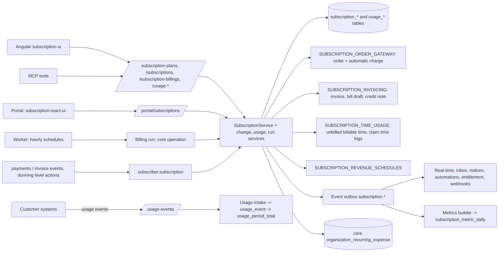

# Implementation Plan: Subscription billing

> Translates an approved `spec.md` into architecture and tech choices. The plan owns
> implementation details; the spec owns behaviour.

**Feature ID**: `subscription-billing`
**Spec**: `./spec.md`
**Tasks**: `./tasks.md`
**Status**: `Draft`
**Last updated**: 2026-11-23

---

## 1. Architecture Summary

The existing plugin `@gauzy/plugin-subscription` (`packages/plugins/subscription`) is extended in place: its four
tables gain nullable or defaulted columns, ten tables are added, and its cycle code (`subscription.cycle.ts`,
`SubscriptionService.billCycle`, the billing run of `POST /subscriptions/billing-run`) stays the one path that
bills a period. Two things are new around it: a second way to settle a cycle (an invoice with a due date, through
the invoicing port) beside the existing order-and-charge path, and a scheduler that calls the existing run for the
organizations that switch it on. Every new organization setting starts at today's behaviour, so an existing
subscription bills, charges and retries as before until someone changes a setting. The
plugin still writes no order, payment, invoice or ledger row itself: it calls ports bound in
`apps/api/src/plugin-composition.ts` and appends `subscription.*` events to the outbox. Core `invoice-schedule`
gets two cadences, an end day and a link to a subscription.

It builds on what exists: a billing run is a core operation (the operation header already names subscription
billing as one of its users); suspension after non-payment is a level action of the one dunning engine of
`payments-and-collections`; the subscribe link is a public link of the platform (`shared_entity`, extended by
`access-control-and-security`); cancellation reasons are core tags of one tag type; a supplier subscription is
attached to the organization's recurring expense of the same cost (`organization_recurring_expense`), which keeps
feeding the dashboards; analysis uses dimension sets of `accounting-foundation`.

## 2. Tech Choices

| Concern | Choice | Rationale |
| ------- | ------ | --------- |
| Package | `packages/plugins/subscription` (existing), `subscription-ui` (new, Angular), `subscription-react-ui` (new, portal blocks of `customer-and-supplier-portal`) | Principle I; build on what exists |
| Flags | `FEATURE_SUBSCRIPTION` on every controller (already there); `FEATURE_SUBSCRIPTION_BILLING` (declared in `commerce-feature-catalogue.ts`, read by nothing today) read by the schedule consumer and by the automatic-charge branch; the schedule also needs the organization setting `subscription.scheduledRun` (off by default) | wire the existing code instead of adding one; no tenant is billed on a schedule it did not choose |
| Settlement | strategy per cycle: `AUTOMATIC` → existing `ISubscriptionOrderGatewayPort.raiseSubscriptionOrder`, then, where `subscription.invoiceAutomaticCycles` is on (off by default), the order-invoice bridge; `INVOICE` → new `ISubscriptionInvoicingPort.raiseCycleInvoice` | one cycle code, two settlers; the existing path unchanged by default |
| Idempotency | existing unique `(subscriptionId, periodStart)` and platform idempotency store; usage unique `(tenantId, meterId, idempotencyKey)` | spec FR-23, FR-43 |
| Change preview | pure calculator shared by preview and apply; `previewToken` = signature over subscription id, `version`, input and result (secret from `@gauzy/config`), valid 15 minutes | spec FR-38 without a table |
| Proration | existing proration code generalised to day-based units in `engine/proration.ts` | property-tested |
| Usage | append-only `usage_event`, incremental `usage_period_total` maintained by a queue worker; pricing in `engine/usage-pricing.ts` | intake stays fast |
| Analytics | `subscription_metric_daily` built nightly and incrementally from `subscription_change` and cycles; reports as report definitions | no raw scans |
| Background work | `@ScheduledJob` + `@QueueWorker`; `SubscriptionSchedulePlugin` in the worker, consumers in the API; in-process fallback | same split as invoice schedules |
| Settings | `subscription.settings.ts` (`PluginSettingContribution`, scope `ORGANIZATION`); defaults keep today's behaviour: `scheduledRun` off, `invoiceAutomaticCycles` off, `billWhenUnpaid` on, `oneTrialPerPlan` off, `refuseMixedLines` off (FR-9), `refuseArchivedPlans` off (FR-7), `maxPauseDays` none, proration credit carried to the next invoice, `defaultCollection` `AUTOMATIC` where the organization had plans before, else `INVOICE` | platform settings store |
| Runs | billing runs as core operations (`packages/core/src/lib/operation`): type `SUBSCRIPTION_BILLING_RUN`, aggregate = organization (one live run), steps per batch of subscriptions, counts and failures in the operation result, per-cycle outcome on `subscription_billing.operationId` | one run model; resumable and observable |
| Collection | past due from invoice events; grace and the suspend-or-cancel action are levels of the dunning policy of `payments-and-collections` (default level: suspend after 7 days for subscriptions collected by invoice; none for automatic collection, which keeps its retry schedule), carried out through `SUBSCRIPTION_COLLECTION_ACTIONS` | one dunning engine |
| Public links | subscribe links are `shared_entity` rows of the plan (hashed token, expiry, revocation) through the public-link service of `access-control-and-security` | one public-link model |
| Reasons | cancellation reasons are core tags of the tag type "Subscription cancellation reason" (seeded per organization) | reuse tags and tag types |
| Recurring costs | each supplier subscription references one `organization_recurring_expense`; the subscription service writes its monthly equivalent, start and end there, so the dashboards and bonus figures count the cost once | one list of recurring costs |
| Analysis | `dimensionSetId` resolved by `AnalyticDimensionSetService.resolve` (a cost centre is a dimension) | one analysis shape |
| Permissions | contributions in `subscription.permissions.ts` with `defaultFor` | no seed migration |

## 3. Data Model

### New or changed entities

Existing entities keep every column. All additions are nullable or have defaults; new tables extend
`TenantOrganizationBaseEntity`. Money is `numeric(20,6)` with a `char(3)` currency.

| Table | Added columns / columns (type, default) | Indexes and uniqueness |
| --- | --- | --- |
| `subscription_plan` (changed) | `pluginId` uuid null (a paid plan of a plugin sold inside the installation; added by the Ever Platform spec `app-installs-and-licensing`, which copies the existing plugin plans), `priceBasis` varchar(16) default `SNAPSHOT` (`SNAPSHOT`/`PRICE_LIST`/`FIXED_AMOUNT`/`MONTHLY_RATE`), `fixedAmount` null, `monthlyRate` null, `billingTiming` varchar(16) default `IN_ADVANCE` (`IN_ADVANCE`/`IN_ARREARS`/`DAYS_BEFORE`), `billDaysBefore` int null, `collectionMode` varchar(16) default `AUTOMATIC` for existing rows (new plans, and API calls naming none, take the organization's `defaultCollection`), `calendarAligned` bool default false, `recogniseOverPeriod` bool default false, `selfService` json null, `retentionOffer` json null, `downgradeAtPeriodEndOnly` bool default false, `versionNo` int default 1, `rootPlanId` uuid null, `isArchived` reuse | idx `(rootPlanId, versionNo)` |
| `subscription_plan_component` (new) | `planId` fk, `kind` varchar(12) (`RECURRING`/`USAGE`), `variantId` uuid null, `meterId` fk null, `pricingModel` varchar(16) null (`PER_UNIT`/`ALLOWANCE`/`GRADUATED`/`VOLUME`/`PACKAGE`), `unitPrice` null, `includedUnits` numeric(20,6) null, `tiers` json null, `packageSize` null, `minimumAmount` null, `maximumAmount` null, `rollOverPeriods` int default 0, `interimInvoiceAbove` null, `position` int | idx `(planId, position)` |
| `subscription_plan_provider_price` (new) | `planId` fk, `providerKey` varchar(64), `externalPriceRef` varchar(255) | unique `(planId, providerKey)`; unique `(organizationId, providerKey, externalPriceRef)`; kept apart from `integration_map` because that table requires an `integration_tenant` and a payment provider registration need not have one (`payment_provider.integrationId` is optional); keyed by `providerKey` as `payment_account_holder` is |
| `subscription` (changed) | `startsOn` date null, `endsOn` date null, `trialEndsAt` timestamp null, `billingTiming`, `billDaysBefore`, `collectionMode`, `calendarAligned` (null = plan), `paymentTermId` uuid null, `daysUntilDue` int null, `autoConfirmInvoices` bool null, `cancelAtPeriodEnd` bool default false, `billWhenUnpaid` bool null, `collectionState` varchar(12) default `CURRENT`, `pastDueSince` timestamp null, `discountType` varchar(8) null, `discountValue` null, `discountCyclesLeft` int null, `dimensionSetId` uuid null, `taxRegimeId` uuid null, `cancelReasonTagId` uuid null (core `tag`), `restartedAt` timestamp null, `ownerUserId` uuid null, `sourceInvoiceScheduleId` uuid null | idx `(organizationId, collectionState)`, `(organizationId, status, nextBillingAt)` (exists) |
| `subscription_item` (changed) | `planComponentId` uuid null, `kind` varchar(12) default `RECURRING`, `meterId` uuid null, `description` varchar(255) null, `rolledOverUnits` numeric(20,6) default 0 | idx `(subscriptionId, kind)` |
| `subscription_billing` (changed) | `invoiceId` uuid null, `operationId` uuid null, `settlement` varchar(12) null (`AUTOMATIC`/`INVOICE`/`BILL_DRAFT`), `recurringAmount`, `usageAmount`, `prorationAmount` null, `heldReason` varchar(64) null, `invoiceDatedOn` date null, `redatedForLock` bool default false, `revenueScheduleId` uuid null, `kind` varchar(12) default `CYCLE` (`CYCLE`/`INTERIM`) | idx `(invoiceId)`, `(operationId)`, `(organizationId, status, heldReason)` |
| `subscription_change` (new) | `subscriptionId` fk, `kind` varchar(24), `before` json, `after` json, `requestedAt`, `effectiveAt`, `status` varchar(12) (`APPLIED`/`SCHEDULED`/`CANCELLED`/`REFUSED`), `actorType` varchar(12), `actorId` uuid null, `credit`, `charge`, `net` null, `currency`, `recurringDelta` numeric(20,6) null (per month), `reasonCode` null, `note` text null | idx `(subscriptionId, effectiveAt)`, `(organizationId, status, effectiveAt)` |
| `supplier_subscription` (new), `supplier_subscription_line` (new) | header: `recurringExpenseId` uuid (core `organization_recurring_expense`: category, monthly value, currency, start and end of the cost), `vendorId` uuid, `name`, `reference` varchar(128) null, `status` varchar(12) (`ACTIVE`/`PAUSED`/`CANCELED`/`EXPIRED`), `billingPeriod`, `billingInterval` int, `nextRenewalOn` date, `paymentTermId` null, `dimensionSetId` null, `ownerUserId` null, `noticeDays` int null, `recogniseOverPeriod` bool, `version` int; line: `variantId` null, `description`, `quantity`, `expectedUnitPrice`, `expenseAccountId` null | unique `(recurringExpenseId)`; idx `(organizationId, status, nextRenewalOn)`, `(vendorId)` |
| `supplier_subscription_cycle` (new) | `supplierSubscriptionId` fk, `periodStart`, `periodEnd`, `expectedAmount`, `currency`, `billId` uuid null (the draft or matched bill), `billedAmount` null, `status` varchar(12) (`DUE`/`DRAFTED`/`MATCHED`/`DEVIATING`/`SKIPPED`), `expenseScheduleId` null, `operationId` null | unique `(supplierSubscriptionId, periodStart)` |
| `usage_meter` (new) | `code` varchar(64), `name`, `unit` varchar(32), `aggregation` varchar(16) (`SUM`/`MAX`/`LAST`/`DISTINCT`), `resetsEachPeriod` bool, `source` varchar(16) (`API`/`TRACKED_TIME`/`SEATS`/`AUTOMATION`), `sourceConfig` json | unique `(organizationId, code)` |
| `usage_event` (new) | `meterId` fk, `subscriptionId` fk, `quantity` numeric(20,6), `occurredAt`, `idempotencyKey` varchar(160), `distinctKey` varchar(160) null, `attributes` json null, `status` varchar(12) (`RECORDED`/`VOIDED`/`BILLED`/`LATE`), `billingId` uuid null, `voidReason` null, `correctsEventId` uuid null | unique `(tenantId, meterId, idempotencyKey)`; idx `(subscriptionId, meterId, occurredAt)` |
| `usage_period_total` (new) | `subscriptionId`, `meterId`, `periodStart`, `periodEnd`, `quantity`, `amount`, `lastEventAt`, `thresholdsNotified` json | unique `(subscriptionId, meterId, periodStart)` |
| `subscription_metric_daily` (new) | `day` date, `planId` uuid null, `currency`, `recurring` (monthly), `activeCount`, `newAmount`, `expansionAmount`, `contractionAmount`, `churnedAmount`, `reactivatedAmount`, `trialsStarted`, `trialsConverted`, `cancelled`, `usageAmount` | unique `(organizationId, day, planId, currency)` |
| `invoice_schedule` (core, changed) | `endDay` varchar(10) null, `subscriptionId` uuid null; enum `InvoiceScheduleFrequencyEnum` gains `QUARTERLY`, `YEARLY` | — |
| `organization_recurring_expense` (core, used) | no new column; rows referenced by supplier subscriptions are written by the subscription service (monthly equivalent, start, end) and show a link to their supplier subscription | the dashboards and bonus statistics read them as today |
| `tag_type`, `tag` (core, used) | tag type "Subscription cancellation reason" seeded per organization by the service; its tags are the reasons | managed on the existing tags page |

### Migrations

**Migration timestamps**: `packages/plugins/subscription` `1791000082100` to `1791000082199`; `packages/core` `1791000082900` to `1791000082999`.

- Plugin (`packages/plugins/subscription/src/lib/database/migrations`): `1791000082100-AddSubscriptionBillingTerms` (columns
  on the four existing tables), `1791000082110-CreateSubscriptionPlanComponentTables`, `1791000082120-CreateSubscriptionChangeTables`,
  `1791000082130-CreateSupplierSubscriptionTables`, `1791000082140-CreateUsageTables`, `1791000082150-CreateSubscriptionMetricDailyTable`.
  Default role grants are permission contributions (`defaultFor`), not a migration.
- Core (`packages/core/src/lib/database/migrations`): `1791000082900-AddInvoiceScheduleEndDayAndSubscription`.
- Additive and idempotent on PostgreSQL, MySQL and SQLite: only `ADD COLUMN` (nullable or defaulted) and
  `CREATE TABLE`; no existing column changes its nullability or type. Supplier subscriptions get their own tables
  because `subscription.customerId` is required and stays so.
- Backfill: none beyond column defaults; `collectionMode` defaults to `AUTOMATIC` for existing rows so they behave
  as today.

### Contracts

`subscription.types.ts` grows additively (new optional fields on `ISubscriptionPlan`, `ISubscription`,
`ISubscriptionItem`, `ISubscriptionBilling`; new `ISubscriptionChange`, `ISubscriptionChangePreview`,
`ISubscriptionBillingRunResult` (the operation result), `IUsageMeter`, `IUsageEvent`, `IUsagePeriodTotal`,
`ISubscriptionMetricDaily`, `ISupplierSubscription`; enums
`SubscriptionCollectionMode`, `SubscriptionBillingTiming`, `SubscriptionCollectionState`, `SubscriptionPriceBasis`,
`UsageAggregation`, `UsagePricingModel`). New ports: `ISubscriptionInvoicingPort` (`raiseCycleInvoice`,
`raiseBillDraft`, `raiseCreditNote`, `overdueInvoicesOf`), `ISubscriptionTimeUsagePort` (`unbilledBillableTime`,
with the time-log ids the invoice line claims), `ISubscriptionSeatPort`, `ISubscriptionRevenueSchedulePort`,
`ISubscriptionPeriodLockPort`, `ISubscriptionCollectionActions` (answered by this plugin for the dunning engine:
suspend, cancel, reinstate), each with a token and optional injection. `invoice-schedule.model.ts`: two enum values,
`endDay`, `subscriptionId`.

## 4. API Surface

Existing routes are unchanged. All new routes sit behind `TenantPermissionGuard`, `PermissionGuard` and
`FeatureFlagGuard` (`FEATURE_SUBSCRIPTION`); portal routes use the portal guard of `customer-and-supplier-portal`.

| Method | Endpoint | Permission | Description (request → response) | Status |
| ------ | -------- | ---------- | -------------------------------- | ------ |
| `GET/POST/PUT/DELETE` | `/subscription-plans/:id/components` | `SUBSCRIPTIONS_VIEW` / `SUBSCRIPTIONS_CREATE` | `PlanComponentDTO` | New |
| `PUT` | `/subscription-plans/:id/provider-prices` | `SUBSCRIPTIONS_EDIT` | `ProviderPriceDTO[]` | New |
| `POST` | `/subscription-plans/:id/versions` · `POST /subscription-plans/:id/migrate` | `SUBSCRIPTIONS_EDIT` | new version on request (a `PUT` of the plan keeps today's effect); move subscriptions (`preview`, `effectiveOn`, `notify`) | New |
| `POST/PUT` | `/subscription-plans`, `/subscriptions` | as today | accept the new optional fields | Changed (additive) |
| `POST` | `/subscriptions/:id/changes/preview` | `SUBSCRIPTIONS_VIEW` | `SubscriptionChangeDTO` → `ISubscriptionChangePreview` (`previewToken`) | New |
| `POST` | `/subscriptions/:id/changes` | `SUBSCRIPTIONS_EDIT` | `{ ...change, previewToken }` → `ISubscriptionChange` | New |
| `GET` | `/subscriptions/:id/changes?status=` · `DELETE /subscriptions/:id/changes/:changeId` | `SUBSCRIPTIONS_VIEW` / `SUBSCRIPTIONS_EDIT` | history and scheduled changes; cancel a scheduled one | New |
| `POST` | `/subscriptions/:id/restart`, `/subscriptions/:id/trial` | `SUBSCRIPTIONS_EDIT` | restart; extend or end trial | New |
| `GET` | `/subscriptions/:id/timeline`, `/subscriptions/:id/heat-map`, `/subscriptions/:id/usage` | `SUBSCRIPTIONS_VIEW` | timeline; cycle outcomes per month; running usage and projected charge | New |
| `POST` | `/subscriptions/:id/subscribe-link` · public `GET/POST /public/subscribe/:token` | `SUBSCRIPTIONS_CREATE` / link token | link issued as a `shared_entity` row of the plan (expiry, revocation); public subscribe flow resolving it | New |
| `POST` | `/subscriptions/import` | `SUBSCRIPTIONS_CREATE` | bulk with per-row results | New |
| `GET/POST/PUT/DELETE` | `/supplier-subscriptions`, `/supplier-subscriptions/:id` (+ `/pause`, `/resume`, `/cancel`, `/cycles`) | `SUBSCRIPTIONS_VIEW` / `SUBSCRIPTIONS_CREATE` / `SUBSCRIPTIONS_EDIT` | `SupplierSubscriptionDTO` → `ISupplierSubscription`; cycles with bill and variance | New |
| `POST` | `/subscriptions/billing-run` | `SUBSCRIPTIONS_BILL` | existing; gains `{ asOf, planId, customerId, preview }` and answers `202` with the operation (the existing synchronous answer stays for callers that do not ask for `async`) | Changed (additive) |
| `GET` | `/operations?type=SUBSCRIPTION_BILLING_RUN`, `/operations/:id` (core, existing) | `SUBSCRIPTIONS_VIEW` | run records with counts and failures; per-subscription outcomes are the cycles with that `operationId` | Existing |
| `POST` | `/subscription-billings/:id/release` | `SUBSCRIPTIONS_BILL` | bill a held cycle | New |
| `GET/POST/PUT/DELETE` | `/usage-meters` | `SUBSCRIPTIONS_VIEW` / `SUBSCRIPTION_USAGE_EDIT` | `UsageMeterDTO` | New |
| `POST` | `/usage-events`, `/usage-events/bulk` | `SUBSCRIPTION_USAGE_REPORT` (API keys of customer systems) | `UsageEventDTO` → `{ status: RECORDED | DUPLICATE | REJECTED, reason? }` per row | New |
| `POST` | `/usage-events/:id/void`, `/usage-events/:id/correct` | `SUBSCRIPTION_USAGE_EDIT` | reason required | New |
| `GET` | `/usage-events?subscriptionId=&meterId=`, `/usage-statements/:billingId` | `SUBSCRIPTIONS_VIEW` | events; statement of a cycle | New |
| `GET/PUT` | `/subscription-settings` | `SUBSCRIPTION_SETTINGS_EDIT` | organization settings; cancellation reasons are the tags of their tag type on the existing `/tags` routes | New |
| `POST` | `/organization-recurring-expenses/:id/supplier-subscription` | `SUBSCRIPTIONS_CREATE` + `ORG_EXPENSES_EDIT` | `{ vendorId, cadence, lines }` → supplier subscription attached to this recurring expense | New |
| `GET` | `/subscription-analytics/recurring`, `/churn`, `/cohorts`, `/forecast`, `/risks` | `SUBSCRIPTION_ANALYTICS_VIEW` | metric series, cohorts, forecast, churn risks with evidence | New |
| `GET/POST` | `/portal/subscriptions`, `/portal/subscriptions/:id`, `/:id/changes/preview`, `/:id/changes`, `/:id/usage`, `/:id/payment-instrument` | portal user of the customer | the same services, limited to `plan.selfService` | New |
| `PUT/POST` | `/invoice-schedules` (core) | `INVOICES_EDIT` | accept `QUARTERLY`, `YEARLY`, `endDay` | Changed (additive) |
| `POST` | `/invoice-schedules/:id/convert` | `SUBSCRIPTIONS_CREATE` + `INVOICES_EDIT` | `{ planId }` → subscription; schedule paused and linked | New |

GraphQL: the existing resolvers gain the new fields and queries `subscriptionChanges`, `usageTotals`,
`subscriptionMetrics`. Errors: stable codes (`SUBSCRIPTION_LINES_CADENCE_MISMATCH`, `SUBSCRIPTION_NOT_STARTED`,
`SUBSCRIPTION_PREVIEW_STALE` (`409`), `SUBSCRIPTION_NO_PAYMENT_PROVIDER`, `USAGE_METER_UNKNOWN`); usage intake is
rate limited per API key.

## 5. Events, Real-Time and Notifications

| Event | Emitted when | Consumers |
| ----- | ------------ | --------- |
| existing `subscription.created`, `.activated`, `.paused`, `.resumed`, `.canceled`, `.cancellation-undone`, `.expired`, `.payment-failed`, `.renewed`, `.scheduled-change-refused`, `.settlement-reversal-required` | unchanged | GraphQL subscriptions, entitlement, webhooks |
| `subscription.trial-ending`, `.trial-converted` | notice sweep / first paid cycle | notices, automations |
| `subscription.cycle-invoiced`, `.cycle-held`, `.cycle-released` | cycle settled by invoice / held / released | timeline, real-time, revenue schedules |
| `subscription.past-due`, `.suspended`, `.reinstated` | collection state changes (suspension and cancellation by dunning level actions) | entitlement, notices, collections context |
| `subscription.changed`, `.change-scheduled`, `.restarted` | change applied, scheduled, restart | metrics builder, timeline, automations |
| `subscription.usage-threshold-reached`, `.usage-late` | threshold crossed / late event | notices, automations |
| `subscription.billing-run-completed` | run ends | inbox digest to billing users |
| consumed: invoice paid, overdue, cancelled, credited (events of `invoicing-receivables-payables` and `payments-and-collections`) | payment state of cycle invoices | cycle status, collection state, held cycles |
| called: dunning level actions of `payments-and-collections` (`suspend`, `cancel`, `reinstate`) | the dunning policy reaches a level with a subscription action | collection state, subscription status |
| consumed: payment instrument replaced (`payment-gateways`) | new instrument | immediate retry |
| consumed: supplier bill confirmed | matching to bill drafts | variance flag |

New names are added to `SUBSCRIPTION_STREAMED_EVENTS`. Real-time record hints for subscriptions, cycles, runs and
usage totals. Notices to customers use the email-template system and the notification preferences; inbox items for
run failures, held cycles, old draft invoices and the churn-risk digest; renewal reminders of supplier subscriptions
are `reminder` rows of `automation-and-notifications` for the owner, moved when the renewal date changes.

## 6. UI Surface

- Angular plugin `packages/plugins/subscription-ui`, registered in `apps/gauzy/src/plugin-ui.config.ts`. Routes
  under `pages/sales/subscriptions` (the link the feature catalogue already names), registered through the
  `sales-sections` page location: list (saved views), detail
  (overview, lines, timeline, billing history with heat map, usage, changes with preview dialog), `plans` (versions,
  components, provider prices, self-service options), `runs` (preview, start, history from core operations),
  `meters`, `analytics`, `suppliers` (payable subscriptions), `settings` (with a link to the cancellation reasons on
  the tags page).
- The existing recurring expenses page (`pages/accounting/expense-recurring`) gains a "Supplier subscription" action
  and a link on rows that have one; there is no second list of recurring costs.
- `pages/accounting/invoices/recurring`: the work-in-progress stub route in `invoices-routing.module.ts` loads the
  plugin's "Recurring billing" page when the UI plugin is registered (invoice schedules list, editor, run history,
  convert action; subscriptions tab when `FEATURE_SUBSCRIPTION` is on); the stub module stays as fallback.
- React UI plugin `packages/plugins/subscription-react-ui`: portal block (my subscriptions, usage, change with
  preview, cancel flow with retention offer, payment instrument) and the public subscribe page; registered with
  the portal shell of `customer-and-supplier-portal`.
- i18n keys `SUBSCRIPTIONS.*` in every locale; charts with table alternatives; forms honour custom fields.

## 7. MCP Tools, SDKs and Integrations

| Tool (`packages/mcp-server/src/lib/tools/subscriptions.ts`) | Input | Output |
| --- | --- | --- |
| `subscription_plans_list` / `subscription_plans_create` | filters / plan fields | plans |
| `subscriptions_search` / `subscriptions_get` | filters / id | subscriptions; detail with timeline summary |
| `subscriptions_create` | party, plan, start, lines, terms | subscription |
| `subscriptions_preview_change` | id, change | credit, charge, net, next invoice, recurring delta, token |
| `subscriptions_apply_change` | id, change, token | change entry |
| `subscriptions_billing_run` | organization, as-of, filters, `preview` (default true) | cycles to bill or run result |
| `subscriptions_explain_invoice` | billing id | lines with their origin (plan, period, proration, usage, discount, tax) |
| `subscriptions_record_usage` / `subscriptions_usage_summary` | events / subscription, period | per-row results / totals and projected charge |
| `subscriptions_metrics` | range, grouping | recurring revenue and churn series |
| `subscriptions_churn_risks` | organization, limit | ranked subscriptions with evidence |

- OpenAPI additive; Kiota SDKs regenerated after merge. Webhook catalogue gains the new events.
- Report definitions registered: the six reports of spec §3.10. Print template: usage statement. Import template:
  subscriptions.
- Payment providers are reached only through the existing ports; provider price references are data for
  `payment-gateways`.

## 8. Background Jobs

| Trigger | When | What it does | Idempotency |
| ------- | ---- | ------------ | ----------- |
| `subscription.billing.sweep` | hourly | for each tenant with `FEATURE_SUBSCRIPTION_BILLING` and each of its organizations with `subscription.scheduledRun` on: starts an automatic run as a core operation (existing due scan on `nextBillingAt`) | cycle key `(subscriptionId, periodStart)`, charge claim token, one live operation per organization |
| operation `SUBSCRIPTION_BILLING_RUN` | sweep or `POST /subscriptions/billing-run` | bills due cycles in steps of 100 subscriptions; resumes after interruption; counts and failures in the result | operation idempotency key; cycle key |
| Outbox consumer `subscriber:subscription` | invoice overdue, paid, cancelled, credited | past due and back to current; holds and releases cycles (suspension and cancellation come from the dunning policy) | state transition guarded by version |
| `subscription.changes.sweep` | hourly | applies scheduled changes and plan migrations that are due | change status `SCHEDULED` → `APPLIED` once |
| `subscription.notices.sweep` | daily | customer notices (trial ending, renewal, price change) and old drafts | notice marker per subscription and kind |
| queue `subscription-usage` | on intake | updates `usage_period_total`, checks thresholds, interim invoices | event status; total recomputable from events |
| `subscription.usage.sources` | every 15 min / daily | samples seats; pulls tracked-time totals for running periods | upsert by source key |
| `subscription.metrics.daily` | nightly + on change | builds `subscription_metric_daily` | upsert on unique key |

Every scheduled pass writes its `job_execution` row. The worker loads `SubscriptionSchedulePlugin` (schedules only,
added to `apps/worker/src/plugins.ts`); the API
hosts the queue consumers because they need the order, invoicing and payment ports. Without a queue the API runs
the sweeps on in-process timers (the pattern of `invoice-schedule-inline.ts`).

## 9. Security & Permissions

- Existing keys unchanged: `SUBSCRIPTIONS_VIEW`, `SUBSCRIPTIONS_CREATE`, `SUBSCRIPTIONS_EDIT`, `SUBSCRIPTIONS_BILL`.
- New permission contributions in `subscription.permissions.ts`: `SUBSCRIPTION_USAGE_EDIT`,
  `SUBSCRIPTION_USAGE_REPORT` (for API keys of customer systems; grants intake only), `SUBSCRIPTION_SETTINGS_EDIT`
  (`ADMINISTRATION`), `SUBSCRIPTION_ANALYTICS_VIEW`. `defaultFor` grants all to super admin and admin, and `VIEW`
  plus `ANALYTICS_VIEW` to manager.
- Portal access is by customer membership, never by permission; portal actions are filtered by `plan.selfService`.
- Subscribe links are platform public links (hashed token, expiry, revocation); preview tokens are signed and
  expire; no instrument data is stored (provider references only, as today).
- Usage attributes are validated (size, depth) and treated as customer data; exports mask nothing but respect
  record-level rules.

## 10. Observability

- Run records (core operations), attempt history on cycles, `subscription_change`, timeline; platform audit entries
  for settings; every scheduled pass recorded in `job_execution`.
- Metrics: cycles billed, failed, held per run; run duration; usage intake rate and lag; preview staleness
  refusals; recurring revenue total as a gauge per organization.
- Logs for refused usage events and port failures; Sentry breadcrumbs per run batch.

## 11. Phased Rollout

1. **Phase 1 — Surface what exists** (flags off): Angular pages for plans, subscriptions, cycles and the existing
   on-demand run; "Recurring billing" page for invoice schedules with the two cadences and end day; MCP read tools.
2. **Phase 2 — Depth**: billing terms, collection by invoice, timing, calendar alignment, past due and the dunning
   level actions, supplier subscriptions on recurring expenses, restart, scheduled run as an operation with preview,
   settings, notices, billing history report.
3. **Phase 3 — Changes and usage**: change calculator with preview and history, plan versions, meters, intake,
   pricing models, tracked time and seats, retainers, conversion of invoice schedules.
4. **Phase 4 — Advanced capabilities, part two**: portal self-service and subscribe link, revenue schedules, analytics,
   forecast, churn risks, remaining MCP tools.
5. **Phase 5 — General availability**: the feature is off by default; after the trial period it may be switched on by default for new tenants only; existing tenants keep their setting until an administrator changes it.

## 12. Constitution Reconciliation

- I Plugin-first: the existing plugin is extended; UI in two new UI plugins; core touched only for invoice schedules.
- II Tenant/organization scoping: all new tables on the tenant-organization base; portal reads filtered by customer.
- III Both ORMs, additive migrations: MultiORM entities; only added columns and new tables, on three dialects.
- IV Default-off flag; nothing removed: both existing flags; existing routes, events and statuses kept.
- V Contracts and API first: additive types, endpoints and GraphQL fields.
- VI Permissions, privacy, security: four new keys; signed tokens; no instrument data.
- VII Real-time through the event bus: outbox events; streamed events catalogue extended.
- VIII i18n and accessibility: `SUBSCRIPTIONS.*` keys; localised notices.
- IX Tests: property tests for periods, proration and usage pricing; SQLite end-to-end for runs; existing suites kept.
- X Behaviour-first spec: implementation lives here.
- XI Documentation describes our platform only.

## 13. Risks & Mitigations

| Risk | Likelihood | Impact | Mitigation |
| ---- | ---------- | ------ | ---------- |
| Double billing across the two settlers | Low | High | one cycle key, one claim token, settler chosen before the claim and stored on the cycle |
| Ports of dependent plugins (invoicing, collections, revenue schedules) absent | Medium | Medium | optional tokens; Phase 2 needs only the invoicing port; others degrade with a named notice |
| Time billed twice between schedules, manual invoices and subscriptions | Medium | High | the existing billed-time rule is the only gate; conversion pauses the schedule in the same transaction |
| Usage volume | Medium | Medium | append-only events, incremental totals, rate limits, 90-day key window |
| Preview differs from what is billed | Low | High | one calculator, signed result, stale check on `version` |
| Analytics drift | Medium | Low | nightly rebuild from changes; invariant test: movements equal the change in total |
| Supplier subscriptions grow into a second engine | Low | Medium | they share the period arithmetic (`subscription.cycle.ts`) and the run; no charge, proration or trial logic of their own |

## 14. References

- Spec: `./spec.md` · Tasks: `./tasks.md`
- [platform architecture](../../architecture/business-suite.md) §2.2, §3.1, §3.3, §3.4, §3.11, §3.12, §6
- Code: `packages/plugins/subscription/src/lib` (`subscription.cycle.ts`, `subscription.types.ts`,
  `subscription/subscription.service.ts`, `subscription-streamed-events.ts`, `subscription.features.ts`,
  `subscription.permissions.ts`), `packages/core/src/lib/invoice-schedule`, `packages/core/src/lib/invoice-item/invoice-item-billed-time.ts`,
  `packages/core/src/lib/operation/operation.entity.ts`, `packages/core/src/lib/organization-recurring-expense`,
  `packages/core/src/lib/tag-type`, `packages/core/src/lib/shared-entity`, `packages/core/src/lib/integration-map`,
  `packages/core/src/lib/feature/commerce-feature-catalogue.ts`, `apps/api/src/plugin-composition.ts`,
  `apps/worker/src/plugins.ts`, `apps/gauzy/src/app/pages/invoices/invoices-routing.module.ts`
