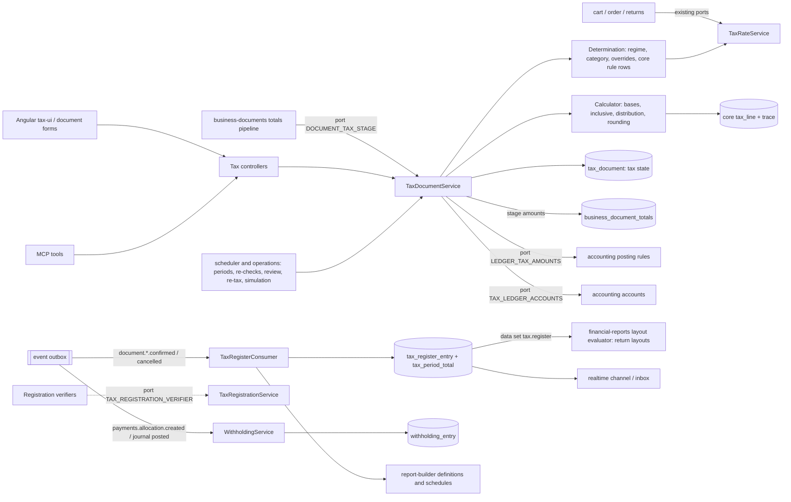

# Implementation Plan: Tax engine

> Translates an approved `spec.md` into architecture and tech choices. The plan owns
> implementation details; the spec owns behaviour.

**Feature ID**: `tax-engine`
**Spec**: `./spec.md`
**Tasks**: `./tasks.md`
**Status**: `Draft`
**Last updated**: 2026-11-23

---

## 1. Architecture Summary

The existing `@gauzy/plugin-tax` (`packages/plugins/tax`) stays the owner of categories, rates, parts and regimes
and of the resolution in `TaxRateService` (`resolve`, `resolveDocument`, `calculate`). This plan adds, in the same
plugin: a **document tax service** that is the tax stage of the totals pipeline of `business-document-engine`; a
**register** written from document events; the one tax-to-account map, registrations, periods, simulation and
withholding. Core keeps the tax-line ledger (`packages/core/src/lib/tax-line`), which gains owner types and nullable
columns. Nothing imports another plugin: every cross-plugin call is a port bound in `apps/api/src/plugin-composition.ts`.

It builds on what exists and on its siblings instead of keeping copies:

- **Totals** of a document live in the document engine's totals row (`business_document_totals`, owned by
  `business-document-engine`); `tax_document` keeps tax state only (mode, regime, tax point, out-of-date).
- **Conditions** (regime determination rules and the place conditions of item overrides) are core `rule` rows.
- **Return layouts** are statement layouts of the one statement and return layout model owned by
  `financial-reports` (kind `TAX_RETURN`), evaluated over the `tax.register` data set this plugin registers; the
  frozen pack of a period is a frozen run of a report-builder schedule. This plugin keeps calendars, periods and
  filing state; filing sets a period lock of `general-ledger` (area `TAX`) when accounting is enabled.
- **Review findings** go to the finding store of `general-ledger`; long jobs (bulk re-tax, simulation) run on the
  core operation runtime; reminders are `reminder` rows of `automation-and-notifications`.

## 2. Tech Choices

| Concern | Choice | Rationale |
| ------- | ------ | --------- |
| Package | `packages/plugins/tax` (existing), new `packages/plugins/tax-ui`, `packages/plugins/tax-react-ui` (portal blocks of `customer-and-supplier-portal`) | Principle I; no parallel tax module |
| Calculation | pure functions on `Money` and exact decimals from `packages/core/src/lib/money`; the existing chain builder in `TaxRateService` is extended, not replaced | one arithmetic for carts and documents |
| Rules | core rule engine (`packages/core/src/lib/rule`) with new owner types `TAX_REGIME` (determination) and `TAX_ITEM_OVERRIDE` (regime and place conditions of an override) | rates already use `TAX_RATE` rules |
| Document totals | written by the document engine into `business_document_totals` from the tax stage's answer (tax amount, rounding, withheld part in `stages`) | one owner of totals |
| Returns | statement layouts of `financial-reports` (kind `TAX_RETURN`) over the `tax.register` data set, so returns need `FEATURE_FINANCIAL_REPORTS` (`TAX_RETURN_LAYOUTS` unbound or the feature off → no return boxes, the rest of the tax area unchanged); frozen packs as frozen runs of report-builder schedules | one layout evaluator, one pack model |
| Persistence | MultiORM entities, plugin migrations for PostgreSQL, SQLite, MySQL, registered for both ORMs | Principle III |
| Settings | `TAX_SETTINGS` contributions resolved by the platform settings store (organization scope) | pattern of `tax.settings.ts` |
| Permissions | contributions in `tax.permissions.ts` with `defaultFor` | no seed migration |
| Feature gates | `FeatureFlagGuard` + `@FeatureFlag` on every controller and resolver (pattern of `purchasing`) | wires the declared codes |
| Background work | `@ScheduledJob` + `@QueueWorker` from `@gauzy/scheduler` for sweeps (recorded in `job_execution`); bulk re-tax and simulation as core operations (`packages/core/src/lib/operation`, `api/bulk-executor.service.ts`); in-process fallback without a queue | house idiom; one run model |
| Events | event outbox (`EventOutboxService.append`, `EventConsumerRegistry`) | at-least-once, idempotent consumers |
| Reports | report definitions registered with `report-builder` over `tax_register_entry` and `tax_period_total` | architecture rule: no hand-built report pages |
| Push | outbox → realtime channel hints | Principle VII |

## 3. Data Model

All new tables extend `TenantOrganizationBaseEntity` (soft delete through `deletedAt`, `isActive`, `isArchived`).
Money columns are `numeric(20,6)` with a currency column; rates `numeric(9,6)`; JSON is stored as `text` on every
dialect. References into other plugins (`ledgerAccountId`, `paymentId`, `documentId`) carry **no foreign key**.

### New or changed entities

**Changed (additive, nullable or defaulted columns):**

| Table | Added columns | Notes |
| --- | --- | --- |
| `tax_rate` | `calculationBasis` varchar(24) default `NET` (`NET`, `RUNNING_TOTAL`, `PRIOR_TAX`, `PER_UNIT`, `LUMP_SUM`); `basisRateCodes` text; `perUnitMeasure` varchar(16); `distributionKey` varchar(16); `costTreatment` varchar(24) default `PAYABLE`; `zeroKind` varchar(24); `zeroReasonCode` varchar(64); `isEnabled` boolean default true; `supersededById` uuid; `sourcePackKey` varchar(64); `sourcePackVersion` varchar(32); `isLocallyModified` boolean default false | backfill: `isCompound` → `RUNNING_TOTAL`, `amountType = FIXED` → `PER_UNIT`; the old columns stay written in sync |
| `tax_rate_part` | `recoverablePercent` numeric(9,6) default 100; `legKind` varchar(24) | legs of buyer-accounted tax; a negative `factorPercent` (withholding at document time) stays as it is |
| `tax_regime` | `kind` varchar(24) default `STANDARD`; `taxPointBasis` varchar(16) default `DOCUMENT_DATE`; `legalMention` text (per language); `defaultForDirection` varchar(8); `channelIds` text; `isEnabled` boolean default true; pack columns as on `tax_rate` | unique partial index: one default per organization and direction |
| `tax_line` (core, altered by this plugin's migration as its earlier migrations do) | `documentType` varchar(48); `documentId` uuid; `lineKind` varchar(16); `zeroKind` varchar(24); `organizationCurrency` varchar(3); `organizationBaseAmount`, `organizationAmount`, `nonRecoverableAmount`, `costAmount` numeric(20,6); `exchangeRate` numeric(20,10); `ledgerAccountId` uuid; `isManual` boolean default false; `overriddenById` uuid; `overrideReason` text; `trace` text | index `(tenantId, organizationId, documentType, documentId)` |
| `TaxLineOwnerType` (contracts) | `INVOICE_LINE`, `DOCUMENT_CHARGE`, `PURCHASE_ORDER_LINE`, `SALE_LINE`, `EXPENSE_LINE`, `JOURNAL_LINE` | additive enum values |
| `RuleOwnerType` (contracts) | `TAX_REGIME`, `TAX_ITEM_OVERRIDE` | determination rules and override conditions are `rule` rows |
| `organization.taxId`, `organization_contact.taxRegistrationNumber` / `taxRegistrationScheme`, marketplace `seller.taxId` / `taxRegistrationScheme` | no new columns | written from the owner's primary `tax_registration` in the same transaction; a write through the existing routes upserts the primary registration (one master, existing columns kept in step) |

**New:**

| Table | Columns (besides base) | Indexes and uniqueness |
| --- | --- | --- |
| `tax_document` | `documentType` varchar(48), `documentId` uuid, `mode` varchar(16), `direction` varchar(8), `priceIncludesTax` boolean, `taxRegimeId` uuid, `regimeSource` varchar(24), `addressBasisUsed` varchar(16), `taxPointDate` date, `roundTotal` boolean, `statedTaxTotal` numeric (the supplier's stated figure, for the tolerance check), `isOutOfDate` boolean, `calculationVersion` int; totals are read from `business_document_totals` | unique `(tenantId, documentType, documentId)`; index `(organizationId, isOutOfDate)` |
| `tax_item_override` | `targetType` (`PRODUCT`, `VARIANT`, `PRODUCT_CATEGORY`), `targetId`, `priority` int, `startsAt`, `endsAt`, `action` (`CATEGORY`, `RATE`, `NOT_TAXABLE`), `taxCategoryId`, `taxRateId`, `reasonCode`; regime, country and province conditions are `rule` rows (`TAX_ITEM_OVERRIDE`) | index `(organizationId, targetType, targetId)`; overlap refused by the rule conflict check inside a serialised transaction |
| `tax_charge_rule` | `chargeKey` varchar(64) (adjustment reason code), `mode` (`CATEGORY`, `FOLLOW_LINES`), `taxCategoryId`, `costDistributionKey` | unique `(organizationId, chargeKey)` live rows |
| `tax_account_mapping` | `level` (`ORGANIZATION`, `CATEGORY`, `RATE`, `PART`), `taxCategoryId`, `taxRateId`, `taxRatePartId`, `role` (collected, deductible, non-recoverable, buyer-accounted payable and deductible, awaiting payment, withholding payable and receivable, rounding), `withholdingCategoryId`, `ledgerAccountId`, `dimensionSetId` null (`analytic_dimension_set` of `accounting-foundation`, resolved by `AnalyticDimensionSetService.resolve`), `sourcePackKey`, `sourcePackVersion` | unique `(organizationId, level, target ids, role)` live rows; lookup takes the most specific level that has a row; the only tax-to-account map of the platform |
| `tax_registration` | `ownerType` (`ORGANIZATION`, `CONTACT`, `VENDOR`, `SELLER`), `ownerId`, `countryCode`, `scheme` (tax schemes and the electronic-address schemes of delivery networks), `number`, `normalizedNumber`, `isPrimary`, `validFrom`, `validTo`, `structureStatus`, `verificationStatus`, `verifiedAt`, `verifiedName`, `verifiedAddress`, `verificationReference`, `verifierKey`, `nextCheckAt` | unique `(tenantId, ownerType, ownerId, countryCode, scheme, normalizedNumber)` live; index `(nextCheckAt)` |
| `tax_registration_check` | `registrationId`, `status`, `checkedAt`, `verifierKey`, `reference`, `response` text | append-only; index `(registrationId, checkedAt)` |
| `tax_register_entry` | document (`documentType`, `documentId`, `documentNumber`, `documentVersion`), line (`ownerType`, `ownerId`, `taxLineId`), `partyType`, `partyId`, `direction`, `taxRegimeId`, `taxCategoryId`, `taxRateId`, `taxRatePartId`, `code`, `zeroKind`, `rate`, `baseAmount`, `taxAmount`, `currency`, organization-currency twins, `exchangeRate`, `taxPointDate`, `taxPeriodId`, `originalTaxPeriodId`, `isLate`, `isReversal`, `reversesEntryId`, `ledgerAccountId`, `registrationId`, `destinationCountry`, `isManual`, `reportableAmount` | append-only; unique `(tenantId, documentType, documentId, documentVersion, taxLineId, isReversal)`; indexes `(organizationId, taxPeriodId, direction, code)`, `(organizationId, taxPointDate)` |
| `tax_period_total` | `taxPeriodId`, `direction`, `taxRatePartId`, `taxCategoryId`, `taxRegimeId`, `zeroKind`, `ledgerAccountId`, `baseTotal`, `taxTotal` (organization currency), `entryCount` | unique on the key columns; updated in the transaction that appends entries |
| `tax_calendar` | `registrationId`, `frequency`, `startMonth`, `dueDaysAfterEnd`, `reminderDaysBefore`, `responsibleUserIds` text, `returnLayoutId` (a `statement_layout` of kind `TAX_RETURN` in `financial-reports`), `packScheduleId` (the report-builder schedule that freezes the period pack) | one live calendar per registration |
| `tax_period` | `calendarId`, `startDate`, `endDate`, `dueDate`, `status` (`OPEN`, `PREPARED`, `FILED`), `preparedAt`, `packRunId` (the frozen `report_schedule_run`), `filedAt`, `filedById`, `filingReference`, `ledgerLockId` null (the `general-ledger` lock set on filing), `reopenReason` | unique `(calendarId, startDate)` |
| `tax_simulation`, `tax_simulation_result` | simulation: `name`, `change` text, `horizonDays`, `activatesAt`, `operationId` (progress, status and summary live in the core operation); result: `simulationId`, `documentType`, `documentId`, `taxBefore`, `taxAfter`, `difference`, `currency` | results purged 30 days after completion |
| `withholding_category` | `code`, `name`, `side`, `basis`, `moment` (`DOCUMENT`, `BILL`, `PAYMENT`), `taxRatePartId` null (moment `DOCUMENT`: the negative rate part it records), `yearBasis`, `thresholdPerDocument`, `thresholdCumulative`, `thresholdCurrency`, `thresholdMode` (`EXCESS_ONLY`, `WHOLE_BASE`), `roundingRule`, `authorityVendorId`, pack columns | unique `(organizationId, code)` live |
| `withholding_rate` | `categoryId`, `contactGroupId`, `rate`, `startsAt`, `endsAt` | overlap per category and group refused |
| `withholding_assignment` | `targetType` (contact, vendor, contact group, product, product category, expense category), `targetId`, `categoryId` | unique `(organizationId, targetType, targetId, categoryId)` |
| `withholding_certificate` | `partyType`, `partyId`, `categoryId`, `number`, `rate`, `validFrom`, `validTo`, `limitAmount`, `limitCurrency`, `consumedAmount`, `fileId` | index `(partyType, partyId, categoryId)` |
| `withholding_entry` | `side`, `documentType`, `documentId`, `documentVersion` int (the version of the event that wrote the entry: for moments `DOCUMENT` and `BILL` the document's version in the business document engine at confirmation or amendment, the value `tax_register_entry.documentVersion` carries; for moment `PAYMENT` the allocation's sequence on the payment, 1 for the first; an adjustment carries the document version in force when it is made), `taxLineId` null, `partyType`, `partyId`, `categoryId`, `certificateId`, `baseAmount`, `rate`, `amount`, `expectedAmount`, `currency`, organization twins, `thresholdBasis`, `yearToDateBase`, `taxYear`, `state`, `isAdjustment`, `adjustsEntryId`, `adjustsKey` varchar(36) not null (the `adjustsEntryId`, or `*` for an entry that adjusts none, so the unique key holds on every dialect), `reason`, `remittanceId`, `receivedCertificateNumber`, `receivedCertificateDate`, `receivedFileId` | append-only; unique `(tenantId, documentType, documentId, documentVersion, categoryId, isAdjustment, adjustsKey)`; index `(organizationId, partyType, partyId, taxYear)` |
| `withholding_remittance` | `number`, `authorityVendorId`, `periodStart`, `periodEnd`, `status` (`DRAFT`, `PAID`, `CANCELLED`), `totalAmount`, `creditsApplied`, `currency`, `paymentId` | numbering through the document engine series |
| `withholding_statement` | `number`, `partyType`, `partyId`, `kind` (`PERIOD`, `ANNUAL`), `periodStart`, `periodEnd`, `totalBase`, `totalWithheld`, `fileId`, `sentAt` | unique `(organizationId, number)` |

**Withholding has one record.** A negative rate part keeps working as today (it lowers the document's payable as a
tax line); with `FEATURE_WITHHOLDING` on, each such tax line also writes one `withholding_entry` of the category
whose `taxRatePartId` names that part (moment `DOCUMENT`), so remittances, statements and reports read one record.
Categories with moment `BILL` or `PAYMENT` are computed by the withholding service and are refused on save when a
negative part of the same scope exists. Payments records no withholding of its own: a withholding deduction of
`payments-and-collections` references the `withholding_entry` it settles.

**Existing and sibling tables used:** `business_document_totals` (totals), `statement_layout*` of
`financial-reports` (return layouts: boxes are layout rows whose selector is a register filter by direction, kind,
category, regime, rate, subdivision and account with a measure, or a formula over rows), report-builder
`report_schedule` / `report_schedule_run` (frozen period packs), `general-ledger` `ledger_lock` (area `TAX`) and
`ledger_integrity_finding` (`source = TAX`), core `operation`, `job_execution`, `reminder`.

### Migrations

**Migration timestamps**: `packages/plugins/tax` `1791000078100` to `1791000078199`.

In `packages/plugins/tax/src/lib/database/migrations/`, registered in `tax.plugin.ts` for both ORMs, each with
PostgreSQL, SQLite and MySQL branches, idempotent (`IF NOT EXISTS` / column checks), forward-only; an applied
migration is never renumbered.

1. `1791000078100-EnableTaxFeatureForTenantsWithTaxData` — data step: switches `FEATURE_TAX` on for every tenant that
   holds tax categories, rates or regimes, before the guard applies (§4); idempotent; `down` is a no-op.
2. `1791000078110-AddTaxEngineColumns` — the columns on `tax_rate`, `tax_rate_part`, `tax_regime`, `tax_line`; backfill
   of `calculationBasis`, `isEnabled = true`.
3. `1791000078120-CreateTaxDocumentTables` — `tax_document`, `tax_item_override`, `tax_charge_rule`.
4. `1791000078130-CreateTaxAccountAndRegistrationTables` — `tax_account_mapping`, `tax_registration`,
   `tax_registration_check`; backfill one primary `tax_registration` per organization with `taxId`, per contact with
   `taxRegistrationNumber` and per seller with `taxId` (the existing columns stay and are kept in step from then on).
5. `1791000078140-CreateTaxRegisterTables` — `tax_register_entry`, `tax_period_total`, `tax_calendar`, `tax_period`.
6. `1791000078150-CreateTaxSimulationTables`.
7. `1791000078160-CreateWithholdingTables` — the seven withholding tables.

Default role grants are permission contributions (§9), not a migration. No `NOT NULL` column without a default is
added to an existing table.

### Contracts

`packages/contracts/src/lib/tax-engine.model.ts` (new) and additive changes to `tax-line.model.ts` and
`rule.model.ts`: `TaxModeEnum`, `TaxCalculationBasisEnum`, `TaxCostTreatmentEnum`, `TaxZeroKindEnum`,
`TaxRegimeKindEnum`, `TaxPointBasisEnum`, `ITaxDocument`, `ITaxDocumentBreakdown`, `ITaxDeterminationTrace`,
`ITaxItemOverride`, `ITaxAccountMapping`, `ITaxRegistration`, `ITaxRegisterEntry`, `ITaxPeriod`, `ITaxSimulation`,
`IWithholdingCategory`, `IWithholdingCertificate`, `IWithholdingEntry`, `IWithholdingRemittance`,
`IWithholdingStatement`, and the port shapes `IDocumentTaxStage`, `ILedgerTaxAmounts`, `ITaxRegistrationVerifier`,
`ITaxReturnLayouts`. Invoice contracts gain optional `taxMode`, `priceIncludesTax`, `taxRegimeId`, `taxSummary`;
`tax`, `tax2`, `taxType`, `tax2Type`, `taxCalculationType` are unchanged.

## 4. API Surface

All routes: `TenantPermissionGuard`, `PermissionGuard`, `FeatureFlagGuard`; cursor pagination on lists;
`Idempotency-Key` on creating and posting routes; bulk routes answer per-row results. Existing routes of
`/tax-categories`, `/tax-rates`, `/tax-regimes` are unchanged and gain `@FeatureFlag(FEATURE_TAX)`; before the guard
applies, a migration switches `FEATURE_TAX` on for every tenant that holds tax categories, rates or regimes, so none
loses its routes or menu. `PUT /tax-rates/:id` keeps accepting changes to a rate in use; `TAX_RATE_IN_USE` is
answered only where the organization's `rates.protectInUse` setting (default off) is on.

| Method | Endpoint | Permission | Description (request → response contract) | Status |
| ------ | -------- | ---------- | ----------- | ------ |
| `POST` | `/tax-rates/:id/supersede` | `TAX_RATES_EDIT` | `SupersedeTaxRateDTO` → `ITaxRate` (successor) | New |
| `GET` `PUT` | `/tax-regimes/:id/rules` | `TAX_REGIMES_VIEW` / `_EDIT` | `SetTaxRegimeRulesDTO` → rules; `409` with overlaps on conflict | New |
| `GET` `POST` `PUT` `DELETE` | `/tax-item-overrides` | `TAX_ITEM_OVERRIDES_VIEW` / `_EDIT` | `ITaxItemOverride` with its condition rows | New |
| `GET` `PUT` | `/tax-charge-rules` | `TAX_RATES_VIEW` / `_EDIT` | charge rules of the organization | New |
| `GET` `PUT` | `/tax-settings` | `TAX_SETTINGS_VIEW` / `_EDIT` | mode, address basis, rounding, tolerances, checks, protection of rates in use (platform settings store) | New |
| `GET` `PUT` | `/tax-accounts` | `TAX_ACCOUNTS_VIEW` / `_EDIT` | bulk upsert of `ITaxAccountMapping`; `GET /tax-accounts/missing` | New |
| `GET` | `/tax-documents/:type/:id` | read permission of the document | `ITaxDocumentBreakdown` (lines, summary by rate; totals from the document engine) | New |
| `POST` | `/tax-documents/:type/:id/recalculate` | edit permission of the document | recompute a draft → breakdown | New |
| `PUT` | `/tax-documents/:type/:id/regime` · `/lines/:lineId/override` · `/stated-tax` | `TAX_DOCUMENT_OVERRIDE` | `TaxOverrideDTO` → breakdown | New |
| `GET` | `/tax-documents/:type/:id/explanation` · `/comparison` | read permission of the document / `TAX_RATES_VIEW` | `ITaxDeterminationTrace[]` | New |
| `POST` | `/tax-documents/retax` | `TAX_DOCUMENT_OVERRIDE` | `{ filter or ids, preview }` → `202` with an operation, or per-document preview | New |
| `POST` | `/tax/test-bench` | `TAX_RATES_VIEW` | `TaxTestBenchDTO` → result with traces; writes nothing | New |
| `GET` `POST` `PUT` `DELETE` | `/tax-registrations` (+ `POST /:id/verify`, `POST /check-structure`) | `TAX_REGISTRATIONS_VIEW` / `_EDIT` | `ITaxRegistration` | New |
| `GET` `POST` `PUT` | `/tax-calendars`, `/tax-periods` (+ `POST /tax-periods/:id/prepare`, `/file`, `/reopen`, `GET /:id/pack`, `GET /:id/return`) | `TAX_PERIODS_VIEW` / `_MANAGE` | `ITaxPeriod`; the frozen pack; return boxes computed by the layout evaluator with drill-down keys | New |
| `GET` | `/tax-register` (+ `/reconciliation?periodId=`) | `TAX_REPORTS_VIEW` | entries; register against ledger per account | New |
| `GET` `POST` | `/tax-simulations` (+ `GET /:id/results`, `POST /:id/activate`) | `TAX_RATES_EDIT` | `ITaxSimulation` (running as an operation) | New |
| `GET` `POST` `PUT` `DELETE` | `/withholding-categories` (+ `/:id/rates`), `/withholding-assignments`, `/withholding-certificates` | `WITHHOLDING_CATEGORIES_VIEW` / `_EDIT`, `WITHHOLDING_CERTIFICATES_EDIT` | masters | New |
| `POST` | `/withholding/preview` | `WITHHOLDING_ENTRIES_VIEW` | document or payment draft → entries it would record | New |
| `GET` | `/withholding-entries` | `WITHHOLDING_ENTRIES_VIEW` | entries with state | New |
| `POST` | `/withholding-entries/:id/adjust` · `PUT /withholding/documents/:type/:id/decision` | `WITHHOLDING_ENTRIES_ADJUST` | adjusting entry; force or waive with reason | New |
| `GET` `POST` | `/withholding-remittances` (+ `POST /:id/pay` with `preview`) | `WITHHOLDING_REMIT` | `IWithholdingRemittance` | New |
| `GET` `POST` | `/withholding-statements` | `WITHHOLDING_REMIT` | issue and list statements | New |
| `POST` `GET` | `/tax-review/run`, `/tax-review/latest` | `TAX_REPORTS_VIEW` | anomaly list (findings of the shared finding store, `source = TAX`) | New |

Return layouts are created, cloned and edited through `/statement-layouts` of `financial-reports` (kind
`TAX_RETURN`, which accepts `TAX_REPORTS_EDIT`); no tax route duplicates them.

Errors use `ApiException` codes: `TAX_RATE_MISSING`, `TAX_INCLUSIVE_MISMATCH` (existing), `TAX_RULE_CONFLICT`,
`TAX_OVERRIDE_OVERLAP`, `TAX_ACCOUNT_MISSING`, `TAX_RATE_IN_USE`, `TAX_MODE_CONFLICT`, `TAX_TOLERANCE_EXCEEDED`,
`TAX_PERIOD_FILED`, `WITHHOLDING_ALREADY_REMITTED`. GraphQL: read fields `taxDocument`, `taxRegisterEntries`,
`taxPeriods`, `withholdingEntries` added to the plugin's schema extension.

**Ports** (declared with an optional injection token; bound in `apps/api/src/plugin-composition.ts`):

| Port | Declared by | Answered by | Purpose |
| --- | --- | --- | --- |
| `CART_TAX_CALCULATION`, `CART_TAX_CATEGORY` | cart (existing) | `TaxRateService`, `TaxCategoryService` | unchanged |
| `DOCUMENT_TAX_STAGE` | `business-documents` | `TaxDocumentService` | calculate, validate for confirmation, breakdown, stage amounts for the totals row |
| `LEDGER_TAX_AMOUNTS` | `accounting` | `TaxPostingService` | amounts per account and dimension of a document; the only way the ledger resolves tax roles |
| `VALUATION_COST_COMPONENTS` | `inventory-valuation` | `TaxPostingService` | cost-only amounts per line |
| `TAX_LEDGER_ACCOUNTS` | tax | `accounting` account service | validate and label accounts; unbound → page hidden |
| `TAX_PERIOD_LOCKS` | tax | `general-ledger` `LedgerLockService` | set a lock (area `TAX`) on filing, lift it on reopening |
| `TAX_FINDINGS` | tax | `general-ledger` finding service | write and resolve review findings (`source = TAX`) |
| `TAX_RETURN_LAYOUTS` | tax | `financial-reports` layout service | list layouts of kind `TAX_RETURN`, evaluate one for a period, register pack layouts |
| `REPORT_LAYOUT_DATASETS` (multi) | `financial-reports` | `TaxRegisterDatasetProvider` | the `tax.register` data set (filters, measures, drill-down to entries) |
| `TAX_PACK_SCHEDULES` | tax | `report-builder` schedule service | create the pack schedule of a calendar, run it frozen on preparation |
| `TAX_DOCUMENT_READER` | tax | `business-documents` | enumerate drafts, open orders, recurring documents |
| `TAX_PAYMENT_GATEWAY` | tax | the payment service of `payments-and-collections` | outgoing payment of a remittance, with preview |
| `TAX_CALCULATOR` | `invoicing-receivables-payables`, `payments-and-collections` | `TaxDocumentService` | taxes of an invoice, bill or payment document with breakdown; unbound → their legacy percentages |
| `TAX_WITHHOLDING` | `payments-and-collections` | `WithholdingService` | withholding due at payment for an allocation (preview, record one `withholding_entry` per category); unbound → no withholding at payment |
| `TAX_REGISTRATION_VERIFIER` (multi) | tax | verifier plugins of country packs; delivery-network directory lookups of `e-invoicing` | official register and directory lookups |
| `TAX_PROVIDER` | tax | provider plugins | external calculation behind `FEATURE_TAX_PROVIDER` |

## 5. Events, Real-Time and Notifications

| Event | Emitted when | Consumers |
| ----- | ------------ | --------- |
| `document.<type>.confirmed` / `.cancelled` / `.amended` (in) | document engine | `subscriber:tax-register` writes entries and totals; `subscriber:withholding` records entries |
| `payments.allocation.created` / `.released` (in) | `payments-and-collections` | payment-date tax point (reportable share), withholding at payment |
| `accounting.journal.posted` (in) | `general-ledger` | register entry for manual journals on tax accounts; journal withholding |
| `tax.register_entry.recorded` | entries appended | realtime hint to report pages; automation rules; webhooks |
| `tax.period.prepared` / `.filed` / `.reopened` | period status change | inbox item to responsible users; activity log |
| `tax.registration.verified` / `.verification_failed` | verifier answered | inbox item to the party owner on failure; drafts flagged |
| `tax.withholding_entry.recorded` / `tax.withholding_remittance.paid` | entry or remittance written | realtime, automation rules |
| `tax.configuration.changed` | rate, regime, rule, override or category saved | marks affected drafts `isOutOfDate` |
| `tax.document.calculated` (realtime only) | a draft was recomputed | open document forms refresh totals |

Inbox items use the inbox item writer (`INBOX_ITEM_WRITER`): "tax pack ready", "tax number failed verification",
"tax review: N anomalies". Period due reminders are `reminder` rows written when a period is created. Emails
use the email-template system for withholding statements.

## 6. UI Surface

- **Angular `packages/plugins/tax-ui`** (lazy, registered with `@gauzy/plugin-ui`; shown when the feature codes are
  on and the permissions held): `/pages/settings/taxes/{categories,rates,regimes,item-overrides,charges,accounts,registrations,calendars,general,test-bench,simulations}`
  through the `settings-sections` page location, and `/pages/accounting/tax/{periods,register,reports,review}`,
  `/pages/accounting/withholding/{categories,certificates,entries,remittances,statements}` through
  `accounting-sections`. Return layouts open in the statement layout designer of `financial-reports`. Lists are
  saved-view lists; forms honour custom fields.
- **Shared components** exported by `tax-ui`: `gauzy-tax-breakdown` (lines and summary by rate, live),
  `gauzy-tax-explanation` ("Why this tax?" drawer), `gauzy-tax-regime-picker`, `gauzy-withholding-preview`. The
  invoice form (`apps/gauzy/src/app/pages/invoices`) and the commerce document forms embed them through the plugin
  UI slot registry; with the flags off the form is unchanged.
- **React `packages/plugins/tax-react-ui`**: `TaxBreakdown`, `TaxExplanation` as blocks of the portal kit of
  `customer-and-supplier-portal`.
- i18n keys under `TAX_ENGINE.*` and `WITHHOLDING.*` in every locale of `packages/ui-core/i18n`.

## 7. MCP Tools, SDKs and Integrations

New file `packages/mcp-server/src/lib/tools/tax.ts`, registered in `register-all-tools.ts`:

| Tool | Input | Output |
| --- | --- | --- |
| `tax_determine` | party, item or category, addresses, date, direction, amount | rates, amounts, traces (test bench) |
| `tax_get_document_breakdown` | document type, id | lines and summary by rate |
| `tax_explain_document` | document type, id, optional line | plain-language explanation |
| `tax_retax_drafts` | filter or ids, `preview` (default true) | per-document before and after, or operation id |
| `tax_simulate_change` | proposed rate, regime, rule or override, horizon | affected documents and totals |
| `tax_get_report` | report key, filters | rows with drill-down keys |
| `tax_get_return_layout` | layout, period | box values |
| `tax_period_status` | organization, optional period | status, due date, exceptions |
| `tax_check_registration` | number, country, scheme, `verify` | structure result, register result |
| `tax_list_anomalies` | organization | review findings with proposed fixes |
| `withholding_preview` | document or payment draft | entries it would record |
| `withholding_list_entries` | party, category, state, dates | entries |
| `withholding_create_remittance` | authority, period, `preview` (default true) | remittance and payment effects |

OpenAPI changes are additive; the SDKs are regenerated after merge. Import and export of rates, regimes, overrides
and withholding masters go through `data-import-export` (CSV, XLSX, JSON pack files); return layouts travel with the
layout export of `financial-reports`. No outbound integration ships here; verifiers and providers are separate
plugins on the two ports.

## 8. Background Jobs

| Trigger | When | What it does | Idempotency |
| ------- | ---- | ------------ | ----------- |
| Outbox consumer `subscriber:tax-register` | document events | appends register entries, updates `tax_period_total` | unique key on document version, tax line, reversal |
| Outbox consumer `subscriber:withholding` | bill, payment, journal events and document tax lines of withholding parts | records or reverses entries | unique key on document version and category |
| `tax.periods.sweep` (queue `tax-maintenance`) | daily 02:00 organization time | creates upcoming periods with their reminders, prepares ended ones (frozen pack through `TAX_PACK_SCHEDULES`) | per period and step |
| `tax.registrations.recheck` | daily | verifies registrations whose `nextCheckAt` passed, in batches | per registration and day |
| `tax.review.run` | weekly (setting) or on demand | anomaly scan into the shared finding store, one inbox item per organization | per organization and run date |
| operation `TAX_RETAX` | on demand | re-taxes drafts in chunks of 100 through the bulk executor, per-document result | operation idempotency key; per document |
| operation `TAX_SIMULATION` | on demand | computes results in chunks; purge after 30 days | operation idempotency key; per simulation and document |

Scheduled passes are recorded in `job_execution`. Schedules are registered in the worker app (`apps/worker/src/plugins.ts`
already loads `tax`); queue jobs and operations run in the API where the document services live; without a queue
root the API runs the sweeps on in-process timers under a database lock, as the invoice sweeps do.

## 9. Security & Permissions

New permission contributions in `tax.permissions.ts` (existing six stay): `TAX_SETTINGS_VIEW`, `TAX_SETTINGS_EDIT`,
`TAX_ITEM_OVERRIDES_VIEW`, `TAX_ITEM_OVERRIDES_EDIT`, `TAX_ACCOUNTS_VIEW`, `TAX_ACCOUNTS_EDIT`,
`TAX_DOCUMENT_OVERRIDE`, `TAX_REGISTRATIONS_VIEW`, `TAX_REGISTRATIONS_EDIT`, `TAX_REPORTS_VIEW`, `TAX_REPORTS_EDIT`,
`TAX_PERIODS_VIEW`, `TAX_PERIODS_MANAGE`, `WITHHOLDING_CATEGORIES_VIEW`, `WITHHOLDING_CATEGORIES_EDIT`,
`WITHHOLDING_CERTIFICATES_EDIT`, `WITHHOLDING_ENTRIES_VIEW`, `WITHHOLDING_ENTRIES_ADJUST`, `WITHHOLDING_REMIT`.
`defaultFor`: all to `SUPER_ADMIN` and `ADMIN`; the `_VIEW` values and `TAX_REPORTS_VIEW` to the accountant-type
roles that hold invoice permissions today. Overrides, adjustments, filing and remittance are separate keys so they
can be given to a second person. Verifier and provider credentials live encrypted in `IntegrationSetting`; a
verifier receives number and country only. Agents act through the caller's request context; their writes are
marked as agent actions in the audit trail. All DTOs use class-validator; legal mentions and reasons are sanitised.

## 10. Observability

Activity-log entries for every change to configuration, overrides, periods, remittances; metrics
`tax_calculation_duration`, `tax_calculation_refusals`, `tax_provider_fallbacks`, `tax_register_lag_seconds`,
`tax_registration_checks`; a daily integrity check compares `tax_period_total` with a recount of the register for
open periods and reports drift to the shared finding store; error-tracking breadcrumbs carry document type and id,
never tax numbers.

## 11. Phased Rollout

1. **Phase 1 — Surface what exists**: `FEATURE_TAX` guard on existing routes, `tax-ui` pages for categories,
   rates, parts and regimes, test bench, read MCP tools. Usable: tax configuration has screens.
2. **Phase 2 — One tax path**: contracts, columns, `tax_document`, document tax service, manual mode through the
   engine, determined mode on invoices, estimates and bills, prices including tax, rounding, breakdown components,
   traces stored. Usable: invoices taxed by the engine behind `FEATURE_TAX_DOCUMENTS`.
3. **Phase 3 — Depth**: calculation bases, determination rules, item overrides, charges, accounts and posting
   hand-off, register, periods, return layouts on the shared layout model, reports, remaining document types.
4. **Phase 4 — Withholding** behind `FEATURE_WITHHOLDING`.
5. **Phase 5 — Advanced capabilities**: explanation UI and comparison, registration checks, simulation, scheduled
   packs, review, remittance and statements, provider port. For `FEATURE_TAX_DOCUMENTS` and `FEATURE_WITHHOLDING`,
   the feature is off by default; after the trial period it may be switched on by default for new tenants only; existing tenants keep their setting until an administrator changes it.

## 12. Constitution Reconciliation

- I Plugin-first: all server code in `packages/plugins/tax`; UI in `tax-ui` and `tax-react-ui`; core changes are additive enum values and columns on the shared ledger it already owns.
- II Tenant/organization scoping: every table extends the tenant-organization base; services extend `TenantAwareCrudService`; consumers set the tenant and organization from the event envelope.
- III Both ORMs, additive migrations: six additive migrations, three dialects, registered for both ORMs; SQLite covered by a migration spec.
- IV Default-off flag; nothing removed: new codes default off; typed taxes, `postingKey`, routes and ports stay.
- V Contracts and API first: contracts and endpoints land before UI; OpenAPI additive.
- VI Permissions, privacy, security: one key per sensitive action; encrypted credentials; minimal data to verifiers.
- VII Real-time through the event bus: outbox events and realtime hints; no private channel.
- VIII i18n and accessibility: keys in every locale; accessible breakdown tables and drawers.
- IX Tests: property tests for the calculator, golden documents, consumers, migrations, e2e for routes.
- X Behaviour-first spec: the spec has no implementation detail; it lives here.
- XI Documentation describes our platform only.

## 13. Risks & Mitigations

| Risk | Likelihood | Impact | Mitigation |
| ---- | ---------- | ------ | ---------- |
| Manual-mode totals differ from today's browser calculation by a cent | Medium | High | golden set of existing invoices replayed in CI on three dialects; mismatch blocks the phase |
| Two owners of document totals (document engine and tax) | Low | High | tax only answers the tax stage port; totals are stored by the document engine; `tax_document` holds tax state only |
| The tax plugin starts referencing ledger accounts | Medium | Medium | account ids without foreign key, mapping optional, posting key untouched |
| Returns need `financial-reports` | Medium | Medium | the layout evaluator works without the ledger; without the module the return report is listed unavailable with the reason, the register and other reports still work |
| Register lags behind confirmation | Low | Medium | consumer lag metric; period preparation waits for an empty lag; reconciliation report |
| Rule conflicts at scale | Low | Medium | conflict check on save, bounded rule count per regime (100), cached compiled rules |
| Verifier outages | High | Low | never blocking, retries with backoff, status "unavailable" kept apart from "invalid" |
| Withholding edge cases differ per country | High | Medium | category options cover threshold modes and bases; packs ship categories; adjusting entries for the rest |

## 14. References

- Spec: `./spec.md` · Tasks: `./tasks.md`
- Code: `packages/plugins/tax/src/lib/tax-rate/tax-rate.service.ts`, `packages/plugins/tax/src/lib/tax.types.ts`,
  `packages/plugins/tax/src/lib/tax-rate-part/tax-rate-part.entity.ts` (negative parts, `postingKey`),
  `packages/core/src/lib/tax-line/tax-line.service.ts`, `packages/contracts/src/lib/tax-line.model.ts`,
  `packages/contracts/src/lib/rule.model.ts`, `packages/core/src/lib/rule/rule.evaluator.ts`,
  `packages/core/src/lib/organization-contact/organization-contact.entity.ts` (tax registration columns),
  `packages/plugins/marketplace/src/lib/seller/seller.entity.ts` (`taxId`, `taxRegistrationScheme`),
  `packages/core/src/lib/invoice/invoice.entity.ts`, `packages/core/src/lib/operation`,
  `packages/core/src/lib/api/bulk-executor.service.ts`, `apps/api/src/plugin-composition.ts`,
  `packages/plugins/purchasing/src/lib/purchasing.features.ts` (feature guard pattern)
- Related plans: `../business-document-engine/plan.md`, `../general-ledger/plan.md`, `../financial-reports/plan.md`,
  `../payments-and-collections/plan.md`, `../regional-compliance-packs/plan.md`, `../report-builder-and-dashboards/plan.md`,
  `../accounting-foundation/plan.md`
