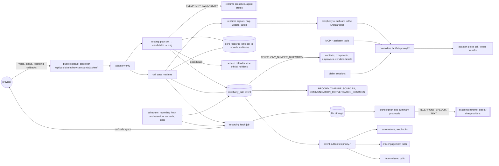

# Implementation Plan: Telephony

> Translates an approved `spec.md` into architecture and tech choices. The plan owns
> implementation details; the spec owns behaviour.

**Feature ID**: `telephony`
**Spec**: `./spec.md`
**Tasks**: `./tasks.md`
**Status**: `Draft`
**Last updated**: 2026-11-23

---

## 1. Architecture Summary

A new plugin pair: `@gauzy/plugin-telephony` (`packages/plugins/telephony`), listed in `apps/api/src/plugins.ts` and
`apps/worker/src/plugins.ts` only when `GAUZY_TELEPHONY_ENABLED` is exactly `true`, contributing `FEATURE_TELEPHONY`
(default off, `@FeatureFlag` on every controller); and `telephony-ui` (Angular: settings, call logs, dialler, and the
call card, incoming popup and dial pad hosted in the app shell on every page). Provider adapters are separate plugins
`packages/plugins/telephony-provider-<key>` that register an `ITelephonyAdapter` (server) and, for browser calling, an
`ITelephonyClient` module (browser) with `registerTelephonyAdapters`, a registry of the same shape as the Inbox email
provider registry. A provider account is the Inbox plugin's `inbox_provider_account` with the channel `VOICE` (the
table gains a channel list; text and push accounts of `email-and-communications` use the same rows), so a vendor that
carries email, text and voice is one account with one sealed secret; voice-only settings sit in a small satellite.
Provider callbacks hit synchronous public routes of this plugin (voice routing must answer within the provider's limit,
so they do not go through the asynchronous inbound endpoints of `integration-hub`). Matching uses a multi-port number
directory filled by core and by plugins that own phone fields (employees' numbers from core `employee_phone`). A call's
links to records are rows of the core `resource_link` record target, the link store every feature uses. Calls reach
timelines and conversations through the registries of `record-views-and-search` and `email-and-communications`.
Settings and permissions are contributions; AI work runs on the agent runtime of `ai-agents-and-assistants`.

## 2. Tech Choices

| Concern | Choice | Rationale |
| --- | --- | --- |
| Package | `packages/plugins/telephony` (`accounts/`, `adapters/`, `agents/`, `routing/`, `calls/`, `matching/`, `recordings/`, `assist/`, `dialler/`, `time/`, `callbacks/`, `schedule/`, `database/`), `telephony-ui` (all screens, the call card included) | Principle I; one plugin UI |
| Adapters | `ITelephonyAdapter` contract + `registerTelephonyAdapters`, shaped like the Inbox `EmailProviderRegistry` entries (`id`, `configSchema`, `capabilities`, `verify`) so a vendor plugin that serves several channels registers one provider id; manual medium and simulated adapter in the plugin; providers as separate plugins | no provider named or bundled; one registry shape |
| Accounts and credentials | `inbox_provider_account` (`packages/plugins/inbox/src/lib/email/entities/inbox-provider-account.entity.ts`) with `channels` containing `VOICE`; non-secret fields in `config`, secrets in `configEncrypted` sealed by the Inbox secret box, status, verification and last error on the same row; voice-only settings in `telephony_account` keyed by `providerAccountId`. Needs the Inbox plugin; without it only the manual medium is offered; no uniqueness is added, so several accounts per vendor stay possible as today | one provider account can carry a vendor's email, text and voice |
| Call links | core `resource_link` rows (`entity = TelephonyCall`, target = the matched or linked record, or `Task` for call tasks; `linkedBy` `MATCH`, `PERSON`, `SYSTEM`); record target columns added by the core migration of `record-views-and-search` (idempotent, so any feature that uses it ships it); tickets are tasks, so a ticket link is a `Task` target | one link store |
| Agents' phones | the employee's phones in core `employee_phone`, which gains `ringsForCalls` (one per employee); do not disturb until a time in the user's notification preferences (`telephony.dndUntil` beside the existing quiet hours); muted sounds in `user.uiPreferences.telephony`; `telephony_agent` keeps only device, default account and greetings | people's numbers and preferences where the platform keeps them |
| Open hours | a routing plan may name a service calendar of `helpdesk-sla-routing-and-analytics` (weekly intervals, holiday calendar, exceptions) for its open hours and holidays; each slot still names its team; without the helpdesk, slots use the plan's time zone and core `official_holiday` | one calendar engine |
| Settings | organization-scoped contributions in `telephony.settings.ts` (default region, rematch days, calling window, call consent required, live assistance, after-call summaries, simulated adapter allowed, call time logging) in the platform settings store | no settings table |
| Permissions | contributions in `telephony.permissions.ts` with `defaultFor` (§9) | no seed migration |
| Callbacks | own public routes with raw body (Inbox raw-body middleware idiom), adapter verification, stored then processed; voice routing answered inline | provider time limits |
| Real time | `RealtimeSignalsService` for ringing, taken and progress signals to targeted users; outbox events for durable changes | Principle VII |
| Presence | `RealtimePresenceStore` merged with agent states of the helpdesk when loaded (`TELEPHONY_AVAILABILITY`) | one notion of availability |
| Numbers | pure `matching/phone-number.ts` over an MIT-licensed phone metadata library chosen in T1, shared with communications' number normalisation; keys of national significant digits | tolerant matching |
| Recordings | core file storage providers (`core/file-storage`); fetch through `createSsrfSafeHttpsAgent()` | one storage, guarded fetch |
| Speech and text | `TELEPHONY_SPEECH` and `TELEPHONY_TEXT_GENERATION` → the agent runtime of `ai-agents-and-assistants` (purposes `telephony.transcribe`, `telephony.summary`, `telephony.assist`; usage and budgets recorded there), which uses the `transcribe` and text providers registered with `ai-chat`; without that plugin, `ai-chat` directly; live audio through the adapter's stream to a streaming-capable provider | existing provider registry; no AI usage store here |
| Jobs | `@ScheduledJob` + `@QueueWorker` (`@gauzy/scheduler`), schedules in `TelephonySchedulePlugin`; in-process timer under an advisory lock without a queue | task-automations pattern |

## 3. Data Model

All tables extend `TenantOrganizationBaseEntity`; JSON is `text`; ids into other plugins carry no foreign key.

| Table | Columns (besides base) | Keys and indexes |
| --- | --- | --- |
| existing `inbox_provider_account` + column | `channels` varchar(64) default `EMAIL` (list of `EMAIL`, `TEXT`, `PUSH`, `VOICE`); name, provider id, status, config, sealed secrets, verification and last error stay on the row | (`organizationId`,`status`) existing |
| existing `employee_phone` + column | `ringsForCalls` bool default false (at most one per employee, checked by the service) | — |
| `telephony_account` | voice satellite of a provider account: `providerAccountId` uuid (unique); `isDefault`, `recordCalls`, `liveAudio`, `voicemail` bool; `consentAnnouncement` text; `recordingRetentionDays` int default 90; `recordingStorage` varchar(10) (`STORE`, `PROVIDER`); `defaultRegion` varchar(2); `callbackTokenHash` varchar(64) | unique `callbackTokenHash`, unique `providerAccountId` |
| `telephony_number` | `accountId` FK cascade; `number` varchar(20) (international); `label` varchar(80); `country` varchar(2); `areaCode` varchar(8); `capabilities` text; `routingPlanId` uuid | unique (`accountId`,`number`); (`tenantId`,`number`), (`organizationId`,`country`,`areaCode`) |
| `telephony_agent` | channel-specific choices only: `userId`, `employeeId`, `defaultAccountId` uuid; `device` varchar(8) (`BROWSER`, `PHONE`); `greeting`, `busyMessage`, `unavailableMessage` text; `greetingAssetId` uuid | unique (`organizationId`,`userId`) |
| `telephony_agent_number` | `agentId` FK cascade; `numberId` FK cascade; `canDial`, `ringsInbound` bool | unique (`agentId`,`numberId`) |
| `telephony_routing_plan` | `name` varchar(120); `mode` varchar(12) (`SEQUENTIAL`, `SIMULTANEOUS`); `ringSeconds` int default 20; `greeting`, `busyMessage`, `unavailableMessage` text; `slots` text (weekday, from, to, teamId); `serviceCalendarId` uuid null (open hours and holidays from a helpdesk service calendar); `timeZone` varchar(64); `fallback` varchar(10) (`MESSAGE`, `VOICEMAIL`, `FORWARD`); `forwardNumber` varchar(20); `stickyOwner` bool default true | (`organizationId`) |
| `telephony_call` | `accountId`, `numberId`, `callerUserId`, `receiverUserId`, `outcomeId`, `recordingAssetId`, `dialSessionId`, `timeLogId`, `parentCallId` uuid; `providerCallId` varchar(128); `direction` varchar(3) (`IN`, `OUT`); `phase` varchar(10) (`WAITING`, `RINGING`, `CONNECTED`, `ON_HOLD`, `ENDED`); `phaseRank` smallint; `endReason` varchar(12) null (`TALKED`, `BUSY`, `NOT_ANSWERED`, `MISSED`, `VOICEMAIL`, `CANCELLED`, `FAILED`); `fromNumber`, `toNumber` varchar(20); `partyKey` varchar(20); `queuedAt`, `startedAt`, `answeredAt`, `endedAt`, `recordingDeleteAfter` timestamp; `ringSeconds`, `durationSeconds` int; `summary`, `note` text; `isManual` bool; `recordingState` varchar(12) (`NONE`, `PENDING`, `STORED`, `PROVIDER`, `UNAVAILABLE`, `DELETED`); `recordingRef` varchar(512); `transcriptState` varchar(12); `transcript` text; `transcriptLanguage` varchar(10); `version` int | unique (`accountId`,`providerCallId`) where not null; (`organizationId`,`startedAt`), (`organizationId`,`callerUserId`,`startedAt`), (`organizationId`,`receiverUserId`,`startedAt`), (`tenantId`,`partyKey`,`startedAt`), (`recordingDeleteAfter`) |
| `telephony_call_event` | `callId` FK cascade; `kind` varchar(16); `at` timestamp; `providerEventId` varchar(128); `detail` text | unique (`callId`,`kind`,`providerEventId`); (`callId`,`at`) |
| `telephony_outcome` | `name` varchar(120); `description` text; `color` varchar(16); `position` int; `followUpTask` text (title, due delay hours) | unique (`organizationId`,`name`) where not deleted |
| `telephony_dial_session` | `name` varchar(120); `ownerUserId` uuid; `source` text (view id or record refs); `rules` text (window, attempts, interval, consent, local presence); `state` varchar(10) (`DRAFT`, `RUNNING`, `PAUSED`, `DONE`, `CANCELLED`); `counts` text; `startedAt`, `endedAt` timestamp | (`organizationId`,`ownerUserId`,`state`) |
| `telephony_dial_item` | `sessionId` FK cascade; `recordType` varchar(64); `recordId` uuid; `number` varchar(20); `attempts` int; `state` varchar(8) (`PENDING`, `CALLED`, `SKIPPED`, `DONE`); `skipReason` varchar(24); `lastCallId` uuid; `nextAttemptAt` timestamp | unique (`sessionId`,`recordType`,`recordId`); (`sessionId`,`state`,`nextAttemptAt`) |

**Why the dialler keeps its own session and item tables.** A dialler session is paced by a person (the next call only
after the previous outcome is set), picks parties out of order by their next attempt time inside each party's local
calling window (up to 2,000 parties, a tick every 15 s reading `(sessionId, state, nextAttemptAt)`), and may stay
paused for days. The core operation runtime runs registered steps in fixed order under a lease and has no paused state,
so it would hold a lease for days and could not pick by due time; building the session's party list from a saved view
does use the core bulk executor. Telephony settings are contributions (§2); no settings table.

### Migrations

**Migration timestamps**: `packages/plugins/telephony` `1791000054100` to `1791000054199`; `packages/core` `1791000054900` to `1791000054999`.

Plugin migrations with the shared core migration helpers of `@gauzy/core`; PostgreSQL, MySQL and
SQLite branches; idempotent, forward-only, registered for both ORMs and listed only with `GAUZY_TELEPHONY_ENABLED`:

- core `1791000054900-AddRingsForCallsToEmployeePhone` (`hasColumn` guard); the Inbox `inbox_provider_account.channels`
  column is the Inbox migration of `email-and-communications` (its T5), which voice accounts use.
- `1791000054100-CreateTelephonyAccountTables` — voice account satellite, number, agent, agent number, routing plan.
- `1791000054110-CreateTelephonyCallTables` — call, call event, outcome.
- `1791000054120-CreateTelephonyDiallerTables` — dial session, dial item.

Permissions and settings are contributions, not rows. Default outcomes ("Connected", "Left a message", "No answer",
"Wrong number", "Call back later") are seeded per organization by `TelephonyBootstrapService.ensureSeeded`, idempotent
on unique keys.

### Contracts

`packages/contracts/src/lib/telephony.model.ts`: directions, phases with ranks, end reasons, devices, ring modes, fallbacks,
capabilities, `ITelephonyAdapter` (`key`, `configSchema`, `capabilities`, `verify(account)`, `listNumbers?`,
`listApplications?`, `verifyCallback(req, account)`, `parseCallback(req) → ICallbackEvent[]`, `answerIncoming(decision)
→ provider response`, `placeCall(req)`, `clientToken?(agent)`, `fetchRecording?(ref)`, `transfer?`, `openAudioStream?`),
`ITelephonyClient` (browser: `connect`, `call`, `answer`, `decline`, `hangup`, `mute`, `hold`, `sendDigits`, events),
`INumberDirectoryEntry` (`recordType`, `find(keys) → { ref, name, kind, ownerUserId, organisationRef }[]`), call,
link view (over `resource_link`), outcome, dial session; `BaseEntityEnum.TelephonyCall`; `InboxProviderChannel.VOICE`;
port tokens `TELEPHONY_NUMBER_DIRECTORY` (multi), `TELEPHONY_AVAILABILITY`,
`TELEPHONY_OPEN_HOURS`, `TELEPHONY_LEAD_INTAKE`, `TELEPHONY_SPEECH`, `TELEPHONY_TEXT_GENERATION`, `TELEPHONY_CONTACT_POLICY`, offered
`TELEPHONY_CALLS`.

## 4. API Surface

Authenticated routes: `TenantPermissionGuard`, `PermissionGuard`, `@FeatureFlag(FEATURE_TELEPHONY)`, Swagger,
class-validator DTOs, cursor pagination, `Idempotency-Key` on creating routes.

| Method | Endpoint | Permission | Description | Status |
| --- | --- | --- | --- | --- |
| `GET` | `/telephony/status` | member | calling available to me (with an agent profile, or without one when an active account of the organization or the manual medium lets the user dial out; the first call then creates the profile with defaults, spec FR-9), default account, capabilities | New |
| `GET` | `/telephony/adapters` | `TELEPHONY_SETTINGS_MANAGE` | loaded adapters with schemas and capabilities | New |
| `GET`, `POST`, `PATCH` | `/telephony/accounts[/:id]`, `POST …/:id/verify`, `GET …/:id/remote-numbers` | `TELEPHONY_SETTINGS_MANAGE` | voice accounts: a provider account with the `VOICE` channel (an existing account of the same vendor gains the channel) plus its voice settings; secrets write-only; verification; provider numbers | New |
| `GET`, `POST`, `PATCH` | `/telephony/numbers[/:id]` · `/telephony/routing-plans[/:id]` | `TELEPHONY_SETTINGS_MANAGE` | numbers, plans with slot validation | New |
| `GET`, `PUT` | `/telephony/agents[/:userId]` · `/telephony/agents/me` | `TELEPHONY_SETTINGS_MANAGE` / self | profiles; own device, messages, default account; phones and the number that rings (employee phones); do not disturb (notification preferences) | New |
| `GET`, `POST`, `PATCH` | `/telephony/outcomes[/:id]` | `TELEPHONY_SETTINGS_MANAGE` (reads members) | outcome list | New |
| `GET`, `PUT` | `/telephony/settings` | `TELEPHONY_SETTINGS_MANAGE` | organization settings (keys of the settings store) | New |
| `GET` | `/telephony/lookup?number=` | `TELEPHONY_CALL_MAKE` | matched records the caller may read | New |
| `POST` | `/telephony/calls` | `TELEPHONY_CALL_MAKE` | place a call (`number`, `recordRef`, `accountId`); returns call and client token | New |
| `POST` | `/telephony/calls/:id/{accept,decline,hangup,hold,resume,mute,transfer}` | participant | call control where supported | New |
| `POST` | `/telephony/calls/manual` | `TELEPHONY_CALL_MAKE` | log a call by hand; `preview` | New |
| `GET` | `/telephony/calls?…` · `/telephony/calls/:id` | readable calls (FR-36) | call logs and detail | New |
| `PATCH` | `/telephony/calls/:id` | participant or `TELEPHONY_CALLS_VIEW_ALL` | summary, outcome, note | New |
| `POST`, `DELETE` | `/telephony/calls/:id/links[/:linkId]` · `POST /telephony/calls/:id/tasks` | participant | link records; tasks (both `resource_link` rows) | New |
| `POST` | `/telephony/calls/:id/lead` | `ORG_CONTACT_ADD` | lead or contact from an unknown caller | New |
| `GET` | `/telephony/calls/:id/recording` | readable call + `TELEPHONY_RECORDINGS_LISTEN` | short-lived signed stream address; listen audited | New |
| `POST` | `/telephony/calls/:id/summary` (`preview`) · `/summary/approve` | participant | proposed summary, outcome, task; approval writes | New |
| `POST` | `/telephony/calls/:id/log-time` | participant | tracked time on the linked task, project or ticket | New |
| `GET`, `POST`, `PATCH` | `/telephony/dialler/sessions[/:id]`, `POST …/:id/{start,pause,resume,end,next}` | `TELEPHONY_DIALLER_RUN` | dialler sessions | New |
| `POST` | `/public/telephony/:accountId/:token/{voice,status,recording,stream,voicemail}` | public: token and adapter signature, throttled | provider callbacks | New |

Errors: `TELEPHONY_NOT_AVAILABLE`, `TELEPHONY_ADAPTER_UNSUPPORTED` (capability named), `TELEPHONY_SLOT_INVALID`,
`TELEPHONY_CALL_TAKEN`, `TELEPHONY_NUMBER_INVALID`, `TELEPHONY_OUTCOME_INACTIVE`, `TELEPHONY_DIALLER_SKIPPED` (reason),
`TELEPHONY_CONTACT_POLICY_UNAVAILABLE` (a dialler session without the contact checks), `TELEPHONY_CALLBACK_REFUSED`. GraphQL reads `telephonyCalls`, `telephonyCall`, `telephonyAccounts`.

## 5. Events, Real-Time and Notifications

| Event (outbox, partition `TELEPHONY:<callId>`) | Emitted when | Consumers |
| --- | --- | --- |
| `telephony.call.started` · `answered` · `ended` · `missed` | state changes | automations, webhooks, `crm-engagement` facts, timeline real-time, reports |
| `telephony.call.outcome_set` | outcome chosen | automations (follow-up flows), `crm-engagement` |
| `telephony.recording.ready` · `deleted`; `telephony.transcript.ready`; `telephony.voicemail.received` | media states | timeline, summaries, Inbox (voicemail to owner) |
| `telephony.dialler.session_finished` | session ends | Inbox to the owner, automations |

Ephemeral signals through `RealtimeSignalsService` to targeted users: `telephony.ring` (card data), `telephony.taken`,
`telephony.progress`, `telephony.transcript.delta` and `telephony.suggestion` (live assistance). Notification category
`telephony.missed` (missed calls and voicemail) registered with `registerNotificationCategories`. Consumed:
`crm.lead.created`, contact and person phone changes (rematch earlier calls), `time_off.request.approved` (agents off).

## 6. UI Surface

- **`telephony-ui`** (Angular, the one UI of this feature): call card component (states, timer, controls by capability,
  note and task panel, outcome and summary step, proposals with sources), incoming call stack, dial pad and dialler
  panel, hosted once in the app shell so they show on every page (also in the app installed on a phone); Settings →
  Telephony (accounts with adapter forms and verification, numbers, routing plans with a weekly slot grid or a service
  calendar, agents, outcomes, organization settings), `/pages/telephony/calls` (call logs with filters, detail panel,
  recording player, transcript), `/pages/telephony/dialler` (sessions, rules, live progress); a phone-field directive
  adding the call button where `/telephony/status` allows it; links from CRM and helpdesk settings. Agents' own numbers
  are edited where employee phones already are.
- **Timelines**: a call entry with player and outcome rendered by the record timeline of `record-views-and-search`;
  helpdesk ticket page and CRM pages receive the call button and Calls tab through their own plugins.
- i18n keys `TELEPHONY.*` in every locale of `packages/ui-core/i18n/`.

## 7. MCP Tools, SDKs and Integrations

- `packages/mcp-server/src/lib/tools/telephony.ts`: `telephony_lookup_number`, `telephony_calls_list`, `telephony_call_get`,
  `telephony_call_log` (preview), `telephony_call_update` (outcome, summary, note), `telephony_call_link`,
  `telephony_routing_plans_list`, `telephony_call_summarise` (preview), `telephony_call_request` (creates an intent shown
  on the user's card; the call starts only on the user's confirmation); registered with `AiChatToolRegistry`.
- Ports consumed and fallbacks: `TELEPHONY_NUMBER_DIRECTORY` (core binds contacts by `primaryPhone`, employees by
  `employee_phone` and `user.phoneNumber`, and vendors; crm binds people's extra channels; helpdesk binds ticket
  contacts), `TELEPHONY_AVAILABILITY` (realtime presence; helpdesk agent states when loaded), `TELEPHONY_OPEN_HOURS` →
  service calendars of `helpdesk-sla-routing-and-analytics` (absent: slots and core `official_holiday`),
  `TELEPHONY_LEAD_INTAKE` → `LEAD_INTAKE` of `lead-capture-and-enrichment` (absent: create a contact of type lead),
  `TELEPHONY_SPEECH` and `TELEPHONY_TEXT_GENERATION` → agent runtime of `ai-agents-and-assistants`, else `ai-chat`
  (absent: no transcripts or proposals), `TELEPHONY_CONTACT_POLICY` → the consent records of `email-and-communications`
  ("do not contact" set from the CRM, and call consent) (absent: no dialler session starts, answered
  `TELEPHONY_CONTACT_POLICY_UNAVAILABLE`, because the "do not contact" and consent checks of spec FR-48 cannot be made;
  single calls from a record stay available), core task and time log services.
- Offered: `TELEPHONY_CALLS` (calls by record, connected outgoing calls as responses, durations by deal, transcripts) for
  `crm-engagement` (`CRM_TRANSCRIPTS` binds to it); a `RECORD_TIMELINE_SOURCES` entry; a
  `COMMUNICATION_CONVERSATION_SOURCES` entry; `registerTelephonyAdapters`; report definitions of spec FR-57, listed as
  core `report` rows of a "Telephony" category on the existing Reports page; the category is keyed `FEATURE_TELEPHONY`
  in the shared catalogue feature filter of `report-builder-and-dashboards`, so a tenant with the feature off lists
  exactly today's reports.
- Adapter plugins (`packages/plugins/telephony-provider-<key>`, plus an optional browser module) are written against
  the contract with a shared contract test suite; none is part of this feature. OpenAPI regenerated; SDKs at release.

## 8. Background Jobs

| Trigger | When | What it does | Idempotency |
| --- | --- | --- | --- |
| callback processing (queue `telephony-callbacks`) | each stored status, recording or voicemail callback | apply to the state machine, links, events | unique (`callId`,`kind`,`providerEventId`); `phaseRank` only rises |
| `telephony.recording-fetch` (queue) | recording ready; retry back-off up to 24 h | fetch through the guarded agent, store, set `recordingDeleteAfter`; transcribe when summaries on | `recordingState` compare-and-set |
| `telephony.retention` | nightly 02:40 | delete recordings and transcripts past retention | conditional update to `DELETED` |
| `telephony.rematch` | on phone changes of directory records | link calls of the last `rematchDays` with matching `partyKey` | unique record-target key of `resource_link` |
| `telephony.dialler-tick` | every 15 s while sessions run | prepare the next item of each running session within its window | item state compare-and-set |
| `telephony.stale-calls` | every 5 minutes | close calls stuck ringing or in progress past the provider's limit after asking the adapter | phase rank |

Voice routing runs inline in the callback request. The worker loads `TelephonySchedulePlugin` (schedules only); the API
consumes queues. Without a queue root the API runs them on the in-process timer under the plugin lock (PostgreSQL
advisory lock, MySQL `GET_LOCK`, in-process guard on SQLite).

## 9. Security & Permissions

- New keys contributed in `telephony.permissions.ts` with `defaultFor`: `TELEPHONY_CALL_MAKE` (super admin, admin,
  manager, employee); `TELEPHONY_CALLS_VIEW_ALL`, `TELEPHONY_RECORDINGS_LISTEN`, `TELEPHONY_DIALLER_RUN` (super admin,
  admin, manager); `TELEPHONY_SETTINGS_MANAGE` (super admin, admin); existing tenants get them from the permission
  reload. Reused: `ORG_CONTACT_ADD`, `ORG_TASK_ADD`, time log permissions for call time.
- Call visibility (FR-36): participant, or a linked record readable through `RECORD_ACCESS_FILTER` when loaded (else the
  record type's view permission), or `TELEPHONY_CALLS_VIEW_ALL`; applied in list queries, detail, timeline entries, MCP.
- Callbacks: random token per account stored hashed, constant-time compare, adapter signature over the raw body, body
  limit, throttling; stored before processing; refusals logged without payload secrets.
- Credentials sealed in `inbox_provider_account.configEncrypted` by the Inbox secret box (bound to the row, blanked in
  exports), write-only through the API; client tokens short-lived (≤ 1 hour) and scoped to the agent.
- Recordings: guarded fetch, file storage with signed short-lived stream addresses, listens audited, retention deletion;
  transcripts and summaries to the AI provider only with the organization's switches on.
- Personal data: calls, links, recordings and transcripts registered as personal data handlers keyed by number and
  party (export, erasure that keeps anonymised call counts).

## 10. Observability

Activity log for account, number, plan, outcome, profile and settings changes, manual logs, edits of outcome and
summary, listens and deletions. Metrics: callback latency and refusals, routing time, ring-to-answer, missed share,
card delivery time, active calls, recording fetch failures, transcription minutes, dialler connect rate. Errors to the
platform logger with account, call and organization ids, never with credentials or audio addresses.

## 11. Phased Rollout

1. **Phase 1 — Foundations** (flags off by default): contracts, tables, adapter contract, manual medium and simulated
   adapter, accounts, numbers, agents, outcomes, manual call logs, number matching and directory, call logs page,
   timeline entries, status route, MCP read tools.
2. **Phase 2 — Live calling**: callbacks and state machine, routing plans and incoming cards, click-to-call with browser
   and phone devices, notes, tasks, outcome step, recordings with retention and listening rules, rematching, helpdesk
   call button and timeline, conversation source, report definitions.
3. **Phase 3 — Advanced capabilities**: sticky routing, transfer, voicemail with transcription, after-call summaries and
   proposals, live assistance, power dialler with local presence and windows, call time as tracked time, call analytics
   on the facts.
4. **Phase 4 — General availability**, once at least one provider adapter is in production: the feature is off by default; after the trial period it may be switched on by default for new tenants only; existing tenants keep their setting until an administrator changes it.

## 12. Constitution Reconciliation

- I Plugin-first: new `telephony` and `telephony-ui`; providers as adapter plugins; accounts, phones, links, settings,
  permissions and AI usage in the platform's existing stores.
- II Tenant/organization scoping: base entity on every table; callbacks resolve tenant and organization from the account
  and its token only.
- III Both ORMs, additive migrations: MultiORM entities, five migrations (two add a column to existing tables), three
  dialects.
- IV Default-off flag; nothing removed: deploy flag and `FEATURE_TELEPHONY` off; text message gateway settings untouched.
- V Contracts and API first: contracts and adapter contract first; REST before UI; GraphQL reads; MCP over the same routes.
- VI Permissions, privacy, security: five keys as contributions; verified callbacks; sealed credentials; guarded fetch;
  audited listens; retention.
- VII Real-time through the event bus: outbox events; card signals on the platform channel; no private socket.
- VIII i18n and accessibility: keys in every locale; keyboard call card with announced states.
- IX Tests: unit specs per pure module (number normalisation, slot validation, candidate ordering, phase ranks, dialler
  skips), e2e with the simulated adapter, callback ordering and duplication tests, adapter contract suite.
- X Behaviour-first spec: the spec names no table or class.
- XI Documentation describes our platform only.

## 13. Risks & Mitigations

| Risk | Likelihood | Impact | Mitigation |
| --- | --- | --- | --- |
| Provider time limits missed during routing | Medium | High | inline routing on indexed lookups, presence in memory, fallback answer when the budget runs out |
| Out-of-order or duplicated callbacks corrupt state | Medium | Medium | stored events, unique provider event ids, forward-only phase ranks |
| Recording privacy breach | Low | High | listen permission, audit, signed short-lived addresses, retention, consent announcement |
| Self-hosted servers unreachable for callbacks | Medium | Medium | documented public address, verification shows the failing callback |
| No adapter at launch | High | Medium | manual medium and simulated adapter make phase 1–2 demonstrable; adapter contract suite ready for plugins |
| Number matching false positives | Medium | Low | full international match first, national digits only within one region, several matches listed |

## 14. References

- Spec: `./spec.md` · Tasks: `./tasks.md`
- Code: `packages/plugins/inbox/src/lib/email/entities/inbox-provider-account.entity.ts`, `packages/plugins/inbox/EMAIL.md`
  (provider registry, secret box), `packages/core/src/lib/employee-phone/employee-phone.entity.ts`,
  `packages/core/src/lib/resource-link/`, `packages/core/src/lib/official-holiday/`,
  `packages/core/src/lib/core/util/ssrf-safe-agent.ts`, `packages/core/src/lib/core/file-storage/`,
  `packages/core/src/lib/organization-contact/organization-contact.entity.ts`, `packages/core/src/lib/tasks/`,
  `packages/plugins/realtime/src/lib/realtime-signals.service.ts`, `realtime-presence.store.ts`,
  `packages/plugins/inbox/src/lib/email/inbound/inbound-raw-body.middleware.ts`,
  `packages/plugins/ai-chat/src/lib/provider.types.ts`, `packages/plugins/task-automations/src/lib/{schedule,database}/`,
  `apps/api/src/plugin-composition.ts`
- Specs: `../crm-engagement/plan.md`, `../lead-capture-and-enrichment/plan.md`, `../helpdesk-tickets/plan.md`,
  `../helpdesk-sla-routing-and-analytics/plan.md` (service calendars), `../record-views-and-search/plan.md`,
  `../record-views-and-search/plan.md` (record links: record target of `resource_link`), `email-and-communications`,
  `ai-agents-and-assistants`
