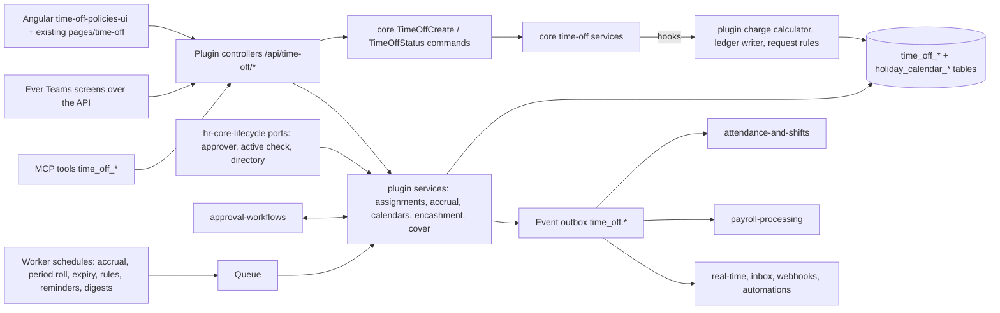

# Implementation Plan: Time-off management

> Translates an approved `spec.md` into architecture and tech choices. The plan owns
> implementation details; the spec owns behaviour.

**Feature ID**: `time-off-management`
**Spec**: `./spec.md`
**Tasks**: `./tasks.md`
**Status**: `Draft`
**Last updated**: 2026-11-23

---

## 1. Architecture Summary

The existing core time-off module stays the one model. Its four entities are extended with nullable columns
(`TimeOffPolicy`, `TimeOffRequest`, `TimeOffBalance`, `OfficialHoliday`); `TimeOffBalanceDeduction` is reused
unchanged. Three optional hooks are added to the core services, each a token in `@gauzy/contracts` that core calls
only when bound; unbound (feature off or plugin absent), core behaves exactly as today. The new plugin
`@gauzy/plugin-time-off-policies` (`packages/plugins/time-off-policies`, tenant feature `FEATURE_TIME_OFF_POLICIES`)
binds the hooks and owns everything new: ledger, assignments and rules, accrual, holiday calendars, block periods,
coverage rules, encashment, compensatory claims, cover proposals, jobs, reports and MCP tools. Ever Teams shows time-off
requests, balances and decisions in its own screens (the Ever Teams spec `people-self-service`) over this API.

**Built on what exists.** Dated assignments keep the core pivot `time_off_policy_employee` (read by the core policy and
request services and the existing policy form) in step: an open assignment inserts its pivot row, an ended one
deletes it, and a change through the existing form starts or ends an assignment. Assignment criteria and block-period
scopes are core `rule` rows (`TIME_OFF_ASSIGNMENT_RULE`, `TIME_OFF_BLOCK_PERIOD`) evaluated against
`hr-core-lifecycle`'s employee context. Holiday recurrence uses the core recurrence rules. Accrual, period roll and
expiry passes are core `job_execution` rows, and "run now" a core operation. Calendar feeds are those of
`calendar-and-scheduling`, which this feature feeds with a time-off layer and the working calendar. Minimum staffing
reads the shift coverage targets for rostered employees, and compensatory credit has one producer per organization
(attendance overtime when attendance is on). Approvals stay core `request_approval` (with `approval-workflows` when on);
settings are in the platform settings store; permissions are plugin contributions; notices de-duplicate through the
notification dispatcher. The existing request dialog and policy form gain named extension slots (a small core UI
task), and the time-off page's "Add holiday" dialog, which files `isHoliday` requests, stays as it is and gains a link
to the Holidays page.

| Core hook (token) | Called from | Plugin implementation |
| --- | --- | --- |
| `TIME_OFF_CHARGE_CALCULATOR` | `TimeOffBalanceDeductionService.chargeOf` | portions, hours, holiday calendar and rest days, entitlement periods → amount per balance |
| `TIME_OFF_LEDGER_WRITER` | every balance move of `TimeOffBalanceService` and `TimeOffBalanceDeductionService`, inside the caller's transaction (TypeORM manager or MikroORM entity manager through `ITimeOffBalanceLedger`) | appends `time_off_ledger_entry` rows and maintains `pending`, `expired`, `encashed` |
| `TIME_OFF_REQUEST_RULES` | `TimeOffRequestService.create` / `updateTimeOffByAdmin`, `TimeOffStatusHandler` | refusals and warnings of spec FR-32 to FR-35 (policy rules refuse only when the policy sets them; overlap, inactive days, backdating, re-approval and self-decision refuse only under their organization settings, all off by default), pending reservation, collision snapshot |

Each implementation first checks the tenant feature and returns "not handled" when off, so a deployment that loads
the plugin for one tenant leaves the others untouched.

## 2. Tech Choices

| Concern | Choice | Rationale |
| ------- | ------ | --------- |
| Package | `packages/plugins/time-off-policies` (new), `time-off-policies-ui` (Angular); no React package | Principle I; the core module is extended, not copied |
| Flag | tenant feature `FEATURE_TIME_OFF_POLICIES` (`time-off-policies.features.ts`), `@FeatureFlag` + `FeatureFlagGuard` on every plugin controller; hooks check it per tenant | default off; `FEATURE_EMPLOYEE_TIMEOFF` unchanged |
| Settings and permissions | `time-off-policies.settings.ts` setting contributions in `tenant_setting` at `ORGANIZATION` scope (`timeOff.approverMandatory` (false), `.backdatedLimitDays` (null: no limit), `.refuseOverlap` (false), `.refuseInactiveDays` (false), `.reapproveOnGrowth` (false), `.forbidSelfDecision` (false), `.absencesVisibleToDepartment`, `.holidayDigest`, `.compensatoryThresholdHours`, `.approvalReminderHours`, `.collisionLookaheadDays`, `.trackedTimeWindowWeeks`); `time-off-policies.permissions.ts` with `defaultFor` | no settings table, no seed migration |
| Conditions | core `rule` rows of owner types `TIME_OFF_ASSIGNMENT_RULE`, `TIME_OFF_BLOCK_PERIOD`, evaluated by `rule.evaluator.ts` with `HR_EMPLOYEE_RULE_CONTEXT` (core employee fields when `hr-core-lifecycle` is absent) | no third condition format |
| Runs | scheduled passes are core `job_execution` rows; "run now" and retries are core operation `TIME_OFF_ACCRUAL_RUN`; accrual lines keep their own outcome | one run ledger |
| Notices | `NOTIFICATION_DISPATCHER.notify({ …, dedupeKey })` (`time-off:approval-reminder:<request>:<n>`, `time-off:holiday-digest:<calendar>:<period>:<employee>`, …); else `INBOX_ITEM_WRITER` with the key as `externalId` | no notice log |
| Core writes | new core columns written only by the plugin's routes and hooks; core DTO whitelists unchanged | existing routes keep their contract |
| Day counting | pure functions in `engine/` (calendar resolution, portions, hours, period split) built on core `working-days.ts` (`weekendDays` option already exists) | one counting rule for requests, accrual, reports |
| Quantities | `numeric(10,2)` with `ColumnNumericTransformerPipe` like the existing balance columns; amounts `numeric(20,6)` with currency | consistent with the existing model |
| Persistence | MultiORM entities, the shared core migration helpers of `@gauzy/core`, tri-dialect migrations | Principle III |
| Background work | `@ScheduledJob` + `@QueueWorker`, schedule-only plugin in the worker, in-process timers without a queue, advisory lock per organization and job | task automations pattern |
| Cross-plugin | tokens bound in `apps/api/src/plugin-composition.ts`, all optional | no internals imported |
| Calendar feeds | the personal and team feeds of `calendar-and-scheduling` (`calendar_feed`, `/public/calendar/feeds/:token`), fed with this feature's time-off and holiday layers (`registerCalendarLayers`, `CALENDAR_TIME_OFF`, `CALENDAR_HOLIDAYS`) | one feed table and route for the platform |
| Holiday recurrence | `official_holiday.recurrenceRule` in the core recurrence rules (`packages/core/src/lib/recurrence/`, yearly cadence), which gain an nth-weekday-of-month and an Easter-offset anchor here | one recurrence implementation |

## 3. Data Model

### Extended core entities (additive, nullable or defaulted)

| Table | New columns (type) | Notes |
| --- | --- | --- |
| `time_off_policy` | `unit` varchar(8) (`DAYS`/`HOURS`), `payFraction` numeric(5,4), `color` varchar(16), `countryCode` char(2), `entitlementPeriod` varchar(16) (`CALENDAR_YEAR`/`FISCAL_YEAR`/`ANNIVERSARY_YEAR`), `eligibleAfterDays` int, `maxConsecutive` numeric(10,2), `minNoticeDays` int, `noticeEnforcement` varchar(8), `allowHalfDays` bool, `allowHours` bool, `minHours` numeric(10,2), `countsNonWorkingDays` bool, `allowNegativeBalance` bool, `negativeBalanceLimit` numeric(10,2), `allowOverAllocation` bool, `documentRequiredAbove` numeric(10,2), `lateProofDays` int, `isOptionalHoliday` bool, `compensatoryExpiryDays` int, `accrualDay` varchar(16), `accrualProrate` bool, `accrualRounding` varchar(8), `accrualMaxBalance` numeric(10,2), `accrualReduceForUnpaid` bool, `carryForwardExpiryDays` int, `encashable` bool, `maxEncashable` numeric(10,2), `encashReserve` numeric(10,2), `encashAtPeriodEnd` bool, `version` int default 1 | existing `maxDaysPerYear` = annual entitlement, `accrualRate`, `accrualFrequency` (enum gains `QUARTERLY`, `HALF_YEARLY`; varchar column, no schema change), `allowCarryForward`, `maxCarryForwardDays`, `requireSufficientBalance` are reused; idx `(organizationId, countryCode)` |
| `time_off_request` | `startPortion`, `endPortion` varchar(12) (`FULL`/`FIRST_HALF`/`SECOND_HALF`), `durationUnit` varchar(8), `duration` numeric(10,2), `notifyByEmail` bool default true, `approverEmployeeId` uuid, `collisions` json, `payslipRef` uuid, `blockPeriodIds` json | `start`/`end` timestamps already carry times for hour requests |
| `time_off_balance` | `periodStart`, `periodEnd` date, `pending`, `expired`, `encashed` numeric(10,2) default 0, `carriedExpiresOn` date | unique key `(tenant, organization, employee, policy, year)` unchanged (`year` = period start year); `remaining` = accrued + carriedForward − taken − carriedOut − expired − encashed (identical while the new columns are 0) |
| `official_holiday` | `recurrenceRule` varchar(64) | the core recurrence text form, e.g. `YEARLY;NTH_WEEKDAY=5:1:1`, `YEARLY;EASTER=+1`; null keeps `isRecurring` behaviour |
| `time_off_policy_employee` (existing pivot) | none | kept in step with open `time_off_policy_assignment` rows (insert on start, delete on end, in the same transaction); a pivot change through the existing policy form starts or ends a `MANUAL` assignment |

### New plugin entities (`TenantOrganizationBaseEntity`)

| Table | Columns (type) | Indexes and uniqueness |
| --- | --- | --- |
| `time_off_ledger_entry` | `balanceId` fk, `employeeId`, `policyId`, `kind` varchar(24), `amount` numeric(10,2) signed, `effectiveDate` date, `sourceType` varchar(32), `sourceId` uuid, `derivation` json, `reversalOfId` uuid, `actorType` varchar(8), `actorId` uuid, `idempotencyKey` varchar(160) | unique `(tenantId, idempotencyKey)`; idx `(balanceId, effectiveDate)`, `(organizationId, kind, effectiveDate)` |
| `time_off_policy_assignment` (dated; mirrored into `time_off_policy_employee`) | `employeeId`, `policyId`, `ruleId` null, `startDate`, `endDate` null, `entitlementOverride` numeric(10,2), `source` varchar(8) (`MANUAL`/`RULE`/`IMPORT`), `liveKey` varchar(80) | unique `(tenantId, liveKey)` (`<employee>:<policy>` while open); idx `(policyId, startDate)` |
| `time_off_assignment_rule` | `name`, `priority` int, `policies` json, `effectiveFrom` date, `isActive`; criteria as core `rule` rows (owner type `TIME_OFF_ASSIGNMENT_RULE`) | idx `(organizationId, priority)` |
| `time_off_accrual_line` | `balanceId`, `employeeId`, `policyId`, `periodFrom`, `periodTo`, `dueDate` date, `amount` numeric(10,2), `status` varchar(12) (`PLANNED`/`GRANTED`/`FAILED`/`SKIPPED`/`RELEASED`), `source` varchar(12), `failureReason`, `ledgerEntryId`, `jobExecutionId` or `operationId` (the pass that granted or failed it) | unique `(balanceId, periodFrom)`; idx `(organizationId, status, dueDate)` |
| `holiday_calendar` | `name`, `countryCode` char(2), `subdivisionCode` varchar(8), `weeklyRestDays` json, `color`, `isDefault` bool, `sourceKey` varchar(64) | unique `(organizationId, name)` |
| `holiday_calendar_day` | `calendarId` fk, `officialHolidayId` fk, `kind` varchar(12), `isHalfDay` bool, `halfDayPortion` varchar(12) | unique `(calendarId, officialHolidayId)` |
| `holiday_calendar_assignment` | `calendarId` fk, `targetType` varchar(16) (`ORGANIZATION`/`BRANCH`/`EMPLOYEE`), `targetId` uuid, `effectiveFrom` date | unique `(targetType, targetId, effectiveFrom)` |
| `time_off_block_period` | `name`, `reason`, `startDate`, `endDate`, `weekdays` json, `policyIds` json, `allowedApproverIds` json; scope (organization, branch, department, team) as core `rule` rows (owner type `TIME_OFF_BLOCK_PERIOD`) | idx `(organizationId, startDate, endDate)` |
| `time_off_coverage_rule` (minimum present for employees without shift assignments in the range; rostered employees are checked against the shift coverage targets through `SHIFTS_COVERAGE`) | `organizationTeamId` null, `organizationDepartmentId` null, `minimumCount` int, `minimumShare` numeric(5,4), `enforcement` varchar(16) | unique per team or department |
| `time_off_encashment` | `number`, `employeeId`, `policyId`, `balanceId`, `days` numeric(10,2), `dailyAmount`, `amount` numeric(20,6), `currency` char(3), `rateSource` varchar(16), `status` (`DRAFT`/`CONFIRMED`/`PAID`/`CANCELLED`), `isAutomatic`, `payoutRef`, `ledgerEntryId`, `version` | unique `(organizationId, number)`; unique `(balanceId)` where automatic |
| `compensatory_claim`, `compensatory_claim_day` | claim: `employeeId`, `policyId`, `trackedHours`, `hoursClaimed`, `daysGranted` numeric(10,2), `status` (`DRAFT`/`REQUESTED`/`APPROVED`/`DENIED`), `isProposed`, `approvalRequestId` (workflow instance or core `request_approval`), `ledgerEntryId`, `expiresOn`, `version`; day: `claimId` fk cascade, `employeeId`, `workDate` date, `hours` numeric(10,2), `source` (`CLAIM`/`TRACKED_TIME`/`ATTENDANCE`), `sourceKey` (the attendance statement line when from attendance), `liveKey` varchar(80) null | day: unique `(tenantId, liveKey)` (`<employee>:<workDate>` while the claim is not denied), so a work day is never credited twice |
| `time_off_cover_proposal` | `timeOffRequestId`, `taskId`, `proposedEmployeeId`, `reasons` json, `handoverNote`, `mode` (`ADD_ASSIGNEE`/`REASSIGN`), `status` (`PROPOSED`/`ACCEPTED`/`REJECTED`), `decidedById`, `revertAt` date | unique `(timeOffRequestId, taskId, proposedEmployeeId)` |

### Migrations

**Migration timestamps**: `packages/plugins/time-off-policies` `1791000097100` to `1791000097199`; `packages/core` `1791000097900` to `1791000097999`.

- Core (`packages/core/src/lib/database/migrations/`): `1791000097900-ExtendTimeOffForPolicies` (the four tables
  above); the recurrence anchors are code; `RuleOwnerType` values need no migration.
- Plugin (`packages/plugins/time-off-policies/src/lib/database/migrations/`): `1791000097100-CreateTimeOffLedgerAndAccrualTables` (ledger, assignments, rules, accrual lines), `1791000097110-CreateHolidayCalendarTables`,
  `1791000097120-CreateTimeOffControlTables` (block periods, coverage rules), `1791000097130-CreateTimeOffEncashmentAndCompensatoryTables`
  (encashments, claims, claim days), `1791000097140-CreateTimeOffCoverTables` (proposals). Permissions, role grants, feature and
  settings are contributions; no seed migration.
- Idempotent, additive, per dialect; open-assignment uniqueness through `liveKey` on all dialects. The opening ledger
  entries and the first assignments mirroring today's `time_off_policy_employee` rows (source `MANUAL`, so no
  assignment rule ever ends them) are written by the feature-enable handler per tenant (FR-15), not by a migration.

### Contracts

`packages/contracts/src/lib/time-off.model.ts` gains optional fields on `ITimeOffPolicy`, `ITimeOff`, `ITimeOffBalance`,
`IOfficialHoliday` and the enum values; new `time-off-policies.model.ts` holds the plugin's interfaces, enums
(`TimeOffUnitEnum`, `DayPortionEnum`, `EntitlementPeriodEnum`, `LedgerEntryKindEnum`, `AccrualDayEnum`,
`AccrualRoundingEnum`, `CalendarTargetEnum`, `EncashmentStatusEnum`), preview shapes, the three hook tokens and
interfaces, the ports below and event payloads. `rule.model.ts` gains `RuleOwnerType.TIME_OFF_ASSIGNMENT_RULE` and
`TIME_OFF_BLOCK_PERIOD`; `approval-policy.model.ts` gains `TIME_OFF_COMPENSATORY`.

## 4. API Surface

Plugin routes under `/api/time-off`, guarded by `TenantPermissionGuard`, `PermissionGuard`, `FeatureFlagGuard`; cursor
pagination; `Idempotency-Key` on creating, granting and confirming routes; `version` on updates. Existing routes
(`/time-off-request`, `/time-off-policy`, `/time-off-balance`, `/official-holiday`) unchanged.

| Method | Endpoint | Permission | Description (request → response) | Status |
| ------ | -------- | ---------- | -------------------------------- | ------ |
| `GET/PUT` | `/time-off/settings` | `TIME_OFF_VIEW` / `TIME_OFF_POLICY_EDIT` | the `timeOff.*` keys of the settings store | New |
| `GET/PUT` | `/time-off/policies/:id/rules`, `GET …/history` | `TIME_OFF_POLICY_VIEW` / `TIME_OFF_POLICY_EDIT` | `PolicyRulesDTO` (FR-1, FR-2) | New |
| `GET/POST/PUT/DELETE` | `/time-off/assignment-rules` (+ `POST /:id/preview`) | `TIME_OFF_ALLOCATE` | `AssignmentRuleDTO` (criteria as `rule` rows) → matches | New |
| `GET/POST/PUT` | `/time-off/assignments`, `POST /time-off/assignments/bulk` (`preview`), `GET /time-off/assignments/missing` | `TIME_OFF_ALLOCATE` | per-employee results | New |
| `GET` | `/time-off/balances`, `/me`, `/:id`, `/:id/ledger`, `/:id/schedule`, `/projection` | `TIME_OFF_VIEW`, self or manager | `ITimeOffBalanceView` with derivations | New |
| `POST` | `/time-off/balances/:id/adjustments`, `/time-off/grants`, `/time-off/balances/:id/expire` | `TIME_OFF_ALLOCATE` | `AdjustmentDTO`, `GrantDTO` | New |
| `GET/POST` | `/time-off/accrual-runs` (run now or retry), `POST /time-off/accrual-lines/release` | `TIME_OFF_ALLOCATE` | passes from `job_execution`, "run now" as core operation `TIME_OFF_ACCRUAL_RUN` with progress; released lines | New |
| `POST` | `/time-off/requests/preview` | `TIME_OFF_REQUEST_OWN` or `TIME_OFF_ADD` | `RequestPreviewDTO` → duration per period, balances, projected, approver, refusals, warnings, collisions | New |
| `POST/PUT` | `/time-off/requests`, `/time-off/requests/:id` | `TIME_OFF_REQUEST_OWN` (own) or `TIME_OFF_ADD` | builds the core input and runs `TimeOffCreateCommand` / `TimeOffUpdateCommand` | New |
| `POST` | `/time-off/requests/:id/withdraw`, `/shorten`, `/decision` | requester; resolved approver or `TIME_OFF_APPROVE` | decision runs core `TimeOffStatusCommand` | New |
| `GET/POST/PUT` | `/time-off/requests/:id/collisions`, `/time-off/requests/:id/cover-proposals`, `/time-off/cover-proposals/:id` | approver or manager | collisions, capacity, proposals; accept or reject | New |
| `GET/POST/PUT/DELETE` | `/time-off/block-periods`, `/time-off/coverage-rules` | `TIME_OFF_POLICY_EDIT` | DTOs | New |
| `GET/POST/PUT/DELETE` | `/time-off/holiday-calendars` (+ `/:id/holidays`, `/:id/closures`, `/:id/import` with `preview`, writing core `official_holiday` rows linked by `holiday_calendar_day`), `/time-off/holiday-calendar-assignments`, `GET /time-off/holiday-sources` | `TIME_OFF_VIEW` / `TIME_OFF_HOLIDAYS_EDIT` | calendar and day DTOs; import rows with results | New |
| `GET` | `/time-off/working-calendar`, `/time-off/expected-hours` | `TIME_OFF_VIEW` or self | day kinds, working-day counts, expected hours | New |
| `GET/POST/PUT` | `/time-off/compensatory-claims` (+ `/:id/submit`, `/:id/decision`) | self; resolved approver or `TIME_OFF_APPROVE` | claim DTOs with their work days; decided through `TIME_OFF_APPROVALS`, else a core request approval of type `TIME_OFF_COMPENSATORY` on the existing Approvals page | New |
| `GET/POST` | `/time-off/encashments`, `/:id/confirm` (`preview`), `/:id/cancel`, `GET /time-off/encashments/encashable` | `TIME_OFF_ENCASH` | amounts and status | New |
| `GET` | `/time-off/payroll-feed`, `/time-off/calendar`, `/time-off/analytics/*` | `TIME_OFF_REPORTS_VIEW`; calendar `TIME_OFF_VIEW` (organization scope `TIME_OFF_CALENDAR_VIEW`) | feed rows; calendar cells; report sources | New |
| `*` | `/calendar/feeds` of `calendar-and-scheduling` | as there | personal and team feeds carry the time-off and holiday layers; no feed route of this plugin | Sibling feature |

Errors: `400` with stable codes (`TIME_OFF_OVERLAP`, `TIME_OFF_INSUFFICIENT_BALANCE`, `TIME_OFF_NOT_ELIGIBLE`,
`TIME_OFF_CONSECUTIVE_LIMIT`, `TIME_OFF_BACKDATED`, `TIME_OFF_BLOCKED`, `TIME_OFF_PERIOD_CLOSED`,
`TIME_OFF_NO_APPROVER`, `TIME_OFF_AGENT_EMPLOYEE`), `403`, `404`, `409` (decided already, version).

**Consumer tokens answered** (bound in `apps/api/src/plugin-composition.ts` to the working calendar, availability, balance reader and payroll feed services; each consumer plan states the shape it calls and its fallback): `AUTOMATION_AVAILABILITY`, `CALENDAR_HOLIDAYS`, `CALENDAR_TIME_OFF`, `PAYROLL_TIME_OFF_BALANCES`, `PAYROLL_TIME_OFF_FEED`, `PAYROLL_WORKING_CALENDAR`, `RECRUITMENT_TIME_OFF_SUMMARY`, `WORKFLOW_WORKING_CALENDAR`.

## 5. Events, Real-Time and Notifications

| Event | Emitted when | Consumers |
| ----- | ------------ | --------- |
| `time_off.request.submitted` / `.approved` / `.denied` / `.withdrawn` / `.shortened` | request lifecycle (payload: employees, policy, days with portions, duration per period, pay fraction) | attendance marks, payroll feed, inbox, chat card, real-time, webhooks |
| `time_off.balance.changed` | ledger entry written | balance screens real-time, automations |
| `time_off.accrual.run_completed` | accrual, period roll or expiry run ends | inbox digest of failures |
| `document.time_off_encashment.confirmed` / `.cancelled` | encashment confirmed or cancelled | `payroll-processing` additional pay, `payments-and-collections` payout |
| `time_off.compensatory.granted`, `time_off.calendar.changed` | as named | automations, attendance, payroll |
| consumed: `hr.employee.hired`, `hr.event.applied`, `hr.separation.completed` | HR changes | rule re-evaluation, accrual stop, settlement source |
| consumed: `payroll.pay_period.closed`, `payroll.encashment.paid`, `attendance.day.marked` | payroll and attendance | period guard (only where `payroll.lockTimeOffInClosedPeriods` is on), paid status, present-day warning |
| consumed: `workflows.approval.decided` (record type `time_off.compensatory_claim`), the settler of core request approvals (type `TIME_OFF_COMPENSATORY`) | approvals | claim granted or denied |

Approver notices through `NOTIFICATION_DISPATCHER` (inbox items with approve and deny actions, FR-42) with
`dedupeKey`, else `INBOX_ITEM_WRITER` with the same key; closing on decision is a real-time hint to every open client.
Emails through the email-template system (`time-off-request-submitted`, `-decided`, `-withdrawn`, `holiday-digest`,
`accrual-failures`), honouring `notifyByEmail` and preferences.

## 6. UI Surface

- **Core UI (first, T48)**: named slots `TIME_OFF_REQUEST_FORM` (the request dialog of
  `packages/ui-core/shared/src/lib/time-off/time-off-request-mutation`) and `TIME_OFF_POLICY_FORM` (the policy form of
  `…/time-off/settings-mutation`) added to `PAGE_EXTENSION_SLOTS` and placed in those components.
- Angular plugin `packages/plugins/time-off-policies-ui`, registered in `apps/gauzy/src/plugin-ui.config.ts`, adds to the
  existing "Time Off" menu: Balances, Calendar, Holidays, Assignments, Accruals, Encashments, Compensatory, Block
  periods, Reports, Settings — each hidden without the feature or permission. Routes under `/pages/time-off/…`
  beside the existing `apps/gauzy/src/app/pages/time-off` page, which stays; its "Add holiday" dialog
  (`time-off-holiday-mutation`, which files `isHoliday` requests) stays available and unchanged with the feature on,
  with a link to the Holidays page, which adds company holidays to the calendars.
- The existing request dialog gains day portions, hours and a live preview (duration, balances, collisions) through
  `TIME_OFF_REQUEST_FORM` when the feature is on; the existing policy form gains a "Rules" panel through
  `TIME_OFF_POLICY_FORM`, and its employee list edits assignments.
- Ever Teams builds its request form, balance cards, team calendar and approval card over the routes of §4; the chat
  record card comes from `chat-agents-and-record-actions` when `FEATURE_CHAT_RECORD_CARDS` is on. No React package.
- i18n keys `TIME_OFF_POLICIES.*` in every locale; calendar cells labelled; keyboard date navigation.

## 7. MCP Tools, SDKs and Integrations

The 20 tools of `packages/mcp-server/src/lib/tools/time-off.ts` stay unchanged. New `time-off-policies.ts`:

| Tool | Input | Output |
| --- | --- | --- |
| `time_off_balance_explain` | employee, policy, period | components and ledger with derivations |
| `time_off_balance_projection` | employee, policy, date | projected available |
| `time_off_request_preview` | employee, policy, dates, portions or times | duration, refusals, warnings, collisions, approver |
| `time_off_request_submit` | same, `preview` (default true) | preview or created request |
| `time_off_decide` | request, approve or deny, comment | decision |
| `time_off_cover_propose` | request | proposals per task |
| `time_off_team_calendar` | scope, range | who is off when |
| `time_off_holiday_lookup` | employee or branch, range | day kinds and counts |
| `time_off_encashable`, `time_off_accrual_status` | employee or organization | encashable days; last runs and failures |

Holiday sources: multi-provider token `TIME_OFF_HOLIDAY_SOURCE` (country packs of `regional-compliance-packs`,
built-in iCalendar and spreadsheet parsers). Ports provided: `TIME_OFF_WORKING_CALENDAR` (bound also as
`HR_WORKING_CALENDAR` and `CALENDAR_HOLIDAYS`), `TIME_OFF_PAYROLL_FEED`, `TIME_OFF_AVAILABILITY` (bound also as
`CALENDAR_TIME_OFF`), the time-off and holiday layers for `calendar-and-scheduling` (`registerCalendarLayers`), a
`HR_SETTLEMENT_SOURCE` provider, `TIME_OFF_COMPENSATORY_INTAKE` (`credit({ employeeId, workDate, hours, sourceKey })`,
used by attendance for overtime taken as time off). Ports consumed: `HR_APPROVER_RESOLVER`, `HR_ACTIVE_EMPLOYEE_CHECK`,
`HR_DIRECTORY`, `HR_EMPLOYEE_RULE_CONTEXT`, `TIME_OFF_APPROVALS` (`approval-workflows`; fallback the existing core
request approval, as for requests), `TIME_OFF_PAY_PERIOD_LOCK` (payroll; answers "locked" only where the organization switched
`payroll.lockTimeOffInClosedPeriods` on, off by default; unbound: never locked) and `TIME_OFF_DAILY_RATE` (payroll), `TIME_OFF_ATTENDANCE`
(present marks, shift hours), `SHIFTS_COVERAGE` (shift coverage targets for rostered employees; absent: the team or
department rule), `NOTIFICATION_DISPATCHER`. Report definitions registered for spec §3.11. Import templates: opening
balances, requests history, holidays. OpenAPI grows additively; Kiota SDKs regenerated after merge.

## 8. Background Jobs

| Trigger | When | What it does | Idempotency |
| ------- | ---- | ------------ | ----------- |
| `time-off.accrual` | hourly sweep; per organization once its local day changed | grants due accrual lines; the pass is a `job_execution` row, outcomes stay on the lines | unique `(balanceId, periodFrom)` + ledger `idempotencyKey`; advisory lock per organization |
| `time-off.period-roll` | same sweep, on a period's first day | creates next-period balances, carries forward up to the cap, then, for a policy with `encashAtPeriodEnd`, drafts the automatic encashment of the encashable days (up to `maxEncashable`, less `encashReserve`), which stay unexpired on the old balance while the draft is open, and expires only the rest; confirming the encashment takes its days, cancelling it expires them then | ledger keys `carry:<balance>`, `expire:<balance>:<date>`, `expire:<balance>:encashment:<encashmentId>`; automatic encashment unique per balance |
| `time-off.expiry` | daily | expires carried parts past their date | ledger key per part and date |
| `time-off.assignment-rules` | nightly + on HR events | starts and ends rule assignments, grants starting entitlement | `liveKey`; ledger keys |
| `time-off.approval-reminders` | hourly | reminds undecided approvers | dispatcher `dedupeKey` |
| `time-off.holiday-digest` | weekly or monthly | upcoming holidays per calendar | dispatcher `dedupeKey` |
| `time-off.compensatory-proposals` | daily, only for organizations without `attendance-and-shifts` on | drafts claims from tracked time on rest days and holidays, skipping work days that already have a live claim day | claim day `liveKey` `<employee>:<workDate>` |
| `time-off.cover-revert` | daily | removes period-only cover assignees after the absence ends | proposal status |

The worker loads `TimeOffPoliciesSchedulePlugin`; the API loads `TimeOffPoliciesPlugin`. Without a queue the API runs
the sweeps on in-process timers under the same locks. Batches of 500 employees per transaction.

## 9. Security & Permissions

- New keys (contributed): `TIME_OFF_REQUEST_OWN`, `TIME_OFF_APPROVE`, `TIME_OFF_ALLOCATE` (group `ADMINISTRATION`),
  `TIME_OFF_ENCASH` (`ADMINISTRATION`), `TIME_OFF_BACKDATE`, `TIME_OFF_BLOCK_OVERRIDE`, `TIME_OFF_CALENDAR_VIEW`,
  `TIME_OFF_HOLIDAYS_EDIT`, `TIME_OFF_REPORTS_VIEW`. Existing `TIME_OFF_POLICY_*` and `TIME_OFF_*` keys are reused.
- Default grants through the contributions' `defaultFor`: super admin and admin all new keys plus the four
  `TIME_OFF_POLICY_*` keys (held by no role today); manager `TIME_OFF_REQUEST_OWN`, `TIME_OFF_REPORTS_VIEW` (their
  reports); employee `TIME_OFF_REQUEST_OWN`. Being the resolved approver authorises a decision on that request without
  a key.
- Self-service writes are limited to the caller's own employee; a manager reads their reports through the reporting
  line; colleagues get "off" only (policy, reason and attachment stripped by a response mapper).
- Calendar feeds are `calendar-and-scheduling` feeds (hashed, revocable, rate-limited tokens); the layers this feature
  registers carry names and dates only for colleagues.
- Agents act with the caller's permissions; `time_off_request_submit` defaults to `preview: true`; agent actions are
  marked on the ledger (`actorType`).

## 10. Observability

- Ledger per balance; passes as `job_execution` rows with the line outcomes; `activity_log` entries for rules,
  calendars, block periods, adjustments and encashments.
- Metrics: accrual lines granted and failed, period-roll duration, preview latency, decisions by channel (web, inbox,
  chat, phone), proposals accepted.
- Structured logs for refused requests (code only, no reason text) and failed hooks; Sentry breadcrumbs on job batches.

## 11. Phased Rollout

1. **Phase 1 — Surface what exists** (flag off): contracts, core columns and hooks, plugin scaffold, policy rules
   screen, balances screen with ledger and opening entries, holiday calendars on official holidays, own requests,
   decisions with approver resolution, read MCP tools.
2. **Phase 2 — Depth**: accrual, period roll and expiry jobs, assignment rules and bulk grants, half days and hours,
   validation rules, block periods, encashment, compensatory claims, payroll feed, team calendar, reports,
   notifications, imports.
3. **Phase 3 — Advanced capabilities**: collisions, team minimum, capacity estimate, cover proposals, one-tap decisions in
   chat and phone, expected hours, presence, calendar feeds, projections, multi-country policies, absence analytics,
   proposed compensatory claims, write MCP tools.
4. **Phase 4 — General availability**: the feature is off by default; after the trial period it may be switched on by default for new tenants only; existing tenants keep their setting until an administrator changes it.

## 12. Constitution Reconciliation

- I Plugin-first: `time-off-policies` pair; core module extended through columns, optional hooks and enum values only.
- II Tenant/organization scoping: all tables tenant-organization based; hooks receive the caller's scope.
- III Both ORMs, additive migrations: hooks receive both ledger flavours (`ITimeOffBalanceLedger`); add-column and create migrations only.
- IV Default-off flag; nothing removed: `FEATURE_TIME_OFF_POLICIES`; unbound hooks keep today's behaviour exactly.
- V Contracts and API first: optional fields and new routes; existing routes and tools unchanged.
- VI Permissions, privacy, security: nine keys, response mapper for colleagues, feeds through the calendar's hashed tokens.
- VII Real-time through the event bus: outbox events, inbox items closed live.
- VIII i18n and accessibility: `TIME_OFF_POLICIES.*` keys; accessible calendar and forms.
- IX Tests: counting golden cases, ledger invariants (balance equals entries), job idempotency, ORM parity of hooks.
- X Behaviour-first spec: implementation lives here.
- XI Documentation describes our platform only.

## 13. Risks & Mitigations

| Risk | Likelihood | Impact | Mitigation |
| ---- | ---------- | ------ | ---------- |
| Hooks change the delicate deduction path | Medium | High | hooks run inside the existing transaction and lock; existing balance and ORM-parity specs run with hooks bound and unbound |
| Ledger and balance drift | Low | High | entries and components written together; nightly invariant check reports differences |
| Calendar resolution errors near changes | Medium | Medium | per-day resolution, golden cases across assignment changes and time zones |
| Accrual double grants after crashes | Low | High | unique accrual line per period and ledger idempotency keys |
| Collision and cover queries slow the form | Medium | Medium | precomputed tracked-hour averages per employee, 400 ms budget, async cover proposals |
| Payroll and attendance contracts move | Medium | Medium | events and ports in contracts; consumers tolerant of extra fields |

## 14. References

- Spec: `./spec.md` · Tasks: `./tasks.md`
- [platform architecture](../../architecture/business-suite.md) §2.5, §3.6, §3.9, §3.11, §3.12, §6
- Code: `packages/core/src/lib/time-off-policy/time-off-policy.entity.ts`, `time-off-request/time-off-request.service.ts`,
  `time-off-request/commands/handlers/time-off.status.handler.ts`, `time-off-balance/time-off-balance.service.ts`,
  `time-off-balance/time-off-balance-deduction.service.ts`, `time-off-balance/time-off-balance-ledger.ts`,
  `time-off-balance/working-days.ts`, `official-holiday/official-holiday.entity.ts`,
  `employee/employee.entity.ts` (pivot `time_off_policy_employee`), `rule/`, `recurrence/`, `job-execution/`,
  `database/migrations/1790000011000-CreateTimeOffLeaveManagement.ts`, `request-approval/request-approval.service.ts`,
  `request-approval/linked-document-decision.gate.ts`, `packages/ui-core/shared/src/lib/time-off/`
  (`time-off-request-mutation`, `settings-mutation`, `time-off-holiday-mutation`),
  `packages/mcp-server/src/lib/tools/time-off.ts`, `packages/plugins/task-automations` (schedule split),
  `packages/plugins/inbox/src/lib/database/migration-helpers.ts`, `apps/api/src/plugin-composition.ts`
