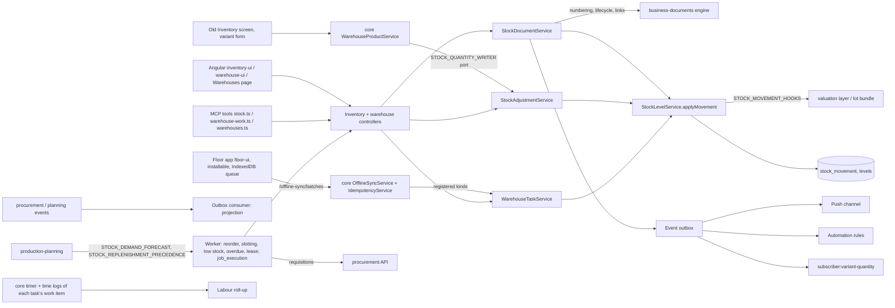

# Implementation Plan: Warehouse and stock movements

> Translates an approved `spec.md` into architecture and tech choices. The plan owns
> implementation details; the spec owns behaviour.

**Feature ID**: `warehouse-and-stock-movements`
**Spec**: `./spec.md`
**Tasks**: `./tasks.md`
**Status**: `Draft`
**Last updated**: 2026-11-23

---

## 1. Architecture Summary

Two existing plugins grow; nothing is replaced. `@gauzy/plugin-inventory` keeps the single write path
(`StockLevelService.applyMovement`: movement, level row and product aggregate in one transaction under the level lock)
and gains movement documents, purposes, reorder, projection and the scan resolver. `@gauzy/plugin-warehouse` keeps
zones, bins, waves and pick lists and gains putaway rules, warehouse tasks and slotting. Core `warehouse` gains tree,
kind and owner columns and a quantity-writer port so the old Inventory screen writes through the ledger. Core also
gains the platform's one offline-sync module beside core idempotency (`packages/core/src/lib/offline-sync/`): this
feature specifies it, and the shop floor, quality and field service register their operation kinds with it. The one
installable floor app (`floor-ui`, inside the Gauzy web app) is owned here; other features add modules to it. Two
hook ports let `stock-ledger-and-valuation` and `serials-and-batches` act inside the movement transaction. Demand
forecasts and the precedence between reorder rules and planned items belong to `production-planning`, read here
through two ports. The level row (core `warehouse_product_variant`) stays the only stored quantity per item and
location: no other feature keeps a second quantity, reserved counter or reorder threshold beside it.

## 2. Tech Choices

| Concern | Choice | Rationale |
| ------- | ------ | --------- |
| Package | extend `packages/plugins/inventory`, `packages/plugins/warehouse`; core `warehouse` columns; core `offline-sync` module | Principle I; build on what exists |
| UI | new Angular `packages/plugins/inventory-ui`, `warehouse-ui`, `floor-ui` (the installable floor app); the existing Warehouses page becomes the location tree | one Angular UI per area; no second location screen |
| Persistence | MultiORM entities, tri-dialect migrations in each plugin's `database/migrations`, helpers copied from the inbox plugin | Principle III |
| Write path | every quantity change through `applyMovement`; documents call it per line inside one transaction | one ledger |
| Extension | ports `STOCK_MOVEMENT_HOOKS`, `STOCK_NEGATIVE_POLICY`, `STOCK_PERIOD_GUARD`, `STOCK_VALUE_PREVIEW`, `STOCK_LOT_PICKER`, `STOCK_LOT_SCAN_RESOLVER`, `STOCK_QUANTITY_WRITER`, `STOCK_PURPOSE_REGISTRY`, `STOCK_DIMENSION_SETS` (accounting's analytic dimension sets), `STOCK_DEMAND_FORECAST` and `STOCK_REPLENISHMENT_PRECEDENCE` (bound by `production-planning`) in `apps/api/src/plugin-composition.ts`; unbound = today's behaviour | plugins never import each other |
| Documents | business document engine for numbering series, lifecycle, links, effects preview | [platform architecture](../../architecture/business-suite.md) §3.1 |
| Background work | `@ScheduledJob` + `@QueueWorker` in `InventoryMaintenanceModule` / new `WarehouseMaintenanceModule`; every pass recorded in core `job_execution`; an on-demand reorder run is a core `operation` (type `STOCK_REORDER_RUN`, `202` with a handle per `packages/core/src/lib/api/async-operation.ts`); in-process timers without a queue root | one run ledger, no run table |
| Push | outbox events → realtime channel; existing `InventoryLevelChangedEvent` bridged | Principle VII |
| Offline | core offline-sync module: `offline_operation` log and `offline_exception` queue; each operation applied through `IdempotencyService.claim` (scope `offline:<kind>`, key = client operation id, retention covering the offline window); plugins contribute operation kinds (`OFFLINE_OPERATION_KINDS`: kind, owner type, permission, handler); device cache in IndexedDB inside `floor-ui` | one offline idiom for warehouse, shop floor, inspection and field service (spec FR-87) |
| Floor app | `floor-ui` is a route group `/pages/floor` of the Gauzy web app, installed through the app's existing `apps/gauzy/src/manifest.json` (floor start URL and shortcut) and Angular service worker (`ngsw-config.prod.json` data groups for task packs); shell: device id, scanner (browser barcode detector with a JavaScript fallback, keyboard wedge), feedback, queue, module registry | one install per device |
| Availability | `StockAvailabilityService` (bound to `CART_STOCK_AVAILABILITY`), `StockReservationService.assertAvailable` and `ChannelWarehouseService` read only active, sellable, own stock-holding locations: group, `TRANSIT`, non-sellable, customer-owned (`ownerContactId`) and supplier-held (`ownerVendorId`) locations are skipped by the sum and refused for holds and channel mappings; one exception for internal production: a reservation of reference `SUBCONTRACT_ORDER` or `PRODUCTION_ORDER` on a customer-owned location is accepted when its order works for that customer (an inward subcontract order whose party is the location's `ownerContactId`, or a work order taking over such an order's reservations) and the location is active and not marked non-sellable or in transit, the exception lifting only the ownership restriction, checked against that location's own balance and never added to sales availability | in-transit and quarantined stock is never sold (spec FR-6); customer material stays out of carts and channels while its own production can hold it (`shop-floor-and-work-orders` FR-36, FR-84) |
| Reorder level | the existing `restockThreshold` of `warehouse_product_variant` (variant) and `warehouse_product` (item rule) is the one level per item and location; reorder rules read it, and low-stock rules (`stock_alert`) read it when they store no threshold of their own; a stored alert threshold is kept as it is | one level for reorder; existing alerts unchanged (spec FR-52, FR-55) |
| Labour | each warehouse task owns a core `task` in the organization's warehouse-work project (created on first use); the floor app runs `StartTimerCommand`/`StopTimerCommand` on it when the task is claimed and released; labour = that task's `time_log` rows at their stored `payRateValue` | the rule shop floor and field service use; a log counts once |
| Settings, permissions | settings as keys in `inventory.settings.ts` / `warehouse.settings.ts` (`PluginSettingContribution`), among them `stock.protectLocationsInUse` and `warehouse.quarantineZonesNonSellable` (default off), `stock.routeQuantityEdits` and `stock.lowStockNotices`; the data step `EnableWarehouseSettingsAsToday` stores the last two as off for organizations of tenants that had `FEATURE_WAREHOUSE` on before the release (spec FR-105); permissions as contributions with `defaultFor` in `inventory.permissions.ts` / `warehouse.permissions.ts` | platform stores; no seed migration |
| AI | the replenishment agent is an agent definition of `ai-agents-and-assistants`; its runs and usage are recorded there | one agent runtime |

### 2.1 Existing code each concern builds on

| Concern | Existing code | How this feature uses it |
| ------- | ------------- | ------------------------ |
| Locations screen | Angular `/pages/inventory/warehouses` (`apps/gauzy/src/app/pages/inventory/components/manage-warehouses/`) | its table becomes the tree with roll-ups; its form gains parent, group, kind, non-sellable purpose, in-transit default and owner; `inventory-ui` adds no location page |
| Location tools | MCP `packages/mcp-server/src/lib/tools/warehouses.ts` (`get_warehouses`, `create_warehouse`, `update_warehouse`) | gain the tree, kind, purpose and owner fields; no parallel location tool |
| Multi-location flag | `FEATURE_MULTI_WAREHOUSE` (`inventory.features.ts`, default off) | gates what its catalogue entry describes: the location tree and roll-ups, in-transit locations and two-step routing; one-step transfers stay as today |
| Location fields | core `merchant.warehouses`, `channel_warehouse`, `warehouse.sellerId`, `isPickupLocation`, `isFulfillmentLocation` | group, in-transit, non-sellable, customer-owned and supplier-held locations cannot be mapped to a channel or merchant, nor be pickup or fulfilment locations; a child inherits its parent's `sellerId` |
| Quarantine and damage | zone types `QUARANTINE`, `DAMAGE` (`warehouse.types.ts`) | where `warehouse.quarantineZonesNonSellable` is on (default off) new such zones are created only in non-sellable locations (purpose `QUARANTINE` / `DAMAGE`); the Warehouses page lists such zones of sellable locations and offers to move each, with its bins and stock (one transfer), under a non-sellable child in one action; existing zones stay until moved |
| Corrections and consumption | `stock_adjustment` (`INCREASE` … `FOUND`, `reasonCode`), `StockReasonCode` | adjustments correct a wrong figure; issue documents consume stock; `stock_issue_reason` rows are seeded from the outgoing `StockReasonCode` values |
| Purchase receipts | purchasing `goods_receipt` and its lines (cost, batch, damage, put-away, a movement per line) | the only receipt path of a purchase order; a stock document may link it (returns to the vendor) but never receives the same order line |
| Put-away | `WarehouseZoneService.findPutAwayPath`, `WarehouseBinService.putAway` (`POST /warehouse-bins/:id/put-away`), `checkCapacity` (`POST /warehouse-bins/capacity-check`), `capacityWarnings` (`GET /warehouse-bins/capacity-warnings`, bins with an undeclared capacity unit), derived bin contents (`GET /warehouse-bins/:id/contents`), bin `capacityUnits`/`maxWeight`/`maxVolume` | item rules feed `findPutAwayPath`; the planner and the overfill guard call `checkCapacity`; the capacity view is a read on the existing bin controller built from `checkCapacity` and the derived contents, listing `capacityWarnings` bins as "capacity unknown" |
| Pick path | `pick_list_line.position` ("position in the sorted pick path"), bin `sortOrder` and coordinates | the walk order is `position`; `warehouse_bin.walkSequence` is only an explicit override read first by the existing sort |
| Picking work | `pick_list.assignedToUserId`, `status`, `startedAt`, `completedAt`, `lineCount`, `pickedCount`; `pick_wave.pickerUserId`; `PICK_LISTS_PICK` | stay the assignee, status and progress of picking; a pick task is only the queue and lease row over its list |
| Counts | `stock_count` (modes, blind, freeze) and `POST /stock-counts/:id/count` | the floor count task drives the existing route |
| Returns | returns plugin through `RETURNS_STOCK_LEDGER`, including `eventOnly` damage movements | sales returns, claims and exchanges stay there; the return purpose covers stock documents only |
| Projection | `incomingQuantity` ("approved purchase orders and inbound transfers, not yet received", also in GraphQL) | written from now on with that meaning; `inTransitQuantity` is its dispatched part |
| Variant quantity | core `product_variant.quantity`, written by the variant form (`edit-inventory-item-variant/variant-form.component.ts`) | stays editable; with the feature on an edit on the form goes through `STOCK_QUANTITY_WRITER` as a "set" adjustment, and the `subscriber:variant-quantity` consumer keeps the column equal to the ledger |
| Lead time and order multiple | `vendor_product_term.leadTimeDays/minQuantity/packSize` (preferred term by `priority`), `organization_vendor.leadTimeDays` | lead time of the forecast suggestion; rounding of the proposal quantity |

## 3. Data Model

### New or changed entities

Core `warehouse` (core migration `AddStockLocationTree`):

| Column | Type | Notes |
| --- | --- | --- |
| `parentId` | uuid null | FK `warehouse` RESTRICT; index (`organizationId`, `parentId`) |
| `isGroup` | boolean | default false |
| `path` | varchar(1024) null | `/<rootId>/…/<id>/`, rewritten for the subtree on re-parent in the same transaction; roll-ups use a prefix match |
| `isNonSellable` | boolean | default false |
| `nonSellablePurpose` | varchar(24) null | `INSPECTION_HOLD`, `QUARANTINE`, `DAMAGE`, `RETAINED_SAMPLE`, `RETURNS`; set only when non-sellable; unique (`parentId`, `nonSellablePurpose`) among live rows; quality's hold, reject and sample targets are these children |
| `inTransitWarehouseId` | uuid null | FK `warehouse` SET NULL; service checks kind `TRANSIT` and same organization |
| `expectedTransitDays` | int null | |
| `ownerContactId` | uuid null | FK `organization_contact` SET NULL (customer-owned stock) |
| `ownerVendorId` | uuid null | FK `organization_vendor` SET NULL (own stock held by a supplier, such as a subcontractor; at most one owner column set) |

`WarehouseType` gains `TRANSIT`; the migration widens the allowed values per dialect (native enum: add value if
missing; check constraint: replaced). Core `warehouse_product_variant` gains `inTransitQuantity`,
`requestedQuantity`, `plannedQuantity` (numeric(20,6), default 0); the existing `incomingQuantity` keeps its
documented meaning and is now written (purchase order and transfer events), `inTransitQuantity` being its dispatched
part. The existing `restockThreshold` of `warehouse_product_variant` and `warehouse_product` is the reorder level.
Projected and reserved-by-kind are derived (reserved by kind from active `stock_reservation` rows; new index
(`warehouseId`, `variantId`, `status`, `referenceType`)). Core `product_variant.quantity` keeps its column; with the
feature on only the consumer writes it (sum of on hand over the organization's own stock-holding locations,
recomputed, never summed).

Inventory plugin, changed: `stock_movement.referenceLineId` (uuid null, indexed) links a movement to its document line.
`stock_reservation`: `consumedQuantity`, `releasedQuantity` (numeric, default 0), `lotId`, `serialUnitId` (uuid null, no
FK: tables of `lot-serial-tracking`), `handedFromReservationId` (uuid null); `StockReservationReferenceType` gains
`PRODUCTION_ORDER`, `SUBCONTRACT_ORDER`, `PRODUCTION_PLAN`, `PICK_LIST`. Reserved quantity by lot or serial unit is
derived from these rows; no other feature keeps a reserved counter. `stock_transfer`: `isTwoStep` (boolean, default
true = today's behaviour), `inTransitWarehouseId`, `expectedArrivalAt`, `overdueRaisedAt`. `stock_transfer_line`:
`sourceBinId`, `targetBinId` (uuid null). `stock_alert.threshold` becomes nullable: null means the level's
`restockThreshold`; existing alerts keep their stored threshold, and saving a reorder rule never changes it (a user
may clear it to follow the level).

Inventory plugin, new (all `TenantOrganizationBaseEntity`, soft delete where noted):

| Table | Columns (beyond base) | Keys and indexes |
| --- | --- | --- |
| `stock_document_type` | `name` varchar(120), `purpose` varchar(48), `numberingSeriesId` uuid, `defaultSourceWarehouseId`, `defaultTargetWarehouseId` uuid null, `isTwoStep`, `allowsLotSplit`, `usesPutaway`, `isActive` boolean | unique (`organizationId`, `name`); soft delete refused while used |
| `stock_movement_document` | `number` varchar(64), `documentTypeId` FK, `purpose` varchar(48), `status` varchar(16), `occurredAt` timestamp, `isOpening` boolean, `sourceWarehouseId`, `targetWarehouseId` uuid null, `sourceDocumentType` varchar(64), `sourceDocumentId` uuid, `totalIncomingQuantity`, `totalOutgoingQuantity` decimal(20,6), `confirmedAt`, `confirmedByUserId`, `cancelledAt`, `cancelledByUserId`, `note` text, `metadata` json | unique (`organizationId`, `number`); (`organizationId`, `status`, `occurredAt`); (`sourceDocumentType`, `sourceDocumentId`) |
| `stock_movement_document_line` | `documentId` FK CASCADE, `lineNo` int, `role` varchar(16) (`LINE`, `INPUT`, `OUTPUT`, `SECONDARY`), `variantId` FK RESTRICT, `quantity`, `stockQuantity` decimal(20,6), `unitId` uuid null, `sourceWarehouseId`, `sourceBinId`, `targetWarehouseId`, `targetBinId` uuid null, `unitCost` decimal(20,6) null, `currency` varchar(3) null, `isNoCost` boolean, `costShare` decimal(9,6) null, `reasonCode` varchar(64) null, `dimensionSetId` uuid null (accounting's `analytic_dimension_set`), `sourceLineType` varchar(64), `sourceLineId` uuid null, `originalLineId` uuid null, `returnedQuantity` decimal(20,6) default 0 | unique (`documentId`, `lineNo`); (`sourceLineType`, `sourceLineId`) |
| `stock_document_additional_cost` | `documentId` FK CASCADE, `description` varchar(255), `amount` decimal(20,6), `currency` varchar(3), `basis` varchar(16), `vendorId` uuid null, `landedCostId` uuid null (set when valuation turns the costs into a landed cost created with the document), `costKind` varchar(64) null (the producing feature's cost kind, such as a work-centre cost kind of `shop-floor-and-work-orders` for absorbed labour, machine and overhead), `dimensionSetId` uuid null (`analytic_dimension_set` of `accounting-foundation`) | (`documentId`) |
| `stock_issue_reason` | `code` varchar(64), `name` varchar(120), `stockReasonCode` varchar(64), `accountRole` varchar(64) null, `isActive` | unique (`organizationId`, `code`); seeded per organization from the outgoing `StockReasonCode` values on first use |
| `stock_reorder_rule` | `variantId` uuid null, `itemId` uuid null (exactly one; an item rule applies to each variant without its own rule, spec FR-103), `warehouseId` FK (stock-holding or group), `kind` varchar(16), `sourceWarehouseId` uuid null, `reorderQuantity` decimal(20,6), `groupReorderLevel` decimal(20,6) null (group locations only, which have no level row), `levelMode` varchar(16) (`FIXED`, `FORECAST`), `serviceLevel` decimal(5,4) null, `isActive`; the level of a stock-holding location is its `restockThreshold`, read and written by the rule service in the same transaction | unique (`organizationId`, `variantId`, `warehouseId`) and (`organizationId`, `itemId`, `warehouseId`) where not deleted |
| `stock_reorder_proposal` | `runKey` varchar(64) (organization and business date), `operationId` uuid null (on-demand run), `jobExecutionId` uuid null (scheduled pass), `ruleId` FK, `variantId`, `warehouseId`, `kind`, `projectedQuantity`, `proposedQuantity` decimal(20,6), `basis` json (level, source of the level, forecast, lead time and its source, safety stock, rounding), `status` varchar(16) (`PROPOSED`, `REQUESTED`, `SKIPPED_PLANNED`, `DISMISSED`, `FAILED`), `requisitionId`, `requisitionLineId` uuid null, `reason` text | unique (`runKey`, `ruleId`, `variantId`); (`organizationId`, `status`) |
| `internal_price_policy` | `targetOrganizationId` uuid, `basis` varchar(16) (`AT_COST`, `DOCUMENT_PRICE`) | unique (`tenantId`, `organizationId`, `targetOrganizationId`) |

The function that spreads charges over lines (`allocateCharges`: quantity, amount, weight, volume, manual; remainder
to the largest share) lives in `packages/plugins/inventory/src/lib/stock-document/cost-allocation.ts`, exported by
`@gauzy/plugin-inventory`; document additional costs, valuation's landed costs and subcontract receipts all use it.

Core offline sync (core migration `AddOfflineSyncTables`, `packages/core/src/lib/offline-sync/`):

| Table | Columns (beyond base) | Keys and indexes |
| --- | --- | --- |
| `offline_operation` | `clientOperationId` varchar(64), `kind` varchar(48), `ownerType` varchar(32), `ownerId` uuid, `deviceId` varchar(64), `sequence` int, `payload` json, `capturedAt`, `receivedAt` timestamp, `outcome` varchar(16) (`APPLIED`, `DUPLICATE`, `EXCEPTION`, `REFUSED`), `result` json, `error` text, `idempotencyKeyId` uuid null | unique (`tenantId`, `clientOperationId`); (`ownerType`, `ownerId`, `sequence`) |
| `offline_exception` | `operationId` FK, `ownerType`, `ownerId`, `reason` varchar(32), `detail` json, `choices` json, `status` varchar(16), `resolution` varchar(32), `resolvedByUserId`, `resolvedAt` | (`organizationId`, `ownerType`, `status`) |

The exception queue is not an operation result of the core runtime because a runtime operation is one server-started
run with progress and one final result, while an offline exception is a single action captured on a device that waits,
often for days, for a supervisor to pick one of its `choices` against the record it touched, and is listed and resolved
per owner record across many uploads.

Warehouse plugin, changed: `warehouse_bin.walkSequence` (int null; an explicit override that the existing pick-path
sort reads before zone priority and coordinates); `pick_list`: `purpose` varchar(16) default `DELIVERY`,
`sourceDocumentType`, `sourceDocumentId`, `allowNonSellable`, `allowManualPick` boolean, `overPickPercent`
decimal(5,2); `pick_list_line`: `lotId`, `serialUnitId` (the walk order is the existing `position`).

Warehouse plugin, new:

| Table | Columns (beyond base) | Keys and indexes |
| --- | --- | --- |
| `putaway_rule` | `variantId` uuid null, `itemGroupId` uuid null (exactly one), `warehouseId` FK, `binId` FK `warehouse_bin` null, `capacity` decimal(20,6) (≤ the bin's `capacityUnits`), `capacityUnitId` uuid null, `priority` int ≥ 1, `targetKey` varchar(120), `isActive` | unique (`organizationId`, `targetKey`) |
| `warehouse_task` | `kind` varchar(24), `sourceType` varchar(32), `sourceId` uuid, `warehouseId` FK, `assigneeUserId` uuid null (only for sources without an assignee; a pick task's assignee is `pick_list.assignedToUserId`), `queueState` varchar(16) (`OPEN`, `CLAIMED`, `DONE`, `CANCELLED`), `priority` int, `leaseDeviceId` varchar(64), `leaseUntil` timestamp, `workTaskId` uuid null (core `task` its time is logged on), `labourSeconds` int, `labourCost` decimal(20,6), `labourCurrency` varchar(3), `labourComputedAt`; status and progress are read from the source (pick list, count, document or transfer lines), never copied | (`organizationId`, `warehouseId`, `queueState`); (`assigneeUserId`, `queueState`); unique (`sourceType`, `sourceId`, `kind`) among open tasks |
| `slotting_proposal` / `slotting_proposal_line` | proposal: `warehouseId`, `computedAt`, `windowDays`, `status`; line: `proposalId` FK CASCADE, `variantId`, `fromBinId`, `toBinId`, `pickLines` int, `walkingSaved` decimal(12,2), `decision` varchar(16), `taskId` uuid null | (`warehouseId`, `computedAt`) |

### Migrations

**Migration timestamps**: `packages/plugins/inventory` `1791000085100` to `1791000085199`; `packages/plugins/warehouse` `1791000085200` to `1791000085299`; `packages/core` `1791000085900` to `1791000085999`.

Inventory (`packages/plugins/inventory/src/lib/database/migrations/`): `1791000085100-EnableInventoryForActiveTenants`
(data step of §4), `1791000085110-AddStockDocumentTables`, `1791000085120-AddStockMovementReferenceLine`,
`1791000085130-AddStockReorderTables` (rule, proposal, internal price policy),
`1791000085140-ExtendStockReservationTransferAndAlert`. Warehouse
(`packages/plugins/warehouse/src/lib/database/migrations/`): `1791000085200-AddPutawayTaskAndSlottingTables`,
`1791000085210-ExtendPickListAndBinForWork`, `1791000085220-EnableWarehouseSettingsAsToday` (data step of the settings
row of §2). Core (`packages/core/src/lib/database/migrations/`): `1791000085900-AddStockLocationTree`,
`1791000085910-AddStockLevelProjection`, `1791000085920-AddOfflineSyncTables`. Each: PostgreSQL, MySQL and SQLite
branches, idempotent (`IF NOT EXISTS` checks through the helpers), additive and forward-only
(`stock_alert.threshold` only loses its not-null constraint); registered in the plugin's `migrations` list (both
ORMs). No backfill is needed: new columns
default to zero, false or null; existing transfers keep `isTwoStep = true`. Role grants come from the permission
contributions (`defaultFor`); existing tenants receive them through the platform's permission reload.

### Contracts

`packages/contracts/src/lib/`: `stock-document.model.ts` (purposes, document, line, preview, confirmation result with
per-line errors), `stock-projection.model.ts`, `stock-reorder.model.ts`, `warehouse-task.model.ts` (task, lease),
`offline-sync.model.ts` (batch request, operation, per-operation result, exception, kind registration),
`stock-scan.model.ts` (`IScanResolution`); `IWarehouse` gains the optional tree, purpose and owner fields. Exported from
`index.ts`; additive only.

## 4. API Surface

All routes: `TenantPermissionGuard`, `PermissionGuard`, `FeatureFlagGuard`; new routes `@FeatureFlag(FEATURE_WAREHOUSE)`,
existing inventory routes `@FeatureFlag(FEATURE_INVENTORY)`, with the data step `EnableInventoryForActiveTenants`
switching that code on for every tenant holding level, movement, reservation, transfer, adjustment, count or alert
rows, so none loses a route. Creating and confirming routes accept `Idempotency-Key`.

| Method | Endpoint | Permission | Description | Status |
| ------ | -------- | ---------- | ----------- | ------ |
| `GET` | `/api/stock-locations/tree` | `STOCK_VIEW` | tree with roll-up figures (read by the Warehouses page) | New |
| `PUT` | `/api/stock-locations/:id` | `STOCK_LOCATIONS_EDIT` | parent, group, kind, non-sellable purpose, in-transit, owner (written by the Warehouses form and `update_warehouse`) | New |
| `GET` | `/api/stock-levels/projection` | `STOCK_VIEW` | FR-9 figures; `includeGroups` | New |
| `GET` | `/api/stock-levels/availability` | `STOCK_VIEW` | per variant across locations by date | New |
| `POST` | `/api/stock-levels/reconcile` | `STOCK_RECONCILE` | gains `figures[]` (projection, variant quantity) | Changed (additive) |
| `GET/POST/PUT/DELETE` | `/api/stock-document-types[/:id]` | `STOCK_SETTINGS_EDIT` (read `STOCK_DOCUMENTS_VIEW`) | | New |
| `GET` | `/api/stock-movement-purposes` | `STOCK_DOCUMENTS_VIEW` | registry | New |
| `GET` | `/api/stock-documents[/:id]` | `STOCK_DOCUMENTS_VIEW` | cursor paged, filters | New |
| `POST`/`PUT`/`DELETE` | `/api/stock-documents[/:id]` | `STOCK_DOCUMENTS_CREATE` | drafts only | New |
| `POST` | `/api/stock-documents/from-source` | `STOCK_DOCUMENTS_CREATE` | `{ sourceType, sourceId, purpose }`; purchase orders refused (received through goods receipts) | New |
| `POST` | `/api/stock-documents/:id/preview` | `STOCK_DOCUMENTS_VIEW` | movements (+ layers, postings via hooks) | New |
| `POST` | `/api/stock-documents/:id/confirm` | `STOCK_DOCUMENTS_CONFIRM` (+ `STOCK_BACKDATE`) | per-line errors on 422 | New |
| `POST` | `/api/stock-documents/:id/cancel` | `STOCK_DOCUMENTS_CANCEL` | reversing movements | New |
| `GET/POST/PUT` | `/api/stock-issue-reasons[/:id]` | `STOCK_SETTINGS_EDIT` | | New |
| `POST` | `/api/stock-transfers/:id/ship` | `STOCK_TRANSFER_SHIP` | one-step completes; two-step to in-transit | Changed (additive) |
| `POST` | `/api/stock-reservations/:id/hand-over` | `STOCK_RESERVATIONS_MANAGE` | to another document | New |
| `GET/POST/PUT/DELETE` | `/api/stock-reorder-rules[/:id]` | `STOCK_REORDER_MANAGE` | level read from and written to `restockThreshold` | New |
| `POST` | `/api/stock-reorder/runs` | `STOCK_REORDER_MANAGE` | `{ preview }`; `202` with the core operation handle | New |
| `GET` | `/api/stock-reorder/proposals` | `STOCK_REORDER_MANAGE` | by run key; runs themselves read through `/api/operations` and job executions | New |
| `POST` | `/api/stock-reorder/proposals/:id/dismiss` | `STOCK_REORDER_MANAGE` | | New |
| `GET/PUT` | `/api/internal-price-policies[/:id]` | `STOCK_SETTINGS_EDIT` | | New |
| `GET` | `/api/inter-organization-flows/pending-receipts` | `GOODS_RECEIPTS_VIEW` | | New |
| `POST` | `/api/stock-scan/resolve` | `STOCK_VIEW` | `{ code, warehouseId?, context }` | New |
| `GET/PUT` | `/api/stock-settings` | `STOCK_VIEW` / `STOCK_SETTINGS_EDIT` | effective values with source | New |
| `GET/POST/PUT/DELETE` | `/api/putaway-rules[/:id]` | `PUTAWAY_RULES_EDIT` | | New |
| `POST` | `/api/putaway-rules/plan` | `STOCK_VIEW` | split proposal for lines, checked by `WarehouseBinService` capacity check | New |
| `GET` | `/api/warehouse-bins/capacity` | `WAREHOUSE_BINS_VIEW` | capacity view on the existing bin controller: `checkCapacity` per bin and rule, derived contents, undeclared units from `capacityWarnings` | New (additive) |
| `POST` | `/api/pick-lists/from-source` | `PICK_LISTS_EDIT` | transfer or production | New |
| `GET` | `/api/warehouse-tasks[/:id]` | `WAREHOUSE_TASKS_VIEW` | status and progress read from the source | New |
| `GET` | `/api/warehouse-tasks/:id/offline-pack` | `WAREHOUSE_TASKS_WORK` | items, bins, lots for the task | New |
| `POST` | `/api/warehouse-tasks/:id/claim`, `/release`, `/assign` | `WAREHOUSE_TASKS_WORK` / `_ASSIGN` | lease; claim starts and release stops the timer on the work item | New |
| `POST` | `/api/offline-sync/batches` | each kind's permission (warehouse kinds: `WAREHOUSE_TASKS_WORK` plus the replayed route's, a pick `PICK_LISTS_PICK`) | `{ deviceId, operations[] }` → per-operation results | New (core) |
| `GET/POST` | `/api/offline-sync/exceptions[/:id/resolve]` | the owner kind's (warehouse: `WAREHOUSE_TASKS_ASSIGN`) | filter `ownerType` | New (core) |
| `GET/POST` | `/api/slotting-proposals[/:id/lines/:lineId/accept|reject]` | `WAREHOUSE_BINS_EDIT` | | New |
| `GET` | `/api/warehouse-labour` | `WAREHOUSE_TASKS_VIEW` (+ `WAREHOUSE_LABOUR_COST_VIEW` for cost) | | New |
| `POST` | `/api/warehouses/inventory-quantity/…` | unchanged | through `STOCK_QUANTITY_WRITER` when on | Changed (behind flag) |

DTOs use class-validator; Swagger decorators on every route; GraphQL reads (`stockDocuments`, `stockDocument`,
`stockProjection`, `warehouseTasks`) added to the plugins' existing schema extensions behind `FEATURE_GRAPHQL`.

**Consumer tokens answered** (bound in `apps/api/src/plugin-composition.ts` to the stock document, availability, reservation, movement writer and offline-sync services; each consumer plan states the shape it calls and its fallback): `MANUFACTURING_STOCK`, `OFFLINE_OPERATION_KINDS`, `PROJECT_STOCK_ISSUES`, `PURCHASING_STOCK_DOCUMENTS`, `PURCHASING_STOCK_FIGURES`, `STOCK_MOVEMENT_WRITER`, `SUBCONTRACTING_STOCK`.

## 5. Events, Real-Time and Notifications

| Event | Emitted when | Consumers |
| ----- | ------------ | --------- |
| `inventory.stock_document.confirmed` / `.cancelled` | document confirmed or cancelled (outbox, partition `stock-doc:<id>`) | valuation and accounting postings, procurement roll-ups, automation, activity log |
| `inventory.level.changed` / `.low` / `.out_of_stock` | the existing CQRS `InventoryLevelChangedEvent`, `InventoryLevelLowEvent` and `InventoryLevelOutOfStockEvent`, published after commit by every write of a level row (one `StockLevelWriter` all writers go through: movements, adjustments, counts, reservations, transfers, recalculation, the variant quantity bridge, imports; today the events are declared and streamed but not raised by stock writes), then bridged to the outbox, coalesced per level per second | push channel (`stock-level:<organizationId>`), automation, low-stock notices, `subscriber:variant-quantity` |
| `inventory.reservation.changed` / `.expiring` | hold placed, consumed, released; 1 h before expiry | push channel, order screens, automation |
| `inventory.transfer.dispatched` / `.received` / `.overdue` | transfer state; overdue job | push, automation, inbox notice to the destination manager |
| `inventory.reorder.proposed` | run finished | inbox notice and email to recipients, replenishment agent |
| `warehouse.task.assigned` / `.completed` / `.exception_raised` | task lifecycle; offline exception of a warehouse kind | push (`warehouse-task:<warehouseId>`), floor app, supervisor inbox |
| consumed: `document.purchase_order.*`, `document.requisition.*`, `document.work_order.*`, planning's planned-quantity events | from procurement, production and planning | consumer `subscriber:stock-projection` updates incoming, requested, planned |

## 6. UI Surface

- Angular `@gauzy/plugin-inventory-ui` (lazy, menu Inventory, hidden when `FEATURE_WAREHOUSE` is off or routes answer
  404): `/pages/inventory/stock-levels` (projection grid, live), `/movements` (ledger), `/documents` (list, editor
  with scan field, preview, confirm), `/transfers`, `/reservations`, `/reorder` (rules, runs, proposals), `/reports`,
  `/settings`. The existing Warehouses page is the location tree (§2.1). The existing Inventory pages stay; their
  quantity field, and the variant form's quantity, stay editable and show a hint that the edit is recorded as an
  adjustment.
- Angular `@gauzy/plugin-warehouse-ui`: `/pages/inventory/warehouse` (zones and bins tree, bin labels, putaway rules,
  capacity, waves, pick lists, task board with live progress and exceptions, slotting, labour) and the floor-app
  modules receive, put away, pick, dispatch and receive transfers, count (driving `POST /stock-counts/:id/count`) and
  relocate.
- Angular `@gauzy/plugin-floor-ui`: the floor app at `/pages/floor` (§2): sign-in, device id, task list, scanner,
  sound and vibration feedback, the IndexedDB queue posting to `/api/offline-sync/batches`, and the module registry
  where `warehouse-ui`, the shop floor's operator console, quality's inspector and the lot and serial capture steps
  register.
- i18n keys under `INVENTORY.*`, `WAREHOUSE.*` and `FLOOR.*` in every locale of `packages/ui-core/i18n/`.

## 7. MCP Tools, SDKs and Integrations

- `packages/mcp-server/src/lib/tools/stock.ts`: `get_stock_projection`, `get_stock_availability`,
  `find_item_locations`, `list_stock_movements`, `create_stock_document`, `preview_stock_document`,
  `confirm_stock_document` (`preview: true` returns effects only), `create_stock_transfer`, `ship_stock_transfer`,
  `receive_stock_transfer`, `reserve_stock`, `release_stock_reservation`, `list_reorder_proposals`, `run_reorder`
  (`preview`). Forecasts are read with production planning's tools.
- `warehouses.ts` (existing): `get_warehouses`, `create_warehouse`, `update_warehouse` gain parent, group, kind,
  non-sellable purpose, in-transit default and owner.
- `warehouse-work.ts`: `list_warehouse_tasks`, `assign_warehouse_task`, `get_slotting_proposal`, `get_warehouse_labour`.
- The replenishment agent is registered with `ai-agents-and-assistants` and calls these tools.
- OpenAPI regenerated; SDK regeneration at release. Print templates registered with the print feature. Reorder
  requisitions through procurement's requisition endpoint (port `STOCK_REQUISITION_WRITER`).

## 8. Background Jobs

| Trigger | When | What it does | Idempotency |
| ------- | ---- | ------------ | ----------- |
| `inventory.reorder` | daily 02:00 per organization timezone (`job_execution`); on demand as a core operation | evaluate rules (skipping items `STOCK_REPLENISHMENT_PRECEDENCE` reports as planned), write proposals, create requisitions | run key (organization, date); proposal unique per run key, rule and variant |
| `inventory.low-stock-scan` | every `stock.lowStockScanMinutes`, for organizations with `FEATURE_WAREHOUSE` and `stock.lowStockNotices` on | `StockAlertService.evaluate()` against the alert's own threshold, or the level's `restockThreshold` when the alert stores none, + notices | existing cool-down |
| `inventory.transfer-overdue` | hourly | raise overdue once | `overdueRaisedAt` |
| `warehouse.slotting` | weekly, Sunday 03:00 | proposals per binned location | one open proposal per location |
| `warehouse.task-lease-sweep` | every 5 min | free expired leases, stop their timers | conditional update on `leaseUntil` |
| `warehouse.labour-rollup` | on task completion; nightly for tasks of the last 7 days | labour from the `time_log` rows of each task's work item at their stored pay rate | recomputed, not summed |
| outbox consumer `subscriber:stock-projection` | on procurement, production and planning events, for tenants with `FEATURE_WAREHOUSE` on | update incoming, in transit, requested, planned by delta | delivery record per event |
| `stock-projection.initialize` (core operation per tenant) | when `FEATURE_WAREHOUSE` is switched on for a tenant, and at start for a tenant that has it on without `warehouse.projectionInitializedAt` | in one repeatable-read transaction: computes incoming, in transit, requested and planned for every variant and location from the open source documents (approved purchase orders and inbound transfers not yet received, open requisitions, work orders and planned quantities; the calculation of `reconcile`), writes the figures, and writes `subscriber:stock-projection` delivery records for the tenant's outbox rows of those events visible in the same snapshot; sets `warehouse.projectionInitializedAt` | a source change and its outbox row commit together, so each event is either inside the snapshot (and marked delivered) or applied once as a delta afterwards; the consumer holds the tenant's deliveries (retried later) while the operation runs; one live operation per tenant |
| outbox consumer `subscriber:variant-quantity` | on `inventory.level.changed`, for tenants with `FEATURE_WAREHOUSE` on | rewrite `product_variant.quantity` from the level rows | recomputed per variant |

The worker loads the schedulers; the API hosts the queue workers (as the reservation sweep does). Every pass is a
`job_execution` row. Without a queue root the API runs the same passes on in-process timers under a database lock.

## 9. Security & Permissions

New keys (`inventory.permissions.ts`, `warehouse.permissions.ts`): `STOCK_LOCATIONS_EDIT`, `STOCK_DOCUMENTS_VIEW`,
`STOCK_DOCUMENTS_CREATE`, `STOCK_DOCUMENTS_CONFIRM`, `STOCK_DOCUMENTS_CANCEL`, `STOCK_BACKDATE`,
`STOCK_RESERVATIONS_MANAGE`, `STOCK_REORDER_MANAGE`, `STOCK_SETTINGS_EDIT`, `PUTAWAY_RULES_EDIT`,
`WAREHOUSE_TASKS_VIEW`, `WAREHOUSE_TASKS_WORK`, `WAREHOUSE_TASKS_ASSIGN`, `WAREHOUSE_LABOUR_COST_VIEW`. Declared as
contributions with `defaultFor`: super admin and admin all; manager all except `STOCK_SETTINGS_EDIT`,
`STOCK_BACKDATE` and `WAREHOUSE_LABOUR_COST_VIEW`. `WAREHOUSE_TASKS_WORK` admits a user to the floor app and to
claiming tasks; each synced operation is also checked against the permission of the route it replays (a pick needs
the existing `PICK_LISTS_PICK`, a count line `STOCK_EDIT` as `POST /stock-counts/:id/count` does). Sync payloads are validated per operation kind; device ids are opaque; offline data
on the device holds no prices or costs. Labour cost requires its own key.

## 10. Observability

Activity log on document create, confirm and cancel, adjustments from the old screen (marked "from Inventory screen"),
task claims and exceptions. Metrics: confirmation latency, sync batch size and duration, exception rate, reorder run
duration (from `job_execution`), push lag. Logs for refused operations with their reason code.

## 11. Phased Rollout

1. **Phase 1 — Surface what exists** (flag off; on per tenant): `FEATURE_INVENTORY` guard wired with its data step;
   the settings data step for tenants that already had `FEATURE_WAREHOUSE` on; Angular pages for
   levels, ledger, transfers, adjustments, reservations, alerts, zones, bins, waves, pick lists; low-stock schedule
   and notices; read MCP tools; print templates; old edits through adjustments; availability limited to sellable own
   locations; the core offline-sync module.
2. **Phase 2 — Depth**: location tree and kinds on the Warehouses page; movement documents, purposes and types;
   two-step transfers; reservation depth; projection; reorder on the restock threshold; putaway; pick list purposes;
   scan resolver; inter-organization flows; settings; reports.
3. **Phase 3 — Advanced capabilities**: floor app on the core offline-sync module; live updates; walk order and slotting;
   forecast-mode levels from production planning; labour; replenishment agent; automation triggers.
4. **Phase 4 — General availability**: the feature is off by default; after the trial period it may be switched on by default for new tenants only; existing tenants keep their setting until an administrator changes it.

## 12. Constitution Reconciliation

- I Plugin-first: inventory and warehouse plugins extended; three UI plugins; core gains columns, one port and the
  shared offline-sync module beside core idempotency.
- II Tenant/organization scoping: every table on the tenant-organization base; reads by id scoped.
- III Both ORMs, additive migrations: nine migrations, three dialects each, registered for both ORMs.
- IV Default-off flag; nothing removed: `FEATURE_WAREHOUSE` off by default; old routes and screens unchanged when off.
- V Contracts and API first: contracts and endpoints land before pages.
- VI Permissions, privacy, security: fourteen new keys as contributions; labour cost guarded; sync validated.
- VII Real-time through the event bus: outbox events to the push channel; no polling where a push exists.
- VIII i18n and accessibility: keys in every locale; keyboard and screen-reader support in the Angular UIs.
- IX Tests: unit specs per service, SQLite database specs for documents, sync and reorder, e2e for routes.
- X Behaviour-first spec: the spec names no tables or classes.
- XI Documentation describes our platform only.

## 13. Risks & Mitigations

| Risk | Likelihood | Impact | Mitigation |
| ---- | ---------- | ------ | ---------- |
| Routing old edits changes figures a tenant relies on | Medium | Medium | behind the flag and, for tenants that already had it on, behind `stock.routeQuantityEdits`; adoption movement first; response shape unchanged |
| A guard on existing inventory routes hides them from a tenant | Low | High | `EnableInventoryForActiveTenants` data step |
| Offline scans conflict with live changes | High | Medium | per-operation results, exceptions instead of loss, leases per task |
| Projection drifts from source documents | Medium | Medium | delta consumer + recalculation route + integrity checks in valuation |
| Large documents hold the level lock long | Low | Medium | lines sorted by level id to avoid deadlocks; 200-line budget measured |
| No forecast without production planning | Medium | Low | fixed levels keep working; forecast mode offered only when `STOCK_DEMAND_FORECAST` is bound |
| Existing quarantine zones in sellable locations | Medium | Medium | listed on the Warehouses page with a one-action move under a non-sellable child |

## 14. References

- Spec: `./spec.md` · Tasks: `./tasks.md`
- Code: `packages/plugins/inventory/src/lib/stock-level/stock-level.service.ts` (`applyMovement`),
  `packages/plugins/inventory/src/lib/stock-availability/stock-availability.service.ts`,
  `packages/plugins/inventory/src/lib/stock-reservation/stock-reservation.service.ts` (`assertAvailable`),
  `packages/plugins/inventory/src/lib/channel-warehouse/`, `packages/plugins/inventory/src/lib/inventory-maintenance.module.ts`,
  `packages/plugins/warehouse/src/lib/pick-list/`, `packages/plugins/warehouse/src/lib/warehouse-zone/warehouse-zone.service.ts`
  (`findPutAwayPath`), `packages/plugins/warehouse/src/lib/warehouse-bin/`, `packages/core/src/lib/warehouse/`,
  `packages/core/src/lib/idempotency/`, `packages/core/src/lib/operation/`, `packages/core/src/lib/job-execution/`,
  `apps/gauzy/src/app/pages/inventory/components/manage-warehouses/`, `apps/api/src/plugin-composition.ts`
